# Bars, Toasts and Overlays

Chrome kinds frame a view rather than hold its content: a `status` strip of
`seg`ments along an edge, a transient `toast` notice, and `overlay` glass
panels floating over the view (popups, pickers, dialogs, sheets).

| Kind | Builder | Draws |
| --- | --- | --- |
| [`status`](#status) | `tern.ui.node("status", …)` | A 24 px strip with left and right segment groups that drop low-priority segments when narrow |
| [`seg`](#seg) | `tern.ui.node("seg", …)` | One status segment: icon, spans, tone, optional click |
| [`toast`](#toast) | `tern.ui.node("toast", …)` | A notice in the window's toast layer; the node itself draws nothing |
| [`overlay`](#overlay) | `tern.ui.node("overlay", …)` | A glass card over the view, centered or anchored, optionally modal |

None of these kinds has a dedicated builder; use
[`tern.ui.node`](../reference/ui.md#node).

## `status`

A strip 24 px tall in the kit status bar look: `--t3` text at 11.5 px, a
`--l1` hairline on top and the page fill (`var(--sf-status-bg, var(--page))`)
unless `transparent`. It owns its children: every child goes into the left
group, except a `seg` with `side = "right"`, which goes into the right group
(pushed to the right edge). Children keep their order within a group.

**Fitting.** Tern measures the strip when it is drawn, when it or its
segments change, and whenever its region's width changes. While the
segments' widths exceed the row, it hides (`.sf-drop`) the `seg` with the
lowest `priority`. On a tie it drops the segment farthest from its edge first
(the two sides interleave from their edges inwards: left 1st, right 1st, left
2nd, right 2nd, …, and the later of those goes first, so the right side's on
an exact tie). A `seg` with `min = { w = … }` counts only its minimum width
and truncates down to it with an ellipsis (`.shrinks`) instead of dropping.
The last segment standing always stays and truncates. Children that are not
`seg`s never drop or shrink.

**Build it:** `tern.ui.node("status", { … }, { segs… })`.

| Prop | Type | Default | Meaning |
| --- | --- | --- | --- |
| `transparent` | boolean | `false` | No fill: the strip shows what is behind it (`.transparent`) |
| `aria` | string | `"Status"` | Accessible name of the group (`aria-label`) |

Common props work as on any node (see [Elements](index.md)).

**Children:** placed by the strip: `seg`s with `side = "right"` in the right
group, everything else in the left group.

**Events:** none of its own; `actions` work as on any node.

**Styling:**

```html
<div class="sf sf-status" data-id="dock.bar" role="group" aria-label="Status">
	<div class="sf-st-row">
		<div class="sf-st-l"><div class="sf sf-seg" …>…</div></div>
		<div class="sf-st-r"><div class="sf sf-seg" …>…</div></div>
	</div>
</div>
```

| Target | Selector |
| --- | --- |
| The node | `.sf-status` |
| No fill | `.sf-status.transparent` |
| Row inside the padding | `.sf-st-row` (inner, may change) |
| Left group | `.sf-st-l` (inner, may change) |
| Right group | `.sf-st-r` (inner, may change) |
| Group holding a truncating segment (only such a group gives up width; the other keeps its segments whole) | `.sf-st-l.shrinks`, `.sf-st-r.shrinks` (inner, may change) |

Set `--sf-status-bg` on the strip or an ancestor to change its fill without
overriding `background`.

## `seg`

One status segment: an icon, spans and a tone, 20 px tall with 6 px side
padding and 5 px corners. With `actions.click` (or `dblclick`) it gets
`.sf-act` and a hover fill (`--l1`, text `--t1`). Children (a small `meter`,
for example) sit between the icon and the text, and their holder hides
while there are none. A `seg` outside a `status` draws as one segment on its
own.

**Build it:** `tern.ui.node("seg", { text = "main", icon = "branch" })`.

| Prop | Type | Default | Meaning |
| --- | --- | --- | --- |
| `text` | string | `""` | Plain text (used when `spans` is absent) |
| `spans` | spans | none | Styled text; wins over `text` |
| `icon` | string | none | An icon name (see [Data](data.md#icon) for the names). Unknown names show no icon |
| `tone` | string | none | `neutral`, `accent`, `info`, `success`, `warning`, `error`, `pending`, `muted`, `user`: colors the icon (`--tc`) and lifts the text to `--t2`. `neutral` leaves the icon uncolored |
| `side` | `"right"` | left | Inside a `status`, the right group |
| `priority` | number | `0` | Drop order when the strip is narrow: lower drops first |
| `min` | `{ w = extent }` | none | Truncate down to this width instead of dropping. `"20ch"` (cells) or a fraction of the row (`0.3`); `"Nlines"` is ignored here. On a `seg`, `min.w` is not a CSS `min-width`: the strip's fit applies it, and the last segment standing truncates below it |
| `actions` | `{ click?, dblclick?, menu? }` | none | Common actions: a click sends an `action` event |

A `role` of `omp.status.<icon>` also picks an icon when `icon` is absent;
that is for omp.

**Children:** drawn in order in the `.sf-seg-k` holder between icon and text.

**Events:** none of its own; `actions` send `action` events
(`{ev = "action", id, act}`) as on any node.

**Styling:**

```html
<div class="sf sf-seg sf-act" data-id="dock.bar.branch" data-tone="accent">
	<span class="sf-seg-ic"><svg class="ico">…</svg></span>
	<span class="sf-seg-k sf-hidden"></span>
	<span class="sf-seg-t">main</span>
</div>
```

| Target | Selector |
| --- | --- |
| The node | `.sf-seg` |
| Clickable | `.sf-seg.sf-act` |
| Toned | `.sf-seg[data-tone='warning']` |
| Dropped for room | `.sf-seg.sf-drop` (`display: none`) |
| Truncating | `.sf-seg.shrinks` |
| Icon holder | `.sf-seg-ic` (12 px, inner, may change) |
| Children holder | `.sf-seg-k` (inner, may change) |
| Text | `.sf-seg-t` (ellipsis, tabular numbers, inner, may change) |

```lua
local ui = tern.ui

local function bar(state)
	return ui.node("status", { key = "bar" }, {
		ui.node("seg", { key = "branch", icon = "branch", text = state.branch, priority = 3 }),
		ui.node("seg", {
			key = "path",
			spans = { ui.span(state.path, "path") },
			min = { w = "12ch" },
			priority = 5,
		}),
		ui.node("seg", {
			key = "errors",
			side = "right",
			icon = "warn",
			tone = state.errors > 0 and "error" or "neutral",
			text = tostring(state.errors),
			priority = 4,
			actions = { click = "show-errors" },
		}),
		ui.node("seg", { key = "clock", side = "right", text = state.clock, priority = 1 }),
	})
end

return { dock = ui.col({ bar(state) }) }
```

When the pane narrows, `clock` goes first, then `branch`; `path` truncates to
12 cells before `errors` would drop.

<figure class="tn-figure">
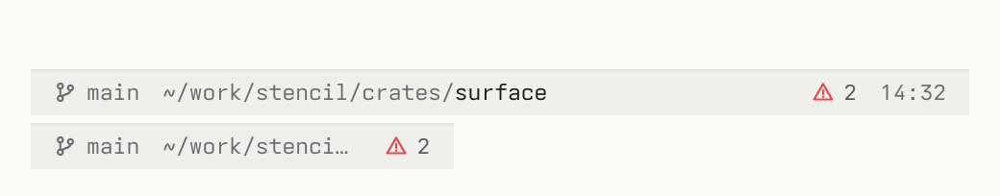
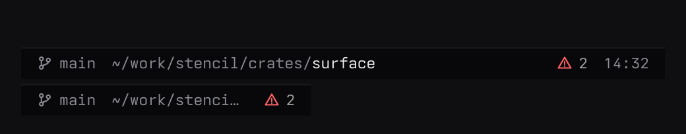
<figcaption>The bar with <code>errors = 2</code>, and below it the same bar capped at 45% of the dock (<code>max = { w = 0.45 }</code>): <code>clock</code> dropped, <code>path</code> truncated.</figcaption>
</figure>

## `toast`

A transient notice. The node's own element is empty and hidden
(`.sf-toast { display: none }`, `aria-hidden`); Tern shows the notice through
kit's toast layer: a glass notice with 12 px corners fixed at the bottom
center of the window (28 px from the bottom), sized to its text and wrapping
past 560 px (or the window width less 32 px), under `<body>` rather than in
your surface. While your dock holds something on screen (a composer), the
toast rises to 12 px above it instead, so it never covers your input. On a
phone, toasts drop in under the top bar instead. It shows when the node is
first drawn and again whenever its `text`, `sub`,
`tone` or `ttl` changes; other prop changes don't re-show it, and neither
does the node scrolling out of a long transcript and back. One toast shows at
a time in the whole window, so a new one (yours or Tern's) replaces the one
up, in place: a toast updated in quick succession changes its text without
animating in again. It stays 2.2 s (success) or 5.2 s (info, error),
then fades over 260 ms; `ttl` takes it down earlier (fading over 200 ms, at
once under reduced motion). Removing the node removes a toast still showing,
scrolled out of the transcript or not, and a node added later under the same
id is a new toast: it shows even with the same props.

To show a notice from a handler without keeping a node, use `cx:toast` (see
[Host API](../reference/api-host.md)).

**Build it:** `tern.ui.node("toast", { text = "Saved", tone = "success" })`.

| Prop | Type | Default | Meaning |
| --- | --- | --- | --- |
| `text` | string | `""` | The message |
| `sub` | string | `""` | A mono detail after it: first line only, at most 120 characters, hidden when empty |
| `tone` | string | success | `error` → error toast (warn icon, `--bad` ring, `role="alert"`); `info` or `accent` → info toast (info icon, accent); anything else → success (check icon) |
| `ttl` | number (ms) | none | Take it down after this many ms (truncated; negative is ignored). It can only shorten the stay; past 2.2 s / 5.2 s the toast is already gone |

**Children:** none (ignored).

**Events:** none.

**Styling:**

```html
<!-- the node, in your surface -->
<div class="sf sf-toast" data-id="main.saved" data-tone="error" aria-hidden="true"></div>
<!-- what shows, under <body> -->
<div class="toast err" role="alert" aria-live="assertive">
	<svg class="ico" aria-hidden="true">…</svg><span>Save failed</span><span class="mono">disk full</span>
</div>
```

| Target | Selector |
| --- | --- |
| The node (always hidden) | `.sf-toast` |
| The shown notice | kit's `.toast`, `.toast.info`, `.toast.err` (outside your surface) |

The notice sits outside your region, so a sheet scoped to
`[data-surface='plugin.<plugin>.<block>']` doesn't reach it. Treat its look as
Tern's.

```lua
local ui = tern.ui
-- show a toast while state.notice is set; bump state.notice_n to re-show the
-- same text (a new key is a new node, which shows on its first draw)
local main = { ui.text(state.body) }
if state.notice then
	table.insert(main, ui.node("toast", {
		key = "notice" .. state.notice_n,
		text = state.notice,
		sub = state.detail,
		tone = state.failed and "error" or "success",
		ttl = 1500,
	}))
end
return { main = ui.col(main) }
```

With `state.notice = "Save failed"`, `state.failed = true` and
`state.detail = "disk full: /Users/me/notes"`, the notice shows at the bottom
of the window:

<figure class="tn-figure">
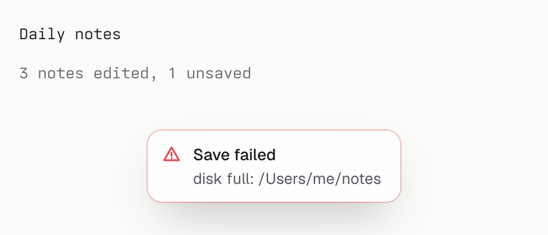
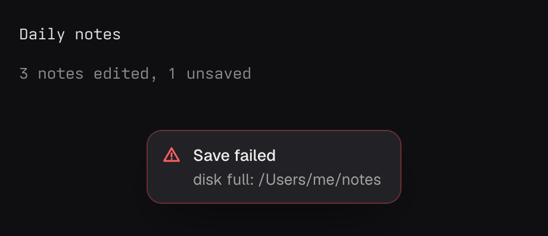
</figure>

## `overlay`

A floating glass card in the `layer` region: a popup, a picker, a dialog, a
full sheet, or a sheet or drawer docked to an edge of the layer
([Sheets and drawers](#sheets-and-drawers)). The node's element covers the
whole layer but lets the pointer through; inside it sit an optional dim
backdrop (with `modal`) and the card.
The card has an optional title row (`head`, with an `icon`, muted `meta` and
`end` controls, as a [`card`](layout.md#card)'s head has), a body that
scrolls and holds the children, and an optional footer bar (`foot`) for the
sheet's buttons. It arrives with a short pop (scale and fade, 220 ms), or a
docked one slides in from its edge, and the backdrop fades in; both are still
under reduced motion (`.sf-still`).

Put overlays in your view's `layer`:

```lua
return { main = …, layer = ui.col({ ui.node("overlay", { … }, { … }) }) }
```

**Placement (`anchor`).**

| `anchor` | Class | Placement |
| --- | --- | --- |
| absent, `"center"`, anything unknown | `.at-center` | Centered in the layer (12 px padding) |
| `"top"` | `.at-top` | Horizontally centered, 40 px from the top |
| `"bottom"` | `.at-bottom` | Horizontally centered, 16 px from the bottom |
| `{ node = id, side = "below" \| "above" }` | `.at-node` | Beside node `id`'s element, left-aligned with it, 4 px away, on `side` (default below) |
| `{ caret = id }` | `.at-caret` | Below the caret of editor/input `id`, 10 px left of it so row text lines up with the typed text |
| any, with `side = "right"` or `"left"` | `.at-side.side-right`, `.side-left` | A full-height sheet docked to that edge, `size` wide ([Sheets and drawers](#sheets-and-drawers)) |
| any, with `side = "bottom"` | `.at-side.side-bottom` | A drawer along the bottom edge, full width, `size` tall, with a grabber |

Node and caret anchors are placed after every update (the anchor may move): the
card goes on the preferred side when it fits there or that side has at least
as much room, else flips (`.above` when it ends up above), is clamped 8 px
inside the layer, and gets a `max-height` (its body scrolls) when short of
room. While the anchor isn't drawn, the card hides (`.lost`); a caret anchor
naming a node that is not an `editor` or `input` counts as not drawn. `id` is
the full node id (`main.draft`).

**Size (`size`).** `sm` 320 px, `md` 480 px, `lg` 720 px wide (never wider
than the layer), or `full`: a sheet filling the layer with 8 px inset and
`--r-panel` corners. Default: `sm` for node and caret anchors, `md` otherwise.
Unknown values fall back to the default. On a docked overlay `size` is the
sheet's width or the drawer's height, and may be a fraction of the layer
(see [Sheets and drawers](#sheets-and-drawers)).

**Covering the view.** While a `modal` or `full` overlay (or a `picker`) is in
the layer, Tern adds `.sf-covered` to the `main` and `dock` regions: every
animation under it pauses (`animation-play-state: paused`) so the backdrop
under the dim and blur stays as rendered. The class goes when the sheet does.

**Keys.** An overlay never takes the keyboard. Keys keep going to your block's
`key` handler, so route them by your own state (an open dialog in state means
↑/↓/Enter/Escape act on it). A `modal` backdrop takes the pointer: clicks on
it reach nothing beneath and send no event, so close the overlay on Escape or
from a button inside it. omp's read-only panel sheets (`role`
`omp.overlay.report`, `.context`, `.usage`, `.sessionInfo`, `.jobs`,
`.hotkeys`, `.btwHistory`, `.spotlight`) are the exception: a press on their backdrop types
Escape for the program, which closes them, as a click outside Tern's own
popovers does.

**Build it:** `tern.ui.node("overlay", { head = …, anchor = …, size = …, modal = … }, children)`.

| Prop | Type | Default | Meaning |
| --- | --- | --- | --- |
| `anchor` | `"center"`, `"top"`, `"bottom"`, `{node, side?}`, `{caret}` | `"center"` | Placement, see above |
| `side` | `"right"`, `"left"`, `"bottom"` | none | Docks the card to that edge of the layer: a full-height sheet (`right`, `left`) or a drawer (`bottom`). Wins over `anchor`; anything else docks nowhere |
| `variant` | `"edge"`, `"inset"` | `"edge"` | With `side`: flush with the edge, or floating 8 px off it with rounded corners. Ignored without `side`; unknown values read as `edge` |
| `size` | `"sm"`, `"md"`, `"lg"`, `"full"`, or a number in (0, 1] | `sm` anchored, else `md` | Card width or full sheet. With `side`: the sheet's width or the drawer's height, `"full"` reading as `md`; a number is a fraction of the layer and is honored only with `side` |
| `modal` | boolean | `false` | Dim backdrop (`--dim`) taking the pointer; `aria-modal="true"`; covers `main`/`dock` |
| `head` | text (string or spans) | none | Title row; empty or blank text means no title row (`.nohead`) |
| `icon` | icon name | none | A 16px `--t3` icon before the title; wins over the one an omp role implies |
| `meta` | text (string or spans) | none | Muted text after the title |
| `end` | a child's id | none | That child is drawn at the right end of the title row instead of in the body: a close or settings `button`, a segmented `tabs` |
| `foot` | a child's id | none | That child is drawn in a footer bar under the body: the sheet's actions, a `row` of `button`s with the primary one last |
| `aria` | string | `head` text | The card's accessible name (`aria-label` on the card; as a common prop it also labels the node) |

A `role` of `omp.overlay.<name>` adds a head icon for omp's panel sheets;
other roles show none unless you give `icon`. As on a card, `end` is a Luau
keyword (write `["end"] = …`), and the SDKs take a node for `end` and `foot`,
adding it as the child keyed `end` or `foot`.

**Sheet metrics.** A centered, top, bottom, full or docked overlay is a
sheet: its title row is at least 52 px tall with `padding: 0 18px`, the title
`550 14px/1.3` sans with `-0.012em` tracking, and its body a column with a
16 px gap and `padding: 16px 18px`. Overlays anchored to a node or a caret
are popups and keep compact metrics: the body a column with a 4 px gap and
4 px padding. The footer bar (class `foot` on the card) sticks to the
card's bottom edge under the scrolling body: `padding: 9px 12px`, an `--l1`
hairline on top, frosting what scrolls under it, with the card's bottom
corners. omp's own overlays keep their looks.

**Children:** drawn in order in the card's body, except the `end` and `foot`
children. A `list` inside a card gets the popup row look.

**Events:** none of its own; children send theirs (`select`, `activate`,
`action`, …), and `actions` work as on any node.

**Styling:**

```html
<div class="sf sf-overlay sz-sm at-center modal" data-id="layer.confirm" data-role="notes.confirm">
	<div class="sf-ov-dim" aria-hidden="true"></div>
	<div class="sf-ov-card" role="dialog" aria-modal="true" aria-label="Delete 3 notes?">
		<div class="sf-ov-head">
			<span class="sf-ov-ic sf-hidden" aria-hidden="true"></span>
			<span class="sf-ov-title">Delete 3 notes?</span>
			<span class="sf-ov-meta"><!-- meta spans --></span>
			<div class="sf-ov-end"><!-- the end child --></div>
		</div>
		<div class="sf-ov-body">…children…</div>
		<div class="sf-ov-foot"><!-- the foot child --></div>
	</div>
</div>
```

| Target | Selector |
| --- | --- |
| The node (covers the layer) | `.sf-overlay` |
| Anchor | `.sf-overlay.at-center`, `.at-top`, `.at-bottom`, `.at-node`, `.at-caret` |
| Size | `.sf-overlay.sz-sm`, `.sz-md`, `.sz-lg`, `.sz-full`; none for a fraction |
| A docked overlay, its edge | `.sf-overlay.at-side`, `.side-right`, `.side-left`, `.side-bottom` |
| Inset (docked) | `.sf-overlay.inset` |
| Modal | `.sf-overlay.modal` |
| Backdrop | `.sf-ov-dim` (inner, may change) |
| Card | `.sf-ov-card` (inner, may change) |
| Card flipped above its anchor | `.sf-ov-card.above` |
| Card hidden, anchor gone | `.sf-ov-card.lost` |
| Card without title | `.sf-ov-card.nohead` |
| Card with a footer | `.sf-ov-card.foot` |
| Title row | `.sf-ov-head`, `.sf-ov-ic`, `.sf-ov-title`, `.sf-ov-meta`, `.sf-ov-end` (inner, may change) |
| Body | `.sf-ov-body` (inner, may change) |
| Footer bar | `.sf-ov-foot` (inner, may change) |
| The drawer's grabber | `.sf-overlay.side-bottom > .sf-ov-card::before` (inner, may change) |
| Regions under a sheet | `.sf-main.sf-covered`, `.sf-dock.sf-covered` |

The card uses the glass recipe: 12 px corners, `--pop-bg` with
`backdrop-filter: blur(32px) saturate(190%)`, a `--l2` ring, a `--glass-hi`
top highlight, a rim-light `::after` and a deeper shadow under
`[data-theme='dark']`. The backdrop is `--dim`. A docked card's width (sheet)
or height (drawer) is `--ov-size`, set on `.sf-overlay.at-side` by the size
class, or on the card for a fraction. See
[Variables](../styles/variables.md).

A confirm dialog driven by keys, its buttons in the footer, each showing the
key that does the same:

```lua
local ui = tern.ui

local function view(state)
	local layer
	if state.confirm then
		layer = ui.col({
			ui.node("overlay", {
				key = "confirm",
				icon = "trash",
				head = { ui.span("Delete " .. #state.marked .. " notes?") },
				size = "sm",
				modal = true,
				foot = "layer.confirm.foot",
			}, {
				ui.text({ ui.span("This can't be undone.", "muted") }),
				ui.node("row", { key = "foot", gap = "sm", justify = "end" }, {
					ui.button("Cancel", { variant = "quiet", keys = { "esc" }, actions = { click = "cancel" } }),
					ui.button("Delete", { variant = "danger", keys = { "enter" }, actions = { click = "delete" } }),
				}),
			}),
		})
	end
	return { main = ui.col({ … }), layer = layer }
end

local function key(state, k)
	if not state.confirm then return false end
	if k.name == "escape" then state.confirm = false
	elseif k.name == "enter" then delete_marked(state); state.confirm = false
	else return false end
	return true
end
```

<figure class="tn-figure">
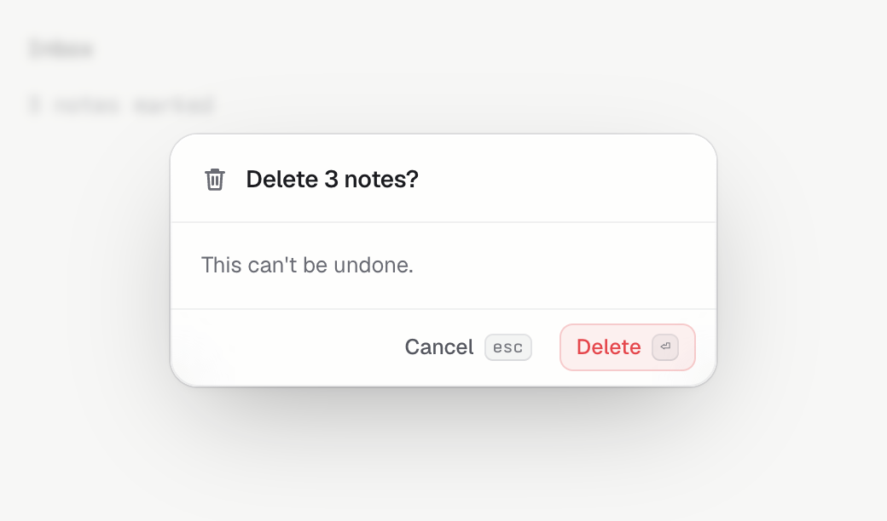
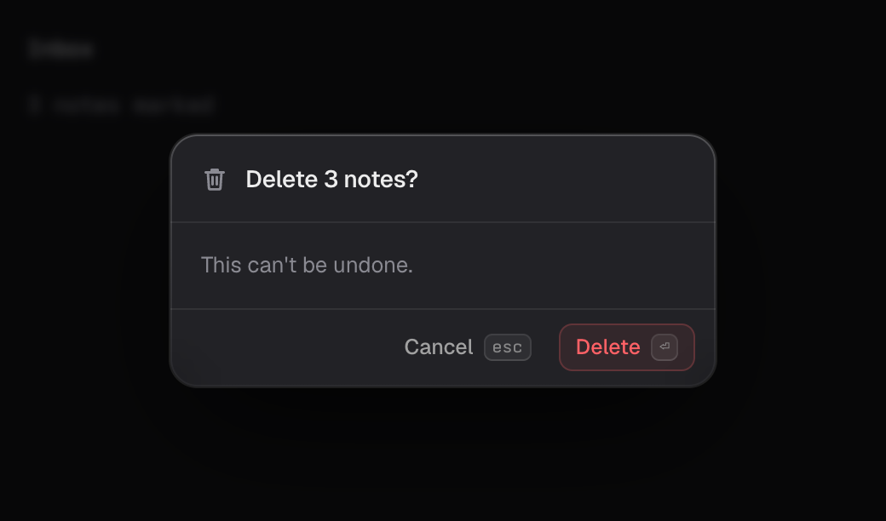
<figcaption>A <code>modal</code>, <code>sm</code> overlay with a <code>head</code>, an <code>icon</code> and a <code>foot</code>: the backdrop dims the view under it.</figcaption>
</figure>

A completion popup at the caret of the editor keyed `draft` in the dock
(`dock.draft`). No `size` means `sm`; there is no `head`, so the card is just
the list:

```lua
layer = ui.col({
	ui.node("overlay", { key = "complete", anchor = { caret = "dock.draft" } }, {
		ui.node("list", { key = "items", selected = "layer.complete.items.review" }, {
			ui.node("item", { key = "review", label = "/review", detail = "review the working tree" }),
			ui.node("item", { key = "revert", label = "/revert", detail = "undo the last edit" }),
			ui.node("item", { key = "rename", label = "/rename", detail = "rename the session" }),
		}),
	}),
})
```

<figure class="tn-figure">
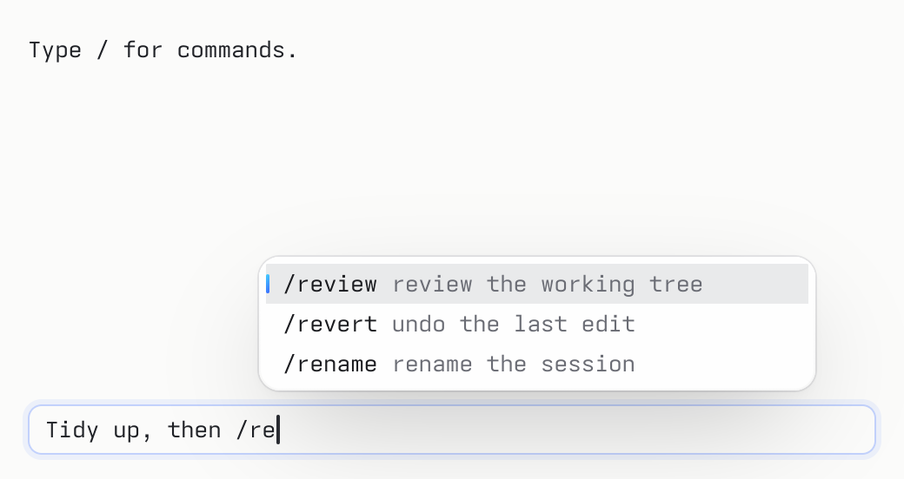
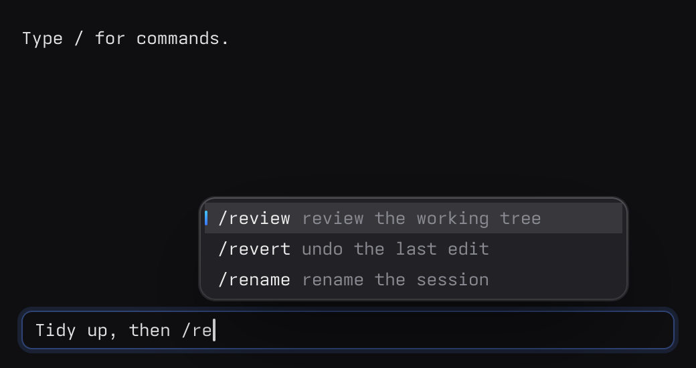
<figcaption>There is more room above the dock's editor than below it, so the card flips above the caret (<code>.above</code>).</figcaption>
</figure>

See [Lists](lists.md) for `list` and `item`, [Text Input](input.md) for the
editor, and [Styling Views](../styles/index.md) for scoping sheets to your
block.

### Sheets and drawers

`side` docks an overlay to an edge of the layer instead of floating it. A
`right` or `left` **sheet** is a full-height panel: the head with its title
and `end` controls on top, the body scrolling under it, the `foot` bar at the
bottom. Reach for one for an inspector, an outline or settings that belong
beside the content they describe, so the view stays in sight. A `bottom`
**drawer** is attached to the bottom edge, with rounded top corners and a
grabber bar: logs, a terminal, a preview or a short confirmation that comes up
from below. Everything else about the overlay holds: `head`, `icon`, `meta`,
`end`, `foot`, `modal` and `aria` work as on a centered sheet, and the title
row and body take the sheet metrics.

The card slides in from its edge (320 ms, `--out`); with `modal` the backdrop
fades in under it, dims the view and takes the pointer. Without `modal` the
rest of the layer lets the pointer through, so the view beside a sheet stays
usable. Both are still under reduced motion (`.sf-still`).

`variant` picks the look:

| `variant` | Class | Look |
| --- | --- | --- |
| `"edge"` (default) | none | Flush with the edge: square corners on a sheet, `--r-panel` top corners on a drawer, an `--l2` hairline on the open side and a soft shadow cast over the content |
| `"inset"` | `.inset` | 8 px off every docked edge, `--r-panel` (16 px) corners all round, the overlay's ring, rim light and shadow. An inset drawer keeps its grabber |

`side` wins over `anchor`; an unknown `side` docks nowhere and `anchor`
places the card as before. Drop `side` and the card goes back to its anchor.

**Size.** On a sheet `size` is its width, on a drawer its height: a name, or a
fraction of the layer.

| `size` | Sheet (`left`, `right`) width | Drawer (`bottom`) height |
| --- | --- | --- |
| `"sm"` | 320 px | 33 % of the layer |
| `"md"` (default) | 400 px | 50 % of the layer |
| `"lg"` | 560 px | 75 % of the layer |
| a number in (0, 1] | that fraction of the layer's width | that fraction of the layer's height |

A sheet is never wider than the layer. `"full"`, `0`, numbers above 1 and
unknown values size as `"md"`.

**Keys.** As for every overlay: it never takes the keyboard. Keep the open
sheet or drawer in your state, close it on Escape or from its close button
(an `end` child), and drive its content through props. Its children send
their events as in any overlay.

An inspector sheet for the selected service, and a logs drawer:

```lua
local ui = tern.ui

local function view(state)
	local layer
	if state.inspecting then
		local svc = state.inspecting
		layer = ui.col({
			ui.node("overlay", {
				key = "inspect",
				side = "right",
				modal = true,
				head = "Inspector",
				["end"] = "layer.inspect.close",
				foot = "layer.inspect.foot",
			}, {
				ui.button("", { key = "close", icon = "x", size = "sm", variant = "quiet", title = "Close", actions = { click = "close" } }),
				ui.kv({ { "service", svc.name }, { "image", svc.image }, { "replicas", tostring(svc.replicas) } }),
				ui.node("row", { key = "foot", gap = "sm", justify = "end" }, {
					ui.button("Cancel", { variant = "quiet", keys = { "esc" }, actions = { click = "close" } }),
					ui.button("Apply", { variant = "primary", keys = { "enter" }, actions = { click = "apply" } }),
				}),
			}),
		})
	elseif state.logs then
		layer = ui.col({
			ui.node("overlay", {
				key = "logs",
				side = "bottom",
				size = 0.55,
				icon = "terminal",
				head = "Logs",
				meta = state.logs.service,
				["end"] = "layer.logs.close",
			}, {
				ui.button("", { key = "close", icon = "x", size = "sm", variant = "quiet", title = "Close", actions = { click = "close" } }),
				ui.node("ansi", { text = state.logs.text }),
			}),
		})
	end
	return { main = ui.col({ … }), layer = layer }
end
```

The same in TSX, where `end` and `foot` take a node:

```tsx
function Layer({ s }: { s: State }) {
   if (s.inspecting)
      return (
         <overlay key="inspect" side="right" modal head="Inspector"
            end={<button icon="x" size="sm" variant="quiet" title="Close" onClick={close} />}
            foot={
               <row gap="sm" justify="end">
                  <button variant="quiet" keys={['esc']} onClick={close}>Cancel</button>
                  <button variant="primary" keys={['enter']} onClick={apply}>Apply</button>
               </row>
            }>
            <kv items={[{ k: 'service', v: s.inspecting.name }, { k: 'replicas', v: String(s.inspecting.replicas) }]} />
         </overlay>
      );
   if (s.logs)
      return (
         <overlay key="logs" side="bottom" size={0.55} icon="terminal" head="Logs" meta={s.logs.service}
            end={<button icon="x" size="sm" variant="quiet" title="Close" onClick={close} />}>
            <ansi text={s.logs.text} />
         </overlay>
      );
   return null;
}
```

<figure class="tn-figure">
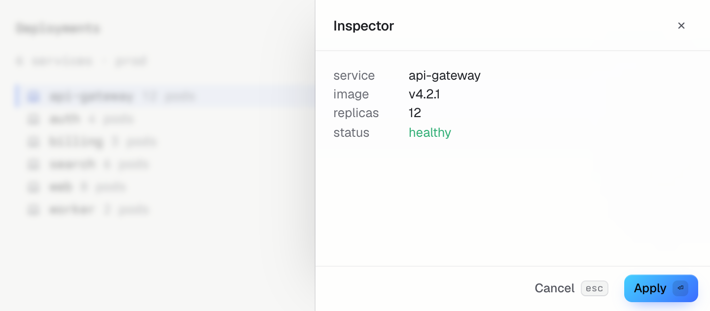
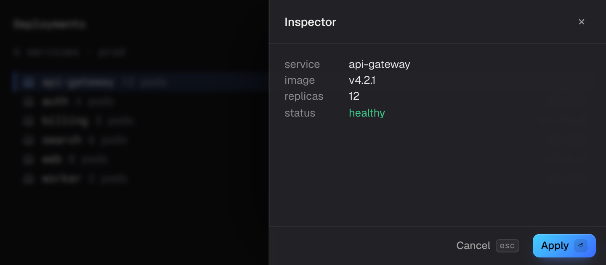
<figcaption>A <code>modal</code> sheet with <code>side: "right"</code>: flush with the edge, its buttons in the <code>foot</code>.</figcaption>
</figure>

<figure class="tn-figure">
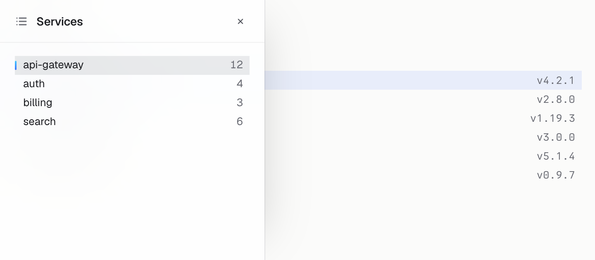
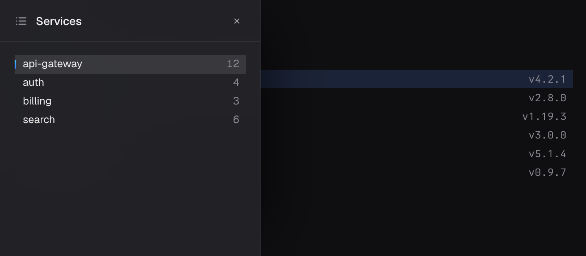
<figcaption><code>side: "left"</code>, <code>size: "sm"</code>, not modal: the view beside it keeps the pointer.</figcaption>
</figure>

<figure class="tn-figure">
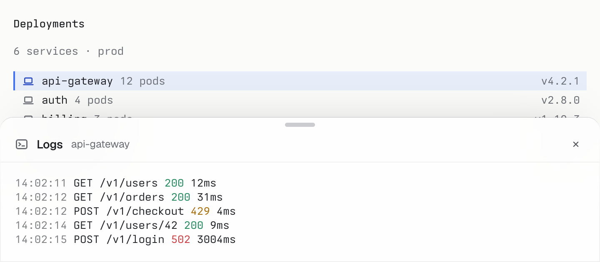
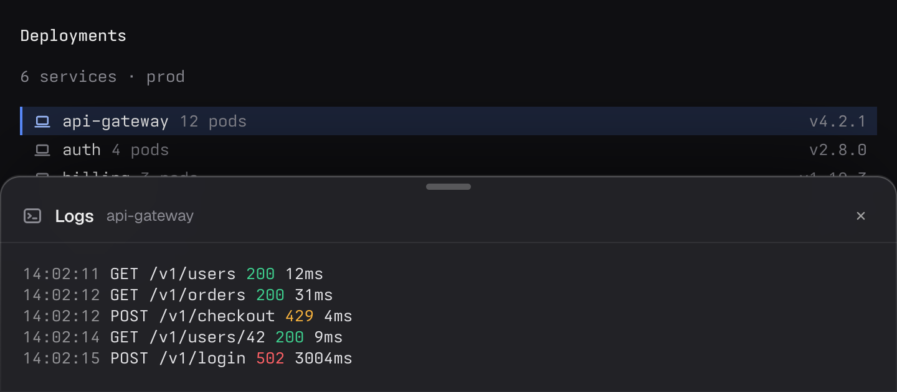
<figcaption>A drawer: <code>side: "bottom"</code> with <code>size: 0.55</code>, 55 % of the layer's height.</figcaption>
</figure>

<figure class="tn-figure">
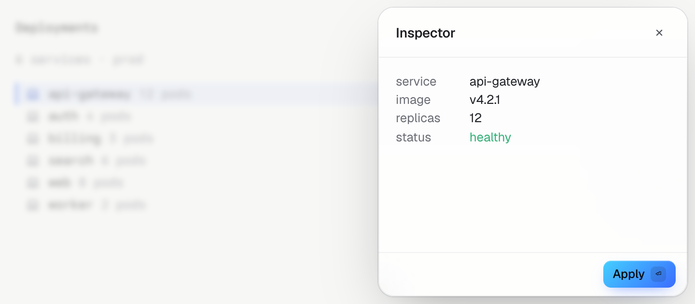
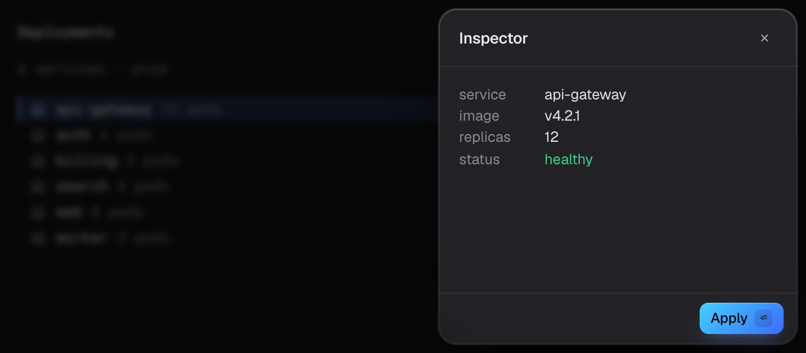
<figcaption><code>variant: "inset"</code> on a right sheet: it floats off the edges with the overlay's rim and shadow.</figcaption>
</figure>

<figure class="tn-figure">
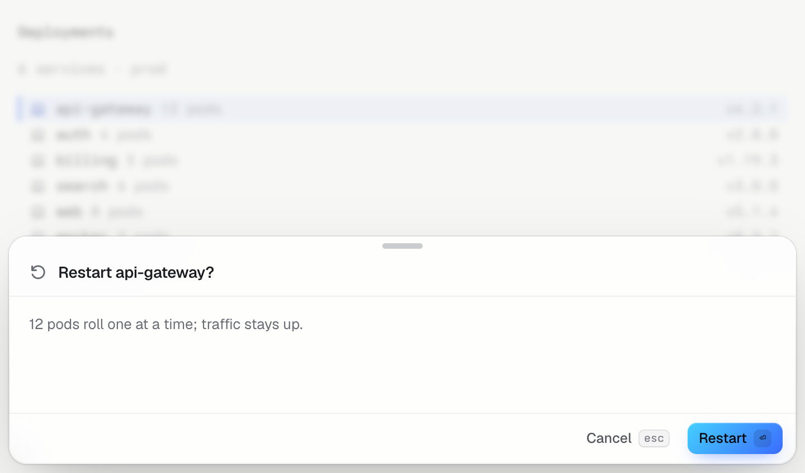
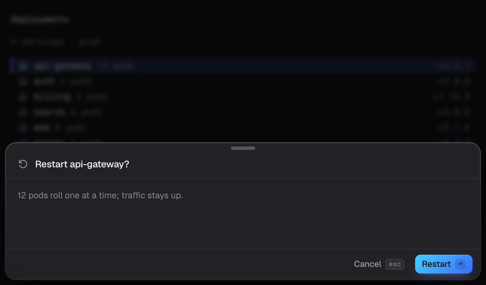
<figcaption>An inset, <code>modal</code> drawer: a confirmation that rises from below.</figcaption>
</figure>

A docked overlay's markup is the overlay's own, with the edge on the node:

```html
<div class="sf sf-overlay sz-md at-side side-right modal" data-id="layer.inspect">
	<div class="sf-ov-dim" aria-hidden="true"></div>
	<div class="sf-ov-card foot" role="dialog" aria-modal="true" aria-label="Inspector">
		<div class="sf-ov-head">…</div>
		<div class="sf-ov-body">…children…</div>
		<div class="sf-ov-foot"><!-- the foot child --></div>
	</div>
</div>
```
