# Data

Data kinds show structured values: key/value pairs, headline numbers, tables, disclosure trees, and the small inline
chips that sit inside them (badges, keycaps, icons, avatars, images), slides to flip through, and files: in Tern's
media viewer or as attachments. Reach for `kv` for a handful of labeled values, `stats` for the few numbers a view is
about, `table` for rows that share columns (pickable with `selectable`, sortable, several rows at once with `multi`),
`tree` for nested items the user opens and closes, `json` to show a raw JSON value as a foldable tree, `badge`, `kbd`,
`icon` inside rows, cards and headers, `avatar` and `avatars` for who did something, `carousel` for a handful of
pictures the user flips through, `media` to show a file on disk (or a git revision of it) by path, and `attachment`
for a file a message carries or a composer is about to send.

| Kind | Builder | Draws |
| --- | --- | --- |
| [`kv`](#kv) | `tern.ui.kv(items)` | An aligned key/value grid, or one inline `k v · k v` line |
| [`stats`](#stats) | `tern.ui.stats(items)` | A flat strip of stat tiles: label, large value, sub line |
| [`table`](#table) | `tern.ui.table(cols, rows)` | A column grid that hides low-priority columns when narrow; sortable headers; selectable or multi-picked rows with a selection bar; text, badge, button, sparkline and meter cells |
| [`tree`](#tree) | `tern.ui.tree(nodes)` | A disclosure tree with guides and turning chevrons |
| [`json`](#json) | `tern.ui.node("json", { value = … })` | A JSON value as a foldable tree with one-line previews |
| [`badge`](#badge) | `tern.ui.badge(text, tone)` | A tone-tinted pill |
| [`kbd`](#kbd) | `tern.ui.node("kbd", { keys = … })` | Keycaps with platform glyphs (`⌃` `⇧` `⏎`) |
| [`icon`](#icon) | `tern.ui.node("icon", { name = … })` | One icon from Tern's set |
| [`avatar`](#avatar) | `tern.ui.node("avatar", { text = … })` | A person's, bot's or provider's mark: initials on a seeded gradient, a tinted squircle tile, an icon or a picture, with a status dot |
| [`avatars`](#avatars) | `tern.ui.node("avatars", { items = … })` | An overlapping stack of avatars with a `+N` overflow chip and a muted label |
| [`image`](#image) | `tern.ui.node("image", { blob = … })` | A PNG, JPEG, GIF, WebP or SVG image (animations play), with children drawn over it; click to zoom |
| [`carousel`](#carousel) | `tern.ui.node("carousel", props, slides)` | Slides on a track that slides sideways: a peek and counter, arrows and dots, or a filmstrip |
| [`media`](#media) | `tern.ui.node("media", { path = … })` | A file by path (or a git revision of it) in Tern's media viewer: images and SVG, 3D models, PDF, video, audio |
| [`attachment`](#attachment) | `tern.ui.node("attachment", { name = … })` | A file chip, thumbnail tile or composer pill with upload progress, error and actions |

Every kind also takes the common props (`id`, `role`, `tone`, `actions`, `min`/`max`, …): see
[Elements](index.md). Every node is `<tag class="sf sf-<kind>" data-id="<id>">`. The stable styling hooks are
`.sf-<kind>`, `[data-id]`, `[data-role]`, `[data-tone]`, and the region's `[data-surface]`. The inner classes listed
below (`.sf-kv-k`, `.sf-tbl-c`, …) are Tern's structure: they are documented so you can style them, but they are
inner and may change between versions. See [Styling views](../styles/index.md) for sheets and the cascade.

Apart from `image`, which draws its children over the picture, and `carousel`, whose children are its slides, none of
these kinds draws children: children of a `kv`, `stats`, `table`, `tree`, `json`, `badge`, `kbd`, `icon`, `avatar`,
`avatars`, `media` or `attachment` are ignored.

## `kv`

A list of key/value pairs. The default `grid` layout is a two-column grid: keys in the muted `--t3` color, no wrap;
values wrap anywhere (`white-space: pre-wrap`). The key column is as wide as the widest key in the source, in
terminal cells (a wide character such as Chinese, Japanese or Korean counts two; in a
[sans region](../protocol/surfaces.md#open-and-close), the widest key as drawn), so the values line up even when only
part of a long list is mounted. The `inline` layout puts every pair on one wrapping line, `key value · key value`,
with nothing wrapping inside a pair.

Keys and values are spans: a string, or a list of spans with style tokens (see [Text](text.md)).

A long grid-layout `kv` mounts only the pairs near what shows; the pairs not mounted keep their place in the scroll
height. Pairs patch in place when their text changes. Copying the whole view still captures every pair.

**Build it:** `tern.ui.kv(items)` (see [UI Builders](../reference/ui.md#kv)), or
`tern.ui.node("kv", { items = { { k = …, v = … } }, layout = "inline" })`. The builder has no `layout` argument: set
`node.p.layout = "inline"` on its result, or use `tern.ui.node`.

| Prop | Type | Default | Meaning |
| --- | --- | --- | --- |
| `items` | `{ { k: Spans, v: Spans } }` | `{}` | The pairs, in order. Position is identity: pairs have no ids |
| `layout` | `"grid"` \| `"inline"` | `"grid"` | `"inline"` draws one wrapping line; any other value is the grid |

**Children:** none (ignored).

**Events:** none of its own; `actions` work as on any node.

**Styling:**

```html
<div class="sf sf-kv" data-id="…">            <!-- .inline with layout = "inline" -->
	<div class="sf-kv-item first">
		<span class="sf-kv-sep" aria-hidden="true">·</span>
		<div class="sf-kv-k">context</div>
		<div class="sf-kv-v">prod</div>
	</div>
	<div class="sf-kv-item">…</div>
</div>
```

| Target | Selector |
| --- | --- |
| The node | `.sf-kv` |
| Inline layout | `.sf-kv.inline` |
| One pair | `.sf-kv-item` (inner, may change; in the grid, a row taking `.sf-kv`'s columns) |
| The first pair | `.sf-kv-item.first` (inner; its separator is hidden) |
| Key | `.sf-kv-k` (inner, may change) |
| Value | `.sf-kv-v` (inner, may change) |
| The `·` between inline pairs | `.sf-kv-sep` (inner; `display: none` in the grid) |

The grid sets `column-gap: 14px` and `row-gap: 1px`. In the transcript Tern writes `grid-template-columns` inline
(the widest key in px, then `minmax(0, 1fr)`), so a sheet that changes the key column needs `!important` or a
different `column-gap`. Keys use `--t3`, the inline separator `--t4` (see [Variables](../styles/variables.md)).

```lua
local ui = tern.ui

return ui.kv({
	{ "context", ui.span("prod", "error strong") },
	{ "namespace", "default" },
	{ "pods", ui.span("12 running", "success") },
})
```

An inline summary line:

```lua
local line = ui.kv({ { "branch", "main" }, { "ahead", "2" }, { "dirty", "yes" } })
line.p.layout = "inline"
return line
```

<figure class="tn-figure">
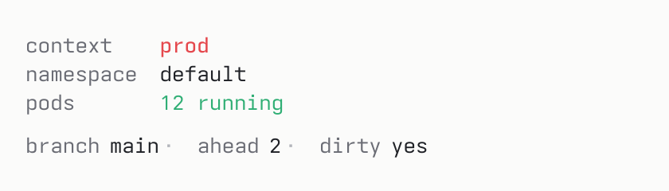
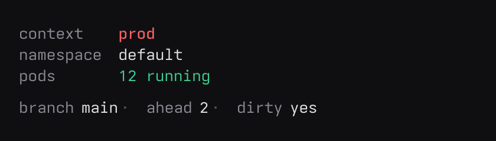
<figcaption>The grid layout (top) and the inline layout (bottom).</figcaption>
</figure>

## `stats`

A flat strip of stat tiles: the few numbers a page is about, each with a small label above a large value and an
optional sub line under it. The strip has no box of its own: it draws on whatever holds it, so it never looks like a
card in a card. Tiles sit side by side from the start, each at its own width (14 characters to 280px), with a
hairline between them; when they don't fit they wrap onto more rows rather than squeeze. Put it directly on the page,
right under the head row, with four tiles at most, and never inside a card
([Designing Views](../guides/design.md#page-structure)); for more values use [`kv`](#kv) or a [`table`](#table).

**Build it:** `tern.ui.stats(items)` (see [UI Builders](../reference/ui.md#stats)), or
`tern.ui.node("stats", { items = { { label = …, value = … } } })`.

| Prop | Type | Default | Meaning |
| --- | --- | --- | --- |
| `items` | `{ Stat }` | `{}` | The tiles, in order. Position is identity: tiles have no ids |

`Stat` fields:

| Field | Type | Default | Meaning |
| --- | --- | --- | --- |
| `label` | Spans | `""` | What the number is (`Error rate`) |
| `value` | Spans | `""` | The number, with its unit (`0.42%`, `182 ms`) |
| `sub` | Spans | none | A line under the value: the comparison or the window (`last 15 min`, `2 degraded`) |
| `tone` | tone | none | Colors the value in the tone's color (`--tc`), for a value that needs attention |
| `title` | string | none | The tile's tooltip |

**Children:** none (ignored).

**Events:** none of its own; `actions` work as on any node (on the whole strip).

Copying the view writes the tiles on one line, `label: value (sub)` each, joined by `  ·  `.

**Styling:**

```html
<div class="sf sf-stats" data-id="main.overview" role="list">
	<div class="sf-stat" data-tone="warning" role="listitem" title="…">
		<div class="sf-stat-label">Error rate</div>
		<div class="sf-stat-value">0.42%</div>
		<div class="sf-stat-sub">last 15 min</div>   <!-- only with a sub -->
	</div>
	<div class="sf-stat" role="listitem">…</div>
</div>
```

| Target | Selector |
| --- | --- |
| The node (the strip) | `.sf-stats` |
| One tile | `.sf-stat` (inner, may change) |
| Label / value / sub | `.sf-stat-label`, `.sf-stat-value`, `.sf-stat-sub` (inner, may change) |
| A toned tile | `.sf-stat[data-tone]` (inner; its value takes `--tc`) |

The strip is a wrapping flex row with no padding, background or ring, and `12px` between wrapped rows. Tiles are
`min-width: 14ch`, `max-width: 280px`, `padding: 0 28px 0 16px` with an `--l2` hairline on their left. The strip
starts 17px early (`margin-left: -17px`) and clips that off (`clip-path`), so the first tile of each row lines up
with the text above it, without its hairline. Labels and sub lines are `12px/16px` sans in `--t3` (labels at
weight 500), cut with an ellipsis; values are `550 22px/30px` sans in `--t1` with tabular figures and `-0.02em`
tracking.

```lua
local ui = tern.ui

return ui.stats({
	{ label = "Services", value = "24", sub = "2 degraded" },
	{ label = "Error rate", value = "0.42%", tone = "warning", sub = "last 15 min" },
	{ label = "p95 latency", value = "182 ms" },
	{ label = "Deploys today", value = "7", sub = "1 rolled back" },
})
```

<figure class="tn-figure">
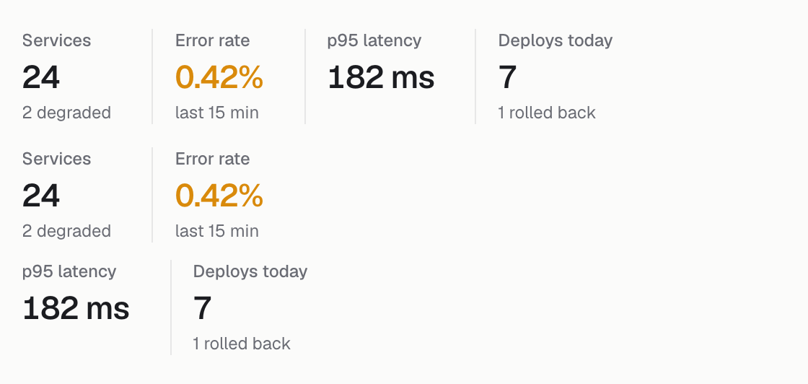
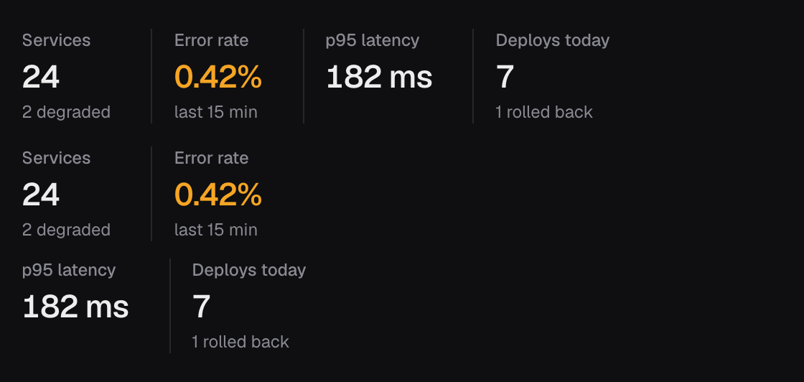
<figcaption>The strip at 560px and at 300px, where the tiles that don't fit wrap to a second row.</figcaption>
</figure>

## `table`

A grid of rows under named columns, with a small sans header and hairlines between rows. Rows are keyed by `id`,
so a row whose cells change patches in place and the others stay mounted. With `selectable` the rows are pickable,
as in a native app's table; headers can sort, and with `multi` the user picks several rows to act on at once; cells
can hold text with a status dot or icon, a badge, a small button, a sparkline or a meter. Cells draw in the region's
font: sans in a [`font: "sans"`](../protocol/surfaces.md#open-and-close) region, except columns marked `mono`.

**Column sizing.** Tern measures each column's natural width: its widest cell (in cells of the cell font, a wide
character such as Chinese, Japanese or Korean counting two; a meter or spark cell counts as 8, a button cell as its
label plus its padding) plus the 14px cell padding, or
its header as drawn, whichever is wider. When the columns do not fit the table's width, columns hide, lowest
`priority` first (a missing priority is `0`; ties hide the rightmost first), until the rest fit or one column is
left. For this test a `grow` column counts as at most 24 characters wide:
a long `grow` column cuts its cells rather than pushing other columns out. Spare width goes to the `grow` columns, in
proportion to their shares; without any `grow` column the table keeps its natural width. When the shown columns
still overflow, the `grow` columns give up width first (each down to 24 characters), then every column shrinks in
proportion. Sizing reruns when the table resizes.

**Truncation.** A cell never wraps. When it is wider than its column it is cut with an ellipsis per its column's
`truncate`: `end` keeps the start (`abcd…`, by CSS `text-overflow`), `start` keeps the end (`…wxyz`), `middle` keeps
both ends (paths drop directories first).

**Cells.** A cell is spans (a string or a span list), or one of these tables:

| Cell | Draws |
| --- | --- |
| `{ text = …, dot = tone }` | The text after a 6px status dot in the tone's color |
| `{ text = …, icon = name, tone = tone }` | The text after a 12px icon, in the tone's color (`--t3` without a tone) |
| `{ badge = { text, tone? } }` | A [`badge`](#badge), 18px tall |
| `{ button = { text, act, … } }` | A [`button`](input.md#button) of size `sm` |
| `{ spark = { values, … } }` | A sparkline the height of the text, drawn as the [`chart`](motion.md#chart) kind draws `spark` |
| `{ meter = { … } }` | A thin bar across the cell, read the way the [`meter`](motion.md#meter) kind reads the same props |

Sparklines and meters are 8 cells wide naturally and as wide as the column in a `grow` column. Hovering a cell with a
`title` shows it. Everything fits the row's fixed height, so rows never grow.

**Selectable rows.** With `selectable = true` rows take the pointer: they tint `--l1` on hover and show the pointing
hand; a click sends `select` and a double click `activate`, each with the table's id as `id` and the row's `id` as
`item`. The selection is yours: send the row's id back as `selected`, which draws the row with an accent tint and a
2px accent bar at its leading edge (as a selected [`list`](lists.md#item) row). When `selected` changes, the row
scrolls into view (the nearest scroller moves) while the table is on screen; a table scrolled out of sight is left
alone, so a selection set from elsewhere doesn't pull the page back to it. `selected` draws without `selectable`
too, for a selection you move only by keys. A row with `disabled`
dims to `--t4` and sends nothing: no `select`, no `activate`, no menu.

**Sorting.** Tern draws, the program owns the order: Tern never reorders rows itself. Give a column `sortable = true`
and the table `sort = { col, dir }`. The sorted column's header draws its arrow in the accent, pointing down for
`"desc"` and up for `"asc"`; other sortable headers show a faint arrow on hover. A click on a sortable header sorts by
it: the other way when it already does, else ascending. The arrow turns at once and the table sends `action` `sort`
with `value = { col, dir }`. Sort the rows and send them, with `sort` set to what you sorted by. A `sort` you send wins
over the user's click only when it changes from what you sent last, so a frame that changes something else leaves the
arrow where the user put it.

**Picking rows.** Reach for `multi` when the user does the same thing to several rows: restart services, delete
branches, export runs. Keep `selectable` / `selected` for the one row a detail pane shows; the two combine (the
selected row is the cursor, the picked rows the set). With `multi = true` a click on a row picks it or, if picked,
unpicks it; a shift-click picks every enabled row between the row clicked last and this one. Each change sends
`change` with `value`, the picked ids in the order they were picked. Disabled rows can't be picked by a click or by
the header box. The picks are yours, as the selection is: `picked` sets them and, like `sort`, wins only when it
changes from what you sent last (send it after a delete, say). A double click still sends `activate` (its second
click leaves the pick alone), and on a table that is also `selectable` a click sends `select` after `change`.

The look is the `variant`:

- `"check"` (default): a leading column of checkboxes, the header's box tri-state (checked when every enabled row
  is picked, a dash when some are, or when `picked` holds ids the rows don't), picked rows in an accent tint. A click
  on the header box picks every enabled row, or none once all are.
- `"bar"`: no checkboxes. Picked rows take the accent tint with a 2px accent bar at their leading edge, and the
  sorted column's header sits in an accent pill over a faint tint down its column. For dense tables driven from the
  keyboard.

**Selection bar.** While rows are picked, a bar shows under the last row: "*N* selected", then `hint` (muted, after
a dot: the keys your program takes), the `bar` buttons and Clear with an esc keycap at the end. A `bar` button
sends `action` with its `act` and `value`, the picked ids; Clear unpicks every row and sends `change` with `{}`. The
esc keycap is a hint: keys go to your program, which clears `picked` on Esc.

**Row actions.** A button cell's click sends `action` with its `act` and the row as `item`, and doesn't select the
row. A row's `menu` lists right-click actions, each sent the same way, followed by Copy row (the row's cells,
tab-separated). These come from the table node, so one handler serves every row.

**Durations.** There is no elapsed cell: write a duration as text (`4m 12s`) and send the view again as it grows; a
diffed view only patches the cells that changed. The [`elapsed`](motion.md#elapsed) kind is for outside tables.

**Long tables.** A long table mounts only the rows near what shows (rows have a fixed stride: one line plus 6px, the
line being the region's: 18px in a sans region); the rows not mounted keep their place in the scroll height. Copying
the whole view still captures every row.

**Empty.** With no rows, `empty` is shown muted and centered under the header: say why there's nothing ("No
services match this filter").

**Build it:** `tern.ui.table(cols, rows, opts?)` with `tern.ui.meter_cell` / `tern.ui.meter_parts_cell` for meter
cells (see [UI Builders](../reference/ui.md#table)), or `tern.ui.node("table", { cols = …, rows = … })`. A row given
to the builder as a list of cells gets the id `r0`, `r1`, …; give it as `{ id = …, cells = … }` for a stable id that
survives reordering, which a selectable table needs. `opts` takes `selectable`, `selected` and `empty`; sorting and
picking several rows take the node form.

| Prop | Type | Default | Meaning |
| --- | --- | --- | --- |
| `cols` | `{ Col }` | `{}` | The columns, left to right. An entry without an `id` is skipped |
| `rows` | `{ Row }` | `{}` | The rows, top to bottom. A row without an `id`, or with an `id` already used, is skipped |
| `selectable` | boolean | `false` | Rows take clicks: hover tint, pointer, `select` on click and `activate` on double click |
| `selected` | string | none | The `id` of the row drawn selected (class `sel`, `aria-selected="true"`), brought into view when it changes while the table is on screen |
| `empty` | Spans | none | Shown, muted and centered, when there are no rows |
| `sort` | `{ col: string, dir: "asc" \| "desc" }` | none | The column the rows are sorted by, drawn with its arrow (`dir` other than `"desc"` reads as `"asc"`). Wins over the user's last header click when it changes |
| `multi` | boolean | `false` | Rows are picked several at a time: a click toggles one, a shift-click picks a range, each change sends `change` |
| `picked` | `{ string }` | `{}` | The ids of the picked rows (with `multi`). Ids the rows don't hold are kept and counted. Wins over the user's clicks when it changes |
| `variant` | `"check"` \| `"bar"` | `"check"` | How picks and the sort look (below). Other values read as `"check"` |
| `bar` | `{ BarAction }` | `{}` | Buttons in the selection bar, left to right |
| `hint` | Spans | none | Muted text after the count in the selection bar, such as the keys the program takes |

`Col` fields:

| Field | Type | Default | Meaning |
| --- | --- | --- | --- |
| `id` | string | required | The key of this column's cell in each row's `cells` |
| `head` | Spans | none | Header text. The header row exists only when some column has a non-empty `head` |
| `align` | `"start"` \| `"center"` \| `"end"` | `"start"` | Text alignment of the header and the cells; `"end"` for numbers. Other values read as `"start"` |
| `truncate` | `"end"` \| `"start"` \| `"middle"` | `"end"` | Where a cell that doesn't fit is cut |
| `priority` | number | `0` | Lower hides first when the table is too narrow. Give the `grow` column the highest, numbers next, sparklines and secondary columns the lowest |
| `grow` | number | `0` | Share of the spare width; `0` or less never grows. Give it to one column, the main text one: on a number, spark, badge or button column the spare width only leaves a gap. In a grid (rows × like columns) give every value column `1` and the row-label column none |
| `mono` | boolean | `false` | For ids, hashes, versions, sizes, times: in a sans region the cells draw in the mono face at 12.5px (a mono region already is). Every `"end"` column uses tabular figures either way |
| `sortable` | boolean | `false` | Its header takes clicks and sends `action` `sort` |

`Row` fields:

| Field | Type | Default | Meaning |
| --- | --- | --- | --- |
| `id` | string | required | Row identity, unique in the table (shown as `data-key`); the `item` of its events |
| `cells` | `{ [colId]: Cell }` | `{}` | One cell per column id: `Spans`, `TextCell`, `BadgeCell`, `ButtonCell`, `SparkCell` or `MeterCell`. A missing cell is empty; keys that match no column are ignored |
| `disabled` | boolean or string | `false` | Dims the row to `--t4`; it sends no events and has no menu. A string is the reason, shown as the row's tooltip instead of `title` |
| `menu` | `{ string }` | none | Right-click actions for the row, each sent as `action` with the row as `item`; Copy row follows |
| `title` | string | none | The row's tooltip |

`TextCell` is `{ text = Spans, dot?, icon?, tone?, title? }`:

| Field | Type | Default | Meaning |
| --- | --- | --- | --- |
| `text` | Spans | `""` | The cell's text |
| `dot` | tone | none | A 6px dot in the tone's color before the text |
| `icon` | icon name | none | A 12px [icon](#icon-names) before the text (instead of a dot) |
| `tone` | tone | none | The icon's color; `--t3` without one |
| `title` | string | none | The cell's tooltip |

`BadgeCell` is `{ badge = { text, tone?, title? } }`: a [`badge`](#badge) with that text, tone and tooltip, 18px tall.

`ButtonCell` is `{ button = { text, act, icon?, keys?, variant?, disabled? } }`: a `size = "sm"`
[`button`](input.md#button). `act` is the action its click sends (`"click"` without one); `icon`, `keys`, `variant`
and `disabled` read as on the `button` kind.

`BarAction` is `{ act, text?, icon?, keys?, variant?, disabled?, title? }`: a `size = "sm"`
[`button`](input.md#button) in the selection bar. `act` is the action its click sends (`"click"` without one); the
rest read as on the `button` kind. A disabled or busy button sends nothing.

A cell table of another shape draws its `text` (or the `text` of the one table inside it); numbers and booleans draw
as written.

`SparkCell` is `{ spark = { values, tone?, min?, max?, title? } }`:

| Field | Type | Default | Meaning |
| --- | --- | --- | --- |
| `values` | `{ number }` | `{}` | The points, oldest first |
| `tone` | tone | `accent` | The line's color |
| `min`, `max` | number | the values' range | The value domain, so rows share a scale |
| `title` | string | none | The cell's tooltip |

`MeterCell` is `{ meter = { … } }`:

| Field | Type | Default | Meaning |
| --- | --- | --- | --- |
| `value` | number | sum of `parts`, else unknown | Fill, clamped to 0–1. With neither `value` nor `parts` the bar is empty and marked `.unknown` |
| `parts` | `{ { value, token, label?, hatch? } }` | none | Stacked fills from the left; values clamp so they sum to at most 1. `token` is a theme color token (`success`, `error`, `toolDiffAdded`, …), `label` names the part in the tooltip, `hatch = true` stripes it |
| `thresholds` | `{ warn: number?, bad: number? }` | none | Sets `data-level="warn"` at or above `warn`, `"bad"` at or above `bad`, tinting the fill |
| `tone` | tone | none | Tints the fill: one of `neutral`, `accent`, `info`, `success`, `warning`, `error`, `pending`, `muted`, `user`; other values are ignored |
| `title` | string | labeled parts | Tooltip; without it, the labeled parts and their shares (`used 42% · cache 8%`) |

**Variants.**

| `variant` | Picked rows | Sorted column | Use |
| --- | --- | --- | --- |
| `"check"` | A leading checkbox column under a tri-state header box; picked rows in an accent tint | Header in `--t1` with an accent arrow | Most tables: picking is visible and discoverable |
| `"bar"` | Accent tint and a 2px accent bar at the leading edge; no checkboxes | Header in an accent pill, column faintly tinted | Dense tables the user drives from the keyboard |

**Children:** none (ignored).

**Events:** with `selectable`, a click on a row (not on a button cell) and a double click:

```lua
{ ev = "select", id = "main.services", item = "api-gateway" }
{ ev = "activate", id = "main.services", item = "api-gateway" }
```

A button cell or a row `menu` entry:

```lua
{ ev = "action", id = "main.services", act = "promote", item = "api-gateway" }
```

A click on a `sortable` header, with the order it asks for:

```lua
{ ev = "action", id = "main.services", act = "sort", value = { col = "age", dir = "asc" } }
```

With `multi`, a row click, a shift-click, the header box or Clear sends the picks (in the order they were picked; `{}`
after Clear), and a `bar` button sends its `act` with the picks:

```lua
{ ev = "change", id = "main.services", value = { "billing", "web" } }
{ ev = "action", id = "main.services", act = "restart", value = { "billing", "web" } }
```

`id` is the table node, `item` the row's `id`. A disabled row sends neither `select` nor `activate`; a disabled button
cell sends nothing. On a `multi` table that is also `selectable`, a row click sends `select` after `change`. On a
surface that is closed or opened with [`listen:false`](../protocol/surfaces.md#open-and-close), headers, rows, the
header box and the bar draw but neither flip nor send. Otherwise `actions` work as on any node.

**Keyboard:** rows never take focus; keys go to your program, which drives the table through props: `picked` for
Space (toggle the cursor row), ⌘A (all) and Esc (none), `selected` for the cursor row with ↑/↓, and `sort` for any
sort keys. Name the keys in `hint` so the user finds them.

**Styling:**

```html
<div class="sf sf-table selectable" data-id="…">
	<div class="sf-tbl" role="table" aria-rowcount="3">
		<div class="sf-tbl-row head" role="row" aria-rowindex="1">
			<div class="sf-tbl-h" role="columnheader">Pod</div>
			<div class="sf-tbl-h ta-end" role="columnheader">CPU</div>
			<div class="sf-tbl-h off" role="columnheader">Memory</div>   <!-- hidden by priority -->
		</div>
		<div class="sf-tbl-body" role="rowgroup">
		<div class="sf-tbl-row sel" role="row" aria-rowindex="2" aria-selected="true" data-key="api">
			<div class="sf-tbl-c c-text" role="cell">
				<span class="sf-tbl-dot" data-tone="success"></span><span class="sf-tbl-t">api-7d9f</span>
			</div>
			<div class="sf-tbl-c ta-end mono" role="cell">120m</div>
			<div class="sf-tbl-c c-btn" role="cell">
				<button class="sf-button" data-variant="primary" data-size="sm" data-act="promote">…</button>
			</div>
			<div class="sf-tbl-c meter off" role="cell">
				<div class="sf-meter" data-style="bar" data-size="sm" data-level="warn" data-tone="…"
					role="meter" aria-valuemin="0" aria-valuemax="100" aria-valuenow="72" title="…">
					<div class="sf-mt-track"><div class="sf-mt-fill"></div></div>
				</div>
			</div>
		</div>
		<div class="sf-tbl-row last" role="row" aria-rowindex="3" data-key="worker">…</div>
		</div>
	</div>
	<div class="sf-tbl-probe" aria-hidden="true">…</div>   <!-- hidden, measured for sizing -->
</div>
```

A `multi` table with a sorted column:

```html
<div class="sf sf-table multi" data-variant="check" data-id="…">
	<div class="sf-tbl" role="table" aria-multiselectable="true" aria-rowcount="5">
		<div class="sf-tbl-row head" role="row" aria-rowindex="1">
			<div class="sf-tbl-h c-check" role="columnheader">
				<span class="cbx mixed" role="checkbox" aria-checked="mixed" aria-label="Select all rows">…</span>
			</div>
			<div class="sf-tbl-h sortable sorted" role="columnheader" data-col="name" aria-sort="descending">
				<span class="sf-tbl-hw"><span class="sf-tbl-hl">Service</span><span class="sf-tbl-sort">…</span></span>
			</div>
			<div class="sf-tbl-h" role="columnheader" data-col="status">Status</div>
		</div>
		<div class="sf-tbl-body" role="rowgroup">
			<div class="sf-tbl-row picked" role="row" aria-selected="true" data-key="billing">
				<div class="sf-tbl-c c-check" role="cell"><span class="cbx on" role="checkbox" aria-checked="true">…</span></div>
				<div class="sf-tbl-c sorted" role="cell">billing</div>
				…
			</div>
		</div>
	</div>
	<div class="sf-tbl-probe" aria-hidden="true">…</div>
	<div class="sf-tbl-bar" role="toolbar" aria-label="Selection">
		<span class="sf-tbl-count">2 selected</span><span class="sf-tbl-sep">·</span><span class="sf-tbl-hint">…</span>
		<div class="sf-tbl-acts"><button class="sf-button" data-size="sm" data-act="restart">…</button></div>
		<button class="sf-button sf-tbl-clear" data-variant="quiet" data-size="sm" data-act="clear">Clear <span class="sf-kbd kbds">…</span></button>
	</div>
</div>
```

| Target | Selector |
| --- | --- |
| The node | `.sf-table` |
| The grid | `.sf-tbl` (inner, may change) |
| Header row / one row | `.sf-tbl-row.head` / `.sf-tbl-row` (inner; a row taking `.sf-tbl`'s columns) |
| The rows below the header | `.sf-tbl-body` (inner, may change) |
| A row by id | `.sf-tbl-row[data-key='api']` (inner) |
| The last row | `.sf-tbl-row.last` (inner; its cells drop the hairline) |
| Header cell / cell | `.sf-tbl-h` / `.sf-tbl-c` (inner, may change) |
| Aligned cells | `.ta-center`, `.ta-end` (inner) |
| Hidden column | `.sf-tbl-h.off`, `.sf-tbl-c.off` (inner; `display: none`) |
| Meter cell | `.sf-tbl-c.meter` (inner); its bar `.sf-meter`, `.sf-mt-track`, `.sf-mt-fill`, `.sf-mt-part` |
| Meter level / tone | `.sf-meter[data-level='warn' \| 'bad']`, `.sf-meter[data-tone]`, `.sf-meter.unknown` |
| Selectable table | `.sf-table.selectable` |
| Selected / disabled row | `.sf-tbl-row.sel` (`[aria-selected='true']`), `.sf-tbl-row.dis` (`[aria-disabled='true']`) (inner) |
| A multi-pick table / its look | `.sf-table.multi`, `.sf-table[data-variant='check' \| 'bar']` |
| Sortable / sorted header | `.sf-tbl-h.sortable`, `.sf-tbl-h.sorted` (`.asc` ascending; `[aria-sort]`) |
| Header label and arrow | `.sf-tbl-hw` (label and arrow; the pill in `bar`), `.sf-tbl-hl`, `.sf-tbl-sort` (inner, may change) |
| Sorted column's cells | `.sf-tbl-c.sorted` (inner) |
| Picked row | `.sf-tbl-row.picked` (`[aria-selected='true']`) (inner) |
| Checkbox column | `.sf-tbl-h.c-check`, `.sf-tbl-c.c-check`; the box is kit's `.cbx` (`.on`, `.mixed`) (inner) |
| Selection bar | `.sf-tbl-bar` (`.sf-hidden` with no picks): `.sf-tbl-count`, `.sf-tbl-sep`, `.sf-tbl-hint`, `.sf-tbl-acts .sf-button`, `.sf-tbl-clear` (inner, may change) |
| Mono column cells | `.sf-tbl-c.mono` (inner) |
| Text cell | `.sf-tbl-c.c-text`: its dot `.sf-tbl-dot[data-tone]` or icon `.sf-tbl-ic[data-tone]`, then its text `.sf-tbl-t` (inner, may change) |
| Badge, button, spark cell | `.sf-tbl-c.c-badge .sf-badge`, `.sf-tbl-c.c-btn .sf-button`, `.sf-tbl-c.c-spark .sf-chart` (inner, may change) |
| Empty line | `.sf-tbl-empty` (inner, may change; `.sf-hidden` while there are rows) |
| Width probe | `.sf-tbl-probe` (inner; never visible, don't style it) |

Cells are `padding: 3px 7px` with a `var(--l1)` hairline (`box-shadow: inset 0 -1px 0`); header cells are 24px,
`500 11.5px` sans in `--t3` over a `var(--l2)` hairline. The grid overhangs the node by 7px on each side so cell text
lines up with the surrounding text. Column widths are inline `grid-template-columns` set by Tern; change cell
padding with care, since sizing assumes 14px per cell. Row selectors such as `:nth-child` count only the rows
mounted near the viewport: target `[data-key]` or `.last` instead. A selected row is the accent at 10% (16% in dark)
with an `inset 2px 0 0 var(--accent)` bar at its leading edge (on the row, so it stays when columns hide); a hovered
selectable row is `--l1`. Picked rows are the accent at 8% (14% in dark); `--sf-sel` overrides both tints. `bar` adds
`inset 2px 0 0 var(--accent)` on a picked row. The checkbox column is a fixed 30px track before the data columns, so
priorities hide data columns only. The selection bar sits under a `var(--l2)` hairline in `500 12px` sans, and
arrives with a short fade (none under reduced motion).

```lua
local ui = tern.ui

local pods = {
	{ name = "api-7d9f8c6b5-x2kqp", cpu = 120, mem = 0.42 },
	{ name = "worker-5c8d7f9b4-m7lzt", cpu = 860, mem = 0.76 },
	{ name = "scheduler-6b9c4d8f7-qq8rn", cpu = 35, mem = 0.93 },
}
local rows = {}
for i, pod in pods do
	rows[i] = {
		id = pod.name,
		cells = {
			name = pod.name,
			cpu = string.format("%dm", pod.cpu),
			mem = { meter = {
				value = pod.mem,
				thresholds = { warn = 0.7, bad = 0.9 },
				title = string.format("%d%% of 2Gi", math.floor(pod.mem * 100)),
			} },
		},
	}
end
return ui.node("table", {
	cols = {
		{ id = "name", head = "Pod", grow = 1, truncate = "middle", priority = 3 },
		{ id = "cpu", head = "CPU", align = "end", priority = 1 },
		{ id = "mem", head = "Memory", grow = 1, priority = 2 },
	},
	rows = rows,
})
```

<figure class="tn-figure">
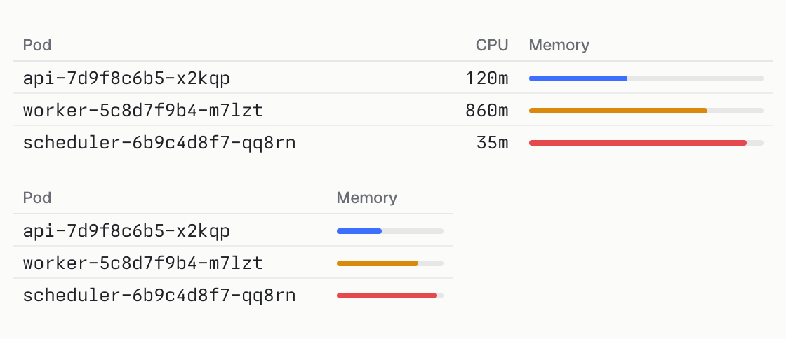
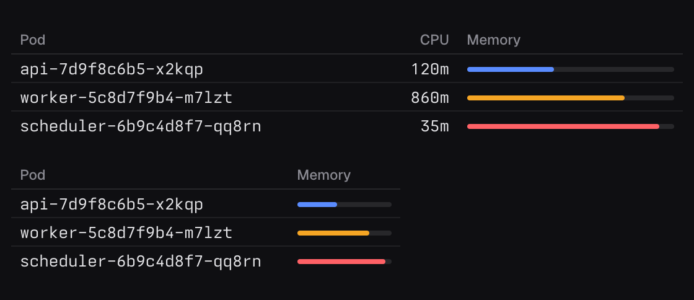
<figcaption>The same table at 560px and at 300px: CPU (priority 1) hides first. The bars cross the <code>warn</code> and <code>bad</code> thresholds.</figcaption>
</figure>

A selectable table of services with every cell type, in a block opened with `font = "sans"`. The block keeps the
selection in its state and moves it with ↑/↓ from its `key` handler as well. With no detail card beside it, every
waiting row gets a Promote button and only the selected row's is `primary` (with its `p` key), so the screen keeps one
primary; with a detail card, the primary moves to the card's head and the rows carry none
([Designing Views](../guides/design.md#tables)):

```lua
local ui = tern.ui

local TONE = { live = "success", degraded = "warning", down = "error", waiting = "pending" }

local function services(state)
	local rows = {}
	for i, s in state.services do
		local promote = nil
		if s.state == "waiting" then
			promote = { text = "Promote", act = "promote" }
			if s.name == state.selected then
				promote.variant, promote.keys = "primary", { "p" }
			end
		end
		rows[i] = {
			id = s.name,
			menu = { "logs", "restart" },
			disabled = s.state == "down" and "Restarting" or nil,
			cells = {
				name = { text = s.name, dot = TONE[s.state] },
				state = { badge = { text = s.state, tone = TONE[s.state] } },
				version = s.version,
				p95 = s.p95 .. " ms",
				trend = { spark = { values = s.latency, min = 0 } },
				act = promote and { button = promote } or "",
			},
		}
	end
	return ui.node("table", {
		key = "services",
		selectable = true,
		selected = state.selected,
		empty = "No services",
		cols = {
			{ id = "name", head = "Service", grow = 1, truncate = "middle", priority = 9 },
			{ id = "state", head = "State", priority = 6 },
			{ id = "version", head = "Version", mono = true, priority = 2 },
			{ id = "p95", head = "p95", align = "end", mono = true, priority = 7 },
			{ id = "trend", head = "Latency", priority = 1 },
			{ id = "act", align = "end", priority = 8 },
		},
		rows = rows,
	})
end

-- event(state, ev, cx)
if ev.ev == "select" and ev.id == "main.services" then
	state.selected = ev.item
elseif ev.ev == "action" and ev.act == "promote" then
	promote(state, ev.item)
end
```

<figure class="tn-figure">
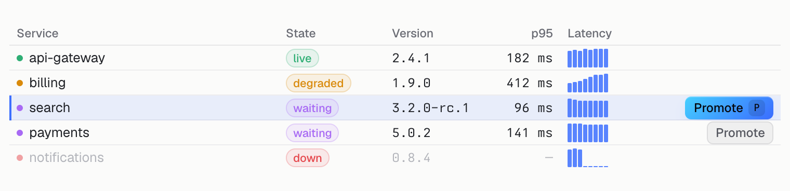
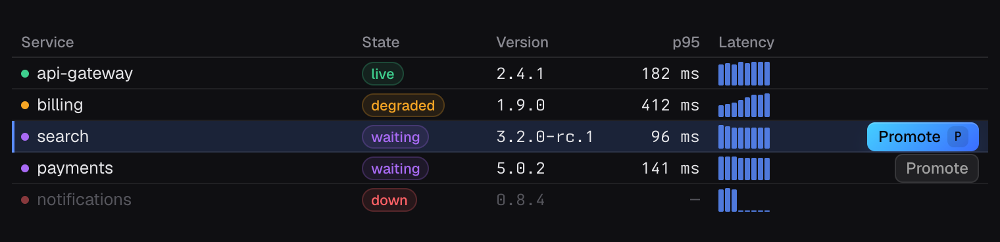
<figcaption>Dot, badge, mono, spark and button cells, with <code>selected</code> on a waiting row (its button the view's one primary) and a <code>disabled</code> row.</figcaption>
</figure>

A table of services the user sorts and restarts or deletes several at a time. The program keeps the sort and the
picks in its state, sorts the rows itself, and sends `picked` back when it wants to change them:

```lua
local ui = tern.ui

local function services(state)
	local rows = {}
	for i, s in state.services do
		rows[i] = {
			id = s.name,
			disabled = s.locked and "locked by a deploy" or nil,
			cells = {
				name = s.name,
				status = { text = s.status, dot = s.tone },
				age = s.age,
			},
		}
	end
	return ui.node("table", {
		key = "services",
		multi = true,
		picked = state.picked,
		sort = state.sort, -- { col = "name", dir = "desc" }
		bar = {
			{ act = "restart", text = "Restart", icon = "refresh" },
			{ act = "delete", text = "Delete", variant = "danger" },
		},
		cols = {
			{ id = "name", head = "Service", grow = 1, mono = true, sortable = true, priority = 9 },
			{ id = "status", head = "Status", sortable = true, priority = 5 },
			{ id = "age", head = "Updated", align = "end", mono = true, sortable = true, priority = 7 },
		},
		rows = rows,
	})
end

-- event(state, ev, cx)
if ev.ev == "action" and ev.act == "sort" then
	state.sort = ev.value -- then sort state.services by it
elseif ev.ev == "change" and ev.id == "main.services" then
	state.picked = ev.value
elseif ev.ev == "action" and ev.act == "restart" then
	restart(state, ev.value) -- keep or clear state.picked
end
```

The same in TSX (TypeScript SDK):

```tsx
<table
   key="services"
   multi
   picked={picked}
   sort={sort}
   onChange={(ev) => setPicked(ev.value)}
   bar={[
      { act: 'restart', text: 'Restart', icon: 'refresh' },
      { act: 'delete', text: 'Delete', variant: 'danger' },
   ]}
   onAction={{
      sort: (ev) => setSort(ev.value),
      restart: (ev) => restart(ev.value),
      delete: (ev) => remove(ev.value),
   }}
   cols={[
      { id: 'name', head: 'Service', grow: 1, mono: true, sortable: true, priority: 9 },
      { id: 'status', head: 'Status', sortable: true, priority: 5 },
      { id: 'age', head: 'Updated', align: 'end', mono: true, sortable: true, priority: 7 },
   ]}
   rows={rows}
/>
```

<figure class="tn-figure">
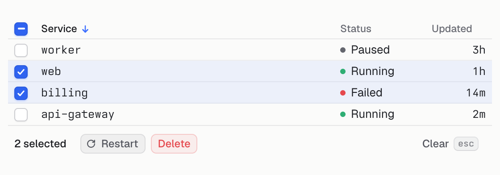
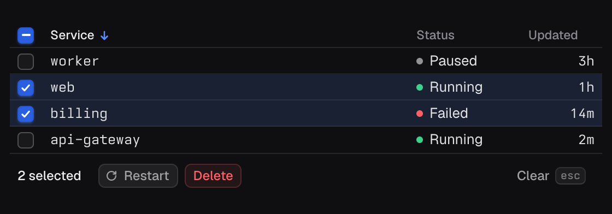
<figcaption><code>variant = "check"</code>: two of four rows picked, so the header box is mixed; the selection bar carries the <code>bar</code> actions.</figcaption>
</figure>

<figure class="tn-figure">
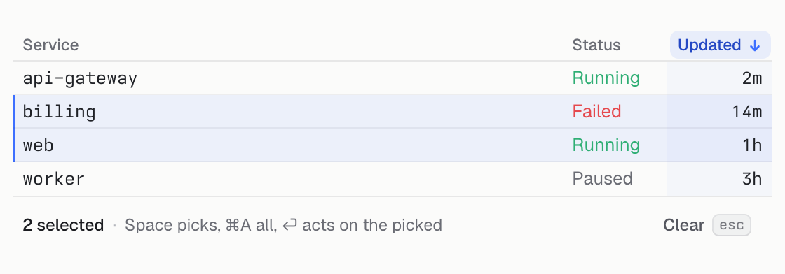
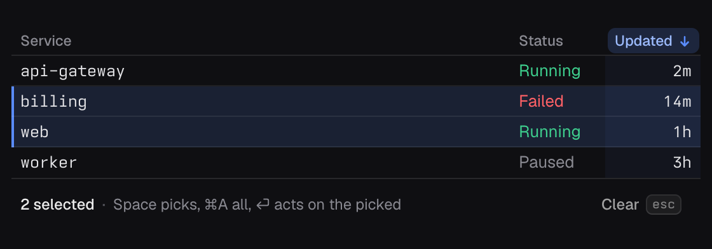
<figcaption><code>variant = "bar"</code> with a <code>hint</code> naming the keys the program takes.</figcaption>
</figure>

<figure class="tn-figure">
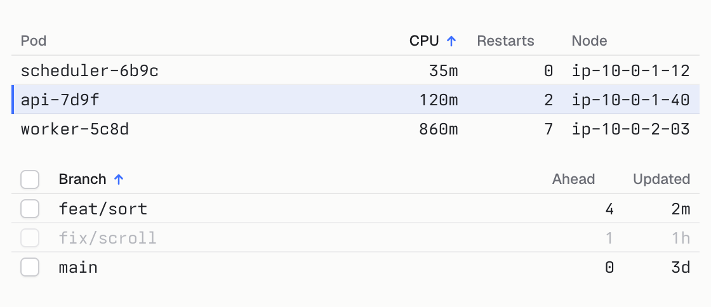
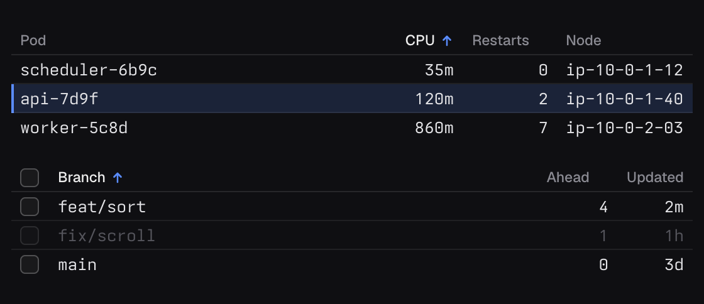
<figcaption>Ascending sorts in a mono region; a <code>multi</code> table with nothing picked shows no bar.</figcaption>
</figure>

## `tree`

A disclosure tree: one row per item, 14px of indent per level, a vertical guide under each open parent, and a
chevron that turns when its item opens or closes. Children fold with a short height and opacity transition. Items
without children show no chevron (it keeps its space so labels align).

**Opening and closing.** `open` sets whether an item's children show (default closed). A click on a chevron opens or
closes that item at once, without a round trip, and Tern remembers it by item id until your view sends a
*different* `open` for that item: re-sending the same `open` keeps the user's choice; changing it overrides the
choice. An item whose id disappears forgets its local state. Only the chevron toggles: a click on the label does
nothing of its own.

**Long trees.** A tree draws its open items as flat rows in preorder (class `.windowed`) and mounts only the rows
near what shows; open/closed state is kept for unmounted items. Full capture draws the nested form.

**Build it:** `tern.ui.tree(nodes)` (see [UI Builders](../reference/ui.md#tree)), or
`tern.ui.node("tree", { nodes = … })`. The builder assigns ids `t0`, `t1`, … depth-first; those shift when items are
added above, which moves the remembered state to other items. Build the props yourself with stable ids (a path, a
key) when the tree changes while the user is browsing it.

| Prop | Type | Default | Meaning |
| --- | --- | --- | --- |
| `nodes` | `{ TreeNode }` | `{}` | The top-level items |

`TreeNode` fields:

| Field | Type | Default | Meaning |
| --- | --- | --- | --- |
| `id` | string | required | Item identity, unique in the tree. An item without an id, or with an id already used, is skipped with its children |
| `label` | Spans | empty | The row's text; cut with an ellipsis |
| `icon` | string | none | An [icon name](#icon-names) shown before the label; an unknown name leaves an empty 14px slot |
| `open` | boolean | `false` | Whether the children show (see above) |
| `children` | `{ TreeNode }` | none | Nested items; an item is a parent only when it has at least one valid child |

**Children:** none (ignored); nesting lives in `nodes`.

**Events:** a chevron click sends `toggle` to your block's `event` handler:

```lua
{ ev = "toggle", id = "<tree node id>", key = "<item id>", collapsed = true }  -- collapsed = not open
```

To keep a choice across your own re-renders, store it from this event and send it back as `open`. `actions` work as on
any node.

**Styling:**

```html
<div class="sf sf-tree" role="tree" data-id="…">          <!-- .windowed when flattened -->
	<div class="sf-tree-node" role="treeitem" aria-level="1" aria-expanded="true" style="--d: 0">
		<div class="sf-tree-row">
			<button class="sf-tree-tw" data-key="src" title="Collapse" aria-label="Collapse"><svg class="ico">…</svg></button>
			<span class="sf-tree-ic" aria-hidden="true"><svg class="ico">…</svg></span>
			<div class="sf-tree-lbl">src</div>
		</div>
		<div class="sf-tree-kids" role="group">
			<div>
				<div class="sf-tree-node" role="treeitem" aria-level="2" style="--d: 1">
					<div class="sf-tree-row leaf">…</div>
					<div class="sf-tree-kids sf-hidden" role="group"><div></div></div>
				</div>
			</div>
		</div>
	</div>
</div>
```

| Target | Selector |
| --- | --- |
| The node | `.sf-tree` |
| Flattened (windowed) mode | `.sf-tree.windowed` |
| One item | `.sf-tree-node` (inner, may change); depth in `--d` (0 at the top) |
| A closed item | `.sf-tree-node.shut` (inner) |
| Row | `.sf-tree-row` (inner); `.sf-tree-row.leaf` without children |
| Chevron | `.sf-tree-tw` (inner); `[data-key]` is the item id |
| Icon | `.sf-tree-ic` (inner; `.sf-hidden` without `icon`) |
| Label | `.sf-tree-lbl` (inner) |
| Children group | `.sf-tree-kids > div` (inner; its `::before` draws the guide) |

Rows are `var(--sf-lh) + 6px` tall with a 5px radius and a `var(--l1)` hover; the chevron is `--t4`, the icon `--t3`,
guides `--l2`. In windowed mode guides are a repeating gradient on `.sf-tree-row::before`. The fold, the chevron
turn and the row hover transitions stop under Tern's reduced-motion setting (`.sf-still`) and
`prefers-reduced-motion`.

```lua
local ui = tern.ui

return ui.node("tree", {
	nodes = {
		{ id = "src", label = "src", icon = "folder", open = state.open["src"] ~= false, children = {
			{ id = "src/main.rs", label = "main.rs", icon = "file-code" },
			{ id = "src/lib.rs", label = ui.span("lib.rs", "muted"), icon = "file-code" },
			{ id = "src/kinds", label = "kinds", icon = "folder", open = state.open["src/kinds"], children = {
				{ id = "src/kinds/data.rs", label = "data.rs", icon = "file-code" },
			} },
		} },
		{ id = "Cargo.toml", label = "Cargo.toml", icon = "file" },
	},
})
```

<figure class="tn-figure">
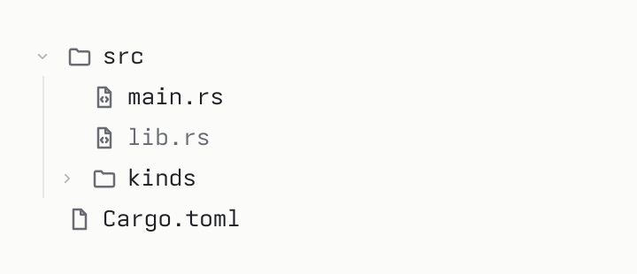
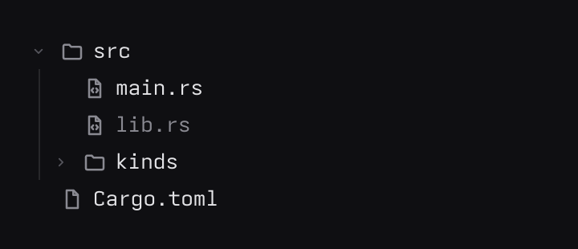
<figcaption>The tree above, with <code>src/kinds</code> (one child, no <code>open</code>) shown closed.</figcaption>
</figure>

```lua
-- in the block definition
event = function(state, ev, cx)
	if ev.ev == "toggle" then
		state.open[ev.key] = not ev.collapsed
	end
end,
```

## `json`

A raw JSON value that Tern draws natively as an interactive tree, the way a browser's developer tools show an
object. Send the value as it is instead of building a `tree` out of it.

- **Entries.** The rows are the value's top-level entries: a root object's keys, a root array's items; a scalar root
  is one row. Array indices show bare and right-aligned (`0`, not `[0]`).
- **Short containers stay whole.** A container whose one-line form fits about 60 characters shows on one row:
  `0: [[3, "vt"], 98]`, `args: {stream: 0, lines: 70}`.
- **Larger containers fold** to a one-line preview, `{name: "highlight_batch", ts: 62213.5, args: {…}}`, arrays with
  their length, `(30) [{…}, {…}, …]`, and expand on click.
- **Multi-line strings** expand into their lines.
- **Folding is local.** `open` sets how many levels of containers start expanded: `0` lists the top-level entries
  with every container among them folded, `1` also expands those containers, and so on. The user's clicks fold and
  unfold from there; they send no events.

**Check support.** `json` is newer than `tree`: look for it in the hello reply's `kinds` (an SDK's
`supports("json")`) and build a `tree` from the value when it is missing.

**Build it:** `tern.ui.node("json", { value = … })`; in the SDKs `ui::json(value).open(1)` (Rust),
`ui.JSON{Value: v, Open: 1}` (Go), `ui.json(value, open=1)` (Python), `ui.json({ value, open: 1 })` (TypeScript).
Plain-text fallbacks print the value pretty-printed with a 2-space indent.

| Prop | Type | Default | Meaning |
| --- | --- | --- | --- |
| `value` | any JSON value | `null` | The value to draw (object, array, string, number, boolean or null) |
| `open` | integer ≥ 0 | `0` | How many levels of containers start expanded |

**Children:** none (ignored).

**Events:** none.

```lua
return tern.ui.node("json", {
	value = { name = "highlight_batch", ts = 62213.5, args = { stream = 0, lines = 70 } },
	open = 1,
})
```

## `badge`

A small rounded pill with plain text, tinted by its tone: text in the tone color, a 10% tone background and a 22%
tone ring. Without a tone (or with `neutral`) it is a gray chip. It never wraps or shrinks.

**Build it:** `tern.ui.badge(text, tone)` (see [UI Builders](../reference/ui.md#badge)), or
`tern.ui.node("badge", { text = …, tone = … })`.

| Prop | Type | Default | Meaning |
| --- | --- | --- | --- |
| `text` | string | `""` | The label. Plain text only: spans are not read |
| `tone` | tone | none | Common prop: `neutral`, `accent`, `info`, `success`, `warning`, `error`, `pending`, `muted` or `user`; other values are ignored |

**Children:** none (ignored).

**Events:** none of its own; `actions` work as on any node.

**Styling:**

```html
<span class="sf sf-badge" data-id="…" data-tone="success">ok</span>
```

| Target | Selector |
| --- | --- |
| The node | `.sf-badge` |
| A tone | `.sf-badge[data-tone='error']` |
| No tone | `.sf-badge:not([data-tone])` |

The badge is 18px tall, `padding: 0 7px`, `500 11px` sans, colored from `--tc` (the tone color the `[data-tone]`
rules set; see [Variables](../styles/variables.md)). The neutral look uses `--t2`, `--chip-bg` and `--l2`.

```lua
local ui = tern.ui

return ui.row({ ui.text("deploy"), ui.badge(ok and "passed" or "failed", ok and "success" or "error") })
```

Every tone, after a badge with none:

```lua
local tones = { "neutral", "accent", "info", "success", "warning", "error", "pending", "muted", "user" }
local badges = { ui.node("badge", { text = "untoned" }) }
for _, tone in tones do
	table.insert(badges, ui.badge(tone, tone))
end
return ui.node("row", { gap = "sm", wrap = true }, badges)
```

<figure class="tn-figure">
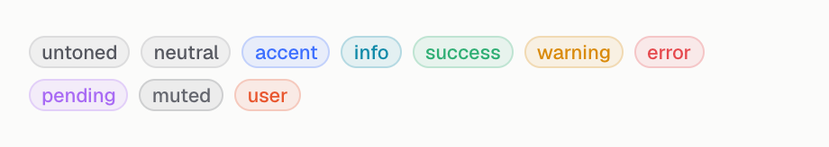
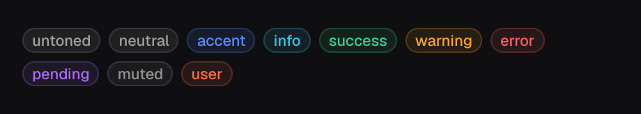
</figure>

## `kbd`

A key combination as keycaps, one `.kbd` per key, 3px apart. Modifier and named keys take macOS glyphs; single
letters and function keys are upper-cased; anything else shows as written. Screen readers hear the spoken names
(`Control O`).

| Key name (any case) | Keycap | Spoken |
| --- | --- | --- |
| `ctrl`, `control` | `⌃` | Control |
| `alt`, `option`, `opt` | `⌥` | Option |
| `shift` | `⇧` | Shift |
| `cmd`, `command`, `meta`, `super`, `win` | `⌘` | Command |
| `enter`, `return` | `⏎` | Return |
| `esc`, `escape` | `esc` | Escape |
| `tab` | `⇥` | |
| `backspace` | `⌫` | |
| `delete`, `del` | `⌦` | |
| `space` | `space` | |
| `up`, `down`, `left`, `right` | `↑` `↓` `←` `→` | |
| `pageup`, `pagedown` | `⇞` `⇟` | |
| `home`, `end` | `↖` `↘` | |
| one character (`o`, `/`) | upper-cased (`O`, `/`) | |
| `f1`…`f24` (`f` + digits) | `F1`…`F24` | |
| anything else (`fn`, `⌘`) | as written | |

Rows without a spoken name are read as their keycap. The glyphs are the same on every platform.

**Build it:** `tern.ui.node("kbd", { keys = { "ctrl", "o" } })`. There is no dedicated builder.

| Prop | Type | Default | Meaning |
| --- | --- | --- | --- |
| `keys` | `{ string }` | `{}` | Key names, in order; non-string entries are skipped |
| `aria` | string | none | Common prop: the `aria-label`. When set, Tern sets neither `role="img"` nor the spoken label |

**Children:** none (ignored).

**Events:** none of its own; `actions` work as on any node. Keycaps are display only: the keys reach your block's
`key` handler whether or not a `kbd` shows them.

**Styling:**

```html
<span class="sf sf-kbd kbds" data-id="…" role="img" aria-label="Control O">
	<span class="kbd">⌃</span>
	<span class="kbd">O</span>
</span>
```

| Target | Selector |
| --- | --- |
| The node | `.sf-kbd` |
| One keycap | `.sf-kbd .kbd` (Tern's shared keycap class; also used in list hints) |

A keycap is 18px tall and at least 18px wide, `500 10.5px` mono in `--t2` on `--l1` with a `--l2` ring.

```lua
local ui = tern.ui

return ui.row({ ui.node("kbd", { keys = { "cmd", "shift", "p" } }), ui.text(ui.span("command palette", "muted")) })
```

<figure class="tn-figure">
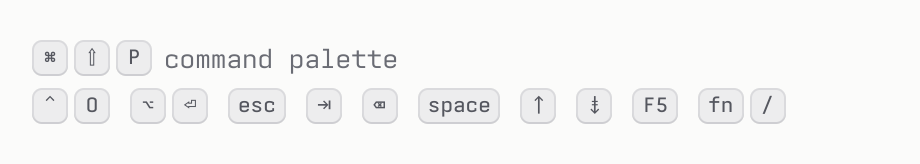
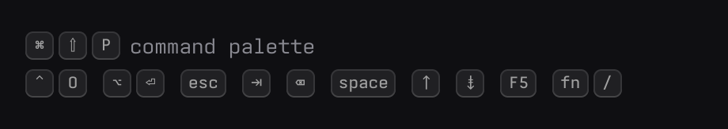
<figcaption>The example, then <code>ctrl o</code>, <code>alt enter</code>, <code>esc</code>, <code>tab</code>, <code>backspace</code>, <code>space</code>, <code>up</code>, <code>pagedown</code>, <code>f5</code> and <code>fn /</code>.</figcaption>
</figure>

## `icon`

One icon from Tern's set: a 16×16 box holding a 14px icon in the current text color, or the tone color with a
`tone`. Most icons are stroked; `logo`, `app-omp` and `slash` are filled. An unknown name draws an empty box. Icons
are decorative: Tern sets `aria-hidden="true"` unless you pass `aria`.

**Build it:** `tern.ui.node("icon", { name = "folder" })`. There is no dedicated builder. The same names work in a
`tree` item's `icon`, a list `item`'s `icon` and other kinds' `icon` props.

| Prop | Type | Default | Meaning |
| --- | --- | --- | --- |
| `name` | string | none | An icon name or alias (below), case-sensitive. Anything up to the last `.` is dropped, so `icon.folder` and `status.error` work |
| `tone` | tone | none | Common prop; colors the icon |
| `aria` | string | none | Common prop: the `aria-label`. When set, Tern does not hide the icon from screen readers |

**Children:** none (ignored).

**Events:** none of its own; `actions` work as on any node (an icon with a `click` action is a compact button).

**Styling:**

```html
<span class="sf sf-icon" data-id="…" aria-hidden="true">
	<svg class="ico" aria-hidden="true">…</svg>
</span>
```

| Target | Selector |
| --- | --- |
| The node | `.sf-icon` |
| Toned | `.sf-icon[data-tone]` (colored `var(--tc)`) |
| The glyph | `.sf-icon .ico` |

Icons stroke with `currentColor`, so `color` recolors them; resize with `width`/`height` on both the node and `.ico`.

```lua
local ui = tern.ui

return ui.row({ ui.node("icon", { name = "branch", tone = "accent" }), ui.text("main") })
```

### Icon names

Tern ships these 208 icons:

| Group | Names |
| --- | --- |
| Apps and brands | `app-btop`, `app-bun`, `app-claude`, `app-codex`, `app-deno`, `app-docker`, `app-go`, `app-hammer`, `app-helix`, `app-hermes`, `app-htop`, `app-java`, `app-node`, `app-omp`, `app-python`, `app-ruby`, `app-rust`, `app-vim`, `logo`, `tern`, `pi-mark` |
| Arrows and navigation | `arrow-up`, `arrow-down`, `arrow-left`, `arrow-right`, `back`, `forward`, `chev`, `chev-r`, `chev-up`, `corner-down-right`, `expand`, `shrink`, `minimize`, `fit`, `zoom-in`, `zoom-out`, `more`, `grip`, `compass` |
| Status and alerts | `check`, `x`, `x-circle`, `warn`, `info`, `help`, `bell`, `shield`, `shield-alert`, `slash`, `slash-circle`, `lock`, `key`, `key-round`, `plus`, `minus`, `clock`, `timer` |
| Files and documents | `doc`, `file`, `file-code`, `file-image`, `file-pdf`, `file-plus`, `files`, `folder`, `folder-go`, `folder-minus`, `folder-open`, `folder-plus`, `markdown`, `note`, `clipboard`, `save`, `inbox`, `image`, `newspaper`, `trash` |
| Version control | `branch`, `commit`, `merge`, `rebase`, `pull`, `push`, `fetch`, `stash`, `cherry`, `diff`, `unified`, `split`, `split-down`, `revert`, `history` |
| Playback and actions | `play`, `pause`, `stop`, `rewind`, `fast-forward`, `frame-next`, `frame-prev`, `repeat`, `redo`, `undo`, `run`, `reel`, `mic`, `wave`, `vibrate`, `power`, `send`, `share`, `open`, `download`, `copy`, `scissors` |
| Text and editing | `bold`, `italic`, `underline`, `type`, `align-left`, `align-center`, `align-right`, `align-justify`, `pen`, `eraser`, `wand`, `cursor`, `selection`, `path-insert`, `prompt`, `vector`, `blur`, `ink`, `palette` |
| Layout and windows | `columns`, `grid`, `sidebar`, `tabs-h`, `tabs-v`, `dock-up`, `dock-down`, `dock-left`, `dock-right`, `pip`, `pip-tl`, `pip-tr`, `pip-bl`, `pip-exit`, `layers`, `stack`, `kanban`, `canvas`, `diagram`, `flow`, `peek`, `tree`, `box`, `eye`, `eye-off` |
| Development and system | `terminal`, `code`, `braces`, `binary`, `bug`, `cpu`, `database`, `server`, `laptop`, `monitor`, `gauge`, `activity`, `chart`, `plug`, `puzzle`, `wrench`, `gear`, `sliders`, `stethoscope`, `hash`, `tag`, `link`, `globe`, `broadcast`, `search`, `funnel`, `funnel-x`, `sort-x`, `swap`, `list`, `list-checks`, `pin`, `keyboard` |
| People and misc | `user`, `users`, `message`, `brain`, `sparkle`, `lightbulb`, `bolt`, `flame`, `rocket`, `moon`, `sun`, `cart`, `footprints`, `scale`, `log-in`, `log-out` |

The SDKs name every icon except the `app-*` ones, which follow the programs Tern knows; pass those as a plain
string (`"app-vim"`).


<figure class="tn-figure">
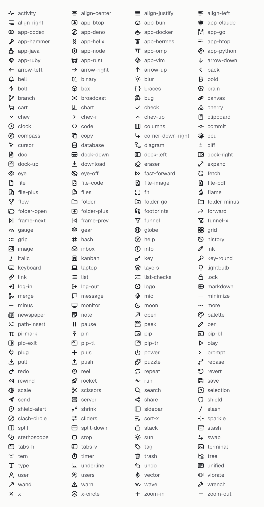
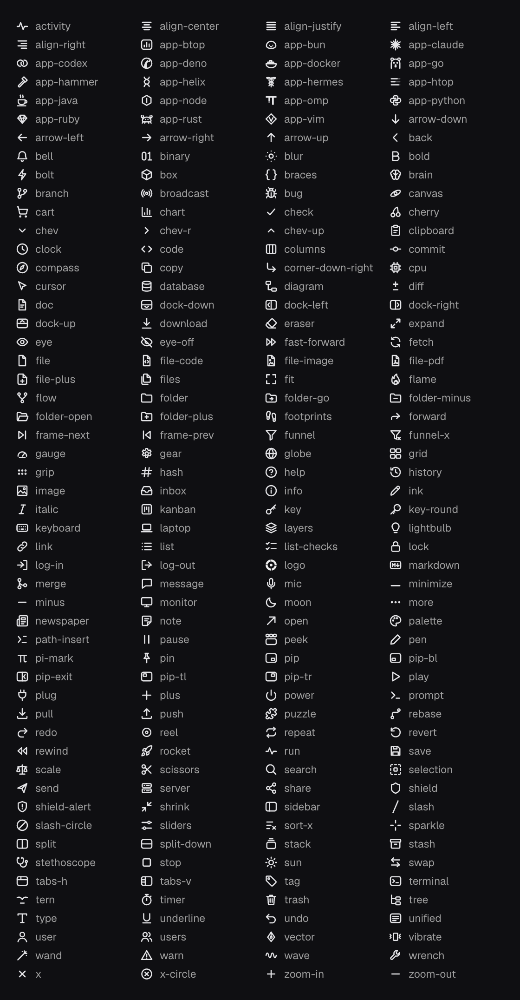
<figcaption>Every icon, as <code>icon</code> nodes in the current text color.</figcaption>
</figure>

Plus a thousand file and folder glyphs, filled, the ones the Files pane picks by name: Material Icon Theme's,
named `mi-` and its icon id (`mi-rust`, `mi-typescript`, `mi-docker`, `mi-folder-src`, `mi-folder-src-open`).

And model providers' logos, in their brands' colors, the current text color, or both (aiand's chevron follows the
text color beside its red stripe): `provider-` and the provider's id
(`provider-anthropic`, `provider-openai`, `provider-llama-cpp`). `provider:<id>` names one by omp's provider id as is:
characters other than letters and digits become `-` (`provider:llama.cpp` is `provider-llama-cpp`), and a provider
without a logo of its own shows its brand's (`apple` → `provider-apple-intelligence`, `bedrock-mantle` →
`provider-amazon-bedrock`, `cloudflare-workers-ai` → `provider-cloudflare-ai-gateway`). A provider Tern has no logo
for names no icon, so a picker `mark` falls back to its initials.

Aliases (omp's symbol names and common words) resolve to an icon when no icon has that name; an icon name always
wins over an alias:

`success` → `check`, `done` → `check`, `error` → `x`, `failed` → `x`, `warning` → `warn`, `pending` → `clock`,
`running` → `activity`, `aborted` → `stop`, `cancelled` → `stop`, `disabled` → `minus`, `model` → `sparkle`, `plan` →
`list`, `goal` → `pin`, `loop` → `redo`, `git` → `branch`, `pr` → `merge`, `tokens` → `hash`, `speculation` →
`selection`, `compaction` → `wand`, `context` → `layers`, `cost` → `hash`, `time` → `clock`, `omp` → `app-omp`, `hermes` → `app-hermes`,
`agents` → `user`, `agent` → `user`, `job` → `run`, `cache` → `database`, `input` → `download`, `output` → `send`,
`host` → `laptop`, `session` → `history`, `worktree` → `tree`, `bash` → `terminal`, `shell` → `terminal`, `python` →
`app-python`, `edit` → `pen`, `write` → `pen`, `read` → `doc`, `web` → `globe`, `url` → `link`, `todo` → `list`,
`task` → `layers`, `thinking` → `sparkle`, `settings` → `sliders`, `appearance` → `ink`, `interaction` → `keyboard`,
`memory` → `brain`, `tools` → `wand`, `tasks` → `list`, `providers` → `server`, `plugins` → `box`, `advisor` →
`sparkle`, `git-branch` → `branch`, `sparkles` → `sparkle`, `action` → `terminal`, `extension` → `puzzle`, `computer`
→ `monitor`, `stats` → `chart`, `news` → `newspaper`, `export` → `open`, `restart` → `revert`, `compress` → `shrink`,
`handoff` → `forward`, `question` → `help`, `pencil` → `pen`, `folderMove` → `folder-go`, `folderPlus` →
`folder-plus`, `folderMinus` → `folder-minus`, `hammer` → `app-hammer`, `prewalk` → `footprints`, `jobs` → `run`,
`signIn` → `log-in`, `signOut` → `log-out`, `package` → `box`, `fast` → `bolt`, `voice` → `mic`, `rule` → `scale`,
`skill` → `lightbulb`, `mcp` → `plug`, `path` → `folder`, `token_total` → `hash`, `time_spent` → `clock`.

## `avatar`

A small mark for a person, a bot, an organization, a repository or a model provider. The default `circle` draws the
initials of `text` on a two-hue gradient picked from `seed` (the same seed always gets the same colors, and these
are exactly the marks the [`picker`](lists.md#picker) draws, so a person looks alike everywhere in Tern). A `square`
is a squircle tile tinted with the seed's hue and its initials in that hue's ink: reach for it for things rather
than people (bots, orgs, repositories, CI). Either shows an `icon` instead of the initials (any Tern icon, or a
`provider:<id>` logo in its own colors on a quiet well), and a `blob` picture over the face when one is given. A
`status` tone adds a small dot at the bottom right, ringed in the surface color so it reads on the face. With no
`text`, `icon` or `blob` it draws a quiet person glyph.

Put it before the name it stands for, in a row, list line or message head; size it to the text beside it (`sm`
next to body text, `md` in rows, `lg` in heads). Don't put a name inside the mark: `text` is only for the initials
and the tooltip. For several people at once, use [`avatars`](#avatars).

**Build it:** `tern.ui.node("avatar", { text = "Cara Alvarez", seed = "cara@acme.dev", status = "success" })`.

| Prop | Type | Default | Meaning |
| --- | --- | --- | --- |
| `variant` | `"circle"` \| `"square"` | `"circle"` | The look (below) |
| `text` | string | `""` | The name the mark stands for: its first two non-space characters are the initials (shown uppercase on a circle, as written on a square) |
| `seed` | string | `text` | Picks the colors; pass a stable id (an email, a repo slug) so renames keep them |
| `icon` | string | none | An [icon name](#icon-names) or `provider:<id>`, drawn instead of the initials. Unknown names fall back to the initials |
| `blob` | string | none | A blob id of a picture (PNG, JPEG, GIF, WebP, SVG), cropped to the face; the initials show while it loads or when it is missing |
| `size` | `"xs"` \| `"sm"` \| `"md"` \| `"lg"` | `"md"` | 16, 20, 28 or 36px square |
| `status` | tone | none | A dot in the tone's color (`success` online, `warning` away, `error` busy, `pending` working, `accent`/`info`/`user` accent; others grey) at the bottom right |
| `title` | string | `text` | The tooltip and accessible name |

**Variants.**

| `variant` | Look | Use |
| --- | --- | --- |
| `circle` | White initials on a 135° two-hue gradient; a logo or icon on a quiet `--chip-bg` well | People and providers |
| `square` | A squircle (radius 30% of the side) tinted with the seed's hue at 18%, initials in mono in that hue's ink | Bots, orgs, repositories, services |

**Children:** none (ignored).

**Events:** none of its own; `actions` work as on any node.

**Keyboard:** none; it takes no focus. The program changes `status`, `text`, `blob` as things change.

**Styling:**

```html
<div class="sf sf-avatar circle s-md" data-id="main.me" role="img" aria-label="Sam Moss" title="Sam Moss">
	<span class="av-face" aria-hidden="true">Sa</span>     <!-- inline gradient; --av-h on a square -->
	<span class="av-dot" data-tone="success" aria-hidden="true"></span>   <!-- only with a status -->
</div>
```

| Target | Selector |
| --- | --- |
| The node | `.sf-avatar` (`.circle` / `.square`, `.s-xs` … `.s-lg`, `.logo` for an icon on a circle, `.blank` with nothing to show) |
| The face | `.sf-avatar .av-face` (inner, may change) |
| The status dot | `.sf-avatar .av-dot[data-tone]` (inner) |
| The ring color | `--av-ring` (default `--panel`): set it to the background the avatar sits on |

Sizes come from `--av` (side), `--av-fs` (initials) and `--av-dot` on the node.

```lua
local ui = tern.ui

ui.node("row", { gap = "sm", align = "center" }, {
	ui.node("avatar", { text = "Sam Moss", seed = user.email, size = "sm", status = user.online and "success" or nil }),
	ui.text(user.name),
})
ui.node("avatar", { variant = "square", text = "ci", seed = "acme/ci", title = "acme/ci" })
ui.node("avatar", { icon = "provider:anthropic", title = "Anthropic", size = "lg" })
```

The same in TSX (TypeScript SDK):

```tsx
<row gap="sm" align="center">
   <avatar text="Sam Moss" seed={user.email} size="sm" status={user.online ? 'success' : undefined} />
   <text>{user.name}</text>
</row>
<avatar variant="square" text="ci" seed="acme/ci" title="acme/ci" />
<avatar icon="provider:anthropic" title="Anthropic" size="lg" />
```

<figure class="tn-figure">
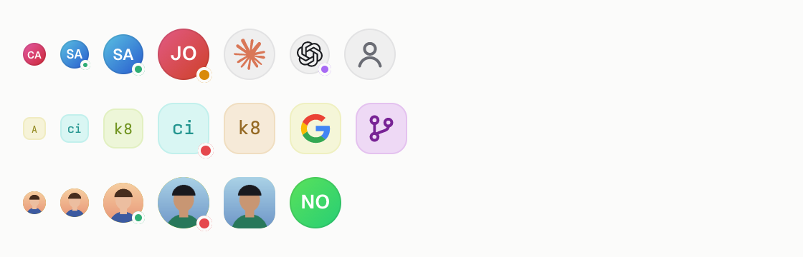
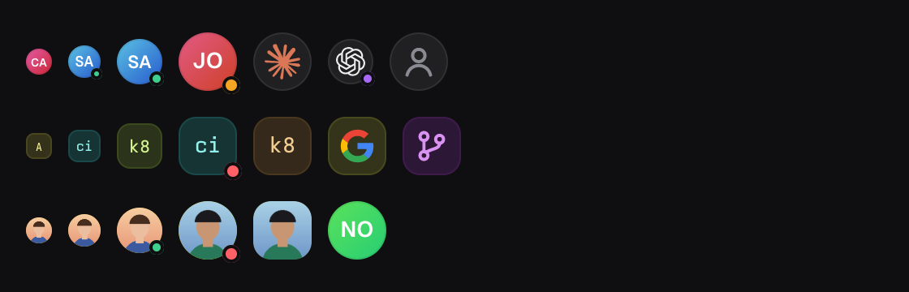
<figcaption>Circles, squares and pictures, xs to lg, with initials, logos, icons and status dots.</figcaption>
</figure>

## `avatars`

An overlapping stack of avatars: the people on a review, the agents in a run, the repos in an org. Each one overlaps
the previous by 28% of its side, ringed in the surface color so the edges stay crisp. With `max`, the avatars after
the first `max` fold into a `+N` chip whose tooltip lists their names, one per line (one hidden avatar shows itself
rather than a `+1`). A muted `label` after the stack says what it is (`7 reviewers`). Hovering an avatar lifts it
over its neighbours and shows its name. Keep `max` to 3–5.

**Build it:** `tern.ui.node("avatars", { items = { { text = "Cara Alvarez" }, … }, max = 4, label = "7 reviewers" })`.

| Prop | Type | Default | Meaning |
| --- | --- | --- | --- |
| `items` | `{ Avatar }` | `{}` | The avatars, front first: each takes the [`avatar`](#avatar) props except `size` (`variant`, `text`, `seed`, `icon`, `blob`, `status`, `title`); `status` dots are not drawn in a stack (the next avatar would cover them) |
| `max` | integer | all | How many to show before the `+N` chip |
| `size` | `"xs"` \| `"sm"` \| `"md"` \| `"lg"` | `"md"` | Every avatar's size |
| `label` | string | none | Muted text after the stack, and the group's accessible name (else the names, joined) |

**Children:** none (ignored).

**Events:** none of its own; `actions` work as on any node.

**Keyboard:** none; it takes no focus.

**Styling:**

```html
<div class="sf sf-avatars s-md" data-id="main.reviewers" role="group" aria-label="7 reviewers">
	<div class="av-stack">
		<span class="av circle s-md" role="img" aria-label="Cara Alvarez" title="Cara Alvarez">
			<span class="av-face" aria-hidden="true">Ca</span>
		</span>
		…
		<span class="av more s-md" title="Ada Lim&#10;Ben Ortiz&#10;Eve Park" aria-label="3 more: …"><span class="av-face" aria-hidden="true">+3</span></span>
	</div>
	<span class="av-label" aria-hidden="true">7 reviewers</span>
</div>
```

| Target | Selector |
| --- | --- |
| The node | `.sf-avatars` (`.s-xs` … `.s-lg`) |
| One avatar | `.sf-avatars .av` (built like `.sf-avatar` on a 2px `--av-ring` pad, inner) |
| The overflow chip | `.sf-avatars .av.more` (inner) |
| The label | `.sf-avatars .av-label` (inner) |
| The ring color | `--av-ring` (default `--panel`) |

```lua
local items = {}
for i, r in pr.reviewers do
	items[i] = { text = r.name, seed = r.email, status = r.approved and "success" or nil }
end
tern.ui.node("avatars", { items = items, max = 4, size = "md", label = #items .. " reviewers" })
```

The same in TSX (TypeScript SDK):

```tsx
<avatars
   items={pr.reviewers.map((r) => ({ text: r.name, seed: r.email, status: r.approved ? 'success' : undefined }))}
   max={4}
   label={`${pr.reviewers.length} reviewers`}
/>
```

<figure class="tn-figure">
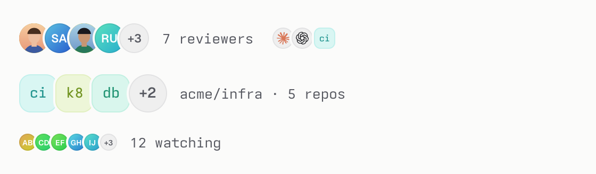
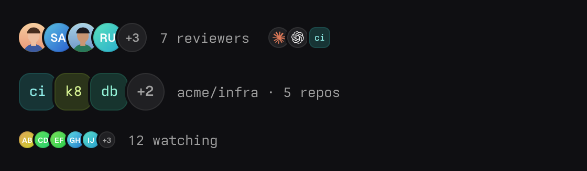
<figcaption>Stacks with an overflow chip and a label.</figcaption>
</figure>

## `image`

An image from a blob you send, or one Tern ships. A raster blob (PNG, JPEG, GIF, WebP, at most 4096 px a side) is
decoded off the main thread and painted with a 6px radius and a faint `--l1` ring. An SVG blob (`image/svg+xml`, at
most 256 KiB) is mounted as real SVG elements, so your sheets can style and animate it.

**Sizing.** `w`/`h` give the natural size in px (and so the aspect ratio); one of them alone is completed from the
decoded ratio; neither uses the decoded size. Raster and SVG previews shrink both axes together to fit the
available width and height bounds. `max.h` bounds the height (`"10lines"` or `"40ch"`; a fraction is ignored);
`max.w` bounds the width through the common props.

**Fit and scaling.** Raster pixels are placed in that box by `object-fit`, always centered: `contain` (the default,
so a declared size or CSS dimensions that differ from the source ratio never stretch the image), `cover` (fill the
box, cropping the overflow), `fill` (stretch to the box), `none` (the decoded size, one image pixel per CSS px,
cropped to the box) or `scale-down` (`none`, or `contain` when that is smaller). `image-rendering: pixelated` (or
`crisp-edges`) scales with the nearest pixel, keeping pixel art's hard edges; `auto`, `smooth` and `high-quality`
filter smoothly. Set both on the node, e.g. `.sf-image[data-role='sprite'] { object-fit: cover; image-rendering:
pixelated }`; `object-position` is not supported.

**Animation.** An animated GIF, APNG or animated WebP plays on its own: each frame for its delay (delays of 10 ms or
less play at 100 ms, as browsers do), as many times as the file's loop count says (forever when it says so), then
holds its last frame. It starts when the image first draws and runs on the window's animation clock, so it pauses
with the clock and skips ahead to the right frame after being scrolled out of view, where it costs no frames. An
animation over 1024 frames or 64 MiB of decoded pixels shows its first frame, still.

**Children.** An image's children are drawn over it, in a layer (`.sf-img-over`) covering the node's box: the
picture's height and the node's width. The layer is a column like `col`, so a sprite over a background is an `image`
inside an `image`, placed with a `row`/`col` or your own CSS; no absolute positioning is needed. Only the children take
the pointer: a click on the picture around them still zooms it, a click on a child does not.

```lua
-- an animated sprite standing at the bottom right of a background, its pixels scaled hard-edged
ui.node("image", { blob = state.meadow, alt = "Meadow", role = "meadow" }, {
	ui.node("col", { grow = 1 }),
	ui.node("row", { justify = "end" }, {
		ui.node("image", { blob = state.pikachu, alt = "Pikachu", role = "sprite", w = 96, h = 96 }),
	}),
})
-- your sheet: .sf-image[data-role='sprite'] { image-rendering: pixelated }
```

**While missing.** Until the blob arrives, while it decodes, or when it is not an image Tern can decode, the node
shows a dashed placeholder card with an image icon and `alt` (or "Image loading" / "Image unavailable"), with a
tooltip saying why: "The image data has not arrived", "The image is loading" or "Not an image format Tern can show"
(also an SVG over 256 KiB or without a size). A blob that arrives after the image drew shows as soon as it lands. An
id the pane never received but Tern's blob cache on the pane's machine keeps (sent to another pane or block, or before a
restart) shows from the cache, in every window showing the pane.

**Zoom.** A click on a drawn blob image opens it in Tern's image viewer, with a zoom-in cursor on hover. When the
image's parent holds other blob images (a message's attachments), the viewer steps through all of them, starting at
this one. The viewer title is `alt` (else `title`). A node with its own `click` action runs that instead. `builtin`
images never zoom.

**SVG.** Tern draws the `svg`, `g`, `defs`, `linearGradient`, `stop`, `path`, `circle`, `line`, `rect`, `mask` and
`text` elements; any other element (`script`, `foreignObject`, `image`, `use`, `title`, …) is dropped with its subtree.
Attributes pass through as written, since nothing in an SVG runs or loads: presentation attributes (`fill`,
`font-family`, `letter-spacing`, …) style the drawing, and inline `style`, event handlers and external `url(…)`
references do nothing. Every `id` and local `url(#id)` is prefixed per node so two copies never clash; `class` values
are kept, so `.sf-image .my-class` selectors work; `tabindex` is dropped so a drawing never takes keyboard focus. The
root's `width` and `height` give its natural size only, and it needs a `viewBox` (or both of them).

**Canvas.** `tern.canvas` rejects `image` nodes (`canvas kind "image" is not supported`): use images in block and lens
views only.

**Build it:** send the bytes with `cx:blob(bytes, mime)` from a block handler (see
[Host API](../reference/api-host.md)), keep the returned id in state, and render
`tern.ui.node("image", { blob = id, alt = … })`. There is no dedicated builder.

| Prop | Type | Default | Meaning |
| --- | --- | --- | --- |
| `blob` | string | none | A blob id (the SHA-256 that `cx:blob` returns) |
| `builtin` | string | none | An image Tern ships, drawn instead of `blob`. The only one is `"omp"` (omp's animated gradient mark) |
| `alt` | string | `"Image"` for screen readers | Accessible name, placeholder text and viewer title |
| `w`, `h` | number | decoded size | Natural width and height in px; zero or negative is ignored |
| `max` | `{ w?, h? }` | none | Common prop; `h` bounds the image height in `"Nlines"` or `"Nch"` |
| `title` | string | none | Common prop: the tooltip. The zoom viewer also uses it as the name when there is no `alt` |
| `href`, `path` | string | none | Read by the zoom viewer, which may offer to open that file or page (`href` first) |

**Children:** any nodes, drawn over the picture (see **Children** above).

**Events:** none of its own. A click on a zoomable image runs the `zoom` action (it shows the viewer; your block
receives nothing). Your own `actions` work as on any node and take precedence for `click`.

**Styling:**

```html
<!-- raster -->
<div class="sf sf-image sf-zoom" data-id="…">
	
	<div class="sf-img-over">…children…</div>
</div>
<!-- SVG -->
<div class="sf sf-image sf-zoom" data-id="…">
	<svg class="sf-img-svg" role="img" aria-label="Build graph" viewBox="…">…</svg>
	<div class="sf-img-over">…children…</div>
</div>
<!-- missing or loading -->
<div class="sf sf-image missing" data-id="…">
	<div class="sf-img-card" role="img" aria-busy="true" title="The image is loading" aria-label="Build graph (image loading)">
		<span class="sf-img-ic"><svg class="ico">…</svg></span>
		<span class="sf-img-alt">Build graph</span>
	</div>
	<div class="sf-img-over">…children…</div>
</div>
```

| Target | Selector |
| --- | --- |
| The node | `.sf-image` |
| Zoomable | `.sf-image.sf-zoom` |
| Not drawn (absent, loading, undecodable) | `.sf-image.missing` |
| Raster frame | `.sf-img-frame` (inner, may change) |
| Inline SVG | `.sf-img-svg` (inner) and your own classes inside it |
| The children's layer | `.sf-img-over` (inner, may change) |
| Placeholder | `.sf-img-card`, `.sf-img-ic`, `.sf-img-alt` (inner, may change); `[aria-busy='true']` while loading |

The frame's ring brightens to `--l3` on hover and dims to 85% opacity while pressed. The placeholder card is
`2 × --sf-lh` tall with a dashed `--l3` border on `--sf-shade`.

```lua
local ui = tern.ui

tern.block.define("graph", {
	init = function(cx, args, saved)
		return { chart = cx:blob(tern.fs.read("graph.png"), "image/png") }
	end,
	view = function(state, cx)
		return {
			main = ui.col({
				ui.text(ui.span("Build graph", "strong")),
				ui.node("image", { blob = state.chart, alt = "Build graph", w = 480, h = 240, max = { h = "10lines" } }),
				-- state.coverage: a blob id whose bytes were not sent yet
				ui.node("image", { blob = state.coverage, alt = "Coverage chart" }),
			}),
		}
	end,
})
```

<figure class="tn-figure">
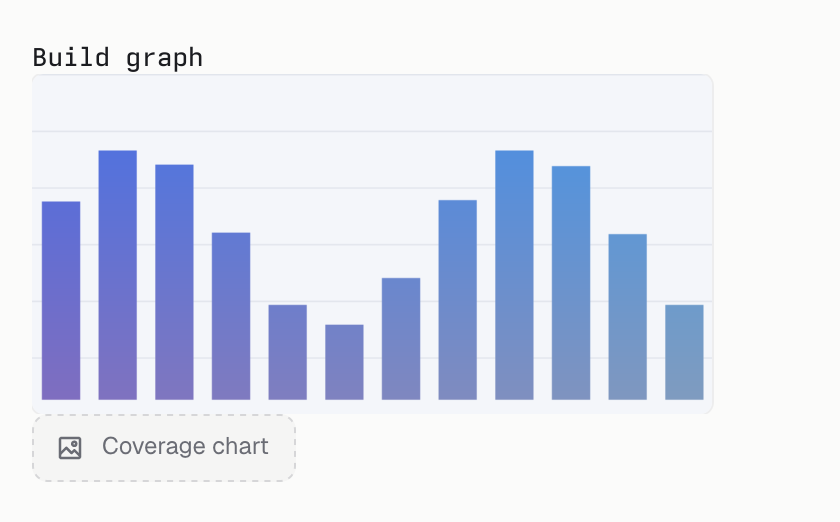
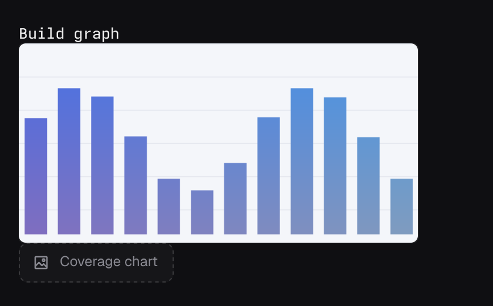
<figcaption>A 480×240 PNG under <code>max.h = "10lines"</code> keeps its ratio as it shrinks; <code>state.coverage</code> names a blob that never arrived, so its node shows the placeholder.</figcaption>
</figure>

## `carousel`

Slides shown one at a time on a track that slides sideways. Use it for a handful of things of one kind that the user
flips through rather than reads side by side: the screenshots a run produced, a set of renders or charts, alternative
designs to pick from. Its children are the slides: usually [`image`](#image) nodes, but any node works (a `card`, a
`md` note, a `stats` row). Past a dozen slides, or when the user needs to compare them, use a [`table`](#table), a
[`list`](lists.md#list) or a grid of cards instead.

Three looks. `peek` (the default) shows the current slide with the next one peeking in at the right edge, a glass
`2 / 5` counter over the slide and a caption row under it: the slide's `title` (else its `alt`) and two small
previous/next buttons. It reads well in a chat or a log, where the peek says "there is more" without any chrome.
`arrows` puts round glass arrow buttons over the slide's edges and page dots below it, the familiar gallery. `strip`
puts a filmstrip of thumbnails under the slide: an `image` slide's own picture, scaled; any other slide a generic tile
with an icon. The current thumbnail is ringed in the accent.

Navigation is local and immediate, like the [`el`](el.md#el) controls: an arrow, a caption-row button, a dot, a
thumbnail, a click on the peeking slide or a horizontal two-finger trackpad swipe moves the track at once (a .32 s
glide; a cut under Tern's reduced motion or the system's) and the program hears `change` with the new index. The
position the user chose stays until your program's `index` changes, which wins; a program that mirrors `change` into
`index` stays the owner. Without `loop` the ends stop: the arrows at an end fade away and the caption-row buttons
dim. With `loop` the last slide moves on to the first and the first back to the last.

**Build it:** `tern.ui.node("carousel", { variant = "arrows", index = 0 }, { …slides })`.

| Prop | Type | Default | Meaning |
| --- | --- | --- | --- |
| `index` | number | `0` | The slide shown, from 0. Past the last slide it shows the last. A change of `index` replaces the position the user moved to |
| `loop` | boolean | `false` | Moving past either end wraps around. Off, the ends stop and their buttons are disabled |
| `variant` | `"peek"` \| `"arrows"` \| `"strip"` | `"peek"` | The look (below). Other values read as `peek` |
| `h` | number or string | `200` (px) | The slides' height: a number in px, or `"10lines"` / `"40ch"` in the surface's line height and cell width. Every slide is this tall; a picture covers it, any other slide sits inside it with a margin and is clipped |

The common props work too: `title`, `aria`, `tone`, `key`, `actions` and the flex props. The carousel fills the
width it is given.

Each slide's own `title` (else, for an `image`, its `alt`) is its caption (`peek`) and names its dot and thumbnail
for screen readers ("Slide 2: screenshot-2.png").

**Variants.**

| `variant` | Look | Use |
| --- | --- | --- |
| `peek` | The current slide at 84% of the width with the next one peeking in at half strength (it brightens on hover and comes in on a click; on the last slide the previous one peeks in from the left instead); a glass pill with `2 / 5` in mono over the slide's top right; under it a caption row: the title in `--t2`, then 22px previous/next buttons | The default: pictures in a chat, a log or a report, where the peek says there is more |
| `arrows` | The slide at full width; 30px round glass arrow buttons over its left and right edges (the one at an end fades out without `loop`); a slide that is not a picture keeps its content clear of them; page dots centered under it, the current one a wider pill | A gallery the user steps through; few slides |
| `strip` | The slide at full width; a row of 44px thumbnails under it (sharing the width, up to 104px each), the others dimmed, the current one ringed in `--accent`; a non-image slide's tile shows a document icon | Many pictures, where seeing what comes next matters: render passes, frames, pages |

**Children:** the slides, in order. Any kind works; `image` slides fill their slide edge to edge
(`object-fit: cover`) and give `strip` its thumbnails. Only the current slide takes the pointer (an image's
zoom-on-click included); a click on another one brings it in.

**Events:** a move by the user sends

```lua
{ ev = "change", id = "main.shots", value = 2 } -- the index now shown
```

Nothing is sent for a move to the slide already shown, for a move your program made through `index`, or past an end
without `loop`. A carousel on a surface that is closed or opened with
[`listen:false`](../protocol/surfaces.md#open-and-close) draws but does not move and sends nothing.

**Keyboard:** the carousel never takes focus. To step it from the keyboard, handle the keys in your program (←/→,
Home/End) and set `index`; show the keys with a [key legend](../guides/design.md#a-key-legend).

**Gestures:** a horizontal two-finger swipe over the slide moves one slide the way the fingers went (fingers left:
the next slide), when there is a slide that way. The track follows the fingers while they move (not under reduced
motion) and springs back when the swipe is canceled.

**Styling:**

```html
<div class="sf sf-carousel" data-id="main.shots" data-variant="peek" role="region" aria-roledescription="carousel">
	<div class="sf-carousel-stage" style="--sf-carousel-h: 200px">
		<div class="sf-carousel-view">
			<div class="sf-carousel-track" style="--sf-carousel-i: 1" aria-live="polite">
				<div class="sf-carousel-slide" role="group" aria-roledescription="slide" aria-label="1 of 5" aria-hidden="true">…</div>
				<div class="sf-carousel-slide on" role="group" aria-roledescription="slide" aria-label="2 of 5" aria-hidden="false">…</div>
				<div class="sf-carousel-slide peek" …>…</div>
				…
			</div>
		</div>
		<button class="sf-carousel-arrow prev" aria-label="Previous slide">…</button>
		<button class="sf-carousel-arrow next" aria-label="Next slide">…</button>
		<span class="sf-carousel-count" aria-hidden="true">2 / 5</span>
	</div>
	<div class="sf-carousel-foot">
		<span class="sf-carousel-cap">screenshot-2.png</span>
		<span class="sf-carousel-nav">
			<button class="sf-carousel-step prev" aria-label="Previous slide">…</button>
			<button class="sf-carousel-step next" aria-label="Next slide">…</button>
		</span>
	</div>
	<div class="sf-carousel-dots" role="group" aria-label="Slides">
		<button class="sf-carousel-dot" aria-label="Slide 1: screenshot-1.png"></button>
		<button class="sf-carousel-dot on" aria-current="true" …></button>
		…
	</div>
	<div class="sf-carousel-strip" role="group" aria-label="Slides">
		<button class="sf-carousel-thumb sf-thumb-ready" aria-label="Slide 1: screenshot-1.png">
			<span class="sf-carousel-ph" aria-hidden="true">…</span>
		</button>
		…
	</div>
</div>
```

Every variant has every part; the variant's rules show its own (`data-variant`).

| Target | Selector |
| --- | --- |
| The node | `.sf-carousel` |
| Variant | `.sf-carousel[data-variant='arrows']` |
| The slides' box (clips the track) | `.sf-carousel-view` |
| A slide / the current / the peeking one | `.sf-carousel-slide`, `.sf-carousel-slide.on`, `.sf-carousel-slide.peek` |
| Arrow buttons (`arrows`) | `.sf-carousel-arrow.prev`, `.sf-carousel-arrow.next` (`[disabled]` at an end) |
| Counter (`peek`) | `.sf-carousel-count` |
| Caption row, caption, step buttons (`peek`) | `.sf-carousel-foot`, `.sf-carousel-cap`, `.sf-carousel-step` |
| Dots (`arrows`) | `.sf-carousel-dots`, `.sf-carousel-dot` (`.on`) |
| Filmstrip and thumbnails (`strip`) | `.sf-carousel-strip`, `.sf-carousel-thumb` (`.on`; `.sf-thumb-ready` once the picture shows) |
| Slide height, slide width, gap | `--sf-carousel-h`, `--sf-carousel-w` (`84%` in `peek`, else `100%`), `--sf-carousel-gap` |

The caption draws in the region's face (sans in an app, mono in the default region); the counter is always mono with
tabular digits.

```lua
local ui = tern.ui

local shots = {}
for i, shot in state.shots do
	shots[i] = ui.node("image", { blob = shot.blob, alt = shot.name, title = shot.name })
end

return ui.col({
	ui.node("carousel", { key = "shots", index = state.shot }, shots),
	ui.node("carousel", { variant = "strip", h = "12lines", loop = true }, shots),
})
```

with the program mirroring the event:

```lua
-- event(state, ev, cx)
if ev.ev == "change" and ev.id == "main.shots" then
	state.shot = ev.value
end
```

The same in TSX (TypeScript SDK):

```tsx
<col>
   <carousel key="shots" index={shot} onChange={(ev) => setShot(ev.value)}>
      {shots.map((s) => <image blob={s.blob} alt={s.name} title={s.name} />)}
   </carousel>
   <carousel variant="strip" h="12lines" loop>
      {shots.map((s) => <image blob={s.blob} alt={s.name} title={s.name} />)}
   </carousel>
</col>
```

<figure class="tn-figure">
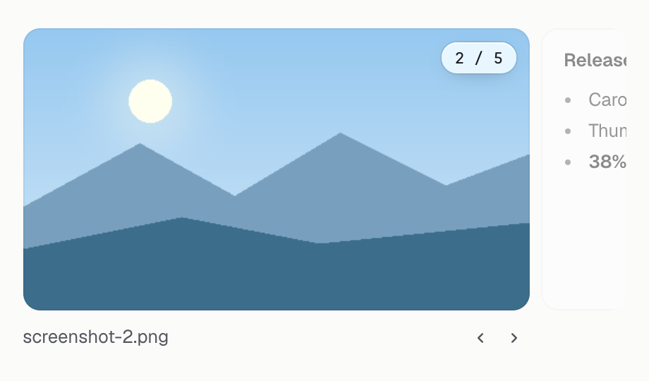
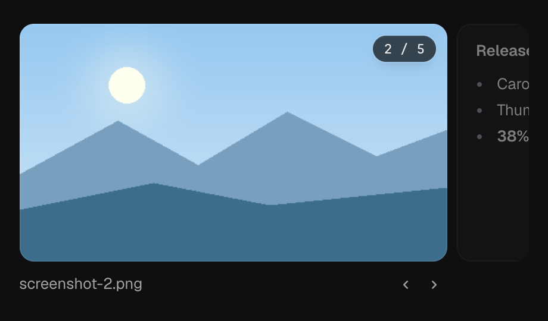
<figcaption>The default <code>peek</code> look: the next slide peeks in, a counter over the slide and the slide's <code>title</code> as its caption.</figcaption>
</figure>

<figure class="tn-figure">
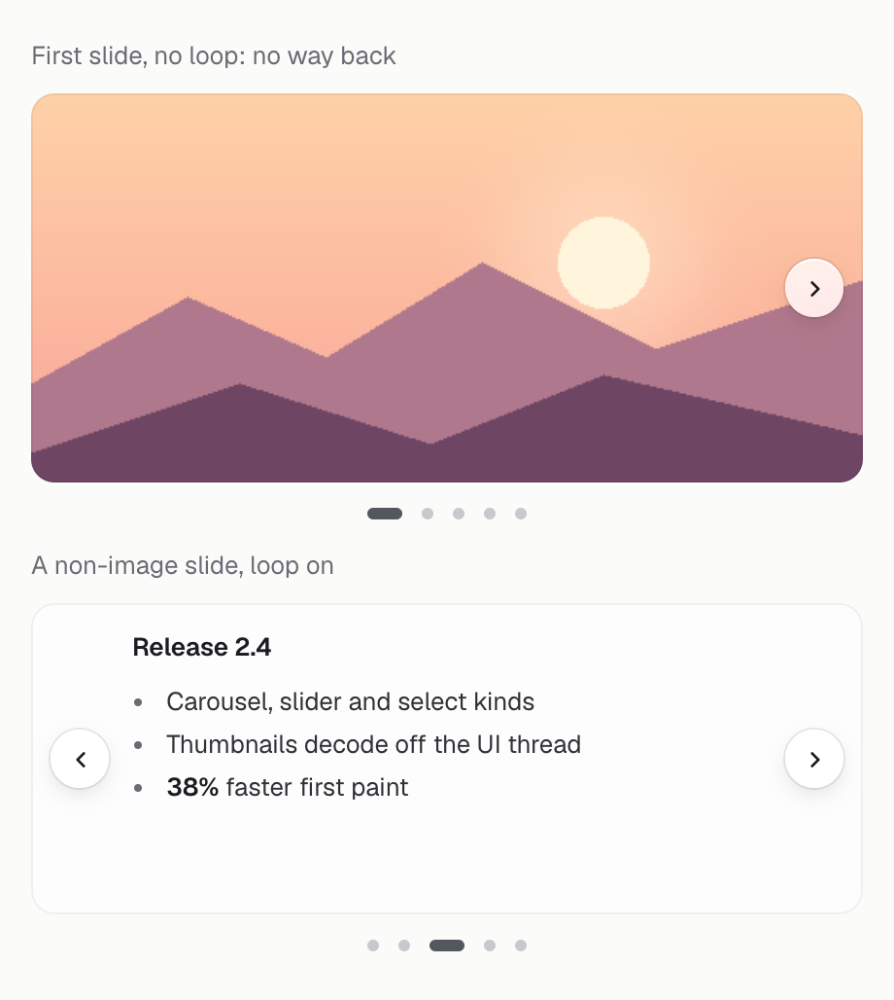
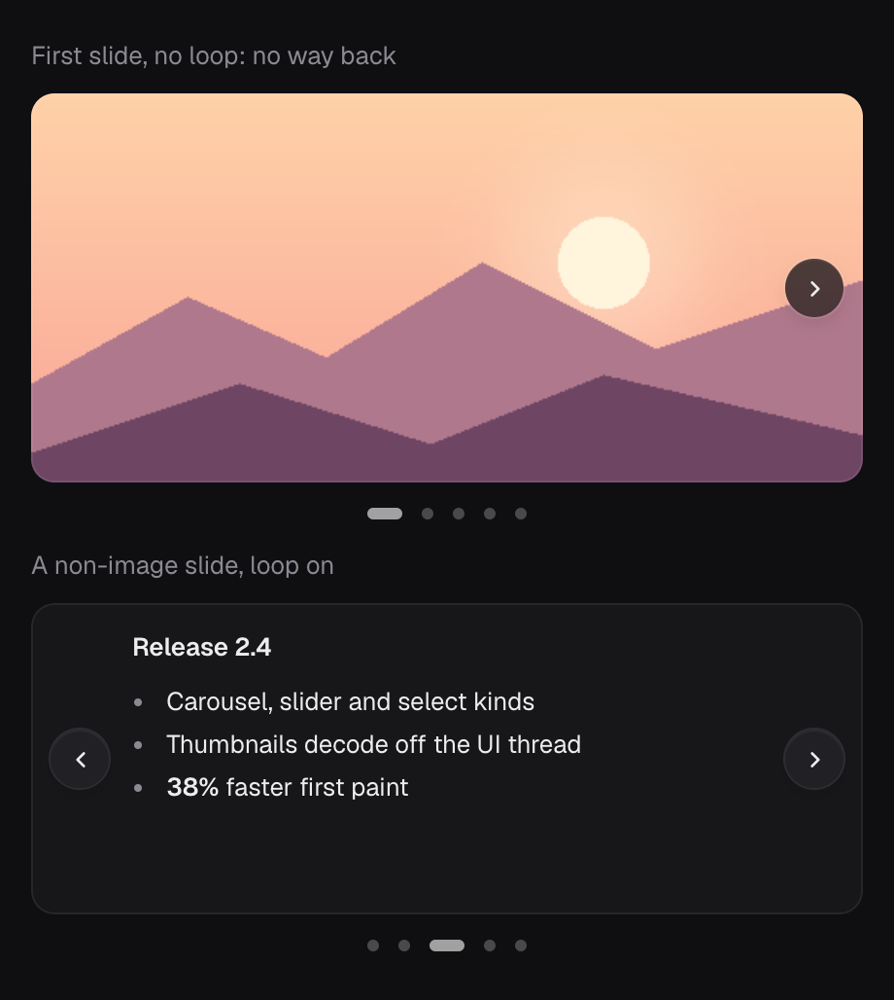
<figcaption>The <code>arrows</code> look: at the first slide without <code>loop</code> there is no way back; with <code>loop</code> both arrows stay.</figcaption>
</figure>

<figure class="tn-figure">
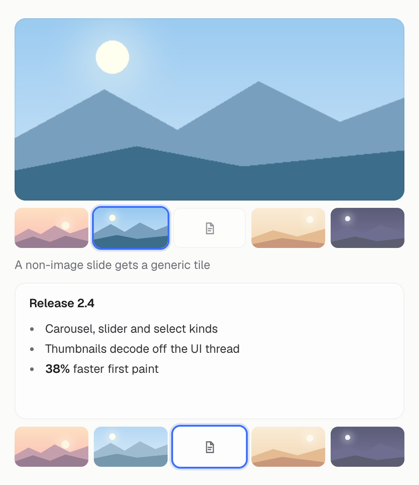
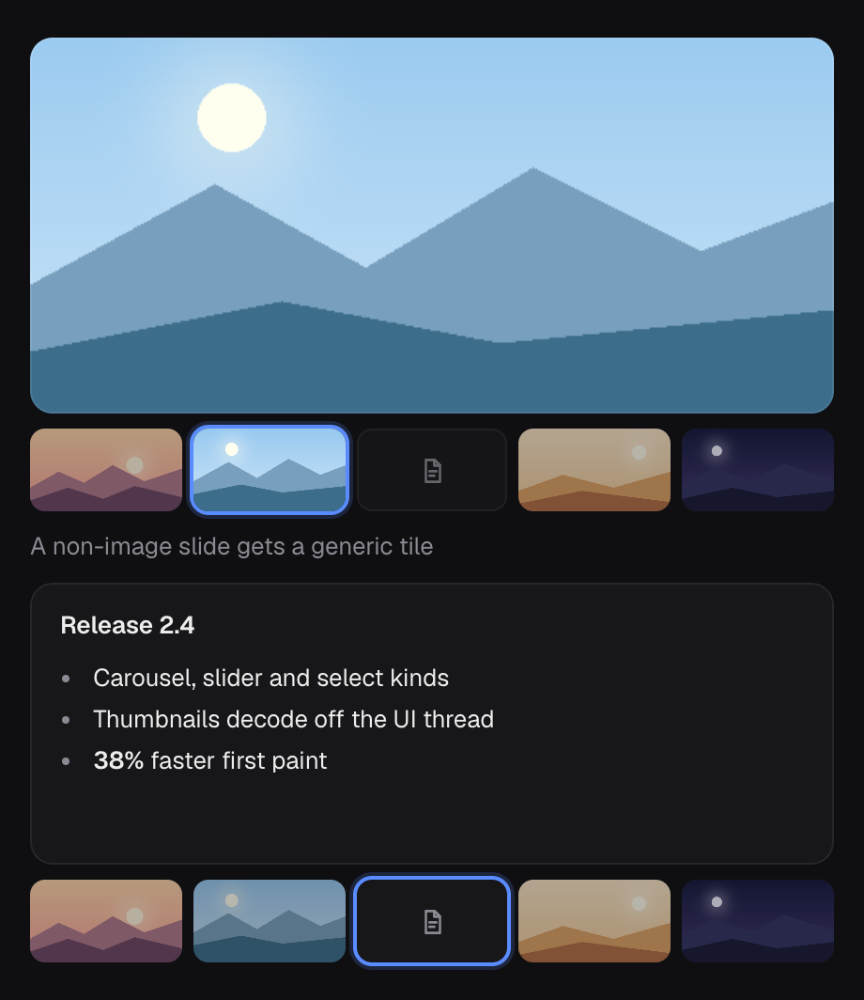
<figcaption>The <code>strip</code> look: an <code>image</code> slide's thumbnail is its own picture, any other slide gets a generic tile.</figcaption>
</figure>

<figure class="tn-figure">
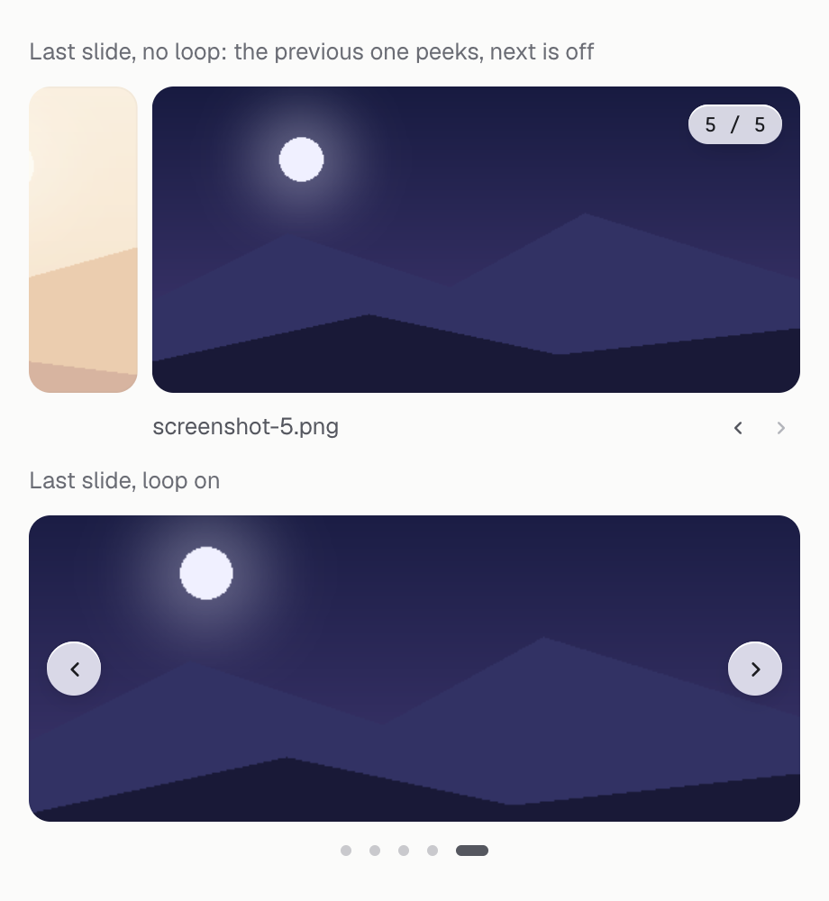
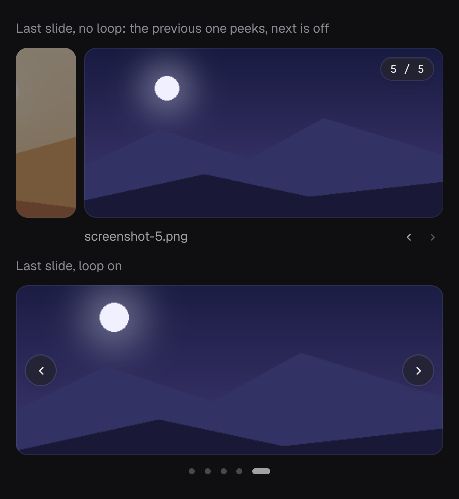
<figcaption>The last slide: without <code>loop</code> the way on is off; with it, the next arrow wraps to the first slide.</figcaption>
</figure>

## `media`

A file named by its path, which Tern reads and shows in the same media viewer it opens files with. Nothing is sent
but the path: Tern loads the bytes itself. Use it to show a screenshot your program wrote, a file a tool read, or a
before/after pair of a changed image; send an [`image`](#image) instead for pictures that exist only in your
program's memory.

**What shows.** Tern classifies the file by its content, not its extension, and draws it with its media viewer:
raster images and SVG (zoom and pan, an ⓘ with the picture's facts), 3D models, and PDF, video and audio in the
platform's reader or player. A bar above the viewer names the file (and its `rev`) and holds the viewer's zoom
menu, ⓘ and, for a picture, Expand, which opens it in Tern's image viewer, as a double-click on the picture does.
A 3D model's material and texture files load from the model's directory (from the same revision with
`rev`). Anything else shows a card in place of a preview: "No preview" (naming the file's kind), "Too large" (over
64 MB; a PDF, video or audio file on disk has no limit), "Not found" (naming the path, or the revision), "LFS object
not fetched", "Not in a git repository", or "Can't read the file" (with the reason).

**Which file.** `path` is absolute, or relative to the pane's working directory (as an `open` action's path
resolves). For a program running on another machine (a remote pane, or a shell that ssh'd into an attached host),
the path is on that machine, and Tern reads it from there as it does for file blocks; a PDF, video or audio file
there is copied to this machine first, for the platform's reader or player.

**Revisions.** With `rev`, Tern shows the version git stores instead of the file on disk: the object
`<rev>:<path relative to its repository root>`, where `rev` is a commit-ish (`HEAD`, a sha, `main~2`) or `:0` for
the index (stage 0). The repository is the one holding the file's directory, read on the machine it is on, so Git
LFS pointers resolve from that machine's LFS store. Without `rev`, the working-tree file shows.

**Snapshots.** Tern reads a picture, SVG or model when the frame naming it arrives, even in a pane out of sight or
far up a transcript, and keeps the bytes. When the node comes into view, scrolls back into it, or is removed and
added again with the same `id` and `path`, Tern shows those bytes without reading the file again, so a screenshot
your program deletes or overwrites right after naming it still shows as it was. This lasts until the surface goes.
Files shown from disk (PDF, video, audio), `rev` nodes, and a transcript Tern restores after it restarts are read
when they show. Nodes of a `screen` surface keep nothing: they read the file again every time.

**Compare.** `media` nodes of one surface with the same `link` pan and zoom together: zooming into the left of a
before/after pair zooms the right to the same place.

**Sizing.** The node fills its container's width. Its height is 20 lines (`20 × --sf-lh`) where the parent sizes
to its content, such as a chat transcript or a card body. In a flex column with room to give (a screen surface's
`main`, a `col` given a height with `min.h` or your sheet) it grows to fill it, and shrinks to no less than 6 lines
when the column is short. `max.h` caps the height as on `image` (`"10lines"` or `"40ch"`), and under a cap the
6-line floor gives way, so `max = { h = "4lines" }` is 4 lines tall. `max.w` bounds the width. Side by side in a
`row`, the nodes share its width equally, each at the default height (or its `max.h`).

**Fallback.** Tern lists `media` in the `kinds` of its `hello` answer. A program speaking the
[Surface Protocol](../protocol/index.md) checks it before sending one (`cx.supports("media")` in the SDKs) and
otherwise falls back, for example to an `image` with the file's bytes as a blob, or to a line naming the file.

**Canvas.** `tern.canvas` rejects `media` nodes (`canvas kind "media" is not supported`).

**Build it:** `tern.ui.node("media", { path = "shots/home.png" })`. There is no dedicated builder.

| Prop | Type | Default | Meaning |
| --- | --- | --- | --- |
| `path` | string | required | The file: absolute, or relative to the pane's working directory |
| `rev` | string | none (the file on disk) | Show git's object `<rev>:<path>`: a commit-ish, or `:0` for the index |
| `link` | string | none | Nodes of one surface with the same `link` pan and zoom together |
| `max` | `{ w?, h? }` | none | Common prop; `h` caps the height in `"Nlines"` or `"Nch"` |

**Children:** none (ignored).

**Events:** none in this version. The viewer's own controls (zoom, pan, the ⓘ facts) are Tern's and tell your
program nothing.

**Styling:**

```html
<div class="sf sf-media" data-id="…">
	<div class="tn-smedia-bar">…the file's name, its rev, the viewer's controls…</div>
	…Tern's media viewer…
</div>
```

| Target | Selector |
| --- | --- |
| The node | `.sf-media` |
| Height capped by `max.h` | `.sf-media.sf-clip` |

The node has a 6px radius and a faint `--l1` ring, and clips the viewer to it. Its default height and floor are
`height` and `min-height` on `.sf-media`, so a sheet can change them, e.g.
`.sf-media[data-role='shot'] { height: calc(12 * var(--sf-lh)) }`.

```lua
local ui = tern.ui

-- the same image before and after a change, side by side, panning together
ui.row({
	ui.node("media", { path = "assets/logo.png", rev = "HEAD", link = "logo" }),
	ui.node("media", { path = "assets/logo.png", link = "logo" }),
})
```

## `attachment`

A file: one a message carries, or one a composer is about to send. Give it a `name` and Tern does the rest: the
extension (from `ext`, else the name, else `mime`) picks the file family and its tint (documents and PDFs in the
accent, sheets green, code amber, images and media orange, the rest gray), `size` in bytes reads as people say it
("2.4 MB"), and an image's `blob` becomes its thumbnail. Upload states are built in: while `uploading` or
`processing` the name shimmers over a progress line (`progress` 0–1; without it the line sweeps), `error` rings the
attachment in red with your `error` text and a retry button, and `removable` adds a × (titled "Cancel upload" while
busy). For a file you want to show rather than name, use [`media`](#media) or an [`image`](#image).

Three looks, by `variant`:

- **`chip`** (default) for files in messages and lists: a 36px type tile (the extension on a tint of the family
  color, or the image's thumbnail), the name over a mono meta line ("PDF · 2.4 MB", or your `meta`), and bare action
  icons at the end.
- **`tile`** for image-heavy trays and galleries: a 68px thumbnail (the image, else the family icon and extension)
  with the name under it in mono, cut in the middle so the extension stays (`homep…back.pdf`). The corner × shows on
  hover (always on an error); a failed tile offers retry on hover. A tile has no room for other `actions`.
- **`pill`** for a composer's tray: a 28px capsule with the family icon, the mono name (cut in the middle) and ×.

A click on an action button sends `action` with its `act`; `remove` also fades the attachment out at once, so the
tray answers before your program does (it shows again if you change its `state` instead of removing it). A click
anywhere else opens `href` (else `path`) like other openable nodes: Tern opens the URL or file. Without either, the
body is not clickable.

**Build it:** `tern.ui.node("attachment", { name = …, size = …, path = … })`.

| Prop | Type | Default | Meaning |
| --- | --- | --- | --- |
| `name` | string | `""` | The file name. Also the tooltip and the accessible name |
| `variant` | `"chip"` \| `"tile"` \| `"pill"` | `"chip"` | The look (below). Other values read as `"chip"` |
| `ext` | string | from `name`, else `mime` | The extension shown and used for the file family (a leading `.` is dropped) |
| `mime` | string | `""` | The MIME type; picks the family when the extension says nothing (`image/*`, `audio/*`, `video/*`, `text/*`, `application/pdf`) |
| `size` | number | none | Size in bytes, shown in decimal units in the default meta ("2.4 MB") |
| `meta` | string | `"EXT · size"` | The chip's meta line at rest, replacing the default |
| `blob` | string | none | An image blob id (a `b` verb's sha256): the thumbnail of an image file (chip tile and `tile`). Decoded as an [`image`](#image) blob; shows when it arrives |
| `href` | string | none | Opened by a click on the attachment |
| `path` | string | none | A file opened by a click when there is no `href` |
| `state` | `"idle"` \| `"uploading"` \| `"processing"` \| `"error"` \| `"done"` | `"idle"` | Upload state; busy states shimmer the name and draw the progress line, `error` rings it red |
| `progress` | number | none | 0–1 (clamped) while busy; the meta reads "Uploading · 62%". Without it the line sweeps |
| `error` | string | `"Upload failed"` | The meta line and tooltip suffix in the `error` state |
| `removable` | boolean | `false` | Adds a × that sends `remove` (titled "Cancel upload" while busy) |
| `actions` | `{ { act: string, icon?: string, title?: string } }` | `{}` | Action icons before the ×, in order (`chip` and `pill`): on an attachment a list, not the common `{ click, menu }` table. `icon` is an [icon name](#icon-names) (default: `act`), `title` the tooltip and accessible name (default: `act` capitalized). An `error` adds `retry` unless listed |

**Variants.**

| `variant` | Look | Use |
| --- | --- | --- |
| `chip` | Type tile, name, meta line, action icons | Files in messages, lists and cards |
| `tile` | 68px thumbnail, name under it, corner × | Image trays and galleries |
| `pill` | 28px capsule: icon, mono name, × | A composer's attachment tray |

**Children:** none (ignored).

**Events:** a click on an action button: `remove` (the ×), `retry`, or one of your `actions`:

```lua
{ ev = "action", id = "main.report", act = "remove" }
```

On a surface that is closed or opened with [`listen:false`](../protocol/surfaces.md#open-and-close) attachments draw
but send nothing and do not fade on remove.

**Keyboard:** attachments never take focus. Drive keyboard selection in your program (Backspace in the composer
removes the last pill, say: drop the node).

**Styling:**

```html
<div class="sf sf-attachment busy" data-id="…" data-variant="chip" data-state="uploading" data-type="sheet"
	role="group" aria-label="runs-2026-10.csv" aria-busy="true" title="runs-2026-10.csv">
	<div class="att-tile" aria-hidden="true"><span class="att-ext">CSV</span></div>
	<div class="att-body">
		<span class="att-name sf-fx-shimmer">runs-2026-10.csv</span>
		<span class="att-meta">Uploading · 62%</span>
	</div>
	<div class="att-acts">
		<button class="att-act" data-act="remove" title="Cancel upload" aria-label="Cancel upload">…</button>
	</div>
	<div class="att-bar" role="progressbar" aria-valuenow="62"><i></i></div>
</div>
```

A `tile` puts `.att-name` under `.att-tile`, its icon and extension in `.att-face`, and its × as `button.att-act.att-x`
inside the tile; a `pill` is `.att-ic`, `.att-name` and `.att-acts`.

| Target | Selector |
| --- | --- |
| The node | `.sf-attachment` |
| Look, state, file family | `.sf-attachment[data-variant]`, `[data-state]`, `[data-type]` (`image`, `pdf`, `sheet`, `code`, `archive`, `audio`, `video`, `doc` or `file`) |
| Openable / busy / removing | `.sf-attachment.openable` (has `href`/`path`), `.busy` (uploading or processing), `.removing` (a remove click awaiting your program) |
| Type tile or thumbnail box | `.att-tile` (inner; `.sf-thumb-ready` while the image shows, `img.sf-thumb` the picture) |
| A tile's face, extension, a pill's icon | `.att-face`, `.att-ext`, `.att-ic` (inner, may change) |
| Name and meta | `.att-body`, `.att-name`, `.att-meta` (inner, may change) |
| Action buttons | `.att-acts`, `.att-act[data-act]` (inner); a tile's corner × `.att-x`, its retry `.att-retry` |
| Progress line | `.att-bar > i` (inner; `.indeterminate` without `progress`) |

`data-type` sets `--tc`, the family color. `--att-bar` is the progress line's color, `--live` while processing.

```lua
local ui = tern.ui

ui.node("attachment", { name = "homepage-feedback.pdf", size = 2400000, path = "/tmp/homepage-feedback.pdf",
	actions = { { act = "download", icon = "download", title = "Download" } } })
ui.node("attachment", { name = "runs-2026-10.csv", state = "uploading", progress = 0.62, removable = true })
-- a composer tray
ui.node("row", { gap = "sm", wrap = true }, {
	ui.node("attachment", { variant = "pill", name = "report.pdf", removable = true, key = "report" }),
	ui.node("attachment", { variant = "tile", name = "shot-1.png", blob = state.shot, removable = true }),
})
```

The same in TSX (TypeScript SDK):

```tsx
<attachment name="homepage-feedback.pdf" size={2_400_000} path="/tmp/homepage-feedback.pdf"
   actions={[{ act: 'download', icon: 'download', title: 'Download' }]} />
<attachment name="runs-2026-10.csv" state="uploading" progress={0.62} removable
   onAction={{ remove: () => cancel('runs') }} />
<attachment variant="tile" name="spec.pdf" state="error" error="Too large" removable />
```

<figure class="tn-figure">
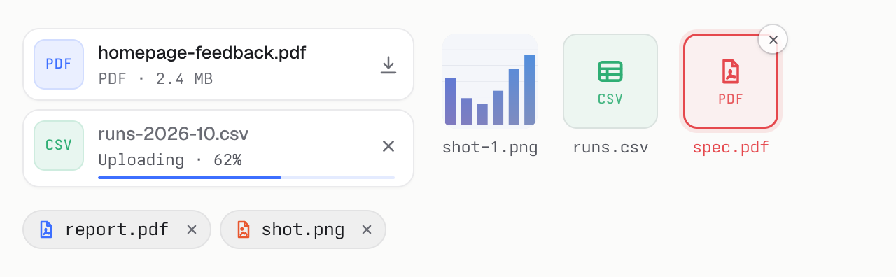
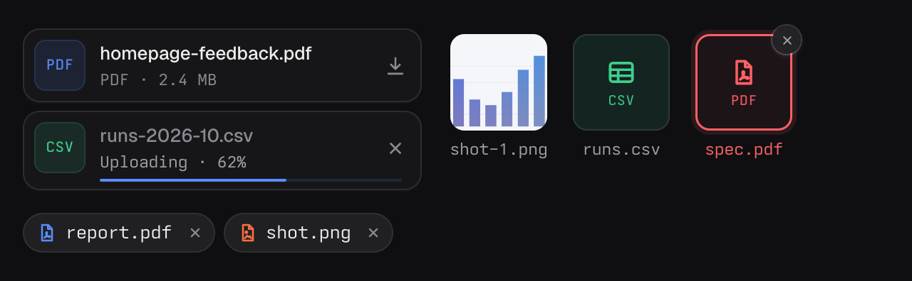
<figcaption>The three looks: chips, tiles and composer pills.</figcaption>
</figure>

<figure class="tn-figure">
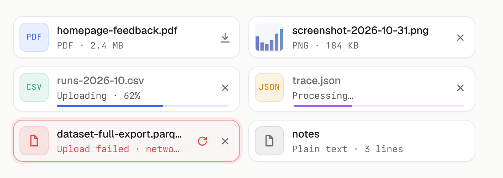
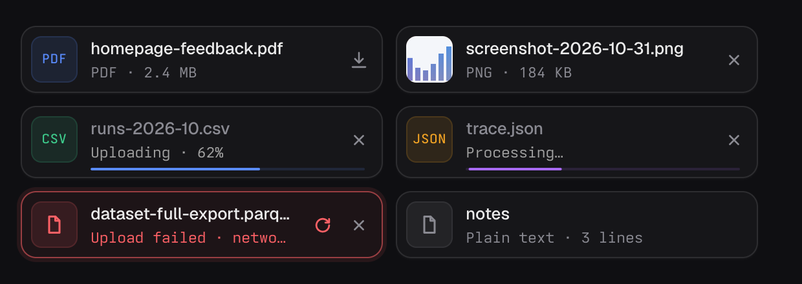
<figcaption>Chips at rest, uploading, processing and failed; an image shows its thumbnail in the type tile.</figcaption>
</figure>

<figure class="tn-figure">
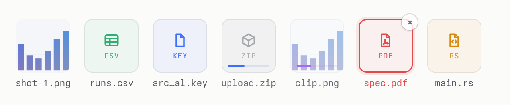
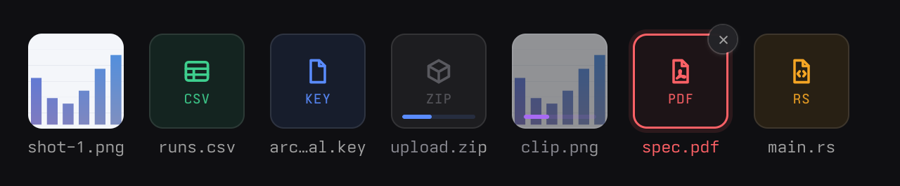
<figcaption>Tiles: thumbnails for images, the family icon and extension for the rest; names cut in the middle.</figcaption>
</figure>

<figure class="tn-figure">
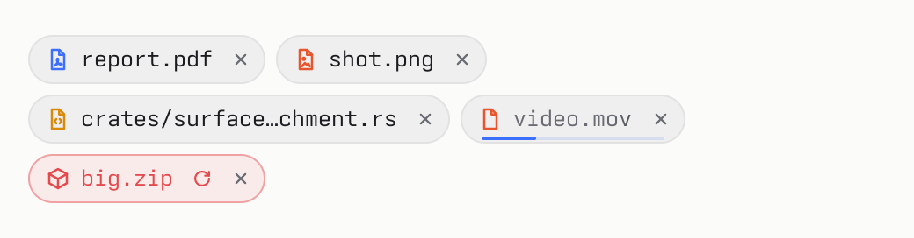
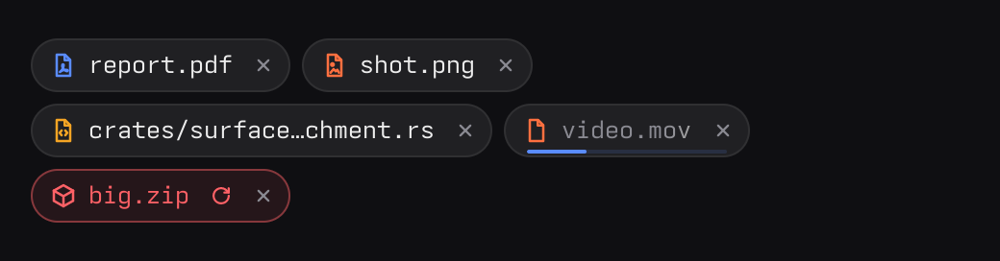
<figcaption>Pills for a composer tray.</figcaption>
</figure>

## Related pages

- [Elements](index.md): common props, actions and the kind index
- [Motion](motion.md): the `meter` kind behind meter cells
- [Lists](lists.md): selectable rows, and the `picker` whose marks `avatar` draws
- [Inputs and Buttons](input.md): the `button` behind button cells and selection-bar actions
- [UI Builders](../reference/ui.md): exact builder output
- [Styling views](../styles/index.md), [Variables](../styles/variables.md), [Supported CSS](../styles/css.md)
