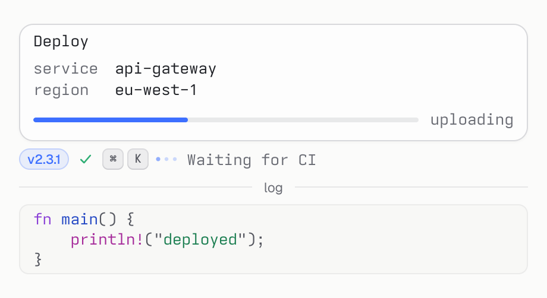
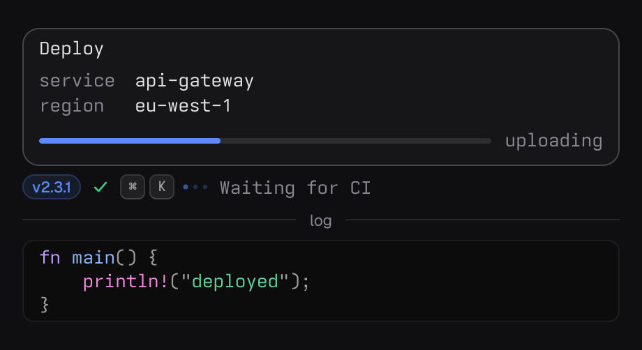
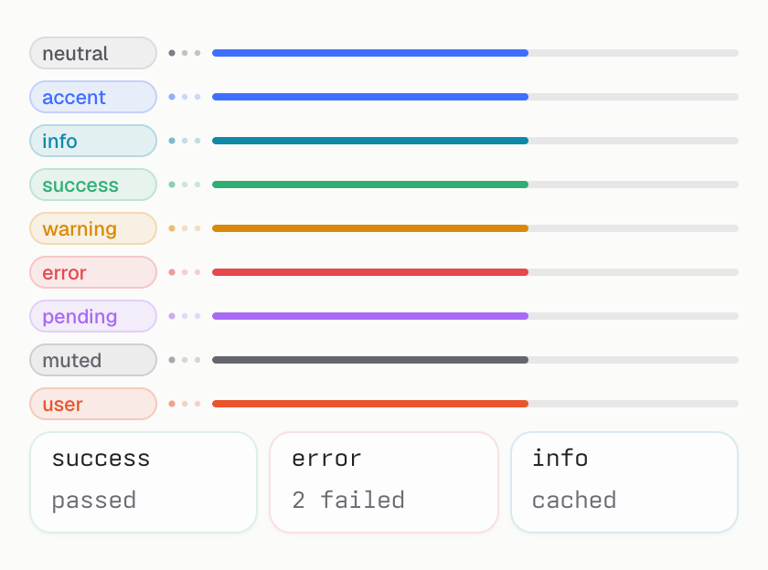
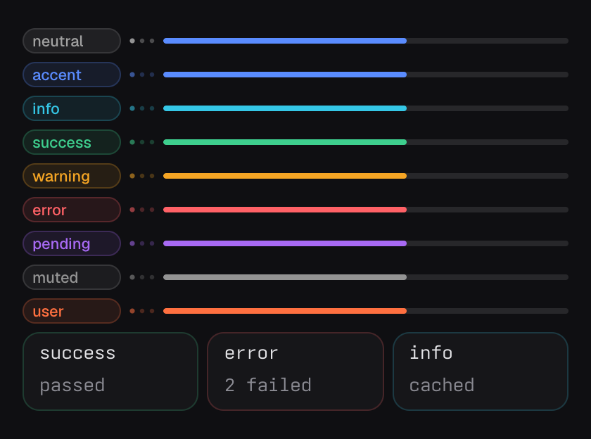

# Elements

A view is a tree of nodes, and every node has a kind: `text`, `card`,
`table`, `el`, and so on. Tern draws each kind natively. It lays the node
out, colors it from the theme, animates it and keeps its view state, while
your code only says what is on screen. This part of the book documents
every kind: its props, how it behaves, the events it sends, and the
elements and classes a style sheet can target.

**Before you build a view, read [Designing Views](../guides/design.md):**
which kind to reach for, the sans face for apps, buttons, selectable tables,
panel heads, the four states, and what not to do. Views that follow it look
like Tern's own without CSS.

```lua
type Node = {
	k: string,               -- the kind
	p: { [string]: any }?,   -- props
	c: { Node }?,            -- children
}
```

`tern.ui` has builders for the common kinds (see [UI Builders](../reference/ui.md)),
and `tern.ui.node(kind, props, children)` builds any kind:

```lua
local ui = tern.ui
ui.col({
	ui.card("Deploy", {
		ui.kv({ { "service", "api-gateway" }, { "region", "eu-west-1" } }),
		ui.progress(0.4, "uploading"),
	}),
	ui.row({
		ui.badge("v2.3.1", "accent"),
		ui.node("icon", { name = "success", tone = "success" }),
		ui.node("kbd", { keys = { "cmd", "K" } }),
		ui.node("spinner", { style = "dots", label = { ui.span("Waiting for CI", "muted") } }),
	}),
	ui.rule("log"),
	ui.code('fn main() {\n    println!("deployed");\n}', "rust"),
})
```

<figure class="tn-figure">


<figcaption>Eleven kinds from one builder call: col, card, kv, progress, row, badge, icon, kbd, spinner, rule and code.</figcaption>
</figure>

How your views reach the screen, how block node ids and keys work, and how
events come back are in [Building Views](../guides/views.md) and
[Blocks](../guides/blocks.md). A program that isn't a plugin sends the same
nodes over the [Surface Protocol](../protocol/index.md). How to style what
these pages describe is in [Styling Views](../styles/index.md).

## Every kind

| Kind | Page | Builder | Children | Draws |
| --- | --- | --- | --- | --- |
| `col` | [Layout](layout.md#col) | `col`, `lines` | in order | A vertical stack |
| `row` | [Layout](layout.md#row) | `row` | in order | A horizontal flex row |
| `card` | [Layout](layout.md#card) | `card`, `diagnostic` | placed by the card | A panel: a head with icon, meta and controls over a body, optionally folding |
| `section` | [Layout](layout.md#section) | `section` | placed by the section | A lighter disclosure group with no ring |
| `rule` | [Layout](layout.md#rule) | `rule` | the `end` child, placed by the rule | A divider hairline, a note row or a pinned transcript marker (checkpoints, joins, compactions) |
| `spacer` | [Layout](layout.md#spacer) | `node` | none | Vertical space |
| `split` | [Layout](layout.md#split) | `node` | the panes, in order | Panes side by side or stacked that the user resizes by dragging the handles between them |
| `scroll` | [Layout](layout.md#scroll) | `node` | in order | A box that scrolls its children inside its bound, optionally kept to its end (logs, chats) |
| `empty` | [Layout](layout.md#empty) | `node` | its actions, in order | An empty state: icon, title, one muted line and the actions that fill it |
| `text` | [Text and Code](text.md#text) | `text`, `overflow` | none | Styled spans, wrapped or truncated, optionally citing their sources |
| `md` | [Text and Code](text.md#md) | `md` | none | Markdown |
| `code` | [Text and Code](text.md#code) | `code` | none | Highlighted code, optionally with line numbers |
| `diff` | [Text and Code](text.md#diff) | `diff` | none | A unified or split diff |
| `ansi` | [Text and Code](text.md#ansi) | `ansi` | none | A small terminal fed escape sequences |
| `rows` | [Text and Code](text.md#rows) | `node` | none | Pre-rendered ANSI rows (migration fallback) |
| `math` | [Text and Code](text.md#math) | `node` | none | TeX math |
| `kv` | [Data](data.md#kv) | `kv` | none | An aligned key/value list |
| `stats` | [Data](data.md#stats) | `stats` | none | A flat strip of stat tiles: label, value, sub line |
| `table` | [Data](data.md#table) | `table` | none | A table with priority-hidden columns, sortable headers, selectable or multi-picked rows with a selection bar, and text, badge, button, sparkline and meter cells |
| `tree` | [Data](data.md#tree) | `tree`, `parse.json_tree` | none | A disclosure tree |
| `json` | [Data](data.md#json) | `node` | none | A JSON value as a foldable tree |
| `badge` | [Data](data.md#badge) | `badge` | none | A pill chip |
| `kbd` | [Data](data.md#kbd) | `node` | none | Keycaps |
| `icon` | [Data](data.md#icon) | `node` | none | A named icon |
| `avatar` | [Data](data.md#avatar) | `node` | none | A person's, bot's or provider's mark: initials on a seeded gradient, a tinted squircle tile, an icon or a picture, with a status dot |
| `avatars` | [Data](data.md#avatars) | `node` | none | An overlapping stack of avatars with a `+N` overflow chip and a muted label |
| `image` | [Data](data.md#image) | `node` | over the picture | An image from a blob (animations play) |
| `media` | [Data](data.md#media) | `node` | none | A file by path (or git revision) in Tern's media viewer |
| `carousel` | [Data](data.md#carousel) | `node` | the slides, one shown at a time | Slides on a track that slides sideways: a peek and counter, arrows and dots, or a filmstrip |
| `attachment` | [Data](data.md#attachment) | `node` | none | A file chip, thumbnail tile or composer pill with upload progress, error and actions |
| `list` | [Lists, Menus and Navigation](lists.md#list) | `list` | its `item`s | A selectable list |
| `item` | [Lists, Menus and Navigation](lists.md#item) | `list` | none | One list row |
| `tabs` | [Lists, Menus and Navigation](lists.md#tabs) | `node` | none | A tab strip, underlined or segmented |
| `picker` | [Lists, Menus and Navigation](lists.md#picker) | `node` | the preview | A searchable picker sheet |
| `menu` | [Lists, Menus and Navigation](lists.md#menu) | `node` | none | A button that opens a dropdown of commands: icons, keys, checks, radio groups, submenus, rich two-line rows |
| `menubar` | [Lists, Menus and Navigation](lists.md#menubar) | `node` | none | A row of menu titles, each opening a menu below it: a quiet strip or a floating glass pill |
| `nav` | [Lists, Menus and Navigation](lists.md#nav) | `node` | none | Navigation pills or links; items with sub-items open a menu or a rich panel |
| `breadcrumb` | [Lists, Menus and Navigation](lists.md#breadcrumb) | `node` | none | The trail from a root to the current place: chevron crumbs with icons, or a mono path; a long middle folds into a "…" menu |
| `pager` | [Lists, Menus and Navigation](lists.md#pager) | `node` | none | Pagination: a range with arrows, numbered pages or a show-more row |
| `spinner` | [Progress and Motion](motion.md#spinner) | `node` | none | An activity indicator |
| `shimmer` | [Progress and Motion](motion.md#shimmer) | `node` | none | A shimmering label |
| `skeleton` | [Progress and Motion](motion.md#skeleton) | `node` | none | Placeholder shapes (lines, an avatar, rows, tiles or a block) where content is still loading |
| `elapsed` | [Progress and Motion](motion.md#elapsed) | `node` | none | A live timer |
| `rate` | [Progress and Motion](motion.md#rate) | `node` | none | A number easing between updates |
| `progress` | [Progress and Motion](motion.md#progress) | `progress` | none | A progress bar |
| `meter` | [Progress and Motion](motion.md#meter) | `meter`, `test_summary` | none | A value as a bar, ring or grid |
| `chart` | [Progress and Motion](motion.md#chart) | `bars`, `spark` | none | Bars, a sparkline, a heatmap, a line or area over time (one series or several) or a donut of shares |
| `effort` | [Progress and Motion](motion.md#effort) | `node` | none | A thinking-effort glyph |
| `editor` | [Inputs and Buttons](input.md#editor) | `node` | none | A multi-line text field with a caret |
| `input` | [Inputs and Buttons](input.md#input) | `node` | none | A single-line text field, plain or framed, with icons, keycaps, a clear ×, attached wells, buttons and a stepper |
| `button` | [Inputs and Buttons](input.md#button) | `button` | none | A button: label, icon, keycaps, variant and size |
| `buttons` | [Inputs and Buttons](input.md#buttons) | `node` | `button` nodes | Buttons drawn as one control: joined, split or a toolbar well |
| `select` | [Inputs and Buttons](input.md#select) | `node` | none | A value picked from a menu: a field, a quiet trigger, or a searchable combobox |
| `switch` | [Inputs and Buttons](input.md#switch) | `node` | none | An on/off setting: a settings row, a compact list switch or an Off \| On segment |
| `slider` | [Inputs and Buttons](input.md#slider) | `node` | none | A value, or a range, dragged along a track |
| `otp` | [Inputs and Buttons](input.md#otp) | `node` | none | A one-time code, one cell per character: separate cells, one joined field or underlines |
| `calendar` | [Inputs and Buttons](input.md#calendar) | `node` | none | A month grid, or presets beside a week strip, to pick a day or a range |
| `date` | [Inputs and Buttons](input.md#date) | `node` | none | A date field that opens a month calendar under it |
| `field` | [Inputs and Buttons](input.md#field) | `node` | its control(s), in order | A labelled form row: label, control, help or error |
| `status` | [Bars, Toasts and Overlays](chrome.md#status) | `node` | its `seg`s | A status bar strip |
| `seg` | [Bars, Toasts and Overlays](chrome.md#seg) | `node` | in order, between its icon and text | A status bar segment |
| `toast` | [Bars, Toasts and Overlays](chrome.md#toast) | `node` | none | A transient notice |
| `overlay` | [Bars, Toasts and Overlays](chrome.md#overlay) | `node` | placed by the overlay | A floating panel, dialog, edge sheet or bottom drawer in `layer`, with a head and a footer bar |
| `tool` | [Agent, Chat and Task Kinds](work.md#tool) | `node` | placed by the tool | One coding-agent tool call, or one waiting for approval |
| `agent` | [Agent, Chat and Task Kinds](work.md#agent) | `node` | placed by the agent | One subagent row |
| `trace` | [Agent, Chat and Task Kinds](work.md#trace) | `node` | keyed to a line: under it; the rest: the body | An agent's steps, a chain of thought, a reasoning block with sources |
| `checklist` | [Agent, Chat and Task Kinds](work.md#checklist) | `node` | none | A todo list |
| `message` | [Agent, Chat and Task Kinds](work.md#message) | `node` | its `avatar` child in the avatar slot, the rest as the body | One chat message: author, time, avatar, body, reactions, hover actions and a status line |
| `suggestions` | [Agent, Chat and Task Kinds](work.md#suggestions) | `node` | none | Suggested prompts as chips, numbered rows or small cards; a click sends `activate` with the item |
| `questions` | [Agent, Chat and Task Kinds](work.md#questions) | `node` | its questions' `input`s keyed `<id>.other` | A questionnaire: steps, inline chips or a folding list |
| `stacktrace` | [Agent, Chat and Task Kinds](work.md#stacktrace) | `node` | none | An error and its stack frames: lit app frames, folded library frames, code at a frame |
| `block` | [Agent, Chat and Task Kinds](work.md#block) | Tern's own | placed by the block | A shell command's output and its lens view |
| `prefs` | [Agent, Chat and Task Kinds](work.md#prefs) | `node` | placed by role | A settings page or sheet |
| `el` | [HTML Elements](el.md) | `el` | in order (none for `input` and `hr`) | A plain HTML element, or a checkbox or radio |

"In order" means Tern draws the node's children one after another inside
it. "Placed by" means the kind decides where each child goes, such as a
card putting its head child in the header row. Children of a kind marked
"none" are ignored.

Text kinds (`text`, `md`, `code`, `ansi`, `math`, `editor`, `input`,
`shimmer`, `el`) keep their text in the `text` prop. In a block view, a
`text` prop that grows by a suffix goes to the window as an append, so
streaming long output costs only the new bytes (see
[Host API](../reference/api-host.md#view-model)).

## Props every node takes

These work on every kind, in addition to the kind's own props.

| Prop | Type | Effect |
| --- | --- | --- |
| `key` | string | Identity among siblings in a block view. It keeps the node's id across reorders. Tern remembers local state by this key among the node's siblings, not across the whole surface: deleting and adding a node with a new id and the same key under the same parent preserves that state. The same key under another parent has independent state. Without a key, local state uses the node's id. Two siblings with the same key are an error (`duplicate child key`) |
| `role` | string | A name of yours, exposed to CSS as `data-role`. Use names under your plugin id (`myplugin.row`) |
| `tone` | `neutral`, `accent`, `info`, `success`, `warning`, `error`, `pending`, `muted`, `user` | The semantic color of the node's chrome (a card's ring, a badge's pill, a spinner, a progress fill, a list row's icon). Exposed as `data-tone`, which sets the tone color `--tc` on the element; other values are ignored |
| `hidden` | boolean | Keeps the node mounted but not laid out (class `sf-hidden`, `display: none`). Cheaper than removing and adding it again |
| `mark` | `pick`, `drop` | Transient selection drawn over the node without restyling it, exposed as `data-mark`: `pick` draws an accent bar at the node's left, `drop` dims it. Other strings only set the attribute |
| `actions` | `{click?, dblclick?, menu?}` | What a pointer does: `menu` lists the actions a right-click offers, followed by Copy when you don't list `copy`. See [Actions and events](../guides/views.md#actions-and-events). A node with a click or double-click action gets class `sf-act` and the pointing-hand cursor |
| `title` | string | A tooltip |
| `hovercard` | node tree `{k, p?, c?}` | A richer tooltip: a floating glass card drawn from an id-less node tree (any kind, usually a `col`; `id`/`key` inside are ignored). It opens when the pointer rests on the node (about 350 ms, 200 ms when a tooltip or card was just showing), below the node (above when there is no room), kept inside the pane. It stays open while the pointer is over the node or the card and closes on leave (after a 150 ms grace), press, key or scroll. While open it replaces the `title` tooltip. A card that is one `md` is a read-only preview of text: 640 px wide, and the pointer passes through it, so it stays open only over the node and moving onto another node with a card under it switches cards. Set a new tree to update it (Tern diffs it, keeping unchanged parts); `null` removes it. The card's nodes are not addressable by ops. An older Tern ignores it and shows the `title`. The same card can sit on part of a node: a [`code`](text.md#code) element's `folds[].hovercard` opens over that folded row |
| `aria` | string | The accessible name of a node that shows no text (`aria-label`). It replaces the name a kind gives itself (a `kbd`'s spoken keys) |
| `href` | string | A link for the node: ⌘-click opens it, and the `copy` and `open` actions use it. Exposed as `data-href` |
| `grow`, `shrink` | number | Flex grow and shrink inside a `row` or `col` |
| `basis` | number or `"content"` | Flex basis: a fraction of the parent (`0.5` is half), or `"content"` for the node's own size without shrinking |
| `min`, `max` | `{w?, h?}` | Size bounds. Each is `"<n>ch"` (character cells), `"<n>lines"` (text lines) or a number as a fraction of the parent (`0.5` is half); negative or other values are ignored. Never pixels, so a view scales with the font. A `max.h` also clips the node (class `sf-clip`, `overflow: hidden`); when it cuts something it also gets class `sf-clipped`, and outside omp's own views its last two lines fade out. A `seg`'s `min.w` sets no CSS bound: it is how far the status strip lets the segment truncate ([`seg`](chrome.md#seg)) |

Tone across kinds, as the badge, spinner, progress and card kinds draw it:

```lua
local rows = {}
for _, tone in ipairs({ "neutral", "accent", "info", "success", "warning", "error", "pending", "muted", "user" }) do
	table.insert(rows, ui.row({
		ui.node("badge", { text = tone, tone = tone, min = { w = "9ch" } }),
		ui.node("spinner", { style = "dots", tone = tone }),
		ui.node("progress", { value = 0.6, tone = tone, grow = 1 }),
	}))
end
local function card(tone, note)
	local c = ui.card(tone, { ui.text({ ui.span(note, "muted") }) })
	c.p.tone, c.p.grow, c.p.basis = tone, 1, 0.3
	return c
end
table.insert(rows, ui.row({ card("success", "passed"), card("error", "2 failed"), card("info", "cached") }))
return ui.col(rows)
```

<figure class="tn-figure">


<figcaption>A <code>neutral</code> badge is a gray chip and a <code>neutral</code> progress bar fills with the accent.</figcaption>
</figure>

Your own sheet can use the tone color too: any node with a `tone`, an
`el` included, has `--tc` set, so `color: var(--tc)` follows it.

`collapsible` and `collapsed` are props of `card` and `section` (and of
the tool and agent kinds); see [Layout](layout.md#card).

## What a node becomes

Every node below a region root becomes one element in the window's
document:

```html
<div class="sf sf-card" data-id="main.0" data-role="deploy.summary" data-tone="success">
	<!-- the kind's own parts, then its children -->
</div>
```

- The element is a `div`. Inline kinds (`badge`, `kbd`, `icon`,
  `spinner`, `shimmer`, `elapsed`, `rate`, `effort`) are a `span`. An
  `el` uses its `tag`, except that a `form` or an unknown tag is a `div`
  and a checkbox or radio `input` is a `span`.
- Classes `sf` and `sf-<kind>` are always there. `data-id` is the node's
  id. Some kinds add classes and attributes of their own to the element
  (`kbds` and `role="img"` on a `kbd`, `role="progressbar"` on a
  `progress`).
- The common props add `data-role`, `data-tone`, `data-mark`,
  `data-href`, `title` and `aria-label`, and the classes `sf-hidden`,
  `sf-act` and `sf-clip`. The flex and size props become the element's
  inline style.
- Inside, each kind builds its own parts with classes such as
  `.sf-card-head`. The kind pages list them. They are Tern's structure and
  may change between versions. Style by kind, role, tone and your own `el`
  classes where you can.

The region roots (`main`, `dock`, `layer`) don't get elements of their
own. Their children go into three region elements, one per region:

```html
<div class="sf-region sf-main" data-scope="sf1" data-surface="plugin.deploy.status" data-role="deploy.main">
	<!-- the elements of main's children -->
</div>
```

- Classes `sf-region` and `sf-main`, `sf-dock` or `sf-layer`, plus
  state classes of Tern's own (`sf-unfocused` while the pane isn't the
  one being typed in, `sf-folded` while it also folds omp's composer,
  `sf-h-annotated` while markdown headings stay body size).
- `data-scope` is the view's scope token (`sf<N>`). Tern confines a
  program's style sheets to the regions carrying it.
- `data-surface` is the surface's role: `plugin.<plugin>.<block>` for a
  block. It is absent when the surface has no role.
- `data-role` is the region root's `role` prop.

See [Styling Views](../styles/index.md) for every hook, the cascade and
recipes.

## Mistakes

Tern checks each node when it arrives. An unknown kind, an op on a node
that doesn't exist, or an `el` with an unknown tag is rejected or drawn as
a plain `div`, and reported with an `error` event. Those events don't
reach a block's `event` handler, which only hears user events, so when a
node doesn't show up, list the block's elements with the control socket's
`tree` command (`tree "[data-surface='plugin.<plugin>.<block>']"`, see
[Debugging](../guides/debugging.md)). The `tern.ui` builders catch most
mistakes earlier and raise with the argument's path.
