# Inputs and Buttons

Two kinds draw a text field whose text your program owns: `editor` for
multi-line text (a composer, a message box, a code draft) and `input` for one
line (a filter, a form field), which can also carry icons, wells, buttons and
a stepper. Tern draws the text, the caret, the selection and decorations; it
never edits the text itself. Keys reach your program, and your program
answers with new `text` and `cursor` props. `otp` draws a one-time code the
same way, one cell per character.

The other controls hold a value instead of text: `select` picks one out of a
set, `calendar` and `date` pick a day or a range, `slider` sets a number
along a track and `switch` turns a setting on or off. They are pointer-only:
a click shows its result at once and sends an event, the keys stay with your
program, and your next prop wins over the user's pick. `button` is the action
beside them: Tern's own button look, with keycaps for the key that does the
same; `buttons` draws a few as one control. `field` puts a label, help and an
error around any of them.

| Kind | Builder | Draws |
| --- | --- | --- |
| [`editor`](#editor) | `tern.ui.node("editor", …)` | A multi-line field: soft wrap, optional line cap, code highlighting |
| [`input`](#input) | `tern.ui.node("input", …)` | A one-line field that scrolls sideways, plain or framed with icons, wells, buttons and a stepper |
| [`otp`](#otp) | `tern.ui.node("otp", …)` | A one-time code, one cell per character: separate cells, one joined field or underlines |
| [`select`](#select) | `tern.ui.node("select", …)` | A value picked from a menu: a field, a quiet trigger or a searchable combobox |
| [`calendar`](#calendar) | `tern.ui.node("calendar", …)` | A month grid, or presets beside a week strip, to pick a day or a range |
| [`date`](#date) | `tern.ui.node("date", …)` | A date field that opens a month calendar under it |
| [`slider`](#slider) | `tern.ui.node("slider", …)` | A value, or a range, dragged along a track |
| [`switch`](#switch) | `tern.ui.node("switch", …)` | An on/off setting: a settings row, a compact switch or an Off \| On segment |
| [`button`](#button) | `tern.ui.button(text, props?)` | A button: label, icon, keycaps, variant and size |
| [`buttons`](#buttons) | `tern.ui.node("buttons", …, buttons)` | Buttons drawn as one control: joined, split or a toolbar well |
| [`field`](#field) | `tern.ui.node("field", …, controls)` | A labelled form row: the label, the control(s), help or an error |

Only `button` has a builder of its own; use [`tern.ui.node`](../reference/ui.md#node)
for the rest. `tern.canvas` rejects the two text fields: a canvas node of kind `editor` or `input` (or
`image`) fails with `canvas kind "editor" is not supported`. Use them in a
block's view.

## The program owns the text

A field is a picture of your state. Nothing typed changes it until your view
sends a new `text`:

1. The user presses a key while your block's pane has focus. The key goes to
   your block's `key` handler (see [Blocks](../guides/blocks.md#keys-and-paste)),
   never to the field as a DOM event.
2. Your handler changes your state (inserts the character, moves the
   cursor) and returns.
3. Your next `view` returns the field with the new `text` and `cursor`; Tern
   redraws the runs that changed and keeps the caret in view.

Offsets (`cursor`, `anchor`, `decor` bounds) are **UTF-16 code units**, as
in a JavaScript string. In Luau, where strings are bytes, convert: ASCII text
has the same offsets either way; for other text count UTF-16 units
(`utf8.codepoint` above `0xFFFF` counts 2). An offset inside a surrogate pair
rounds down to the character it splits; an offset past the end clamps to the
end.

## Focus and the caret

The caret is one 2 px beam (`span.sf-caret`) that takes no room. It shows on
every field, dimmed (`opacity: 0.3`), except a `readonly` one, and blinks at
full strength only on the field that has the surface's **focus** (a focused
`readonly` field shows it too). Focus is the TSP `focus` frame op
(`["focus", id]` or `["focus", null]`); it names the node that owns the caret
and the IME. The view diff never sends it, so a block sets it with a raw op:

```lua
cx:frame({ { "focus", "main.query" } })
```

`id` is the node's id in the view (`main.query` for a child keyed `query` of
`main`; see [Blocks](../guides/blocks.md)). Raw ops bypass the diff, and the
focus stays until another `focus` op changes it. Give the field a stable `key`
so its id doesn't move. On a focused field the node gets `.focused` (an accent
ring) and the caret blinks; it holds steady under reduced motion, in a hidden
pane and in a pane not typed in (`.sf-still`, `.sf-paused`, `.sf-unfocused`
on an ancestor).

Focus only decides which field shows the live caret. Keys still go to your
`key` handler whichever field is focused; route them by your own state (keep
the focused field's key in state next to its text).

A primary click in a field that isn't the focus (and isn't `readonly`) sends a
`focus` event instead of placing a caret:

```lua
ev = { ev = "focus", id = "main.query" }
```

Answer it by moving your own focus there and sending the `focus` op, or ignore
it (a modal overlay may keep the keys). A click in the focused field places
the caret only when native editing is on (below): for a block, only one that
opts into the `edit` feature.

## Native editing, `edit` and `undo`

TSP lets the terminal keep a selection of its own over the drawn text (⇧ with
arrows, ⌘A, ⌘C, drag), apply edits to it and send them as `edit` events
(`{ev = "edit", id, from, to, text, cursor, len}`, replace `from..to` with
`text`, caret at `cursor`, `len` the text length it was computed against), and
take ⌃Z as an `undo` event (`{ev = "undo", id}`). The spell checker's
context menu over a `typo` decoration also answers with an `edit` event.

Tern turns this on only for a program whose `hello` lists the `edit` feature
(and `undo` for ⌃Z), only on a field without `mode` and not `readonly`, and
only while the user's Settings › Terminal › Native composer editing is on.
A block's hello lists the features in its definition's `features`
([`BlockDef`](../reference/api-host.md#blockdef)); without them (the
default):

- every key, including ⇧-arrows, ⌘A and ⌃Z, reaches your `key` handler;
- there is no native selection: draw one yourself with `anchor`;
- no `edit` or `undo` events arrive, a click in the focused field does
  nothing, and the `typo` context menu doesn't offer guesses.

A block that opts in applies `edit` events in its `event` handler:

```lua
tern.block.define("notes", {
	features = { "edit", "undo" },
	-- init, view, key …
	event = function(state, ev)
		if ev.ev == "edit" and ev.len == utf16_len(state.text) then
			state.text = splice16(state.text, ev.from, ev.to, ev.text)
			state.cursor = ev.cursor
		elseif ev.ev == "undo" then
			undo(state)
		end
	end,
})
```

(`utf16_len`, `splice16` and `undo` are yours: offsets are UTF-16, as
above.) With `edit` on, a click in the focused field sends an `edit` that
replaces nothing and moves the caret (`from == to`, `text = ""`), a drag or a
double or triple click selects, and ↑/↓ between drawn lines and ⌘←/⌘→ to a
drawn line's ends arrive as caret-moving `edit`s too. While Tern's selection
shows, typing, deleting and cut replace it with one `edit`. Everything else
still reaches `key`: typing and deleting with no selection, ↑ on the first
line and ↓ on the last, Enter, Tab and Escape.

## IME

Tern composes IME input in its own hidden text area and places the
composition window at the focused field's caret (the caret element is what
the IME is placed against), then commits the composed text to the program as
typed text. The field must be the `focus` for the composition to appear at its
caret. A block's `key` handler gets the committed text like typing: one key per
character, each with its `text`.

## `editor`

A multi-line field. Text soft-wraps (`white-space: pre-wrap`, breaking
anywhere), so a long line never scrolls sideways; `nowrap` clips a long line
instead, like a terminal row. Without `maxLines` it grows with its text; with
`maxLines = N` it grows to N lines and then scrolls inside itself, keeping the
caret in view after each frame; a `topline` puts the scroll in the program's
hands (that line at the top, the caret no longer moving it). `gutter` spans
(line numbers, signs) draw at each line's start and `virt` spans (inlay hints,
diagnostics) at each line's end; both are laid out with the text but are not
part of it, so `cursor`, `decor` and native editing never see them. With
`lang`, the text is code: Tern's highlighter colors it in the background (an
edited line keeps its old colors until the new ones land, so typing never
flashes plain) and the field adds `.code`. Every surface already draws in the
mono face, so `lang` changes the colors, not the font.

**Build it:** `tern.ui.node("editor", { text = …, cursor = … })`.

For a program-owned code viewport, send the whole text and index `gutter`
and `virt` by logical line (each entry is a string or an array of spans):

```lua
tern.ui.node("editor", {
	text = "local answer = 42\nprint(answer)\n",
	cursor = 6,
	lang = "lua",
	highlight = false,
	decor = { { from = 6, to = 12, s = "syntaxVariable" } },
	gutter = { "1 │ ", "2 │ ", "3 │ " },
	virt = { "  : number", "", "" },
	nowrap = true,
	maxLines = 2,
	topline = 1,
})
```

`topline` is zero-based; convert a one-based buffer line number before
sending it. Omitting `topline` with `followCursor = false` preserves the
existing scroll without pinning a particular line. Colors in `decor`,
`gutter` and `virt` use the same span tokens as ordinary text.

| Prop | Type | Default | Meaning |
| --- | --- | --- | --- |
| `text` | string | `""` | The text. Primary text: a diff that only appends sends an append op |
| `cursor` | number (UTF-16) | end of text | Caret position. Clamped to the text |
| `anchor` | number (UTF-16) or nil | nil | Selection anchor; the selection is `anchor`..`cursor` in either order; none when equal or nil |
| `decor` | `{ {from, to, s, fx?} }` | `{}` | Decorations: UTF-16 range `from`..`to` styled with span tokens `s` (space-separated, see [Text](text.md)); `fx` a span effect (`shimmer`, `pulse`). Empty ranges are ignored; overlapping entries combine tokens in order. `typo` marks a misspelling |
| `ghost` | string | `""` | Inline completion suffix drawn dim right after the caret |
| `placeholder` | string or spans | `""` | Dim text shown while `text` is empty (and no `ghost`); span tokens style it (`em` for italics). Its plain text is also `aria-placeholder` |
| `prompt` | spans | none | Spans before the first line (`> `, a shell prompt) |
| `mode` | string | none | A vim mode label: shows it in a mode chip (`title` `Mode: <label>`) and sets `data-mode` (lowercased) on the field and the chip; turns native editing off. The chip is a neutral pill; an `insert` chip is tinted accent. The caret keeps its beam in every mode |
| `lang` | string | none | The text is code in this language: highlighted unless `highlight` is false, `.code` |
| `highlight` | boolean | `true` | Set false to use your program's `decor` colors without Tern's syntax highlighter, keeping `lang`'s code presentation |
| `readonly` | boolean | `false` | Not editable: hides the caret unless focused, default cursor, `aria-readonly`, no `focus` event on click, no native editing, no `send` |
| `sendable` | boolean | `false` | The owner accepts an atomic `send` into this field ([Sending](../protocol/input.md#native-editing), with the `send` hello feature). Tern drops a `send` to a field that isn't `sendable: true` or is `readonly`, `disabled` or `hidden`. Plugin blocks don't advertise `send`, so it has no effect from a block |
| `typeahead` | boolean | `false` | You cannot read input yet: while it is set and the field has the focus, Tern keeps the text typed into it, draws it at the caret (`span.sf-ed-ahead`) and writes it to the pty as typed once you clear it ([Typeahead](../protocol/input.md#typeahead)). No effect with a `mode` or `readonly` |
| `maxLines` | number | none | Cap the height at N lines (`calc(N * var(--sf-lh))`) and scroll inside; adds `.capped`. `0` or absent: no cap |
| `nowrap` | boolean | `false` | A long line clips like a terminal row instead of soft-wrapping (`white-space: pre`); adds `.nowrap`. A capped field still scrolls vertically |
| `topline` | number (0-based line) | none | The program owns the scroll: that line sits at the top and the caret no longer scrolls the field. Absent: Tern keeps the caret in view (with `maxLines`) |
| `followCursor` | boolean | `true` | Set false to leave scrolling alone when the caret moves. A supplied `topline` is authoritative regardless of this flag |
| `gutter` | `{ TspText }` (one per line) | `{}` | Spans in a shared, nonwrapping gutter column aligned to each logical line's first visual row, even when text wraps (`span.sf-ed-gutter`, `aria-hidden`). The widest entry determines the column width. Not part of `text`; missing entries draw nothing |
| `virt` | `{ TspText }` (one per line) | `{}` | End-of-line spans drawn at each line's end (`span.sf-ed-virt`), for inlay hints and diagnostics; the last line's entry draws too. Not part of `text`; missing entries draw nothing |
| `variant` | `"well"` \| `"field"` | `"field"` with `buttons`, else `"well"` | `field` frames the editor in kit's text field look (see [Addons](#addons)) |
| `buttons` | `{ Button }` | none | Buttons at the editor's bottom right, default ones as quiet rounded icons: a prompt input's Attach and Send (see [Addons](#addons)) |
| `aria` | string | `"Message"` | Accessible name (common prop) |

Common props (`role`, `tone`, `hidden`, `grow`, `min`, `max`, `actions`, …)
work as on any node; see [Elements](index.md).

**Children:** none (ignored).

**Events:** `focus` (click in an unfocused, editable field). `edit` and `undo`
only for programs with those hello features (a block's `features`). `actions`
work as on any node.

**Styling:**

```html
<div class="sf sf-editor focused code" data-id="main.draft" role="textbox"
     aria-multiline="true" data-mode="insert">
	<div class="sf-ed-scroll">
		<div class="sf-ed-text">
			<span class="sf-ed-prompt">…</span>
			<span class="sf-ed-gutter" aria-hidden="true">12 </span>
			plain run
			<span class="sf-ed-sel"><span class="tk-keyword">sel</span></span>
			<span class="sf-t-accent">@file</span>
			<span class="sf-caret"></span>
			<span class="sf-ed-ghost">suggested suffix</span>
			rest of the text
			<span class="sf-ed-virt" aria-hidden="true">◀ hint</span>
		</div>
	</div>
	<span class="sf-ed-mode on" data-mode="insert" title="Mode: INSERT">INSERT</span>
</div>
```

`span.sf-ed-ph` replaces the ghost when the text is empty and there is no
ghost. While an IME composes in the focused field, its marked text draws at
the caret in `span.sf-ed-preedit` (underlined) in place of both, the caret at
the input method's caret inside it; the commit reaches you as typed text.

| Target | Selector |
| --- | --- |
| The node | `.sf-editor` |
| Has the focus | `.sf-editor.focused` |
| Read-only | `.sf-editor.readonly` |
| Empty text | `.sf-editor.empty` |
| Code (`lang`) | `.sf-editor.code` |
| Height capped (`maxLines`) | `.sf-editor.capped` |
| Never wraps (`nowrap`) | `.sf-editor.nowrap` |
| A native selection showing | `.sf-editor.selecting` (in a block, only with the `edit` feature) |
| Vim mode | `.sf-editor[data-mode='normal']` |
| Scroller | `.sf-ed-scroll` (inner, may change) |
| Text flow | `.sf-ed-text` (inner, may change) |
| Prompt | `.sf-ed-prompt` (inner, may change) |
| Gutter run | `.sf-ed-gutter` (inner, may change) |
| End-of-line virtual text | `.sf-ed-virt` (inner, may change) |
| Selected run | `.sf-ed-sel` (inner, may change) |
| Decoration run | `.sf-t-<token>` (stable token classes, see [Text](text.md)) |
| Highlighted code run | `.tk-<token>` (kit highlighter) |
| Caret | `.sf-caret` (inner, may change) |
| Ghost suffix | `.sf-ed-ghost` (inner, may change) |
| Placeholder | `.sf-ed-ph` (inner, may change) |
| IME composition | `.sf-ed-preedit` (inner, may change) |
| Mode chip | `.sf-ed-mode.on`, `.sf-ed-mode[data-mode='insert']` (inner, may change) |

Stable hooks are `.sf-editor`, `[data-id]`, `[data-role]`, `[data-tone]` and
the region's `[data-surface]`; the inner classes above are Tern's structure.

Look: padding `6px 10px`, `--r-ctl` corners, a `--l1` hairline top, an accent
ring while focused. Text color `var(--tv-fg, var(--t1))`; the caret is
`var(--tv-cur, var(--accent))`: in a pane, the terminal theme's cursor color,
not the accent; selection is the accent at 20 % (light) / 34 % (dark); prompt
`--t3`; ghost and placeholder `--t4`. Line height is `--sf-lh` (see
[Variables](../styles/variables.md)). A `.code` field looks like any other
field: the colors change, the box doesn't.

omp's composer (an editor inside an `omp.editor*` role) draws its Markdown
inline (`.markdown` with `md-*` spans) and has its own vim look: the `insert`
chip hidden, `normal` tinted accent, `visual` warning, and a block caret in
`normal` and `visual`. Those looks apply only there, never in a plugin view.

```lua
local ui = tern.ui

local function view(state)
	return {
		main = ui.col({ ui.text(state.sent or "") }),
		dock = ui.col({
			ui.node("editor", {
				key = "draft",
				text = state.draft,
				cursor = state.cursor,
				placeholder = "Write a note, Enter to save",
				prompt = { ui.span("› ", "muted") },
				maxLines = 6,
			}),
		}),
	}
end

local function key(state, k, cx)
	if k.name == "enter" and not k.shift then
		state.sent, state.draft, state.cursor = state.draft, "", 0
	elseif k.name == "backspace" and state.cursor > 0 then
		state.draft = state.draft:sub(1, state.cursor - 1) .. state.draft:sub(state.cursor + 1)
		state.cursor -= 1
	elseif k.name == "left" then
		state.cursor = math.max(0, state.cursor - 1)
	elseif k.name == "right" then
		state.cursor = math.min(#state.draft, state.cursor + 1)
	elseif k.text and not (k.ctrl or k.meta) then
		-- typed text, or a whole paste (name = "paste")
		state.draft = state.draft:sub(1, state.cursor) .. k.text .. state.draft:sub(state.cursor + 1)
		state.cursor += #k.text
	else
		return false
	end
end
```

Before the first key the field shows its prompt, the dimmed caret and the
placeholder:

<figure class="tn-figure">
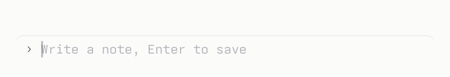
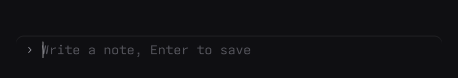
</figure>

This example treats offsets as bytes, which is right for ASCII text only.
Focus the field from any handler that has `cx` once the field has been drawn,
for example when a `focus` event arrives:

```lua
event = function(state, ev, cx)
	if ev.ev == "focus" then
		cx:frame({ { "focus", ev.id } })
	end
end
```

Focused, with text, a decoration and a completion suggested at the caret:

```lua
ui.node("editor", {
	key = "draft",
	text = "Ship the notes after @review",
	cursor = 28,
	ghost = " signs off",
	decor = { { from = 21, to = 28, s = "accent" } },
	placeholder = "Write a note, Enter to save",
	prompt = { ui.span("› ", "muted") },
	maxLines = 6,
})
-- and once: cx:frame({ { "focus", "dock.draft" } })
```

<figure class="tn-figure">
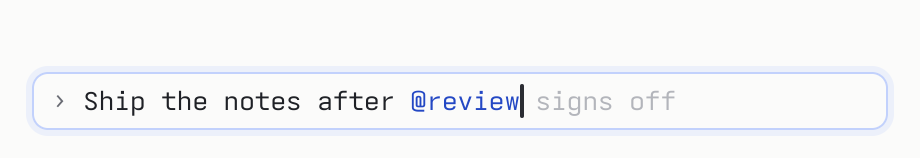
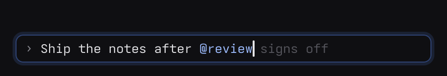
<figcaption>The focus ring and full-strength caret come from the focus op, not from a prop.</figcaption>
</figure>

## `input`

A one-line field in a tinted well. It takes the same props and draws the same
DOM as `editor`, with these differences:

- The text never wraps (`white-space: pre`); the field scrolls sideways
  (scrollbar hidden) and keeps the caret in view.
- `maxLines` is ignored.
- `aria-multiline="false"`; the default accessible name is the
  `placeholder`, or `"Search"` without one.
- Height is one line plus 8 px (`calc(var(--sf-lh) + 8px)`), padding `0 8px`,
  `--l1` background; focused, the background clears and an accent ring
  shows. That is the `well` look; [addons](#addons) (an icon, a clear ×,
  wells, buttons, a stepper, a secret) frame the field instead.

**Build it:** `tern.ui.node("input", { text = …, cursor = … })`.

| Prop | Type | Default | Meaning |
| --- | --- | --- | --- |
| `text`, `cursor`, `anchor`, `decor`, `ghost`, `placeholder`, `prompt`, `mode`, `lang`, `readonly`, `sendable` | as [`editor`](#editor) | | |
| `variant`, `icon`, `keys`, `mono`, `clear`, `prefix`, `suffix`, `unit`, `stepper`, `secret`, `reveal`, `buttons` | see [Addons](#addons) | | |
| `aria` | string | `placeholder` or `"Search"` (`"Password"` for a `secret`) | Accessible name |

An idle field next to the focused one, with a selection drawn from `anchor`:

```lua
ui.col({
	ui.node("input", {
		key = "filter",
		placeholder = "Filter",
		prompt = { ui.span("/", "muted") },
	}),
	ui.node("input", {
		key = "query",
		text = "deploy logs",
		cursor = 6,
		anchor = 0,
		placeholder = "Filter",
		prompt = { ui.span("/", "muted") },
	}),
})
-- focused with cx:frame({ { "focus", "main.query" } })
```

<figure class="tn-figure">
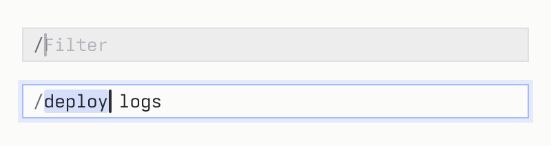
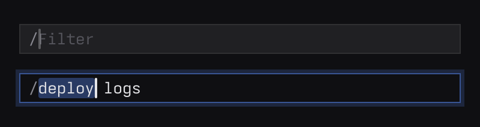
</figure>

**Children:** none (ignored).

**Events:** as [`editor`](#editor); addons send `action` (see [Addons](#addons)).

**Styling:**

```html
<div class="sf sf-input focused" data-id="main.filter" role="textbox"
     aria-multiline="false" aria-placeholder="Filter">
	<div class="sf-ed-scroll">
		<div class="sf-ed-text">abc<span class="sf-caret"></span></div>
	</div>
	<span class="sf-ed-mode"></span>
</div>
```

| Target | Selector |
| --- | --- |
| The node | `.sf-input` |
| States | `.sf-input.focused`, `.readonly`, `.empty`, `.code`, `.selecting`, `[data-mode]` |
| Parts | `.sf-ed-scroll`, `.sf-ed-text`, `.sf-ed-prompt`, `.sf-ed-sel`, `.sf-caret`, `.sf-ed-ghost`, `.sf-ed-ph`, `.sf-ed-preedit`, `.sf-ed-mode` (inner, may change) |

A filter field above a list, with the query's matches marked in the list:

```lua
local ui = tern.ui

local function view(state)
	return {
		main = ui.col({
			ui.node("input", {
				key = "filter",
				text = state.query,
				cursor = #state.query,
				placeholder = "Filter",
				prompt = { ui.span("/", "muted") },
			}),
			ui.node("list", { key = "rows", filter = state.query }, state.items),
		}),
	}
end
```

Restyle the field from your sheet:

```css
[data-surface^='plugin.notes.'] .sf-input {
	background: transparent;
	box-shadow: inset 0 -1px 0 var(--l2);
	border-radius: 0;
}
[data-surface^='plugin.notes.'] .sf-input.focused {
	box-shadow: inset 0 -2px 0 var(--accent);
}
[data-surface^='plugin.notes.'] .sf-input .sf-caret {
	background: var(--accent);
}
```

<figure class="tn-figure">
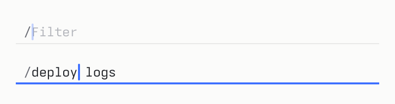
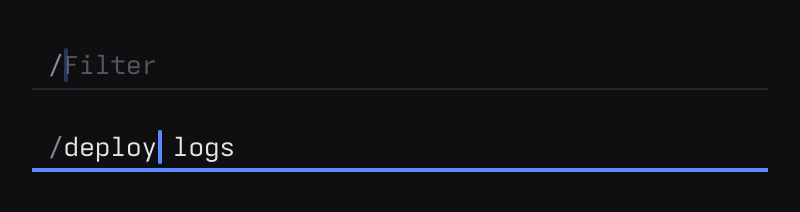
</figure>

The first rule outranks Tern's `.sf-input.focused` (same specificity, later
sheet), so it also drops the focus ring; the `.focused` rule puts a focus
cue back.

### Addons

An `input` can carry what a field usually has around its text: a leading
icon, a keycap that says how to reach it, a clear ×, wells that hold a fixed
part of the value (`https://`, `.com`), a unit, a ⌃⌄ stepper, buttons attached
to its ring (a Send) and a secret's eye. Reach for them instead of building a
`row` of an icon, a field and buttons: they sit inside one ring, line up at
every font size and act without taking the keys from your program.

Addons draw in Tern's **field** look, kit's framed text field: a 30 px well
(`--well`) in a hairline ring with 8 px corners that firms into the accent
ring while the field has the focus. Any addon implies it; `variant` picks the
look yourself:

| `variant` | Look |
| --- | --- |
| `"well"` (default without addons) | The tinted one-line well above: `--l1`, one line plus 8 px, no ring until focused |
| `"field"` (default with an addon) | Kit's framed field: 30 px, `--well`, hairline ring, the accent ring and a 3 px halo while focused |

A field without addons and without `variant` keeps the well.

In a sans region (`font: "sans"`) a `field` is the app's own control: its
text and placeholder take kit's 13 px UI face instead of the terminal's mono,
unless `mono: true` keeps the mono face for a machine value (a URL, a token,
an id). Its caret shows only while it has the focus, and an idle field reads
from its start (a long value scrolls to the caret only while focused), as
kit's fields do; the `well` look keeps its dim idle caret and its scroll.

**Inside the field.** `icon` leads the text (`--t3`, `--t2` while focused).
`keys` draws one keycap for the chord at the end (`["cmd","f"]` reads ⌘F)
while the field is idle and empty (it says how to reach the field, so it
leaves once the field has the keys or text). `clear: true`
draws a filled circled × at the end while the field has text and is not
`readonly`; a click sends `action` `clear`, and your program empties `text`.
`unit` is a mono word after the text (`bytes`, `ms`, `MB`).

**Attached to the ring.** `prefix` and `suffix` are mono wells in a faint
tint, run to the ring and parted from the text by a hairline: the fixed part
of a value, not part of `text`. `stepper: true` attaches a ⌃⌄ segment at the
end; its halves send `action` `inc` and `dec`, and your program sets the new
`text`. `buttons` attach actions: a `default` button is a hairline segment (an
icon or a short word), `primary`, `quiet` and `danger` are inset small
buttons inside the ring (22 px in an `input`, 24 px in an `editor`; one
`primary` Send). Every click sends `action`
with the button's `act`; the built-in acts run as on any pointer action, so
`copy` copies the field's text (a secret's own text, not its dots).

**Secret.** `secret: true` draws a `•` for every UTF-16 unit of `text` (an
emoji outside the BMP takes two), so `cursor`, `anchor`, `decor` and `edit`
offsets mean what they always do, and attaches an eye that reveals the text
in place. The eye is local, like a card's fold: it flips at once, sends
nothing, and is remembered by the node's `key` among its siblings (else its
id). Your `reveal` prop owns it again when it changes: send `reveal: true` to
show the text (a "Show password" setting), `false` to hide it. A secret is
never highlighted (`lang` is ignored), shows no `ghost`, and copying a native
selection of its dots copies dots; typing kept ahead (`typeahead`) draws as
dots too. Its accessible name defaults to `"Password"`.

`editor` takes `variant` and `buttons` (a prompt input): the field look frames
it, and its buttons sit at its bottom right, default ones as quiet rounded
icons.

Order, from the start: `prefix`, `icon`, the text, `unit`, the ×, `keys`, the
vim mode chip, then attached: `suffix`, the eye, `buttons` in order, the
stepper.

```lua
local ui = tern.ui

local function view(state)
	return {
		main = ui.col({
			ui.node("input", {
				key = "find",
				text = state.query,
				cursor = #state.query,
				placeholder = "Find in table",
				icon = "search",
				keys = { "cmd", "f" },
				clear = true,
			}),
			ui.node("input", {
				key = "size",
				text = tostring(state.size),
				stepper = true,
				unit = "bytes",
			}),
			ui.node("input", {
				key = "token",
				text = state.token,
				secret = true,
				buttons = { { act = "copy", icon = "copy", title = "Copy token" } },
			}),
			ui.node("input", {
				key = "ask",
				text = state.draft,
				placeholder = "Ask anything…",
				buttons = { { act = "send", text = "Send", variant = "primary", keys = { "enter" } } },
			}),
		}),
	}
end

local function event(state, ev)
	if ev.ev == "action" and ev.act == "clear" then
		state.query = ""
	elseif ev.ev == "action" and ev.act == "inc" then
		state.size = state.size * 2
	elseif ev.ev == "action" and ev.act == "dec" then
		state.size = math.max(1, state.size // 2)
	elseif ev.ev == "action" and ev.act == "send" then
		send(state.draft)
	end
end
```

The same in TSX (TypeScript SDK):

```tsx
<col>
   <input key="find" text={s.query} cursor={s.query.length} placeholder="Find in table"
          icon="search" keys={['cmd', 'f']} clear
          onAction={{ clear: () => { s.query = ''; render(); } }} />
   <input key="url" text={s.host} prefix="https://" suffix=".com" />
   <input key="size" text={String(s.size)} stepper unit="bytes"
          onAction={{ inc: () => step(2), dec: () => step(0.5) }} />
   <input key="token" text={s.token} secret
          buttons={[{ act: 'copy', icon: 'copy', title: 'Copy token' }]} />
   <input key="ask" text={s.draft} placeholder="Ask anything…"
          buttons={[{ act: 'send', text: 'Send', variant: 'primary', keys: ['enter'] }]}
          onAction={{ send: () => send(s.draft) }} />
</col>
```

<figure class="tn-figure">
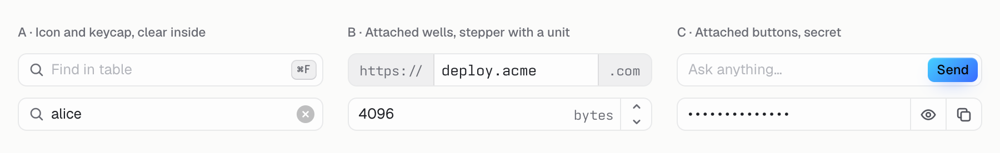
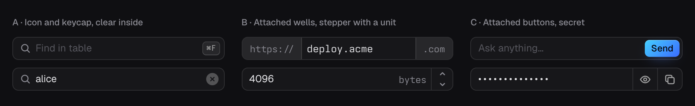
<figcaption>Inside the field (A), attached wells and a stepper (B), attached buttons and a secret (C), in a sans region.</figcaption>
</figure>

<figure class="tn-figure">
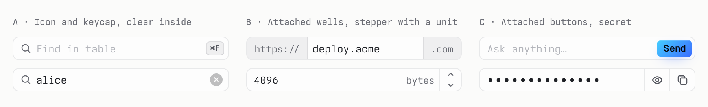
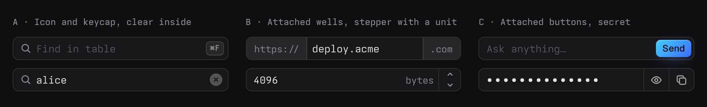
<figcaption>The same fields in the default mono region.</figcaption>
</figure>

<figure class="tn-figure">


<figcaption>Focus, <code>reveal</code>, <code>readonly</code>, <code>mono</code>, disabled, busy and quiet buttons, and an <code>editor</code> with <code>buttons</code>.</figcaption>
</figure>

**Props** (added to `input`'s; `editor` takes `variant` and `buttons`):

| Prop | Type | Default | Meaning |
| --- | --- | --- | --- |
| `variant` | `"well"` \| `"field"` | `"field"` with any addon, else `"well"` | The look; unknown values read as the default |
| `icon` | string (icon name) | none | Leading icon; unknown names draw none |
| `keys` | string \| string[] (key names) | none | One keycap for the chord at the end while the field is idle and empty (`["cmd","f"]` draws ⌘F) |
| `mono` | boolean | `false` | In a sans region, a `field` keeps the terminal's mono face for its text (a URL, a token) |
| `clear` | boolean | `false` | A circled × at the end while the text is not empty and the field not `readonly`; sends `action` `clear` |
| `prefix` | string | none | A mono well before the text, attached to the ring |
| `suffix` | string | none | A mono well after the text, attached to the ring |
| `unit` | string | none | A mono unit after the text, inside the field |
| `stepper` | boolean | `false` | An attached ⌃⌄ segment; sends `action` `inc` / `dec`; dimmed and inert while `readonly` |
| `secret` | boolean | `false` | Draws a `•` per UTF-16 unit of `text`, with an attached eye that reveals it locally |
| `reveal` | boolean | `false` | A secret's shown state; a change wins over the eye |
| `buttons` | `Button[]` | none | Attached buttons, in order, after the eye and before the stepper |

`Button`:

| Field | Type | Default | Meaning |
| --- | --- | --- | --- |
| `act` | string | required | The act a click sends (`"copy"` copies the text; `"x=y"` sends `act` `x` with `value` `y`); entries without one are skipped |
| `text` | string | none | Label; without one the button is icon-only |
| `icon` | string (icon name) | none | Leading icon |
| `variant` | `"default"` \| `"primary"` \| `"quiet"` \| `"danger"` | `"default"` | `default`: an attached hairline segment; the others: an inset `sm` button in the `button` kind's look (24 px in an `editor`) |
| `keys` | string[] | none | Keycaps after the label (inset buttons) |
| `title` | string | label and keycaps | Tooltip; also the accessible name of an icon-only button (else its `act`) |
| `disabled` | boolean \| string | `false` | Faded and inert; a string is the tooltip's reason |
| `busy` | boolean | `false` | A spinner in the icon's place (inset buttons), inert |

**Events:** besides the `focus`, `edit` and `undo` of [`editor`](#editor):

| Event | When | Payload |
| --- | --- | --- |
| `action` `clear` | The × is clicked | `{ev = "action", id, act = "clear", mods?, values?}` |
| `action` `inc` / `dec` | A stepper half is clicked | `{ev = "action", id, act = "inc"}` / `"dec"` |
| `action` `<act>` | A button is clicked | `{ev = "action", id, act, value?, mods?, values?}`; built-in acts (`copy`, `open`, …) run as pointer actions |

None of them asks for the focus or moves the caret, and the eye sends
nothing. On a closed surface, or one opened with `listen = false`, the parts
draw but send nothing and the eye does not flip.

**Keyboard model.** Addons are pointer-only, like `button`: a press never
takes the keys from your program. Bind keys yourself and drive the props:
⌘F focuses the field (`focus` op; `keys` only shows the keycap), Esc empties
`text` as `clear` would, ↑/↓ change the value as `inc`/`dec` would, Enter
sends as the Send button would, and a "show password" key sets `reveal`.

**Styling:**

```html
<div class="sf sf-input focused" data-id="main.find" data-variant="field" role="textbox"
     aria-multiline="false" aria-placeholder="Find in table">
	<span class="sf-in-pre sf-in-well">https://</span>
	<span class="sf-in-ic" aria-hidden="true"><svg class="ico">…</svg></span>
	<div class="sf-ed-scroll"><div class="sf-ed-text">alice<span class="sf-caret"></span></div></div>
	<span class="sf-in-unit">bytes</span>
	<button class="sf-in-x sf-in-act" data-act="clear" aria-label="Clear" title="Clear"><svg class="ico">…</svg></button>
	<span class="sf-kbd kbds sf-in-keys" aria-hidden="true"><span class="kbd">⌘F</span></span>
	<span class="sf-ed-mode"></span>
	<span class="sf-in-end">
		<span class="sf-in-suf sf-in-well">.com</span>
		<button class="sf-in-seg sf-in-act sf-in-eye only-ic" aria-label="Show" aria-pressed="false"><svg class="ico">…</svg></button>
		<button class="sf-in-seg sf-in-act only-ic" data-act="copy" aria-label="Copy key" title="Copy key"><svg class="ico">…</svg></button>
		<button class="sf-button sf-in-btn sf-in-act" data-act="send" data-variant="primary" data-size="sm"><span class="sf-btn-label">Send</span></button>
		<span class="sf-in-step" role="group">
			<button class="sf-in-stepb sf-in-act" data-act="inc" aria-label="Increment"><svg class="ico">…</svg></button>
			<button class="sf-in-stepb sf-in-act" data-act="dec" aria-label="Decrement"><svg class="ico">…</svg></button>
		</span>
	</span>
</div>
```

Each part is there only when its prop asks for it.

| Target | Selector |
| --- | --- |
| The look | `.sf-input[data-variant='field']`, `.sf-editor[data-variant='field']` |
| States | `.sf-input.secret`, `.revealed` (a secret showing its text), `.mono`, plus `.focused`, `.readonly`, `.empty` as above |
| Inside | `.sf-in-ic`, `.sf-in-unit`, `.sf-in-x`, `.sf-in-keys` |
| Attached | `.sf-in-well` (`.sf-in-pre`, `.sf-in-suf`), `.sf-in-end`, `.sf-in-seg` (`.only-ic`, `.on`, `.disabled`, `.busy`), `.sf-in-eye`, `.sf-in-btn` (a `.sf-button`), `.sf-in-step`, `.sf-in-stepb` |
| Every acting part | `.sf-in-act[data-act]` |

## `otp`

A short code typed one character per cell: the six digits of a sign-in
code, a pairing PIN, a device code. Each character sits in its own cell,
groups split by a dash, and the cell the next key goes to wears an accent
ring and a blinking caret, so the user always sees how much is left. Reach
for it whenever the code has a fixed length; for free text use
[`input`](#input).

Like every field in a view, the code is yours: keys reach your program as
input, and you answer with `text` (and `cursor` when the caret is not after
the text). Tern draws, never edits. A cell never takes the keyboard focus.

**Build it:** `tern.ui.node("otp", { text = …, length = 6 })`.

| Prop | Type | Default | Meaning |
| --- | --- | --- | --- |
| `text` | string | `""` | The characters typed so far, one per cell. Characters past `length` are not drawn |
| `length` | integer | `6` | The number of cells, clamped to 1–12 |
| `group` | integer | `3` | Cells per group; a dash (`.sf-otp-sep`) separates groups. `0`, or a value of at least `length`, draws one group |
| `cursor` | integer \| `false` | the length of `text` | The active cell (0-based): accent ring, plus the caret when it is empty. Clamped to the first empty cell; equal to `length` (a full code by default), negative or `false` shows no active cell |
| `variant` | `"cells"` \| `"joined"` \| `"underline"` | `"cells"` | The look (below). Other values read as `cells` |
| `mask` | boolean \| string | `false` | Hide what was typed: `true` draws a dot in each filled cell, a string draws its first character instead (`"*"`) |
| `state` | `"error"` \| `"success"` | none | `error` rings the cells in `--bad`, colors the hint and shakes the code once (not under reduced motion); `success` rings them in `--ok`. Other values read as none |
| `hint` | string | none | A quiet line under the cells, 12px `--t3`: where the code went, a resend countdown, the error. Takes the state's color |
| `disabled` | boolean or string | `false` | Dimmed, no active cell, clicks send nothing; class `disabled`, `aria-disabled="true"` |

The common props work too: `title`, `aria` (the group's name; default "One-time
code"), `tone`, and the flex props. The code sizes to its cells and never
stretches (`align-self: flex-start`).

**Variants.**

| `variant` | Look | Use |
| --- | --- | --- |
| `cells` | Separate 34×40 tiles on `--card` with an `--l2` hairline ring (`--l3` once filled), 18px mono digits, a dash between groups; the active cell gets a 1.5px accent ring and a 3px accent halo | The default: sign-in codes, PINs |
| `joined` | Each group one field (`--card`, `--l3` ring) split by `--l2` hairlines into 38×38 cells; the active cell is tinted with the accent | Dense forms and sheets, where six tiles read too loud |
| `underline` | No boxes: digits over 2px rules (`--l3`, `--t4` filled, accent active), the hint below | Quiet flows, onboarding, a code on its own page |

A typed character rises into its cell over .18 s; hover strengthens a cell's
ring (or rule), a press settles it to 96%. The caret blinks like a field's
and holds still under reduced motion, in a paused or unfocused pane. The
error shake (.32 s, a few pixels side to side) plays each time `state`
becomes `"error"` and never under reduced motion; set another state (or
none) in between to shake again.

**Children:** none (ignored).

**Events:** a click on a cell, while the code is enabled and the surface
listens, moves the caret there at once and sends

```lua
{ ev = "action", id = "<the otp's id>", act = "focus", value = 2 }
```

`value` is the cell the caret went to: the clicked one, or the first empty
cell when the click lands past the text (so a click on the last cell of a
half-typed code still means "type here"). Move your focus to the code and
set `cursor` to `value` (or ignore it: a modal overlay keeps the keys). The
local caret stays until your next change of `text` or `cursor`, which wins.
A disabled code, a closed surface or one opened with `listen = false` sends
nothing and moves nothing. Clicks on a cell do not reach the nodes around
the code.

**Keyboard model.** Your program owns every key; a usual mapping:

| Key | Do |
| --- | --- |
| A character the code accepts | Replace the character at `cursor` (append at the end), then advance: set `text`, and `cursor` only when it is not after the text |
| Backspace | Delete before the caret (or the character under it when the caret sits on a filled cell) |
| ← / → | Move `cursor` within the text |
| Paste (bracketed) | Take the accepted characters, up to `length`, as the whole `text` |
| Enter, or the last character | Submit; answer with `state = "error"` and a `hint`, or `"success"` |

Clear `state` as soon as the user types again.

**Styling:**

```html
<div class="sf sf-otp" data-id="main.code" data-variant="cells" data-state="error"
	role="group" aria-label="One-time code" aria-invalid="true" aria-disabled="false">
	<div class="sf-otp-row">
		<div class="sf-otp-group">
			<span class="sf-otp-cell filled" role="button" aria-label="Character 1 of 6: 4"><span class="sf-otp-ch">4</span></span>
			<span class="sf-otp-cell filled" role="button" aria-label="Character 2 of 6: 8"><span class="sf-otp-ch">8</span></span>
			<span class="sf-otp-cell filled" role="button" aria-label="Character 3 of 6: 1"><span class="sf-otp-ch">1</span></span>
		</div>
		<span class="sf-otp-sep" aria-hidden="true"></span>
		<div class="sf-otp-group">
			<span class="sf-otp-cell on" role="button" aria-current="true" aria-label="Character 4 of 6"><i class="sf-otp-caret" aria-hidden="true"></i></span>
			<span class="sf-otp-cell" role="button" aria-label="Character 5 of 6"></span>
			<span class="sf-otp-cell" role="button" aria-label="Character 6 of 6"></span>
		</div>
	</div>
	<div class="sf-otp-hint">That code didn’t work. Try again.</div>
</div>
```

| Target | Selector |
| --- | --- |
| The node | `.sf-otp` |
| Variant / state | `.sf-otp[data-variant='joined']`, `.sf-otp[data-state='error']` (`[aria-invalid='true']`), `[data-state='success']` |
| Disabled / full | `.sf-otp.disabled` (`[aria-disabled='true']`), `.sf-otp.full` (every cell filled) |
| A group (the joined field) | `.sf-otp-group` |
| A cell | `.sf-otp-cell`, filled `.filled`, active `.on` (`[aria-current='true']`) |
| Group dash | `.sf-otp-sep` |
| Character / mask dot / caret | `.sf-otp-ch`, `.sf-otp-dot`, `.sf-otp-caret` (inner, may change) |
| Underline rule | `.sf-otp[data-variant='underline'] .sf-otp-cell::after` |
| Hint | `.sf-otp-hint` |

Cells draw their ring as `box-shadow` (the joined look on `.sf-otp-group`),
digits in `500 18px` mono with tabular numbers in every region, mono or
sans. A masked cell's label says "filled" instead of the character.

```lua
local ui = tern.ui

return ui.col({
	ui.text({ ui.span("Enter the code we sent to •••• 42", "muted") }),
	ui.node("otp", {
		key = "code",
		text = state.code,
		cursor = state.cursor,
		state = state.wrong and "error" or nil,
		hint = state.wrong and "That code didn’t work. Try again." or ("Resend in 0:" .. state.wait),
	}),
})
```

The same in TSX, where `onAction` maps the act to a handler:

```tsx
<col gap="sm">
   <text>Enter the code we sent to •••• 42</text>
   <otp
      key="code"
      text={s.code}
      cursor={s.cursor}
      state={s.wrong ? 'error' : undefined}
      hint={s.wrong ? 'That code didn’t work. Try again.' : `Resend in 0:${s.wait}`}
      onAction={{ focus: ev => { s.cursor = ev.value as number; render(); } }}
   />
</col>
```

<figure class="tn-figure">
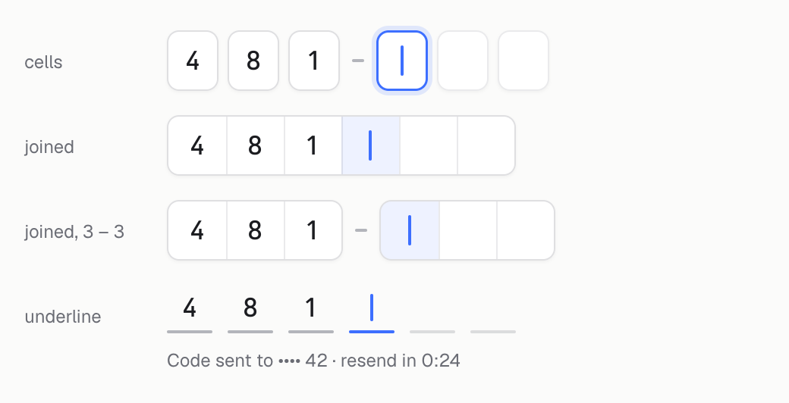
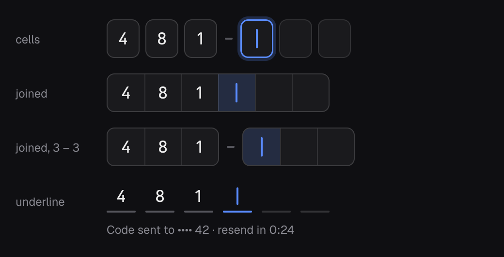
<figcaption>The three looks: <code>cells</code>, <code>joined</code> (one group, then 3 – 3) and <code>underline</code> with a <code>hint</code>.</figcaption>
</figure>

<figure class="tn-figure">
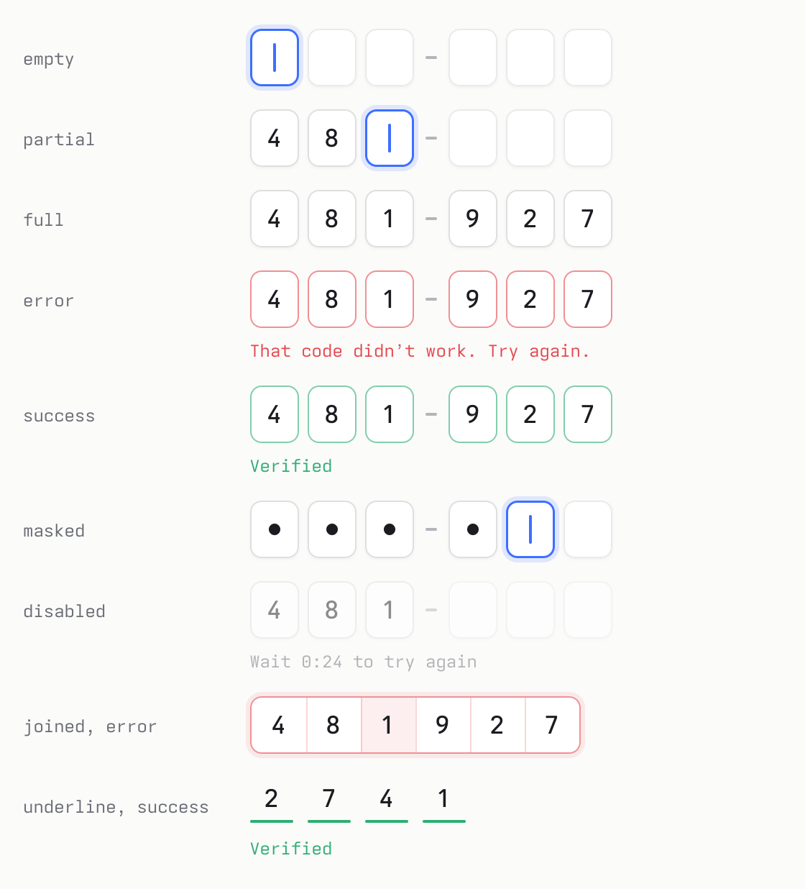
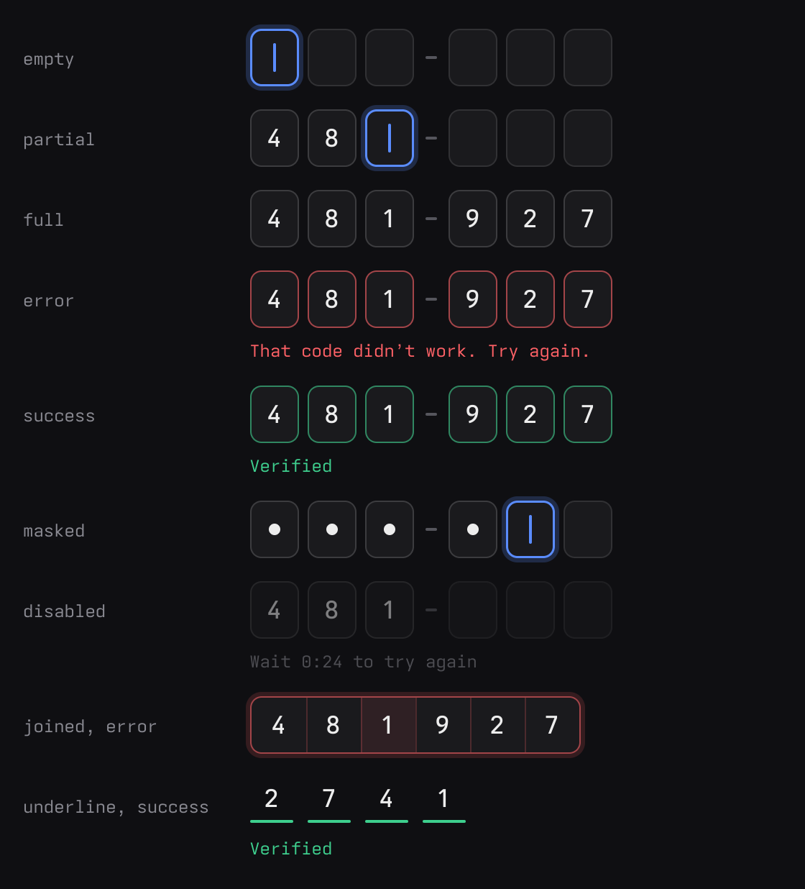
<figcaption>Empty, partial, full, <code>error</code>, <code>success</code>, <code>mask</code>, <code>disabled</code>, and the states in the other looks.</figcaption>
</figure>

## `select`

A value picked from a menu, in kit's select look: the current option on a
trigger and, open, a glass menu of the options with a check on the current
one. It covers a select, a native popup button and a combobox. Use it for
one value out of a set whenever a segmented choice would hold more than
three or four options: a model, a region, a branch, a sort order.

Two looks, by `variant`, and a behaviour prop:

- **`field`** (the default) is a 30px card button with a hairline ring, the
  value and a chevron, for forms and settings. Its menu checks the current
  option and draws each option's `detail` in muted mono at the right.
- **`quiet`** has no ring: the value (after a muted `label`, "Model  Sonnet
  4.5") on a pill that shows on hover and while open, for panel heads and
  bars. Its menu tints the current option in the accent instead of checking
  it.
- **`search = true`** makes either look a combobox. Open, a field's trigger
  becomes a search line (a search icon, your `query` with a caret, and a
  count such as `3 of 24`); a quiet trigger keeps its pill and the search
  line heads the menu. The labels mark the query's hits as `list` marks its
  `filter`, and `group` names draw section headers.

The select keeps `align-self: flex-start` in a `col` and draws in Tern's UI
face (Geist) in every region, mono or sans; details and the count are mono.
The menu hangs 4px under the trigger, inside the node, so a card or row
around it does not clip it; once laid out it opens over the trigger instead
when the pane has more room above and the menu does not fit below, and lines
up with the trigger's right edge when it would run past the pane's. Up to
about ten 30px rows show at a time; more scroll inside the menu, which keeps
the highlighted option in view.

**Build it:** `tern.ui.node("select", props)`. No dedicated builder.

**Pointer and keys.** Like the `el` controls a select never takes focus:
keys go to your `key` handler, which drives the menu through props. The
pointer acts at once and tells you after:

- a click on the trigger opens or closes the menu and sends `toggle`;
- a click on an option shows it as the value, closes the menu and sends
  `change` (when it is another value), then `toggle`;
- a press anywhere outside the open menu and its trigger closes it and sends
  `toggle` (light dismiss).

Tern remembers that open state and pick while the node is drawn and draws
them over your props until your `open` or `value` changes from what it last
drew: mirror `change` into `value` and `toggle` into `open` and you stay the
owner. A click in an open combobox's search line keeps it open (the keys
type there). A disabled select, and any select on a surface that is closed or
opened with `listen = false`, draws but opens nothing and sends nothing.

**Typing into a combobox.** The search line is drawn, not a native field,
exactly as the [`picker`](lists.md#picker)'s is: your `key` handler keeps the
query and its caret, sends them back as `query` and `cursor`, and filters
`options` itself (the same text Tern marks). Use the input kind's
[key handler](#input) as the model for editing the query; ⌘C, selections
and IME composition are not offered in the search line. A typical keyboard
model:

| Key | Closed | Open |
| --- | --- | --- |
| Enter, Space, ↓ | `open = true`, `active = value` | Enter: `value = active`, `open = false` |
| ↑ / ↓ | | Move `active` over the enabled options |
| Escape | | `open = false` (a combobox also clears `query`) |
| Text, Backspace, ← → | | Combobox: edit `query` and `cursor`, refilter `options`, `active` = the first match |

| Prop | Type | Default | Meaning |
| --- | --- | --- | --- |
| `value` | string | none | The current option's `value`. Without one the trigger shows `placeholder`. A value no option has (a list your search narrowed) shows as itself |
| `options` | `{ string \| SelectOption }` | `{}` | The options in order. A string is an option whose value and label are that string. `SelectOption` is below |
| `variant` | `"field"` \| `"quiet"` | `"field"` | The look (above). Other values read as `field` |
| `label` | string | none | A muted label before the value on the trigger ("Model"), and the combobox's accessible name unless `aria` gives one |
| `placeholder` | string | `"Select…"`; searching `"Search…"` | The trigger's text without a `value`, and the search line's without a `query` |
| `size` | `"sm"` \| `"md"` | `"md"` | `field`: 30px (`sm` 26px). `quiet`: 28px (`sm` 22px). `sm` menus have 26px rows |
| `disabled` | boolean or string | `false` | Dimmed and inert: opens nothing, sends nothing, class `disabled`, `aria-disabled="true"`. A string is the reason, the trigger's tooltip |
| `open` | boolean | `false` | The menu shows (keyboard state you drive). A change wins over the pointer's open or close |
| `active` | string | the current `value` | The highlighted option's `value` (the keyboard cursor, class `sel`); scrolled into view when it changes. Ignored when no option has it |
| `search` | boolean | `false` | A combobox (above) |
| `query` | string | `""` | The search text drawn in the search line; its hits are marked in the labels |
| `cursor` | number | end of `query` | The caret in `query`, in UTF-16 units |
| `total` | number | none | The size of the whole set: with a `query`, the count reads `<options shown> of <total>` (just the number without it) |
| `empty` | string | `"No matches"` with a `query`, else `"No options"` | The menu's text when `options` is empty |

**`SelectOption`:**

| Field | Type | Default | Meaning |
| --- | --- | --- | --- |
| `value` | string | required | What `value`, `active` and `change` carry. An entry without one is skipped |
| `label` | string | `value` | What the option and, when current, the trigger show |
| `detail` | string | none | Muted mono text at the option's right (`default`, `200k`, `$3 / $15`) |
| `icon` | icon name | none | A leading icon from [Tern's set](data.md#icon-names) (`provider:anthropic` for a provider's logo); the current option's also leads the trigger |
| `group` | string | none | Section header drawn over the first option of each run of options with the same group |
| `disabled` | boolean | `false` | Drawn faint and never picked |

The common props work too: `title`, `aria` (the combobox's name), `key`,
`tone` (sets `--tc` for your sheet), `hidden` and the flex props.

**Variants.**

| `variant` | Trigger | Menu | Use |
| --- | --- | --- | --- |
| `field` | Kit's `.sel-btn`: `--card` (dark `--raise`) with an `--l2` hairline ring; hover rings `--l3`; open, a 55% accent ring and a 3px accent halo | Glass `.pop.sel-menu`: an accent check before the current option, mono details | Forms, settings, dialogs |
| `quiet` | No fill, no ring, the value at weight 500 after a `--t3` label; hover `--l1`, open and pressed `--l2` | The current option in `--accent-ink` on a 10% accent tint, no check column | Panel heads, bars, toolbars |
| either, `search = true` | Open: `field` turns into the search line inside its accent ring; `quiet` keeps its pill | `quiet`: the search line heads the menu on an `--l1` pill | More than a dozen options, or options from a search |

The menu pops in with kit's `popIn` (.22s); a press scales the trigger to
98.5% at once; hover and selection tints fade over .12–.15s. Under Tern's
reduced motion (`.sf-still`) or the system's, the menu appears without
motion and the caret stops blinking.

**Children:** none (ignored).

**Events:**

```lua
{ ev = "change", id = "<the select's id>", value = "haiku" }  -- an option was picked
{ ev = "toggle", id = "<the select's id>", open = true }      -- the pointer opened or closed the menu
```

`change` comes only when the pick differs from the value shown; a pick
always closes the menu, so a `toggle` with `open = false` follows it. Unlike
a card's `toggle`, a select's carries `open`, not `collapsed`. A select
sends no `values` inside an `el` form; read its value from your state.

**Styling:**

```html
<div class="sf sf-select open search" data-id="main.model" data-variant="field" data-size="md">
	<button class="sf-select-btn sel-btn" role="combobox" aria-haspopup="listbox" aria-expanded="false">
		<span class="sf-select-ic"><svg class="ico">…</svg></span>     <!-- the current option's icon -->
		<span class="sf-select-label">Model</span>
		<span class="sf-select-v v">Sonnet 4.5</span>                  <!-- .ph: the placeholder -->
		<svg class="ico sf-select-chev">…</svg>
	</button>
	<!-- a field combobox while open: the trigger is the search line -->
	<button class="sf-select-btn sel-btn searching" role="combobox" aria-expanded="true">
		<span class="sf-select-find-ic"><svg class="ico">…</svg></span>
		<span class="sf-select-field"><span class="sf-select-q">son</span><span class="sf-select-caret"></span></span>
		<span class="sf-select-count">3 of 24</span>
	</button>
	<div class="pop sel-menu sf-select-menu" role="listbox">       <!-- .up over the trigger, .end right-aligned -->
		<div class="sf-select-find">…the search line (quiet)…</div>
		<div class="sf-select-rows">
			<div class="mi-sec sf-select-group" role="presentation">Anthropic</div>
			<div class="mi sf-select-opt cur sel" role="option" aria-selected="true" data-i="0">
				<span class="mi-ck"><svg class="ico">…</svg></span>     <!-- field only -->
				<span class="sf-select-ic">…</span>
				<span class="sf-select-text"><mark class="sf-mark">Son</mark>net 4.5</span>
				<span class="sub">200k</span>
			</div>
			<div class="sf-select-empty">No matches</div>
		</div>
	</div>
</div>
```

| Target | Selector |
| --- | --- |
| The node | `.sf-select` |
| Look / size | `.sf-select[data-variant='quiet']`, `[data-size='sm']` |
| States | `.sf-select.open`, `.search`, `.disabled` |
| Trigger | `.sf-select-btn` (`[aria-expanded='true']` while open, `.searching` as the search line) |
| Trigger parts | `.sf-select-ic`, `.sf-select-label`, `.sf-select-v` (`.ph`), `.sf-select-chev` (inner, may change) |
| Search line | `.sf-select-find-ic`, `.sf-select-field`, `.sf-select-q`, `.sf-select-caret`, `.sf-select-ph`, `.sf-select-count`, `.sf-select-find` (inner, may change) |
| Menu | `.sf-select-menu` (`.up`, `.end`), `.sf-select-rows` |
| Option | `.sf-select-opt` (`.cur` the value, `.sel` the active one, `.dis`) |
| Option parts | `.mi-ck`, `.sf-select-text`, `.sub`, `mark.sf-mark` (inner, may change) |
| Group header / empty text | `.sf-select-group`, `.sf-select-empty` |

The trigger and the menu reuse kit's classes (`.sel-btn`, `.pop`,
`.sel-menu`, `.mi`, `.mi-ck`, `.mi-sec`, `.sub`), so they look like Tern's
own selects; restyle through the `.sf-select…` classes, which outrank kit's.

A model picker in a panel head, quiet, driven by the keyboard:

```lua
local ui = tern.ui

local MODELS = {
	{ value = "sonnet", label = "Sonnet 4.5", detail = "$3 / $15" },
	{ value = "opus", label = "Opus 4.1", detail = "$15 / $75" },
	{ value = "haiku", label = "Haiku 4.5", detail = "$1 / $5" },
}

local function view(state)
	return {
		main = ui.col({
			ui.node("card", { key = "review", head = "Review", ["end"] = "main.review.model" }, {
				ui.node("select", {
					key = "model",
					variant = "quiet",
					label = "Model",
					value = state.model,
					options = MODELS,
					open = state.open,
					active = state.active,
				}),
				ui.text("Reads the diff and leaves comments on the lines it would change."),
			}),
		}),
	}
end

local function index(value)
	for i, m in MODELS do
		if m.value == value then
			return i
		end
	end
	return 1
end

local function key(state, k, cx)
	if not state.open then
		if k.name == "enter" or k.name == "space" or k.name == "down" then
			state.open, state.active = true, state.model
		else
			return false
		end
	elseif k.name == "up" or k.name == "down" then
		local i = index(state.active) + (k.name == "down" and 1 or -1)
		state.active = MODELS[math.clamp(i, 1, #MODELS)].value
	elseif k.name == "enter" then
		state.model, state.open = state.active, false
	elseif k.name == "escape" then
		state.open = false
	else
		return false
	end
end

local function event(state, ev, cx)
	if ev.ev == "change" then
		state.model = ev.value
	elseif ev.ev == "toggle" then
		state.open, state.active = ev.open, state.model
	end
end
```

A combobox in TSX (TypeScript SDK): the program filters, Tern marks:

```tsx
const shown = models.filter((m) => m.label.toLowerCase().includes(query.toLowerCase()))

<select
   variant="field"
   search
   value={model}
   options={shown.map((m) => ({ value: m.id, label: m.label, detail: m.context, group: m.provider }))}
   query={query}
   cursor={cursor}
   total={models.length}
   open={open}
   active={active}
   placeholder="Search models…"
   onChange={(ev) => setModel(ev.value)}
   onToggle={(ev) => setOpen(ev.open)}
/>
```

<figure class="tn-figure">
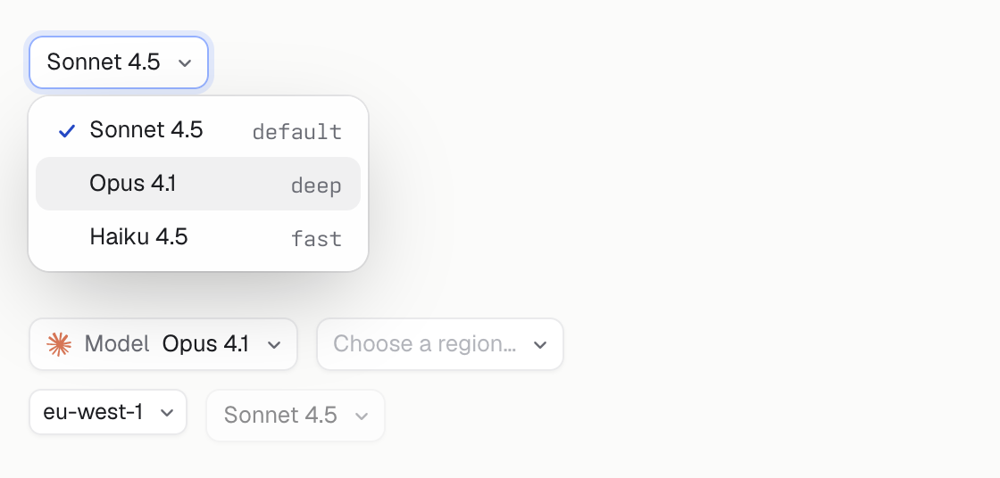
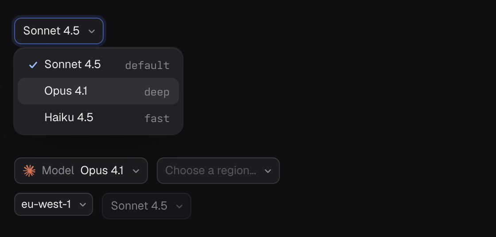
<figcaption>The <code>field</code> look: open with <code>active</code> on Opus, then a <code>label</code> and icon, <code>sm</code>, the placeholder and <code>disabled</code>.</figcaption>
</figure>

<figure class="tn-figure">
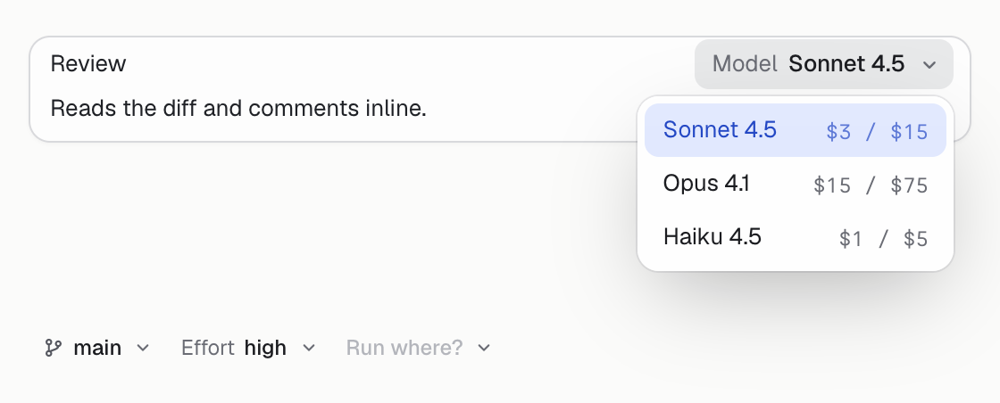
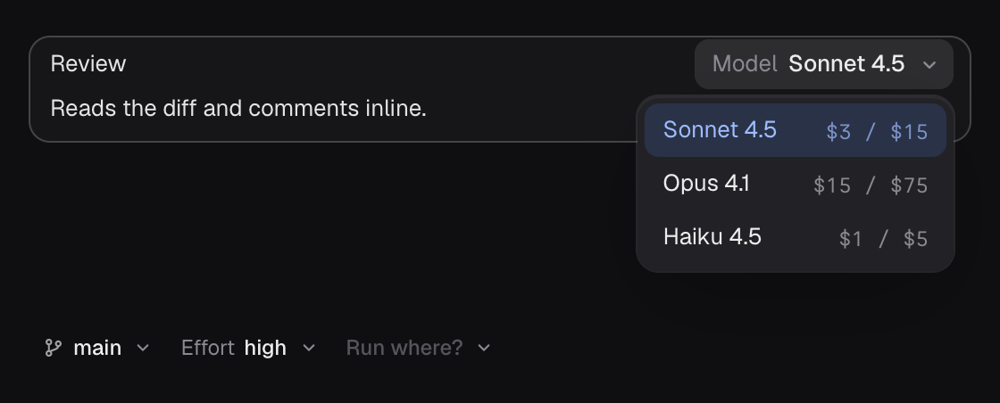
<figcaption>The <code>quiet</code> look in a card head (its menu lines up with the trigger's right edge), and <code>sm</code> quiet selects in a bar.</figcaption>
</figure>

<figure class="tn-figure">
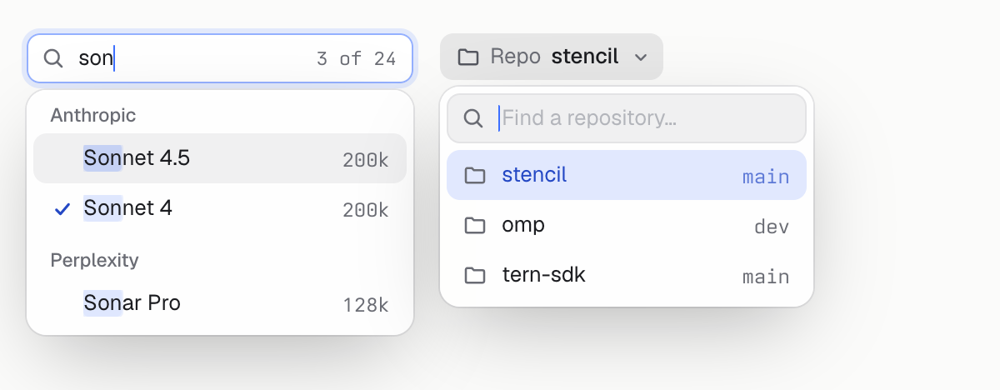
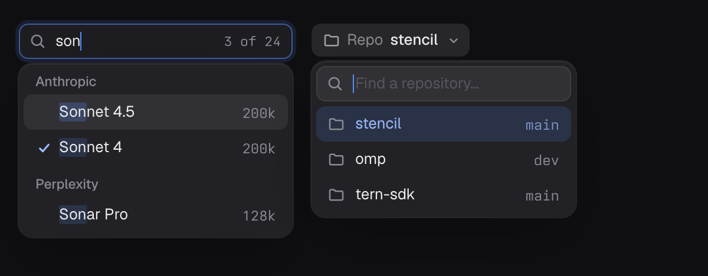
<figcaption><code>search = true</code> on a <code>field</code> (the trigger is the search line) and on a <code>quiet</code> select (the line heads the menu).</figcaption>
</figure>

<figure class="tn-figure">
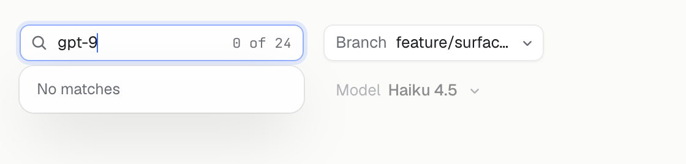
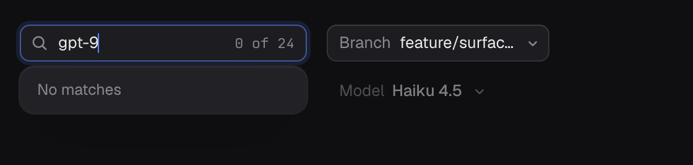
<figcaption>No options for the query, a long value cut with an ellipsis, a disabled <code>quiet</code> select.</figcaption>
</figure>

## `calendar`

Days to pick from. The default `month` variant is a month grid: weekday
letters, the selected day as an accent disc, a range as two discs joined by
a tinted band, today ringed, weekends muted, dots on the days you mark, and
‹ › to step months. The `week` variant is for a short pane: a column of
presets ("Today", "Last 7 days") beside one strip of seven days with the
range tinted across it. Reach for a calendar when picking dates is the
view (a schedule, a report's window); in a form, use a [`date`](#date)
field, which folds the same grid into a popover.

Everything is data-first: you send `value` (a `"YYYY-MM-DD"` day, or a
`[from, to]` pair with `range = true`) and Tern draws it. A click shows at
once and the event follows; your next `value` wins over the user's pick. A
range takes two clicks in either order: the first end shows alone while the
band previews under the pointer, and the second sends one `change` with
both ends sorted. Days before `min` or after `max` are dimmed and refuse
clicks, and ‹ › stop at the months that hold no allowed day.

Dates are the user's calendar dates, with no time and no zone. `today`
defaults to the system's local date; send it when your notion of today
differs (a server's zone, a test).

```lua
local ui = tern.ui

ui.node("row", { gap = "lg" }, {
	ui.node("calendar", {
		key = "trip",
		range = true,
		value = { "2026-10-12", "2026-10-16" },
		month = "2026-10",
	}),
	ui.node("calendar", {
		key = "deploy",
		value = "2026-10-21",
		min = "2026-10-06",
		max = "2026-10-27",
		weekStart = "sun",
		marks = { "2026-10-08", { date = "2026-10-14", tone = "warning" } },
		note = "Deploys run Tue–Thu · 3 scheduled",
	}),
})
```

The same in TSX (TypeScript SDK):

```tsx
<row gap="lg">
   <calendar key="trip" range value={[from, to]} month="2026-10"
      onChange={(e) => setTrip(e.value)} />
   <calendar key="deploy" value={day} min="2026-10-06" max="2026-10-27"
      weekStart="sun" marks={deploys} note="Deploys run Tue–Thu · 3 scheduled"
      onChange={(e) => setDay(e.value)} />
</row>
```

<figure class="tn-figure">
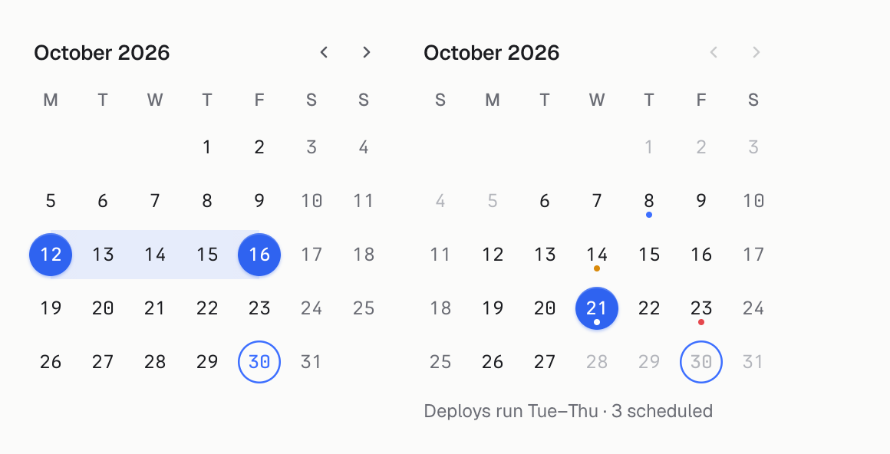
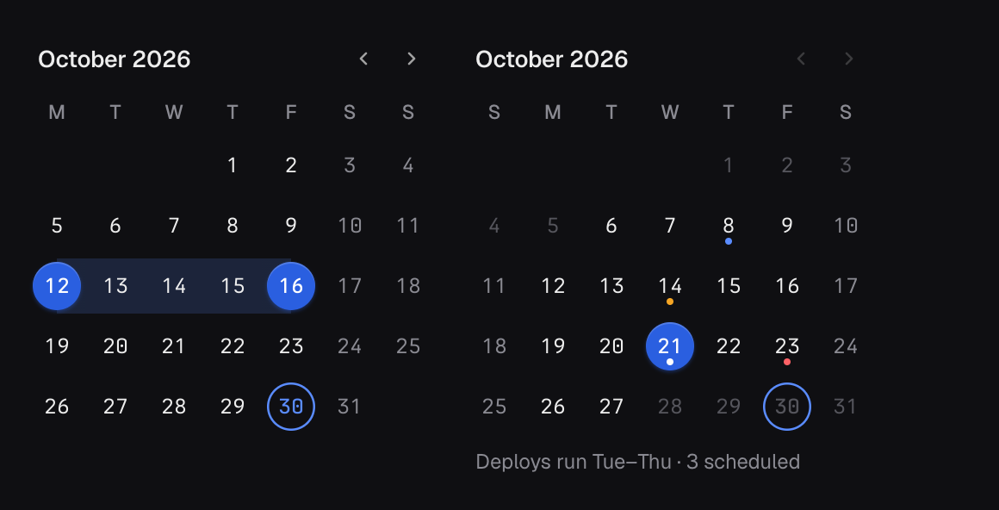
<figcaption>A <code>range</code> with today ringed, and a single day with <code>min</code>, <code>max</code>, <code>marks</code>, <code>weekStart = "sun"</code> and a <code>note</code>.</figcaption>
</figure>

The `week` variant, with presets:

```lua
ui.node("calendar", {
	key = "window",
	variant = "week",
	range = true,
	value = { "2026-10-24", "2026-10-30" },
	preset = "7d",
	presets = {
		{ id = "today", label = "Today" },
		{ id = "yesterday", label = "Yesterday" },
		{ id = "7d", label = "Last 7 days" },
		{ id = "30d", label = "Last 30 days" },
		{ id = "custom", label = "Custom…" },
	},
	note = "7 days · 1,284 runs",
})
```

The same in TSX:

```tsx
<calendar key="window" variant="week" range value={win} preset={preset}
   presets={PRESETS} note={`${days} days · ${runs} runs`}
   onSelect={(e) => applyPreset(e.item)} onChange={(e) => setWin(e.value)} />
```

<figure class="tn-figure">
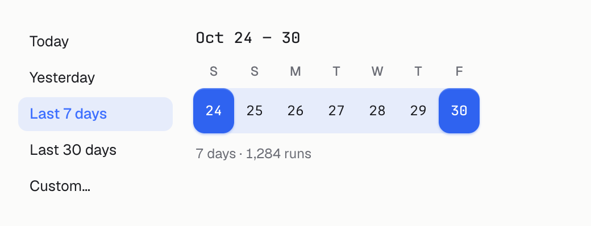
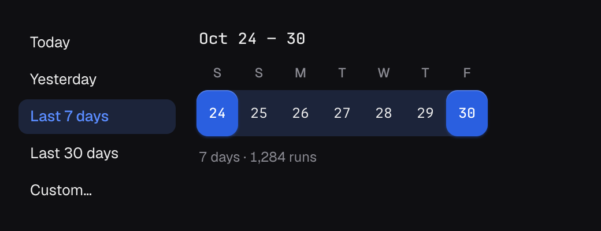
<figcaption><code>variant = "week"</code>: presets beside the seven days ending on the range's end.</figcaption>
</figure>

| Prop | Type | Default | Meaning |
| --- | --- | --- | --- |
| `variant` | `"month"` \| `"week"` | `"month"` | A month grid, or presets beside a week strip |
| `value` | `string` \| `[string, string \| null]` | none | The selection: a `"YYYY-MM-DD"` day, or with `range` the `[from, to]` ends (either order; `[from, null]` shows a range waiting for its end). A change wins over the user's pick |
| `range` | `boolean` | `false` | Pick a range (two clicks) instead of a day |
| `month` | `string` | the month of `value`'s start, else of `today` | The month shown, `"YYYY-MM"` (`month` variant). ‹ › step locally; a change wins |
| `today` | `string` | the system's local date | The day ringed as today, `"YYYY-MM-DD"` |
| `min` | `string` | none | The first day that can be picked; earlier days are dimmed and refuse clicks |
| `max` | `string` | none | The last day that can be picked |
| `weekStart` | `"mon"` \| `"sun"` | `"mon"` | The first column of the month grid |
| `marks` | `(string \| {date: string, tone?: string})[]` | `[]` | Days carrying a dot, in the accent or the [tone](../styles/index.md#tones)'s color |
| `cursor` | `string` | none | The day your keys are on, drawn with a focus ring |
| `presets` | `{id: string, label?: string}[]` | `[]` | The `week` variant's presets column (`label` defaults to `id`); none hides the column |
| `preset` | `string` | none | The active preset's `id`. A change wins over the user's choice |
| `note` | `string` | none | A muted line under the days (a count, a hint) |

| Variant | Look | For |
| --- | --- | --- |
| `month` (default) | Title, ‹ ›, weekday letters, a 7-column grid of round days | Picking a day or a range when the month is the view |
| `week` | Presets column; a mono range title, seven days as rounded squares, the range tinted | A report or log window in a short pane |

**Children:** none (ignored).

**Events:**

| Event | Payload | When |
| --- | --- | --- |
| `change` | `{ev = "change", id, value}`: a `"YYYY-MM-DD"` string, or `[from, to]` sorted with `range` | The user picked a day, or a range's second end |
| `select` | `{ev = "select", id, item}`: the preset's `id` | The user chose a preset (`week`). Set `value` (and `preset`) to apply it |
| `action` | `{ev = "action", id, act = "month", value = "YYYY-MM"}` | The user stepped to another month with ‹ ›. Load that month's `marks` if you draw them; mirroring it into `month` is optional |

A pick in the `week` variant also clears the active preset locally (the
range is now the user's own); send `preset` to set it again.

**Keyboard:** a calendar never takes focus; your program owns the keys and
drives the props: move `cursor` with the arrows (←→ a day, ↑↓ a week),
change `month` with Page Up/Down, and set `value` on Enter. For a range,
send `[from, null]` after the first Enter and `[from, to]` after the
second.

**Inert surfaces:** a closed surface or one opened with `listen = false`
still draws and steps months, but picks nothing and sends nothing.

**Styling:**

```html
<div class="sf sf-calendar" data-id="main.trip" data-variant="month">
	<div class="sf-cal-month">
		<div class="sf-cal-head">
			<span class="sf-cal-title">October 2026</span>
			<span class="sf-cal-nav"><button class="sf-cal-step" data-nav="-1">…</button><button class="sf-cal-step" data-nav="1">…</button></span>
		</div>
		<div class="sf-cal-wds"><span class="sf-cal-wd">M</span>…</div>
		<div class="sf-cal-days" role="grid">
			<span class="sf-cal-pad"></span>…
			<span class="sf-cal-day from" data-day="2026-10-12" role="gridcell" aria-selected="true"><span class="n">12</span></span>…
		</div>
		<div class="sf-cal-note" hidden></div>
	</div>
</div>
```

| Target | Selector |
| --- | --- |
| The node, its variant | `.sf-calendar`, `[data-variant='week']` |
| Month title, steps | `.sf-cal-title`, `.sf-cal-step` (`.off` past `min`/`max`) |
| Weekday letters | `.sf-cal-wd` |
| A day, its number, its dot | `.sf-cal-day`, `.sf-cal-day .n`, `.sf-cal-day .dot` |
| Day states | `.today`, `.wkend`, `.off`, `.cur`, `.sel` (one day), `.from`, `.to`, `.in` (inside a range), `.pre` (the hovered end while a range is picked; the days carry `.previewing`) |
| A row's first / last day | `.sf-cal-day.l`, `.sf-cal-day.r` |
| Presets (`week`) | `.sf-cal-presets`, `.sf-cal-preset` (`.on` active) |
| The note | `.sf-cal-note` |

Days are `12.5px` mono with tabular figures in every region; titles,
weekday letters and presets are sans. Month days are 34 × 32px cells with
28px discs; week days 36 × 40px with rounded squares. The custom
properties `--cal-w`, `--cal-h`, `--cal-n` (cell width, height, disc) and
`--cal-band` (the range tint) on `.sf-calendar` resize and retint it.

## `date`

A date field: the value in mono ("Oct 30, 2026") and a calendar glyph. A
click opens a month calendar in a popover under the field; picking a day
(or a range's second end) sends `change` and closes it, and a click outside
closes it too. Reach for it in forms and settings, where a full calendar
would take too much room. It takes the same date props as a `calendar`
month and draws the same grid.

```lua
ui.node("col", { gap = "md" }, {
	ui.node("date", { key = "due", value = "2026-10-30" }),
	ui.node("date", { key = "start", placeholder = "Start date", min = state.today }),
	ui.node("date", { key = "sprint", range = true, value = { "2026-10-19", "2026-10-30" } }),
})
```

The same in TSX:

```tsx
<col gap="md">
   <date key="due" value={due} onChange={(e) => setDue(e.value)} />
   <date key="start" placeholder="Start date" min={today} onChange={(e) => setStart(e.value)} />
   <date key="sprint" range value={sprint} onChange={(e) => setSprint(e.value)} />
</col>
```

<figure class="tn-figure">
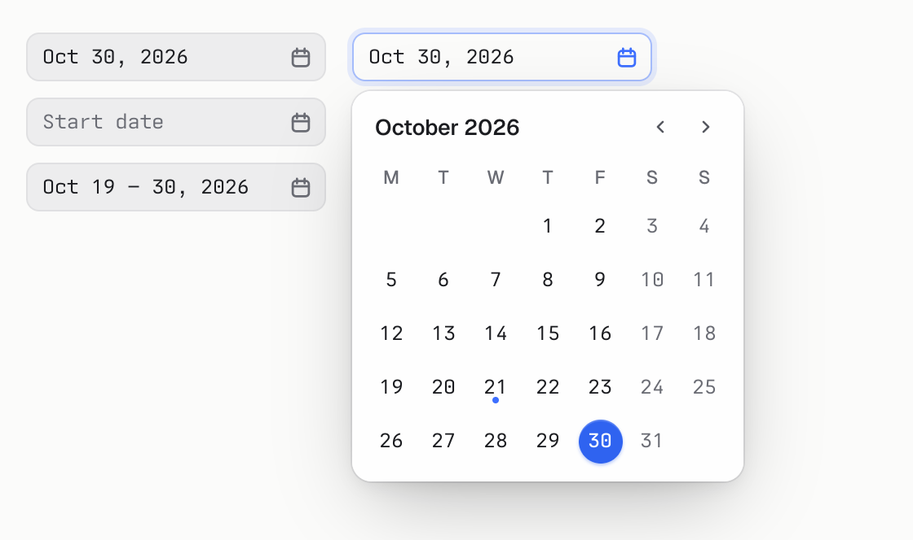
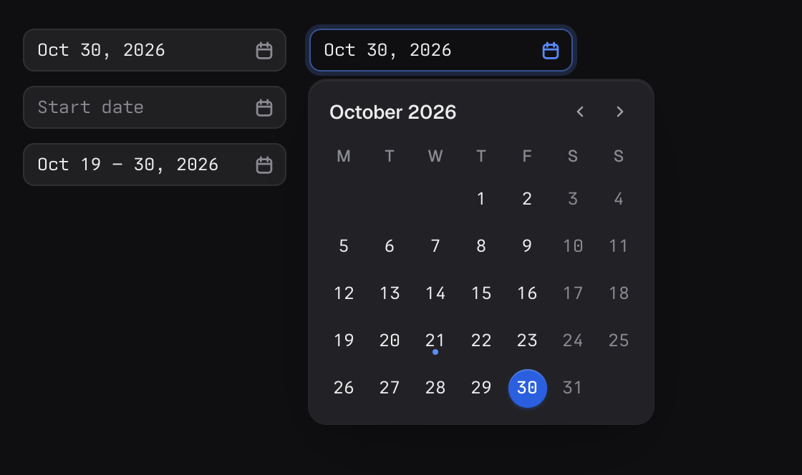
<figcaption>Closed fields (a day, the <code>placeholder</code>, a <code>range</code>) and an <code>open</code> one with its calendar.</figcaption>
</figure>

| Prop | Type | Default | Meaning |
| --- | --- | --- | --- |
| `value` | `string` \| `[string, string \| null]` | none | As `calendar`; the field shows `"Oct 30, 2026"`, a range `"Oct 19 – 30, 2026"` |
| `range` | `boolean` | `false` | Pick a range; the popover stays open until the second end |
| `open` | `boolean` | `false` | The popover shows. A click on the field flips it locally; a change wins |
| `placeholder` | `string` | `"Pick a date"` (`"Pick dates"` with `range`) | Shown in the field without a `value` |
| `month`, `today`, `min`, `max`, `weekStart`, `marks`, `cursor`, `note` | | | As `calendar`, for the popover's month |

**Children:** none (ignored).

**Events:**

| Event | Payload | When |
| --- | --- | --- |
| `toggle` | `{ev = "toggle", id, collapsed}`: `false` when it opened, `true` when it closed | A click on the field, a click outside the open popover, or a pick that closed it |
| `change` | `{ev = "change", id, value}` | As `calendar`; followed by `toggle` with `collapsed = true` |
| `action` | `{ev = "action", id, act = "month", value = "YYYY-MM"}` | As `calendar` |

**Keyboard:** the field never takes focus. To open it from the keys, set
`open = true`, drive `cursor` and `month` as for a `calendar`, set `value`
on Enter, and `open = false` on Enter or Escape.

**Styling:**

```html
<div class="sf sf-date open" data-id="main.due" data-variant="month">
	<button class="sf-date-box" aria-haspopup="dialog" aria-expanded="true">
		<span class="sf-date-val">Oct 30, 2026</span><svg class="sf-date-ic">…</svg>
	</button>
	<div class="sf-date-pop" role="dialog">
		<div class="sf-cal-month">…as calendar…</div>
	</div>
</div>
```

| Target | Selector |
| --- | --- |
| The node, open | `.sf-date`, `.sf-date.open` |
| The field box | `.sf-date-box` (ring is its `box-shadow`) |
| The value, the placeholder | `.sf-date-val`, `.sf-date-val.ph` |
| The glyph | `.sf-date-ic` |
| The popover | `.sf-date-pop` |
| Its month | every `calendar` selector above, under `.sf-date` |

The field is 30px tall, at least 184px wide, an `--l1` well like an
`input`, with the accent ring while open. The popover is glass
(`--pop-bg`, blurred), 12px corners, 6px under the field, its days 32 × 30px.

## `slider`

A value dragged along a track, or a range with two thumbs. Use it for a
number the user sets by feel rather than types: an opacity, a font size, a
model's temperature, a latency window. The value shows beside the track in
mono, formatted the way you say (`72%`, `13 px`, `200 ms – 1.2 s`).

Two looks. `default` is the kit's slider, the one Tern's own settings use: a
thin neutral track filled to a white thumb, the label at the left and the
value at the right, one 28px row that lines up in a `col` of settings.
`accent` is for the one control a view is about: the label and value sit
over an accent-filled track with ticks at the steps, the end values sit under
it, and a bubble over the thumb shows the value while the pointer is on the
track or dragging. Either look becomes a range when `value` is a pair.

The slider is pointer-only like the `el` controls: a press on the track
moves the nearest thumb there and a drag follows the pointer, drawn at once;
it never takes focus, so keys stay yours. The release sends `change` with
the new value. The value the user set stays on screen until your program's
`value` changes, which wins; a program that mirrors `change` into `value`
stays the owner.

**Build it:** `tern.ui.node("slider", { value = …, min = …, max = … })`.

| Prop | Type | Default | Meaning |
| --- | --- | --- | --- |
| `value` | number or `{ number, number }` | `min` | The value. A pair (`{ lo, hi }`) draws a range with two thumbs; it is put in order. Clamped to `min`..`max` and moved to the nearest step |
| `min` | number | `0` | The low end |
| `max` | number | `100` | The high end. Below `min` reads as `min` |
| `step` | number | a hundredth of the span's order of magnitude | The distance between values, counted from `min`: every value drawn and sent is `min + n × step`. Without one, `0.01` over a 0–1 span, `1` over 0–100, `10` over 0–2000. A `max` off the steps is reached only when it lands on one |
| `label` | string | none | The name at the left (over the track in `accent`); the thumbs speak it (`aria-label`, "`label`, minimum/maximum" on a range) |
| `unit` | string | none | Written after the number: `%`, `°`, `×`, `x`, `‰`, `′`, `″` sit against it (`72%`), any other after a space (`13 px`). Only for `format: "number"` |
| `format` | `"number"` \| `"percent"` \| `"duration"` | `"number"` | How the value reads. `number`: the value with the step's decimals (`0.6` for step `0.1`), then `unit`. `percent`: a fraction as a percentage (`0.9` → `90%`). `duration`: milliseconds as `0`, `200 ms`, `1.2 s`, `1 min 30 s` |
| `ticks` | boolean, number or `{ number }` | `accent`: every `step` you give, when there are at most 40; `default`: none | Tick marks under the track. `true` puts one at every step (up to 100), a number divides the track into that many equal parts (`4` → 0, 25, 50, 75, 100%), a list puts one at each value in it. `false` draws none |
| `variant` | `"default"` \| `"accent"` | `"default"` | The look (below). Other values read as `default` |
| `disabled` | boolean or string | `false` | Dimmed and inert: the thumbs do not move and nothing is sent; class `disabled`, `aria-disabled="true"`. A string is the reason, shown as the track's tooltip |

The common props work too: `title`, `aria`, `tone`, `key`, `actions` and
the flex props. The slider fills the width it is given; the track takes
what the label and value leave (at least 96px).

**Variants.**

| `variant` | Look | Use |
| --- | --- | --- |
| `default` | One row: the label in `--t2`, a 4px `--l2` track filled in `--t3` to a 14px white thumb, the value right in `12px` mono `--t2` (`--t3` at the minimum). Hover deepens the fill to `--t2` | Settings, a column of related values, anything beside other controls |
| `accent` | The label (`--t1`) and value over the track; the fill is `--accent`, the 16px thumb a `--card` disc in a 2.5px accent ring; ticks in `--l4` under the track and the end values in `11.5px` mono `--t3` under them; hovering or dragging raises an inverted bubble with the value over the thumb | The one value a view or step is about: a model's temperature, a budget, a window |

A held thumb swells a little (to 114%, 112% in `accent`) and follows the
pointer one to one; a click glides the thumb and fill there over .14 s. The
value column keeps the width of its widest value (at least seven
characters), so the track does not move while you drag and a column of
sliders with short values lines its tracks up. On a range, the thumb nearer the press takes it and stops at
the other thumb, never crossing it; from two thumbs together, the drag moves
the one on the side it goes. With Tern's reduced motion or the system's, nothing glides.

**Children:** none (ignored).

**Events:** releasing a drag (or a click on the track) that moved the value
sends

```lua
{ ev = "change", id = "<the slider's id>", value = 0.6 }          -- one value
{ ev = "change", id = "<the slider's id>", value = { 200, 1200 } } -- a range
```

Values are clamped and stepped as drawn; whole numbers arrive as integers.
Nothing is sent while dragging, and nothing when the release leaves the value
where it was. A disabled slider, or one on a surface that is closed or
opened with `listen = false`, sends nothing and does not move.

**Keyboard:** the slider never takes focus. To move it from the keyboard,
handle the keys in your program (←/→ by one `step`, Home/End to the ends)
and set `value`; show the keys with a key legend.

**Styling:**

```html
<div class="sf sf-slider range ticked" data-id="main.latency" data-variant="accent">
	<span class="sf-slider-label">Latency</span>
	<div class="sf-slider-track">
		<div class="sf-slider-rail">
			<div class="sf-slider-fill"></div>
			<div class="sf-slider-ticks" aria-hidden="true"><i class="sf-slider-tick"></i>…</div>
			<span class="sf-slider-thumb lo" role="slider" aria-label="Latency, minimum"
				aria-valuemin="0" aria-valuemax="2000" aria-valuenow="200" aria-valuetext="200 ms">
				<span class="sf-slider-bubble" aria-hidden="true">200 ms</span>
			</span>
			<span class="sf-slider-thumb hi" role="slider" …><span class="sf-slider-bubble">1.2 s</span></span>
		</div>
		<div class="sf-slider-ends" aria-hidden="true"><span class="lo">0</span><span class="hi">2 s</span></div>
	</div>
	<span class="sf-slider-value" aria-hidden="true">200 ms – 1.2 s</span>
</div>
```

| Target | Selector |
| --- | --- |
| The node | `.sf-slider` |
| Variant | `.sf-slider[data-variant='accent']` |
| A range / with ticks | `.sf-slider.range`, `.sf-slider.ticked` |
| Disabled | `.sf-slider.disabled` (thumbs `[aria-disabled='true']`) |
| While dragging | `.sf-slider.drag`, the held thumb `.sf-slider-thumb.held` |
| Label / value text | `.sf-slider-label`, `.sf-slider-value` (`.min` at the minimum) |
| Track (the pointer's) / rail / fill | `.sf-slider-track`, `.sf-slider-rail`, `.sf-slider-fill` |
| Thumbs | `.sf-slider-thumb` (`.lo`, `.hi`; `.hi` shows on a range only) |
| Ticks | `.sf-slider-tick` (inner, may change) |
| Bubble / end values | `.sf-slider-bubble`, `.sf-slider-ends` (`accent` only; inner, may change) |

The label draws in the region's face (sans in an app, mono in the default
region); the value, ends and bubble are always mono with tabular digits.

```lua
local ui = tern.ui

return ui.node("col", { gap = "sm" }, {
	ui.node("slider", { label = "Opacity", value = 72, step = 1, unit = "%" }),
	ui.node("slider", { label = "Font size", min = 9, max = 24, step = 1, value = 13, unit = "px" }),
	ui.node("slider", {
		label = "Latency", min = 0, max = 2000, step = 50,
		value = { 200, 1200 }, format = "duration",
	}),
	ui.node("slider", {
		key = "temperature", label = "Temperature", variant = "accent",
		min = 0, max = 1, step = 0.1, value = state.temperature,
	}),
})
```

with the block mirroring the event:

```lua
local function event(state, ev)
	if ev.ev == "change" and ev.id == "main.temperature" then
		state.temperature = ev.value
	end
end
```

The same in TSX (TypeScript SDK):

```tsx
<col gap="sm">
   <slider label="Opacity" value={opacity} step={1} unit="%" onChange={(v) => setOpacity(v)} />
   <slider label="Latency" min={0} max={2000} step={50} value={[lo, hi]} format="duration"
      onChange={([a, b]) => setWindow(a, b)} />
   <slider variant="accent" label="Temperature" min={0} max={1} step={0.1} value={temperature}
      onChange={setTemperature} />
</col>
```

<figure class="tn-figure">
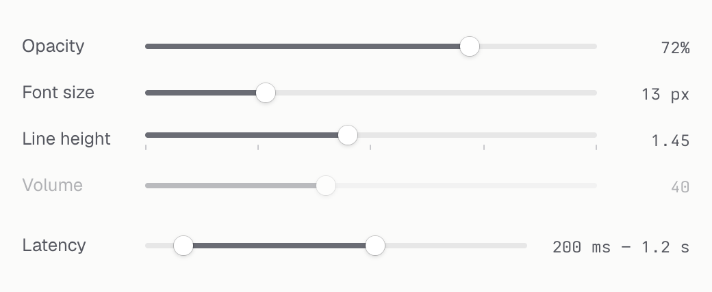
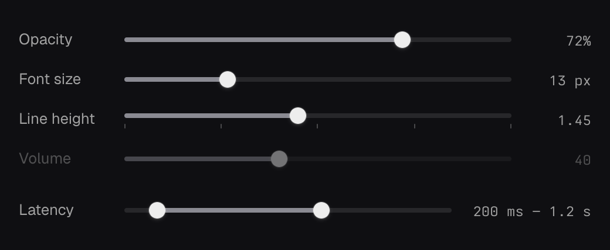
<figcaption>The <code>default</code> look: values with units, <code>ticks</code>, a disabled slider, and a range with <code>format: "duration"</code>.</figcaption>
</figure>

<figure class="tn-figure">
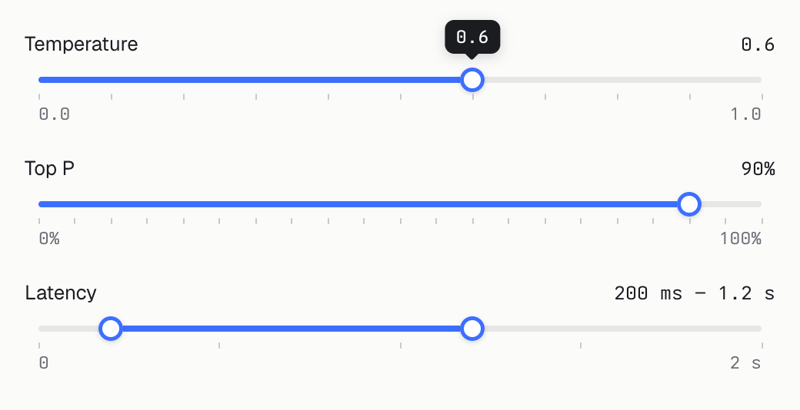
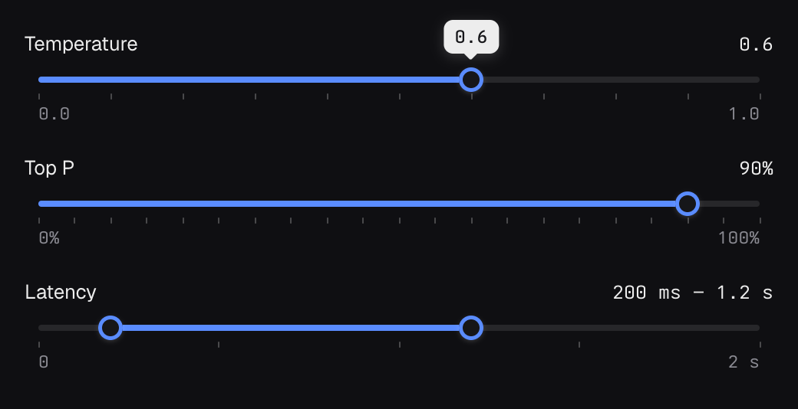
<figcaption>The <code>accent</code> look: ticks at every step, the end values, a range, and the bubble a hovered or dragged thumb carries.</figcaption>
</figure>

## `switch`

An on/off setting in Tern's look, the same switch Tern's own settings use. A
click on the switch or on its label flips it at once and sends `change`; your
program keeps the state and answers with `on`. Reach for it when a choice
takes effect immediately (wrap lines, follow output, telemetry); for a choice
submitted with a form, use an [`el` checkbox](el.md).

Three looks: `default` is kit's 36×22 switch, and with a `label` (and a
`hint` under it) it fills its row as a settings row: the words left, the
switch right. `compact` is a 26×15 switch with its label to the right, for
dense lists and toolbars. `segment` is a two-state segmented control,
Off | On, that reads well in a mono region too; `labels` renames the two
sides.

It is pointer-only like the `el` controls: it never takes focus, so keys
stay yours. Drive it from the keyboard by changing `on` yourself.

**Build it:** `tern.ui.node("switch", { label = …, on = … })`.

```lua
local ui = tern.ui

ui.node("col", { gap = "sm" }, {
	ui.node("switch", { key = "wrap", label = "Wrap long lines",
		hint = "Soft-wrap instead of scrolling", on = state.wrap }),
	ui.node("switch", { key = "follow", variant = "compact",
		label = "Follow output", on = state.follow }),
	ui.node("switch", { key = "telemetry", variant = "segment",
		label = "Telemetry", on = state.telemetry }),
})
```

The same in TSX (TypeScript SDK):

```tsx
<col gap="sm">
   <switch label="Wrap long lines" hint="Soft-wrap instead of scrolling" on={wrap} onChange={(v) => setWrap(v)} />
   <switch variant="compact" label="Follow output" on={follow} onChange={setFollow} />
   <switch variant="segment" label="Theme" labels={['Light', 'Dark']} on={dark} onChange={setDark} />
</col>
```

<figure class="tn-figure">
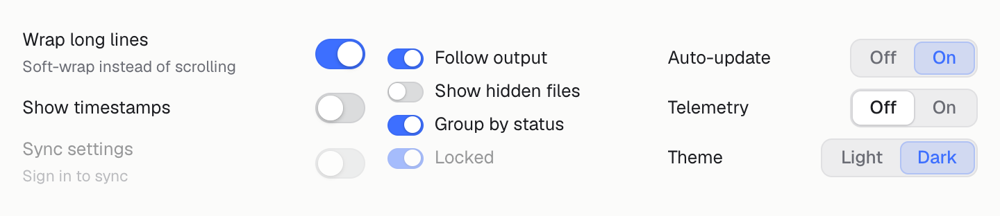
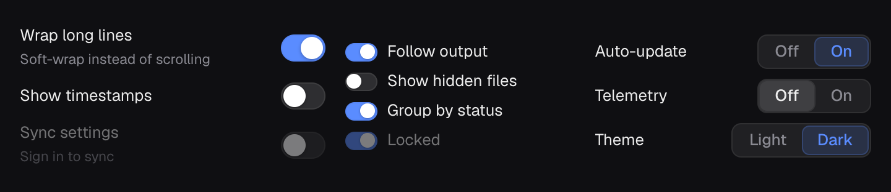
<figcaption>The three looks: <code>default</code> settings rows, <code>compact</code> list switches and <code>segment</code> controls.</figcaption>
</figure>

<figure class="tn-figure">
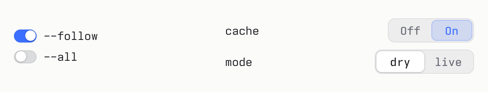
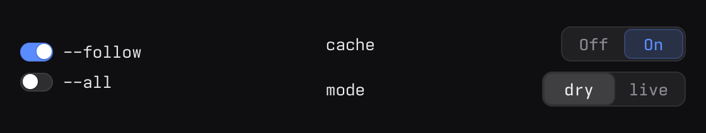
<figcaption><code>compact</code> and <code>segment</code> in the default mono region.</figcaption>
</figure>

| Prop | Type | Default | Meaning |
| --- | --- | --- | --- |
| `on` | boolean | `false` | Whether the switch is on: class `on`, `aria-checked="true"`. A change of `on` wins over the user's local flip |
| `variant` | `"default"` \| `"compact"` \| `"segment"` | `"default"` | The look (below). Other values read as `default` |
| `label` | string | none | The setting's name; also the switch's accessible name. A labeled switch fills its row (class `row`) |
| `hint` | string | none | A muted line under the label, wrapping as needed |
| `labels` | `{ string, string }` | `{ "Off", "On" }` | The words of a `segment`'s two sides, off first. Ignored by the other variants |
| `disabled` | boolean or string | `false` | Dimmed and inert: clicks flip nothing and send nothing, class `disabled`, `aria-disabled="true"`. A string is the reason, shown as the tooltip (it wins over `title`) |

The common props work too: `key` (the local flip is remembered by it among
siblings, else by id), `title`, `tone`, `actions` and the flex props.

**Variants.**

| `variant` | Look | Use |
| --- | --- | --- |
| `default` | A 36×22 pill, `--l3` (13% white in dark) off and `--accent` on, a white knob in both themes; label and hint left, switch right | Settings pages and preference cards |
| `compact` | A 26×15 pill with a 12px knob, label to its right; rows 22px tall | Dense lists, filters, toolbars |
| `segment` | A 28px segmented control on `--l1`: a raised card thumb under Off, an accent tint and accent text under On; label left | A setting that reads better as words, mono regions |

The knob slides on a spring (`--out`, .32 s) and stretches toward its
destination while pressed; the segment's thumb slides the same way. Motion
stops under reduced motion, `.sf-still` and `.sf-paused`. Disabled switches
draw at 45% opacity.

**Children:** none (ignored).

**Events:** a click on the switch or its label (on a `segment`, a click on
the side it is not on, or on the label to flip) sends

```lua
{ ev = "change", id = "<the switch's id>", value = true }  -- the new state
```

The switch draws the new state at once and keeps it, by `key`, until your
program sends an `on` that differs from the last one drawn; then `on` wins.
Mirror `value` into `on` and you stay the owner. Disabled switches, and every
switch on a closed surface or one opened with `listen = false`, flip nothing
and send nothing.

**Keyboard:** none of its own. Your program owns the keys: flip your state
and send the new `on` (Space on a focused row, say).

**Styling:**

```html
<div class="sf sf-switch row on" data-id="main.wrap" data-variant="default"
	role="switch" aria-checked="true" aria-disabled="false" aria-label="Wrap long lines">
	<span class="sf-switch-text">
		<span class="sf-switch-label">Wrap long lines</span>
		<span class="sf-switch-hint">Soft-wrap instead of scrolling</span>
	</span>
	<span class="sf-switch-track" aria-hidden="true"><span class="sf-switch-knob"></span></span>
	<!-- segment: <span class="sf-switch-seg" aria-hidden="true">
		<span class="sf-switch-thumb"></span>
		<span class="sf-switch-opt off">Off</span><span class="sf-switch-opt on">On</span>
	</span> -->
</div>
```

`compact` puts the track before the text.

| Target | Selector |
| --- | --- |
| The node | `.sf-switch` |
| Variant | `.sf-switch[data-variant='compact']`, `[data-variant='segment']` |
| On / disabled | `.sf-switch.on` (`[aria-checked='true']`), `.sf-switch.disabled` (`[aria-disabled='true']`) |
| Labeled row | `.sf-switch.row` |
| Label / hint | `.sf-switch-label`, `.sf-switch-hint` (in `.sf-switch-text`) |
| Track / knob | `.sf-switch-track`, `.sf-switch-knob` |
| Segment, thumb, sides | `.sf-switch-seg`, `.sf-switch-thumb`, `.sf-switch-opt.off`, `.sf-switch-opt.on` |

## `button`

A button in Tern's look: a label, an optional leading icon and the keycaps of
the key that does the same thing. A click sends an `action` event; nothing
else happens until your program answers. Use it for every action in a view;
the [design guide](../guides/design.md#buttons) says which variant and size
goes where.

The button sizes to its content and never stretches, not even as a child of
a `col` (it keeps `align-self: flex-start` unless you give it `grow`). It is
pointer-only like the `el` controls: it never takes focus, so keys stay
yours, and `keys` shows the user which one to press.

**Build it:** `tern.ui.button(text, props?)` (see
[UI Builders](../reference/ui.md#button)), or
`tern.ui.node("button", { text = …, variant = … })`. In the SDKs a
button's string children become its `text`, as a badge's do.

| Prop | Type | Default | Meaning |
| --- | --- | --- | --- |
| `text` | string | `""` | The label. Empty with an `icon` draws an icon-only button: give it a `title` or `aria` |
| `icon` | icon name | none | A leading icon from [Tern's set](data.md#icon-names): 14px, 12px at `sm` |
| `keys` | `{ string }` | none | Keycaps after the label, named as in [`kbd`](data.md#kbd). Display only: your program handles the key. Without a `title`, the tooltip is the label and the keys (`Refresh  R`) |
| `variant` | `"default"` \| `"primary"` \| `"quiet"` \| `"danger"` | `"default"` | The look (below). Other values read as `default` |
| `size` | `"sm"` \| `"md"` | `"md"` | `md` is 28px tall, for heads, bars and forms; `sm` is 22px, for rows and inline use |
| `on` | boolean | `false` | A pressed toggle: class `on`, `aria-pressed="true"`, drawn in an accent tint |
| `disabled` | boolean or string | `false` | Dimmed and inert: sends nothing, class `disabled`, `aria-disabled="true"`. A string is the reason, shown as the tooltip (it wins over `title`) |
| `busy` | boolean | `false` | A spinner takes the icon's place (or leads the label), the button sends nothing and keeps its width; class `busy`, `aria-busy="true"` |

The common props work too: `title`, `aria`, `tone` (sets `--tc` for your
sheet), `actions` and the flex props.

**Variants.**

| `variant` | Look | Use |
| --- | --- | --- |
| `default` | `--t2` text on `--chip-bg` with an `--l2` hairline ring; hover lifts to `--t1` on `--l2` | Most actions |
| `primary` | `--grad-ink` text on the brand gradient (`--grad`) with a soft accent glow; keycaps take the text color | The one action the view exists for |
| `quiet` | No fill, no ring, `--t2` text; hover tints `--l1` | Secondary actions in bars and heads, Cancel |
| `danger` | `--bad` text on an 8% `--bad` tint with a 22% `--bad` ring | The destructive action itself |

A press scales the button to 98% at once and releases over .3 s; hover
arrives instantly and leaves over .15 s. Disabled buttons draw at 45%
opacity. The cursor is the pointing hand, the arrow while disabled or busy.

**Children:** none (ignored).

**Events:** a click sends

```lua
{ ev = "action", id = "<the button's id>", act = "click" }
```

`act` is the button's `actions.click` when it has one, so
`actions = { click = "deploy" }` sends `act = "deploy"` (and `value` for a
`name=value` action, `mods` with modifiers held, `values` inside an `el`
form, as any action). A disabled or busy button sends nothing, not even its
`dblclick`. `dblclick` and `menu` actions otherwise work as on any node.
Copying a view writes a button as `[Label]`.

**Styling:**

```html
<button class="sf sf-button" data-id="main.bar.deploy" data-variant="primary" data-size="md"
	title="Deploy  ⌘ ⏎">
	<span class="sf-btn-ic"><svg class="ico">…</svg></span>   <!-- busy: <span class="sf-orbit"><i></i></span> -->
	<span class="sf-btn-label">Deploy</span>
	<span class="sf-kbd kbds"><span class="kbd">⌘</span><span class="kbd">⏎</span></span>
</button>
```

| Target | Selector |
| --- | --- |
| The node | `.sf-button` |
| Variant / size | `.sf-button[data-variant='primary']`, `[data-size='sm']` |
| Pressed toggle | `.sf-button.on`, `[aria-pressed='true']` |
| Disabled / busy | `.sf-button.disabled` (`[aria-disabled='true']`), `.sf-button.busy` (`[aria-busy='true']`) |
| Icon-only | `.sf-button.only-ic` |
| Icon / label | `.sf-btn-ic`, `.sf-btn-label` (inner, may change) |
| Busy spinner | `.sf-button .sf-orbit` (inner, may change) |
| Keycaps | `.sf-button .kbd` (inner; 16px tall, 10px text) |

`md` is `500 12.5px` sans with `padding: 0 10px`, a 6px gap and 8px
corners; `sm` is `500 12px` sans, `padding: 0 8px`, a 5px gap and 6px
corners. Both draw in sans in every region, mono or not. A button doesn't
carry `.sf-act`; it shows the pointing hand by its own rule.

```lua
local ui = tern.ui

return ui.col({
	ui.row({
		ui.button("Deploy", { variant = "primary", keys = { "cmd", "enter" }, actions = { click = "deploy" } }),
		ui.button("Refresh", { icon = "repeat", keys = { "r" }, actions = { click = "refresh" } }),
		ui.button("Follow", { variant = "quiet", on = true, actions = { click = "follow" } }),
		ui.button("Delete", { variant = "danger", actions = { click = "delete" } }),
	}),
	ui.row({
		ui.button("Approve", { size = "sm", actions = { click = "approve" } }),
		ui.button("Retry", { size = "sm", icon = "repeat" }),
		ui.button("Saving", { size = "sm", busy = true }),
		ui.button("Publish", { size = "sm", disabled = "Sign in to publish" }),
		ui.button("", { size = "sm", icon = "more", title = "More actions" }),
	}),
})
```

The same in TSX (TypeScript SDK), where handlers set the click action for
you:

```tsx
<row>
   <button variant="primary" keys={['cmd', 'enter']} onClick={deploy}>Deploy</button>
   <button icon="repeat" keys={['r']} onClick={refresh}>Refresh</button>
   <button variant="quiet" on={follow} onClick={toggleFollow}>Follow</button>
   <button variant="danger" onClick={askDelete}>Delete</button>
</row>
```

<figure class="tn-figure">
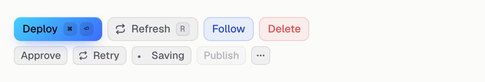
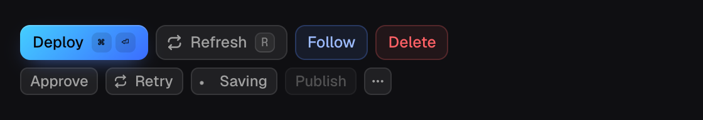
<figcaption>The four variants at <code>md</code>, then <code>sm</code> with <code>busy</code>, <code>disabled</code> and an icon-only button.</figcaption>
</figure>

For a button inside a table row, use a [button cell](data.md#table), which
sends the row with the action.

## `buttons`

A group of [`button`](#button) nodes drawn as one control. Reach for it when
actions belong together: Undo and Redo, previous / Today / next, a view
switch of `on` toggles, an action with its options menu, or the strip of
icon tools at the top of a pane. The children stay ordinary buttons: each
sends its own `action`, shows its own tooltip, and can be `on`, `disabled`
or `busy`. The group only draws them together.

The group sizes to its content and never stretches (in a `col` it keeps
`align-self: flex-start`). It never takes focus; neither do its buttons.

**Build it:** `tern.ui.node("buttons", { variant = … }, { …buttons })`.

```lua
local ui = tern.ui

return ui.row({
	ui.node("buttons", { label = "History" }, {
		ui.button("Undo", { icon = "undo", actions = { click = "undo" } }),
		ui.button("Redo", { icon = "redo", actions = { click = "redo" } }),
	}),
	ui.node("buttons", { variant = "split" }, {
		ui.button("Deploy", { variant = "primary", icon = "rocket", actions = { click = "deploy" } }),
		ui.button("", { variant = "primary", icon = "chev", title = "Deploy options",
			actions = { click = "deploy-menu" } }),
	}),
	ui.node("buttons", { variant = "toolbar", label = "View" }, {
		ui.button("", { icon = "search", title = "Find", actions = { click = "find" } }),
		ui.button("", { icon = "eye", title = "Preview", on = state.preview,
			actions = { click = "preview" } }),
	}),
})
```

The same in TSX (TypeScript SDK):

```tsx
<row>
   <buttons label="History">
      <button icon="undo" onClick={undo}>Undo</button>
      <button icon="redo" onClick={redo}>Redo</button>
   </buttons>
   <buttons variant="split">
      <button variant="primary" icon="rocket" onClick={deploy}>Deploy</button>
      <button variant="primary" icon="chev" title="Deploy options" onClick={openDeployMenu} />
   </buttons>
   <buttons variant="toolbar" label="View">
      <button icon="search" title="Find" onClick={find} />
      <button icon="eye" title="Preview" on={preview} onClick={togglePreview} />
   </buttons>
</row>
```

<figure class="tn-figure">
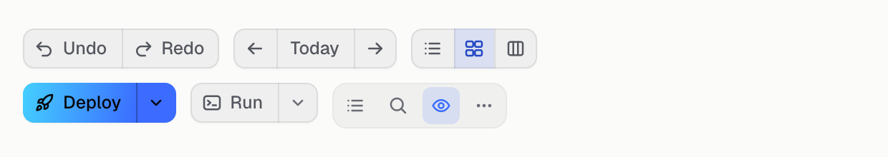
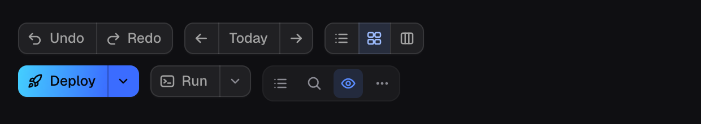
<figcaption>The three variants: joined, split and toolbar.</figcaption>
</figure>

<figure class="tn-figure">
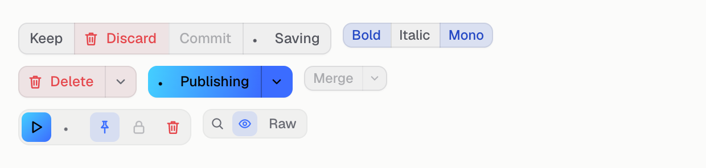
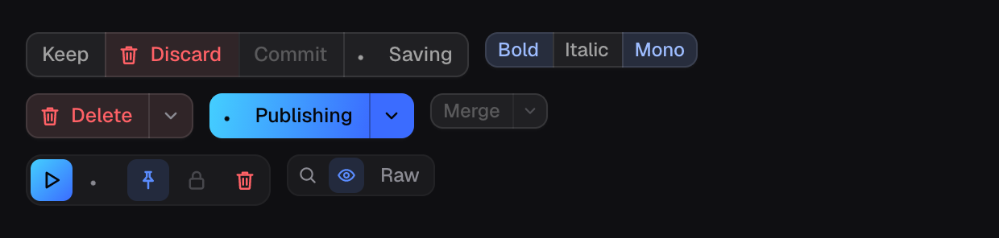
<figcaption>Children keep their variant and state inside every group; <code>size = "sm"</code> shrinks them all.</figcaption>
</figure>

| Prop | Type | Default | Meaning |
| --- | --- | --- | --- |
| `variant` | `"joined"` \| `"split"` \| `"toolbar"` | `"joined"` | The look (below). Other values read as `joined` |
| `size` | `"sm"` \| `"md"` | `"md"` | The children's size, winning over their own `size`: `md` 28px tall (26px in a toolbar), `sm` 22px |
| `label` | string | none | The group's accessible name (`aria-label`), e.g. `"History"` |

The common props work too: `title`, `aria`, `tone`, and the flex props.

**Variants.**

| `variant` | Look | Use |
| --- | --- | --- |
| `joined` | One `--l2` hairline ring and 8px outer corners around all children, `--l2` hairline dividers between them; children lose their own ring and inner corners. `on` children tint `--accent` 12%, `danger` ones `--bad` 7%, `primary` ones keep the gradient | Related actions (Undo/Redo), steppers (← Today →), a view switch of `on` toggles |
| `split` | `joined` for two children: the action, then a 28px (22px at `sm`) menu part, drawn `--t3`, usually an icon-only `chev` button. Two `primary` children read as one pill: the gradient runs across the action and the menu part holds its end color, split by a 28% `--grad-ink` hairline | An action with options: Deploy ▾, Run ▾ |
| `toolbar` | A soft well (`--t1` at 5%, 10px corners, 3px padding) holding bare buttons 4px apart: 26px square icon buttons (22px at `sm`), `--t3` icons, hover `--l2`; `on` buttons draw `--accent` on a 14% accent tint | A pane's tool strip: outline, find, preview, more |

Each segment has its own hover and press tint (presses tint instead of
scaling, so neighbours stay put); disabled segments draw at 45% opacity (40%
in a toolbar), busy ones show the button's spinner.

**Children:** `button` nodes, in order. Other kinds are drawn in the row but
not restyled.

**Events:** none of its own. Each child sends its `action` as a lone
[`button`](#button) does (`{ ev = "action", id = "<the button's id>", act = … }`);
disabled and busy children send nothing.

**Keyboard:** the group and its buttons never take focus. Your program owns
the keys: show them with a child's `keys` (the tooltip lists them) and drive
the state with props (`on` for the active toggle, `busy` while working,
`disabled` with a reason).

**Accessibility:** `role="group"` (`role="toolbar"` for `toolbar`) with
`label` as `aria-label`; children keep `aria-pressed` / `aria-disabled` /
`aria-busy`. Give icon-only children a `title`.

**Styling:**

```html
<div class="sf sf-buttons" data-id="main.bar.view" data-variant="toolbar" data-size="md"
	role="toolbar" aria-label="View">
	<button class="sf sf-button only-ic" data-variant="default" data-size="md" title="Find">…</button>
	<button class="sf sf-button only-ic on" aria-pressed="true" title="Preview">…</button>
</div>
```

| Target | Selector |
| --- | --- |
| The node | `.sf-buttons` |
| Variant / size | `.sf-buttons[data-variant='split']`, `[data-size='sm']` |
| A segment | `.sf-buttons > .sf-button` |
| A pressed segment | `.sf-buttons > .sf-button.on` |
| The split menu part | `.sf-buttons[data-variant='split'] > .sf-button:last-child` |

## `field`

A labelled form row: the label, the control (or a few), and a line under it
that is the help text until your program says something is wrong. Reach for
it whenever a control needs a name: a form in a panel, a settings list, a
dialog's fields. It is pure layout and state: the children are ordinary
controls ([`input`](#input), [`editor`](#editor), [`select`](#select),
[`date`](#date), [`otp`](#otp), [`switch`](#switch), buttons, [`el`](el.md)
checkboxes) that keep their own props and events. The field only draws the
words around them and, on `error` or `warning`, rings whichever control sits
inside in red or amber, so you never set an error prop on the control itself.

Three looks, one per `variant`:

- **`stacked`** (default): the label over the control, then the help line, or
  the error with a warning icon in `--bad`. Text fields fill the width. The
  shape for forms in a column.
- **`row`**: a settings row, like Tern's own Settings: the label and its hint
  at the left, the control at the right, vertically centred. Consecutive
  `row` fields draw a hairline between them, so a `col` of them reads as one
  list. A warning or error replaces the hint, in its tone, with the icon
  before the label.
- **`grid`**: a form grid, like a dialog's: a right-aligned label column
  (`labelWidth`, 12 cells by default) before the control, the note under the
  control. Every field in the column has the same label width, so the
  controls line up; a field with no `label` keeps the empty column (use it
  for a lone checkbox under the others).

The label is text, not an HTML `<label>`: a click on it does nothing, so the
keys stay where your program put them (nodes never take focus). Put the
field's name in `label`; the control gets its accessible name from the
field's group (`role="group"` labelled by the label, described by the note).

**Build it:** `tern.ui.node("field", { label = …, … }, { control })`. In the
SDKs the field's children are its controls.

```lua
local ui = tern.ui

local port_error = nil
if state.port < 1 or state.port > 65535 then
	port_error = "Must be 1–65535"
end

return ui.node("col", { gap = "lg" }, {
	ui.node("field", { label = "Service name", hint = "Lowercase letters, digits and dashes", required = true }, {
		ui.node("input", { key = "name", text = state.name }),
	}),
	ui.node("field", { label = "Port", error = port_error }, {
		ui.node("input", { key = "port", text = tostring(state.port) }),
	}),
})
```

A settings list and a dialog grid in TSX (TypeScript SDK):

```tsx
<col>
   <field variant="row" label="Auto-update" hint="Check daily, install on quit">
      <select key="update" value={update} options={['Never', 'Daily', 'Weekly']} />
   </field>
   <field variant="row" label="Endpoint" warning={reachable ? undefined : 'Unreachable: timed out'}>
      <input key="endpoint" text={endpoint} />
   </field>
   <field variant="row" label="Launch at login" hint="Start Tern when you sign in">
      <switch key="login" on={login} />
   </field>
</col>

<col gap="md">
   <field variant="grid" label="Name"><input key="name" text={name} /></field>
   <field variant="grid" label="Replicas" error={replicas > quota ? `Quota allows ${quota} replicas in this region` : undefined}>
      <input key="replicas" text={String(replicas)} />
   </field>
</col>
```

<figure class="tn-figure">
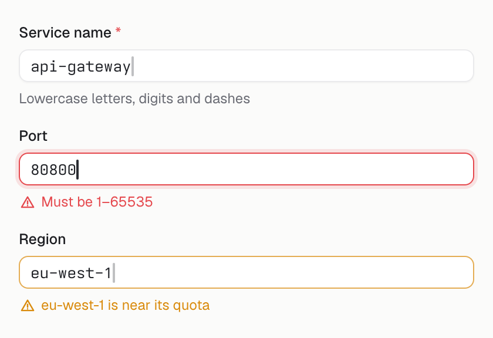
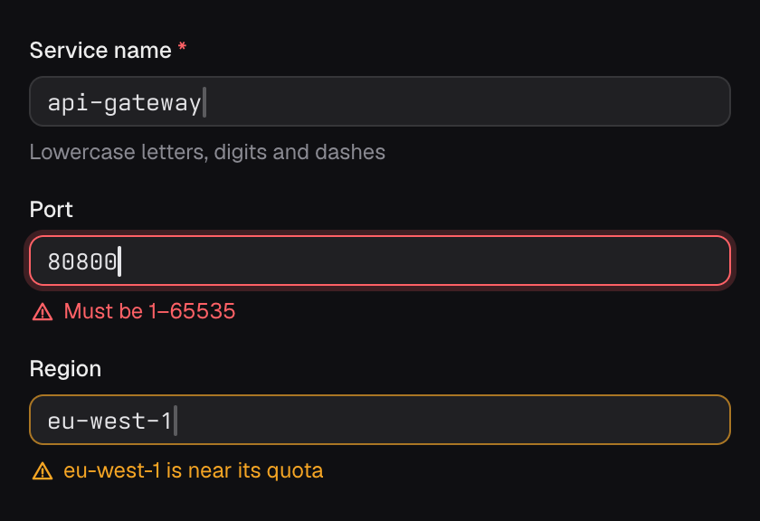
<figcaption><code>stacked</code>: help, <code>required</code>, an <code>error</code> on the focused input and a <code>warning</code>.</figcaption>
</figure>

<figure class="tn-figure">
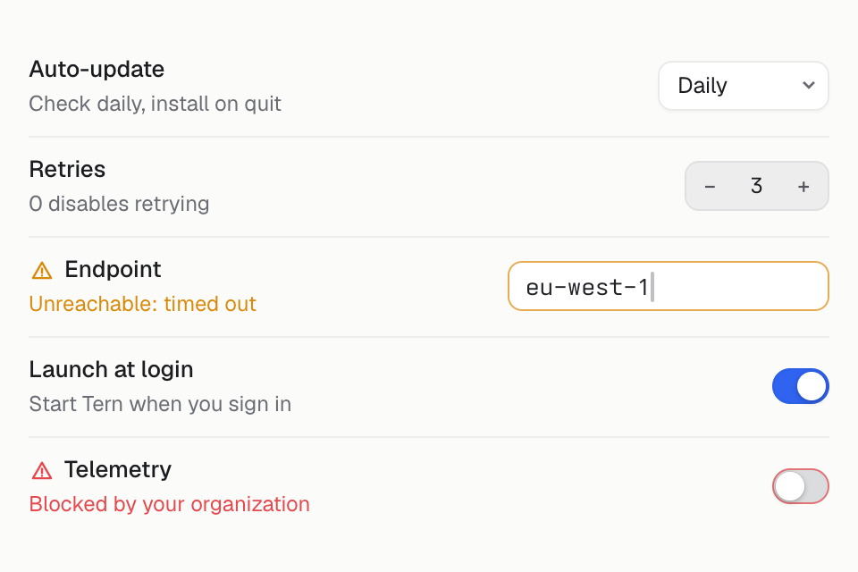
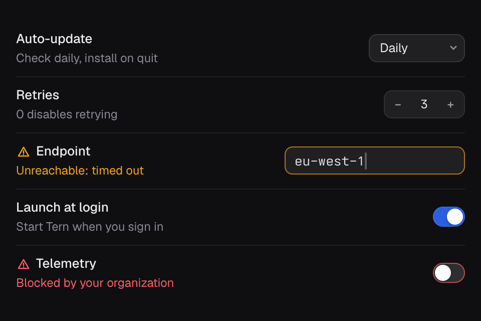
<figcaption><code>row</code>: a settings list, with a <code>warning</code> and an <code>error</code> in place of the hint.</figcaption>
</figure>

<figure class="tn-figure">
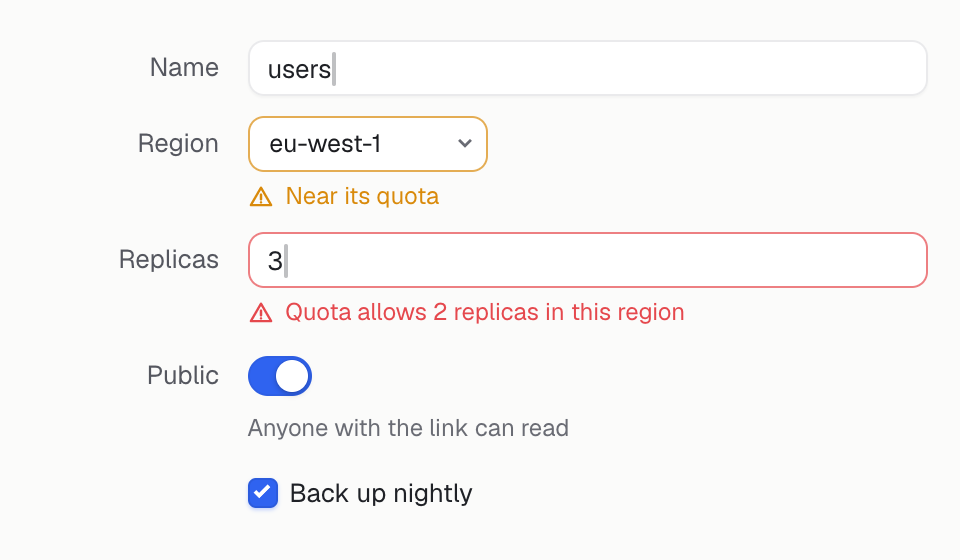
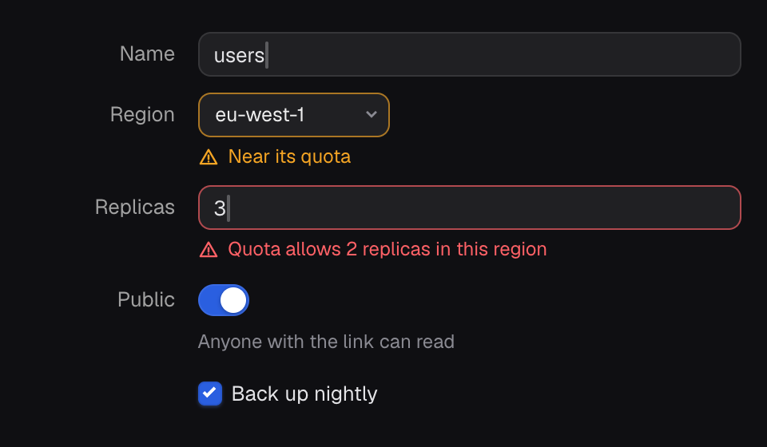
<figcaption><code>grid</code>: one label column, so the controls align; a field without a <code>label</code> keeps it.</figcaption>
</figure>

| Prop | Type | Default | Meaning |
| --- | --- | --- | --- |
| `label` | text (string or spans) | none | The field's name. Without it `stacked` and `row` draw no label line; `grid` keeps the empty column |
| `hint` | text | none | The help line: under the control (`stacked`, `grid`) or under the label (`row`), in `--t3`. Hidden while an `error` or `warning` shows |
| `error` | text or boolean | none | Something is wrong: the note shows this in `--bad` with a warning icon and the control inside gets a `--bad` ring. `true` sets the state (and the ring) without a line; `""`, `false` or absent clears it. Wins over `warning` |
| `warning` | text or boolean | none | Worth a look but not wrong: as `error`, in `--warn`. Ignored while `error` is set |
| `required` | boolean | `false` | A small `*` in `--bad` after the label (`title` "Required"), class `req`. Display only: validating is your program's |
| `labelWidth` | extent (`"14ch"`, or a fraction such as `0.3`) | `"12ch"` | `grid` only: the label column's width, in cells of the region (`--sf-cw`) or a fraction of the field. Give every field of one form the same value |
| `variant` | `"stacked"` \| `"row"` \| `"grid"` | `"stacked"` | The look (below). Other values read as `stacked` |

The common props work too (`title`, `aria`, `tone`, `actions`, the flex
props and `w`/`min`/`max`). Text props take spans, so a hint can carry a
`code` or `path` token.

**Variants.**

| `variant` | Look | Use |
| --- | --- | --- |
| `stacked` | Label (`500 12.5px` sans, `--t1`) over the control over the note, 6px apart; text fields fill the width | Forms in a panel or card |
| `row` | A grid: label (`500 13px`) over the note at the left, the control at the right and centred, 24px between, at least 52px tall with 10px above and below; an `--l1` hairline above every `row` field that follows another; text fields 180px wide | Settings, preferences, toggles |
| `grid` | A right-aligned label column (`400 13px`, `--t2`, `labelWidth`) 14px before the control (28px row), the note 4px under the control | Dialogs and dense forms with several fields |

An `error` or `warning` appears with a short fade and drop (.22 s, none
under reduced motion); the ring follows the control's own transition.
While the control has the keys (an `input` or `editor` that is `focused`) or
is open (a `select`, a `date`), the ring firms to the full tone and gains a
3px halo, in place of the accent focus ring.

**Children:** the control(s), laid out in a wrapping row 8px apart:
`input` and `editor` grow to fill it (`flex: 1 1 140px`; fixed 180px in
`row`), everything else keeps its own width. A one-line `input` inside a
field takes the form-field face (28px, 8px corners, a `--card` face with an
`--l2` hairline ring) instead of its tinted well. A `row` of children works
too.

**Events:** none of its own. The controls inside send theirs (`change`,
`edit`, `action`, …) as anywhere else; a click on the label or the note
sends nothing and moves no focus.

**Keyboard:** the field never takes focus. Your program drives the control's
keyboard state (`focus` op, `cursor`, `open`, `value`) as usual, and the
field's state through `error` / `warning`: validate on `edit` or `change` and
set or clear them.

**Accessibility:** the field is `role="group"` with `aria-labelledby` naming
its label and `aria-describedby` naming its note while one shows; an error
or warning note is `role="alert"`, so it is announced as it appears. The
icons are `aria-hidden`.

**Styling:**

```html
<div class="sf sf-field bad" data-id="main.port" data-variant="stacked" role="group"
	aria-labelledby="…-label" aria-describedby="…-note">
	<div class="sf-field-lbl" id="…-label">
		<span class="sf-field-ic" aria-hidden="true"><svg class="ico">…</svg></span>  <!-- row look only -->
		<span class="sf-field-t">Port</span>
		<span class="sf-field-req sf-hidden" title="Required">*</span>  <!-- shown with `required` -->
	</div>
	<div class="sf-field-ctl"><!-- the children --></div>
	<div class="sf-field-note" id="…-note" role="alert">
		<span class="sf-field-ic" aria-hidden="true"><svg class="ico">…</svg></span>
		<span class="sf-field-msg">Must be 1–65535</span>
	</div>
</div>
```

| Target | Selector |
| --- | --- |
| The node | `.sf-field` |
| Variant | `.sf-field[data-variant='row']`, `[data-variant='grid']` |
| Error / warning state | `.sf-field.bad`, `.sf-field.warn`; the tone is `--sf-field-tc` on the node |
| Required / no label / no note | `.sf-field.req`, `.sf-field.nolbl`, `.sf-field.nonote` |
| Label column | `.sf-field-lbl` (its text `.sf-field-t`, the mark `.sf-field-req`) |
| Controls | `.sf-field-ctl` (the children's parent) |
| Note | `.sf-field-note` (its text `.sf-field-msg`) |
| Icons | `.sf-field-ic` (inner, may change) |

The ring rules sit on the field's classes, not on the controls: they reach
`.sf-input`, `.sf-editor`, `.sf-select-btn`, `.sf-date-box`, the `otp` cells,
the `switch` track, buttons and `el` checkboxes inside `.sf-field-ctl`. A
control of your own can follow them with
`.sf-field.bad .sf-field-ctl .mine { box-shadow: inset 0 0 0 1px var(--sf-field-tc) }`.

See [Styling Views](../styles/index.md) for how sheets are scoped and
[Supported CSS](../styles/css.md) for what a rule may use.
