# Layout

Layout kinds arrange other nodes. Use `col` and `row` to stack nodes and lay them side by side, `card` to frame a
unit of work with a head, a status and an optional fold, `section` for a lighter fold with no frame, `split` for
panes the user resizes, `scroll` for a box that scrolls its children, `empty` for what a view shows while it has
nothing, `rule` for a divider or a transcript marker and `spacer` for fixed vertical space.

| Kind | Builder | Draws |
| --- | --- | --- |
| [`col`](#col) | `tern.ui.col(…)`, `tern.ui.lines(…)` | A vertical flex stack of its children |
| [`row`](#row) | `tern.ui.row(…)` | A horizontal flex row of its children |
| [`card`](#card) | `tern.ui.card(head, …)` | A framed box: head row (role icon, head, status chip, chevron), body, preview clamp |
| [`section`](#section) | `tern.ui.section(head, …)` | An unframed disclosure group: chevron and head over an indented body |
| [`split`](#split) | `tern.ui.node("split", { sizes = … }, …)` | Panes side by side or stacked that the user resizes by dragging the handles between them |
| [`scroll`](#scroll) | `tern.ui.node("scroll", { max = … }, …)` | A box that scrolls its children inside its bound, optionally kept to its end (logs, chats) |
| [`empty`](#empty) | `tern.ui.node("empty", { title = … }, …)` | An empty state: icon, title, one muted line and the actions that fill it |
| [`rule`](#rule) | `tern.ui.rule(label?)`, `tern.ui.node("rule", { variant = … })` | A hairline divider, optionally labeled; a note row or a pinned transcript marker (checkpoints, joins, compactions) |
| [`spacer`](#spacer) | `tern.ui.node("spacer", { size = … })` | A fixed block of vertical space |

## Common props on layout nodes

Every node takes the common props (see [Elements](index.md)). Two groups matter most for layout: the flex props,
which size a node inside its parent `col` or `row`, and `hidden`. They go on the child, not on the stack.

| Prop | Type | Effect |
| --- | --- | --- |
| `grow` | number | Inline `flex-grow` |
| `shrink` | number | Inline `flex-shrink` |
| `basis` | number or `"content"` | A number is a fraction of the parent (`0.5` → `flex-basis: 50%`). `"content"` sets `flex-basis: auto` and `flex-shrink: 0`: the node keeps its content size. Other values are ignored |
| `min` | `{ w?, h? }` | Inline `min-width` / `min-height` |
| `max` | `{ w?, h? }` | Inline `max-width` / `max-height`. A `max.h` also adds class `sf-clip` (`overflow: hidden`), and `sf-clipped` while it cuts something, whose last two lines then fade out. To keep what runs past reachable, use [`scroll`](#scroll) |
| `hidden` | boolean | Adds `sf-hidden` (`display: none !important`) |

`min` and `max` take extents:

| Extent | Example | CSS |
| --- | --- | --- |
| Character cells | `"40ch"` | `calc(40 * var(--sf-cw))` |
| Text lines | `"10lines"` | `calc(10 * var(--sf-lh))` |
| Fraction | `0.25` | `25%` |

Pixel strings (`"200px"`), negative numbers and other strings are ignored. `--sf-cw` and `--sf-lh` are the
surface's cell width and line height (see [Variables](../styles/variables.md)).

The flex props are written as the element's inline style, so a sheet rule needs `!important` to beat them. The
other common props become attributes: `role` → `data-role`, `tone` → `data-tone` (only a known tone: `neutral`,
`accent`, `info`, `success`, `warning`, `error`, `pending`, `muted`, `user`), `mark` → `data-mark`, `href` →
`data-href`, `title` → `title`, `aria` → `aria-label`.

## `col`

A vertical flex stack (`display: flex; flex-direction: column; min-width: 0`). Children are drawn in order straight
into the element: there is no inner wrapper. Without an `align` prop children stretch to the column's width (the
flex default).

**Empty stacks take no room.** After its children are placed, a `col` whose drawn children are all hidden or
themselves empty (or that has no children) gets class `sf-void` (`display: none !important`), so it adds no gap to
its parent either. An empty stack with `grow > 0` is kept: it acts as a flexible spacer.

**Large columns stay cheap.** Every child of a `col` below `main` is drawn, but one far from the viewport
is not laid out: it holds the height it last had (an estimate from its text before it was ever shown), with
`content-visibility: auto`. You do not opt in, and children keep their state as they scroll in and out. The
same holds for the body children of a `section`, a `card` (not its `head` child) and a framed `tool` below
`main`; a clamped preview counts as the viewport, so what its clamp hides is not laid out either.

**Build it:** `tern.ui.col(children)` (`gap = "sm"`) or `tern.ui.lines(children)` (`gap = "none"`, for lines of
one text stream); see [UI Builders](../reference/ui.md#layout). Or `tern.ui.node("col", { gap = "md" }, children)`.

| Prop | Type | Default | Meaning |
| --- | --- | --- | --- |
| `gap` | `"none"` \| `"xs"` \| `"sm"` \| `"md"` \| `"lg"` | `"none"` (the builders send `"sm"`) | Space between children: 0, 2px, 6px, 10px, 16px. Adds class `gap-<value>` |
| `align` | `"start"` \| `"center"` \| `"end"` \| `"baseline"` \| `"stretch"` | none (stretch) | Cross-axis alignment (`align-items`). Adds `al-<value>`; other values add nothing |
| `justify` | `"between"` \| `"end"` | none (start) | Main-axis distribution (`justify-content: space-between` / `flex-end`). Adds `js-<value>`; `"start"` and other values add nothing |
| `wrap` | boolean | `false` | Adds class `wrap`. On a `col` it has no style of its own (`.sf-row.wrap` is the only rule) |

An unknown `gap` still adds `gap-<value>`, which no rule matches, so the gap is 0. Sheets can define their own:
`.sf-col.gap-huge { gap: 40px }` with `gap = "huge"`.

```lua
local ui = tern.ui

local rows = {}
for _, gap in { "none", "xs", "sm", "md", "lg" } do
	table.insert(rows, ui.node("row", { gap = "md" }, {
		ui.node("text", { spans = { ui.span(gap, "muted") }, min = { w = "6ch" } }),
		ui.node("row", { gap = gap }, {
			ui.badge("build", "info"),
			ui.badge("test", "info"),
			ui.badge("deploy", "info"),
		}),
	}))
end
return { main = ui.col(rows) }
```

<figure class="tn-figure">
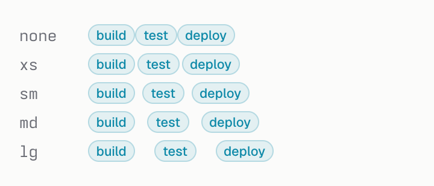
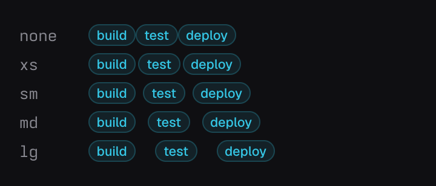
<figcaption>The five gaps, on rows; a column spaces its children the same way.</figcaption>
</figure>

**Children:** drawn in order, directly inside the element.

**Events:** none of its own; `actions` work as on any node.

**Styling:**

```html
<div class="sf sf-col gap-sm al-center js-between" data-id="main.list">
	<!-- children -->
</div>
```

| Target | Selector |
| --- | --- |
| The node | `.sf-col` |
| Gap | `.sf-col.gap-none` … `.gap-lg` |
| Alignment | `.al-start`, `.al-center`, `.al-end`, `.al-baseline`, `.al-stretch` |
| Justification | `.js-between`, `.js-end` |
| Wrap flag | `.sf-col.wrap` |
| Nothing to show | `.sf-void` |

`.sf-col`, `[data-id]`, `[data-role]` and `[data-tone]` are stable hooks; the `gap-*`, `al-*`, `js-*` and `wrap`
classes follow the props. A block's region roots (`main`, `dock`, `layer`) are drawn as their children, not as a
`col` element (see [Styling views](../styles/index.md)).

```lua
local ui = tern.ui

return {
	main = ui.node("col", { gap = "md" }, {
		ui.text("Deploy"),
		ui.lines({ ui.text("step 1: build"), ui.text("step 2: upload") }),
	}),
}
```

## `row`

A horizontal flex row (`display: flex; flex-direction: row; align-items: center; min-width: 0`). Every direct child
gets `min-width: 0`, so long text shrinks and truncates instead of pushing the row wider. Children are vertically
centered unless `align` says otherwise.

A row's children are always laid out. Empty rows get `sf-void` exactly like columns (see [`col`](#col)); a `row` with `grow > 0`
and no children stays as a spacer, which is the usual way to push the following children to the far end.

**Build it:** `tern.ui.row(children)` (`gap = "sm"`, see [UI Builders](../reference/ui.md#layout)), or
`tern.ui.node("row", { gap = "md", justify = "between" }, children)`.

| Prop | Type | Default | Meaning |
| --- | --- | --- | --- |
| `gap` | `"none"` \| `"xs"` \| `"sm"` \| `"md"` \| `"lg"` | `"none"` (the builder sends `"sm"`) | Space between children: 0, 2px, 6px, 10px, 16px (`gap-<value>`) |
| `align` | `"start"` \| `"center"` \| `"end"` \| `"baseline"` \| `"stretch"` | none (`center` from the sheet) | `align-items` (`al-<value>`). Use `"baseline"` to line up text of different sizes, `"start"` for multi-line children |
| `justify` | `"between"` \| `"end"` | none (start) | `justify-content: space-between` / `flex-end` (`js-<value>`) |
| `wrap` | boolean | `false` | `flex-wrap: wrap` (class `wrap`): children flow onto more lines when they don't fit |

A two-line column next to a label and a badge, under four `align` values:

```lua
local ui = tern.ui

local rows = {}
for _, align in { "start", "center", "end", "baseline" } do
	table.insert(rows, ui.node("row", { gap = "md", align = align }, {
		ui.node("text", { spans = { ui.span(align, "muted") }, min = { w = "8ch" } }),
		ui.node("col", {}, { ui.text("main.rs"), ui.text("lib.rs") }),
		ui.badge("2 files", "info"),
	}))
end
return { main = ui.node("col", { gap = "lg" }, rows) }
```

<figure class="tn-figure">
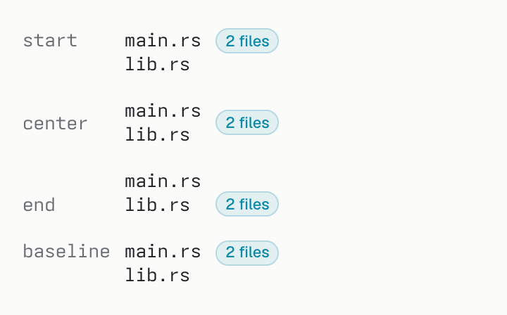
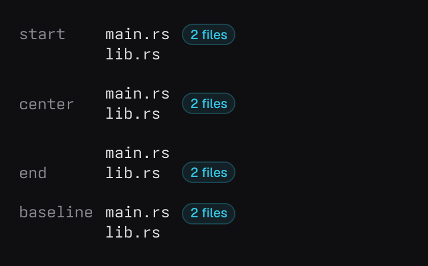
</figure>

**Children:** drawn in order, directly inside the element. Size them with the [common flex props](#common-props-on-layout-nodes).

**Events:** none of its own; `actions` work as on any node.

**Styling:**

```html
<div class="sf sf-row gap-sm wrap" data-id="main.toolbar">
	<!-- children -->
</div>
```

| Target | Selector |
| --- | --- |
| The node | `.sf-row` |
| Children | `.sf-row > *` |
| Wrapping | `.sf-row.wrap` |
| Gap, alignment, justification | `.gap-*`, `.al-*`, `.js-*` as on `col` |
| Nothing to show | `.sf-void` |

```lua
local ui = tern.ui

return ui.node("row", { gap = "md", align = "baseline" }, {
	ui.text({ ui.span("api", "strong") }),
	ui.node("row", { grow = 1 }), -- empty and growing: pushes the badge right
	ui.badge("healthy", "success"),
})
```

<figure class="tn-figure">
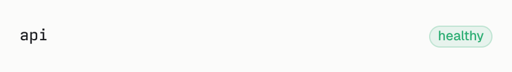
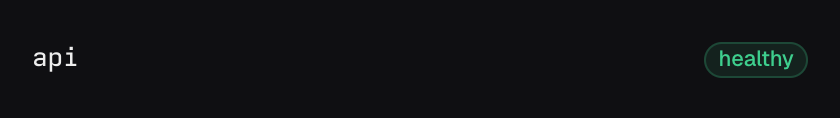
</figure>

## `card`

A rounded box with a hairline ring tinted by `tone`, a head row and a body: a panel. The head shows, left to right:
an icon (`icon`, else one implied by `role`), the head content, muted `meta`, then at its right end the `end` child
(your controls), a status chip and a disclosure chevron. The body holds the other children in a column with
`--sf-inner-gap` (8px) between them, indented to line up with the head text: `padding: 0 12px 10px 36px` with an
icon, `0 12px 10px` without one (class `noic`; omp's own cards keep their insets). In an app a card is one object
(the selected item's detail, a confirm strip, an error), never a frame around a table, a `stats` strip or another
card; see [Designing Views](../guides/design.md#cards) for what goes where.

**Head controls.** `end` names one of the card's own children (by id, as `head` does); Tern draws it at the right of
the head instead of in the body: a `row` of [`button`](input.md#button)s, a segmented [`tabs`](lists.md#tabs), a
[`badge`](data.md#badge). A click on it never folds a collapsible card. `meta` is text drawn after the head content
in `--t3` (12.5px sans in a sans region), 8px from it: counts, a version, "updated 2 min ago".

`end` is a Luau keyword, so the prop is written `["end"] = …`. The SDKs take a node for `end` (and for `head`): they
add it as the card's child keyed `end` (or `head`) and send its id.

```lua
local ui = tern.ui

return ui.col({
	ui.node("card", { key = "services", icon = "server", head = "Services", meta = "24 · 2 degraded",
		["end"] = "main.services.end" }, {
		ui.node("row", { key = "end", gap = "sm" }, {
			ui.node("tabs", { key = "filter", variant = "segmented", active = "all", items = {
				{ id = "all", label = "All" }, { id = "degraded", label = "Degraded" },
			} }),
			ui.button("Refresh", { icon = "repeat", keys = { "r" }, actions = { click = "refresh" } }),
		}),
		ui.text({ ui.span("api-gateway, billing, search and 21 more", "muted") }),
	}),
	ui.node("card", { key = "notes", head = "Notes", meta = "no icon: the body lines up with the head" }, {
		ui.text("Body text starts under the head text."),
	}),
})
```

<figure class="tn-figure">
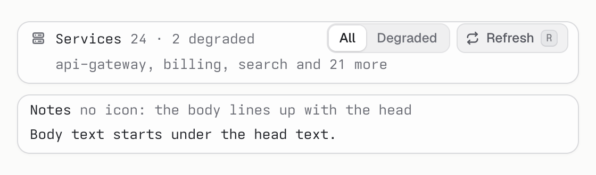
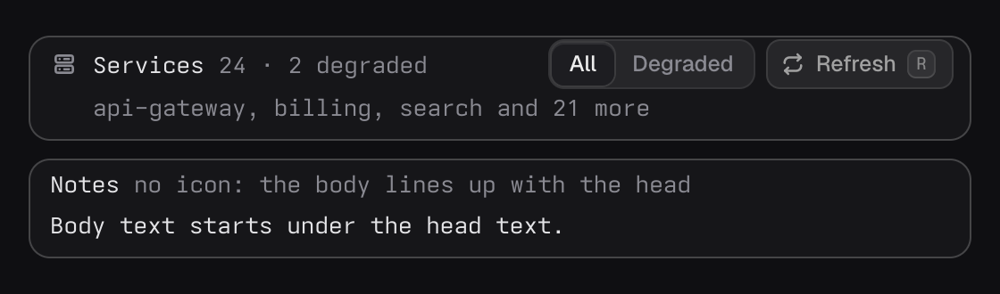
<figcaption>A panel head with <code>icon</code>, <code>meta</code> and <code>end</code> controls, and a card without an icon.</figcaption>
</figure>

**Head.** `head` is either a span list (`TspText`: a string or spans) drawn into `div.sf-head`, or the id of one of
the card's own children, which is then drawn in the head instead of the body. A string that is not a child id is
plain text. In a block, child ids are `<parent id>.<key>` (or `<parent id>.<index>` without a key), so a child with
`key = "title"` under a card with id `main.build` is named `"main.build.title"`. `tern.ui.card(head, …)` always
sends `head` as spans; to name a child, set `p.head` to its id or build the card with `tern.ui.node`.

**Body.** The body keeps its bottom padding when it has no children, so a card with a head and an empty body
draws 10px of space under the head row.

**No head.** When the card has no head content, no status and is not `collapsible`, the head row is hidden (class
`nohead`) and the body takes even padding (`10px 12px`). A role icon alone does not make a head.

**Role icon.** `icon` names the head icon outright ([icon names](data.md#icon-names)), winning over the role's.
Without it, `role` picks an icon: `lens.<family>…` roles map by family (`lens.git.log` → branch, unknown families
→ terminal), `omp.tool.<tool>…` by tool (unknown tools → plug), and any other role by its second dot-separated
segment when Tern has an icon for that name (`omp.user` → user, `plugin.search.results` → search,
`plugin.bash` → terminal). Known names include `bash`, `shell`, `edit`, `read`, `search`, `web`, `todo`, `task`,
`user` and `error`. Most plugin roles name none (`plugin.ci.job` reads `ci`), so the icon holder stays hidden. The
icon takes the tone color (`--t3` for neutral or untoned cards).

**Status chip.** `status` is one of `pending` (clock, "Pending"), `running` (a pulsing dot, "Running"), `done`
(check, "Done"), `error` (cross, "Failed") or `cancelled` (stop, "Canceled"). Other values show no chip. The card
draws no timer of its own: put an [`elapsed`](motion.md#elapsed) node in the head for one.

Every tone, with a status on some:

```lua
local ui = tern.ui

local cards = {}
for _, t in {
	{ "untoned", nil, "running" }, { "neutral", "neutral" }, { "accent", "accent" }, { "info", "info" },
	{ "success", "success", "done" }, { "warning", "warning" }, { "error", "error", "error" },
	{ "pending", "pending", "pending" }, { "muted", "muted", "cancelled" }, { "user", "user" },
} do
	table.insert(cards, ui.node("card", { head = t[1], tone = t[2], status = t[3], basis = 0.48, grow = 1 }, {
		ui.text("Body"),
	}))
end
return { main = ui.node("row", { gap = "sm", wrap = true }, cards) }
```

<figure class="tn-figure">
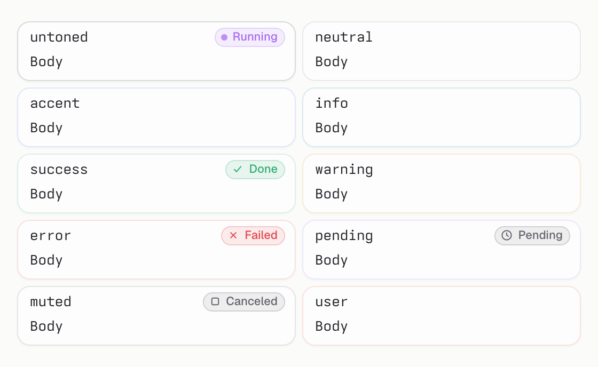
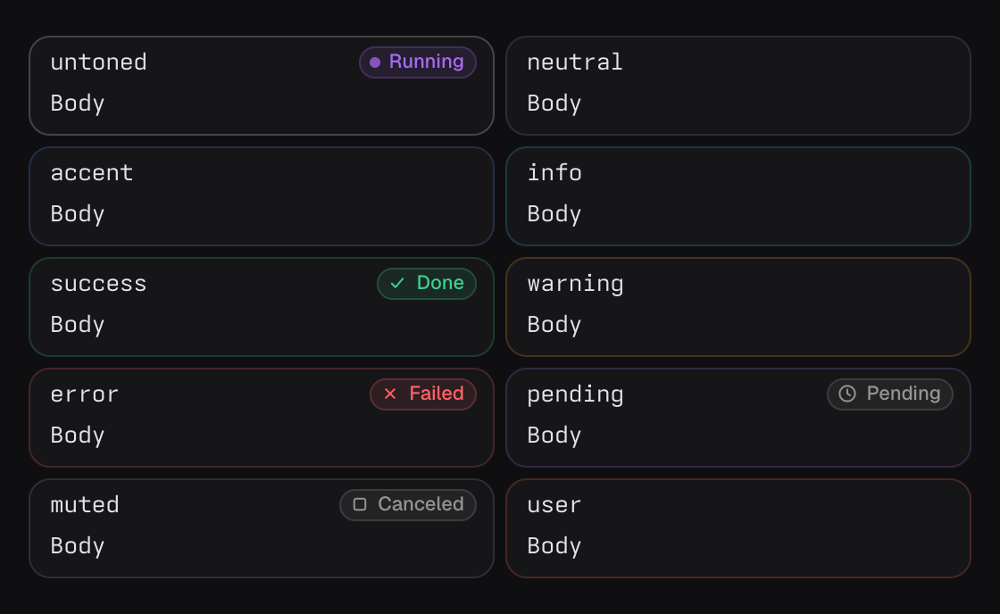
<figcaption>The fill stays <code>--sf-card-bg</code>; the tone shows in the ring.</figcaption>
</figure>

**Folding.** With `collapsible = true` the head becomes a button (`role="button"`, `tabindex="0"`,
`aria-expanded`): a click, Enter or Space flips it. ⌘-click on the head does not flip it, so links in the head still
open. Collapsed:

- without `preview`, the body and the "more" button are hidden (class `nopreview`);
- with `preview`, the body is clamped to that many lines (`preview × line height`). When the content is taller, the
  card gets class `clamped`: the body's `max-height` is `var(--sf-clamp)` with a fade over its last ~2 lines, and a
  `button.sf-more` under it reads "N more lines" (or "1 more line") with a chevron and a `title` of
  `Show all  N more lines`. Clicking it expands the card (the same local flip as the head). When the content fits,
  nothing is clamped and no button shows. A partial line counts as hidden only past a quarter of a line. The clamp
  is re-measured when the card resizes.

`collapsed` without `collapsible` does nothing: the card draws open.

```lua
local ui = tern.ui

local log = "step 1: ok\nstep 2: ok\nstep 3: ok\nstep 4: ok\nstep 5: ok"
local function build(head, p)
	p.head, p.role, p.collapsible = head, "lens.build", true
	return ui.node("card", p, { ui.ansi(log) })
end
return {
	main = ui.col({
		build("Open", { status = "done" }),
		build("Collapsed", { status = "done", collapsed = true }),
		build("Collapsed, preview 2 lines", {
			status = "error", tone = "error", collapsed = true, preview = { lines = 2 },
		}),
	}),
}
```

<figure class="tn-figure">
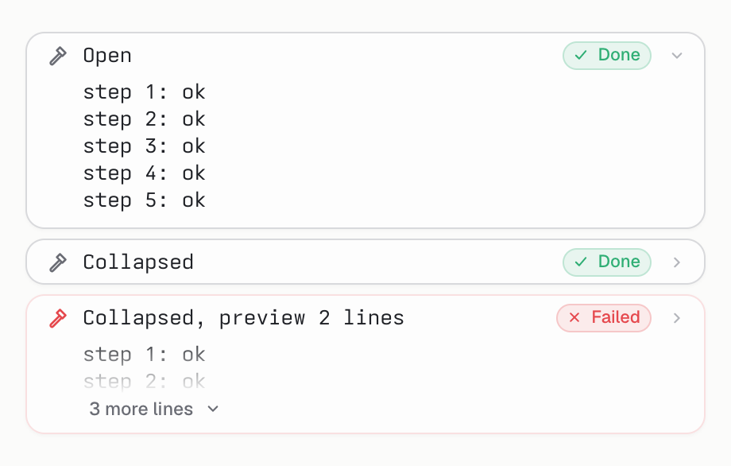
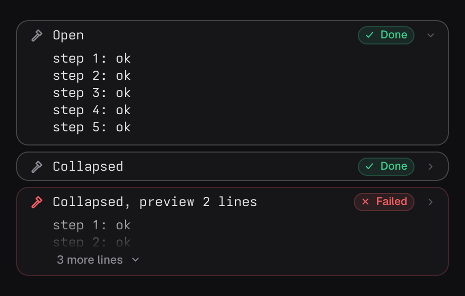
<figcaption>The chevron points down when open and right when collapsed; <code>lens.build</code> implies the hammer icon.</figcaption>
</figure>

**Collapse state is local.** A flip by the user takes effect at once, without a round trip, and is remembered by
the node's `key` among its siblings (its id without one), not surface-wide. Deleting and adding a card with a new
id and the same key under the same parent preserves the fold; the same key under another parent has independent
state. The `collapsed` prop sets
the starting state; once the user flips it, the local state wins until your view sends a *different* `collapsed`
value, which resets it (sending the same value again changes nothing). The program hears a `toggle` event.

**Previews inside.** Kinds with their own `preview` (`ansi`, `code`) apply it only while collapsed: inside an open
collapsible card, section or [`tool`](work.md#tool) (the nearest one up the tree) their previews give way and they
show in full, and they clamp again once it folds (by a click or the program's `collapsed`). While that disclosure is
folded, their "N more lines" / "N earlier lines" buttons open it (the `toggle` event, as a head click) rather than
expanding only their own block.

**Build it:** `tern.ui.card(head, children)` (see [UI Builders](../reference/ui.md#layout)), then set props on `p`,
or `tern.ui.node("card", { head = …, status = "running", collapsible = true }, children)`.

| Prop | Type | Default | Meaning |
| --- | --- | --- | --- |
| `head` | spans, string, or a child's id | none | Head content (above) |
| `icon` | icon name | none | Head icon; wins over the one `role` implies |
| `meta` | spans or string | none | Muted text after the head content |
| `end` | a child's id | none | That child is drawn at the head's right end instead of in the body (above) |
| `status` | `"pending"` \| `"running"` \| `"done"` \| `"error"` \| `"cancelled"` | none | Status chip; adds `.sf-chip.st-<status>` |
| `role` | string | none | `data-role`, and the head icon it implies |
| `tone` | tone name | none | `data-tone`: ring color and fill tint (below) |
| `collapsible` | boolean | `false` | The head flips the fold; adds `collapsible` and shows the chevron |
| `collapsed` | boolean | `false` | Starting fold state (needs `collapsible`); adds `collapsed` |
| `preview` | `"auto"` or `{ lines = n }` | none | Lines shown while collapsed. `"auto"` is 10; a fractional `lines` is truncated, and anything below 1 or of another shape means no preview |
| `key` | string | none | Identity among siblings; local collapse is remembered by this key under the same parent (by node id without a key) |
| `selected` | boolean | `false` | Class `selected`: an accent ring and a soft 3px accent halo |
| `inset` | boolean | `false` | Class `inset`: the body has no padding (`0 0 1px`) and its children get the card's bottom corners, so a `code`, `diff` or `table` fills the card edge to edge |
| `variant` | `"bare"` | none | Class `bare`: no ring, fill or rounding; the head is a plain line-height row with no padding and the body indents by 24px. Keeps head, status, fold and preview. For grouped and compact presentations, such as a group of rows or one file inside a larger card |

```lua
local ui = tern.ui

return {
	main = ui.node("col", { gap = "md" }, {
		ui.node("card", { head = "selected", selected = true }, { ui.text("An accent ring and halo.") }),
		ui.node("card", { head = "inset", inset = true }, { ui.code('[build]\ntarget = "release"', "toml") }),
		ui.node("card", { head = "variant = bare", variant = "bare", status = "done", collapsible = true }, {
			ui.text("A plain head row over an indented body."),
		}),
		ui.node("card", {}, { ui.text("No head: the head row hides.") }),
	}),
}
```

<figure class="tn-figure">
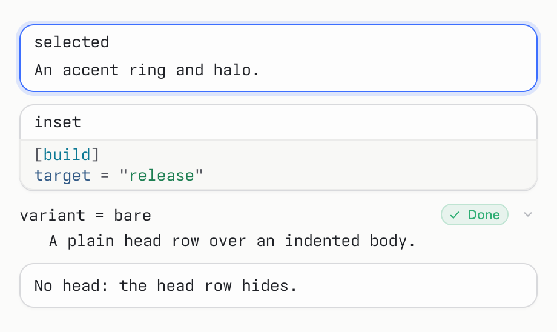
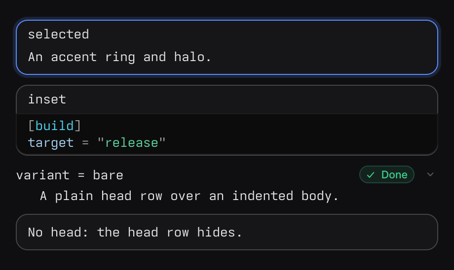
</figure>

**Children:** the `head` child (if `head` names one) goes into `div.sf-head`, the `end` child (if `end` names one)
into `div.sf-card-end`; every other child goes into `div.sf-card-body`, in order.

**Events:** `toggle` when the user flips a collapsible card (head click, Enter/Space on the focused head, or the
"more" button):

```lua
{ ev = "toggle", id = "main.build", collapsed = true, key = "build" } -- key only when the node has one
```

A block's `event(state, ev, cx)` receives it. `actions = { click = "toggle" }` on the card itself also flips it.
Otherwise `actions` work as on any node.

**Styling:**

```html
<div class="sf sf-card collapsible collapsed clamped" data-id="main.build" data-role="plugin.ci.job" data-tone="error"
	style="--sf-clamp: 200px">
	<div class="sf-card-head meta" role="button" tabindex="0" aria-expanded="false">   <!-- .meta with a meta -->
		<span class="sf-card-ic sf-hidden" aria-hidden="true"></span>
		<div class="sf-head"><!-- head spans or the head child --></div>
		<span class="sf-card-meta"><!-- meta spans --></span>
		<div class="sf-card-end"><!-- the end child --></div>
		<span class="sf-chip st-error"><svg class="ico">…</svg>Failed</span>
		<span class="sf-chev" aria-hidden="true"><svg class="ico">…</svg></span>
	</div>
	<div class="sf-card-body"><!-- children --></div>
	<button class="sf-more" aria-hidden="false" title="Show all  12 more lines">12 more lines<svg class="ico">…</svg></button>
</div>
```

| Target | Selector |
| --- | --- |
| The node | `.sf-card` |
| By role / tone | `.sf-card[data-role='…']`, `.sf-card[data-tone='error']` |
| Head row | `.sf-card-head` (inner, may change) |
| Head content | `.sf-card-head > .sf-head` (inner, may change) |
| Head icon | `.sf-card-ic` (inner, may change) |
| Meta / head controls | `.sf-card-meta`, `.sf-card-end` (inner, may change) |
| Status chip | `.sf-chip`, `.sf-chip.st-pending` … `.st-cancelled`, running dot `.sf-chip .dot` (inner, may change) |
| Chevron | `.sf-chev` (inner, may change); hidden unless `.collapsible`, rotated −90° when `.collapsed` |
| Body | `.sf-card-body` (inner, may change) |
| "N more lines" | `.sf-more` (inner, may change); shown only in `.sf-card.clamped` |
| Folding | `.sf-card.collapsible`, `.sf-card.collapsed`, `.sf-card.nopreview`, `.sf-card.clamped` |
| Flags | `.sf-card.selected`, `.sf-card.inset`, `.sf-card.bare`, `.sf-card.nohead`, `.sf-card.noic` (no head icon) |

Tone and color:

- The ring is `rgb(from var(--tc) r g b / 16%)` (20% in dark), where `--tc` is the tone color set by
  `[data-tone]`. Untoned cards use `--sf-neutral`; `tone = "neutral"` uses the plain `--l2` hairline.
- The fill is `--sf-card-bg`, replaced for `success`, `error`, `pending`, `user`, `info` and `neutral`/untoned cards
  by `--sf-tint-<tone>` when it is defined (see [Variables](../styles/variables.md#context-fills)).
- The body gap is `--sf-inner-gap`; the corner radius is `--r-card`; the clamp height is `--sf-clamp`, set inline
  while clamped.
- The status chip colors from `--cc`: `--sf-muted` (pending, cancelled), `--live` (running), `--sf-ok` (done),
  `--sf-bad` (error).
- A collapsible head shades with `--sf-shade` on hover.
- Children of a clamped body get `flex-shrink: 0`: a sheet that lets them shrink breaks the "N more lines" count.

The `bare` look (no fill, ring, rounding) applies inside a region (`.sf-region .sf-card.bare`).

```lua
local ui = tern.ui

local function job(j)
	local card = ui.card({ ui.span(j.name, "strong"), ui.span("  " .. j.branch, "muted") }, {
		ui.node("ansi", { text = j.log }),
	})
	local p: { [string]: any } = card.p or {}
	p.key = j.id
	p.role = "plugin.ci.job"
	p.status = j.failed and "error" or "done"
	p.tone = j.failed and "error" or nil
	p.collapsible = true
	p.collapsed = not j.failed
	p.preview = { lines = 6 }
	card.p = p
	return card
end
```

## `section`

A lighter disclosure group with no frame: a head row of a chevron and the head content over a body indented 22px
past a 1px rule on its left (`box-shadow: inset 1px 0 0 var(--l2)`). Body children sit `--sf-inner-gap` apart.

`head`, `collapsible`, `collapsed` and `key` work exactly as on [`card`](#card): the head as spans or a child's id,
the head as a button with Enter/Space and `aria-expanded` when collapsible, local collapse state kept by `key` among siblings, and
the `toggle` event. Collapsed, the body is hidden. A section has no role icon, status chip, preview clamp, "more"
button, `selected`, `inset` or `variant`; those props are ignored. The chevron always shows, pointing down while
open, even on a section that is not collapsible.

**Build it:** `tern.ui.section(head, children)` (see [UI Builders](../reference/ui.md#layout)), or
`tern.ui.node("section", { head = "Details", collapsible = true }, children)`.

| Prop | Type | Default | Meaning |
| --- | --- | --- | --- |
| `head` | spans, string, or a child's id | none | Head content |
| `collapsible` | boolean | `false` | The head flips the fold; adds `collapsible` |
| `collapsed` | boolean | `false` | Starting fold state (needs `collapsible`); adds `collapsed` and `nopreview` (the body hides; a `preview` prop is ignored) |
| `key` | string | none | Identity among siblings; local collapse is remembered by this key under the same parent (by node id without a key) |

**Children:** the `head` child into `div.sf-head`, the rest into `div.sf-section-body`.

**Events:** `toggle`, as on [`card`](#card).

**Styling:**

```html
<div class="sf sf-section collapsible" data-id="main.env">
	<div class="sf-section-head" role="button" tabindex="0" aria-expanded="true">
		<span class="sf-chev" aria-hidden="true"><svg class="ico">…</svg></span>
		<div class="sf-head"><!-- head --></div>
	</div>
	<div class="sf-section-body"><!-- children --></div>
</div>
```

| Target | Selector |
| --- | --- |
| The node | `.sf-section` |
| Head row | `.sf-section-head` (inner, may change) |
| Head content | `.sf-section-head > .sf-head` (inner, may change) |
| Chevron | `.sf-section-head .sf-chev` (inner, may change); rotated −90° when collapsed |
| Body | `.sf-section-body` (inner, may change) |
| Folding | `.sf-section.collapsible`, `.sf-section.collapsed` |

The head text is `--t2`. A collapsible head turns `--t1` with an `--l1` shade on hover. The body's rule sits 7px in,
under the chevron.

```lua
local ui = tern.ui

local function env(key: string, collapsed: boolean)
	local s = ui.section({ ui.span("Environment"), ui.span(" 2", "muted") }, {
		ui.kv({ { "PATH", "/usr/bin" }, { "HOME", "/Users/me" } }),
	})
	local p: { [string]: any } = s.p or {}
	p.key = key
	p.collapsible = true
	p.collapsed = collapsed
	s.p = p
	return s
end

return { main = ui.col({ env("env", false), env("env2", true) }) }
```

<figure class="tn-figure">
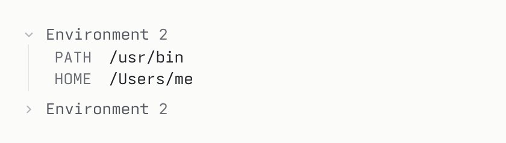
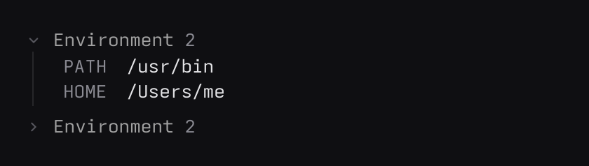
</figure>

## `split`

Panes the user resizes: each child is a pane, and between two panes sits a handle the pointer drags. Reach for it
when two or three views share the room and the user should decide how much each gets: a file list beside the file,
a query over its results, a conversation beside its details. For a fixed arrangement use a `row` or `col` with
`basis`; for one view at a time, [`tabs`](lists.md#tabs).

Three looks. `hairline` (the default) is one framed box with a 1px divider between the panes; hovering the divider
tints it and shows a grip pill, and a held divider turns accent with a glass tip giving both panes' shares.
`gutter` makes every pane its own card, 6px apart, with a dotted grip in the gap. `tiles` makes every pane a card
8px apart and the gap itself is the handle: an accent line shows in it on hover and stays while held.

`dir = "col"` stacks the panes and the handles move up and down. A stacked split needs a height: `h` (12 lines by
default), or `grow` in a parent with a height of its own (a screen surface's `main`), which fills it.

**Build it:** `tern.ui.node("split", { sizes = { 0.36, 0.64 } }, { pane, pane })` (no dedicated builder).

| Prop | Type | Default | Meaning |
| --- | --- | --- | --- |
| `variant` | `"hairline"` \| `"gutter"` \| `"tiles"` | `"hairline"` | The look (below). Unknown values read as `hairline` |
| `dir` | `"row"` \| `"col"` | `"row"` | `row`: panes side by side, handles move left and right. `col`: panes stacked, handles move up and down |
| `sizes` | number[] | equal panes | Each pane's share, in child order. Normalized to sum to 1 (`{ 2, 1 }` is `{ 0.667, 0.333 }`); a missing, zero or negative entry shares what the others leave of 1 (their average when they leave nothing). What the panes show until the user drags, and what a double click on a handle goes back to. A changed `sizes` wins over the user's drags |
| `min` | (string \| number \| nil)[], string or number | none | Each pane's minimum along the split: `"<n>ch"` (character cells), `"<n>lines"` (text lines) or a number as a fraction of the split (`0.2`); `nil` (`null`) for none. One value applies to every pane. Panes hold it whatever `sizes` says, and a drag stops there. An object `{ w?, h? }` is still the [common size bound](#common-props-on-layout-nodes) of the split itself |
| `h` | string or number | `row`: the panes' content; `col`: `"12lines"` | The split's height: `"<n>lines"`, `"<n>ch"` or a fraction of its parent's height. Panes taller than their share scroll |
| `grow` | number | none | The common prop: a growing split also fills its own box's height (a screen surface's `main`), so a `col` split needs no `h` there |
| `active` | number | none | The handle (0 is the one after the first pane) your program is moving with the keys: drawn held, with its shares tip |
| `key` | string | none | The identity the user's drag is remembered by among the split's siblings (else the node id), so a rebuilt split keeps it |

| Variant | Look | Reach for it for |
| --- | --- | --- |
| `hairline` | One framed box, a 1px divider; on hover the divider tints accent with a grip pill; held: accent, with a glass `36% │ 64%` tip | Views that belong together: a list and its detail, an editor and its output |
| `gutter` | Every pane its own card, 6px apart, a 2 × 3 dotted grip in the gap (darker on hover, accent while held) | Separate objects side by side where the grip should always show |
| `tiles` | Every pane its own card, 8px apart; the gap is the handle, an accent line in it on hover, solid while held | Dashboards and tiled tools, matching Tern's tiles layout |

```lua
local ui = tern.ui

return {
	main = ui.node("split", { key = "browser", sizes = state.sizes or { 0.36, 0.64 }, min = { "18ch", "30ch" } }, {
		ui.list(state.files),
		ui.code(state.source, "lua"),
	}),
}
```

<figure class="tn-figure">
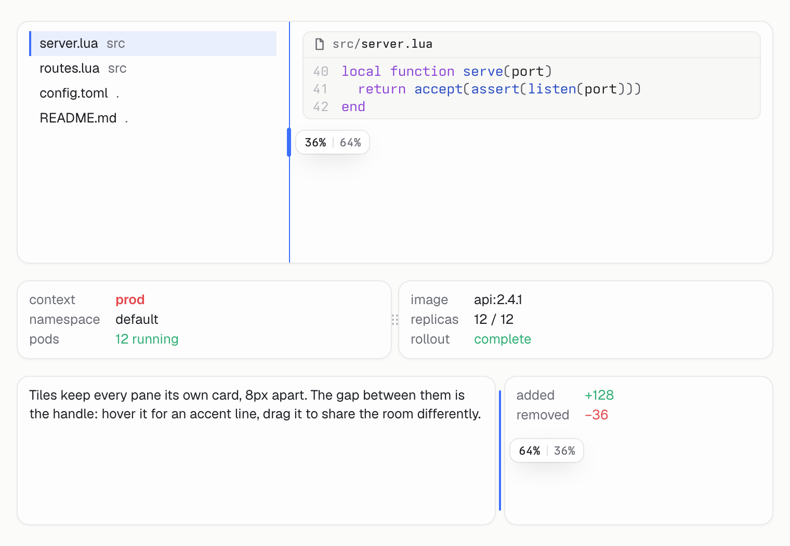
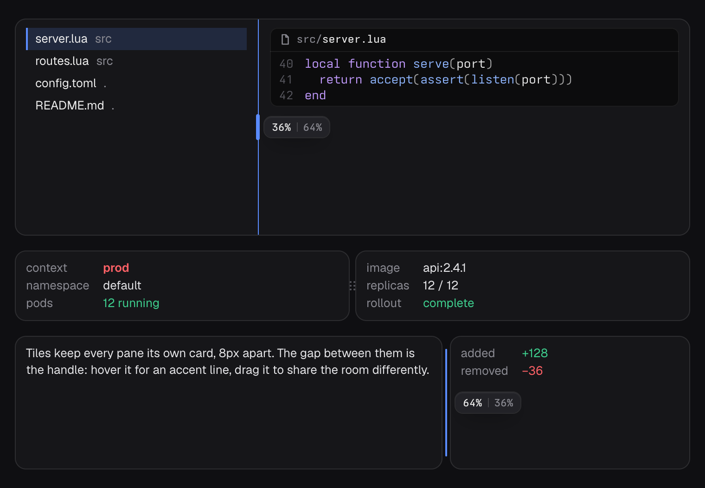
<figcaption>The three looks: <code>hairline</code> (its handle held, as <code>active</code> draws it), <code>gutter</code> and <code>tiles</code> (held).</figcaption>
</figure>

<figure class="tn-figure">
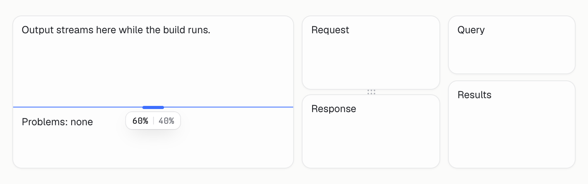
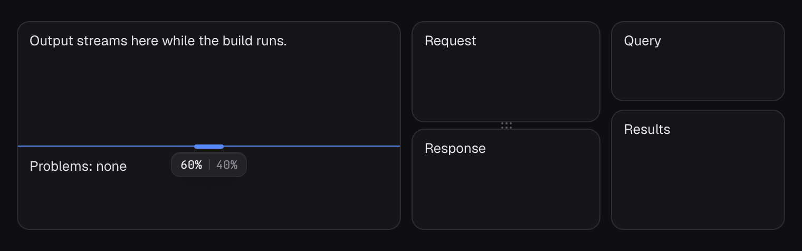
<figcaption><code>dir = "col"</code> in each look, <code>h = "11lines"</code>.</figcaption>
</figure>

<figure class="tn-figure">
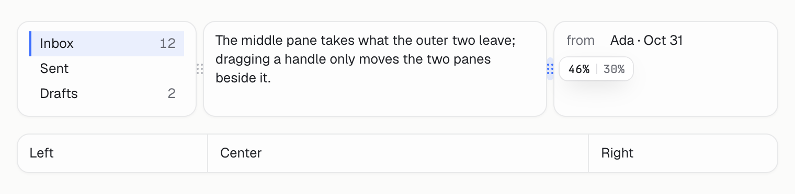
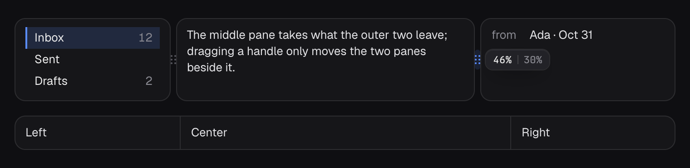
<figcaption>Three panes: a handle moves only the two panes beside it.</figcaption>
</figure>

<figure class="tn-figure">
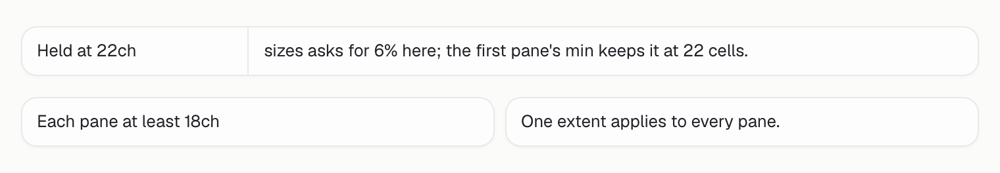
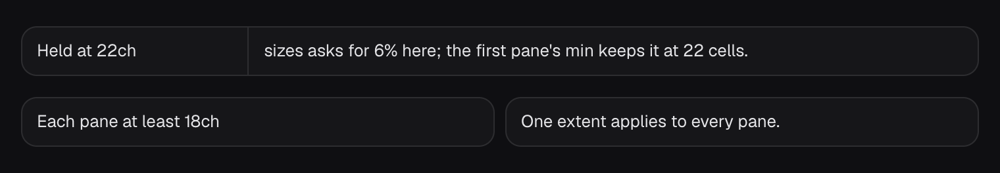
<figcaption><code>min</code> holds a pane at its size, whatever <code>sizes</code> asks or the pointer drags.</figcaption>
</figure>

**Children:** the panes, in order, one per child. Each child sits in a pane body with 10px × 12px of padding that
scrolls when the child is taller than its pane. A split of one child is a single pane with no handle.

**Events:** releasing a handle that moved sends

```lua
{ ev = "change", id = "main.browser", value = { 0.3, 0.7 } } -- every pane's share, summing to 1
```

`value` has one fraction per pane (four decimal places), measured as drawn, so minimums are already applied. A
double click on any handle puts every pane back to `sizes` and sends `change` with them when that moved something.

The panes follow the pointer at once, and the split keeps the user's fractions, by `key`, until your program sends a
`sizes` that differs from the last one drawn; then `sizes` wins. To persist a layout, store `value` and pass it as
`sizes` next time; keep a separate default if a double click should go back to it. A split on a closed surface or
one opened with `listen = false` (see [Surfaces](../protocol/surfaces.md#open-and-close)) draws its handles but does
not move and sends nothing.

```lua
-- event(state, ev, cx)
if ev.ev == "change" and ev.id == "main.browser" then
	state.sizes = ev.value
end
```

**Keyboard:** none of its own (nodes never take focus). Your program owns the keys: set `active` to the handle being
moved and send new `sizes` per key press (for example ←/→ by 2%, ⇧ by 10%); `active` draws that handle held with
its tip. Clear `active` when done.

**Accessibility:** each handle is `role="separator"` with `aria-orientation` (`vertical` between side-by-side
panes), `aria-valuenow` (the share of the pane before it, in percent), `aria-valuemin="0"`, `aria-valuemax="100"`
and `aria-label="Resize panes"`; its grip and tip are `aria-hidden`.

**Motion:** the grip fades and scales in on hover (0.22s `--out`), the divider and dots tint (0.15s `--ease`), the
tip fades (0.14s). Off under reduced motion, `.sf-still` and `.sf-paused`.

**Styling:**

```html
<div class="sf sf-split" data-id="main.browser" data-variant="hairline" data-dir="row">
	<div class="sf-split-box">
		<div class="sf-split-pane" style="flex-grow: 360; min-width: calc(18 * var(--sf-cw))">
			<div class="sf-split-body"><!-- the first child --></div>
		</div>
		<div class="sf-split-handle held" role="separator" aria-orientation="vertical"
			aria-valuenow="36" aria-valuemin="0" aria-valuemax="100" aria-label="Resize panes">
			<span class="sf-split-grip" aria-hidden="true">
				<span class="sf-split-dot"></span><!-- ×6, shown by gutter -->
			</span>
			<span class="sf-split-tip" aria-hidden="true">
				<span class="a">36%</span><span class="sep"></span><span class="b">64%</span>
			</span>
		</div>
		<div class="sf-split-pane" style="flex-grow: 640">
			<div class="sf-split-body"><!-- the second child --></div>
		</div>
	</div>
</div>
```

The `.sf-split` element itself gets class `held` while a handle is dragged. Rules that depend on the look or
direction go through `> .sf-split-box >`, so a split nested in a pane keeps its own.

| Target | Selector |
| --- | --- |
| The node | `.sf-split` |
| Variant / direction | `.sf-split[data-variant='gutter']`, `[data-variant='tiles']`; `.sf-split[data-dir='col']` |
| A drag under way | `.sf-split.held` |
| The box (frame of `hairline`, height of `col`) | `.sf-split-box` (`.fill` when the split grows) (inner, may change) |
| A pane / its scrolling body | `.sf-split-pane`, `.sf-split-body` (inner, may change) |
| A handle; held, program-active | `.sf-split-handle`, `.sf-split-handle.held`, `.sf-split-handle.active` (inner, may change) |
| Grip / gutter dots | `.sf-split-grip`, `.sf-split-dot` (inner, may change) |
| Shares tip | `.sf-split-tip` (`.a`, `.sep`, `.b`) (inner, may change) |
| Gap / divider width | `--sf-split-gap` on `.sf-split` (1px, 6px, 8px by look) |

## `scroll`

A box that scrolls its children instead of cutting them. Give it a bound, `max = { h = "12lines" }` or the height a
parent gives it (`grow` in a sized `col`), and its children (any nodes, drawn in order like a `col`'s) scroll inside
it under Tern's thin overlay scrollbar. A `max.h` on any other node clips what runs past it and fades the cut (see
[Common props](#common-props-on-layout-nodes)); reach for `scroll` when the rest should stay reachable.

Two behaviours make it a message scroller too. `stick = "end"` keeps it at its end while content grows, whether
children arrive or the last one streams (a `text` [append](text.md#text-kinds-and-text-ops)), until the user scrolls
up; then a floating **↓ N new** pill counts the children that arrived out of sight and jumps back, following the end
again. `variant = "fade"` fades the edges where content continues and counts what is left below on a **N more ↓**
chip.

**Build it:** `tern.ui.node("scroll", { stick = "end", max = { h = "14lines" } }, children)` (no dedicated builder).

| Prop | Type | Default | Meaning |
| --- | --- | --- | --- |
| `variant` | `"bar"` \| `"fade"` | `"bar"` | The look (below). Other values read as `bar` |
| `stick` | `"end"` | none | Keep to the end while content grows, until the user scrolls up from it; then show the **↓ N new** pill |
| `pinned` | boolean | `true` with `stick` | Whether a stuck view follows its end. The user's scrolling changes it locally; a value that changes from the one last drawn wins (`false` opens a log at its start, still offering the pill) |
| `bar` | `"auto"` \| `"always"` | `"auto"` | When the thumb shows: while scrolling (and as the pointer comes in), or always while there is something to scroll |
| `gap` | `"none"` \| `"xs"` \| `"sm"` \| `"md"` \| `"lg"` | `"none"` | Space between the children, as a [`col`](#col)'s |
| `noun` | string or `{ string, string }` | none | What the counts name: `"line"` (plural with an `s`) or `{ "entry", "entries" }`: "4 more lines", "2 new entries". Without it: "4 more", "2 new" |

The bound is the common `max.h` (or a height from the parent: `grow` in a sized `col`, `basis`); without one the box
grows with its content and nothing scrolls. The other common props work too: `title`, `aria`, `role`, `hidden`, the
flex props.

| Variant | Look | Use |
| --- | --- | --- |
| `bar` | Content to the edges; a 6px overlay thumb 2px off the right edge shows while the view scrolls, then fades (as a macOS scroll view's), widening under the pointer. Its 12px band takes a press: drag the thumb, or press the track to bring the thumb under the pointer | Lists, panes, anything the user scrolls on purpose |
| `fade` | The bar, plus the top and bottom edges fading where content continues, and a small glass **N more ↓** chip at the bottom right counting the children wholly below the fold ("More ↓" when the rest is inside the last child in view). A click scrolls down most of a view | Previews and summaries where "there is more" should read at a glance |

`stick = "end"` works with either variant. While pinned, the view takes every new child and every growth of the last
one (streamed `text` appends) without moving off its end. Scrolling up lets go; scrolling back to the end, a click on
the pill, or the program's `scroll` op to `"end"` pins it again. While let go, the pill reads **↓ N new** with the
number of children that arrived below and have not been in view yet (it goes down as the user scrolls over them), or
shows a round arrow alone when nothing new came; the bottom edge fades under it. With `fade`, the pill stands in for
the chip.

```lua
local ui = tern.ui

return {
	main = ui.col({
		-- A build log that follows its output.
		ui.node("scroll", { key = "log", stick = "end", max = { h = "14lines" } }, state.lines),
		-- Release notes with fading edges and a "4 more changes" chip.
		ui.node("scroll", { key = "notes", variant = "fade", noun = "change", max = { h = "8lines" } }, state.notes),
		-- A chat: messages 6px apart, the pill reading "2 new messages".
		ui.node("scroll", {
			key = "chat", stick = "end", gap = "sm", noun = { "message", "messages" }, max = { h = "20lines" },
		}, state.messages),
	}),
}
```

<figure class="tn-figure">
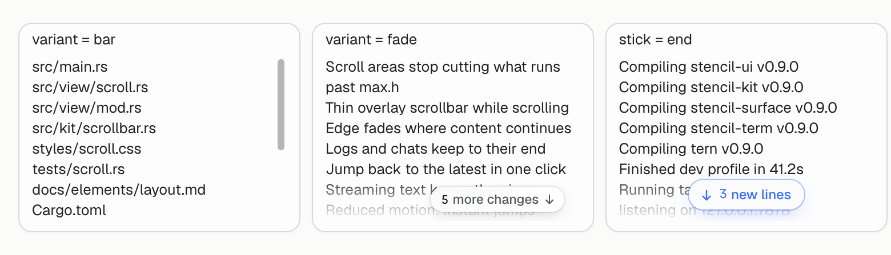
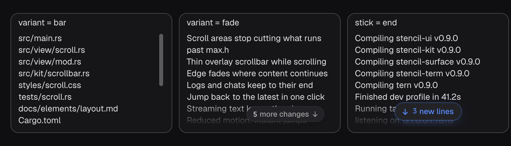
<figcaption>The three looks: the overlay bar (shown here with <code>bar = "always"</code>; by default it shows while scrolling), <code>variant = "fade"</code> with its chip, and <code>stick = "end"</code> scrolled away from its end.</figcaption>
</figure>

<figure class="tn-figure">
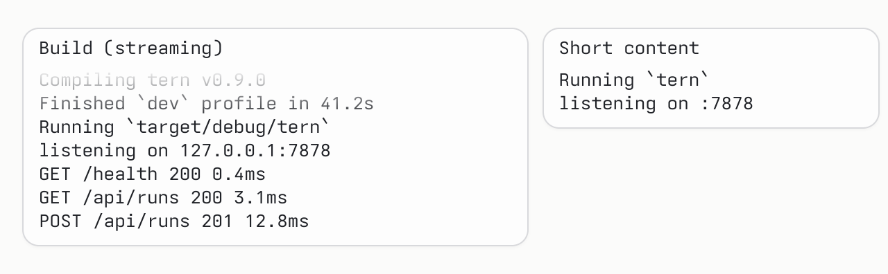
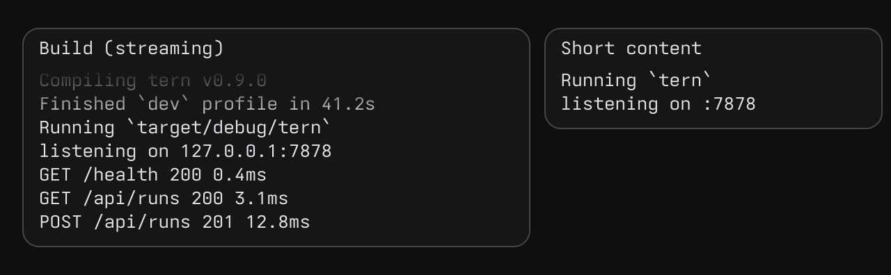
<figcaption>A stuck log stays at its end as lines are added and the last one streams; content that fits shows no chrome at all.</figcaption>
</figure>

<figure class="tn-figure">
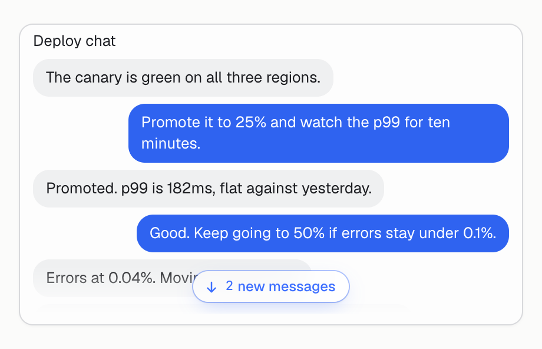
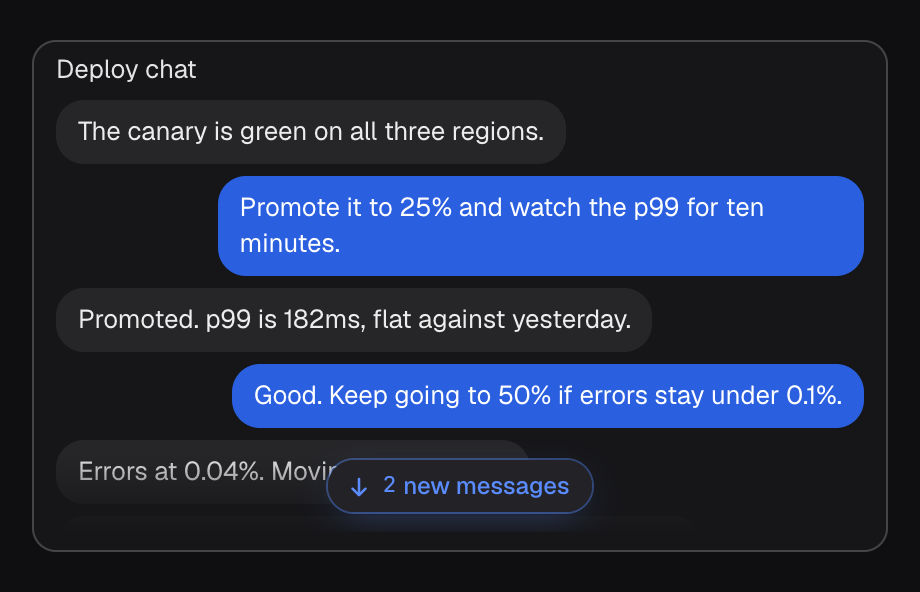
<figcaption>A message scroller the user scrolled up in: the pill counts the messages below that they have not seen and jumps to the latest.</figcaption>
</figure>

**Children:** any nodes, drawn in order (spaced by `gap`).

**Events:** none. Scrolling, the pin and the counts are the viewer's, so a `scroll` in a closed surface or one opened
with `listen = false` scrolls the same.

**Keyboard:** nodes never take focus. The program scrolls the box with the [`scroll` op](../protocol/documents.md#frame-ops)
on its id (or any node inside it): `"page-up"`, `"page-down"`, `"line-up"`, `"line-down"`, `"start"`, `"end"`. From a
block, `cx:frame({ { "scroll", "main.log", "page-up" } })`. `"end"` pins a stuck view again (do that when the user
sends a message). `pinned` sets the pin outright.

**Accessibility:** a stuck view's scroller has `role="log"` (new children are announced politely). The chip and the
pill are buttons named for what they do ("4 more lines below, scroll down", "2 new messages, jump to latest"), hidden
from assistive technology while they are not shown; the bar is decorative.

**Styling:**

```html
<div class="sf sf-scroll scroll fade stick can sf-clip" data-id="main.log">
	<div class="sf-scroll-view gap-sm down up" role="log"><!-- children --></div>
	<div class="sf-scroll-bar fa" aria-hidden="true"><div class="sf-scroll-thumb"></div></div>
	<button class="sf-scroll-more">
		<span class="n">4</span><span class="w">more</span><svg class="ico">…</svg>
	</button>
	<div class="sf-scroll-dock">
		<button class="sf-scroll-jump on" aria-label="2 new messages, jump to latest">
			<svg class="ico">…</svg><span class="n">2</span><span class="w">new messages</span>
		</button>
	</div>
</div>
```

| Target | Selector |
| --- | --- |
| The node (the bounded frame) | `.sf-scroll` |
| Variant / behaviour | `.sf-scroll.fade`, `.sf-scroll.stick`, `.sf-scroll.always` |
| Has something to scroll | `.sf-scroll.can` |
| The scroller (children's parent) | `.sf-scroll-view` (inner, may change) |
| Content above / below the view | `.sf-scroll-view.up`, `.sf-scroll-view.down` (inner, may change) |
| The thumb (track, while dragged) | `.sf-scroll-thumb` (`.sf-scroll-bar`, `.sf-scroll-bar.held`) (inner, may change) |
| The "N more" chip, shown | `.sf-scroll-more`, `.sf-scroll-more.on` (inner, may change) |
| The "↓ N new" pill, shown / arrow only | `.sf-scroll-jump.on`, `.sf-scroll-jump.bare` (inner, may change) |
| A count / its words | `.sf-scroll-more .n`, `.sf-scroll-jump .w` (inner, may change) |

## `empty`

What a pane, card, list or drop target shows when it has nothing yet. It says what is missing in a title, why (or
what to do) in one muted line, and holds the actions that fill it as its children, usually one
[`button`](input.md#button). Reach for it in place of the view whose data is missing, not beside it; keep the view's
key, so the empty state and the content take turns in one place.

It is one of [the four states](../guides/design.md#the-four-states) every view has (loading, empty, error, success):
`tone = "error"` makes it the error state of a whole pane, with a Retry button among its children.

Three looks, picked by `variant`:

- `center` (default): an icon in a soft circular well, the title, one line and the actions under it, centered in
  the space it gets. For a card or a pane.
- `inline`: one row: icon, title and muted text, the actions at its end. For a table-sized area or a small panel;
  `frame = true` draws it in a hairline card. Give its buttons `variant = "quiet"` and `size = "sm"`.
- `drop`: a dashed zone with the icon in a raised tile, title, line and actions; a button's `keys` draw its keycap
  hint. `over = true` lights it up in the accent while the program sees a drag over it.

Everything arrives with a short fade (none under reduced motion).

**Build it:** `tern.ui.node("empty", { icon = …, title = …, text = … }, { button })` (no dedicated builder).

| Prop | Type | Default | Meaning |
| --- | --- | --- | --- |
| `variant` | `"center"` \| `"inline"` \| `"drop"` | `"center"` | The look (below). Other values read as `center` |
| `icon` | icon name | by look: `inbox`, `info`, `file-plus`; `warn` with an `error` or `warning` tone | The icon ([icon names](data.md#icon-names)); `""` for none |
| `title` | spans or string | none | What is missing, in a few words |
| `text` | spans or string | none | One muted line: why, or what to do |
| `tone` | tone name | none | `error` or `warning` tints the icon (and the `drop` border): an error empty state |
| `frame` | boolean | `false` | `inline` only: draw the row in a hairline card |
| `over` | boolean | `false` | `drop` only: a drag is over the zone, it lights up in the accent |

The common props (`grow`, `key`, `min`, `max`, …) apply; give `center` and `drop` `grow` to fill a pane.

| Variant | Look | For |
| --- | --- | --- |
| `center` | Icon in a round well, title, line, actions under, centered | Cards, panes, the first run of a view |
| `inline` | One row: icon, title, muted text, actions at the end | Table-sized areas, small panels, a filter with no hits |
| `drop` | Dashed zone, icon tile, title, line, actions with keycaps | Places that take a dropped file |

```lua
local ui = tern.ui

return {
	main = ui.col({
		ui.node("empty", { icon = "inbox", title = "No deployments yet", text = "Push to main or run tern deploy." }, {
			ui.button("New deployment", { variant = "primary", icon = "rocket", actions = { click = "deploy" } }),
		}),
		ui.node("empty", { variant = "inline", frame = true, icon = "search", text = "Nothing matches “zzz”" }, {
			ui.button("Clear", { variant = "quiet", size = "sm", keys = { "esc" }, actions = { click = "clear" } }),
		}),
	}),
}
```

<figure class="tn-figure">
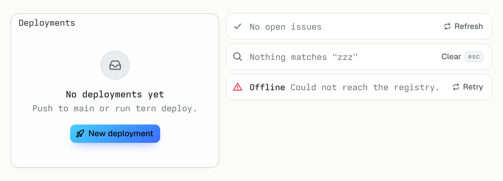
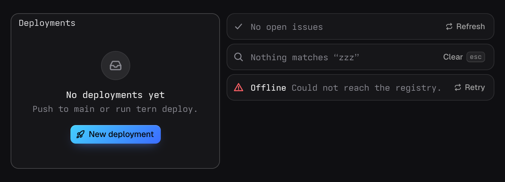
<figcaption><code>center</code> in a card, and <code>inline</code> with <code>frame</code>, the last with <code>tone = "error"</code>.</figcaption>
</figure>

<figure class="tn-figure">
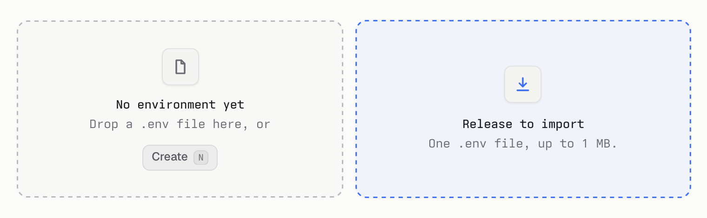
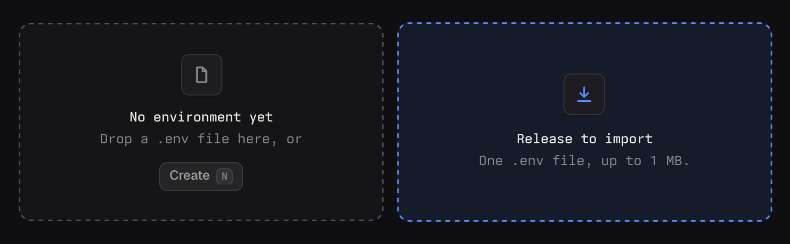
<figcaption><code>drop</code>, at rest and with <code>over = true</code>.</figcaption>
</figure>

<figure class="tn-figure">
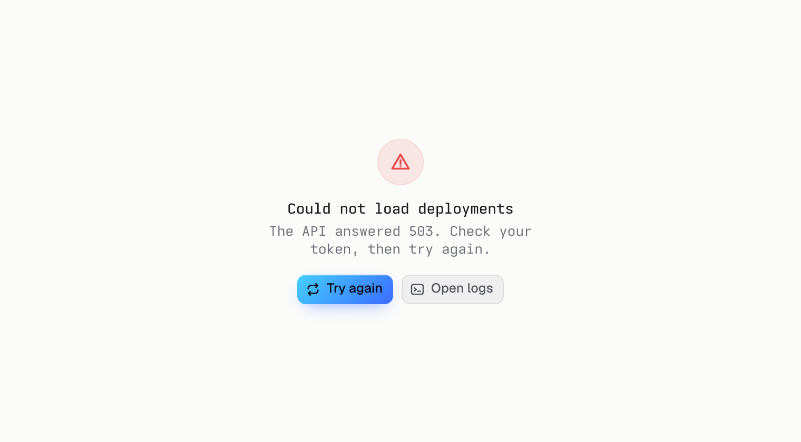
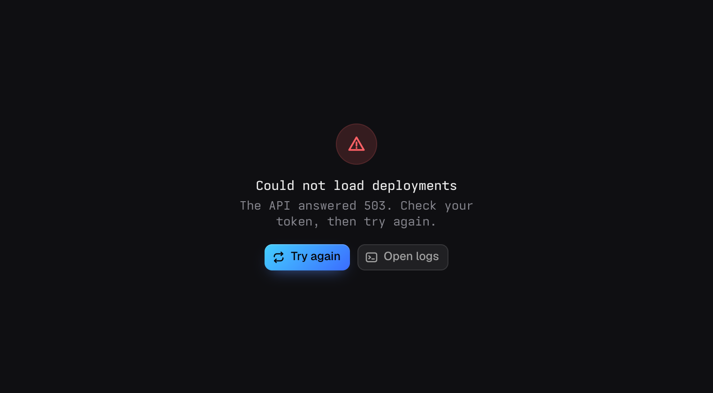
<figcaption>A full pane in its error state: <code>tone = "error"</code>, with <code>grow</code>.</figcaption>
</figure>

**Children:** the actions, in order, into `div.sf-empty-acts`.

**Events:** none of its own. Its children send theirs (a `button`'s `action` with `act`).

**Keyboard:** the node never takes focus. Bind the actions' keys in the program and show them as the buttons' `keys`;
set `over` from the program's own drag tracking.

**Accessibility:** the node is `role="status"`; the icon is `aria-hidden`.

**Styling:**

```html
<div class="sf sf-empty framed" data-id="main.issues" data-variant="inline" data-tone="error" role="status">
	<div class="sf-empty-in">
		<span class="sf-empty-ic" aria-hidden="true"><svg class="ico">…</svg></span>
		<div class="sf-empty-copy">
			<div class="sf-empty-title">Offline</div>
			<div class="sf-empty-text">Could not reach the API</div>
		</div>
		<div class="sf-empty-acts"><!-- children --></div>
	</div>
</div>
```

| Target | Selector |
| --- | --- |
| The node | `.sf-empty` |
| Variant / tone | `.sf-empty[data-variant='inline']`, `[data-variant='drop']`; `.sf-empty[data-tone='error']` |
| Framed row / drag over | `.sf-empty.framed`, `.sf-empty.over` |
| Inner box | `.sf-empty-in` (inner, may change) |
| Icon | `.sf-empty-ic` (inner, may change) |
| Title and line | `.sf-empty-copy`, `.sf-empty-title`, `.sf-empty-text` (inner, may change) |
| Actions | `.sf-empty-acts` (inner, may change) |

## `rule`

A horizontal hairline (`--l2`) one line tall (`--sf-lh`), with `role="separator"`. With a `label` the label sits
in the middle between two hairlines, in 11.5px sans `--t3`. Without a label, icon, time or `end` the rule is a single
full-width line and gets class `bare`.

A rule is also how a transcript marks a moment: a day break, a checkpoint, someone joining, a compaction. Three
looks, picked by `variant`:

- `line` (default): the hairline divider, with an optional `icon` before the label and an optional `time` after it
  (`Checkpoint 3 · 14:02`), centered between the two hairlines.
- `note`: a left-aligned row in muted text: icon, label, and `time` at the right edge in mono. With an `end` child
  (a Restore button) it becomes a framed checkpoint row: a card-tinted rounded row with a hairline ring, the label in
  `--t1`, the icon in the accent (or the tone's color), the control at the right.
- `pin`: a pill on a transcript rail: a 1.5px vertical rail runs through the row at the left (consecutive pins and
  rows join into one rail), and the pill sits on it with the icon, the label (medium weight) and the `time` in mono,
  tinted by the accent or the `tone`. The `end` child sits beside the pill.

Reach for `line` to separate groups (days, sections), `note` for events that sit in the flow of a transcript, and
`pin` for points the user can jump back to. Put the action in `end` rather than beside the rule: the rule places it,
and a click on it is the button's own event.

**Build it:** `tern.ui.rule(label?)` (see [UI Builders](../reference/ui.md#layout)), or
`tern.ui.node("rule", { label = "Older" })`. The variants and the other props need `tern.ui.node`:
`tern.ui.node("rule", { variant = "note", label = …, icon = …, time = …, ["end"] = id }, { button })`. As on
[`card`](#card), `end` is a Luau keyword, written `["end"] = …`, and names one of the rule's own children by id.

| Prop | Type | Default | Meaning |
| --- | --- | --- | --- |
| `variant` | `"line"` \| `"note"` \| `"pin"` | `"line"` | The look (below). An unknown value draws `line`. Adds class `v-note` / `v-pin` |
| `label` | spans or string | none | The label; span style tokens apply (`muted` for a detail like `12 files`) |
| `icon` | icon name | none | An icon before the label ([icon names](data.md#icon-names): `history`, `user`, `warn`). An unknown name draws none |
| `time` | string | none | A time or short stamp: after the label as ` · 14:02` (`line`), at the right edge in mono (`note`), inside the pill in mono (`pin`) |
| `tone` | tone name | none | Colors the icon (`line`, `note`) or tints the whole pill (`pin`); the common `data-tone` |
| `end` | a child's id | none | That child is drawn at the end: after the label (`line`), at the right of a framed row (`note`), beside the pill (`pin`) |

| Variant | Look | With `end` |
| --- | --- | --- |
| `line` | Centered icon · label · time between two hairlines | The child follows the label |
| `note` | Left-aligned muted row: icon, label (ellipsized), time at the right | Framed checkpoint row (class `framed`): card background, hairline ring, `--r-ctl` corners, label in `--t1`, accent icon |
| `pin` | A tinted pill (icon, label, time) on a vertical transcript rail | The child sits beside the pill |

**Children:** only the child `end` names, drawn into `span.sf-rule-end`; other children are not drawn.

**Events:** none of its own; `actions` work as on any node. The `end` child sends its own (a `button`'s `action`),
with its own id.

**Keyboard:** the rule never takes focus. A program that offers a keyboard restore binds the key on the `end` button
(`keys`).

**Accessibility:** `role="separator"`, or `role="group"` when the rule has an `end` child (a separator's content is
presentational, which would hide the control). Icons are `aria-hidden`.

**Styling:**

```html
<!-- line -->
<div class="sf sf-rule" data-id="main.3" role="separator">
	<span class="sf-rule-label"><svg class="ico sf-rule-ic">…</svg>Checkpoint 3<span class="sf-rule-time"> · 14:02</span></span>
</div>
<!-- note with end -->
<div class="sf sf-rule v-note framed" data-id="main.note" role="group">
	<svg class="ico sf-rule-ic">…</svg><span class="sf-rule-label">Checkpoint 3</span><span class="sf-rule-time">14:02</span>
	<span class="sf-rule-end"><!-- the end child --></span>
</div>
<!-- pin -->
<div class="sf sf-rule v-pin" data-id="main.pin" role="group">
	<span class="sf-rule-pill"><svg class="ico sf-rule-ic">…</svg><span class="sf-rule-label">Checkpoint 3</span><span class="sf-rule-time">14:02</span></span>
	<span class="sf-rule-end"><!-- the end child --></span>
</div>
```

| Target | Selector |
| --- | --- |
| The node | `.sf-rule` |
| Hairlines | `.sf-rule::before`, `.sf-rule::after` (the `::after` is hidden on `.sf-rule.bare`) |
| Unlabeled | `.sf-rule.bare` |
| Variants | `.sf-rule.v-note`, `.sf-rule.v-pin`; framed note `.sf-rule.v-note.framed` |
| Rail (`pin`) | `.sf-rule.v-pin::before` |
| Label | `.sf-rule-label` (inner, may change) |
| Icon, time, pill, end holder | `.sf-rule-ic`, `.sf-rule-time`, `.sf-rule-pill`, `.sf-rule-end` (inner, may change) |
| Pill color | `--pc` on `.sf-rule-pill` (the accent, or `--tc` with a tone) |

```lua
local ui = tern.ui

return {
	main = ui.col({ ui.text("today"), ui.rule("Yesterday"), ui.text("yesterday"), ui.rule(), ui.text("older") }),
}
```

<figure class="tn-figure">
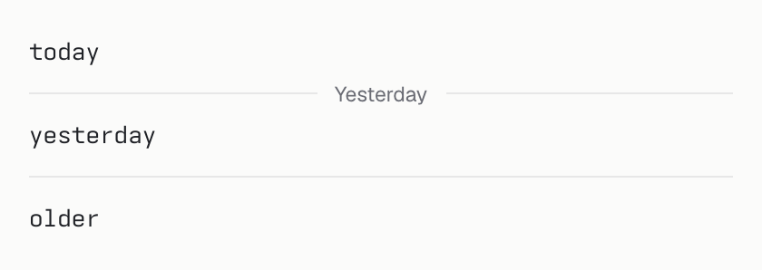
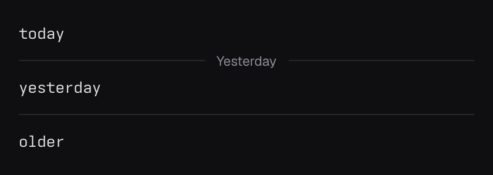
</figure>

Transcript markers, with a Restore button as the `end` child of a framed note and of a pin:

```lua
local ui = tern.ui

return {
	main = ui.col({
		ui.node("rule", { label = "Checkpoint 3", icon = "history", time = "14:02" }),
		ui.node("rule", { variant = "note", label = "Sarah joined the session", icon = "user", time = "14:01" }),
		ui.node("rule", { variant = "note", label = "Context compacted · 182k → 41k", icon = "warn", tone = "warning" }),
		ui.node("rule", {
			key = "note", variant = "note", label = "Checkpoint 3", icon = "history", time = "14:02",
			["end"] = "main.note.restore",
		}, {
			ui.button("Restore", { key = "restore", variant = "quiet", size = "sm", actions = { click = "restore:3" } }),
		}),
		ui.node("rule", {
			key = "pin", variant = "pin", label = "Checkpoint 3", icon = "history", time = "14:02",
			["end"] = "main.pin.restore",
		}, {
			ui.button("Restore", {
				key = "restore", variant = "quiet", size = "sm", icon = "undo", actions = { click = "restore:3" },
			}),
		}),
	}),
}
```

<figure class="tn-figure">
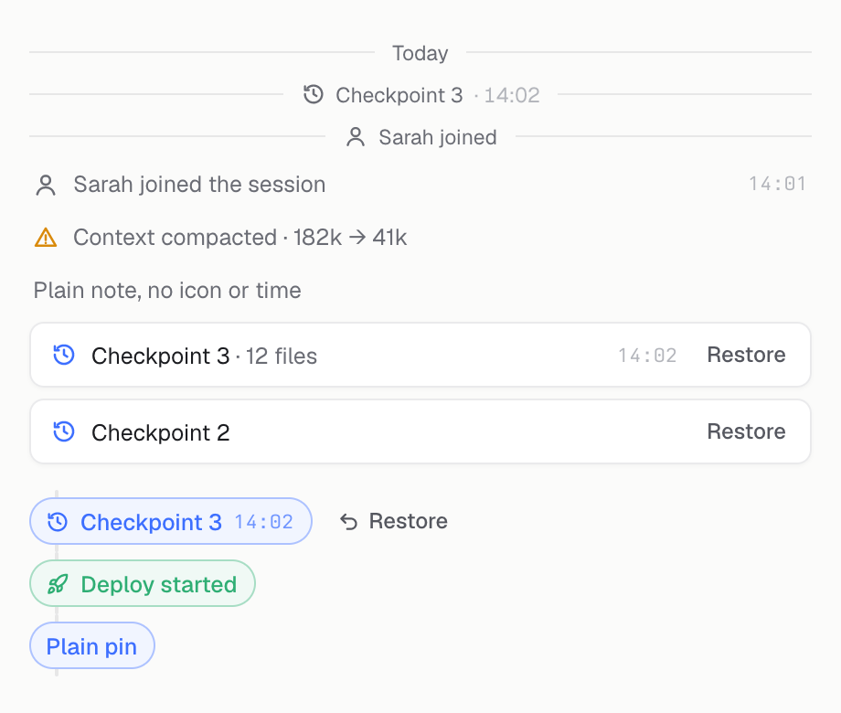
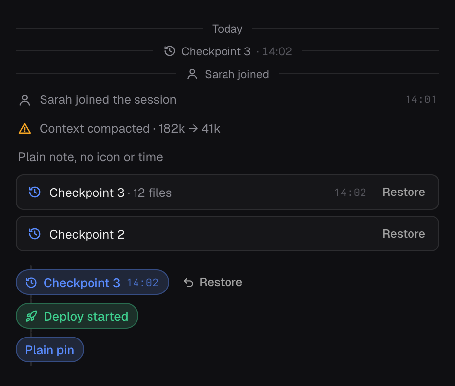
<figcaption>The three rule variants: <code>line</code>, <code>note</code> (framed with an <code>end</code> child) and <code>pin</code>.</figcaption>
</figure>

## `spacer`

A fixed block of vertical space (`flex: none`), `aria-hidden`. For flexible space inside a `row` or `col`, use an
empty stack with `grow = 1` instead (see [`row`](#row)). Tern spaces blocks and their parts itself
(`--sf-block-gap`, `--sf-inner-gap`); reach for a spacer only for space that rhythm doesn't give you.

**Build it:** `tern.ui.node("spacer", { size = "lg" })` (no dedicated builder).

| Prop | Type | Default | Meaning |
| --- | --- | --- | --- |
| `size` | `"none"` \| `"xs"` \| `"sm"` \| `"md"` \| `"lg"` | `"md"` | Height: 0, 2px, 6px, 12px, 20px. Adds class `sz-<value>`; an unknown value matches no rule and falls back to the base 8px |

**Children:** none (ignored).

**Events:** none of its own.

**Styling:**

```html
<div class="sf sf-spacer sz-md" data-id="main.4" aria-hidden="true"></div>
```

| Target | Selector |
| --- | --- |
| The node | `.sf-spacer` |
| Size | `.sf-spacer.sz-none` … `.sz-lg` |

```lua
local ui = tern.ui

return { main = ui.col({ ui.text("header"), ui.node("spacer", { size = "lg" }), ui.text("body") }) }
```

Each size between two badges:

```lua
local ui = tern.ui

local cols = {}
for _, size in { "none", "xs", "sm", "md", "lg" } do
	table.insert(cols, ui.node("col", {}, {
		ui.badge(size, "accent"),
		ui.node("spacer", { size = size }),
		ui.badge(size, "accent"),
	}))
end
return { main = ui.node("row", { gap = "lg", align = "start" }, cols) }
```

<figure class="tn-figure">
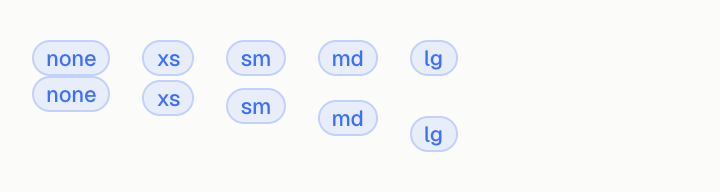
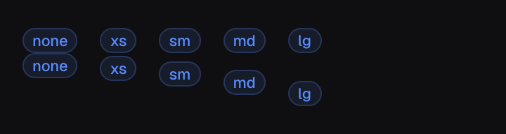
</figure>

## Stable hooks

`.sf-col`, `.sf-row`, `.sf-card`, `.sf-section`, `.sf-split`, `.sf-scroll`, `.sf-empty`, `.sf-rule`, `.sf-spacer`,
`[data-id]`, `[data-role]`, `[data-tone]`, `[data-variant]`, `[data-dir]`, `[data-mark]`, `[data-href]` and the
region's `[data-surface]` are stable. State classes that follow props (`gap-*`, `al-*`, `js-*`, `wrap`, `sz-*`,
`collapsible`, `collapsed`, `selected`, `inset`, `bare`, `fade`, `stick`, `always`, `framed`, `over`, `v-note`,
`v-pin`) follow the props above; `held` (a split's drag) and `can` (a scroll with something to scroll) follow the
user. Classes on inner parts (`.sf-card-head`, `.sf-head`, `.sf-card-ic`, `.sf-chip`, `.sf-chev`, `.sf-card-body`,
`.sf-more`, `.sf-section-head`, `.sf-section-body`, `.sf-split-*`, `.sf-scroll-*`, `.sf-empty-*`, `.sf-rule-label`,
`.sf-rule-ic`, `.sf-rule-time`, `.sf-rule-pill`, `.sf-rule-end`) are Tern's structure: inner, may change between
versions. See [Styling views](../styles/index.md) and
[Supported CSS](../styles/css.md).
