# Lists, Menus and Navigation

Rows the user points at and your code selects, the menus that hold an app's
commands, and the controls that move between views. Use `list` with `item`
children for a selectable column of rows, `menu` for a button that opens a
dropdown of commands, `menubar` for an app's menus in a row, `tabs` for a
strip of tabs that switches what you show, `nav` for an app's sections and
their sub-pages, `breadcrumb` for the trail back up a hierarchy, `pager`
under a table or list shown a page at a time, and `picker` when you want a
full modal sheet (search, scopes, fact columns, preview, action bar) drawn
from data.

| Kind | Builder | Draws |
| --- | --- | --- |
| [`list`](#list) | `tern.ui.list(items)` or `tern.ui.node("list", …)` | A listbox of `item` rows with your selection, filter highlights and an empty line |
| [`item`](#item) | inside `tern.ui.list`, or `tern.ui.node("item", …)` | One row: icon, label, detail, value, key hint |
| [`menu`](#menu) | `tern.ui.node("menu", …)` | A button that opens a dropdown of commands: icons, keys, checks, radio groups, submenus, rich two-line rows |
| [`menubar`](#menubar) | `tern.ui.node("menubar", …)` | A row of menu titles, each opening a menu below it: a quiet strip or a floating glass pill |
| [`tabs`](#tabs) | `tern.ui.node("tabs", …)` | A tab strip with an underlined active tab, or a segmented control |
| [`nav`](#nav) | `tern.ui.node("nav", …)` | Navigation pills or links; items with sub-items open a menu or a rich panel |
| [`breadcrumb`](#breadcrumb) | `tern.ui.node("breadcrumb", …)` | The trail from a root to where the user is; each crumb takes them back |
| [`pager`](#pager) | `tern.ui.node("pager", …)` | Pagination: a range with arrows, numbered pages or a show-more row |
| [`picker`](#picker) | `tern.ui.node("picker", …)` | A modal glass sheet: search head, scopes, tabs, virtual rows, preview, action bar |

All of them leave the selection to your code. A click or double-click sends
an event; you update your state and send the new `selected` (or `active`,
`open`, `page` or `tab`) back in the next view. `list`, `tabs` and `picker`
change only then; `menu`, `menubar`, `nav`, `breadcrumb` and `pager` show
the click at once and keep it until a value you send differs from the last
one. None of them takes focus, so keys never become events here: they reach
your block's `key` handler, which moves the selection the same way.

## `list`

A vertical listbox of `item` children. It draws:

- the selected item (your `selected` prop) with an accent tint and a 2px
  leading bar, and a hover tint on the others;
- `<mark>` highlights of the `filter` query in each item's label;
- the `empty` line when it has no items.

The list does not filter, sort or move the selection itself. `filter` only
marks: pass the items you want shown, already filtered, and the query that
produced them.

**Filter marking.** The query is trimmed and matched case-insensitively
against the label's plain text. The first contiguous occurrence of the whole
query is marked; when there is none, the kit's fuzzy subsequence match marks
its hit characters, adjacent hits merged into runs. No match marks nothing.
Span styles in the label are kept across the cut. For example, `LIFE` marks
`Life` in `Session Lifecycle`; `sl` marks the `s` and the `l` of
`session-lifecycle`.

**Height and scrolling.** Without `max` the list is as tall as its rows and
scrolls with the region around it. With `max` it caps its own height and
scrolls inside itself (`.sf-list-scroll.max`, thin scrollbar, overscroll
contained). Each row is one line of the terminal font plus 6px.

**Keeping the selection in view.** When `selected` changes, the list scrolls
its own scroller (only when `max` is set) to show that item, the least
distance needed. A protocol `reveal` request for an item of the list scrolls
the list's own scroller the same way, aligned to start, end or nearest; a
list without `max` leaves the scrolling to the region. Plugins have no call
that sends `reveal`; changing `selected` is how a plugin brings an item into
view. A selected item inside a list that scrolls with `main` is not scrolled
to by the list.

**Virtual lists.** Past 200 children that are all `item`s, or with
`virtual = true`, the items are not mounted as nodes. Rows share one height
(one line plus 6px, or the tallest drawn row when your stylesheet makes rows
taller) and only the rows near the view are drawn inside `.sf-list-slot` (the
space of the others is kept as padding). A long list with other kinds among
its children (headings, links) stays mounted. An item's content is read only when its row is drawn. Clicks still send `select` and `activate` with the item's
node id. In a virtual list, an item's own `actions` and its links are not
wired: the row only selects and activates.

**Build it:** `tern.ui.list(items)` builds a `list` of `item` children from
`{label, detail?, value?, icon?, tone?}` tables (see
[UI Builders](../reference/ui.md#list)). Set `selected`, `filter`, `empty`,
`max` or `virtual` on the returned node's `p`, or use
`tern.ui.node("list", { … }, items)`.

| Prop | Type | Default | Meaning |
| --- | --- | --- | --- |
| `selected` | `string` | none | Node id of the selected item. Drawn as selected (`.sel`, `aria-selected="true"`) and kept in view when it changes. An id that is not a child draws nothing selected |
| `filter` | `string` | `""` | Query whose matches are marked in each item's label with `mark.sf-mark`. Marking only; it hides nothing |
| `empty` | Spans | none | Line shown when the list has no children. Nothing shows when unset |
| `max` | `{lines = n}` or `number` | none | Height cap. `{lines = n}`: `n` rows of `--sf-row` (one line plus 6px; a stylesheet may raise it on a list that isn't virtual). A number: that fraction of the window height (`0.5` = `50vh`). Non-positive or other values are ignored. With a cap the list scrolls itself |
| `virtual` | `boolean` | `false` | Virtualize the rows even under 200 items |

The [common props](index.md) apply too (`key`, `role`, `tone`, `actions`).

**Children:** `item` nodes, drawn in order inside `.sf-list-slot`. Other
kinds are placed as well but get no row behavior. In a virtual list the
children are not mounted: each child's item props are read into a drawn
row.

**Events:** none of its own. Its items send `select` and `activate` naming
the list (see [`item`](#item)).

**Styling:**

```html
<div class="sf sf-list" data-id="main.items" role="listbox">
	<div class="sf-list-scroll max">            <!-- .max only with `max` -->
		<div class="sf-list-slot">
			<div class="sf sf-item sel" data-id="main.items.i1" role="option" aria-selected="true">…</div>
			<!-- virtual: <div class="sf sf-item" role="option" data-item="main.items.i1">…</div> -->
		</div>
	</div>
	<div class="sf-list-empty sf-hidden">No results</div>
</div>
```

| Target | Selector |
| --- | --- |
| The node | `.sf-list`, `.sf-list[data-id=…]`, `.sf-list[data-role=…]` |
| A virtual list | `.sf-list.virtual` |
| Its scroller | `.sf-list-scroll` (inner, may change); `.sf-list-scroll.max` when capped |
| Mounted items | `.sf-list-slot` (inner, may change) |
| Virtual rows | `.sf-list.virtual .sf-item[data-item=…]` (inner, may change) |
| The empty line | `.sf-list-empty` (inner, may change) |
| Selected item | `.sf-list .sf-item.sel`, `[aria-selected='true']` |
| Filter hits | `.sf-list mark.sf-mark` |

`.sf-hidden` hides parts that have nothing to show (the empty line while
there are items, the scroller while there are none). The selection tint is
`var(--sf-sel)` when you set it, else the accent at 10% (light) or 16%
(dark); the bar is `inset 2px 0 0 var(--accent)`. Hover uses `--l1`. Inside an
`overlay` card (`.sf-ov-card`) the selection is a neutral `--l2` fill with a
`--grad` edge instead. Rows use `--sf-lh` for their height. See
[Variables](../styles/variables.md).

Stable hooks are `.sf-list`, `.sf-item`, `[data-id]`, `[data-role]`,
`[data-tone]` and the ARIA attributes; the `sf-list-*` and `sf-item-*` parts are
Tern's structure.

```lua
local ui = tern.ui

-- view: state.visible holds the branches matching state.query ("log"),
-- state.sel the selected branch name ("fix-login")
local rows = {}
for _, b in state.visible do
	local row = ui.list({ {
		label = b.name,
		detail = b.upstream or "no upstream",
		value = b.drift, -- "↑2", "↓5" or nil
		icon = "git-branch",
		tone = b.behind and "warning" or nil,
	} }).c[1]
	row.p.key = b.name
	row.p.disabled = b.upstream == nil
	table.insert(rows, row)
end
return {
	main = ui.col({
		ui.node("list", {
			key = "branches",
			selected = state.sel and ("main.branches." .. state.sel) or nil,
			filter = state.query,
			empty = { ui.span("No branches match", "muted") },
			max = { lines = 12 },
		}, rows),
	}),
}
```

<figure class="tn-figure">
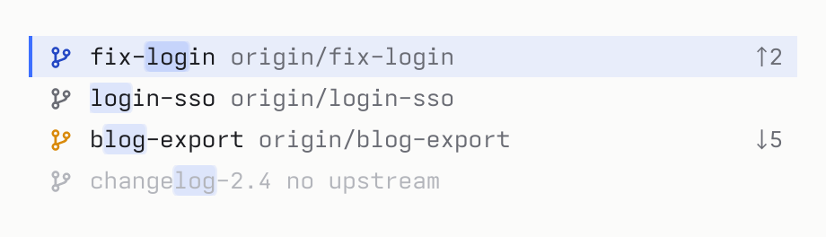
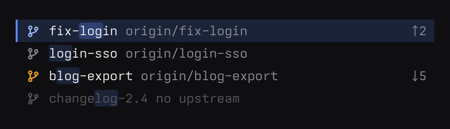
<figcaption>Selection, <code>filter</code> marks, a <code>warning</code> tone and a disabled row.</figcaption>
</figure>

## `item`

One row: an icon, the label, a dim detail that takes the free room and
truncates, a right-aligned value, and keycaps. Inside a `list` it is an
`option` of the listbox; on its own it is a plain row with the same parts.
Text never wraps; label, detail and value truncate with an ellipsis.

**Build it:** as an element of `tern.ui.list(items)` (see
[UI Builders](../reference/ui.md#list)), which covers `label`, `detail`,
`value`, `icon` and `tone`. `hint` and `disabled` need
`tern.ui.node("item", { … })` or setting them on the built child's `p`.

| Prop | Type | Default | Meaning |
| --- | --- | --- | --- |
| `label` | Spans | `""` | The row's text. Filter hits are marked in it |
| `detail` | Spans | `""` | Dim text after the label; flexes and truncates first |
| `value` | Spans | `""` | Right-aligned text (tabular numbers, at most 40% of the row). Hidden when empty |
| `icon` | `string` | none | An icon name (see [`icon`](data.md#icon)); unknown names show no icon |
| `hint` | `{ string }` | `{}` | Key names drawn as keycaps at the end, e.g. `{ "cmd", "enter" }`. Display only: it binds nothing |
| `disabled` | `boolean` | `false` | Dims the row (`.off`, `aria-disabled="true"`), takes no pointer events and sends no `select` or `activate` |
| `tone` | tone name | none | Sets `data-tone`; tints the icon. One of `neutral`, `accent`, `info`, `success`, `warning`, `error`, `pending`, `muted`, `user`; other names are ignored |

**Children:** none (ignored).

**Events:**

| Gesture | Event |
| --- | --- |
| Click | `{ev = "select", id = <list id>, item = <item id>}` |
| Double-click | `{ev = "activate", id = <list id>, item = <item id>}` |

A double-click also sends the `select` of its first click. Outside a list,
`id` and `item` are both the item's own id. A disabled item sends neither.
A click on a link span in the item opens the link (with ⌘) instead of
selecting. When the item has its own `actions.click`, that action replaces
`select`; its own `actions.dblclick` replaces `activate`. The events go to
your block's `event(state, ev, cx)`; nothing changes on screen until your
view sends the new `selected`.

Keys (arrows, Enter) are not handled by the list: they reach your block's
`key` handler. Move your selection there and return the new view.

**Styling:**

```html
<div class="sf sf-item sel" data-id="main.items.i1" data-tone="warning"
		role="option" aria-selected="true">
	<span class="sf-item-ic"><!-- icon --></span>
	<span class="sf-item-label">fix-<mark class="sf-mark">log</mark>in</span>
	<span class="sf-item-detail">origin/fix-login</span>
	<span class="sf-item-value">↑2</span>
	<span class="sf-item-hint kbds"><!-- keycaps (.kbd) --></span>
</div>
```

| Target | Selector |
| --- | --- |
| The node | `.sf-item`, `.sf-item[data-id=…]` |
| Selected | `.sf-item.sel` |
| Disabled | `.sf-item.off`, `[aria-disabled='true']` |
| Toned | `.sf-item[data-tone='warning']` |
| Icon | `.sf-item-ic` (inner, may change) |
| Label | `.sf-item-label` (inner, may change) |
| Detail | `.sf-item-detail` (inner, may change) |
| Value | `.sf-item-value` (inner, may change) |
| Key hint | `.sf-item-hint`, `.sf-item-hint .kbd` (inner, may change) |
| Filter hits | `.sf-item mark.sf-mark` |

Empty icon, value and hint parts carry `.sf-hidden`. The icon takes `--tc`,
the tone color, when `data-tone` is set (`--t3` for `neutral`, `--accent-ink`
on a selected row without a tone). The detail and value are `--t3`, a
disabled row `--t4`. Under reduced motion (`.sf-still` or
`prefers-reduced-motion`) the hover and selection transitions are off.

```lua
local ui = tern.ui

ui.node("item", {
	key = "deploy",
	label = "Deploy",
	detail = "production",
	icon = "jobs",
	hint = { "cmd", "enter" },
	tone = "accent",
})
```

## `menu`

A button that opens a dropdown of commands, in Tern's own menu look (the
frosted sheet Tern's menus use). Reach for it when a node has more commands
than fit as buttons (a "…" button), for a sort or view menu with radio and
check groups, or for a few weighty choices that want a sentence each
(Promote, Roll back). The node *is* its trigger: it draws like a
[`button`](input.md#button), and its menu hangs below it.

Rows are data: an action with an `icon`, shortcut `keys` drawn at the right,
a `detail` line under the label (a rich two-line row), a check (`checked`) or
a radio dot (`radio` names its group), a submenu (`items`), a `disabled`
reason, a `danger` tone; `"-"` is a separator and `{ header = "…" }` a
section title. The same rows work in any node's right-click menu
([`actions.menu`](#right-click-menus-actionsmenu), below).

Two looks: `default` is the kit menu, 32px rows; `dense` packs 24px rows of
12.5px text for long sort and filter menus. A row with a `detail` draws as
a rich row in either: its icon in a soft tile, the label over the detail.

It is pointer-only like the [`el`](el.md) controls: it never takes focus, so
keys stay yours. A click opens it at once; drive it from the keyboard with
`open` and `active`.

**Build it:** `tern.ui.node("menu", { text = …, items = { … } })`. No
dedicated builder.

```lua
local ui = tern.ui

ui.row({
	ui.node("menu", {
		key = "more",
		title = "Deployment actions",
		items = {
			{ header = "Deployment" },
			{ id = "logs", label = "Open logs", icon = "list", keys = { "cmd", "L" } },
			{ id = "follow", label = "Follow output", checked = state.follow },
			"-",
			{ id = "export", label = "Export", icon = "download", items = {
				{ id = "json", label = "JSON" },
				{ id = "csv", label = "CSV" },
			} },
			"-",
			{ id = "delete", label = "Delete…", icon = "trash", danger = true },
		},
	}),
	ui.node("menu", {
		key = "sort",
		text = "Sort",
		icon = "list",
		variant = "dense",
		items = {
			{ header = "Sort by" },
			{ id = "name", label = "Name", radio = "sort", checked = state.sort == "name" },
			{ id = "deploy", label = "Last deploy", radio = "sort", checked = state.sort == "deploy" },
		},
	}),
})

-- event(state, ev, cx)
-- ev.ev == "action" and ev.act == "follow" -> state.follow = ev.checked
-- ev.ev == "action" and ev.id == "main.sort" -> state.sort = ev.act
```

<figure class="tn-figure">
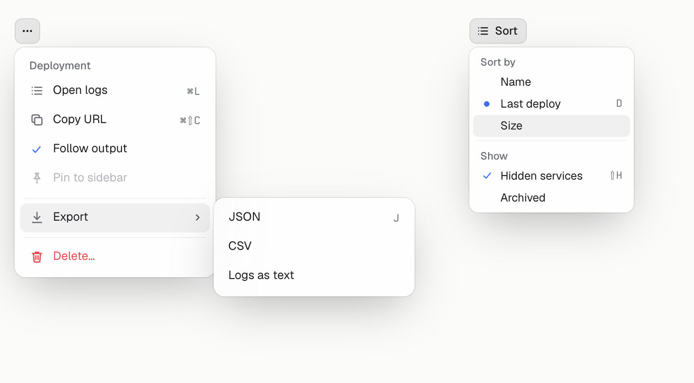
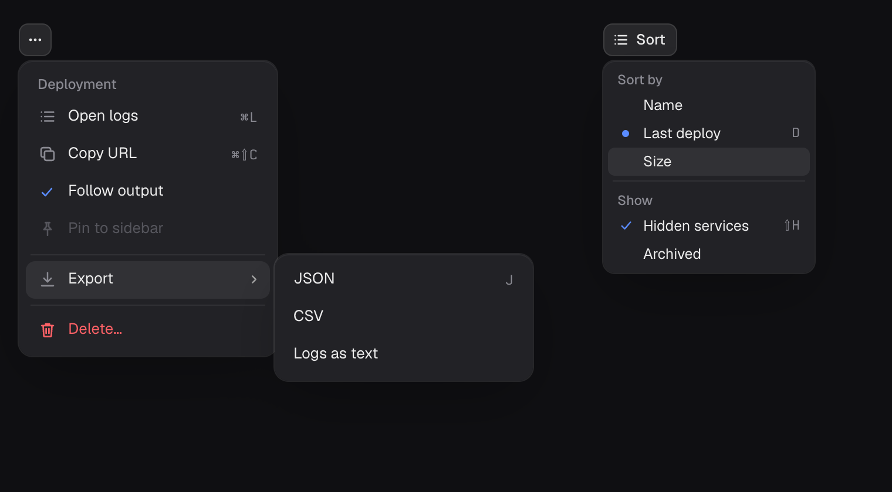
<figcaption><code>default</code> with every row type and a submenu open, and <code>dense</code> with a radio group and a check group.</figcaption>
</figure>

A few weighty choices, each with a sentence, under a labeled trigger:

```lua
ui.node("menu", {
	key = "release",
	text = "Release",
	icon = "rocket",
	caret = true,
	items = {
		{ id = "promote", label = "Promote", icon = "rocket", detail = "Copy staging to production" },
		{ id = "rollback", label = "Roll back", icon = "undo", detail = "Restore the previous release" },
	},
})
```

<figure class="tn-figure">
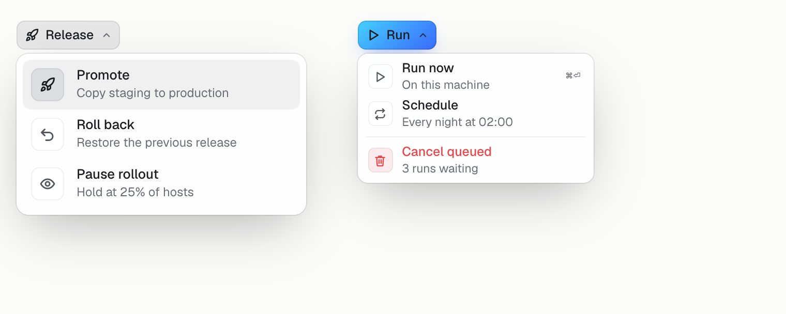
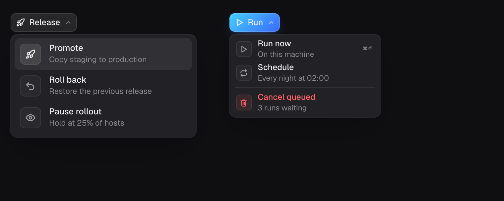
<figcaption>Rows with a <code>detail</code> draw as rich two-line rows, in <code>default</code> and in <code>dense</code>; <code>caret</code> and <code>trigger</code> style the button.</figcaption>
</figure>

<figure class="tn-figure">
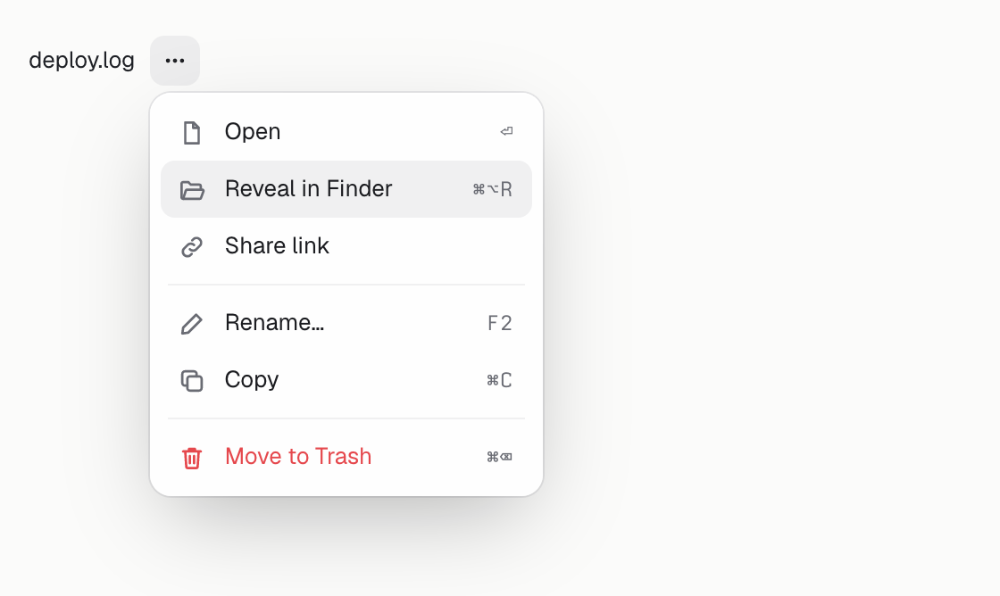
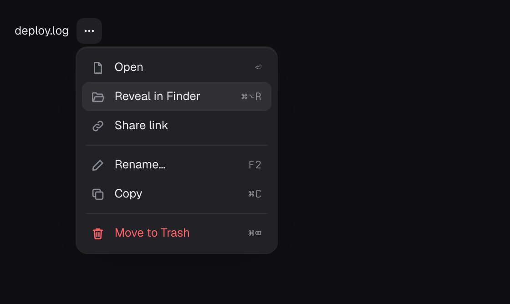
<figcaption>The rows a right-click menu takes: icons, keys, separators and a danger row (here under a <code>quiet</code> trigger).</figcaption>
</figure>

| Prop | Type | Default | Meaning |
| --- | --- | --- | --- |
| `items` | `{ item }` | `{}` | The rows, in order (see *Items*) |
| `text` | `string` | none | The trigger's label. Without `text` and `icon` the trigger is a square … button |
| `icon` | `string` | none | The trigger's leading icon (an icon name, as `button`) |
| `trigger` | `"default"` \| `"quiet"` \| `"primary"` | `"default"` | The trigger's look: the `button` variants of the same names |
| `caret` | `boolean` | `false` | A chevron after the label, turning over while open |
| `size` | `"md"` \| `"sm"` | `"md"` | The trigger's size (28px or 22px), as `button` |
| `variant` | `"default"` \| `"dense"` | `"default"` | The menu's look (below). Other values read as `default` |
| `open` | `boolean` | `false` | Whether the menu shows. A change of `open` wins over the user's local open or close |
| `active` | `string` | none | The highlighted row's `id` (your keyboard cursor). The submenus holding it open; a highlighted row with a submenu opens its own too |
| `align` | `"start"` \| `"end"` | `"start"` | Which edge of the trigger the menu lines up with; `end` for a trigger at a row's right |
| `disabled` | `boolean` \| `string` | `false` | The trigger is dimmed and does not open; a string is the reason, shown as the tooltip |
| `title` | `string` | none | The trigger's tooltip, and its accessible name when it has no `text` (default "Menu") |

The [common props](index.md#props-every-node-takes) work too: `key` (the
local state is kept per node), `tone` and the flex props.

**Items.** Each entry of `items` (and of `actions.menu`) is one of:

| Entry | Meaning |
| --- | --- |
| `"-"` | A separator line |
| `{ header = "…" }` | A dim section title |
| `"<id>"` | An action labeled from its id (`open-file` → "Open file") |
| `{ id, … }` | An item, fields below |

| Field | Type | Default | Meaning |
| --- | --- | --- | --- |
| `id` | `string` | required | What the `action` event sends as `act` |
| `label` | `string` | from `id` | The row's text |
| `icon` | `string` | none | A leading icon |
| `keys` | `string` \| `{ string }` | none | Shortcut keys, drawn as mono glyphs at the right (`{"cmd","shift","C"}` → ⌘⇧C). Only shown: your program binds them |
| `detail` | `string` | none | A second line under the label; the row draws as a rich row (icon in a tile) |
| `checked` | `boolean` | none | Makes the row a check row (`menuitemcheckbox`) showing a check while `true` |
| `radio` | `string` | none | Makes the row a radio row of this group (`menuitemradio`): a dot while `checked`; choosing it turns the group's others off |
| `disabled` | `boolean` \| `string` | `false` | Dimmed, not choosable; a string is the reason, shown as the row's tooltip |
| `danger` | `boolean` | `false` | A destructive action, drawn in `--bad` |
| `items` | `{ item }` | none | A submenu, opening beside the row on hover or click; the row itself sends nothing |

A row with both an `icon` and `checked` shows its icon while off and the
check while on.

**Variants:**

| `variant` | Look | Use |
| --- | --- | --- |
| `default` | Kit's menu: a 12px frosted sheet, 32px rows on 8px pills, 13px text, a 16px icon column, mono keys at the right, a › for submenus | Actions, "…" menus, right-click menus |
| `dense` | 24px rows on 6px pills, 12.5px text, a 10px sheet | Long sort, filter and view menus |
| rows with `detail` | The icon in a 32px tile (24px in `dense`), a medium-weight label over a muted line | Few weighty choices that need a sentence each |

The menu fades and scales in from its trigger (`--out`, .2 s); marks pop in
as they turn on. Motion stops under reduced motion, `.sf-still` and
`.sf-paused`.

**Children:** none (ignored).

**Events:** choosing a row sends

```lua
{ ev = "action", id = "<the menu's id>", act = "<the row's id>" }
{ ev = "action", id = "…", act = "follow", checked = true }  -- a check or radio row: its new state
```

then closes the menu. Opening or closing it with the pointer (the trigger, a
press outside, a pick) sends

```lua
{ ev = "toggle", id = "<the menu's id>", open = true }
```

The menu opens or closes, and checks and radios flip, at once; the menu
keeps that until your program sends an `open` (or an item's `checked`) that
differs from the last one drawn, which then wins. Mirror the events into
`open` and `checked` and you stay the owner. Disabled rows, submenu rows,
headers and separators send nothing; a disabled trigger does not open. On a
closed surface or one opened with `listen = false` nothing opens, flips or
sends.

**Keyboard:** none of its own. Your program owns the keys: set `open` to
show the menu, move `active` with the arrows (into a submenu by naming one
of its rows), and on Enter run the `active` row yourself.

### Right-click menus: `actions.menu` {#right-click-menus-actionsmenu}

Every node's `actions.menu` (see
[Actions and events](../guides/views.md#actions-and-events)) takes the same
entries, so a right-click menu can have icons, keys, checks, radio groups,
separators, headers, disabled and danger rows and submenus. Plain strings
keep working as before. Tern draws the menu (its own native menu) and adds
Copy at the end, after a separator when the menu has icons, keys or
separators. Choosing a row sends `action` with `act`, and `checked` (the new
state) for check and radio rows; a row's `detail` shows as its tooltip
there.

```lua
local file = tern.ui.text("deploy.log")
file.p.actions = { menu = {
	{ id = "open", label = "Open", icon = "file", keys = "enter" },
	{ id = "reveal", label = "Reveal in Finder", icon = "folder-open", keys = { "cmd", "alt", "R" } },
	"-",
	{ id = "trash", label = "Move to Trash", icon = "trash", danger = true },
} }
```

**Styling:**

```html
<div class="sf sf-menu open" data-id="main.more">
	<button class="sf-menu-trigger sf-button" data-variant="default" data-size="md"
		aria-haspopup="menu" aria-expanded="true">
		<span class="sf-btn-ic" aria-hidden="true"><svg class="ico">…</svg></span>
		<span class="sf-btn-label">Release</span>
		<span class="sf-menu-caret" aria-hidden="true"><svg class="ico">…</svg></span>
	</button>
	<div class="sf-menu-pop marks" role="menu" data-variant="default" data-align="start">
		<div class="sf-menu-head" role="presentation">Deployment</div>
		<div class="sf-menu-item active" role="menuitem" data-act="logs">
			<span class="sf-menu-lead" aria-hidden="true"><svg class="ico">…</svg></span>
			<span class="sf-menu-text"><span class="sf-menu-label">Open logs</span>
				<span class="sf-menu-detail">…</span></span>
			<span class="sf-menu-keys" aria-hidden="true">⌘L</span>
		</div>
		<div class="sf-menu-item on" role="menuitemcheckbox" aria-checked="true" data-act="follow">
			<span class="sf-menu-lead" aria-hidden="true"><i class="sf-menu-check"><svg class="ico">…</svg></i></span>…
		</div>
		<div class="sf-menu-sep" role="separator"></div>
		<div class="sf-menu-item sub open" role="menuitem" aria-haspopup="menu" aria-expanded="true" data-act="export">
			…<span class="sf-menu-more" aria-hidden="true"><svg class="ico">…</svg></span>
			<div class="sf-menu-pop sf-menu-subpop" role="menu">…</div>
		</div>
	</div>
</div>
```

| Target | Selector |
| --- | --- |
| The node / open | `.sf-menu`, `.sf-menu.open` |
| Trigger | `.sf-menu-trigger` (a `.sf-button`), caret `.sf-menu-caret` |
| The menu / variant | `.sf-menu-pop`, `.sf-menu-pop[data-variant='dense']`, `[data-align='end']` |
| Submenu | `.sf-menu-subpop`; its row `.sf-menu-item.sub`, open `.sf-menu-item.open` |
| Rows | `.sf-menu-item`; `.active`, `.on` (checked), `.dis`, `.danger`, `.rich` |
| Row parts | `.sf-menu-lead` (icon or mark: `.sf-menu-check`, `.sf-menu-dot`), `.sf-menu-label`, `.sf-menu-detail`, `.sf-menu-keys`, `.sf-menu-more` |
| Separator / header | `.sf-menu-sep`, `.sf-menu-head` |

## `menubar`

A row of menu titles, each opening a menu of commands below it, the way a
Mac app's menu bar works. Reach for it when a full-screen app has more
commands than a toolbar holds and they group naturally (File, Edit, View,
Go, Help, or Deploys, Services, Logs): the titles stay short and visible,
and every command keeps its keys on show in its menu. For one group of
commands, a [`menu`](#menu) button is enough.

The menus are [`menu`](#menu)'s popover: the same rows (icons, keys, check
marks, radio groups, submenus, separators, headers, rich two-line rows,
disabled and danger rows) on the same frosted sheet.

With the pointer it behaves like a menu bar: a click on a title opens its
menu; while one is open, resting on another title switches to that menu;
a click on the open menu's title, or a press anywhere outside the open menu,
closes it; picking a row closes it too. All of that shows at once and is
reported to you as `toggle` events. Keys stay with your program: drive
`open` (and `active`, the highlighted row) from your key handler.

Two looks, by `variant`:

- `strip` (the default): a quiet text strip with a hairline ring, 30px tall
  and as wide as its container, for an app's head row or the dock. The open
  title sits on a soft gray pill. In the dock, menus open upward.
- `pill`: a floating glass capsule, 40px tall and only as wide as its titles,
  led by the app's mark (`icon`, in the accent). The open title is tinted
  with the accent.

**Build it:** `tern.ui.node("menubar", { menus = { … } })`. No dedicated
builder.

```lua
local ui = tern.ui

ui.node("menubar", {
	key = "bar",
	open = state.menu,
	active = state.row,
	menus = {
		{ id = "file", label = "File", items = {
			{ id = "new", label = "New window", keys = { "cmd", "N" } },
			{ id = "open", label = "Open…", keys = { "cmd", "O" } },
			"-",
			{ id = "close", label = "Close", keys = { "cmd", "W" } },
		} },
		{ id = "view", label = "View", items = {
			{ id = "zoom-in", label = "Zoom in", keys = { "cmd", "+" } },
			{ id = "zoom-out", label = "Zoom out", keys = { "cmd", "-" } },
			"-",
			{ id = "sidebar", label = "Sidebar", checked = state.sidebar },
		} },
		{ id = "help", label = "Help", items = { { id = "docs", label = "Documentation" } } },
	},
})

-- event(state, ev, cx)
if ev.id == "main.bar" then
	if ev.ev == "toggle" then
		state.menu = ev.open and ev.item or nil
	elseif ev.ev == "action" then
		state.menu = nil
		run(ev.item, ev.act, ev.checked)
	end
end
```

<figure class="tn-figure">
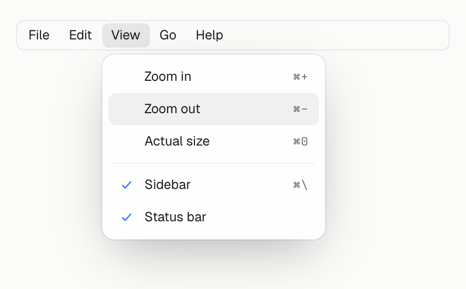
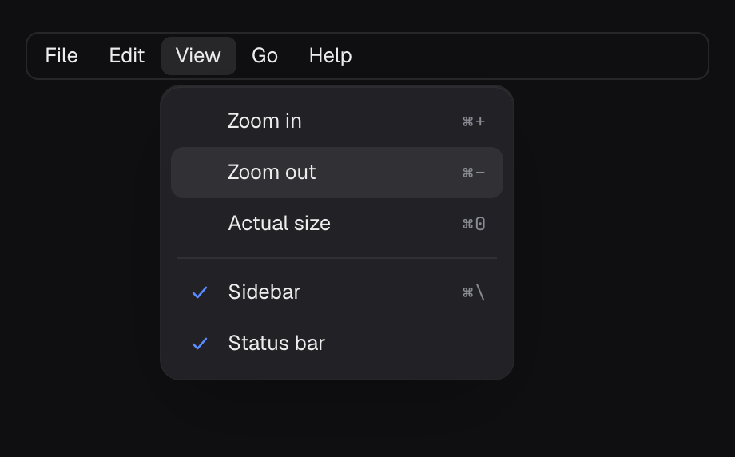
<figcaption>The strip with <code>open = "view"</code> and <code>active = "zoom-out"</code>.</figcaption>
</figure>

<figure class="tn-figure">
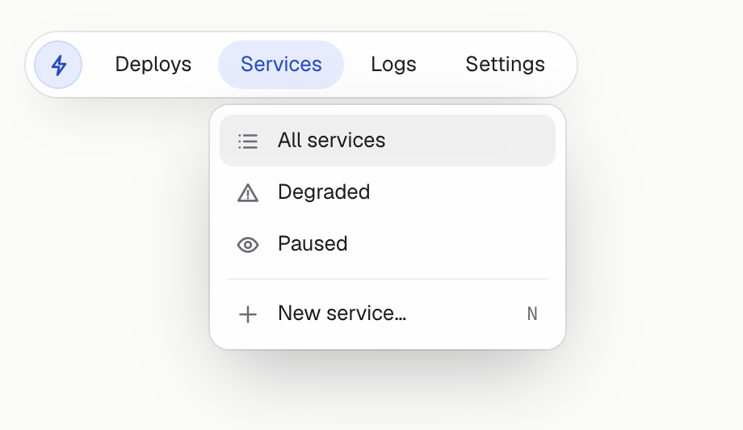
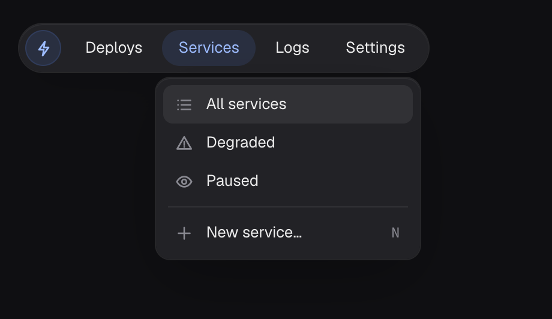
<figcaption><code>variant = "pill"</code> with <code>icon = "bolt"</code> and <code>open = "services"</code>.</figcaption>
</figure>

<figure class="tn-figure">
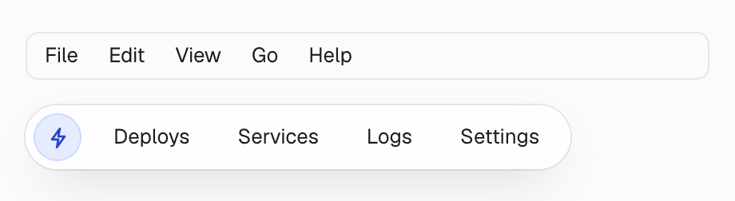
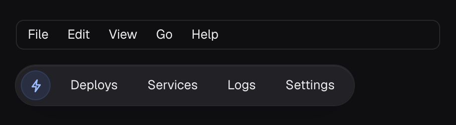
<figcaption>Both looks closed.</figcaption>
</figure>

<figure class="tn-figure">
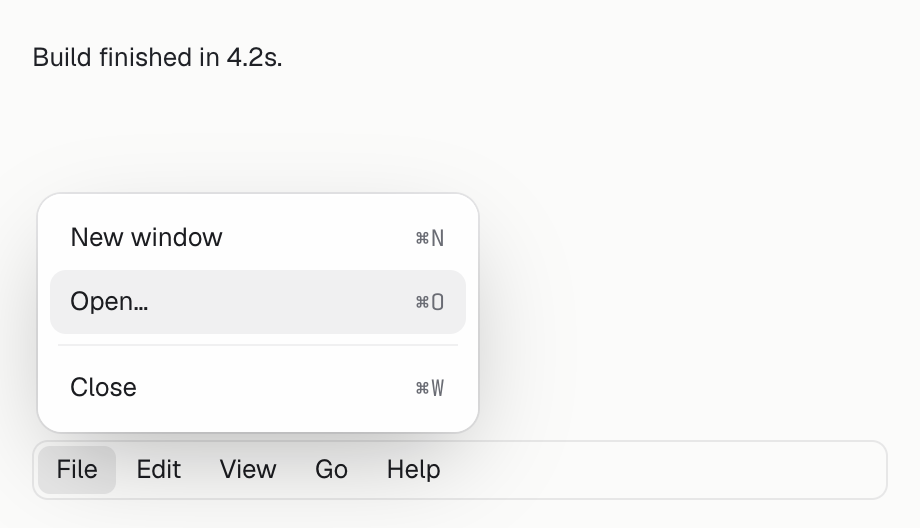
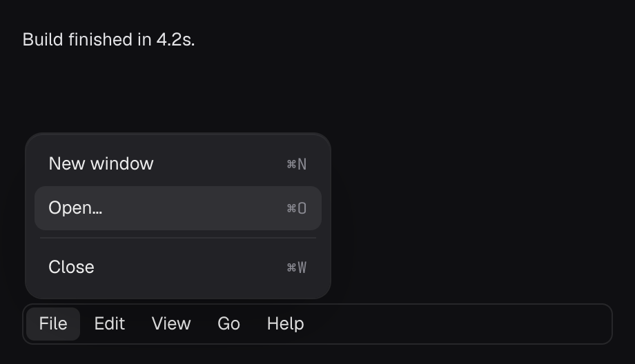
<figcaption>In the dock the menus open upward.</figcaption>
</figure>

| Prop | Type | Default | Meaning |
| --- | --- | --- | --- |
| `menus` | `{ {id: string, label?: string, items: { item }} }` | `{}` | The menus in order. `id` names the menu in events and in `open`; entries without an `id` are skipped. `label` is its title (default: the `id`). `items` are [`menu`](#menu) entries: item objects, `"-"` for a separator, `{header}` for a section title |
| `variant` | `"strip"` \| `"pill"` | `"strip"` | The look (`data-variant`); other values read as `"strip"` |
| `icon` | `string` | none | An icon name drawn before the titles as the app's mark (`.sf-mb-mark`, decorative). Under `pill`, in the accent on an accent-tinted 30px disc; under `strip`, bare in `--t2`. Unknown names draw nothing |
| `open` | `string` | none | `id` of the menu shown open. A change wins over what the pointer did; while it stays the same, the pointer's opening and closing stand. An `id` no menu has (or `""`) opens nothing |
| `active` | `string` | none | `id` of the highlighted row in the open menu (your keyboard cursor); the submenus holding it open along the way |

**Children:** none (ignored).

| Variant | Look | Where |
| --- | --- | --- |
| `strip` | 30px hairline strip, full width, 24px titles; the open title on an `--l2` pill | An app's head row, the dock (menus open upward there) |
| `pill` | 40px frosted capsule, as wide as its titles, 30px capsule titles, an accent mark; the open title tinted with the accent | Floating over an app, centered in a `row` with `justify = "center"` |

**Events:**

| Event | Payload | When |
| --- | --- | --- |
| `toggle` | `{ev = "toggle", id, item = <menu id>, open = true}` | A click on a closed title opens its menu, or the pointer rests on another title while a menu is open (one event: opening a menu closes the other) |
| `toggle` | `{ev = "toggle", id, item = <menu id>, open = false}` | A click on the open menu's title, a press outside the open menu, or a pick closes it |
| `action` | `{ev = "action", id, act = <row id>, item = <menu id>, checked?}` | A click on an enabled row; `checked` is the row's new state for a check row (flipped) or a radio row (`true`; its group's others turn off). Followed by the menu's `toggle` with `open = false` |

Disabled rows, headers and separators send nothing; a row with a submenu
opens it. On a surface that is closed or opened with `listen = false`, the
bar draws (including the menu `open` names) but the pointer opens, closes
and picks nothing and nothing is sent.

**Keyboard:** the bar never takes focus. A typical model: a key (F10, or
⌃F2 like macOS) sets `open` to the first menu; ←/→ move `open` along the
menus; ↑/↓ move `active` through the open menu's rows; Enter runs `active`
(send yourself the command and clear `open`); Escape clears `open`. Mirror
`toggle` into `open` so the pointer and the keys agree.

**Styling:**

```html
<div class="sf sf-menubar open" data-id="main.bar" data-variant="strip" role="menubar">
	<span class="sf-mb-mark" aria-hidden="true"><svg class="ico">…</svg></span>
	<span class="sf-mb-menu sf-menu-anchor" data-menu="file">
		<span class="sf-mb-title" role="menuitem" aria-haspopup="menu" aria-expanded="false">File</span>
		<div class="sf-menu-pop" role="menu" data-variant="default" data-align="start">…</div>
	</span>
	<span class="sf-mb-menu sf-menu-anchor open" data-menu="view">
		<span class="sf-mb-title" role="menuitem" aria-haspopup="menu" aria-expanded="true">View</span>
		<div class="sf-menu-pop" role="menu" data-variant="default" data-align="start">…</div>
	</span>
</div>
```

| Target | Selector |
| --- | --- |
| The node | `.sf-menubar`, `.sf-menubar[data-variant='pill']` |
| A menu is open | `.sf-menubar.open` |
| The app's mark | `.sf-mb-mark` |
| A title and its menu | `.sf-mb-menu`, `.sf-mb-menu[data-menu='view']` |
| The open one | `.sf-mb-menu.open` |
| A title | `.sf-mb-title`, `.sf-mb-title[aria-expanded='true']` |
| A menu | `.sf-mb-menu > .sf-menu-pop` (its rows: see [`menu`](#menu)) |

Titles are `400 13px` sans (in mono regions too) in `--t1`; hover adds
`--l1`, a press `--l2`. The strip's titles are 24px tall with 6px corners
inside a 30px strip with 8px corners and an `--l2` hairline ring; the open
title is on `--l2`. The pill is `--pop-bg` frosted glass with an `--l2` ring
and a soft shadow, its 30px titles capsules; the open title is
`--accent-ink` on the accent at 12%. Every menu is drawn and only the open
one shows (`display: none` otherwise), 7px under the strip (10px under the
pill), with the popover's arrival animation. Transitions and the arrival are
off under reduced motion, `.sf-still` and `.sf-paused`.

## `tabs`

A row of tabs over a hairline; the active one is underlined with the accent.
The strip does not scroll: tabs past its width are clipped. The active tab
is yours: a click sends `select`, and the strip changes only when you send
a new `active`.

The underlined strip is a page's navigation: in an app with more than two
panels, one strip under the head row and stats, a tab per view (its name,
with a muted count where it helps), and only the active view rendered
under it, full width. Switch views on `select` and on Tab/⇧Tab (or `[`/`]`)
from your key handler, and say so in the key legend (see
[Designing Views](../guides/design.md#page-structure)).

With `variant = "segmented"` the strip is a segmented control instead: a
small well holding the tabs as segments, the active one raised on a card
face. It sizes to its tabs rather than stretching. It filters or switches
what one view shows, from the view's toolbar row (a muted description on the
left, the control on the right) or a card's head (its
[`end`](layout.md#card)); never a second navigation strip (see
[Designing Views](../guides/design.md#a-view-table-and-detail)).

**Build it:** `tern.ui.node("tabs", { items = { … }, active = "…" })`. No
dedicated builder.

| Prop | Type | Default | Meaning |
| --- | --- | --- | --- |
| `items` | `{ {id: string, label: Spans} }` | `{}` | The tabs in order. Entries without an `id` are skipped |
| `active` | `string` | none | `id` of the active tab (`.on`, `aria-selected="true"`) |
| `variant` | `"underline"` \| `"segmented"` | `"underline"` | The look. `"segmented"` adds class `seg`; other values read as `"underline"` |

**Children:** none (ignored).

**Events:** a click on a tab sends `{ev = "select", id = <tabs node id>,
item = <tab id>}`. `item` is the tab's `id` from `items`, not a node id.

**Styling:**

```html
<div class="sf sf-tabs" data-id="main.tabs" role="tablist">
	<div class="sf-tab on" role="tab" aria-selected="true" data-tab="files">Files</div>
	<div class="sf-tab" role="tab" aria-selected="false" data-tab="commits">Commits</div>
</div>
```

| Target | Selector |
| --- | --- |
| The node | `.sf-tabs` |
| A tab | `.sf-tab`, `.sf-tab[data-tab='files']` |
| Active tab | `.sf-tab.on`, `.sf-tab[aria-selected='true']` |
| Segmented strip | `.sf-tabs.seg` |

The strip uses `--sans` at 12px; inactive tabs are `--t3`, hover adds `--l1`,
the active underline is `--accent`, the hairline `--l2`. Transitions are off
under reduced motion.

The segmented strip is 28px tall with 2px padding and 9px corners, on
`--l1` with an `--l1` hairline ring. Each tab is 24px tall, `padding: 0 10px`,
7px corners, `500 12.5px` sans in `--t3`; the active one is `--t1` on
`--card` (`--raise` in dark) with a soft shadow and an `--l1` ring. Every
tab shows the pointing hand.

```lua
local ui = tern.ui

ui.node("tabs", {
	key = "tabs",
	active = state.tab,
	items = {
		{ id = "files", label = "Files" },
		{ id = "commits", label = { ui.span("Commits "), ui.span("12", "muted") } },
		{ id = "checks", label = "Checks" },
	},
})

-- event(state, ev, cx): render only the active view
-- if ev.ev == "select" and ev.id == "main.tabs" then state.tab = ev.item end
```

<figure class="tn-figure">
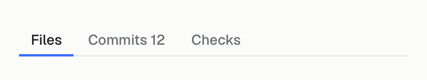
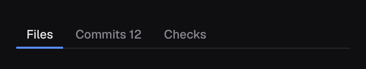
<figcaption>The strip with <code>active = "files"</code>.</figcaption>
</figure>

A segmented filter in a view's toolbar row, over the table it filters:

```lua
ui.node("col", { key = "jobs" }, {
	ui.node("row", { key = "bar", justify = "between", align = "center" }, {
		ui.text({ ui.span(#shown(state) .. " of " .. #state.jobs .. " jobs", "muted") }),
		ui.node("tabs", {
			key = "filter",
			variant = "segmented",
			active = state.filter,
			items = {
				{ id = "all", label = "All" },
				{ id = "failed", label = "Failed" },
				{ id = "running", label = "Running" },
			},
		}),
	}),
	jobs_table(state),
})
```

<figure class="tn-figure">
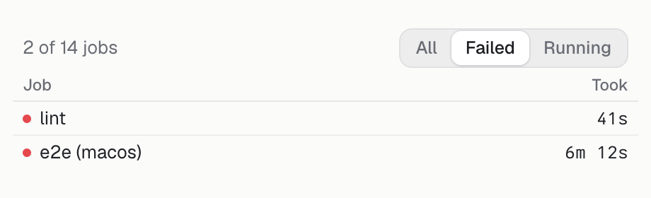
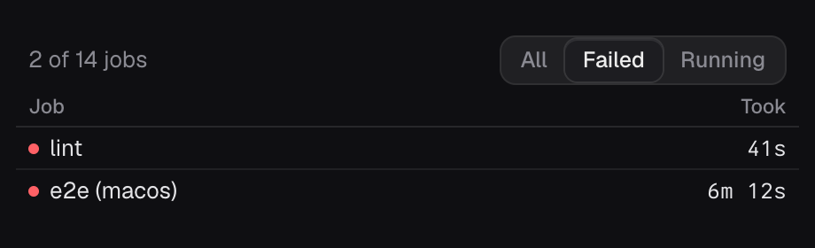
<figcaption><code>variant = "segmented"</code> with <code>active = "failed"</code>, in a toolbar row over the table it filters.</figcaption>
</figure>

## `nav`

A navigation bar: the sections of an app, the active one marked, and items
that hold sub-pages opening a menu of them. Reach for it when a section is a
group (Deploys → Production, Previews, History) rather than one view; a flat
row of views is [`tabs`](#tabs).

Two looks:

- `variant = "pills"` (the default): the items sit in a small well, the
  active one raised on a card face, like the segmented tabs. An item with
  sub-items shows a chevron and opens a compact menu under it (the
  [`menu`](#menu) kind's rows: icon, label, a muted mono detail on the right).
  It sizes to its items; put it in a toolbar row or a page's head.
- `variant = "links"`: text links over a hairline, an accent underline under
  the active one that slides to the next active link. An item with
  sub-items opens a two-column panel of rich entries: an icon tile, a title
  and a one-line description. It spans its container's width; use it as the
  page navigation under a head row.

The active item is yours: a click on an item without sub-items, or on a
sub-item, marks it at once and sends `select`; you echo it back in
`active`. A click on an item with sub-items opens its menu (or closes it
again) locally and sends nothing. When `active` is a sub-item's id, its
parent item shows active and the sub-item is marked in the open menu.

When the program changes `active` or `open` from what it last sent, its value
wins over the user's local pick or open/close; sending the same value again
keeps the user's choice. On a surface opened with `listen = false` (or
closed) the nav draws but clicks neither flip nor send.

**Build it:** `tern.ui.node("nav", { items = { … }, active = "…" })`. No
dedicated builder.

```lua
local ui = tern.ui

ui.node("nav", {
	key = "nav",
	variant = "links",
	active = state.page,
	open = state.menu, -- the item whose panel shows, driven by your keys
	items = {
		{ id = "overview", label = "Overview" },
		{ id = "deploys", label = "Deploys", items = {
			{ id = "production", label = "Production", detail = "Live releases, by region", icon = "rocket" },
			{ id = "history", label = "History", detail = "Every release, rollbacks", icon = "history" },
			{ id = "previews", label = "Previews", detail = "One per open pull request", icon = "eye" },
			{ id = "hooks", label = "Hooks", detail = "Run checks before a promote", icon = "bolt" },
		} },
		{ id = "usage", label = "Usage" },
		{ id = "issues", label = "Issues", count = 3 },
	},
})

-- event(state, ev, cx)
-- if ev.ev == "select" and ev.id == "main.nav" then state.page = ev.item end
```

<figure class="tn-figure">
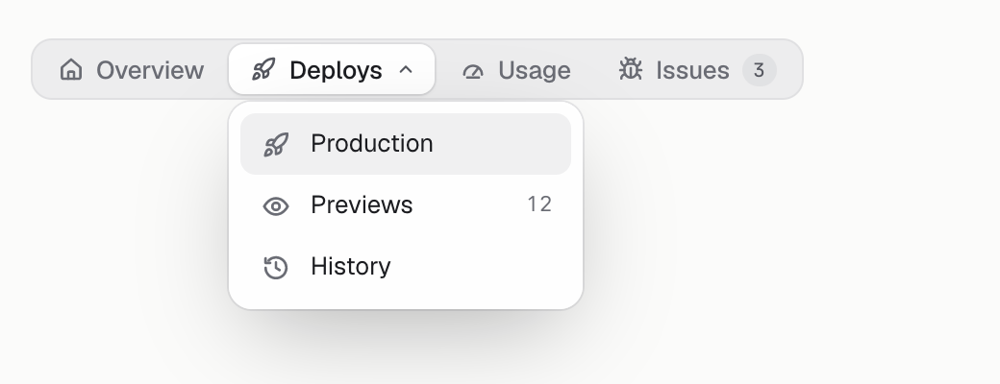
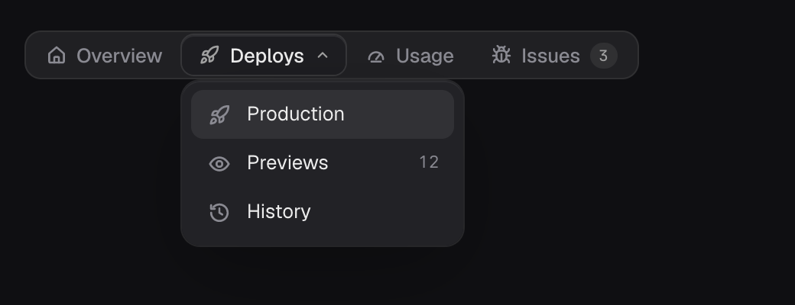
<figcaption>The default <code>pills</code>, <code>open</code> on Deploys with the active sub-item marked.</figcaption>
</figure>

<figure class="tn-figure">
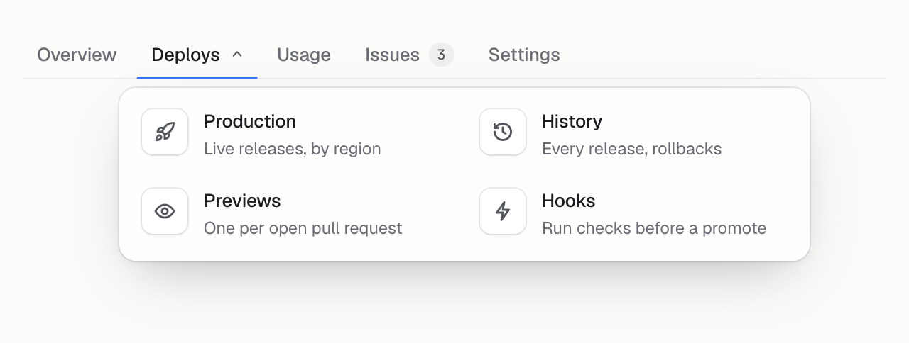
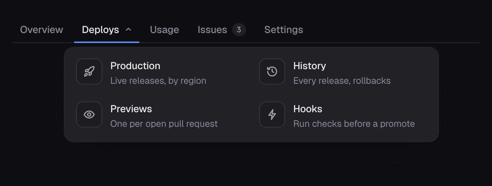
<figcaption><code>variant = "links"</code> with its panel of rich entries open.</figcaption>
</figure>

<figure class="tn-figure">
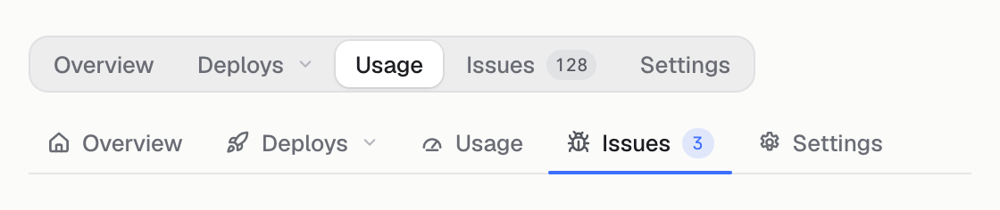
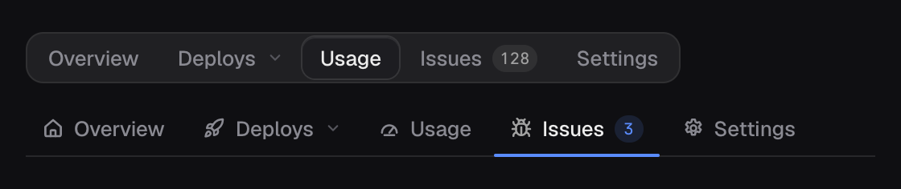
<figcaption>Both looks closed, with icons and counts.</figcaption>
</figure>

| Prop | Type | Default | Meaning |
| --- | --- | --- | --- |
| `items` | `{ {id: string, label?: string, icon?: string, count?: string \| number, items?: { {id: string, label?: string, detail?: string \| number, icon?: string} }} }` | `{}` | The items in order. Entries without an `id` are skipped; `label` defaults to the `id`. `icon` is a Tern icon name (as the [`icon`](data.md#icon) kind). `count` shows as a small mono pill after the label (accent-tinted on the active item). An item with a non-empty `items` has sub-items: it shows a chevron and opens a menu instead of being picked. A sub-item's `detail` is a muted right-aligned note in the `pills` menu and the description line in the `links` panel; its `icon` leads the menu row, or fills the panel entry's tile |
| `active` | `string` | none | `id` of the active item or sub-item. A sub-item's id marks its parent item active too |
| `open` | `string` | none | `id` of the item (with sub-items) whose menu or panel shows. Other values show none |
| `variant` | `"pills"` \| `"links"` | `"pills"` | The look; other values read as `"pills"` |

**Children:** none (ignored).

| Variant | Look | Sub-items open |
| --- | --- | --- |
| `pills` | Pills in a well, the active one raised | A compact menu under the item (the `menu` kind's rows) |
| `links` | Text links over a hairline, a sliding accent underline under the active one | A two-column panel of entries: icon tile, title, description |

**Events:**

| Event | Payload | When |
| --- | --- | --- |
| `select` | `{ev = "select", id = <nav node id>, item = <item or sub-item id>}` | A click on an item without sub-items or on a sub-item. Not sent while the surface does not listen |

Opening or closing a menu sends nothing; if you drive `open`, keep your own
state and send it.

**Keyboard:** nodes never take focus. Drive the nav from your key handler:
move `active` with ←/→ (or Tab/⇧Tab), open the active item's menu with ↓ or
Enter by sending `open = <item id>`, move `active` through its sub-items with
↑/↓, and close with Escape by sending `open = nil`. Say so in your key legend.

**Styling:**

```html
<div class="sf sf-nav" data-id="main.nav" data-variant="links">
	<div class="sf-nav-bar inked" role="menubar">
		<div class="sf-nav-item" role="menuitem" data-item="overview"><span class="sf-nav-label">Overview</span></div>
		<div class="sf-nav-item on open" role="menuitem" data-item="deploys" aria-current="page" aria-haspopup="menu" aria-expanded="true">
			<span class="sf-nav-label">Deploys</span><span class="sf-nav-chev">…</span>
		</div>
		<div class="sf-nav-item" role="menuitem" data-item="issues">
			<span class="sf-nav-label">Issues</span><span class="sf-nav-count">3</span>
		</div>
		<span class="sf-nav-ink" aria-hidden="true"></span>
	</div>
	<div class="sf-nav-pop" role="menu" aria-label="Deploys" data-for="deploys">
		<div class="sf-nav-entry" role="menuitem" data-sub="production">
			<span class="sf-nav-tile">…</span>
			<span class="sf-nav-text"><span class="sf-nav-title">Production</span><span class="sf-nav-detail">Live releases, by region</span></span>
		</div>
	</div>
</div>
```

| Target | Selector |
| --- | --- |
| The node | `.sf-nav`, `.sf-nav[data-variant='pills' \| 'links']` |
| The bar | `.sf-nav-bar` (`role=menubar`) |
| An item | `.sf-nav-item`, `.sf-nav-item[data-item='deploys']` |
| Active item | `.sf-nav-item.on`, `.sf-nav-item[aria-current='page']` |
| Item with its menu open | `.sf-nav-item.open`, `[aria-expanded='true']` |
| Item parts | `.sf-nav-ico`, `.sf-nav-label`, `.sf-nav-count`, `.sf-nav-chev` |
| Underline (`links`) | `.sf-nav-ink` (placed by `--ink-x` / `--ink-w` on the bar) |
| Pills menu | `.sf-nav-item .sf-menu-pop` (the [`menu`](#menu) kind's classes) |
| Links panel | `.sf-nav-pop`, its entries `.sf-nav-entry[data-sub]`, `.sf-nav-entry.on`, `.sf-nav-tile`, `.sf-nav-title`, `.sf-nav-detail` |
| Any menu open | `.sf-nav.has-pop` |

Items use `--sans` at `500 13px`, inactive in `--t3`, hover and active in
`--t1`. Pills: 26px tall in a 3px-padded well on `--l1` with 11px corners;
the active pill on `--card` (`--raise` in dark) with a soft shadow. Links:
36px tall over an `--l2` hairline; the 2px `--accent` underline slides in
0.28s. Counts are mono 10.5px pills on `--chip-bg`, accent-tinted when
active. The panel is a `--pop-bg` glass card with `--r-card` corners, entries
236px wide in two columns with 32px icon tiles that turn accent on hover.
Transitions and the open animation are off under `.sf-still`, `.sf-paused`
and reduced motion.

## `breadcrumb`

The trail from a root to where the user is: an organization, a project, an
environment; a folder path. Each crumb but the last takes the user back to
that step. Reach for it in a page's head row when the view sits deep in a
hierarchy; for switching between sibling views use [`tabs`](#tabs) or
[`nav`](#nav).

Two looks:

- `variant = "chevron"` (the default): sans crumbs with an optional leading
  icon and chevrons between them. The hovered crumb sits on a soft pill; the
  last crumb, the current place, is in full ink.
- `variant = "path"`: a mono path in the style of Tern's pane captions, `/`
  between dim parents and a strong leaf. Icons are not drawn. Use it when the
  steps are a file path, a key path or a URL.

With `max`, a trail longer than `max` crumbs keeps the first crumb and the
last `max - 1` (only the last when `max` is `1`) and folds the middle into a
"…" chip. A click on the chip opens a menu of the folded crumbs (the
[`menu`](#menu) kind's popover: their icons and labels; dense rows in the
`path` look); picking one sends `select` for it, like a click on a shown
crumb, and closes the menu.

The last crumb is the current place: it has `aria-current="page"` and a
click on it sends nothing. A click on any other crumb sends `select` with its
`id`; you navigate and send the new trail. A crumb with an `href` opens that
link on ⌘-click, as the common [`href`](index.md#props-every-node-takes)
does (a plain click still selects). A label too long for its crumb (crumbs
cap at 220px and shrink when the row is narrow, the current one last) loses
its middle, `observabi…ay-ingest`, keeping both ends; the full label is its
tooltip.

The menu opens and closes locally: a click on "…", a press outside it, or a
pick. When the program changes `open` from what it last sent, its value wins
over the user's; sending the same value again keeps the user's choice. On a
surface opened with `listen = false` (or closed) the breadcrumb draws, but
the chip does not open its menu and nothing is sent.

**Build it:** `tern.ui.node("breadcrumb", { items = { … } })`. No dedicated
builder.

```lua
local ui = tern.ui

ui.node("breadcrumb", {
	key = "where",
	max = 4,
	items = {
		{ id = "acme", label = "acme", icon = "folder" },
		{ id = "infra", label = "infra", icon = "folder" },
		{ id = "k8s", label = "k8s", icon = "folder" },
		{ id = "clusters", label = "clusters" },
		{ id = "prod-eu", label = "prod-eu", href = "https://console.acme.dev/clusters/prod-eu" },
	},
})

-- event(state, ev, cx)
-- if ev.ev == "select" and ev.id == "main.where" then go_to(state, ev.item) end
```

<figure class="tn-figure">
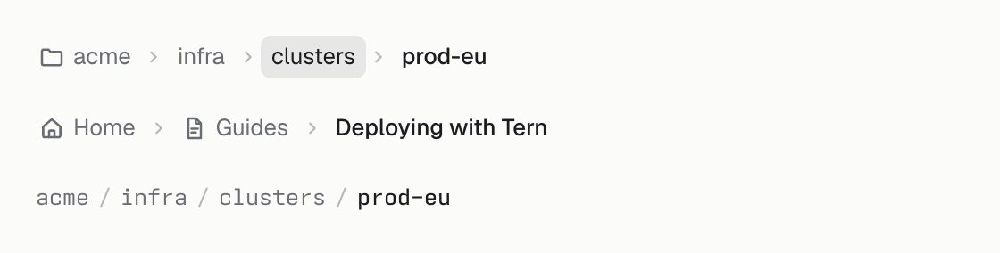
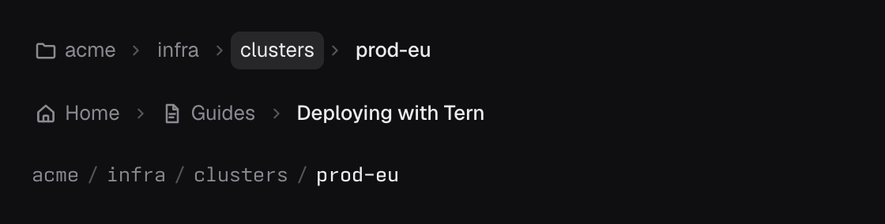
<figcaption>The default <code>chevron</code> look (<code>active</code> on clusters draws its pill), and <code>variant = "path"</code>.</figcaption>
</figure>

<figure class="tn-figure">
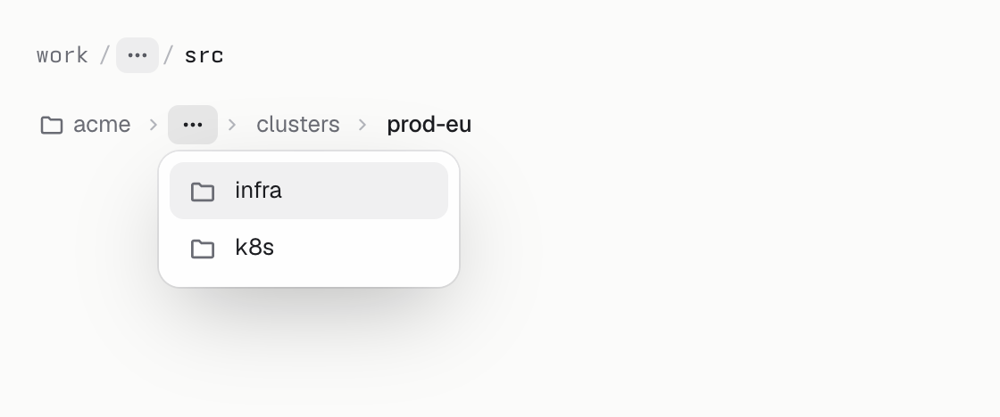
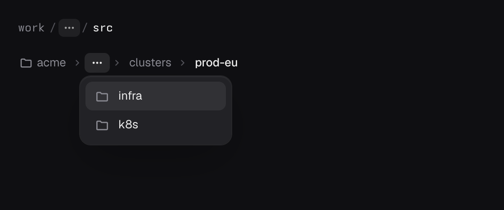
<figcaption>A <code>path</code> folded by <code>max = 2</code>, and <code>max = 3</code> with the fold's menu <code>open</code>.</figcaption>
</figure>

<figure class="tn-figure">
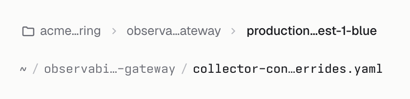
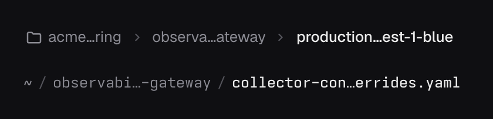
<figcaption>Long labels lose their middle; the full label is the crumb's tooltip.</figcaption>
</figure>

| Prop | Type | Default | Meaning |
| --- | --- | --- | --- |
| `items` | `{ {id: string \| number, label?: string, icon?: string, href?: string} }` | `{}` | The trail, root first; the last entry is the current place. Entries without an `id` are skipped; `label` defaults to the `id`. `icon` is a Tern icon name (as the [`icon`](data.md#icon) kind), drawn before the label in the `chevron` look and in the fold's menu. `href` is a URL or path that ⌘-click on the crumb opens |
| `variant` | `"chevron"` \| `"path"` | `"chevron"` | The look; other values read as `"chevron"` |
| `max` | `number` | none | Most crumbs shown. A longer trail keeps the first crumb and the last `max - 1` (with `1`, only the last) and folds the rest into a "…" menu. Unset, `0` or a non-number: never folds |
| `open` | `boolean` | `false` | Whether the fold's menu shows (only with folded crumbs). Wins over the user's open or close when it changes |
| `active` | `string` | none | `id` of the crumb under your keyboard cursor: a shown crumb draws its hover pill, a folded one is the highlighted row of the menu. Never the last crumb |

**Children:** none (ignored).

| Variant | Look |
| --- | --- |
| `chevron` | Sans 13px crumbs, 24px tall, optional 14px icons, `›` chevrons; a soft pill on hover; the current crumb in full ink at weight 500 |
| `path` | Mono 12.5px, `/` between parents in `--t3` and the leaf in `--t1` at weight 550; no icons; a fainter hover pill |

**Events:**

| Event | Payload | When |
| --- | --- | --- |
| `select` | `{ev = "select", id = <breadcrumb node id>, item = <crumb id>}` | A click on a crumb other than the last, or on a folded crumb in the menu. Not sent for a ⌘-click on a crumb with an `href` (that opens the link), nor while the surface does not listen |

Opening or closing the menu sends nothing; if you drive `open`, keep your
own state.

**Keyboard:** nodes never take focus. Drive the breadcrumb from your key
handler: move `active` along the crumbs with ←/→ (it highlights the folded
ones inside the menu once you send `open = true`), and on Enter navigate to
`active` as a `select` would; close the menu with Escape by sending
`open = false`. Say so in your key legend.

**Styling:**

```html
<div class="sf sf-breadcrumb" data-id="main.where" data-variant="chevron" role="navigation" aria-label="Breadcrumb">
	<ol class="bc-list">
		<li class="bc-it">
			<button class="bc-crumb" data-item="acme"><span class="bc-ic" aria-hidden="true">…</span><span class="bc-lbl">acme</span></button>
		</li>
		<li class="bc-it bc-fold open sf-menu-anchor">
			<span class="bc-sep" aria-hidden="true">…</span>
			<button class="bc-more" aria-haspopup="menu" aria-expanded="true" aria-label="2 more crumbs">…</button>
			<div class="sf-menu-pop" role="menu" data-variant="default">…</div>
		</li>
		<li class="bc-it">
			<span class="bc-sep" aria-hidden="true">…</span>
			<button class="bc-crumb cur" data-item="prod-eu" aria-current="page"><span class="bc-lbl">prod-eu</span></button>
		</li>
	</ol>
</div>
```

| Target | Selector |
| --- | --- |
| The node | `.sf-breadcrumb`, `.sf-breadcrumb[data-variant='chevron' \| 'path']` |
| The list | `.bc-list`, its steps `.bc-it` |
| A crumb | `.bc-crumb`, `.bc-crumb[data-item='infra']`, linked: `.bc-crumb[data-href]` |
| The current crumb | `.bc-crumb.cur`, `[aria-current='page']` |
| The keyboard cursor | `.bc-crumb.active` |
| Crumb parts | `.bc-ic`, `.bc-lbl` |
| Separators | `.bc-sep` |
| The fold | `.bc-fold` (`.open` while its menu shows), its chip `.bc-more` (`[aria-expanded='true']`) |
| The fold's menu | `.bc-fold .sf-menu-pop` (the [`menu`](#menu) kind's classes) |

Crumbs are `--t3`, the current one `--t1`; separators `--t4`. The hover pill
and the cursor are `--l2` (`--l1` in `path`) with `--r-chip` corners and a
0.97 press. The "…" chip is 28×22 on `--l1`, `--l2` while hovered or open.
Labels cap at 220px. Transitions and the press scale are off under
`.sf-still`, `.sf-paused` and reduced motion.

## `pager`

The control under a paged table or list. You send the page and the counts;
Tern draws one of three looks and tells you when the user pages. Reach for
it whenever a view shows a slice of something bigger: `range` (the default)
is the compact table foot, `pages` lets people jump to a page, and `more`
closes a list that grows as the user asks for more (a log, a feed, commits).

- **`range`**: "12–24 of 312" in mono, the counts strong and the words dim,
  then ‹ › joined in one 28px capsule. Laid out full width (a `col` or the
  region's `main`) the arrows sit at the right edge; in a `row` it is as wide
  as its content. Each arrow is disabled at its bound.
- **`pages`**: ‹ 1 2 3 4 5 … 26 › with the current page an accent-tinted
  pill. Past seven pages the strip always has seven slots: the first and
  last page, the current one with its neighbors and a "…" for each run left
  out (`1 2 3 4 5 … 26`, `1 … 12 13 14 … 26`, `1 … 22 23 24 25 26`), and
  every slot is as wide as the widest page number, so the arrows never move
  while paging. With thousands of pages the strip grows wide (about 440px at
  four digits); prefer `range` there.
- **`more`**: a quiet centered row under a hairline (like a table row's),
  an accent "Show 50 more" pill and the dim "· 262 left". Place it right
  after the list or table it closes. Here `page` counts the pages already
  loaded: page 1 of `size = 50` and `total = 312` means 50 shown and 262
  left. On the last page it offers only what is left ("Show 12 more"); once
  nothing is left the row reads "All 312 shown" and sends nothing.

**Counts.** The page count is `pages`, else `total` divided by `size`
(rounded up). `range` needs `total` and `size` to show the item range;
with only `pages` it reads "Page 3 of 26". Without any count `range` and
`pages` have one page and both arrows are off; `more` keeps offering more
("Show 100 more", or "Show more" without `size`) until you remove it.
Numbers are grouped by thousands (`1,048,576`).

**Clamping.** `page` is 1-based and clamped into the page count: `0` reads
as 1 and a page past the end as the last one. The `change` events Tern
sends are always in range.

**Paging is local first.** A click on an arrow or a page pill shows that
page at once and sends `change` with the page as `value`; your program
loads that page and answers with `page`. Until your `page` changes, the
user's page stays drawn (another prop changing, such as `loading`, keeps
it); when your `page` changes, yours wins. The more row does not move
anything itself: it sends `action` with `act = "more"`, and your program
loads the next page and sends `page + 1`.

**Loading.** `loading = true` shows a turning ring: after the range, in
place of the current page's number (its pill keeps its width), or in place
of the more row's chevron, whose text then reads "Loading…" and which sends
nothing until `loading` goes. The arrows and pills stay live while loading.

On a surface that is closed or opened with `listen = false` the pager draws
but does not page and sends nothing.

**Build it:** `tern.ui.node("pager", { page = …, total = …, size = … })`. No
dedicated builder.

```lua
local ui = tern.ui
local SIZE = 25

-- view
return {
	main = ui.col({
		deploys_table(state.rows),
		ui.node("pager", {
			key = "pager",
			page = state.page,
			total = state.total,
			size = SIZE,
			label = "deployments",
			loading = state.loading,
		}),
	}),
}

-- event(state, ev, cx)
-- if ev.ev == "change" and ev.id == "main.pager" then
--   state.page = ev.value; state.loading = true; fetch(state.page, SIZE)
-- end
```

A feed that grows, closed by the more row:

```lua
ui.node("col", { key = "log" }, {
	commit_list(state.commits),
	ui.node("pager", {
		key = "more",
		variant = "more",
		page = state.loaded,
		total = state.total,
		size = 50,
		label = "commits",
		loading = state.loading,
	}),
})

-- if ev.ev == "action" and ev.act == "more" then
--   state.loading = true; fetch_page(state.loaded + 1)
-- end
```

<figure class="tn-figure">
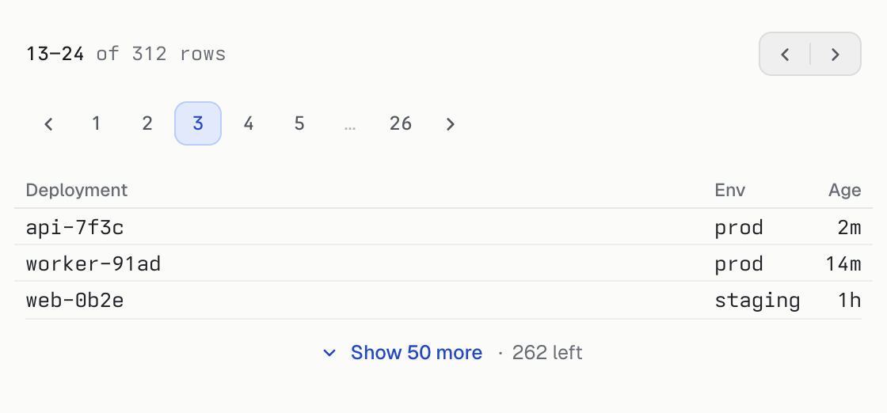
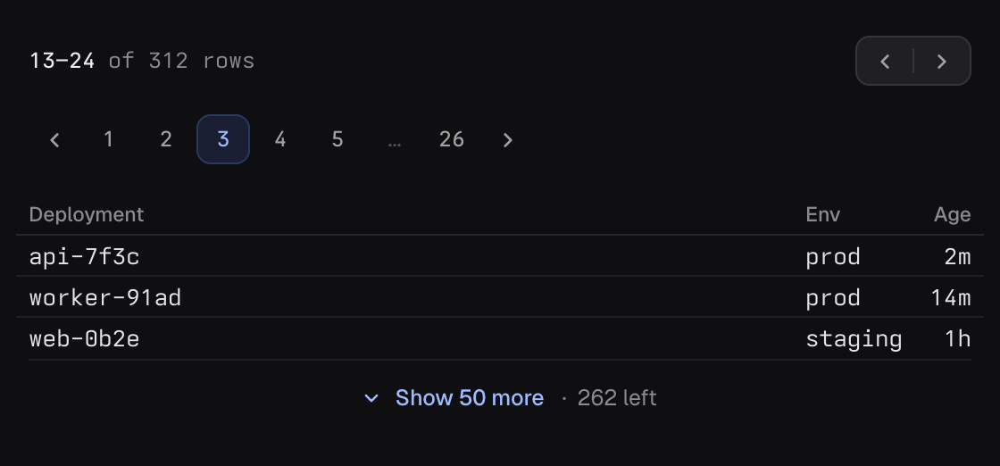
<figcaption>The three looks: <code>range</code> (default), <code>pages</code> and <code>more</code> closing a table.</figcaption>
</figure>

<figure class="tn-figure">
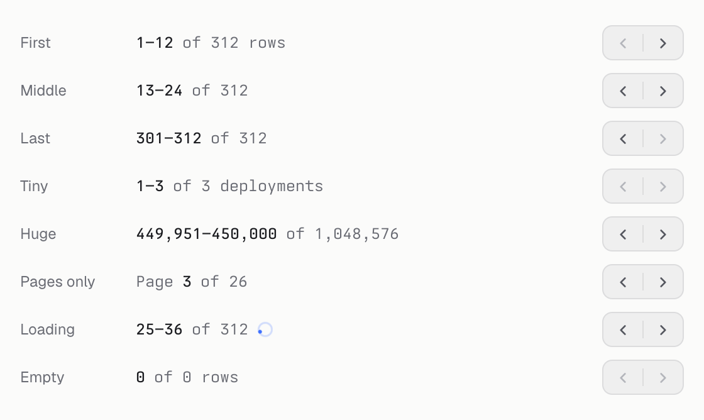
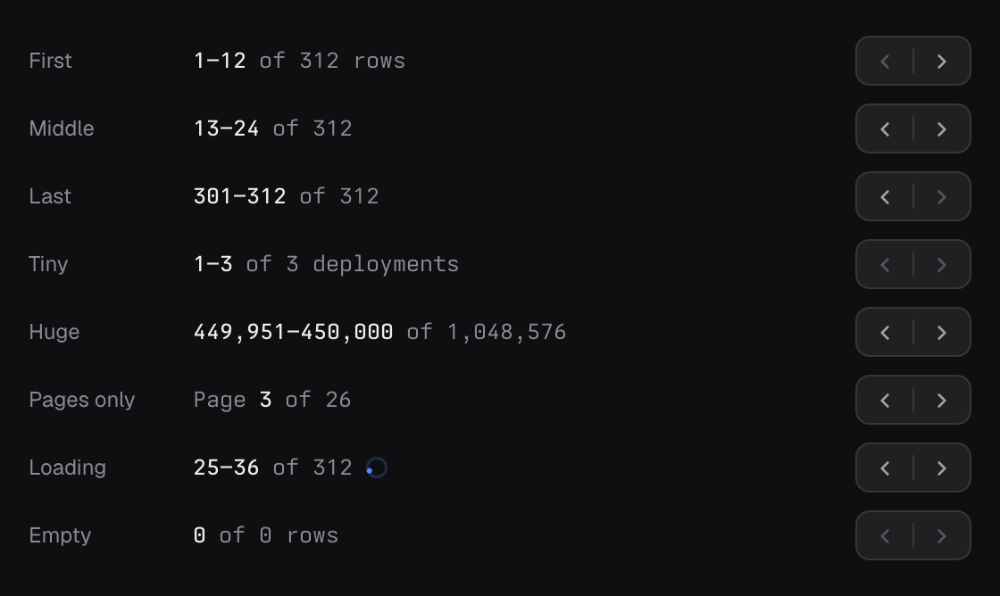
<figcaption><code>range</code> at its bounds, with tiny and huge totals, a page count alone, <code>loading</code> and nothing to show.</figcaption>
</figure>

<figure class="tn-figure">
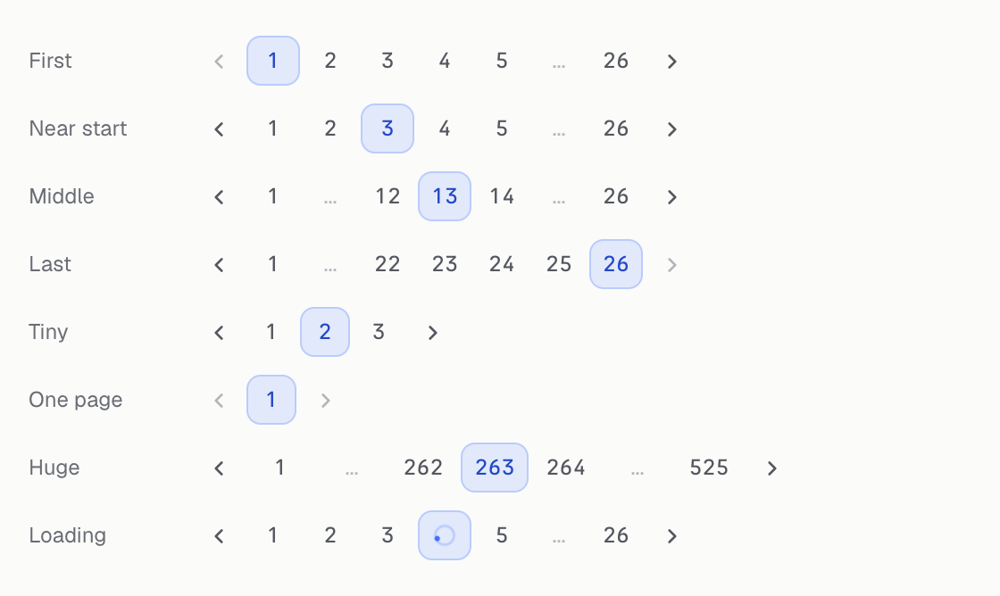
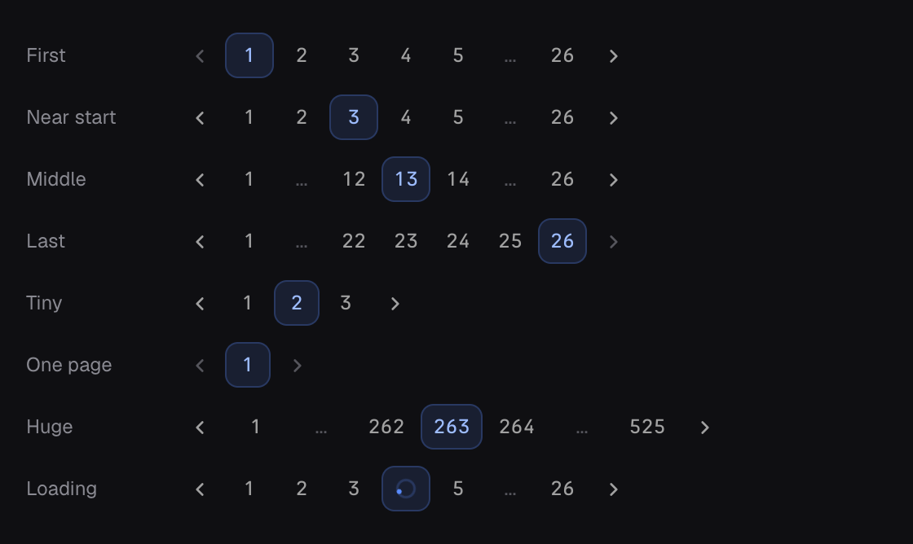
<figcaption><code>pages</code>: the seven-slot window at the first, a near, the middle and the last page, few pages and many, and <code>loading</code>.</figcaption>
</figure>

<figure class="tn-figure">
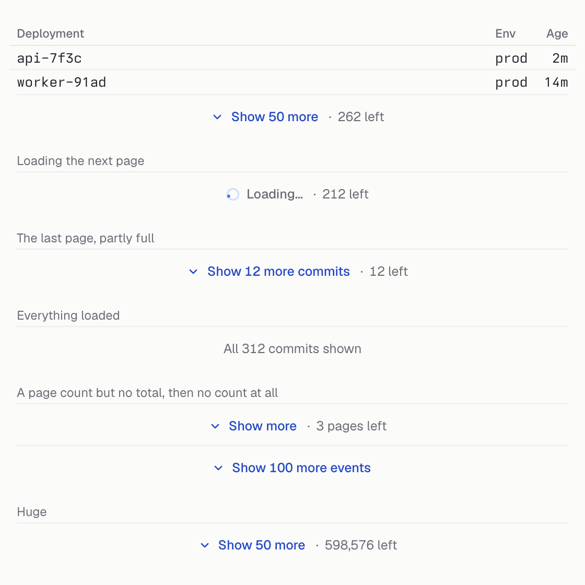
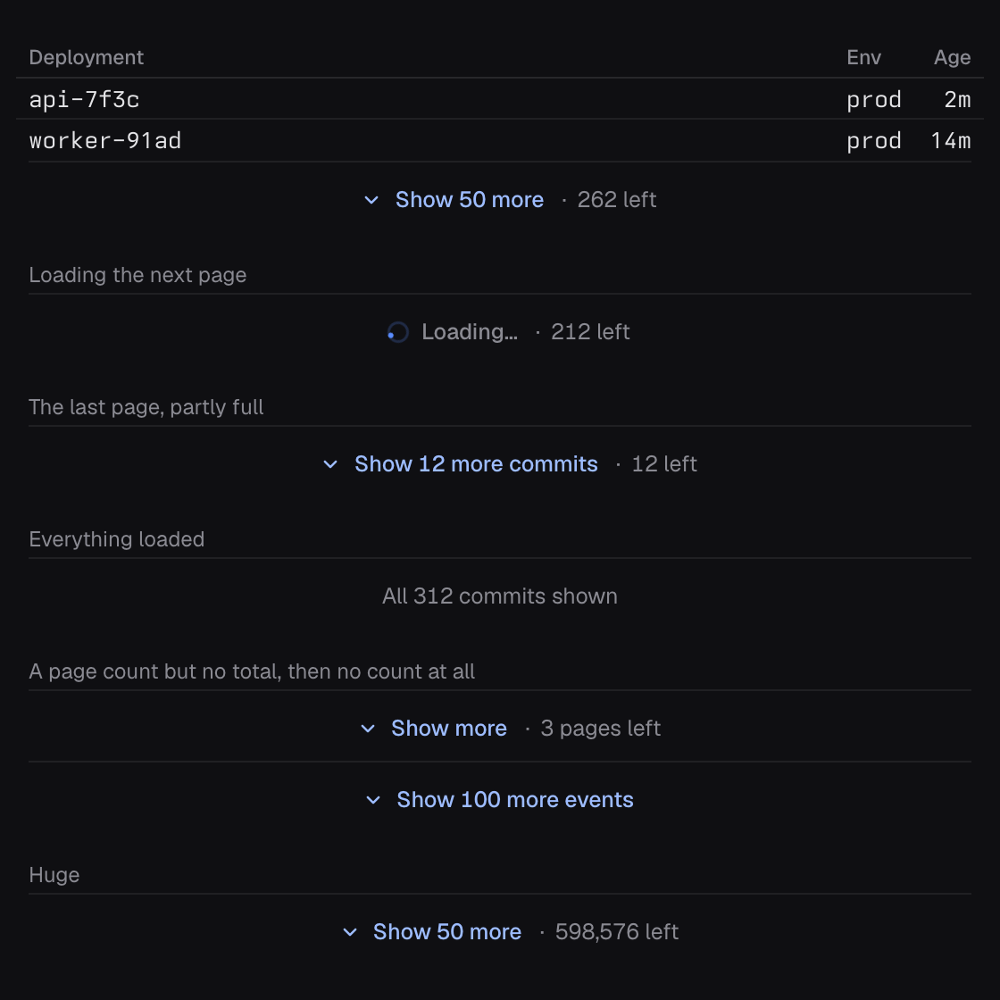
<figcaption><code>more</code> closing a table, loading, on its last page, done, and with partial or no counts.</figcaption>
</figure>

| Prop | Type | Default | Meaning |
| --- | --- | --- | --- |
| `variant` | `"range"` \| `"pages"` \| `"more"` | `"range"` | The look (below). Unknown values read as `"range"` |
| `page` | `number` | `1` | The current page, 1-based, clamped into the page count. For `more`, the pages loaded so far. A change wins over the user's local page |
| `pages` | `number` | from `total` / `size` | The page count. Wins over `total` / `size` for the count; `0` or absent falls back to them |
| `total` | `number` | none | The item count: `range` shows "12–24 of 312", `more` counts what is left |
| `size` | `number` | none | Items per page. Without it `range` spreads `total` over `pages` |
| `loading` | `boolean` | `false` | A turning ring (after the range, in the current pill, in the more row) and `aria-busy`; the more row sends nothing |
| `label` | `string` | none | What the items are, plural, after the counts: "of 312 rows", "Show 50 more commits", "All 312 commits shown" |

The [common props](index.md#props-every-node-takes) apply (`key`, `aria`,
`title`, `grow`, `min`, …). Without `aria` a `range` or `pages` pager is a
`navigation` landmark named "Pagination".

**Children:** none (ignored).

**Variants:**

| `variant` | Look | Use |
| --- | --- | --- |
| `range` | "12–24 of 312" (mono, tabular) and ‹ › joined in one capsule | A table's or list's foot; the default |
| `pages` | ‹ 1 2 [3] 4 5 … 26 ›, the current page an accent-tinted pill, a stable seven-slot window | When people jump to a page (search results, a docs index) |
| `more` | "Show 50 more · 262 left", centered and quiet; "All 312 shown" at the end | A list that grows on demand (logs, feeds, history) |

**Events:**

| Event | Payload | When |
| --- | --- | --- |
| `change` | `{ev = "change", id, value = <page>}`: the page, 1-based, in range | An arrow or page pill clicked (`range`, `pages`); the page is drawn at once |
| `action` | `{ev = "action", id, act = "more"}` | The more row clicked while not `loading` and not done (`more`) |

**Keyboard:** a pager never takes focus: keys stay with your program.
Page from the keyboard by changing `page` yourself (←/→ or PgUp/PgDn for
the previous and next page, Home/End for the first and last), and show
`loading` while the page arrives.

**Accessibility:** the arrows are `role=button` named "Previous page" and
"Next page" (`aria-disabled` at a bound); page pills are named "Page N",
the current one `aria-current="page"`; gaps are hidden. The more row is a
`role=button` with its text as its name.

**Styling:**

| Target | Selector |
| --- | --- |
| Any pager | `.sf-pager`, `.sf-pager[data-variant=range\|pages\|more]` |
| An arrow, at a bound | `.sf-pager-step.prev`, `.sf-pager-step.next`, `.sf-pager-step.off` |
| The range text | `.sf-pager-range` (`.pre`, `.cur`, `.of`) |
| The joined arrows | `.sf-pager-steps`, `.sf-pager-sep` |
| Page pills | `.sf-pager-list`, `.sf-pager-pg`, `.sf-pager-pg.on`, `.sf-pager-pg.gap`, `.sf-pager-pg.busy` |
| The more row | `.sf-pager-more` (`.busy`), `.sf-pager-ic`, `.sf-pager-left`, `.sf-pager-done` |

Words are `--sans` and numbers `--mono` with tabular figures in any region.
Arrows and pills are 28px with `--r-ctl` corners; hover adds `--l1`, a
press scales down at once and settles back. The current pill is
`--accent-ink` on a 13% `--accent` tint with a 24% ring; disabled arrows
are `--t4`. The more pill is `--accent-ink`, tinted 10% `--accent` on
hover. Transitions stop under reduced motion and `.sf-still`.

## `picker`

A data-first modal sheet: you send the catalog and what to show, and Tern
draws a glass sheet with a search head, optional scope column, tab row,
fact columns, virtualized rows, a preview pane and an action bar. It is
built for omp (the coding agent's model selector, session picker and
settings) and is styled by `omp-pickers.css`, which is loaded for every
surface, so it looks the same in a plugin block.

**From a plugin.** It works in a block, placed directly in the `layer`
region: the node *is* the sheet, positioned over the whole block
(`position: absolute; inset: 0`) above a dim, blurred backdrop. In `main` or
in a lens it covers its container instead and is rarely what you want. It
draws no real text field: the search line shows your `query` with a drawn
caret, so typing, arrows, Enter and Escape must be handled in your block's
`key` handler, which updates `query`, `selected` and the rest. Pointer input
arrives as events (below). It is a heavyweight component; for a plain
selectable list in your own layout use [`list`](#list).

### Layout and behavior

- **Sizes.** `size = "lg"` (default) is a sheet top-centered, up to
  1120×760px, 28px from the top. `"md"` is a palette-sized sheet up to
  680px wide and 540px tall, 72px from the top, only as tall as its rows
  need (it keeps its height while a `query` narrows them). `"screen"` fills the
  surface with no backdrop, radius or shadow.
- **Narrow sheets.** Under 760px wide the scope column folds into a head
  button (`.narrow`) whose menu sends the same `scope` action, and the
  subtitle hides. A side preview moves below the list under 980px
  (`.pv-below-auto`); under 640px the preview hides and so does the count
  (`.pv-hide`). An `md` sheet shows its subtitle only without a `query`:
  the head is then the title with the subtitle on a line under it.
- **Rows** are virtualized with fixed heights per layout: `rows` 36px,
  `cards` 54px, `timeline` 26px (34px for `node = "user"`), `tree` 24px; group
  headers 32px. One selection bar (`.pk-selbar`) slides between rows. The
  group of the first visible row sticks to the top (`.pk-sticky`). Match
  `hits` draw bold in the label, without the tint `list` uses.
- **Keeping the selection in view.** The list scrolls to the selection when
  it opens, when the layout changes, when `selected` changes, and when rows
  change while the selection was visible. A list the reader scrolled away
  from stays put through updates.
- **Fact columns** hide lowest `priority` first until the label keeps 260px.
  A `text` column grows to fit its widest value (up to 320px) out of the
  room the label leaves, narrowing back to its default before any column
  hides; a value still cut short shows whole as the fact's tooltip.
- **Head `esc`.** The head's `esc` keycap shows only when no action has
  `"esc"` or `"escape"` in its `keys`; that action's bar button stands in
  for it.
- **Action bar folding.** When the bar's buttons overflow, the action bound
  to Escape (unless it is `primary`) moves into the head's `esc` button
  (`.fold-esc`), then the root also gets `.fold-keys`; it unfolds when the
  width is back.
- **Buttons show labels only.** A bar button says what it does; its keys are
  in its tooltip (`Select  ⏎`), not drawn on it. The confirm strip's buttons
  answer ⏎ and esc without drawing them. Omp's Console chat style draws the
  keys again as the TUI's key legend.
- **Motion.** The sheet animates in, changed rows stagger in (up to 8 rows,
  24ms apart), bar facts grow from zero on first show. Under `.sf-still` or
  `prefers-reduced-motion` these are off.

**Build it:** `tern.ui.node("picker", props, preview_children)`. No dedicated
builder.

### Sheet props

| Prop | Type | Default | Meaning |
| --- | --- | --- | --- |
| `size` | `"md"` \| `"lg"` \| `"screen"` | `"lg"` | Sheet size (above). Other values fall back to `"lg"` |
| `layout` | `"rows"` \| `"cards"` \| `"timeline"` \| `"tree"` | `"rows"` | Row template. `cards` puts `detail` on its own line; `timeline` draws a node per row; `tree` draws depth guides and a disclosure chevron |
| `preview` | `"side"` \| `"below"` \| `"none"` | `"side"`, `"none"` for `md` | Where the preview pane sits |
| `title` | Spans | none | Heading (not the common tooltip). Without it the head is the icon and the search only (`.no-title`); the sheet's accessible name is then `placeholder`, else `noun` |
| `subtitle` | Spans | none | Second part of the heading |
| `icon` | `string` | a list icon | Head icon name |
| `query` | `string` | none | The search text. Unset hides the search (`.no-query`); `""` shows the placeholder |
| `cursor` | `number` | end of `query` | Caret position in `query`, in UTF-16 units |
| `placeholder` | `string` | `"Search <noun>…"` | Search placeholder |
| `noun` | `string` | `"items"` | What the rows are, used in the placeholder and the empty texts |
| `focus` | `"list"` \| `"scopes"` \| `"tabs"` \| `"strip"` \| `"preview"` | `"list"` | Which part your keys drive; sets `.f-<focus>` on `.pk-sheet`. The caret shows only for `list`; the others ring the active scope, the active tab, the `selected` strip chip or the preview pane |
| `state` | `"ready"` \| `"loading"` \| `"error"` | `"ready"` | `loading` shows 8 skeleton rows and `…` as the count; `error` shows `message` in an alert card. Sets `.st-loading` / `.st-error` |
| `message` | Spans | none | Error card text for `state = "error"` |
| `empty` | Spans | `"No <noun> yet"` | Text when there are no rows and `query` is empty |
| `total` | `number` | none | Catalog size; the count reads `"<shown> of <total>"` when it differs |

### Rows: `items`, `order`, selection

| Prop | Type | Default | Meaning |
| --- | --- | --- | --- |
| `items` | `{ PickerItem }` | `{}` | The catalog, by `id`. Replacing it rebuilds the rows |
| `itemsAdd` | `{ PickerItem }` | none | Items added to (or replacing in) the catalog by `id` |
| `itemsDel` | `{ string }` | none | Item ids removed from the catalog |
| `order` | `{ string \| {group, label, count?} }` | `items` order | What to show, in order: item ids (unknown ids are skipped) and group headers. A header is any table with a `group` field; it shows `label` and an optional `count` (thousands-separated) |
| `selected` | `string` | none | Selected item id: the selection bar, `aria-activedescendant` |
| `current` | `{ string }` | `{}` | Item ids marked current with a check (`.cur`); while any is current every row keeps the check slot (`.has-cur`) |
| `hits` | `{ [id]: { {from, to} } }` | none | Match ranges per item id: positional `{from, to}` pairs (JSON `[[0, 2]]`), UTF-16 `[from, to)` offsets in the label's plain text; overrides the item's own `hits` |
| `columns` | `{ Column }` | `{}` | Fact columns, at most 8 |
| `confirm` | `{text, act?, label?}` | none | A confirm strip over the selected row: a trash icon, `text`, a danger button `label` (default `"Delete"`) sending `act` (default `"confirm"`), and `Keep` sending `cancel` |

`PickerItem`:

| Field | Type | Meaning |
| --- | --- | --- |
| `id` | `string` | Required; items without one are dropped |
| `label` | Spans | Row text. With `mono = true` and a plain label containing `/`, it splits into a dim `dir` that truncates first and a `name` |
| `detail` | Spans | Inline after the label (its own line in `cards`) |
| `icon` | `string` | Lead icon name |
| `role` | `string` | Picks the lead icon from a role name when `icon` is unset |
| `mark` | `{text, seed?, icon?}` | An avatar: the `icon` when Tern has it (`provider:<id>` for a model provider's logo, see [Icon names](data.md#icon-names)), else the initials (first two non-space chars of `text`) on a gradient from `seed` (default `text`); wins over `icon` |
| `dot` | tone name | A status dot as the lead when there is no mark or icon, else a corner dot (not in `tree`). Not drawn in `timeline`. In `tree`, `"accent"` lights the depth guides |
| `mono` | `boolean` | Monospace label |
| `facts` | `{ [column id]: number \| Spans }` | Column values. Numbers show compact (`272k`, `1.6M`); in a `bar` column a number 0–1 is a meter; in an `elapsed` column a number is milliseconds so far, a timer the terminal runs on from the item's arrival (`12.3s`, `2m12s`, `1h5m`, `3d2h`) |
| `badges` | `{ {text, tone?, title?} }` | Up to 3 badges after the label, then a `+N` badge whose tooltip lists the rest |
| `chips` | `{ {text, on?, auto?, dot?} }` | Role chips after the badges; `dot` is a span token naming the dot's color |
| `tone` | tone name | `data-tone` on the row |
| `disabled` | `true` \| `string` | Dims the row (`.off`); a string is its tooltip reason. A disabled row still selects but never activates |
| `hits` | `{ {from, to} }` | Match ranges in the label: positional pairs (JSON `[[0, 2]]`), UTF-16 `[from, to)` offsets, marked with `mark.sf-mark` |
| `node` | `string` | `timeline`: node style `n-<node>` (`user`, `tool` with its icon, default `assistant`); also `data-node` |
| `depth` | `number` | `tree`: indent guides |
| `open` | `boolean` | `tree`: chevron, rotated when `true`; unset is a leaf |
| `title` | `string` | Row tooltip (also on a `bar` fact) |

`Column`:

| Field | Type | Default | Meaning |
| --- | --- | --- | --- |
| `id` | `string` | required | The `facts` key |
| `head` | `string` | `""` | Head label. With any head, heads ride on the first group header and the sticky header, or on their own `.pk-colhead` row when the list does not start with a group |
| `format` | `"text"` \| `"num"` \| `"price"` \| `"bar"` \| `"time"` \| `"elapsed"` \| `"dim"` | `"text"` | Class `f-<format>` and default width: text 96 (growing to fit its values when there is room), num 52, price 76, bar 44, time 44, elapsed 52, dim 64 px. It styles the column but does not format values: outside `bar` and `elapsed` a number shows compact (`3`, not `$3`), so send prices and `time` values as text |
| `priority` | `number` | `100` | Lower hides first when the list is narrow |
| `min` | `number` | none | Minimum width in characters |

### Scopes, tabs, strip, actions

| Prop | Type | Meaning |
| --- | --- | --- |
| `scopes` | `{ {id, label, group?, mark?, icon?, dot?, count?, disabled?} }` | A vertical scope column at the left; `mark` is an item's `mark` and wins over `icon`. Consecutive scopes with the same `group` share a header; a change to no group draws a separator. `disabled` (true or a reason) adds a lock and tooltip but still sends the action |
| `scope` | `string` | Active scope id |
| `tabs` | `{ {id, label, count?} }` | A tab row over the list: a segmented control up to 4 tabs, chips beyond |
| `tab` | `string` | Active tab id |
| `strip` | `{label?, items = { {id, label, on?, dot?} }, selected?}` | A row of switch chips above the action bar; `on` checks a chip, `selected` outlines one |
| `actions` | `{ {id, label?, keys?, primary?, end?, danger?, on?, disabled?} }` | The action bar; `label` defaults to `id`. Secondary actions sit left, `end` ones right, the `primary` one last in the corner. `keys` names its keys in the button's tooltip (`Label  keys`); an action with `"escape"`/`"esc"` in `keys` is what the backdrop and head `esc` send. `on` makes a pressed toggle. `disabled` (true or a reason) dims it (`.off`, reason as tooltip) and its clicks send nothing |

In the empty state with no query, the first action whose `keys` include
`"tab"` is offered as a button; in the error state, the action with
`id = "retry"`.

**Children:** the preview. Children are drawn in `.pk-pv-slot`; with none,
the pane says "Nothing to preview". `preview = "none"` hides the pane.

### Events

`id` is the picker node's id.

| Gesture | Event |
| --- | --- |
| Click a row | `{ev = "select", id, item}` |
| Click the selected row, click the row clicked last, or double-click a row | `{ev = "activate", id, item}` (once per double-click; never for a disabled row) |
| Click a scope, or pick one in the narrow scope menu | `{ev = "action", id, act = "scope", value = <scope id>}` |
| Click a tab | `{ev = "action", id, act = "tab", value = <tab id>}` |
| Click a strip chip | `{ev = "action", id, act = "strip", value = <chip id>}` |
| Click an action bar button | `{ev = "action", id, act = <action id>}` |
| Click the backdrop or the head `esc` | `{ev = "action", id, act = <escape action id or "close">}` |
| Confirm strip buttons | `act = <confirm.act or "confirm">`, or `act = "cancel"` |
| Empty state `Clear search` | `{ev = "action", id, act = "clear"}` |
| Empty or error state button | `{ev = "action", id, act = <that action's id>}` |

Group headers send nothing. Keys are yours: handle them in `key`.

### Styling

```html
<div class="sf sf-picker sz-lg lay-rows pv-side has-cur" data-id="layer.models">
	<div class="pk-dim" aria-hidden="true"></div>
	<div class="pk-sheet f-list" role="dialog" aria-modal="true">
		<div class="pk-head">
			<span class="pk-ic"></span>
			<div class="pk-title"><span class="t">Models</span><span class="sub">…</span></div>
			<button class="pk-scopebtn" data-pk="menu"></button>
			<div class="pk-search"><span class="q">son</span><span class="caret"></span></div>
			<span class="pk-count">12 of 140</span>
			<button class="pk-esc" data-pk="act" data-v="close"><span class="kbd">esc</span></button>
		</div>
		<div class="pk-body">
			<div class="pk-scopes" role="tablist">
				<div class="pk-sgh">Providers</div>
				<div class="pk-scope nav-row on" data-pk="scope" data-v="all">…</div>
			</div>
			<div class="pk-center">
				<div class="pk-main">
					<div class="pk-tabs seg"><div class="pk-tabs-in"><button class="pk-tab on" data-pk="tab" data-v="…"></button></div></div>
					<div class="pk-colhead"></div>
					<div class="pk-list">
						<div class="pk-sticky pk-row grp"></div>
						<div class="pk-scroll">
							<div class="pk-rows" role="listbox">
								<div class="pk-selbar"></div>
								<div class="pk-confirm" role="alertdialog"></div>
								<div class="pk-row sel cur" role="option" data-pk="row" data-v="sonnet" id="pk-sonnet">
									<span class="pk-lead"></span>
									<div class="pk-txt"><div class="pk-l1">
										<span class="pk-label">…</span><span class="pk-tags">…</span>
										<span class="pk-detail"><span class="t">…</span></span>
									</div></div>
									<div class="pk-facts"><span class="pk-fact c0 f-price">$3</span></div>
									<span class="pk-cur"></span>
								</div>
							</div>
						</div>
					</div>
					<div class="pk-state"></div>
				</div>
				<div class="pk-pv"><span class="pk-pv-empty">Nothing to preview</span><div class="pk-pv-slot">…</div></div>
			</div>
		</div>
		<div class="pk-strip" role="toolbar"></div>
		<div class="pk-bar" role="toolbar"><button class="pk-btn" data-pk="act" data-v="…"></button><span class="pk-bar-fill"></span><button class="pk-btn primary">…</button></div>
	</div>
</div>
```

| Target | Selector |
| --- | --- |
| The node | `.sf-picker`, `.sf-picker[data-id=…]`, `[data-role=…]` |
| Size, layout, preview | `.sz-md` `.sz-lg` `.sz-screen`, `.lay-rows` `.lay-cards` `.lay-timeline` `.lay-tree`, `.pv-side` `.pv-below` `.pv-none` |
| Width states | `.narrow`, `.pv-below-auto`, `.pv-hide`, `.fold-esc`, `.fold-keys`, `.h0`–`.h7` (column hidden) |
| Content states | `.no-title`, `.no-query`, `.has-cur`, `.st-loading`, `.st-error` |
| Backdrop, sheet | `.pk-dim`, `.pk-sheet`, `.pk-sheet.f-<focus>` (inner, may change) |
| Head | `.pk-head`, `.pk-ic`, `.pk-title .t`, `.pk-title .sub`, `.pk-search .q/.ph/.caret`, `.pk-count`, `.pk-esc`, `.pk-scopebtn` (inner, may change) |
| Scopes | `.pk-scopes`, `.pk-scope`, `.pk-scope.on`, `.pk-scope.dis`, `.pk-sgh`, `.pk-ssep`, `.pk-lock` (inner, may change) |
| Tabs | `.pk-tabs.seg` / `.pk-tabs.chips`, `.pk-tab`, `.pk-tab.on`, `.pk-tab .n` (inner, may change) |
| Rows | `.pk-row`, `.pk-row.sel`, `.pk-row.cur`, `.pk-row.off`, `.pk-row.grp`, `.pk-row[data-v=…]`, `.pk-row[data-tone=…]`, `.pk-row[data-node=…]`, `.pk-row.arr-a/.arr-b` (arriving) (inner, may change) |
| Row parts | `.pk-lead`, `.pk-mark`, `.pk-mark.logo` (an icon mark), `.pk-dot`, `.pk-dot.corner`, `.pk-node.n-<node>`, `.pk-guides .pk-g`, `.pk-chev`, `.pk-label`, `.pk-label.mono.path .dir/.name`, `.pk-tags`, `.pk-badge`, `.pk-chip`, `.pk-detail`, `.pk-facts`, `.pk-fact.c<i>.f-<format>`, `.pk-meter`, `.pk-cur`, `.pk-gl`, `.pk-gc` (inner, may change) |
| Selection, sticky, confirm | `.pk-selbar`, `.pk-sticky`, `.pk-rows.confirming`, `.pk-confirm`, `.pk-ct` (inner, may change) |
| States | `.pk-state.loading .pk-sk`, `.pk-state.error .pk-err`, `.pk-state.empty .pk-empty` (inner, may change) |
| Preview | `.pk-pv`, `.pk-pv-empty`, `.pk-pv-slot` (inner, may change) |
| Strip, bar | `.pk-strip`, `.pk-strip-l`, `.pk-schip`, `.pk-bar`, `.pk-btn`, `.pk-btn.primary/.danger/.on/.off/.esc` (inner, may change) |
| Filter hits | `.sf-picker mark.sf-mark` |

Every `pk-*` class is Tern's structure for omp's sheet; only `.sf-picker`
and its state classes on the root are worth relying on. The sheet uses the
theme's `--pop-bg`, `--glass-hi`, `--dim`, `--l1`–`--l3`, `--t1`–`--t4`,
`--accent` and `--grad` (see [Variables](../styles/variables.md)).

```lua
local ui = tern.ui

-- in a block view; state.query ("cl") and state.sel ("sonnet") are driven
-- by your key handler, state.current ("opus") is the model in use
local items, order = {}, {}
for _, g in state.groups do -- the models matching state.query, by provider
	table.insert(order, { group = g.id, label = g.name, count = #g.models })
	for _, m in g.models do
		table.insert(items, {
			id = m.id,
			label = m.path, -- "anthropic/claude-opus": dim dir, bold hits
			mono = true,
			icon = "model",
			hits = { { m.hit, m.hit + #state.query } }, -- UTF-16 offsets
			facts = { ctx = m.context, price = m.price }, -- 200000, "$15"
			disabled = m.offline and (m.runtime .. " is not running") or nil,
		})
		table.insert(order, m.id)
	end
end
return {
	main = ui.col({ ui.text("Choose the model for this session.") }),
	layer = ui.col({
		ui.node("picker", {
			key = "models",
			size = "md",
			title = "Model",
			noun = "models",
			query = state.query,
			items = items,
			order = order,
			selected = state.sel,
			current = { state.current },
			columns = {
				{ id = "ctx", head = "Context", format = "num" },
				{ id = "price", head = "$/M", format = "price", priority = 50 },
			},
			actions = {
				{ id = "close", label = "Cancel", keys = { "esc" } },
				{ id = "use", label = "Use", keys = { "enter" }, primary = true },
			},
		}),
	}),
}

-- event(state, ev, cx)
-- ev.ev == "select"   -> state.sel = ev.item
-- ev.ev == "activate" -> use ev.item
-- ev.ev == "action" and ev.act == "close" -> hide the picker
```

<figure class="tn-figure">
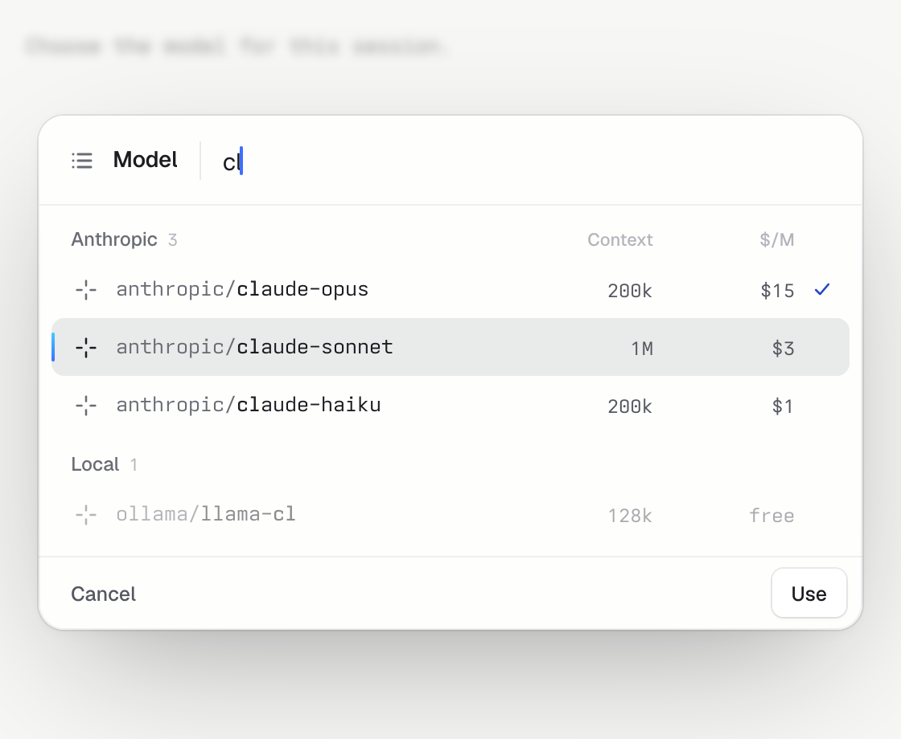
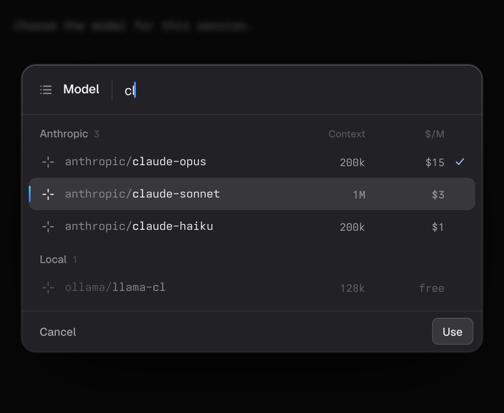
<figcaption>An <code>md</code> sheet in the <code>layer</code> region. At this width (under 640px) the count is hidden.</figcaption>
</figure>

## Related pages

- [Building Views](../guides/views.md): actions and events.
- [Blocks](../guides/blocks.md): node ids, keys, the `key` handler.
- [Styling views](../styles/index.md), [Variables](../styles/variables.md).
