# Progress and Motion

These kinds show work in progress and quantities. Tern runs every animation itself, so your plugin never sends
frames: it sends a `spinner`, a `shimmer` or an `elapsed` once, and Tern keeps it moving until the node changes or
goes away. Reach for `spinner` or `shimmer` to say "busy", `skeleton` for the shape of a view whose data is on its
way, `elapsed` for a running timer, `rate` for a throughput number, `progress` for a known (or unknown) fraction
done, `meter` for a level such as usage or a split of a whole, `chart` for a series or a split, and `effort` for
omp's thinking-effort glyph.

| Kind | Builder | Draws |
| --- | --- | --- |
| [`spinner`](#spinner) | `tern.ui.node("spinner", …)` | An activity indicator with an optional label |
| [`shimmer`](#shimmer) | `tern.ui.node("shimmer", …)` | Text with a light sweeping across it |
| [`skeleton`](#skeleton) | `tern.ui.node("skeleton", …)` | Placeholder shapes (lines, an avatar, rows, tiles or a block) where content is still loading |
| [`elapsed`](#elapsed) | `tern.ui.node("elapsed", …)` | A live timer or countdown (`12.3s`, `4:05`) |
| [`rate`](#rate) | `tern.ui.node("rate", …)` | A number that eases to each new value (`42.3 tok/s`) |
| [`progress`](#progress) | `tern.ui.progress(value, label)` | A progress bar, determinate or indeterminate |
| [`meter`](#meter) | `tern.ui.meter(value, label)` | A value or stacked parts as a bar, ring or block grid |
| [`chart`](#chart) | `tern.ui.bars(…)`, `tern.ui.spark(…)` | A heatmap, bars, a sparkline, a line or area over time (one series or several) or a donut of shares |
| [`effort`](#effort) | `tern.ui.node("effort", …)` | A ring that fills by thinking-effort level |

All of these kinds have no children: Tern ignores any you pass. All accept the common props (`id`, `role`, `tone`,
`title`, `aria`, `actions`, …) described in [Elements](index.md).

## How Tern clocks motion

There are two kinds of clock.

- **CSS keyframes.** Spinners, shimmer, skeletons, the indeterminate progress bar, the effort fire, chart arrivals
  and meter fills are CSS animations and transitions on the document clock. Each kind's keyframe names are listed
  in its **Styling** section. You can restyle them or replace them with your own `@keyframes` (see
  [Supported CSS](../styles/css.md)).
- **The view's tick.** `elapsed` and `rate` change their *text*, so the view keeps a clock for each one. It redraws
  a timer only when its text changes: every 100 ms below a minute in `short` format, otherwise every second. It
  redraws a rate about every 16 ms while the rate is easing. A stopped timer, a finished countdown or a settled rate
  asks for no frames at all.

Time travels as **ages**, never as wall-clock timestamps. `elapsed.age` is how many milliseconds had already passed
when you built the node. Tern sets the start to "time the age arrived − age", so a redraw, a late mount or a replay
after reattaching still shows the right time.

### Hidden, covered and reduced motion

Tern puts state classes on each region (`.sf-main`, `.sf-dock`, `.sf-layer`):

| Class | When | Effect on motion kinds |
| --- | --- | --- |
| `.sf-paused` | The surface isn't visible | Spinner, shimmer and effort keyframes hold where they are; a skeleton shows its plain blocks; the Spindle mark holds its rest frame |
| `.sf-still` | Tern's Reduce Motion setting is on (it follows the system's by default; you can force it on or off) | As `.sf-paused`, and more: see the table below |
| `@media (prefers-reduced-motion: reduce)` | The system setting is on | The same as `.sf-still` (Tern's base sheet also zeroes every animation and transition duration) |

Some things are not CSS, so Tern also reads Reduce Motion while it renders. A `meter` or `effort` then draws its
value at once, without the first-show sweep.

What each kind shows under reduced motion:

| Kind | Reduced motion |
| --- | --- |
| `spinner` | The indicator's first frame stays still; the label stays |
| `shimmer` | Plain text in its own color, no sweep |
| `skeleton` | `shimmer` and `pulse` show plain soft blocks, no band and no breathing; `wire` is still anyway |
| `elapsed` | Keeps ticking (it is text, not motion) |
| `rate` | Keeps updating, and still eases: the ease runs on the view's tick, not in CSS |
| `progress` | Determinate: the fill moves at once under the system setting (it zeroes the transition); under `.sf-still` alone it still eases over 0.3 s. Indeterminate: a full-width fill at 35% opacity |
| `meter` | No first-show grow; later bar and ring values jump instead of easing (`transition: none`). Block cells still fade over 0.3 s unless the system setting is on |
| `chart` | Heatmap columns, bars, lines, areas, dots, legends and donut segments appear at once (no `omp-cell`/`omp-bar`/`sf-chart-*` arrival); hover dots and lines show without easing |
| `effort` | No sweep or cross-fade; at `max` the fire shows but doesn't flicker |

Under a sheet (for example a modal picker), Tern adds `.sf-covered`. Every animation under it holds its frame until
the sheet goes away.

## `spinner`

An inline activity indicator, optionally followed by a label. It sizes to its content and never shrinks
(`flex: none`). The indicator is colored by `tone`, or the accent color without one. The label uses the text color.

An unlabeled spinner has no gap after the indicator, because its label element stays hidden (`.sf-hidden`) until it
has spans. If you don't set `aria`, the spinner gets `role="img"` and `aria-label` set to the label's plain text, or
`"Working"` without a label.

**Build it:** `tern.ui.node("spinner", { style = "dots", label = "Fetching" })`. There is no dedicated builder.

| Prop | Type | Default | Meaning |
| --- | --- | --- | --- |
| `style` | `"braille"` \| `"dots"` \| `"starburst"` \| `"orbit"` | `"braille"` | The indicator. An unknown value draws `braille` |
| `label` | Spans (a string or a span list) | none | Text after the indicator. Span tokens and `fx` work as in [`text`](text.md) |
| `tone` | Tone | accent | Color of the indicator (`[data-tone]`) |
| `aria` | string | label text or `"Working"` | Accessible name. Setting it also drops the automatic `role="img"` |

The styles:

| `style` | Draws | Loop |
| --- | --- | --- |
| `braille` | `⠋⠙⠹⠸⠼⠴⠦⠧⠇⠏`, one glyph at a time in a one-line window | `sf-strip`, 1 s, 10 steps |
| `starburst` | `·✢✳✶✻✽✻✶✳✢`, omp's thinking glyph | `sf-strip`, 1.2 s, 10 steps |
| `dots` | Three dots pulsing one after another | `sf-dot`, 1.25 s, delays 0 / 0.15 / 0.3 s |
| `orbit` | A dot circling a faint ring | `sf-turn`, 0.9 s, 18 steps |

A `starburst` spinner whose parent has `role = "omp.working"` (omp's working row) draws the Stencil Spindle mark
instead (`span.sf-spindle`). Tern paints that one natively, not with CSS keyframes. This is meant for omp. A plugin
can reach it by using that role on the parent, but you should use the documented styles.

**Children:** none (ignored).

**Events:** none of its own; `actions` work as on any node.

**Styling:**

```html
<span class="sf sf-spinner" data-id="…" data-tone="info" role="img" aria-label="Fetching">
	<!-- braille / starburst -->
	<span class="sf-spin braille" aria-hidden="true">
		<span class="strip"><span>⠋</span><span>⠙</span>…</span>
	</span>
	<!-- dots:     <span class="sf-dots" aria-hidden="true"><i></i><i></i><i></i></span> -->
	<!-- orbit:    <span class="sf-orbit" aria-hidden="true"><i></i></span> -->
	<!-- Spindle:  <span class="sf-spindle" aria-hidden="true"></span> -->
	<span class="lbl">Fetching</span>
</span>
```

| Target | Selector |
| --- | --- |
| The node | `.sf-spinner` |
| By tone | `.sf-spinner[data-tone='success']` |
| Frame window (braille, starburst) | `.sf-spin`, `.sf-spin.braille`, `.sf-spin.starburst` (inner, may change) |
| Frame strip, the animated element | `.sf-spin .strip` (inner, may change) |
| Dots | `.sf-dots > i` (inner, may change) |
| Orbit ring and its dot | `.sf-orbit`, `.sf-orbit > i` (inner, may change) |
| Spindle mark | `.sf-spindle` (inner, may change) |
| Label | `.sf-spinner .lbl` (inner, may change) |

The keyframes are `sf-strip` (translates the strip up by 100%), `sf-dot` and `sf-turn`. The indicator reads
`--tc` (the tone color) or `--accent`. The label reads `--tv-fg` with `--t1` as the fallback. The frame window is
`1.2em` wide and `--sf-lh` tall. The Spindle mark draws in `currentColor`, and `--sf-spindle: still` holds its rest
frame.

```lua
local ui = tern.ui

return ui.col({
	ui.node("row", { gap = "lg" }, {
		ui.node("spinner", { label = "braille" }),
		ui.node("spinner", { style = "starburst", label = "starburst" }),
		ui.node("spinner", { style = "dots", label = "dots" }),
		ui.node("spinner", { style = "orbit", label = "orbit" }),
	}),
	ui.node("spinner", { style = "dots", tone = "info", label = { ui.span("Syncing ", ""), ui.span("3 repos", "muted") } }),
})
```

<figure class="tn-figure">
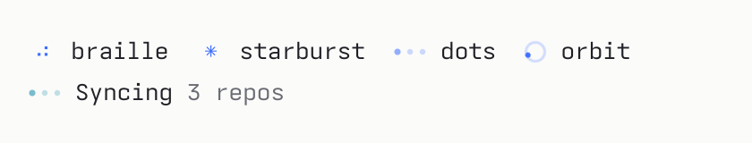
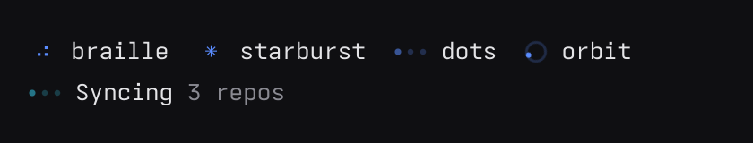
<figcaption>Every style, caught at one instant of its loop, and a toned spinner with a styled label.</figcaption>
</figure>

## `shimmer`

A label with one band of light sweeping across it, left to right. Use it for a "working" message. The band
crosses the whole label in 2 s, however long it is, then starts over. The text keeps its whitespace
(`white-space: pre`). The node's `aria-label` is the plain text.

The same effect is available on any span as `fx = "shimmer"` (see [Text](text.md)).

**Build it:** `tern.ui.node("shimmer", { text = "Thinking…" })`.

| Prop | Type | Default | Meaning |
| --- | --- | --- | --- |
| `spans` | span list | none | Styled text. Takes precedence over `text` when it is an array |
| `text` | string | none | Plain text, used when `spans` isn't an array |
| `mode` | `"classic"` \| `"kitt"` | `"classic"` | `classic` sweeps left to right and restarts. `kitt` bounces back and forth (`animation-direction: alternate`, class `.kitt`) |
| `palette` | `{ low?, mid?, high? }` of span tokens | theme text colors | The three sweep colors. Each value's first span token sets `--sh-lo` / `--sh-mid` / `--sh-hi` to `var(--sf-c-<token>)`. Use a color token (`muted`, `dim`, `accent`, `info`, `success`, …); omp theme tokens map to theirs (`toolDiffAdded` → `ins`). A missing key, an unknown token or a token that names no color (`strong`) falls back to the default |

Each span's style tokens become `sf-t-<token>` classes on a wrapper around that span's text. The sweep paints
the text, so a color token on a span doesn't show while it runs (it does under reduced motion). Other tokens,
such as `strong`, still apply.

**Children:** none (ignored).

**Events:** none of its own; `actions` work as on any node.

**Styling:**

```html
<span class="sf sf-shimmer kitt" data-id="…" aria-label="Thinking…">
	<span class="sf-fx-shimmer">
		<span class="sf-t-strong">Thinking…</span>
	</span>
</span>
```

| Target | Selector |
| --- | --- |
| The node | `.sf-shimmer` |
| Bouncing mode | `.sf-shimmer.kitt` |
| The sweep | `.sf-shimmer .sf-fx-shimmer` (inner, may change) |

The sweep is a `background-clip: text` gradient moved by the keyframe `sf-sh` (2 s, linear, infinite), the
same sweep as OpenAI Codex's: a band about ten characters wide (`--sh-band`, default `5em`) whose color rises on
a cosine from `--sh-lo` at its edges through `--sh-mid` to `--sh-hi` at its middle, starting a band's width
before the text and ending as far past it. The colors default to `--t3`, `--t2` and `--t1` (see
[Variables](../styles/variables.md)). You can set `--sh-lo`, `--sh-mid`, `--sh-hi` and `--sh-band` from your
sheet instead of using `palette`:

```css
[data-role='plugin.deploy.status'] .sf-shimmer {
	--sh-hi: var(--accent);
}
```

```lua
local ui = tern.ui

return ui.node("shimmer", {
	text = "Deploying to staging…",
	mode = "kitt",
	palette = { low = "muted", mid = "info", high = "accent" },
})
```

<figure class="tn-figure">
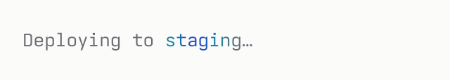
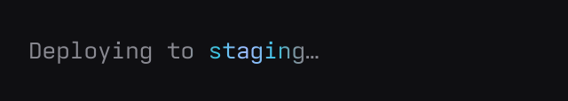
<figcaption>One instant of the sweep: characters ahead of and behind the highlight sit at the low color.</figcaption>
</figure>

## `skeleton`

The shape of content that has not arrived yet: soft placeholder blocks where the text, the avatar, the table rows
or the stat tiles will be. Reach for it in place of a view whose data is on its way, sized like the view, so nothing
jumps when the data lands: give it the view's `key` and swap the node for the real one in the same place. For work
that has a name ("Fetching services…"), a [`shimmer`](#shimmer) or [`spinner`](#spinner) says more; for a list
inside a `picker`, use its [`state = "loading"`](lists.md#picker).

`shape` picks what it stands for:

- `text` (default): `lines` ragged lines, each one text line tall, the last one short.
- `avatar`: a 32px disc beside a name line and a shorter line under it.
- `rows`: `rows` table-like rows: a dot, a bar and a short value at the right edge, hairlines between.
- `card`: `tiles` stat tiles side by side (a label, a value, a sub line), as [`stats`](data.md#stats) draws them;
  they wrap rather than squeeze.
- `block`: one rounded rect (an image, a chart, an editor) filling the node: 72px tall unless the common `min` /
  `max` size it (`min = { h = "8lines" }`).

Every width is drawn from the node's id, so the same node keeps the same ragged edge on every frame, redraw and
remount.

Three looks, picked by `variant`:

| Variant | Look | For |
| --- | --- | --- |
| `shimmer` (default) | Soft blocks, one band of light sweeping across the whole skeleton on the [`shimmer`](#shimmer) label's clock (2 s, left to right) and in its colors. Every shape shows its slice of the same band | Loading anything |
| `pulse` | The same blocks breathing slowly (2 s) | A calmer loading state, many skeletons at once |
| `wire` | Dashed hairline outlines with no fill and no motion: a wireframe of the layout to come | A view that waits on the user rather than the network (nothing picked yet), print-like sketches |

Under reduced motion (Tern's setting, the system's), in a hidden copy and while paused, `shimmer` and `pulse` hold
still as plain soft blocks.

`tone` tints the shapes (an `accent` skeleton for the selected item's card). A program sheet that sets the
shimmer's `--sh-lo` / `--sh-mid` / `--sh-hi` colors the skeleton too.

**Build it:** `tern.ui.node("skeleton", { shape = "rows", rows = 6 })`.

| Prop | Type | Default | Meaning |
| --- | --- | --- | --- |
| `variant` | `"shimmer"` \| `"pulse"` \| `"wire"` | `"shimmer"` | The look (see above). Anything else reads as `shimmer` |
| `shape` | `"text"` \| `"avatar"` \| `"rows"` \| `"card"` \| `"block"` | `"text"` | What it stands for. Anything else reads as `text` |
| `lines` | integer, 1–24 | `3` | `text` only: how many lines. Clamped; 0 draws one |
| `rows` | integer, 1–50 | `4` | `rows` only: how many rows. Clamped |
| `tiles` | integer, 1–8 | `3` | `card` only: how many stat tiles. Clamped |
| `tone` | Tone | none | Tints the shapes (and the `wire` outlines) in the tone's color |
| `aria` | string | `"Loading"` | Accessible name |

The common `min` and `max` size a `block`; `max.w` keeps any shape narrower than its column.

```lua
local ui = tern.ui

return ui.node("col", { gap = "lg" }, {
	ui.node("skeleton", { shape = "avatar" }),
	ui.node("skeleton", { lines = 3 }),
	ui.node("skeleton", { shape = "card", tiles = 3 }),
})
```

The same in TSX:

```tsx
<skeleton key="services" shape="rows" rows={6} variant="pulse" />
```

<figure class="tn-figure">


<figcaption>The default <code>shimmer</code>: <code>shape: "avatar"</code>, <code>"text"</code> and <code>"card"</code>, one band across them all.</figcaption>
</figure>

<figure class="tn-figure">


<figcaption><code>variant: "pulse"</code>: the blocks fade in and out slowly.</figcaption>
</figure>

<figure class="tn-figure">
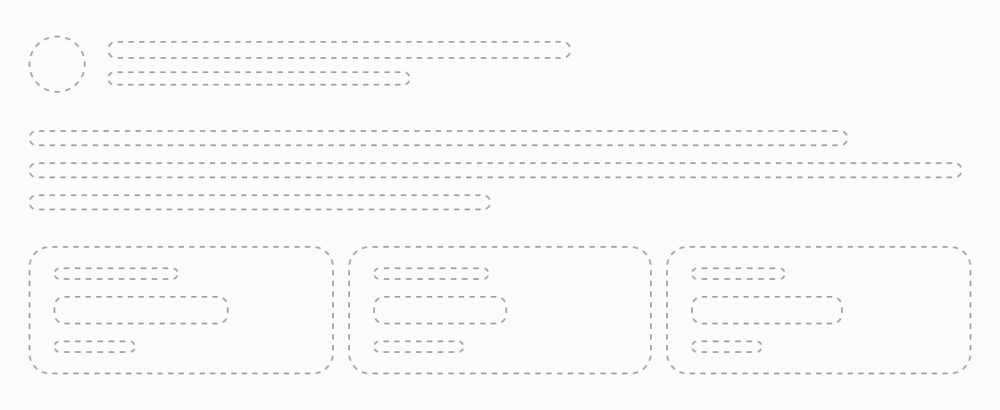
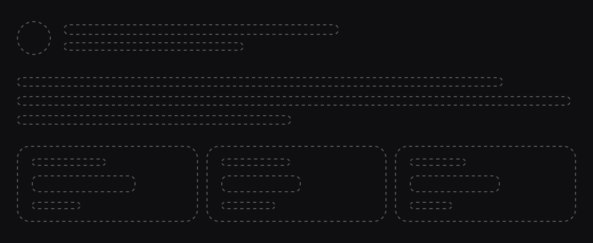
<figcaption><code>variant: "wire"</code>: a still wireframe of the layout to come.</figcaption>
</figure>

<figure class="tn-figure">
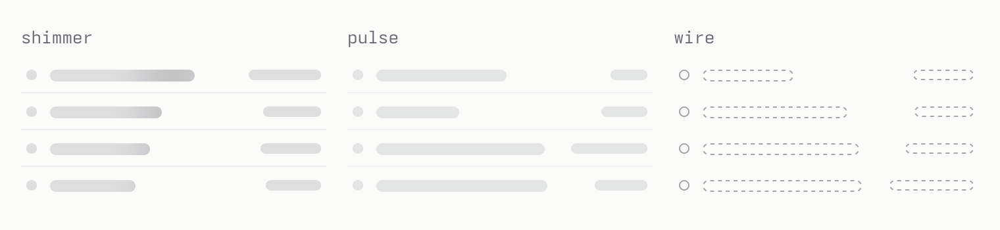
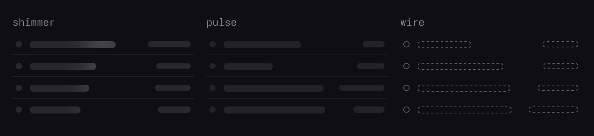
<figcaption><code>shape: "rows"</code> in each variant.</figcaption>
</figure>

<figure class="tn-figure">
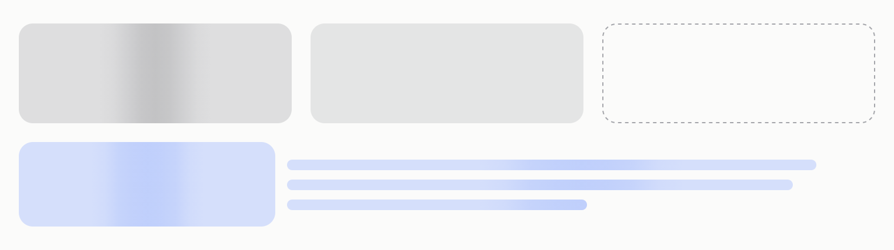
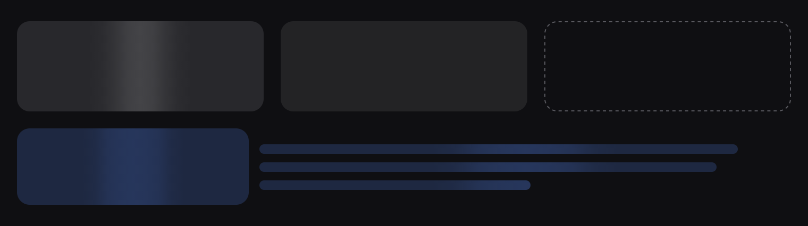
<figcaption><code>shape: "block"</code> sized by <code>min: { h: "5lines" }</code> in each variant; below, <code>tone: "accent"</code> with <code>max: { w: 0.3 }</code>.</figcaption>
</figure>

<figure class="tn-figure">
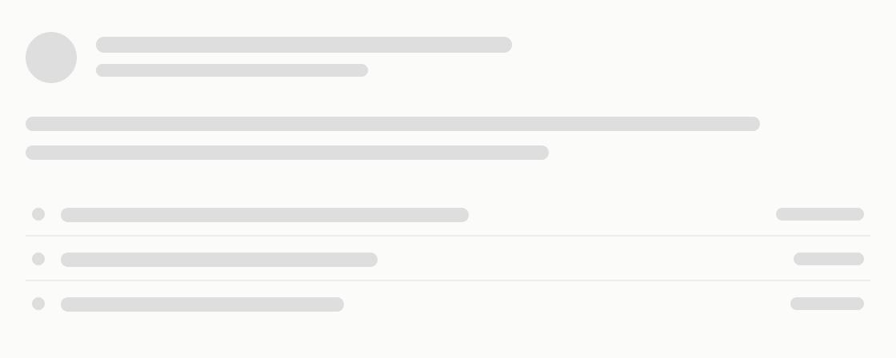
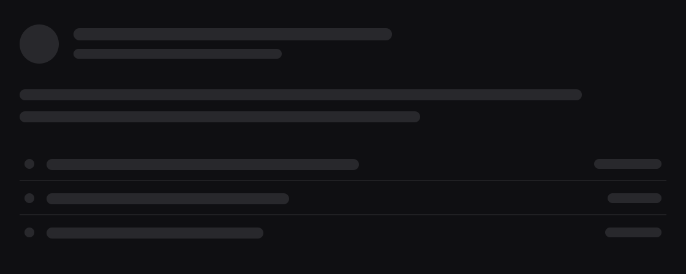
<figcaption>Under reduced motion the <code>shimmer</code> holds still as plain blocks.</figcaption>
</figure>

**Children:** none (ignored).

**Events:** none of its own; `actions` work as on any node.

**Keyboard:** the node never takes focus and has nothing to drive; the program replaces it with the real view when
the data arrives.

**Accessibility:** the node is `role="status"` with `aria-busy="true"` and the name `Loading` (or its `aria`); the
shapes are hidden from assistive technology.

**Styling:**

```html
<div class="sf sf-skeleton" data-id="…" data-variant="shimmer" data-shape="avatar" role="status" aria-busy="true" aria-label="Loading">
	<div class="sk-in" aria-hidden="true" style="--sk-run: …; --sk-band: …">
		<i class="sk-b sk-av" style="--sk-x: …"></i>
		<div class="sk-col">
			<div class="sk-line"><i class="sk-b sk-name"></i></div>
			<div class="sk-line"><i class="sk-b sk-meta"></i></div>
		</div>
	</div>
</div>
<!-- text: <div class="sk-line"><i class="sk-b sk-t"></i></div>…
     rows: <div class="sk-row"><i class="sk-b sk-dot"></i><i class="sk-b sk-bar"></i><i class="sk-b sk-end"></i></div>…
     card: <div class="sk-tile"><i class="sk-b sk-lbl"></i><i class="sk-b sk-val"></i><i class="sk-b sk-sub"></i></div>…
     block: <i class="sk-b sk-blk"></i> -->
```

| Target | Selector |
| --- | --- |
| The node | `.sf-skeleton` |
| Variant / shape / tone | `.sf-skeleton[data-variant='wire']`, `[data-shape='rows']`, `[data-tone]` |
| Shapes box | `.sf-skeleton .sk-in` (inner, may change) |
| Any shape | `.sf-skeleton .sk-b` (inner, may change) |
| Text line | `.sk-line`, `.sk-t` (inner, may change) |
| Avatar disc, its lines | `.sk-av`, `.sk-col`, `.sk-name`, `.sk-meta` (inner, may change) |
| Row and its parts | `.sk-row`, `.sk-dot`, `.sk-bar`, `.sk-end` (inner, may change) |
| Tile and its parts | `.sk-tile`, `.sk-lbl`, `.sk-val`, `.sk-sub` (inner, may change) |
| Block | `.sk-blk` (inner, may change) |

Variables: `--sk-fill` (the blocks), `--sk-mid` / `--sk-hi` (the band) and `--sk-wire` (the outlines), all derived
from `--sh-lo` / `--sh-mid` / `--sh-hi`; `--sk-run` and `--sk-band` on `.sk-in` (the sweep's run and band width)
and `--sk-x` (a shape's offset in it), set by Tern after layout. Keyframes: `sk-sweep` moves the band across each
shape (2 s, linear, infinite) and `sk-pulse` breathes the `pulse` variant (2 s, ease-in-out, infinite).

## `elapsed`

A live timer that counts up from an age, or down to zero. The text uses tabular figures, doesn't wrap, and is drawn
in `--t3`. It has `role="timer"`.

**Build it:** `tern.ui.node("elapsed", { age = ms })`.

| Prop | Type | Default | Meaning |
| --- | --- | --- | --- |
| `age` | number (ms) | `0` | Milliseconds already elapsed when you built the node. A negative age is a countdown that ends that many ms after it arrives |
| `stopped` | number (ms) | none | Freezes the display at this many ms. The timer no longer ticks |
| `format` | `"short"` \| `"clock"` | `"short"` | How the time reads. An unknown value reads as `short` |

Formats (negative values show as zero):

| Shown time | `short` | `clock` |
| --- | --- | --- |
| under 1 min | `12.3s` (tenths, rounded down so it never runs ahead) | `0:12` |
| under 1 h | `4m 05s` | `4:05` |
| 1 h or more | `1h 02m` | `1:02:03` |

How ages work:

- A positive `age` shows `age` plus the time since that `age` value arrived. Each `age` that arrives (in a new node
  or in a `set` that includes it) re-anchors the count, even when the number is unchanged. A `set` of other props
  leaves the count running. So compute `age` from your own start time whenever you send it
  (`(os.clock() - started) * 1000`, or the equivalent from your plugin's time source).
- A negative `age` counts down from `-age` ms and stops at `0:00` / `0.0s`. It is anchored the same way: it ends
  `-age` ms after that `age` value arrived, a `set` of other props leaves it running, and a new `age` (even the
  same number) starts it over. Once it reaches zero it stays there.
- `stopped` shows a fixed duration, for example the final time of a finished job.

**Children:** none (ignored).

**Events:** none of its own; `actions` work as on any node.

**Styling:**

```html
<span class="sf sf-elapsed" data-id="…" role="timer">4m 05s</span>
```

| Target | Selector |
| --- | --- |
| The node | `.sf-elapsed` |

It has no keyframes. Reduced motion doesn't stop it.

```lua
local ui = tern.ui

-- a running job, a finished one and a countdown
return ui.col({
	ui.row({ ui.text("build"), ui.node("elapsed", { age = 12345 }) }),
	ui.row({ ui.text("tests"), ui.node("elapsed", { stopped = 18400 }) }),
	ui.row({ ui.text("retry in"), ui.node("elapsed", { age = -30000, format = "clock" }) }),
})
```

<figure class="tn-figure">
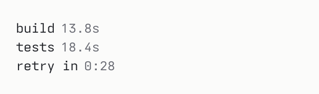
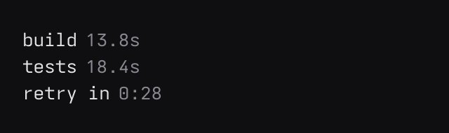
<figcaption>Drawn about 1.5 s after the frame arrived: the running timer and the countdown have moved on from their ages; the stopped one hasn't.</figcaption>
</figure>

## `rate`

A number that eases to each new value instead of jumping. Use it for throughput such as tokens per second. When you
send a new `value`, the display eases from what it shows now to the new value over 420 ms (ease-out cubic). The
first value shows at once. The text has one decimal below 100 and none from 100 up, followed by a space and `unit`
when you set one (`42.3 tok/s`, `1234`).

**Build it:** `tern.ui.node("rate", { value = 42.26, unit = "tok/s" })`.

| Prop | Type | Default | Meaning |
| --- | --- | --- | --- |
| `value` | number | `0` | The target value |
| `unit` | string | none | Appended after a space |

**Children:** none (ignored).

**Events:** none of its own; `actions` work as on any node.

**Styling:**

```html
<span class="sf sf-rate" data-id="…">42.3 tok/s</span>
```

| Target | Selector |
| --- | --- |
| The node | `.sf-rate` |

It uses tabular figures, doesn't wrap, and is drawn in `--t2`. The node needs a stable `id` to ease: a node with a
new id starts over at its value.

```lua
local ui = tern.ui

return ui.row({ ui.text("download"), ui.node("rate", { id = "dl-rate", value = state.mbps, unit = "MB/s" }) })
```

## `progress`

A horizontal bar with an optional label after it. With a `value`, the fill shows that fraction and moves to a new
value over 0.3 s. Without one (`nil`/`null`), the bar is **indeterminate**: a 30%-wide fill slides across the track.
The node has `role="progressbar"` with `aria-valuemin` 0 and `aria-valuemax` 100. `aria-valuenow` is the rounded
percentage, and it is absent while indeterminate. The track grows to fill the row (minimum 40 px). The label is
hidden while it's empty.

**Build it:** `tern.ui.progress(value, label)` (see [UI Builders](../reference/ui.md#progress)), or
`tern.ui.node("progress", { value = 0.4, label = "40%" })`.

| Prop | Type | Default | Meaning |
| --- | --- | --- | --- |
| `value` | number 0–1, or `nil` | `nil` (indeterminate) | Fraction done. Clamped to 0–1 and rounded to whole percent |
| `label` | Spans | none | Text after the bar, in tabular figures |
| `tone` | Tone | accent | Fill color. `neutral` uses the accent too |

**Children:** none (ignored).

**Events:** none of its own; `actions` work as on any node.

**Styling:**

```html
<div class="sf sf-progress indeterminate" data-id="…" role="progressbar" aria-valuemin="0" aria-valuemax="100">
	<div class="track"><div class="fill"></div></div>
	<span class="lbl">Uploading…</span>
</div>
```

| Target | Selector |
| --- | --- |
| The node | `.sf-progress` |
| Indeterminate | `.sf-progress.indeterminate` |
| Track | `.sf-progress .track` (inner, may change) |
| Fill | `.sf-progress .fill` (inner, may change) |
| Label | `.sf-progress .lbl` (inner, may change) |

The keyframe is `sf-indet` (1.3 s, `translateX(-100%)` → `translateX(340%)`). The track is 4 px tall
on `--l2`. The fill uses `--tc`, or `--accent` without a tone. Under reduced motion an indeterminate bar becomes a
full-width fill at 35% opacity.

```lua
local ui = tern.ui

return ui.col({
	ui.progress(0.4, "40%"),
	ui.node("progress", { value = 0.85, tone = "success", label = "85%" }),
	ui.progress(nil, "Preparing…"), -- indeterminate
})
```

<figure class="tn-figure">
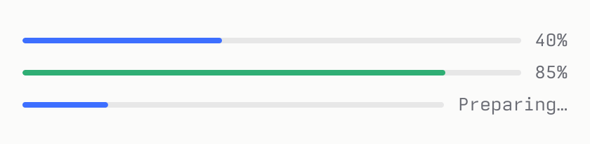
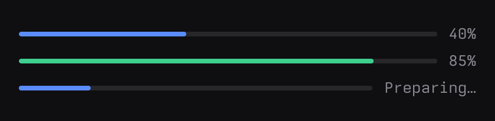
<figcaption>Determinate, toned and indeterminate. Each track takes the width its label leaves.</figcaption>
</figure>

## `meter`

A level drawn as a **bar** (the default), a **ring** or a **block grid**. It shows one `value`, or stacked `parts`
that split a whole (for example used / cached / free). Thresholds color it `warn` or `bad`. Ticks (`marks`) can
point out a limit on the track.

The shape comes from `style`. Tern never picks it from the value:

| `style` | Shape | `size` `sm` / `md` / `lg` |
| --- | --- | --- |
| `bar` (default, also any unknown value) | A rounded track that grows along its row (`flex: 1 1 60px`; stretched across in a column) | 4 / 6 / 10 px tall |
| `ring` | A 16-unit SVG ring filling clockwise from 12 o'clock | 12 / 16 / 24 px |
| `blocks` | A grid of 8 px squares, 10 columns. With `steps`, one row of that many slim bars instead | 2 / 5 / 10 rows (20 / 50 / 100 cells) |

On first show a bar or ring fill grows from zero over 0.6 s (`meter-fill`, a Web Animation, not a CSS keyframe).
Later values ease over 0.4 s (CSS transitions on `width`/`left`, or `stroke-dasharray` for rings). Block cells
don't grow; they change color over 0.3 s. Under reduced motion it draws the value at once.

**Build it:** `tern.ui.meter(value, label)` (see [UI Builders](../reference/ui.md#meter)), or
`tern.ui.node("meter", { … })` for the props below. `tern.ui.test_summary(…)` builds a row with a stacked meter
(see [UI Builders](../reference/ui.md#test_summary)). Table cells take a meter too (`tern.ui.meter_cell`,
`meter_parts_cell`, see [Data](data.md)).

| Prop | Type | Default | Meaning |
| --- | --- | --- | --- |
| `value` | number 0–1 | none | The level. Clamped to 0–1. Ignored for drawing when `parts` is given, but still used for `thresholds` |
| `parts` | `{ { value, token?, label?, hatch? } }` | none | Stacked parts, left to right (clockwise on a ring). See below |
| `thresholds` | `{ warn?: number, bad?: number }` | none | `value ≥ bad` sets `data-level="bad"`, else `value ≥ warn` sets `data-level="warn"`. Needs `value` |
| `style` | `"bar"` \| `"ring"` \| `"blocks"` | `"bar"` | The shape |
| `size` | `"sm"` \| `"md"` \| `"lg"` | `"sm"` | See the shape table. Any other value reads as `sm` |
| `steps` | integer 1–20 | none | `blocks` only: one row of exactly this many cells (`data-steps`). Out-of-range values are ignored |
| `marks` | `{ { at, tone?, title?, icon? } }` | none | Ticks at `at` (0–1, required). See below |
| `label` | Spans | none | Text after the shape, usually the value (`72%`) |
| `total` | Spans | none | Text after the label, usually the whole (`200K`), dimmer |
| `tone` | Tone | accent | Fill color. Wins over the threshold level (`neutral` doesn't) |
| `title` | string | parts summary | Tooltip. Without it, a meter with labeled parts gets `used 42% · cache 8%` |

`parts` entries:

| Field | Type | Meaning |
| --- | --- | --- |
| `value` | number | The part's share of the whole. Parts are clamped in order so they never sum past 1: a part that would overflow is cut, and later parts get 0 |
| `token` | string | Color: a span token (`success`, `error`, `muted`, …) or an omp theme token (`toolDiffAdded`, …), which maps to its semantic token. The fill takes the color text in that token draws in. `"track"` is a gap: the part keeps its place but draws as empty track |
| `label` | string | The part's tooltip, also used in the meter's default `title` |
| `hatch` | boolean | Diagonal hatching over the fill, for reserved or estimated parts |

`marks` entries:

| Field | Type | Meaning |
| --- | --- | --- |
| `at` | number 0–1 | Position on the track, clamped to 0–1. A mark without `at` is dropped |
| `tone` | Tone | Tick color (`data-tone` on the tick) |
| `title` | string | Tooltip (bar ticks only) |
| `icon` | icon name | Bar only. Draws the icon on the track and breaks the track and fills around it, `--sf-mt-gap` wide (default 14 px). See [`icon` in Data](data.md) for icon names |

On a ring, marks are short radial ticks. Block grids ignore marks. In a block grid, the parts fill cells in order.
Each part gets its rounded share, and the total matches the rounded sum.

The node has `role="meter"` with `aria-valuemin` 0 and `aria-valuemax` 100. `aria-valuenow` is the rounded
percentage of `value` (or of the parts' sum). It also sets `--sf-meter` to the value (0–1) on the node, so a sheet
can draw its own meter. Without `value` or `parts`, the node gets class `unknown` and a dashed track.

**Children:** none (ignored).

**Events:** none of its own; `actions` work as on any node.

**Styling:**

```html
<div class="sf sf-meter" data-id="…" data-style="bar" data-size="sm" data-level="warn"
     role="meter" aria-valuenow="78" style="--sf-meter: 0.78">
	<div class="sf-mt-track gapped">
		<div class="sf-mt-rail"></div>                <!-- only with icon marks -->
		<div class="sf-mt-fill"></div>                <!-- one value -->
		<!-- or per part: <div class="sf-mt-part first hatch" title="cache"></div> … <div class="sf-mt-part last gap"></div> -->
		<div class="sf-mt-mark icon" data-tone="warning" title="compacts here"><svg>…</svg></div>
	</div>
	<!-- ring:   <svg class="sf-mt-ring" viewBox="0 0 16 16"><circle class="track"/><circle class="arc"/>…<line class="mark"/></svg> -->
	<!-- blocks: <div class="sf-mt-blocks"><i class="on"></i><i class="on hatch"></i><i></i>…</div> -->
	<span class="sf-mt-lbl">78%</span>
	<span class="sf-mt-total">200K</span>
</div>
```

| Target | Selector |
| --- | --- |
| The node | `.sf-meter` |
| Shape / size / stepped | `.sf-meter[data-style='ring']`, `[data-size='lg']`, `[data-steps]` |
| Level | `.sf-meter[data-level='warn']`, `[data-level='bad']` |
| No value | `.sf-meter.unknown` |
| Bar track, rail | `.sf-mt-track`, `.sf-mt-track.gapped`, `.sf-mt-rail` (inner, may change) |
| Single fill, parts | `.sf-mt-fill`; `.sf-mt-part` with `.first`, `.last`, `.hatch`, `.gap` (inner, may change) |
| Bar tick | `.sf-mt-mark`, `.sf-mt-mark.icon`, `.sf-mt-mark[data-tone]` (inner, may change) |
| Ring | `.sf-mt-ring`, `.sf-mt-ring .track`, `.sf-mt-ring .arc` (`.gap`, `.sf-hidden` when empty), `.sf-mt-ring .mark` (inner, may change) |
| Block grid, cell | `.sf-mt-blocks`, `.sf-mt-blocks i`, `i.on`, `i.hatch` (inner, may change) |
| Label, total | `.sf-mt-lbl`, `.sf-mt-total` (inner, may change) |

Variables: `--mt` is the fill color. It is `--accent` by default, `--warn` or `--bad` by level, and `--tc` when the
node has a non-neutral tone. Override `--mt` to recolor every shape at once. Tracks use `--l2` (`--l3` for rings and
stepped cells). The label is `--t3`, the total `--t4`. `--sf-mt-gap` sets the width of an icon mark's break.
`--sf-meter` is the value, set by Tern. The meter rules live in the `omp-composer.css` sheet, but they aren't
scoped to omp and apply to every surface.

```lua
local ui = tern.ui

return ui.col({
	ui.node("meter", {
		value = 0.84,
		thresholds = { warn = 0.8, bad = 0.95 },
		label = "84%",
		total = "512G",
		marks = { { at = 0.9, tone = "warning", title = "quota" } },
	}),
	ui.node("row", { gap = "lg" }, {
		ui.node("meter", {
			style = "ring",
			size = "md",
			parts = {
				{ value = 0.42, token = "info", label = "used" },
				{ value = 0.08, token = "muted", label = "cache", hatch = true },
			},
			label = "50%",
		}),
		ui.node("meter", { style = "blocks", value = 0.6, label = "60%" }),
		ui.node("meter", { style = "blocks", steps = 5, value = 0.6 }),
	}),
})
```

<figure class="tn-figure">
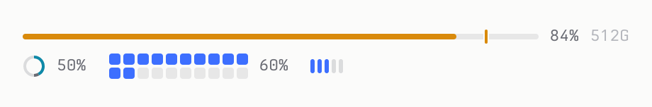
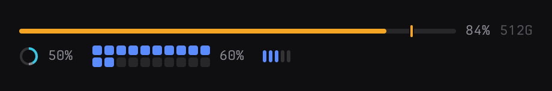
<figcaption>A bar past its <code>warn</code> threshold with a mark, a ring of two parts, a <code>sm</code> block grid (20 cells) and <code>steps = 5</code>.</figcaption>
</figure>

## `chart`

Series data drawn by Tern: a **heatmap** (a calendar-style grid of cells), a **bar** chart, a **spark**line of thin
bars, a **line** or **area** over time (one series or several) or a **donut** of shares. The node has
`role="figure"`. With a `summary`, its plain text becomes the `aria-label` and a summary line appears under the
chart.

| `kind` | Draws | Reach for it for |
| --- | --- | --- |
| `heatmap` (default) | A calendar-style grid of cells in four shades of `--chart-c` | Activity over weeks or a year (runs, deploys) |
| `bars` | One bar per entry, sharing the row's width | A handful of values side by side (runs per day) |
| `spark` | A one-line row of thin bars | A trend beside a number, in a row or a table cell |
| `line` (one series) | A 1.75 px line over a soft area of its color fading to the baseline, faint gridlines, x labels under it; a dot at its last point and the last value beside the plot | One value over time: latency this week, a coverage trend, req/s since deploy |
| `line` (several) | One line per series in one value domain, legend chips above, a dot at each line's end; no areas, no last value | Several series over the same time (p50/p95/p99) |
| `area` | As `line`, with a fuller fill under every series | A value over time when the amount itself matters (disk used, tokens spent), not only its shape |
| `donut` | A ring of segments with small gaps over a faint track, the total in its middle and a `caption` under it, and a legend list (dot, label, value) beside it | A few parts of a whole (4–6): requests by service, disk by kind |

Tern rebuilds a heatmap when any prop changes, so keep heatmaps small (a year is 371 cells). The other kinds update
in place, so a chart fed every second does not replay its arrival: bars keep their elements (only bars added since
the last draw enter, and the rest ease to their new height), and lines, areas and donuts keep their drawn parts and
move their points while the shape stays. Their arrival plays when the chart first appears or changes shape (another
`kind`, another number of series or segments): lines draw on from the left (0.9 s, each series 90 ms after the one
before), areas fade in under them and the end dots and last value pop in as the line arrives; a donut turns into
place while its segments fade in.

Pointing at a line or area shows a hairline down the plot and a dot on each series at that point; resting there
shows the point's tooltip: its x label and every series' value with `unit` (`Tue · p50 12 ms · p95 45 ms`), or the
point's own `title`. A donut segment and its legend row share a tooltip: label, value and share
(`api · 552 · 46%`).

**Build it:** `tern.ui.bars(series)` and `tern.ui.spark(series)` (see
[UI Builders](../reference/ui.md#bars-spark)). For a heatmap, a line, an area or a donut, or for `summary`, `size`
or `token`, use `tern.ui.node("chart", { … })`.

| Prop | Type | Default | Meaning |
| --- | --- | --- | --- |
| `kind` | `"heatmap"` \| `"bars"` \| `"spark"` \| `"line"` \| `"area"` \| `"donut"` | `"heatmap"` | Which chart. Any other value draws a heatmap |
| `size` | `"sm"` \| `"md"` \| `"lg"` | `"md"` | Heatmap cells 8 / 11 / 13 px. Bars 2 / 4 / 8 lines tall. A spark is always one line tall. `line`/`area`: the plot is 60 / 112 / 176 px tall (at a 13 px font; it fills the width). `donut`: the ring is 76 / 112 / 152 px across. Any other value draws as `md` |
| `token` | span token | `accent` | Fill color, set as `--chart-c`: the bars, the cells, the first series of a line or area, the first segment of a donut. Further series and segments without a `token` take `--chart-2` … `--chart-10` (purple, amber, green, teal, red, then four hues turned from the theme's colors), then start over |
| `summary` | Spans | none | A line under the chart and its accessible name |
| `series` (`bars`, `spark`) | `{ { value, label?, title?, tone? } }` | none | One bar per entry, in order. Heights are relative to the value domain (`min`..`max`); a zero, negative or missing value draws a 1 px stub. Bars are at most 24 px wide (spark: 4 px) and share the row's width. Tooltip is `title`, else `label`. A `tone` fills that bar instead of `token` |
| `series` (`line`, `area`, one series) | `{ number \| { value?, label?, title? } }` | none | One point per entry, evenly spaced across the plot. An entry without a number (`null`, or a table with no `value`) is a gap: the line breaks there. `label` is the point's x label when `labels` is absent; `title` replaces its tooltip |
| `series` (`line`, `area`, several) | `{ { label?, token?, values } }`, each `values` `{ number \| { value, title? } }` | none | Used as soon as one entry has a `values` array; entries without one are skipped. One line per entry; points share x positions by index (the longest series sets the count). `label` names its legend chip and its part of the tooltip; `token` its color |
| `series` (`donut`) | `{ number \| { value, label?, token?, title? } }` | none | One segment per entry, clockwise from the top, sized by its share of the total. A zero, negative or missing `value` draws no segment but keeps its legend row. `title` replaces the segment's tooltip |
| `labels` | `{ string }` | the entries' `label`s (one series) | `line`/`area`: the x labels by point index. `""` leaves a point unlabelled. More than 8 labels are thinned evenly. The first label aligns to the plot's left edge and the last to its right |
| `unit` | string | none | `line`/`area`/`donut`: written after every value Tern prints (tooltips, the last value, the donut total and legend). A currency symbol (`$`, `€`, `£`, `¥`) leads the number (`$51.4`); `%`, `×` and `°` attach (`64%`); other units follow a space (`182 ms`) |
| `last` | `boolean` \| Spans | `true` | `line`/`area` with one series: the label beside the last point. `true` prints its value with `unit`; text or spans replace it; `false` hides it. Several series never show one |
| `min`, `max` | number | `0`, the largest series or mark value | `bars`/`spark`: a fixed value domain. Values are clamped into it. A degenerate domain (`max ≤ min`, or not finite) draws every bar empty. `line`/`area`: see below. On `chart` nodes these are numbers, not the common `{ w, h }` size extents |
| `marks` | `{ { value, tone?, title? } }` | none | `bars`/`spark`/`line`/`area`: horizontal dashed reference lines (a target, a limit) at `value`, in value units, across the chart. `tone` colors the line (default: muted foreground); `title` is its tooltip on hover. Marks outside the domain are clamped to its edge |
| `total` | Spans | the sum of the values, with `unit` | `donut`: what the ring's middle says |
| `caption` | Spans | none | `donut`: a quiet line under the ring (`requests`), wrapping to about the ring's width |
| `cells` | `{ { number? } }` (rows of columns) | none | `heatmap`: rows of intensity values 0–1. The widest row sets the column count |
| `tips` | `{ { string? } }` | none | `heatmap`: a tooltip per cell, indexed like `cells` |
| `rows` | `{ string }` | none | `heatmap`: a label per row (`"Mon"`, `""`, `"Wed"`, …) |
| `cols` | `{ { at, label } }` | none | `heatmap`: column labels (months) placed above column `at` (a 0-based whole number). Entries missing either field are skipped |

A heatmap cell's value maps to a level (`data-l`): `≤ 0` → `0` (the empty swatch), `≤ 0.25` → `1`, `≤ 0.5` → `2`,
`≤ 0.75` → `3`, above that → `4`. A non-number or a missing cell is `n`, drawn transparent. The four levels fill
with `--chart-c` at 20%, 40%, 65% and 100%.

On a `line` or `area`, `min` and `max` fix the value domain and values outside it clamp to its edge. Without them
the domain runs from 0 (or from below the smallest value when one is negative) to just above the largest value or
mark, rounded out to 1, 1.2, 1.5, 2, 2.5, 3, 4, 5, 6 or 8 times a power of ten (182 → 200). A degenerate domain (all
zero, `max ≤ min`) puts every point on the baseline.

Values Tern prints are short: up to three significant digits, thousands as `k`, millions `M`, billions `B`
(`1200` → `1.2k`, `12.34` → `12.3`, `3.14159` → `3.14`), with a true minus sign. Send `last`, `total` or a point's
`title` to print a value your own way.

A donut's segments take round ends when every one is long enough to keep its gap with them; one sliver among them
squares them all, so a small share never reads larger than it is. One segment alone is a whole ring.

Note that the builders send `series` entries as `{ value, label }` objects. A Luau table you pass to `tern.ui.node`
must use those field names too: positional `{ label, value }` pairs only work through `tern.ui.bars`/`spark`.

`min`, `max`, `marks` and series `tone` are newer: an older Tern ignores them (no marks, an automatic domain).

```lua
local ui = tern.ui

local latency = { 2, 4, 3, 6, 5, 8, 7, 9, 6, 4, 7, 10, 8, 6, 9 }
local series = {}
for i, v in latency do
	series[i] = { value = v }
end

return ui.col({
	ui.node("chart", {
		kind = "bars",
		size = "sm",
		series = {
			{ value = 3, label = "Mon" }, { value = 7, label = "Tue" }, { value = 5, label = "Wed" },
			{ value = 9, label = "Thu" }, { value = 4, label = "Fri" }, { value = 1, label = "Sat" },
			{ value = 2, label = "Sun" },
		},
	}),
	ui.node("chart", { kind = "spark", token = "success", series = series, summary = "p95 latency, last 15 min" }),
})
```

<figure class="tn-figure">
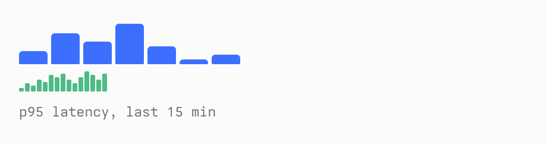
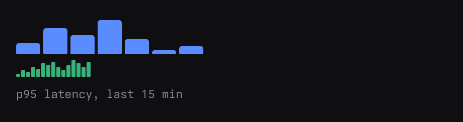
<figcaption>A <code>sm</code> bar chart and a spark with a <code>token</code> and a <code>summary</code>.</figcaption>
</figure>

Lines, areas and donuts:

```lua
local ui = tern.ui

return ui.col({
	-- One series: points are numbers or { value, label?, title? }; a point without a value is a gap.
	ui.node("chart", {
		kind = "line",
		unit = "ms",
		labels = { "Mon", "", "", "", "Wed", "", "", "", "", "Fri", "", "", "", "Sun" },
		series = state.latency, -- 14 numbers
		summary = "p95 latency, last 7 days",
	}),
	-- Several series share the labels and the domain.
	ui.node("chart", {
		kind = "line",
		unit = "ms",
		labels = state.days,
		series = {
			{ label = "p50", values = state.p50 },
			{ label = "p95", token = "pending", values = state.p95 },
			{ label = "p99", token = "warning", values = state.p99 },
		},
	}),
	ui.node("chart", {
		kind = "donut",
		caption = "requests",
		series = {
			{ label = "api", value = 552 },
			{ label = "web", value = 288 },
			{ label = "worker", value = 216 },
			{ label = "cron", value = 144 },
		},
	}),
})
```

The same in TSX:

```tsx
<col>
   <chart kind="line" unit="ms" labels={days} series={latency} summary="p95 latency, last 7 days" />
   <chart
      kind="line"
      unit="ms"
      labels={days}
      series={[
         { label: 'p50', values: p50 },
         { label: 'p95', token: 'pending', values: p95 },
         { label: 'p99', token: 'warning', values: p99 },
      ]}
   />
   <chart kind="donut" caption="requests" series={byService} />
</col>
```

<figure class="tn-figure">
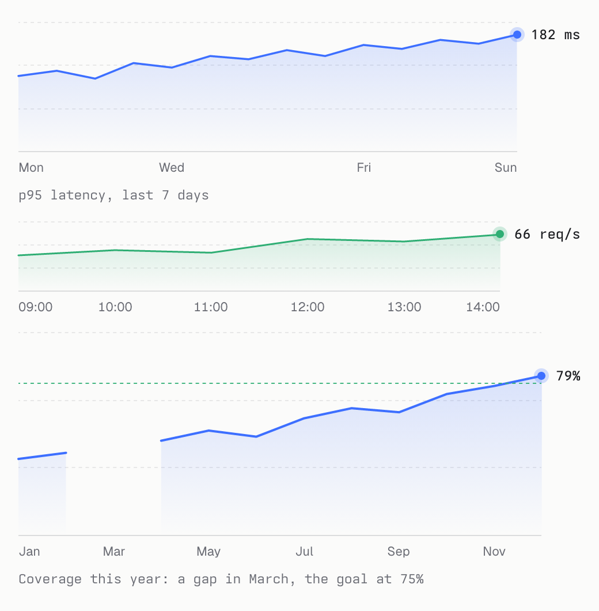
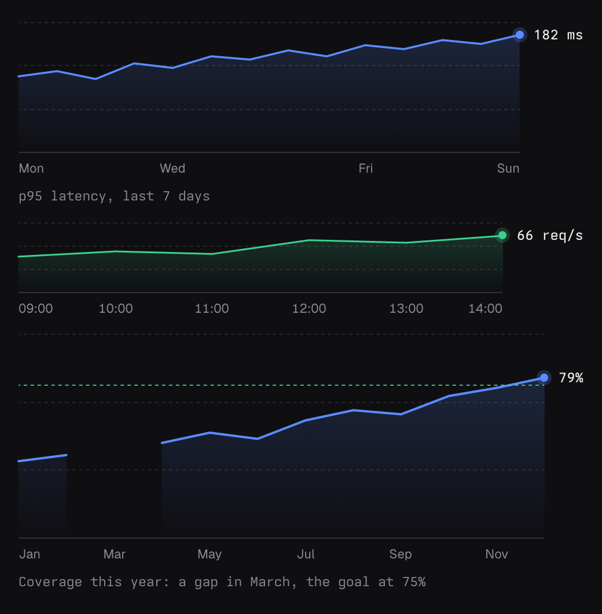
<figcaption>A <code>line</code> at <code>md</code> with a <code>unit</code>, at <code>sm</code> in a <code>token</code>, and at <code>lg</code> with a gap (<code>null</code>), a fixed <code>max</code> and a mark.</figcaption>
</figure>

<figure class="tn-figure">
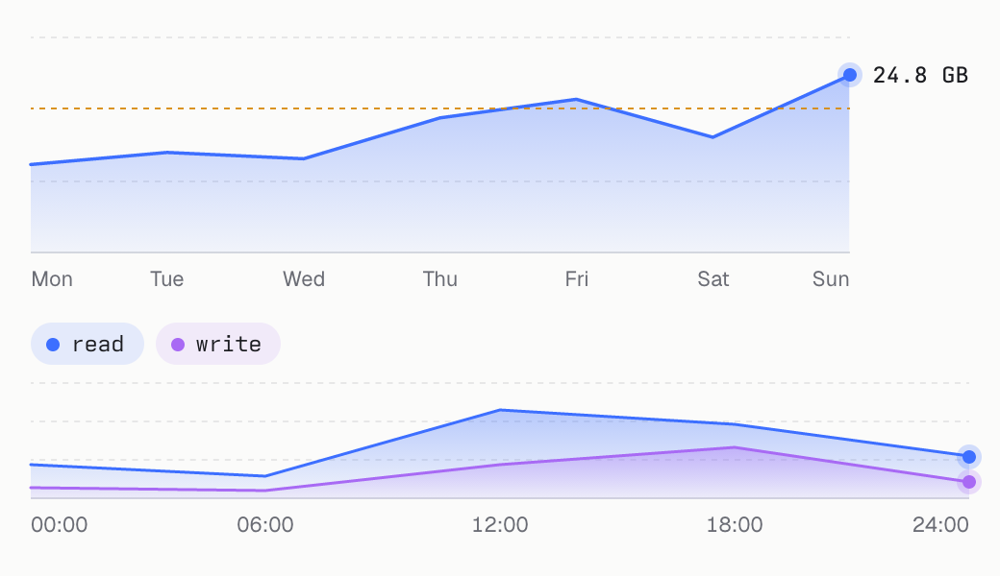
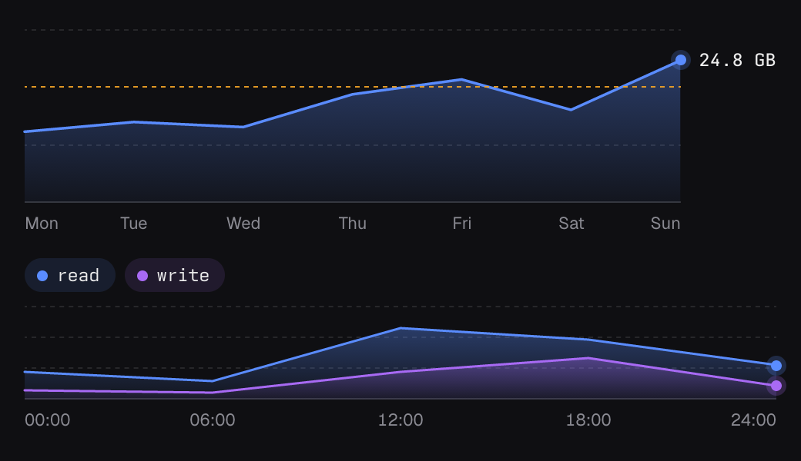
<figcaption>An <code>area</code> with a warning mark, and a <code>sm</code> area of two series.</figcaption>
</figure>

<figure class="tn-figure">
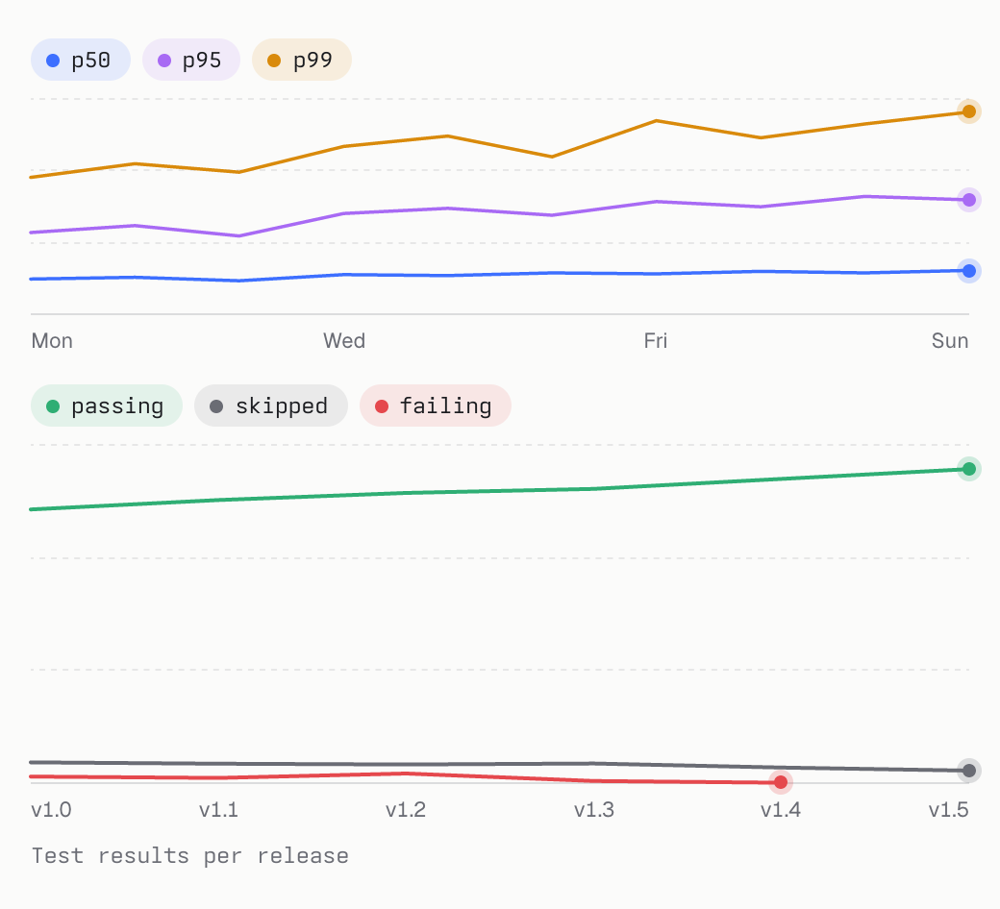
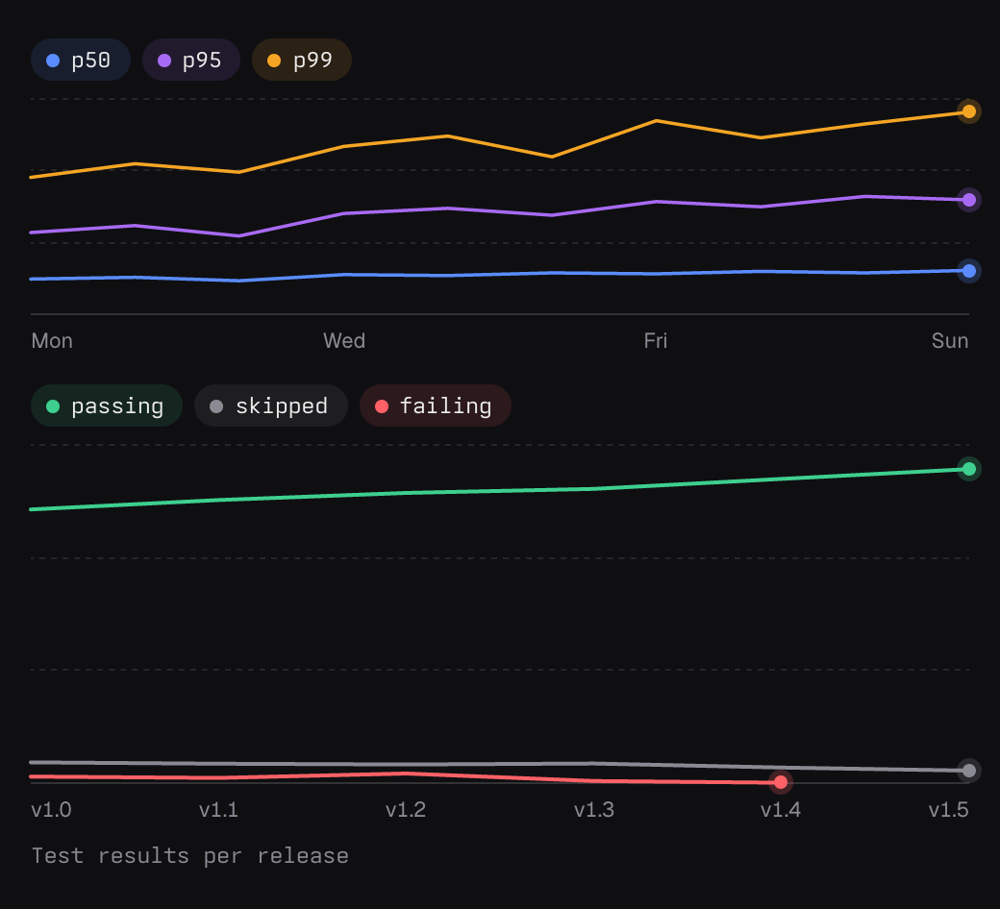
<figcaption>Several series: legend chips on top, one domain, a dot at each line's end. At <code>lg</code>, a series whose last value is <code>null</code> ends early.</figcaption>
</figure>

<figure class="tn-figure">
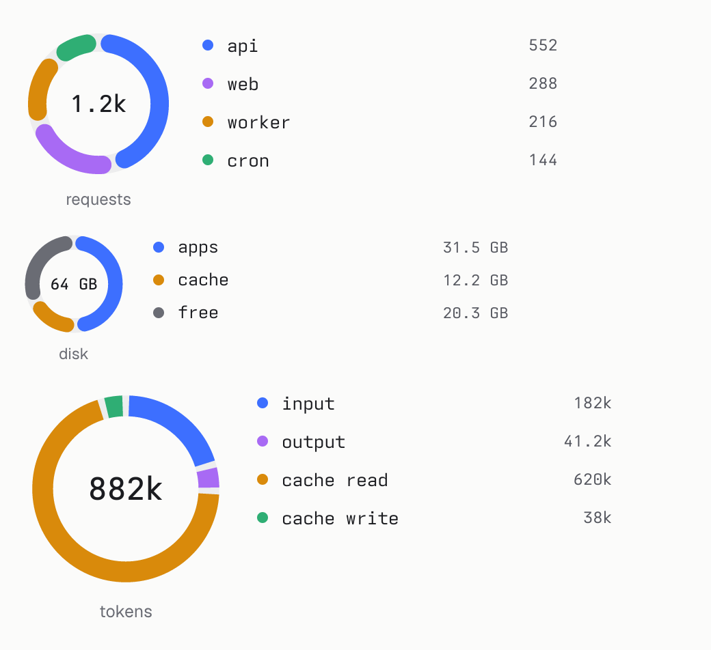
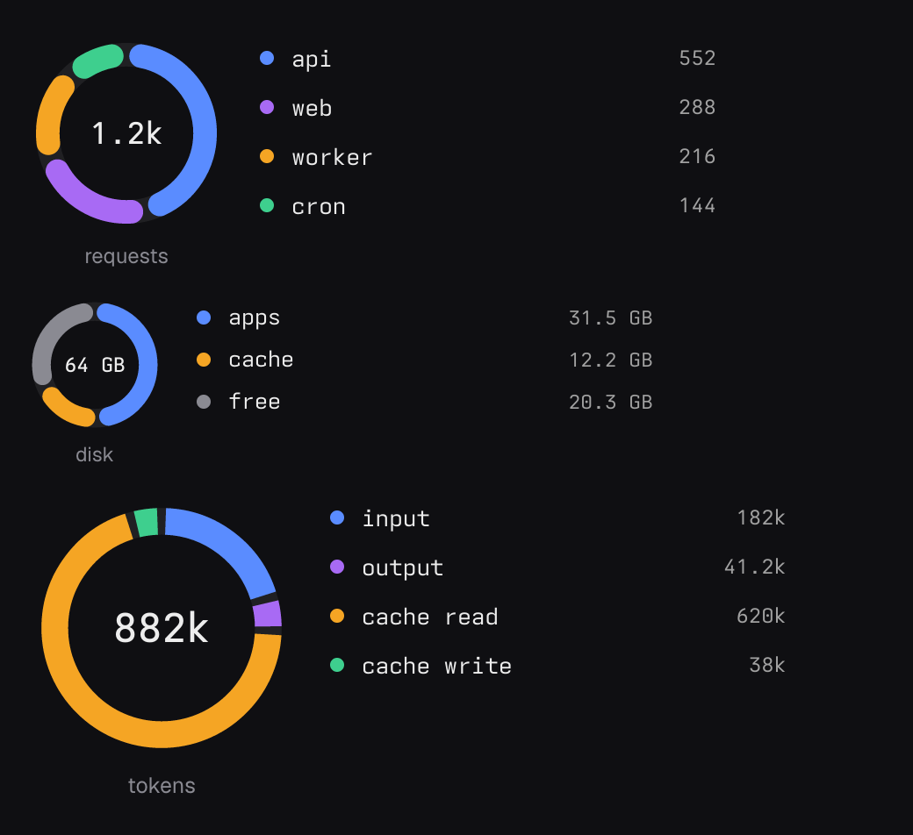
<figcaption>A <code>donut</code> at <code>md</code> with a <code>caption</code>, at <code>sm</code> with its own <code>total</code> and tokens, and at <code>lg</code>.</figcaption>
</figure>

**Children:** none (ignored).

**Events:** none of its own; `actions` work as on any node. Pointing at a chart only shows tooltips.

**Keyboard:** charts never take the keys. The program owns the data: send new `series` (and `labels`) to move the
chart; the same shape keeps its drawn parts and updates in place.

**Styling:**

```html
<div class="sf sf-chart" data-id="…" data-kind="heatmap" data-size="md" role="figure" style="--chart-c: …">
	<div class="hm">
		<div class="mls"><span class="ml" style="--at: 4">Feb</span>…</div>
		<div class="grid">
			<div class="rls"><span class="rl">Mon</span>…</div>
			<div class="wk" style="--x: 0"><span class="c" data-l="3" title="Jan 3: 12 runs"></span>…</div>
			…
		</div>
	</div>
	<!-- bars / spark: <div class="bars"><span class="b" style="--v: 0.5; --x: 0" title="Mon"></span>…<span class="mk" style="--v: 0.8" title="Target"></span>…</div> -->
	<div class="sum">412 runs this year</div>
</div>
<div class="sf sf-chart" data-id="…" data-kind="line" data-size="md" role="figure" aria-label="…" style="--chart-c: …">
	<div class="lg"><span class="lgi" style="--sc: …"><i class="dot"></i><span class="t">p50</span></span>…</div>
	<div class="ln">
		<div class="pc">
			<div class="plot">
				<div class="gl" aria-hidden="true"><i class="g" style="--g: 0"></i>…</div>
				<svg class="sv" aria-hidden="true" viewBox="0 0 W H" preserveAspectRatio="none">
					<defs class="df"><linearGradient class="ag" id="ga0"><stop class="s0"/><stop class="s1"/></linearGradient></defs>
					<g class="se" style="--sc: …; --i: 0"><path class="fa"/><path class="st"/></g>
				</svg>
				<span class="end" style="--sc: …; --x: 1; --v: 0.91"></span>
				<div class="ov">
					<span class="col" title="Mon · 50 ms" style="--x0: 0; --x1: 0.04; --px: 0"><i class="vl"></i><i class="pd" style="--sc: …; --v: 0.25"></i></span>…
					<span class="mk" style="--v: …"></span>…
				</div>
			</div>
			<div class="xl" aria-hidden="true"><span class="x s" style="--x: 0">Mon</span>…</div>
		</div>
		<div class="sd"><span class="lv" style="--v: 0.91">182 ms</span></div>
	</div>
	<div class="sum">…</div>
</div>
<div class="sf sf-chart" data-kind="donut" …>
	<div class="dn">
		<div class="fig">
			<div class="ring">
				<svg class="dv rd" viewBox="0 0 100 100"><circle class="tr"/><circle class="sg" title="api · 552 · 46%" style="--sc: …"/>…</svg>
				<div class="ctr"><span class="tot">1.2k</span></div>
			</div>
			<span class="cap">requests</span>
		</div>
		<div class="leg"><div class="lr" title="…" style="--sc: …"><i class="dot"></i><span class="t">api</span><span class="v">552</span></div>…</div>
	</div>
</div>
```

| Target | Selector |
| --- | --- |
| The node | `.sf-chart` |
| Kind / size | `.sf-chart[data-kind='spark']`, `.sf-chart[data-size='sm']` |
| Heatmap box, month labels | `.sf-chart .hm`, `.mls`, `.ml` (inner, may change) |
| Grid, row labels, column | `.sf-chart .grid`, `.rls`, `.rl`, `.wk` (inner, may change) |
| Cell by level | `.sf-chart .c[data-l='0'…'4']`, `.c[data-l='n']` (inner, may change) |
| Bars box, bar | `.sf-chart .bars`, `.sf-chart .b` (inner, may change) |
| Reference line (mark) | `.sf-chart .mk` (inner, may change) |
| Legend chips (several series) | `.sf-chart .lg`, `.lgi`, `.lgi .dot`, `.lgi .t` (inner, may change) |
| Plot box, gridlines | `.sf-chart .plot`, `.gl`, `.g` (inner, may change) |
| A series' line, area | `.sf-chart .se .st`, `.se .fa`; its gradient stops `.ag .s0`, `.s1` (inner, may change) |
| End dot, last value | `.sf-chart .end`, `.sf-chart .lv` (inner, may change) |
| Hover band, its hairline and dots | `.sf-chart .col`, `.col .vl`, `.col .pd` (inner, may change) |
| X labels | `.sf-chart .xl .x` (`.x.s` first, `.x.e` last) (inner, may change) |
| Donut ring, track, segment | `.sf-chart .dv`, `.dv .tr`, `.dv .sg` (`.dv.rd`: round ends) (inner, may change) |
| Donut total, caption | `.sf-chart .tot`, `.sf-chart .cap` (inner, may change) |
| Donut legend row, label, value | `.sf-chart .lr`, `.lr .t`, `.lr .v` (inner, may change) |
| Summary | `.sf-chart .sum` (inner, may change) |

Variables: `--chart-c` (fill, the first series' color), `--chart-2` … `--chart-10` (the palette further series and
segments take), `--sc` (a series' or segment's color, on its parts), `--cell` and `--gap` (heatmap cell size and
spacing), `--p` (a cell's fill percentage by level), `--at` (a month label's column), `--x` (column or bar index,
used for the stagger; on a line, 0–1 across the plot), `--v` (a bar's height or a point's place up the plot, as a
fraction), `--i` (a series' or segment's index, used for the stagger), `--ph` (a plot's height) and `--ring` (a
donut's diameter) on `.sf-chart`. Set `--ph` or `--ring` from a role sheet to size a chart between the three sizes.

Keyframes: `omp-cell` fades each heatmap column in, staggered 8 ms per column. `omp-bar` grows each bar from the
bottom over 0.6 s, staggered 20 ms per bar (capped at 24) on the first draw; bars added later enter at once, and
kept bars ease to their new height (`transition: height 0.3s`). `sf-chart-draw` draws each line on (0.9 s, 90 ms
per series); `sf-chart-fade` fades in the areas, the legend chips, the last value, the donut segments (60 ms apart)
and its legend rows (50 ms apart); `sf-chart-pop` pops each end dot in after 0.6 s; `sf-chart-spin` turns a donut
into place (0.7 s). Because Tern rebuilds a heatmap on every change, its arrival replays whenever its props change;
the other kinds play theirs once per shape. The chart rules live in `omp-panels.css` and apply to every surface.

```lua
local ui = tern.ui

return ui.node("chart", {
	kind = "heatmap",
	token = "success",
	rows = { "Mon", "", "Wed", "", "Fri", "", "" },
	cols = {
		{ at = 0, label = "Sep" }, { at = 4, label = "Oct" }, { at = 9, label = "Nov" },
		{ at = 13, label = "Dec" }, { at = 17, label = "Jan" },
	},
	cells = state.cells, -- 7 rows × N weeks of 0–1
	tips = state.tips,
	summary = string.format("%d deploys", state.count),
})
```

<figure class="tn-figure">
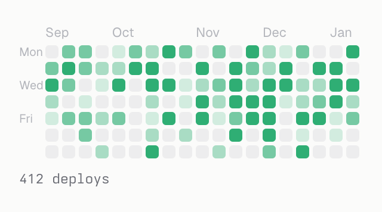
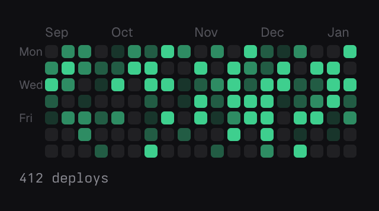
<figcaption>Twenty weeks at the default <code>md</code> size. A <code>null</code> cell (<code>data-l="n"</code>) draws nothing, as in the last column.</figcaption>
</figure>

## `effort`

The thinking-effort glyph of omp's composer chip. It is built for omp, but any plugin can show it. It draws a
14 px ring that fills clockwise one sixth per level, in that level's color. At `max` the ring closes and
"catches fire": a crown of flames rises off it with an ember inside, both flickering. Any other level (for example
`auto` before it resolves) draws a dashed empty ring and sets class `unknown`.

When the level changes, the arc sweeps to the new fill and the fire cross-fades (CSS transitions). On first show
the arc sweeps from empty over 0.6 s. Under reduced motion, `.sf-still` or `.sf-paused`, the fire holds still.
Under reduced motion there is also no sweep.

**Build it:** `tern.ui.node("effort", { level = "high" })`.

| Prop | Type | Default | Meaning |
| --- | --- | --- | --- |
| `level` | `"off"` \| `"minimal"` \| `"low"` \| `"medium"` \| `"high"` \| `"xhigh"` \| `"max"` | none | The rung: 0/6 through 6/6. Anything else is unresolved |
| `aria` | string | `"Thinking effort"` | Accessible name |

| Level | Fill | Arc color |
| --- | --- | --- |
| `off` | empty | (no arc) |
| `minimal` | 1/6 | `muted` |
| `low` | 2/6 | `info` |
| `medium` | 3/6 | `accent` |
| `high` | 4/6 | `warning` |
| `xhigh` | 5/6 | `error` |
| `max` | full, on fire | `error` (mixed into the fire) |

The colors are the span token colors (`--sf-c-<token>`). At `max` the track and arc fade out and a ring stroked with the fire
gradient takes their place. The node has `role="meter"`, `aria-valuemin` 0, `aria-valuemax` 6, `aria-valuenow`
the rung (0 when unresolved) and `aria-valuetext` the level.

**Children:** none (ignored).

**Events:** none of its own; `actions` work as on any node.

**Styling:**

```html
<span class="sf sf-effort" data-id="…" data-level="max" role="meter" aria-valuenow="6" aria-valuetext="max">
	<svg class="sf-eff" viewBox="0 0 16 16" aria-hidden="true">
		<defs><linearGradient id="fire"><stop class="lo"/><stop class="hi"/></linearGradient></defs>
		<path class="crown"/>
		<circle class="track"/>
		<circle class="arc"/>
		<circle class="blaze"/>
		<path class="ember"/>
	</svg>
</span>
```

| Target | Selector |
| --- | --- |
| The node | `.sf-effort` |
| By level | `.sf-effort[data-level='high']` |
| Unresolved | `.sf-effort.unknown` |
| Glyph | `.sf-eff` (inner, may change) |
| Ring track, level arc | `.sf-eff .track`, `.sf-eff .arc` (inner, may change) |
| Fire: blazing ring, flames, ember | `.sf-eff .blaze`, `.sf-eff .crown`, `.sf-eff .ember` (inner, may change) |
| Fire gradient stops | `.sf-eff .lo`, `.sf-eff .hi` (inner, may change) |

Variables: `--fire` (the gradient's low stop, mixed from `--bad`) and `--fire-hi` (the high
stop, `#ffc24a`). The track is `--l3`. Keyframes: `sf-flame` (the crown, 1.4 s) and `sf-ember` (0.9 s,
alternate), both starting 0.5 s after the level reaches `max`.

```lua
local ui = tern.ui

local levels = { "off", "minimal", "low", "medium", "high", "xhigh", "max", "auto" }
local cells = {}
for i, level in levels do
	cells[i] = ui.node("col", { gap = "xs", align = "center" }, {
		ui.node("effort", { level = level }),
		ui.text({ ui.span(level, "dim") }),
	})
end
return ui.node("row", { gap = "lg" }, cells)
```

<figure class="tn-figure">
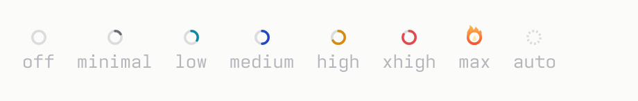
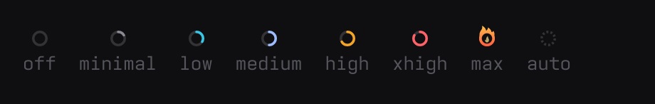
<figcaption>Every rung, and <code>auto</code> as an unresolved level.</figcaption>
</figure>

## Related pages

- [Elements](index.md): common props and the full kind index.
- [Text](text.md): span tokens and the `fx = "shimmer"` span effect.
- [Styling views](../styles/index.md): sheets, hooks and state classes such as `.sf-still`.
- [Variables](../styles/variables.md): `--accent`, `--t1`…`--t4`, `--l1`…`--l3`, tone colors.
- [Supported CSS](../styles/css.md): `@keyframes`, animation and transition support.
