# Text and Code

These kinds put words on screen: styled spans, Markdown, highlighted code, diffs, raw terminal output and
formulas. Use `text` for labels and short lines you style span by span, `md` for anything a person wrote in
Markdown, `code` for a file or snippet, `diff` for a change, `ansi` for a program's output as a terminal would
show it, and `math` for one TeX formula.

| Kind | Builder | Draws |
| --- | --- | --- |
| [`text`](#text) | `tern.ui.text(spans)` | Styled spans that wrap, clamp or truncate |
| [`md`](#md) | `tern.ui.md(text)` | Markdown in omp's dialect: callouts, tables, tasks, math, mermaid |
| [`code`](#code) | `tern.ui.code(text, lang?, start?)` | A highlighted code block with optional line numbers and marks |
| [`diff`](#diff) | `tern.ui.diff(text, path?)` | A unified or side-by-side diff with word-level emphasis |
| [`ansi`](#ansi) | `tern.ui.ansi(text)` | Program output (SGR colors, OSC 8 links) in a mini terminal |
| [`rows`](#rows) | `tern.ui.node("rows", …)` | Pre-rendered terminal rows at a fixed width (migration fallback) |
| [`math`](#math) | `tern.ui.node("math", …)` | One typeset TeX formula, inline or display |

All of them draw no children: children you give them are ignored. Every node element is
`<div class="sf sf-<kind>" data-id="…">`, and the [common props](index.md) (`key`, `tone`, `role`, `title`,
`min`/`max`, `actions`, …) work on each. Text in these kinds is set in the terminal's monospace face at
`--sf-fs`/`--sf-lh` and is selectable.

Stable hooks for your sheet: `.sf-<kind>`, `[data-id]`, `[data-role]`, `[data-tone]`, `[data-mark]`,
`[data-href]`, the `.sf-t-<token>` span classes, `.sf-link`, `.sf-fx-*`, `.tk-*`, and the region's
`[data-surface]`. Every other class below is Tern's inner structure: it is listed so you can style it, but it
is inner and may change between versions. See [Styling views](../styles/index.md) for scoping and the cascade,
[CSS variables](../styles/variables.md) for `--sf-c-*`, `--t1`…`--t4`, `--code-bg` and friends, and
[Supported CSS](../styles/css.md) for what a sheet may use.

## Text kinds and text ops

`text`, `md`, `code`, `ansi` and `math` are *text kinds*: their primary text is the `text` prop, and the
`text` and `splice` ops of the protocol address it (so do `editor`, `input`, `shimmer` and `el`; see
[Inputs](input.md), [Motion](motion.md) and [`el`](el.md)). `diff` and `rows` are not text kinds.

| Op | Effect |
| --- | --- |
| `text append <s>` | Appends `s` to the `text` string (sets it when `text` was absent or not a string) |
| `text replace <s>` | Sets `text` to `s` |
| `splice <at> <del> <s>` | Replaces `del` UTF-16 units at offset `at` of `text` with `s`; a range outside the text or splitting a surrogate pair is an error |

You never send ops from a plugin. You return a whole view; when a text kind's `text` prop grew by a suffix
since the last view, Tern sends it to the renderer as an append (see [UI Builders](../reference/ui.md#text-and-code)).
The renderers make appends cheap: `md` re-parses only from the last changed top-level block, `code` keeps the
highlighting of unchanged lines, and `ansi` feeds only the new tail to its terminal. Streaming into `text`
works only for the `text` prop: a `text` node with `spans` draws its spans and ignores `text`.

## `text`

Draws a run of styled spans. The text wraps by word by default; it can wrap anywhere, stay on one line, be
clamped to a number of lines, or be cut at the end, the start or the middle. Wrapping is CSS. Clamping and
truncation are computed by Tern after layout, from the element's width: a cut ends in `…`, and the cut node
gets the full text as its tooltip (`title`) unless you set `title` yourself. When the width changes, Tern shows
the full spans again, measures, and cuts anew. Spans can cite their sources ([Citations](#citations)).

**Build it:** `tern.ui.text(spans)` (see [UI Builders](../reference/ui.md#nodes-and-spans)), which emits
`{k = "text", p = {spans = …}}`. With `tern.ui.span`, `tern.ui.link` and `tern.ui.path` you build the spans.
Or `tern.ui.node("text", { text = "One style", wrap = "none" })`.

| Prop | Type | Default | Meaning |
| --- | --- | --- | --- |
| `spans` | `Spans` (list of span tables and strings) | none | The styled runs. When `spans` is a list it wins over `text` |
| `text` | string | `""` | Plain text, one unstyled span. Used only when `spans` is not a list |
| `wrap` | `"word"` \| `"char"` \| `"none"` | `"word"` | `word` breaks between words (a word longer than the line breaks by character); `char` breaks anywhere; `none` keeps each `\n`-separated line on one line. Unknown values read as `word` |
| `truncate` | `"end"` \| `"start"` \| `"middle"` | `"end"` | Where an overflowing text is cut: `end` keeps the start (`abcd…`), `start` keeps the end (`…wxyz`), `middle` keeps both ends (`ab…yz`). Unknown values read as `end`. A `truncate` without `wrap` or `lines` keeps the text on one line |
| `lines` | integer | none | Clamp to this many visual lines, the last one ending in `…`. `0` is no clamp. `1` keeps one line |
| `measure` | `"prose"` | none | `prose` caps the line length at 80 cells for readable paragraphs; otherwise the text fills its width |
| `cite` | `"chip"` \| `"pill"` \| `"note"` | `"chip"` | How cited spans look (see [Citations](#citations)). Unknown values read as `chip` |
| `sources` | boolean | `true` for `note`, else `false` | Draws the numbered sources list under the text. Not drawn when the text is fitted (`truncate`, `lines`, `wrap = "none"`) |

When fitting runs:

- One line (`wrap = "none"`, `lines = 1`, or a bare `truncate`): Tern cuts only when the text really overflows
  and cuts by `truncate`.
- `lines = N` with wrapping: Tern counts cells per line (the face is monospace) as `wrap` would break them, keeps
  what fits in N lines, drops trailing space and ends with `…` (inside the last line: a full last line gives up
  its final character for it). `truncate` does not apply here: the clamp always
  cuts at the end.
- `truncate = "middle"` with a span styled `path` first drops whole leading directories of that span
  (`Edited …/src/routes/users.ts`), then cuts the middle of the whole text if that was not enough.
- A cut that falls inside a span keeps that span's style, ellipsis included.

```lua
local s = "Indexing the workspace for symbols and references"
ui.node("text", { truncate = "end", spans = { ui.span("end    ", "dim"), s } })
ui.node("text", { truncate = "start", spans = { ui.span("start  ", "dim"), s } })
ui.node("text", { truncate = "middle", spans = { ui.span("middle ", "dim"), s } })
ui.node("text", { truncate = "middle", spans = {
	ui.span("path   ", "dim"), ui.span("Edited ", "muted"),
	ui.span("app/server/src/routes/users.ts", "path"), ui.span(" +12", "ins num"),
} })
ui.node("text", { lines = 2, spans = { ui.span("lines=2 ", "dim"),
	s .. ", then warming the type cache for every open file." } })
```

<figure class="tn-figure">
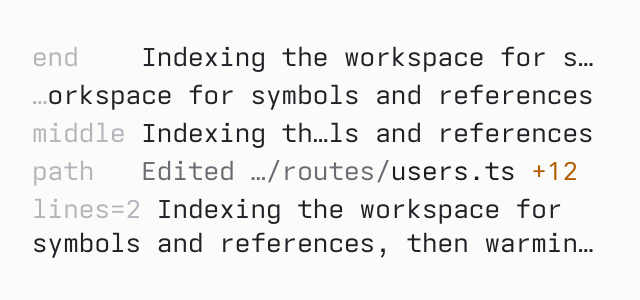
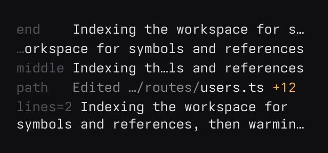
<figcaption>The five nodes at 288px: <code>start</code> cuts the label too, since the whole text is cut; the path line drops directories before anything else.</figcaption>
</figure>

### Spans

A span is a table; a plain string in a span list is an unstyled span.

| Field | Type | Meaning |
| --- | --- | --- |
| `t` | string | The text. An empty `t` draws nothing |
| `s` | string | Space-separated style tokens (below). Absent or `""` is plain. Unknown tokens draw no class (but see program tokens) |
| `href` | string | Makes the span a link (below) |
| `fx` | `"shimmer"` \| `"pulse"` \| `"none"` | An effect. `shimmer` sweeps a highlight across the characters; `pulse` fades the span in and out. Anything else is none |
| `cite` | source table, or a list of them | The sources this run cites (see [Citations](#citations)); the marker follows the run. A cited span with an empty `t` draws the marker alone |

`tern.ui.span(t, s)` and `tern.ui.link(t, href, s)` build `t`, `s` and `href`; set `fx` on the returned table
yourself. Spans are used by `text` and by every kind that takes span props (`card` and `section` heads, `kv`,
`table` cells, `badge`…), so everything here applies there too.

### Span style tokens

Each semantic token draws as class `.sf-t-<token>` on the span:

| Token | Draws |
| --- | --- |
| `muted` | Quiet text: `--sf-c-muted` |
| `dim` | Quieter text: `--sf-c-dim` |
| `strong` | Weight 600 in the primary text color (`--t1`) |
| `em` | Italic |
| `accent` | `--sf-c-accent` |
| `success` | `--sf-c-success` |
| `warning` | `--sf-c-warning` |
| `error` | `--sf-c-error` |
| `info` | `--sf-c-info` |
| `pending` | The `pending` tone's color (`--live`), for a word that waits on someone, beside a pending dot or badge |
| `title` | A page's title in its head row: `550 15px/1.3` sans (Geist), tracked in by `-0.014em`, in `--t1` |
| `code` | An inline code chip: `--sf-c-code` on `--chip-bg`, a hairline ring, rounded |
| `mono` | Tabular figures (`font-variant-numeric: tabular-nums`); in a sans region, also the mono face |
| `path` | A file path: `--sf-c-path`. A span with a `/` splits into `span.dir` (the directory, through the last `/`, in `--sf-c-muted`) and the file name. `truncate = "middle"` shortens it by directories |
| `key` | A keycap: padded, on `--l1`, in `--sf-c-key`. A key id with no spaces (`ctrl+r`, `shift+enter`, `f5`) draws as its platform keycap (`⌃R`) with the id as the tooltip |
| `link` | Link color (`--sf-c-link`) without making it a link; use `href` for a real link |
| `num` | A number in code: tabular figures in `--sf-c-num`, the code-number color. For numbers in `kv` values and text use `mono` |
| `ins` | Inserted text: `--sf-c-ins` |
| `del` | Deleted text: `--sf-c-del`, struck through |
| `mark` | A highlight (a search match, a selected row): a tinted background, `--sf-mark-bg` when set |
| `typo` | A misspelled word: a dotted underline in `--spelling-error-color`, as Tern's text fields mark one |
| `icon` | A Nerd Font glyph at icon metrics (1.2em wide, the Nerd-patched mono face, `aria-hidden`). When the next non-empty span does not start with whitespace, it also gets `.gap` (a small right margin) |
| `hide` | Not drawn (`display: none`), still in the text |

In a region of a surface opened with [`font: "sans"`](../protocol/surfaces.md#open-and-close), `mono`, `code`,
`num`, `path` and `key` spans (and Markdown inline code) draw in the terminal's mono face at 12.5px: the way to keep
ids, versions, sizes, times and paths mono among sans text. A `title` span draws in the sans face whatever the region.

You can combine tokens: `"strong error"`, `"muted path"`. A token appears once even if two tokens map to it.
A `key` span whose text has spaces or is not a `+`-joined id (`Esc to cancel`) draws its text as is.

<figure class="tn-figure">
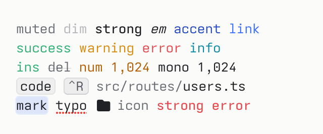
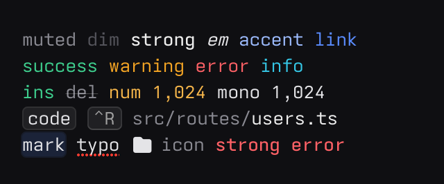
<figcaption>Each word is a span styled by the token it names: <code>{t = "ctrl+r", s = "key"}</code>, <code>{t = "src/routes/users.ts", s = "path"}</code>, a folder glyph with <code>s = "icon"</code>.</figcaption>
</figure>

**Icons in any text.** A Private Use Area codepoint (U+E000–U+F8FF, planes 15 and 16: Nerd Font icons) in a span
without `icon` is split out into its own span with the span's style plus `icon`. The same happens in `md` prose
and editors, so a Nerd glyph never overlaps the text after it.

### Program (theme) tokens

The omp theme token names also work as span tokens. Each draws in the theme's own color for it
(`--omp-<token>`, see [Theme token colors](../styles/variables.md#theme-token-colors)), else in the color of
the semantic token it maps to. omp's `accent`, `dim`, `muted`, `error`, `success` and `warning` are semantic
tokens already.

| Tokens | Map to |
| --- | --- |
| `text`, `customMessageText`, `syntaxVariable`, `toolOutput`, `userMessageText` | plain (no class) |
| `borderAccent`, `customMessageLabel`, `mdListBullet`, `statusLineModel`, `syntaxFunction`, `thinkingMedium` | `accent` |
| `borderMuted`, `statusLineSep`, `thinkingOff` | `dim` |
| `border`, `mdCodeBlockBorder`, `mdHr`, `mdLinkUrl`, `mdQuote`, `mdQuoteBorder`, `statusLineOutput`, `statusLineSpend`, `statusLineUntracked`, `syntaxComment`, `syntaxOperator`, `syntaxPunctuation`, `thinkingText`, `thinkingMinimal`, `toolDiffContext` | `muted` |
| `thinkingXhigh`, `thinkingMax`, `toolDiffRemoved` | `error` |
| `statusLineCost`, `statusLineGitClean`, `statusLineStaged`, `syntaxString` | `success` |
| `bashMode`, `statusLineDirty`, `statusLineGitDirty`, `thinkingHigh` | `warning` |
| `pythonMode`, `statusLineContext`, `statusLineSubagents`, `syntaxKeyword`, `syntaxType`, `thinkingLow` | `info` |
| `mdCode` | `code` |
| `mdCodeBlock` | `mono` |
| `mdHeading`, `toolTitle` | `strong` |
| `mdLink` | `link` |
| `statusLinePath` | `path` |
| `syntaxNumber` | `num` |
| `toolDiffAdded` | `ins` |
| `customMessageBg`, `selectedBg`, `statusLineBg`, `toolErrorBg`, `toolPendingBg`, `toolSuccessBg`, `userMessageBg` | nothing: fills never color text |

A token Tern does not know (`s = "myTone"`) gets no class and no color. There are no raw colors in spans.

### Links

A span with `href` draws as `span.sf-link[data-href]` (link color, pointer cursor, underline on hover) with the
tooltip `<href>  ⌘-click to open`. ⌘-click opens it. With Tern's "Open links with" setting on plain click, a
plain click opens it too, unless ⇧ is held or the click ended a text selection.

| `href` | Opens |
| --- | --- |
| A URL with a scheme (`https://…`, `mailto:…`) | Through the window's link handling, `tern.route.link` first (see [Routing](../guides/routing.md)) |
| `file://…` | The file, in a file block, through Tern's system integration |
| No scheme: a path (`./README.md`, `docs/a.md:12`, `../b.md#L3`, `src/a.rs:10-20`, `src/a.rs#L10-L20`, `~/x`, `C:\x`) | `%XX`-decoded; a relative one resolves against the pane's working directory, on the pane's host; it opens in a file block like a `file://` link, at the line (a range at its first line). A path that does not exist on this machine shows a toast naming the resolved path |

`tern.ui.path(p, cwd)` builds a `path` span linked to the absolute `file://` URL.

### Citations

A span can cite where its words come from. Give it a `cite` (one source or a list of them) and Tern draws a marker
after the run: a small numbered chip by default, the source's domain in a pill, or a dotted underline with a
superscript number and a numbered sources list under the text. Reach for it when an agent answer or a summary leans
on web pages, issues or docs and the reader should be able to check them without leaving the pane.

| Source field | Type | Default | Meaning |
| --- | --- | --- | --- |
| `href` | string | required | Where the source is; opened on click. A source without one is ignored |
| `title` | string | `""` | The source's title (hover card, sources list, accessible name) |
| `n` | integer ≥ 1 | by appearance | The number shown. Sources without one take the next free number in order of first appearance |
| `site` | string | the `href`'s host, `www.` dropped | The name the pill shows |
| `snippet` | string | none | A quote shown in the hover card (two lines at most) |

Sources are numbered per `text` node in the order their `href` first appears (the same `href` keeps its number); a
source's own `n` wins. The node's `cite` prop picks the look:

| `cite` | Look | Hover card on |
| --- | --- | --- |
| `chip` (default) | A small numbered accent chip after the run, one per source | Each chip (its source) |
| `pill` | The first source's domain in a pill with a colored dot, `+N` for more | The pill (all sources) |
| `note` | The run underlined in dots, superscript numbers after it; the sources list below | The cited run (all sources) |

A plain click on a marker, a cited run (`note`) or a sources row opens the `href` through the same handling as a
[link](#links), with no event to your program (⇧-click and a click ending a text selection open nothing). Resting
the pointer on the hover card's host opens a card with the source's title, URL and snippet. Copying the text (its
`copy` action or a selection) keeps `[1]`-style markers after each cited run. Spans without `cite` are untouched.

Citations are pointer-only: the node takes no focus. A program that wants keyboard access lists the sources itself
(or turns `sources` on) and opens them from its own keys.

```lua
tern.ui.node("text", {
	cite = "chip",
	spans = {
		{
			t = "The lockfile drifted from package.json",
			cite = {
				title = "pnpm install — frozen lockfile",
				href = "https://pnpm.io/cli/install",
				snippet = "CI fails when the lockfile needs an update.",
			},
		},
		" after the bump, and ",
		{ t = "CI refuses frozen installs", cite = {
			{ title = "Frozen lockfile errors", href = "https://github.com/pnpm/pnpm/issues/7019" },
			{ title = "pnpm install", href = "https://pnpm.io/cli/install" },
		} },
		".",
	},
})
```

The same in TSX, as footnotes with the sources list:

```tsx
<text
   cite="note"
   spans={[
      { t: 'The lockfile drifted', cite: { title: 'pnpm install', href: 'https://pnpm.io/cli/install' } },
      ' after the bump.',
   ]}
/>
```

<figure class="tn-figure">
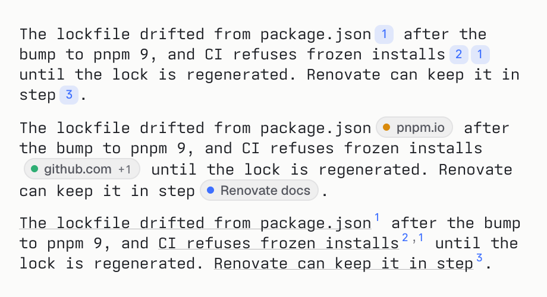
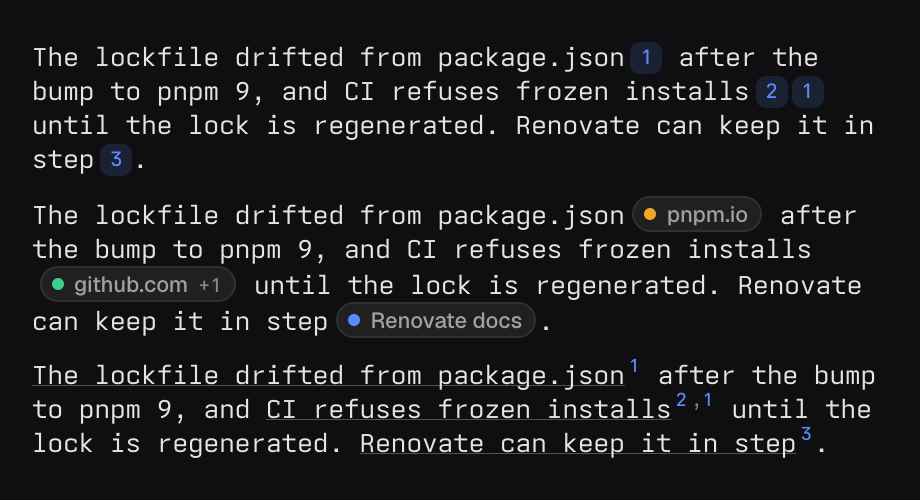
<figcaption>The three looks: <code>chip</code>, <code>pill</code> and <code>note</code> (here without its list).</figcaption>
</figure>

<figure class="tn-figure">
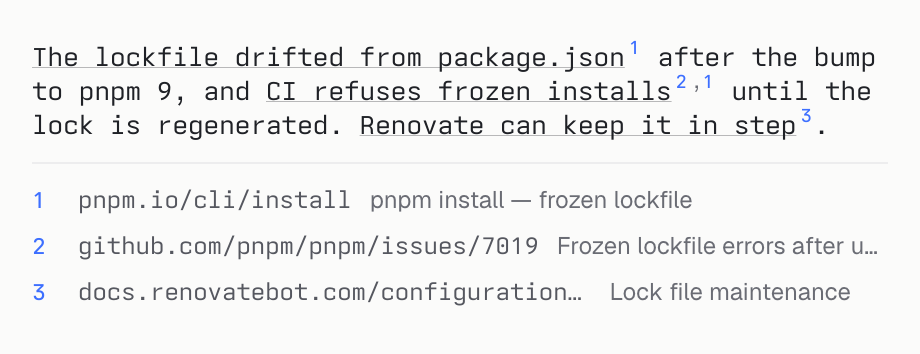
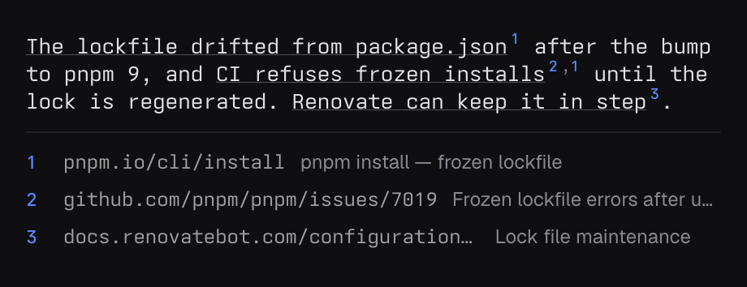
<figcaption><code>cite = "note"</code> draws the numbered sources under the text.</figcaption>
</figure>

### Effects

`fx = "shimmer"` sweeps one band of light across the span, as the [`shimmer`](motion.md#shimmer) kind does
(`--sh-lo`, `--sh-hi`, `--sh-mid` set the three colors, defaulting to `--t3`, `--t1`, `--t2`). `fx = "pulse"`
adds `.sf-fx-pulse` (opacity 1 → 0.45 → 1 over 1.6s). Both carry `.sf-fx-<fx>` and keep the document clock's
phase across redraws. Under reduced motion (`.sf-still`) and while the pane is hidden (`.sf-paused`) they stop;
a still shimmer shows its text in its own color.

**Children:** none (ignored).

**Events:** none of its own; `actions` work as on any node. Link and citation clicks are handled by Tern and do
not reach your `event`.

**Styling:**

```html
<div class="sf sf-text nowrap" data-id="…" title="full text when cut">
	plain text
	<span class="sf-t-muted">Edited </span>
	<span class="sf-t-path sf-link" data-href="file:///…" title="file:///…  ⌘-click to open">
		<span class="dir">app/src/routes/</span>users.ts
	</span>
	<span class="sf-t-icon gap" aria-hidden="true"></span>
	<span class="sf-t-key" title="ctrl+r">⌃R</span>
	<span class="sf-fx-shimmer">Working…</span>
</div>
<div class="sf sf-text cite-chip" data-id="…">
	<span class="sf-cite" data-href="https://pnpm.io/cli/install">
		<span class="run">The lockfile drifted</span>
		<span class="mk">
			<span class="cp">[1]</span>
			<span class="n" role="link" data-href="https://pnpm.io/cli/install" aria-label="Source 1: pnpm install">1</span>
			<span class="pill" role="link" data-href="…" aria-label="Source: pnpm.io"><span class="dot" data-c="…"></span><span class="site">pnpm.io</span></span>
		</span>
	</span>
	after the bump.
	<div class="sf-cite-list" role="list"><div class="src" data-href="…"><span class="n">1</span><span class="url">…</span><span class="ttl">…</span></div>…</div>
</div>
```

An unstyled span with no `href` and no effect is a bare text node, not a `span`.

| Target | Selector |
| --- | --- |
| The node | `.sf-text` |
| One line (`wrap = "none"` or `lines = 1`) | `.sf-text.nowrap` |
| Character wrapping | `.sf-text.char` |
| Prose measure | `.sf-text.prose` |
| A styled span | `.sf-t-<token>` |
| A link span | `.sf-link`, `[data-href]`, `[data-href^="http"]` |
| A path's directory, its position (`:12`, `#L3`) | `.sf-t-path .dir`, `.sf-t-path .ln` (inner, may change) |
| An icon followed by text | `.sf-t-icon.gap` |
| Effects | `.sf-fx-shimmer`, `.sf-fx-pulse` |
| Citation look | `.sf-text.cite-chip`, `.cite-pill`, `.cite-note` |
| A cited span: its words, its marker | `.sf-cite[data-href]`, `.sf-cite .run`, `.sf-cite .mk` (inner, may change) |
| The copy-only `[1]` text (unseen) | `.sf-cite .cp` (inner, may change) |
| A numbered chip or superscript | `.sf-cite .n[data-href]` (inner, may change) |
| The domain pill | `.sf-cite .pill`, `.pill .dot[data-c]`, `.pill .site`, `.pill .more` (inner, may change) |
| The citation hover card | `.sf-hovercard.sf-cite-card`, `.src`, `.head`, `.dot`, `.ttl`, `.url`, `.snip` (inner, may change) |
| The sources list | `.sf-cite-list`, `.src[data-href]`, `.n`, `.url`, `.ttl` (inner, may change) |

Variables: `--sf-c-<token>` for each colored token (`muted`, `dim`, `accent`, `success`, `warning`, `error`,
`info`, `code`, `path`, `key`, `link`, `num`, `ins`, `del`), `--sf-mark-bg`, `--spelling-error-color`,
`--sh-lo`/`--sh-mid`/`--sh-hi`. See [CSS variables](../styles/variables.md).

```lua
local ui = tern.ui

local function header(run)
	local file = ui.path(run.file, run.cwd)
	local line = ui.text({
		ui.span("Edited ", "muted"),
		file,
		ui.span(" +" .. run.added, "ins num"),
		ui.span(" −" .. run.removed, "del num"),
	})
	local p = line.p or {}
	p.truncate = "middle" -- one line; drops directories of the path first
	line.p = p
	return line
end

local busy = ui.span("Indexing…", "muted")
busy.fx = "shimmer"
return ui.col({ header(state.run), ui.text({ busy }) })
```

## `md`

Draws Markdown in omp's dialect through kit's Markdown view, set in the terminal's mono face. The source is
split into top-level blocks, each drawn as its own `div.md`; an update re-parses only the blocks whose source
changed (all of them when the link reference definitions changed). Long documents stay cheap: a block far from
the viewport is not laid out and holds the height it last had (an estimate before it was ever shown), and the
line groups of a long code fence and the items of a long list (once it stops streaming) do the same. Find and
copy still see the whole source.

**Images.** An `` image resolves through Tern, not the program: a file beside the pane (or an
absolute path, `file://`, `~/`), a `data:` URI or an `http(s)` address is read and decoded off the UI thread
and shows in place at its natural size, never wider than the column (a file on another host is read through
that host). A source Tern cannot read keeps the chip — an image icon and the alt text, titled with the source.

**Build it:** `tern.ui.md(text)` (see [UI Builders](../reference/ui.md#text-and-code)), or
`tern.ui.node("md", { text = src, stream = true })`.

| Prop | Type | Default | Meaning |
| --- | --- | --- | --- |
| `text` | string | `""` | The Markdown source |
| `stream` | bool | `false` | The source is still arriving: the last block is provisional (`.streaming`), it may be an unclosed fence or list. Its last element draws at 86% opacity, and a trailing paragraph, heading or list item ends in a pulsing accent caret. A mermaid fence left open shows as code until it closes or `stream` turns off, so a half-written diagram is never laid out |
| `marks` | `Spans` | none | Spans drawn in place of their literal text wherever it occurs in prose. At each point the earliest match wins, the longest on a tie. omp uses it for chips, skills and mentions in a sent prompt |

### Dialect

| Feature | Syntax | Draws |
| --- | --- | --- |
| CommonMark | headings, paragraphs, emphasis, links, images, lists, quotes, rules, code | The usual elements. Raw HTML stays literal text (blocks as `div.md-html`) |
| Headings 5 and 6 | `#####`, `######` | `h4.h5`, `h4.h6` (there is no `h5`/`h6`) |
| Line breaks | every line ending inside a paragraph, as omp draws Markdown in a terminal (CommonMark would join the lines); two spaces or `\` at line end too | `span.br` |
| GFM tables | pipes, `:---:` alignment | `div.tbl > table > thead + tbody`; alignment as inline `text-align` |
| Severity pills | a table cell that is exactly `high`, `medium` or `low` (any case) | `span.sev.<level> > i + text` |
| Task lists | `- [ ]`, `- [x]` | `ul.tasks > li.task` (`.done` when checked, its text struck through), read-only boxes `span.cb[role=checkbox]` (`.on` when checked) |
| Strikethrough, autolinks | `~~x~~`, bare URLs (`http://`, `https://`, `file://`, `www.`) and emails | `del`, links |
| Callouts | a quote whose first line is `[!NOTE]`, `[!TIP]`, `[!IMPORTANT]`, `[!WARNING]` or `[!CAUTION]` (any case) | `div.callout.<kind> > .co-ic + div.co-body`; warning and caution tint with `--warn` and a warning icon, the rest with `--accent` and an info icon |
| Math | `$…$`, `\(…\)` inline; `$$…$$`, `\[…\]`, a `\begin{env}…\end{env}` block display | `span.math` (`.display`) or `div.math-display` around a typeset `svg` in `currentColor`; a formula that fails shows `code.math-err` titled with the error. The wrapper holds the TeX in `data-tex`, and a text selection copies it as `$tex$` / `$$tex$$` |
| Code fences | ```` ```lang ```` | `div.code > div.code-head (language + Copy) + pre > code` on `--code-bg`, one span per line, highlighted with `.tk-*` classes (see [`code`](#code)). The head shows only on hover or focus, at the block's top right. The label is the lowercased fence language, `text` without one |
| Mermaid | ```` ```mermaid ```` | `figure.mfig[data-m] > div.mfig-head (icon, "mermaid · <kind>", Source, Copy, Open) + div.mfig-body` with the diagram at natural size; wide diagrams scroll sideways |
| Color swatches | a hex color in a code span | a `span.chip` color chip before it |
| File paths | a path in prose or as a whole code span, with an optional position: `` `crates/x/y.rs:10-20` ``, `src/a.ts#L4`, `./b.md:3:7` | A linked `path` span, `span.sf-t-path.sf-link[data-href]` (directory `.dir` and position `.ln` quiet, the name strong), opening the file at the line like a path `href`. Only what reads as a file links: a separator or a position, and an extension (`src/a.rs`, `keys.rs:12`; not `ui.now`, `and/or`, `styles/*.css`). Text inside a Markdown link keeps to that link |
| Nerd icons | Private Use Area codepoints | `icon` spans (see [Span style tokens](#span-style-tokens)) |

Prose (the text inside paragraphs, headings, list items, cells) is drawn through the same span path as `text`.

**User settings.** "Markdown headings" (Annotated by default) is Tern's, not a prop. Annotated: every heading is
body size, weight 600, in the `mdHeading` color, after a quiet `#`…`######` marker (`::before`, `--t4`).
Annotated adds `.sf-h-annotated` to the regions. Sized: `h1`–`h3` are 20/17/15px sans titles. "Open links with"
decides whether a plain click opens a link, as for spans.

**Copy.** A code block's Copy button (`.code-copy`, in the head shown on hover or focus) puts the
code on the clipboard. A mermaid figure's Open button (`.mfig-open`) or a click on its drawing shows the diagram
large; a click on a complete SVG figure's drawing shows it large too, as it is drawn. On SVG, 3D and mermaid
figures once their fence is complete, Source (`.mfig-source`) shows the fence's code (`pre.mfig-src`) in place
of the drawing until it is pressed again, and Copy (`.mfig-copy`) puts that code on the clipboard. A text selection
copies as Markdown-backed text, with math as its TeX.

**Run.** In `main`, a `sh`, `shell`, `bash` or `zsh` fence has a Run button before Copy (`.code-run`) when Tern
can run the program's commands: a program on this machine, not one reached over `ssh`, on macOS and Linux.
Run starts the code with that shell (`sh -c …`) in the pane's directory, its input empty and its output
through a pipe (no pager, no terminal prompts), and the output streams in under the code: a mini terminal
showing the last 16 lines ("N earlier lines" above them shows the rest) over a foot line with the state and time. While it
runs the button is Stop, which interrupts the command (`SIGINT`, then a kill if it does not end within two
seconds). Once it ends the foot says how (Done, `exit N`, Stopped) with its duration and a Clear button; Run
runs it again in place of the old output. A fence still arriving (the streamed tail) offers no Run yet. The
output is Tern's alone: the program does not see it, and it goes when the block leaves the transcript (a
running command ends then too).

**Children:** none (ignored).

**Events:** none of its own; `actions` work as on any node. Copy, Open, Run and link clicks are Tern's.

**Styling:**

```html
<div class="sf sf-md" data-id="…">
	<div class="md">
		<h2 id="h-…">Setup</h2>
		<p>Run <code>make</code> first.</p>
	</div>
	<div class="md streaming">
		<div class="callout warning"><svg class="co-ic">…</svg><div class="co-body"><p>…</p></div></div>
		<div class="code">
			<div class="code-head"><span>rust</span><button class="btn sm quiet code-copy">Copy</button></div>
			<pre><code><span><span class="tk-keyword">fn</span> main() {}</span></code></pre>
		</div>
	</div>
</div>
```

| Target | Selector |
| --- | --- |
| The node | `.sf-md` |
| One top-level block (chunk) | `.sf-md .md` (inner, may change) |
| The provisional streamed tail | `.sf-md .md.streaming` |
| Headings | `.sf-md .md :is(h1, h2, h3, h4)`, `h4.h5`, `h4.h6` |
| Annotated headings | `.sf-h-annotated .sf-md .md h2` |
| Lists, tasks | `ul`, `ol`, `li > .li-t`, `ul.tasks`, `li.task`, `li.task.done`, `.cb`, `.cb.on` |
| Tables | `.tbl`, `table`, `th`, `td`, `.sev.high`/`.medium`/`.low` |
| Callouts | `.callout`, `.callout.note`/`.tip`/`.important`/`.warning`/`.caution`, `.co-ic`, `.co-body` |
| Code fences | `.code`, `.code-head`, `.code-copy`, `pre code`, `.tk-*` |
| A fence's run | `.code.runnable`, `.code.ran`, `.code.running`, `.code.failed`, `.code-run`, `.code-out`, `.code-out-foot`, `.code-out-state[data-tone]`, `.code-out-time`, `.code-out-clear` |
| Mermaid | `.mfig`, `.mfig-head`, `.mfig-open`, `.mfig-body` |
| Math | `.math`, `.math.display`, `.math-display`, `code.math-err` |
| Images | `.md-img`, `.md-img.framed`, `.md-img-frame`, `.md-img-alt` |
| Inline code, swatches | `code`, `.chip`, `.swatch` |

All the inner selectors are kit's Markdown DOM (inner, may change). Blocks sit `0.5 × --sf-lh` apart (`gap` on
`.sf-md`). Variables: `--code-bg`, `--chip-bg`, `--t1`…`--t4`, `--accent`, `--warn`, the
`--tk-*` colors.

````lua
local ui = tern.ui

local doc = ui.node("md", {
	text = [[
## Release

> [!WARNING]
> Tag only from `main`.

- [x] changelog, see [notes](https://example.com)
- [ ] tag `v1.4.0`

| Check | Risk |
| --- | :---: |
| Migrations | high |
| Docs | low |

Energy: $E = mc^2$, accent `#7c5cff`.

```rust
fn main() { println!("ship"); }
```
]],
	stream = state.generating,
})
return { main = ui.col({ doc }) }
````

<figure class="tn-figure">
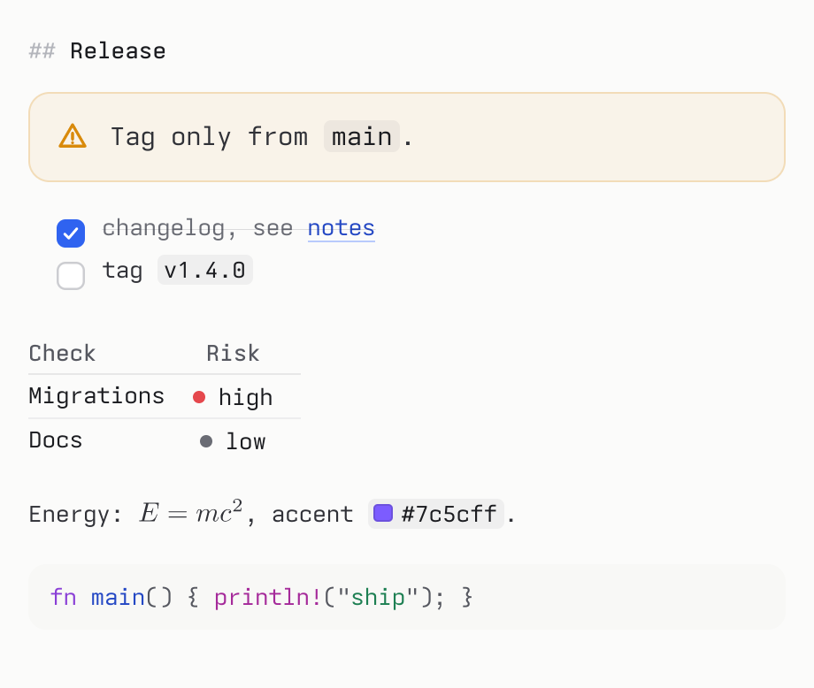
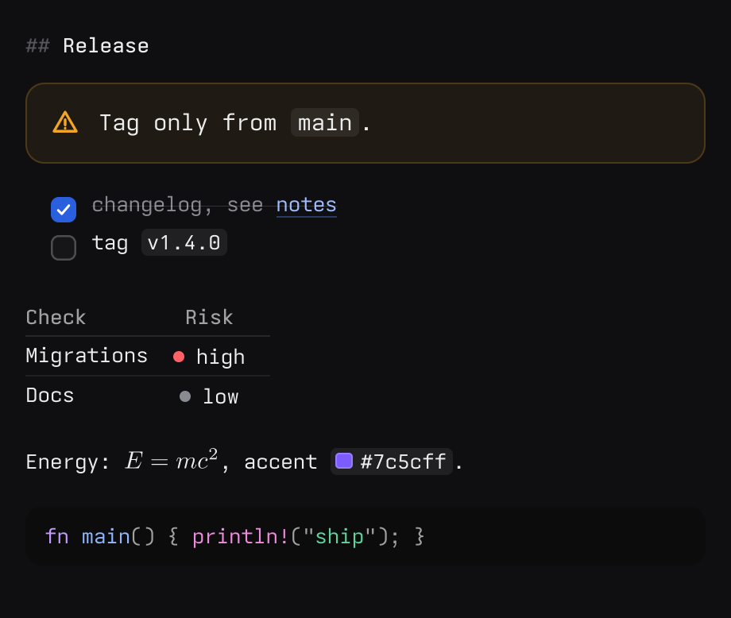
<figcaption>With <code>stream</code> off. The fence's language label and Copy button appear on hover.</figcaption>
</figure>

## `code`

Draws a code block with Tern's highlighter, optional line numbers and marked lines. Highlighting runs in the
background over the whole text, so multi-line strings and comments color right; lines show plain until their
colors land. Unwrapped lines scroll sideways inside the block. The code block always has its full source height,
but only the rows near the viewport are mounted. Without `wrap` the rows are one line tall; with `wrap` they keep
their wrapped heights. A line longer than 4,096 bytes draws only its first 4,096 (cut at a character boundary),
then a dim "… N more characters" (`span.sf-elided`); only the drawn part is highlighted and marked.

**Preview.** `preview = { lines = N }` clamps a block taller than N drawn lines (a wrapped line counts as many) to
its first N under a bottom fade (class `clamped`), with a `button.sf-code-more` after the body reading "K more
lines" ("1 more line"). Only the rows inside the clamp are mounted (with the usual overscan); the rest mount once
it lifts, and unwrapped lines still scroll sideways. The button expands the block in place ("Show less" folds it
again); a new `preview` value resets that. Inside a collapsible card, section or tool, the preview applies only
while that disclosure is folded: open, the block shows whole and the button hides; folded, the button opens the
disclosure (the `toggle` event, as a head click) rather than expanding only the block.

**Wash.** A mark's `wash` (a list of numbers) washes its row on the same ten-step amber-to-red ramp as `heat`,
each value a score clamped to 0–1 (a value that is not a number reads as 0). One value washes the row flat;
several run a gradient across the row, left to right, one evenly spaced stop per value, so a row can show two
scorers side by side. It replaces `heat`'s flat wash and the tone's tint on that row; `heat` still sets the line's
bar in the overview strip and the fold sparkline. An empty list draws nothing, and scores that are all 0 leave the
row bare even under a `heat`. A mark with `wash` and no `tone` draws no tone bar.

**Folds.** Each of `folds` (`from`/`to`, the first and last line in the gutter's numbering) draws its lines as
one row (`.sf-fold`): the `label` in the code's face (default `… [lines {from}-{to}]`, `… [line {from}]` for one
line), a sparkline of the folded lines' mark `heat`, then the `note` (a string or spans). A click on the folded row
opens the fold in place, the lines drawn with their marks (which apply only once open) under a head row
(`.sf-fold.open`, naming the lines and then the `label` if one was given) whose click folds them
again (Enter or Space on a focused fold row toggles too); an open fold's drawn lines carry `.folded` (a closed
fold's lines are not drawn). A find match inside a closed fold opens it. Each fold's open state is Tern's, kept
by its first line across updates of `text` or `folds`; `open = true` only opens a fold not drawn before (none
earlier started at that line). Folds that overlap an earlier one or fall outside the text are dropped.
`tone = "error"` tints the row; any tone colors the note. `hovercard` is a node tree shown as a card while the
pointer rests on the folded row, as the common [`hovercard`](index.md) prop.

**Overview.** `overview = true` draws a strip (`.sf-code-map`) above the lines: one bar per line, its height the
line's mark `heat` and its color the mark's tone; a band under it over the lines outside folds; and a bracket over
the lines in view, which follows scrolling. A click or drag on the strip scrolls the block to that line.

**Excerpts.** `nums` numbers each line itself (one integer per line of `text`, strictly ascending) in place of
counting from `start`, for lines picked out of a longer file such as search hits with their context. A line whose
number does not follow the one before gets a `…` row (`.sf-gap`) above it, in the gutter in line with the numbers,
so the excerpt stays one block that scrolls sideways as a whole. Marks and folds name lines by these numbers. A
`nums` of another length than the text's lines, or not ascending, is ignored and the lines count from `start`.

**Build it:** `tern.ui.code(text, lang, start)` (see [UI Builders](../reference/ui.md#text-and-code)); with
`start` it also sets `numbers = true`. Or `tern.ui.node("code", { text = src, path = "src/main.rs", wrap = true })`.

| Prop | Type | Default | Meaning |
| --- | --- | --- | --- |
| `text` | string | `""` | The code |
| `lang` | string | none | The grammar by language name or extension (`"rust"`, `"lua"`, `"ts"`). Wins over `path`. Without `lang` and `path` the code is plain |
| `path` | string | none | A file path: picks the grammar by file name when `lang` is absent, and shows a header with a file icon, the dim directory and the file name (tooltip: the path). Without `path` there is no header |
| `numbers` | bool | `false` | Show the line number gutter |
| `start` | integer | `1` | The first line's number |
| `nums` | list of integers | none | Each line's number, strictly ascending, in place of `start`, with a `…` row where they jump (see Excerpts) |
| `marks` | list of `{line, tone?, heat?, wash?, ranges?}` | none | Marked lines. `line` counts in the gutter's numbering (from `start`, or `nums`); lines before `start` or missing from `nums` are ignored. `tone` is one of the [tones](index.md) (default `accent`; unknown tones read as `accent`); the row gets a tone bar and its number in the tone, and any tone but `accent` also tints the row. `accent` marks (search matches) stay muted whatever the theme's accent, so a run of them never reads as a diff, and the block's unmarked lines fade to half opacity instead. `heat` is a score from 0 to 1 (clamped) that washes the row on a ramp from untinted to a strong amber-to-red, in ten steps, in place of the tone's tint (`wash`, see Wash, takes its place); a mark with `heat` or `wash` and no `tone` draws no bar, and in a block with `accent` marks only its text fades, not the wash. `ranges` is `{{start, end}, …}` byte ranges in that line (end exclusive) drawn with a stronger tint, e.g. search matches |
| `wrap` | bool | `false` | Soft-wrap long lines instead of scrolling sideways |
| `preview` | `{lines = N}` | none | Clamp to the first N drawn lines under a fade, with a "K more lines" button (see Preview). A fractional `lines` is truncated; anything below 1 or of another shape means no preview |
| `folds` | list of `{from, to, label?, note?, tone?, open?, hovercard?}` | none | Runs of lines drawn as one row until opened (see Folds). Sorted and not overlapping |
| `overview` | bool | `false` | Show the overview strip above the lines (see Overview) |

Highlight token classes, from kit's highlighter:

| Class | Color variable | Typical tokens |
| --- | --- | --- |
| `.tk-comment` | `--tk-comment` | comments |
| `.tk-doc` | `--tk-doc` | documentation comments (`///`, `/** */`, docstrings) |
| `.tk-keyword` | `--tk-keyword` | keywords |
| `.tk-function` | `--tk-function` | function names |
| `.tk-macro` | `--tk-macro` | macros, attributes, decorators (`println!`, `#[derive]`, `@sealed`) |
| `.tk-variable` | `--tk-variable` | variables |
| `.tk-property` | `--tk-property` | fields, properties, object and config keys, markup attribute names |
| `.tk-string` | `--tk-string` | strings, inline code |
| `.tk-escape` | `--tk-escape` | escapes and format placeholders in strings, markup entities |
| `.tk-number` | `--tk-number` | numbers |
| `.tk-constant` | `--tk-constant` | `true`, `None`, `nil`, named constants, enum members |
| `.tk-type` | `--tk-type` | types |
| `.tk-tag` | `--tk-tag` | markup tag names (HTML, JSX, XML) |
| `.tk-heading` | `--tk-heading` | markup headings |
| `.tk-link` | `--tk-link` | markup link text and targets |
| `.tk-operator` | `--tk-operator` | operators |
| `.tk-punct` | `--tk-punct` | punctuation |
| `.tk-inserted` | `--tk-inserted` | inserted lines (diff grammar) |
| `.tk-deleted` | `--tk-deleted` | deleted lines (diff grammar) |

The same classes color `md` fences, `diff` and `editor` code. Override the `--tk-*` variables to recolor
everything at once.

**Children:** none (ignored).

**Events:** none of its own; `actions` work as on any node. The preview's expansion is Tern's local state.

**Styling:**

```html
<div class="sf sf-code numbers wrap clamped" data-id="…" style="--sf-gw:…">
	<div class="sf-code-head"><svg class="ico">…</svg><span class="sf-code-path" title="src/main.rs"><span class="dir">src/</span><span class="name">main.rs</span></span></div>
	<div class="sf-code-body">
		<div class="sf-code-lines">                   <!-- the mounted lines only -->
			<div class="sf-ln mk" data-tone="warning">
				<span class="sf-gut" aria-hidden="true">12</span>
				<span class="sf-lt"><span class="tk-keyword">let</span> x = <span class="sf-em">42</span>;</span>
			</div>
		</div>
	</div>
	<button class="sf-code-more" title="Show all lines" aria-expanded="false">14 more lines<svg class="ico chev">…</svg></button>
</div>
```

| Target | Selector |
| --- | --- |
| The node | `.sf-code` |
| With numbers, wrapping | `.sf-code.numbers`, `.sf-code.wrap` |
| With `accent` marks (its unmarked lines faded) | `.sf-code.matches` |
| Header (hidden without `path`) | `.sf-code-head`, `.sf-code-head.sf-hidden` (inner, may change) |
| Path in the header | `.sf-code-path`, `.sf-code-path .dir`, `.sf-code-path .name` (inner) |
| Scroll body, lines | `.sf-code-body`, `.sf-code-lines` (inner) |
| Preview clamp | `.sf-code.clamped > .sf-code-body` (`max-height: var(--sf-clamp)`, content-box, bottom fade) |
| More/less button | `.sf-code-more`, `.sf-code-more.open` (expanded), `.sf-code-more.sf-hidden` (inner) |
| A line | `.sf-ln` (inner) |
| A marked line | `.sf-ln.mk`, `.sf-ln[data-tone="error"]` |
| A line's heat step (`0`–`10`; it may have no `.mk`) | `.sf-ln[data-heat="7"]` |
| A washed line (by `wash`, or a `heat` above 0; its background is `--wash`) | `.sf-ln.wash` |
| The `…` row where `nums` jumps | `.sf-ln.sf-gap` (inner) |
| Gutter, line text | `.sf-gut`, `.sf-lt` (inner) |
| A cut line's note | `.sf-elided` (inner) |
| A mark's range | `.sf-ln.mk .sf-em` |
| A fold's row, open (its head) | `.sf-fold`, `.sf-fold.open`, `.sf-fold[data-tone="error"]` (inner) |
| A line of an open fold | `.sf-ln.folded` (inner) |
| The overview strip | `.sf-code-map` (inner) |
| Tokens | `.tk-*` |

Variables: `--sf-gw` (gutter width, set inline from the digit count), `--sf-clamp` (the clamped lines' height, set
inline on `.sf-code-body`), `--tc` (the tone color, from `data-tone`),
`--code-bg` (the block background), `--l1` (ring and header rule), `--t3`/`--t4`, `--sf-lh`, `--sf-tab`
(columns per tab stop), `--tk-*`.

```lua
local ui = tern.ui

local block = ui.code(state.source, nil, 40) -- numbers from 40
block.p.path = "src/server.lua"
block.p.marks = {
	{ line = 42, tone = "error", ranges = { { 16, 21 } } }, -- `sockt`
	{ line = 45, tone = "warning" },
}
return { main = ui.col({ block }) }
```

<figure class="tn-figure">
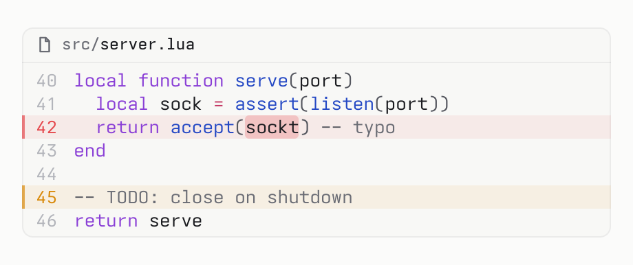
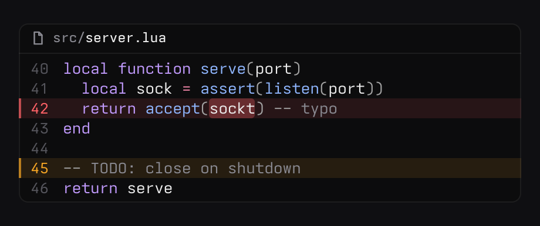
<figcaption>The example with a seven-line <code>state.source</code>. The grammar comes from <code>path</code>, since <code>lang</code> is nil.</figcaption>
</figure>

Scored lines with folds, washes and the overview strip:

```lua
local ui = tern.ui

local block = ui.code(state.output, nil, 1)
block.p.overview = true
block.p.marks = {
	{ line = 1, tone = "accent", heat = 0.9, wash = { 0.9, 0.3 } },
	{ line = 2, heat = 0.2, wash = { 0.2, 0.6 } },
	{ line = 7, heat = 0.7 }, -- folded below, still hot
}
block.p.folds = {
	{
		from = 3, to = 9, label = "… [lines 3-9]", note = "7 lines below the cutoff", tone = "error",
		hovercard = ui.text("Line 7 scored 0.9, under the cutoff of 1"),
	},
}
return { main = ui.col({ block }) }
```

## `diff`

Draws a diff with word-level emphasis and syntax highlighting on both sides. It draws no header of its own: put
it in a `card` whose head names the file. Inside a `card` it sits flush (no ring or background of its own). A
diff with no changes shows "No changes".

**Build it:** `tern.ui.diff(text, path)` (see [UI Builders](../reference/ui.md#text-and-code)), or
`tern.ui.node("diff", { hunks = …, path = …, mode = "split" })`.

| Prop | Type | Default | Meaning |
| --- | --- | --- | --- |
| `text` | string | none | A unified diff: `@@ -a,b +c,d @@` hunks. `diff --git`, `---`/`+++` and `index` headers are tolerated and name the file. Text with no hunk header at all reads as one hunk of `+`/`-`/` ` lines |
| `hunks` | list of `{oldStart?, newStart?, lines}` | none | Hunks given directly; wins over `text` when it is a list. `oldStart`/`newStart` default to `1`; `lines` are strings starting with `+`, `-` or a space (any other line, and an empty one, reads as context, whole). Lines starting with `\` (`\ No newline at end of file`) are skipped |
| `path` | string | the file the headers name | Picks the grammar when `lang` is absent. Not drawn |
| `lang` | string | none | The grammar by language name; wins over `path` |
| `mode` | `"unified"` \| `"split"` \| `"auto"` | `"auto"` | `unified`: one column, numbered once per line (a removed line by its old number, the rest by their new one). `split`: old \| new side by side, the missing side of an unpaired line left blank. Absent, `auto` or any other value: the user's setting. Either way a long line wraps inside its row (or its half) under its text; the diff never scrolls sideways |

**The Edits setting.** For any `mode` but `unified` and `split`, Tern's "Edits" setting decides: Inline (the default) draws
unified; Split draws side by side when the block is wider than 112 cells and unified otherwise, re-deciding as
the width changes. An explicit `mode` wins over the setting.

A line longer than 4,096 bytes is cut as in [`code`](#code), its note included.

Paired lines (the i-th `-` and the i-th `+` of one change) get word-level emphasis (`.sf-em`) on the words that
changed, unless either line is over 1000 bytes or both sides are mostly rewritten. Between hunks a fold row says
`⋯ N unchanged lines` (`⋯` alone when the gap is unknown) and the enclosing function from the next hunk's `@@`
header; the first hunk's header text is not drawn. On added and removed lines indented by 2 or more cells,
faint guides mark each indent unit (a tab stop with tabs, 4 cells for a multiple of 4 spaces, else 2) through
the leading whitespace. A diff of more than 64 rows (in the layout shown) puts them in `div.sf-dgrp` groups of
64, laid out only near the viewport (until then each stands in at its rows' estimated height).

**The Tab width setting.** Tabs here, in [`code`](#code) and in Markdown code stop every N columns, N being
Tern's "Tab width" setting (Settings › Appearance › Programs, 3 by default; `--sf-tab` on the regions).

**Children:** none (ignored).

**Events:** none of its own; `actions` work as on any node.

**Styling:**

```html
<div class="sf sf-diff split" data-id="…" style="--sf-gw:…">
	<div class="sf-diff-body">
		<div class="sf-dsep">⋯ 12 unchanged lines<span class="fn">fn main()</span></div>
		<!-- unified -->
		<div class="sf-dl del"><span class="sf-dg">4</span><span class="sf-dm">-</span><span class="sf-dt">let x = <span class="sf-em">1</span>;</span></div>
		<!-- split -->
		<div class="sf-dr">
			<div class="sf-dl half del">…</div>
			<div class="sf-dl half add">…</div>
		</div>
		<!-- over 64 rows: the rows in groups of 64 -->
		<div class="sf-dgrp" style="content-visibility:auto;contain-intrinsic-height:auto …px">…</div>
	</div>
</div>
```

| Target | Selector |
| --- | --- |
| The node | `.sf-diff`, `.sf-diff.split` |
| Body | `.sf-diff-body` (inner, may change) |
| Empty | `.sf-diff-empty` (inner) |
| Row group of a long diff | `.sf-dgrp` (inner, laid out only near view) |
| Fold row between hunks | `.sf-dsep`, `.sf-dsep .fn` (inner) |
| A line | `.sf-dl.ctx`, `.sf-dl.add`, `.sf-dl.del` (inner) |
| Split row and halves | `.sf-dr`, `.sf-dl.half`, `.nil` on the blank side (inner) |
| Number, marker, text | `.sf-dg`, `.sf-dm`, `.sf-dt` (inner) |
| Changed words | `.sf-dl.add .sf-em`, `.sf-dl.del .sf-em` |
| Indent guides | `.sf-dt.ind` (inner) |
| Tokens | `.tk-*` |

Variables: `--sf-gw`, `--ok` (added), `--bad` (removed), `--code-bg`, `--l1`, `--l2` (indent guides), `--t4`,
`--sf-cw`, `--sf-tab`, `--sf-shade` (the blank side), `--ind`/`--ind-unit` (set inline on `.sf-dt.ind`),
`--tk-*`.

```lua
local ui = tern.ui

local change = ui.diff(state.patch, "src/app.lua")
return ui.card({ ui.path("src/app.lua", state.cwd) }, { change })
```

The same patch drawn both ways, outside a card:

```lua
local patch = [[
@@ -3,4 +3,4 @@ function start(cfg)
 local port = cfg.port
local host = cfg.host
 log("on " .. port)
return serve(host, tls)
@@ -20,2 +20,3 @@ return {
 start = start,
stop = stop,
 }]]
return ui.col({
	ui.node("diff", { text = patch, path = "src/app.lua", mode = "unified" }),
	ui.node("diff", { text = patch, path = "src/app.lua", mode = "split" }),
})
```

<figure class="tn-figure">
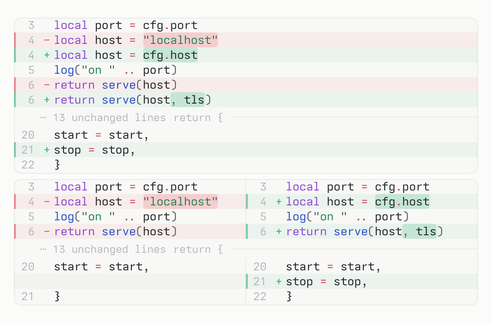
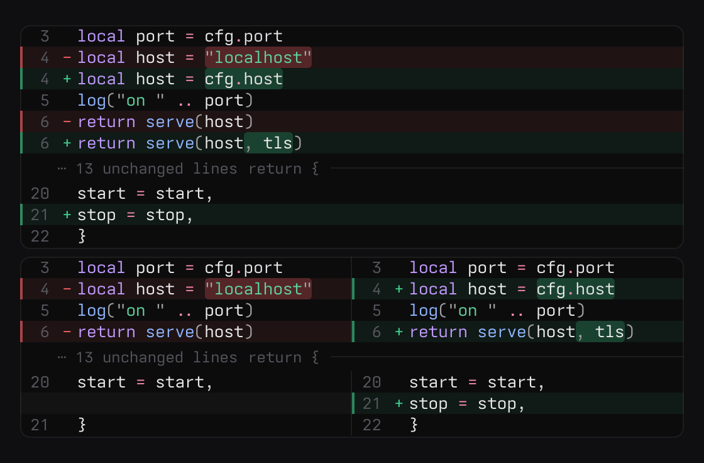
<figcaption><code>mode = "unified"</code> (top) and <code>mode = "split"</code> (bottom). Paired lines tint only the words that changed.</figcaption>
</figure>

## `ansi`

Draws raw program output in a mini terminal: SGR colors and styles, OSC 8 hyperlinks, `\r` and `\b`. The output
wraps at the block's width and reflows when it changes; a bare `\n` moves to the next line's start, as a pty
would. The block is as tall as its output, but only the lines in view (plus 24 on each side) are painted. ANSI
colors come from the terminal theme (`--ansiN`); the background is transparent.

Text that only grew (a `text append`, or a view whose `text` gained a suffix) feeds just the new tail; any other
change starts the terminal over.

**Build it:** `tern.ui.ansi(text)` (see [UI Builders](../reference/ui.md#text-and-code)), or
`tern.ui.node("ansi", { text = out, follow = true, preview = { lines = 8 } })`.

| Prop | Type | Default | Meaning |
| --- | --- | --- | --- |
| `text` | string | `""` | The output, with escape sequences |
| `cols` | integer | none | The most columns: wrap at this width when the block is wider |
| `preview` | `{lines = N}` | none | Clamp to N lines under a fade, with a button that expands it in place ("Show less" folds it again). The first N lines with "K more lines" under them, or with `follow` the last N with "K earlier lines" ("1 earlier line") above them. A new `preview` value resets the expansion. Inside a collapsible card, section or tool it applies only while that is folded, and the button opens it instead (see below) |
| `follow` | bool | `false` | Keep the tail in view. With `preview`, the clamp shows the tail. With a `max.h` bound, the block keeps scrolled to the bottom until the user scrolls away from it, and follows again once they scroll back to the bottom |
| `max` | `{h = …}` | none | The common size bound. On `ansi`, a `max.h` (`"10lines"`) makes the block scroll vertically (`.scroll`) instead of clipping |

⌘-click on an OSC 8 link opens it (a plain click too, under the "Open links with" plain-click setting, unless ⇧
is held, or the click ended a selection).

The mouse selects the output as in the terminal: a drag selects cells from the press, line by line; a double
click selects a word, a triple click a line, and ⇧-click extends the selection. Tern's copy (the Copy shortcut,
the context menu's Copy, Copy on select) takes the selected text, a line break ending each output line and blank
cells past a line's text left out. A press anywhere else ends the selection.

**Children:** none (ignored).

Inside a collapsible card, section or tool (the nearest one up the tree), the preview gives way while that
disclosure is open: the block shows whole and the button hides. While it is folded, the button opens it (the
`toggle` event, as a head click) rather than expanding only the block.

**Events:** none of its own; `actions` work as on any node. The more button is Tern's local state.

**Styling:**

```html
<div class="sf sf-ansi scroll" data-id="…">
	<div class="sf-term-clip clamped fade-bottom" style="--sf-clip:…">
		<div class="tv-mini">…</div>
	</div>
	<button class="sf-ansi-more" title="Show all output" aria-expanded="false">12 more lines<svg class="ico chev">…</svg></button>
</div>
<!-- a tail preview (`follow`): the button, with .tail, comes before the clip -->
<div class="sf sf-ansi" data-id="…">
	<button class="sf-ansi-more tail" title="Show all output" aria-expanded="false">12 earlier lines<svg class="ico chev">…</svg></button>
	<div class="sf-term-clip clamped fade-top" style="--sf-clip:…">…</div>
</div>
```

| Target | Selector |
| --- | --- |
| The node | `.sf-ansi` |
| Scrolling (`max.h`) | `.sf-ansi.scroll` |
| Clip | `.sf-term-clip`, `.sf-term-clip.clamped`, `.fade-top` (following), `.fade-bottom` (inner, may change) |
| The terminal | `.tv-mini` (inner) |
| More/less button | `.sf-ansi-more`, `.sf-ansi-more.open` (expanded), `.sf-ansi-more.tail` (a tail preview's, before the clip), `.sf-ansi-more.sf-hidden` (inner) |

Variables: `--sf-clip` (the clamped height), `--sf-lh`, `--ansi0`…`--ansi15` from the terminal theme.

```lua
local ui = tern.ui

local log = ui.ansi(state.output)
log.p.follow = true
log.p.max = { h = "12lines" }
return { main = ui.col({ ui.text("Build output"), log }) }
```

A preview of a failed build: eight lines of SGR-colored output, one OSC 8 link, clamped to seven.

```lua
local E = "\27"
local out = table.concat({
	E .. "[1;32m   Compiling" .. E .. "[0m tern-core v0.9.2",
	E .. "[1;32m   Compiling" .. E .. "[0m tern-ui v0.9.2",
	E .. "[1;33mwarning" .. E .. "[0m" .. E .. "[1m: unused variable: `port`" .. E .. "[0m",
	"  " .. E .. "[34m-->" .. E .. "[0m src/server.rs:42:9",
	E .. "[1;31merror[E0308]" .. E .. "[0m" .. E .. "[1m: mismatched types" .. E .. "[0m",
	"  " .. E .. "[34m-->" .. E .. "[0m src/app.rs:17:5",
	E .. "[2mFor more information, see" .. E .. "[0m "
		.. E .. "]8;;https://doc.rust-lang.org/error_codes/E0308.html" .. E .. "\\E0308" .. E .. "]8;;" .. E .. "\\",
	E .. "[1;31merror" .. E .. "[0m: could not compile `tern-ui`",
}, "\n")
return ui.node("ansi", { text = out, preview = { lines = 7 } })
```

<figure class="tn-figure">
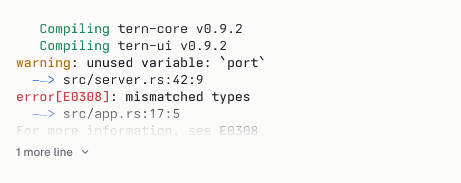
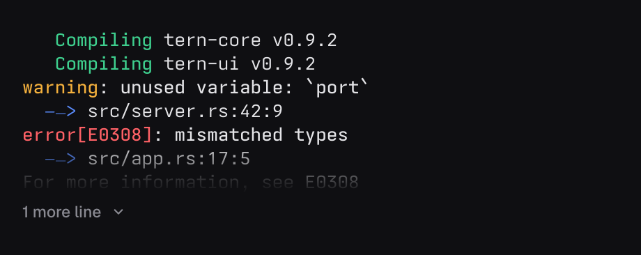
<figcaption>Colors come from the terminal theme. Without <code>follow</code>, the preview keeps the first lines and fades at the bottom.</figcaption>
</figure>

## `rows`

The migration fallback: rows a program already rendered for a terminal, shown at exactly `cols` columns with no
rewrap, every line shown, and a dim `fallback` marker in the corner for debugging. It exists for programs moving
to the protocol; a plugin should prefer `ansi`, which reflows.

**Build it:** `tern.ui.node("rows", { lines = { … }, cols = 80 })`.

| Prop | Type | Default | Meaning |
| --- | --- | --- | --- |
| `lines` | list of strings | `{}` | The rows, with escape sequences; non-strings are skipped |
| `cols` | integer | `80` | The exact width in columns |

**Children:** none (ignored).

**Events:** none of its own; `actions` work as on any node.

**Styling:**

```html
<div class="sf sf-rows" data-id="…">
	<span class="sf-rows-mark" title="Fallback rows (3)" aria-label="Fallback rows (3)">fallback</span>
	<div class="sf-term-clip"><div class="tv-mini">…</div></div>
</div>
```

| Target | Selector |
| --- | --- |
| The node | `.sf-rows` |
| Marker | `.sf-rows-mark` (inner, may change) |
| Clip, terminal | `.sf-term-clip`, `.tv-mini` (inner) |

```lua
return tern.ui.node("rows", { lines = { "\27[1mname\27[0m  size", "a.txt     12" }, cols = 40 })
```

## `math`

Typesets one TeX formula with the same engine as `md` math: inline by default, or as a display block.

**Build it:** `tern.ui.node("math", { text = "e^{i\\pi} + 1 = 0", display = true })`.

| Prop | Type | Default | Meaning |
| --- | --- | --- | --- |
| `text` | string | `""` | The TeX, without delimiters |
| `display` | bool | `false` | Display style, as a block centered in the node's width. Display math drops blank lines (they would end the block); inline math is one line (newlines read as spaces) and sits at the node's start |

A formula that does not typeset shows its source as `code.math-err`, titled with the error.

**Children:** none (ignored).

**Events:** none of its own; `actions` work as on any node.

**Styling:**

```html
<div class="sf sf-math display" data-id="…">
	<div class="md">
		<div class="math-display" data-tex="…"><svg>…</svg></div>
	</div>
</div>
<!-- inline: <div class="md"><p><span class="math" data-tex="…"><svg>…</svg></span></p></div> -->
```

| Target | Selector |
| --- | --- |
| The node | `.sf-math`, `.sf-math.display` |
| The formula | `.sf-math .math`, `.sf-math .math-display` (inner, may change) |
| A failed formula | `.sf-math code.math-err` (inner) |

The svg paints in `currentColor`, which the inner elements set to `--t1` (`.md` and, for display math,
`.math-display`), so a `color` on `.sf-math` itself does not reach it. Recolor the formula with
`.sf-math :is(.math, .math-display) { color: … }`.

```lua
local ui = tern.ui

return ui.col({
	ui.text("The identity:"),
	ui.node("math", { text = "e^{i\\pi} + 1 = 0", display = true }),
	ui.node("math", { text = "\\sum_{k=1}^{n} k = \\frac{n(n+1)}{2}" }),
})
```

<figure class="tn-figure">
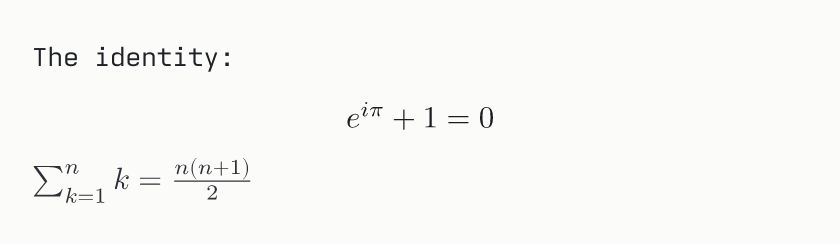
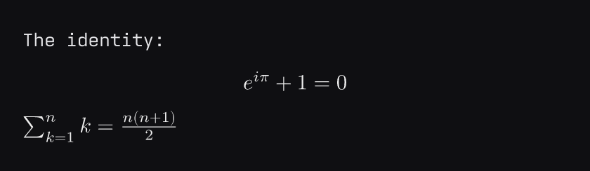
<figcaption>A display formula (centered) and an inline one (text style: limits beside the sum, a small fraction).</figcaption>
</figure>
