# Agent, Chat and Task Kinds

These kinds draw an agent's work, its conversation and settings as live data. They
were designed for two programs: omp (the coding agent) draws its tool calls,
subagents, todo list and `/settings` page with `tool`, `agent`, `checklist` and
`prefs`, and Tern itself draws a shell command's lens output in a `block`. The chat
kinds draw the conversation around that work: the messages (`message`), the steps and
reasoning behind an answer (`trace`), an error with its stack (`stacktrace`), what to
ask next (`suggestions`) and what the agent asks back (`questions`). Every kind
renders in a plugin view too, and this page says what works there. Reach for them
when your plugin shows the same shapes: a running step with a status and an output
body (`tool`), a worker with live stats (`agent`), a phased task list (`checklist`),
a chat, or a settings page (`prefs`). You don't build `block` yourself: Tern wraps
your lens view in one.

| Kind | Builder | Draws |
| --- | --- | --- |
| [`tool`](#tool) | `tern.ui.node("tool", …)` | One step: a data head (icon, verb, target, meta, status, timer) over a framed, collapsible body, or one waiting for approval |
| [`agent`](#agent) | `tern.ui.node("agent", …)` | One worker row with live status and stats, and expandable content |
| [`trace`](#trace) | `tern.ui.node("trace", …)` | An agent's steps, a chain of thought, a reasoning block with sources |
| [`stacktrace`](#stacktrace) | `tern.ui.node("stacktrace", …)` | An error and its stack frames: lit app frames, folded library frames, code at a frame |
| [`checklist`](#checklist) | `tern.ui.node("checklist", …)` | A phased todo list, a dock pill with a popover, or a "still open" reminder |
| [`message`](#message) | `tern.ui.node("message", …)` | One chat message: author, time, avatar, body, reactions, hover actions and a status line |
| [`suggestions`](#suggestions) | `tern.ui.node("suggestions", …)` | Prompts to ask next as chips, numbered rows or small cards |
| [`questions`](#questions) | `tern.ui.node("questions", …)` | A questionnaire: steps, inline chips or a folding list |
| [`block`](#block) | made by Tern around a lens view | A command's output: the lens view or the raw output, a Native/Raw toggle, Copy |
| [`prefs`](#prefs) | `tern.ui.node("prefs", …)` | A full settings page or a settings sheet, driven by your data and your keys |

None of these kinds has a `tern.ui` builder; use `tern.ui.node(kind, props,
children)` (see [UI Builders](../reference/ui.md)). Each node is a
`<div class="sf sf-<kind>" data-id="<id>">` and takes the common props (`role`,
`tone`, `hidden`, `actions`, …) described in [Elements](index.md), with two
exceptions: `tool` and `trace` use `title` as their head text, not as a tooltip, and
`message` takes `actions` as its own list of buttons.

Their sheets are built in and load for every surface: `omp-tools.css` (`tool`,
`agent`, `checklist`), `surface-trace.css`, `surface-stacktrace.css`,
`surface-message.css`, `surface-suggestions.css` and `surface-questions.css` (one
per kind), `surface-lens.css` (`block`), the kit's `prefs.css` plus `omp-prefs.css`
(`prefs`). Stable hooks are `.sf-<kind>`, `[data-id]`, `[data-role]`, `[data-tone]`,
`[data-state]`, `[data-variant]` and region `[data-surface]`. The other
classes listed below are Tern's inner structure: they are documented so you can
target them, but they are **inner, may change between versions**.

## `tool`

One step of work: a head that Tern draws from data, and a body made of your
children. omp sends one per tool call (`bash`, `read`, `edit`, …); in a plugin it fits
a deploy step, a query, a build stage, anything with a verb, a target, a status and
output.

The head reads, left to right: a status bar on the left edge, an icon, the `title`
verb, the `target`, `meta` facts, badges, a flexible gap, a `note`, an `exit N` chip,
a timer, a status glyph, a chevron and hover action buttons. The body holds the
children in order. Whenever a visible child's kind differs from the visible child
before it (code, then output, then a table), the child gets `.sf-tool-hr` and the
sheet draws a hairline above it. A `text` between two `code` children is the gap
between two runs of one file (omp's `…` where line numbers jump): it gets
`.sf-tool-gap` and the run above it `.sf-tool-cont`, with no hairline, so a sheet
can draw the runs and their gaps as one block. Nothing in the body draws a second
frame: nested `card` and `tool` children lose their ring and tint and draw as borderless
sections (a nested card also hides its head chips), and `code` and `diff` children
lose their background and frame (a code block also hides its head), so a step
never shows a frame inside a frame.

**Frame.** `frame: "card"` (the default) draws one ring with a faint tint while
`running`/`pending` and a red tint on `error`. `frame: "inline"` drops the ring,
the tint and the status bar: a head line plus the body, indented behind a
hairline.

**Status.** `status` is one of `pending`, `running`, `done`, `error`,
`cancelled`, `ask`; anything else reads as `pending`. `running` shows a spinning ring
as the glyph and a steady left bar; `error` shows an x-circle and a red bar;
`cancelled` a slashed circle; `done` and `pending` no glyph. `ask` waits for the
person's approval (see Approval below): no glyph, the icon in the warning color.

**Timer.** While `running` or `pending`, `age` (ms already elapsed when sent)
starts a live timer: it counts up from `age` plus the time since `age` last
arrived, so a patch that leaves `age` alone does not reset it. Otherwise the timer
shows `took`, else `age`, frozen. A frozen time under one second gets `.fast`
(hidden until the head is hovered). No `age`/`took`: no timer.

```lua
local ui = tern.ui

ui.node("col", { gap = "sm" }, {
	ui.node("tool", { name = "bash", title = "Deploy", status = "pending",
		target = "kubectl apply -f k8s/web.yaml", targetKind = "command",
		badges = { { text = "prod", tone = "info" } } }),
	ui.node("tool", { name = "bash", title = "Build", status = "running", age = 4200,
		target = "cargo build --release 2>&1 | tee build.log", targetKind = "command" }, {
		ui.node("ansi", { text = "Compiling stencil-css v0.1.0\n…" }),
	}),
	ui.node("tool", { name = "edit", title = "Edit", status = "done", took = 640,
		target = "src/deploy/plan.rs:13-36", targetKind = "path", meta = { "+8 −1" } }),
	ui.node("tool", { name = "bash", title = "Test", status = "error", took = 3100,
		exit = 101, note = "2 failed",
		target = "cargo test -p deploy", targetKind = "command" }, {
		ui.node("ansi", { text = "test plan::rollback ... \27[31mFAILED\27[0m\n…" }),
	}),
})
```

<figure class="tn-figure">
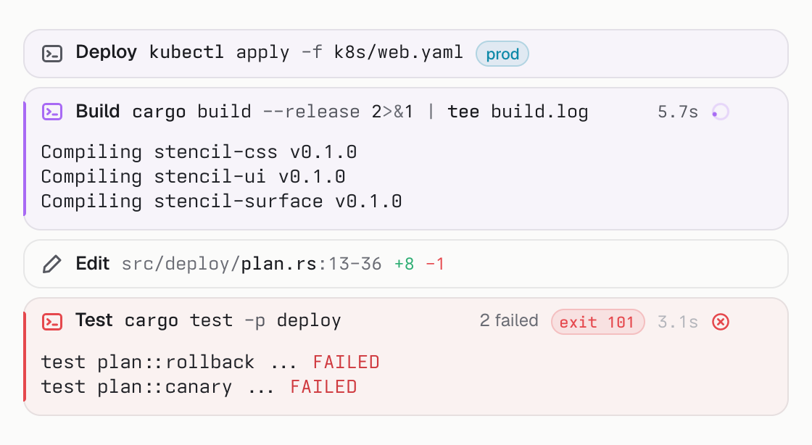
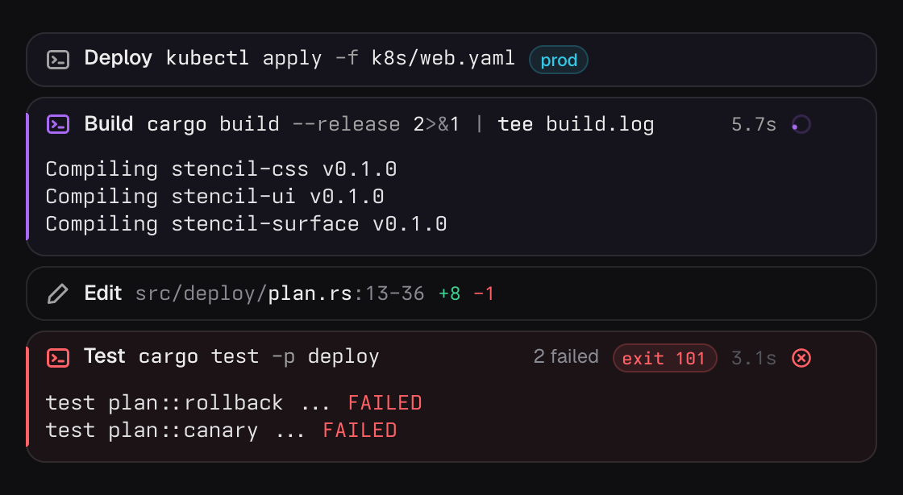
<figcaption>Pending, running, done and error. The Edit's 640 ms is under a second, so its timer waits for a hover.</figcaption>
</figure>

**Target.** `targetKind` decides how a string `target` is drawn:

| `targetKind` | Drawn as |
| --- | --- |
| `command` | One shell line split into runs: `.cmd` (program words), `.flag` (`-x`), `.str` (quoted strings), `.var` (`$X`), `.op` (`|`, `&&`, `;`, `>`, …), plain text for the rest. Ellipsis while collapsed, wraps when expanded. |
| `path` | `.dir` (the directory, dim), `.name` (the file, strong), `.ln` (a `:12` / `:13-36` suffix, quiet) |
| `pattern`, `query` | The text between two `.q` curly quotes |
| `text` (default) | The text or spans as given |

Spans (a table, not a string) are always drawn as spans. With `href` on the node,
the target's tooltip names the link and ⌘-click anywhere on the tool opens it.

**Meta.** Each `meta` entry is one `.sf-tool-meta` span. In a plain string, words
`+N` are wrapped in `.add` (the added color) and `-N` / `−N` in `.del` (the removed
color), so `"+8 −1"` reads like a diff stat.

**Collapse.** `collapsible: true` makes the head a button (Enter or Space flips it;
a plain click flips it, a ⌘-click doesn't). The state is local and remembered by
`key` among the node's siblings (else by id), like a card's, not surface-wide.
Deleting and adding a node with a new id and the same key under the same parent
preserves the fold; the same key under another parent has independent state.
`collapsed` sets the initial state; changing the
prop later resets the remembered state to it. While collapsed:

- with `preview: { lines = N }` the body is clamped to its first N lines under a
  bottom fade, with a "`K more lines · Show all ⌃O`" button below;
- with `preview: { tail = N }` the body is clamped to its last N lines under a top
  fade, with "`K earlier lines · Show all ⌃O`" (the tail wins when both are given);
- with `preview = "children"` the body stays whole: no clamp, no Show all button
  (class `clamp-children`). The children's own previews (`ansi`, `code`) clamp
  instead, so each section of the body shows its own few lines;
- with no preview the body hides.

Lines are drawn lines (a wrapped line counts as many), measured from the body's
height. The clamp only applies when the body is taller than the preview. The
Show all button sits below the clamped body for `lines` and between the head and
the body for `tail`; it flips the tool open. The `⌃O` keycap is a label only: keys
reach your block's `key` handler, not the tool.

A collapsible tool is a disclosure for the previews inside it, like a card: while
it is open, the `preview` of an `ansi` or `code` in its body gives way and they
show whole; folded (by the head, the program's `collapsed` or a Show all button)
they clamp again. While it is folded, their "N more lines" / "N earlier lines"
buttons open the whole tool (the `toggle` event, as a head click) rather than
expanding only their own block.

**Copy command.** With a `command` prop, or a string `target` of `targetKind =
"command"` when `command` is absent, the head offers a Copy command button (on
hover, like the actions) that copies that raw command line whole, however the head
shows it. `command` lets a tool copy its command while its `target` shows
something else (the intent).

```lua
ui.node("tool", {
	name = "bash", title = "Deploy", status = "done", took = 12400,
	target = "kubectl rollout status deploy/web", targetKind = "command",
	collapsible = true, collapsed = true, preview = { tail = 3 },
	tools = { { id = "copy", label = "Copy" }, { id = "rerun", label = "Rerun" } },
}, {
	ui.node("ansi", { text = rollout_log }), -- six lines
})
```

<figure class="tn-figure">
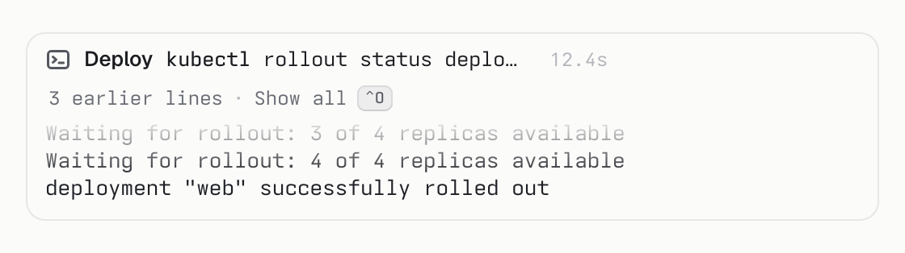
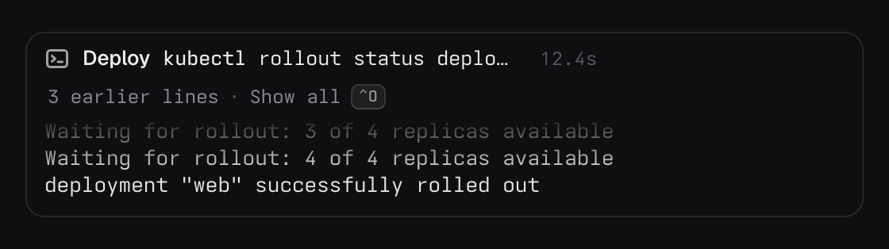
<figcaption>Collapsed with <code>preview = { tail = 3 }</code>. The chevron and the Copy and Rerun buttons show on hover.</figcaption>
</figure>

**Fold.** With Tern's *Fold tool calls* setting on (off by default), two or more
consecutive work blocks among `main`'s children (`tool` nodes, and omp's tool cards
and thinking-only messages) go under one `div.sf-work-head` disclosure reading
"Worked for 12.3s · Deploy ×2 · Test": the summed `took`, then each `title` (else
`name`) with its count. A run that another block follows starts folded; a run
still growing at the end of `main` starts open. The blocks of a run get `.sf-work`,
folded ones `.sf-folded`. Nested tools never fold.

**Actions.** `tools` lists buttons shown in the head on hover or keyboard focus:
`{ id, label, keys? }`, where `keys` is a list of key names drawn as keycaps inside
the button. A click runs `id` as an action on the tool node: the built-ins
(`toggle`, `copy`, `open`, `select`, `activate`, `zoom`) do what they do on any node
(see [Elements](index.md)); any other id sends `action`.

**Approval.** A tool can wait for the person before it runs. Set `status = "ask"`
and Tern draws an approval panel between the head and the body; describe it with
`ask`. Reach for it whenever a step is risky enough that the person should say yes
first: deleting files, a force push, a deploy, anything that spends money. Once your
program has the answer, set the status it runs in (`running`, `done`, `cancelled`,
…) and `approved`: the panel goes away and a chip in the head records the decision
(*Allowed once*, *Allowed this session*, *Always allowed* in green, *Denied* in red;
it shows under any status).

`confirm` picks the look:

| `confirm` | Look | Buttons |
| --- | --- | --- |
| `card` (default) | The frame turns warning-toned (ring and tint), the head shows a pulsing *Needs your approval* chip, and a foot under a hairline holds the buttons. For the call a person should see whole before saying yes. | Deny at the left; Always and Allow ⏎ at the right |
| `strip` | One compact warning strip under the head reading `ask.text` (*Allow this command?*); the frame stays plain. For a stream of calls, where a card per call would be loud. | Deny · Allow |
| `scopes` | The question (*Allow this?*), a radio list of scopes (how long the yes lasts), then the buttons; the frame stays plain. Without `ask.scopes` the list is *Only this time*, *For this session*, *Always* (`once`, `session`, `always`). | Deny · Allow ⏎ |

A click on a button sends `action { id, act, value? }` with `act` = `allow`, `deny`
or `always`, and `value` the selected scope (`ask.scope`, or the radio the person
picked; absent when there is none). Picking a scope radio sends nothing: it shows
selected at once and rides along on the next button's `value`. A change of
`ask.scope` from your program wins over the person's pick. The panel never takes
focus: the ⏎ keycap on Allow is a label, so bind Enter (and Escape to deny, if you
like) in your block's `key` handler and answer as for a click; to move the scope
from the keyboard, set `ask.scope`. A surface that is closed or opened with
`listen: false` draws the panel but sends nothing and does not move the radio.

```lua
local ui = tern.ui

ui.node("tool", {
	name = "bash", title = "Run", target = "rm -rf dist build", targetKind = "command",
	status = "ask", confirm = "scopes",
	ask = {
		text = "Let bash run rm -rf?",
		scopes = {
			{ id = "once", label = "Only this time" },
			{ id = "session", label = "For this session" },
			{ id = "repo", label = "Always, in this repo" },
		},
	},
})

-- after action { act = "allow", value = "once" }, the same tool once it ran:
ui.node("tool", {
	name = "bash", title = "Run", target = "rm -rf dist build", targetKind = "command",
	status = "done", approved = "once", took = 840,
})
```

<figure class="tn-figure">
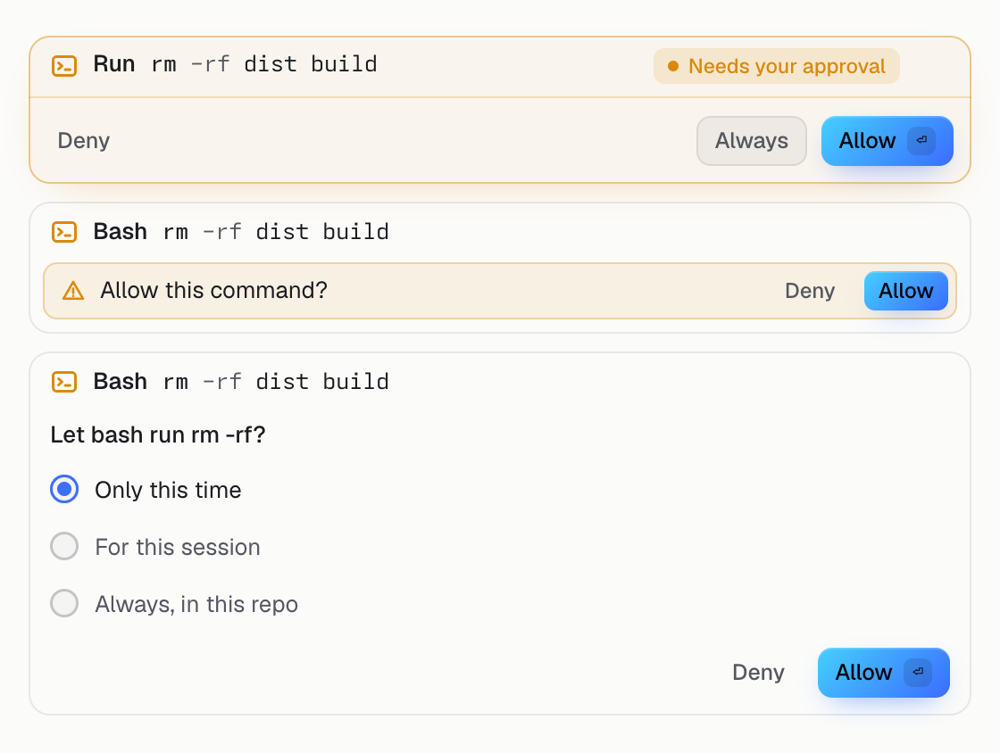
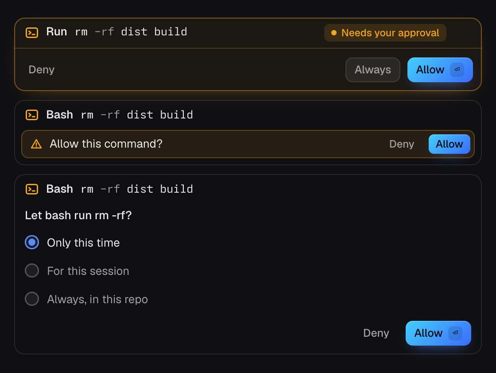
<figcaption>The three approval looks: <code>confirm = "card"</code>, <code>"strip"</code> and <code>"scopes"</code>.</figcaption>
</figure>

<figure class="tn-figure">
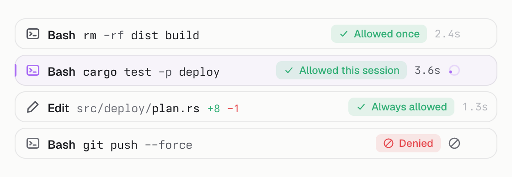
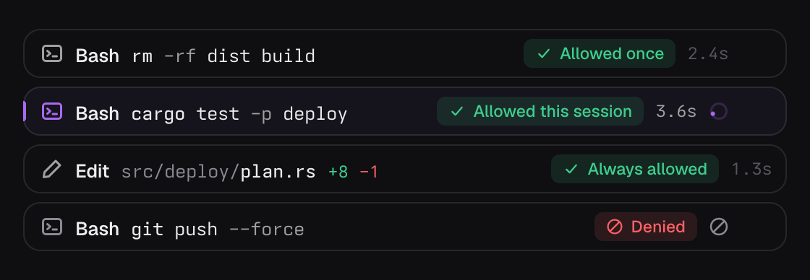
<figcaption>After the answer: <code>approved</code> leaves a chip in the head.</figcaption>
</figure>

**Build it:** `tern.ui.node("tool", { … }, { …body })`.

| Prop | Type | Default | Meaning |
| --- | --- | --- | --- |
| `name` | string | `""` | Tool name; picks the icon by the `omp.tool.<name>` role table (`bash`/`shell` terminal, `read` doc, `edit` pen, `write` file-plus, `grep`/`glob`/`search` search, `find` sparkle, `ls` folder, `web`/`fetch`/`browser` globe, `todo` list-checks, `task` users, `eval` code, `python`, `lsp` braces, `proc` activity, …). Any other name gets the plug icon. |
| `title` | text | `""` | The verb ("Deploy", "Query"). Also the head's accessible name, with the target and status. Not a tooltip here. |
| `target` | text | none | The primary argument, mono. |
| `targetKind` | `"command"` \| `"path"` \| `"pattern"` \| `"query"` \| `"text"` | `"text"` | How a string `target` is drawn (table above). Also set as `data-tk` on the node and as a class on `.sf-tool-target`. |
| `href` | string | none | Link of the tool: ⌘-click opens it; shown in the target's tooltip. |
| `meta` | array of text | `[]` | Short facts after the target. |
| `badges` | array of `{ text, tone?, title? }` | `[]` | `.sf-badge` chips in the head; `tone` sets `data-tone`, `title` a tooltip. |
| `note` | text | none | A short state note ("timed out", "partial") before the timer. |
| `exit` | number | none | A non-zero code shows an `exit N` chip (`.sf-chip.st-error.sf-tool-exit`). |
| `status` | `"pending"` \| `"running"` \| `"done"` \| `"error"` \| `"cancelled"` \| `"ask"` | `"pending"` | State: class `st-<status>`, glyph, tint, timer mode; `"ask"` waits for approval and draws the panel. |
| `age` | number (ms) | none | Elapsed when sent; live timer while running/pending, frozen fallback after. |
| `took` | number (ms) | none | Final duration once settled. |
| `intent` | string | none | Tooltip of the head. |
| `frame` | `"card"` \| `"inline"` | `"card"` | Ring or no ring. |
| `collapsible` | boolean | `false` | Head toggles the body. |
| `collapsed` | boolean | none | Initial collapse state (only with `collapsible`). |
| `preview` | `{ lines = N }` \| `{ tail = N }` \| `"children"` | none | Clamp of the collapsed body; `"children"` keeps it whole and leaves the clamping to the children's own previews. |
| `command` | string | none | The raw command line the head's Copy command button copies (else a `command` target's). |
| `tools` | array of `{ id, label?, keys? }` | `[]` | Hover action buttons. |
| `confirm` | `"card"` \| `"strip"` \| `"scopes"` | `"card"` | The approval look while `status` is `"ask"` (table above). |
| `ask.text` | string | `"Allow this command?"` (strip), `"Allow this?"` (scopes), none (card) | The question. |
| `ask.allow` | string | `"Allow"` | The Allow button's label. |
| `ask.deny` | string | `"Deny"` | The Deny button's label. |
| `ask.always` | string \| `false` | `"Always"` | The Always button's label (`card` only); `false` hides it. |
| `ask.scopes` | array of `{ id, label? }` | once / session / always | The radios of `confirm = "scopes"`; `label` defaults to `id`. |
| `ask.scope` | string | the first scope (scopes look), none otherwise | The selected scope, sent as the buttons' `value`. A change from your program wins over the person's pick. |
| `approved` | `"once"` \| `"session"` \| `"always"` \| `"denied"` | none | The answer, shown as a head chip under any status. |
| `key` | string | node id | Identity among siblings; collapse is remembered by this key under the same parent. |

**Children:** drawn in order in `.sf-tool-body` (any kinds). Nested `card` and
`tool` children draw unframed.

**Events:** `toggle { id, collapsed, key? }` when the user flips a collapsible tool;
`action { id, act, mods? }` from an action button whose id is not a built-in;
`action { id, act, value? }` with `act` = `allow`, `deny` or `always` from an approval
button, `value` the selected scope. Plus the common `actions` on the node.

**Styling:**

```html
<div class="sf sf-tool card st-running collapsible [collapsed] [nopreview] [clamped] [tail] [clamp-children] [inline] [ask-card|ask-strip|ask-scopes]"
	data-id="…" data-tk="command">
	<i class="sf-tool-bar"></i>
	<div class="sf-tool-head" role="button" tabindex="0" aria-expanded="true">
		<span class="sf-tool-ic"><!-- icon --></span>
		<span class="sf-tool-line">
			<span class="sf-tool-title">Deploy</span>
			<span class="sf-tool-target command"><span class="cmd">kubectl</span> apply <span class="flag">-f</span> …</span>
			<span class="sf-tool-meta"><span class="add">+8</span> <span class="del">−1</span></span>
			<span class="sf-badge" data-tone="info">prod</span>
			<span class="sf-tool-sp"></span>
			<span class="sf-tool-note">partial</span>
			<span class="sf-chip st-error sf-tool-exit">exit 1</span>
			<span class="sf-tool-askchip"><i class="dot"></i>Needs your approval</span>
			<span class="sf-tool-approved" data-tone="ok"><svg class="ico">…</svg>Allowed once</span>
		</span>
		<span class="sf-tool-time [fast]" role="timer">1.2s</span>
		<span class="sf-tool-st"><i class="sf-tool-spin"></i></span>
		<span class="sf-chev"><!-- chevron --></span>
		<button class="sf-tool-copy [sf-hidden]" title="Copy command"><svg class="ico">…</svg></button>
		<span class="sf-tool-acts"><button class="sf-tool-act">Copy<span class="kbd">⌘C</span></button></span>
	</div>
	<div class="sf-tool-ask scopes [sf-hidden]"><!-- card: text and foot; strip: .sf-tool-ask-ic, text, .sf-tool-sp and the buttons in one row -->
		<div class="sf-tool-ask-text">Let bash run rm -rf?</div>
		<div class="sf-tool-scopes" role="radiogroup">
			<button class="sf-tool-scope on" role="radio" aria-checked="true"><i class="radio"></i><span class="label">Only this time</span></button>
		</div>
		<div class="sf-tool-ask-foot">
			<span class="sf-tool-sp"></span>
			<button class="sf-button sf-tool-ask-btn" data-variant="quiet"><span class="sf-btn-label">Deny</span></button>
			<button class="sf-button sf-tool-ask-btn" data-variant="primary"><span class="sf-btn-label">Allow</span><span class="sf-kbd"><span class="kbd">⏎</span></span></button>
		</div>
	</div>
	<div class="sf-tool-body"><!-- children; a child whose kind changes gets .sf-tool-hr, a text between two code runs .sf-tool-gap (the run above it .sf-tool-cont) --></div>
	<button class="sf-tool-more"><span class="n">12 more lines</span><span class="dot">·</span>Show all<span class="kbd">⌃O</span></button>
</div>
```

| Target | Selector |
| --- | --- |
| The node | `.sf-tool` |
| Framed / unframed | `.sf-tool.card` / `.sf-tool.inline` |
| A status | `.sf-tool.st-pending`, `.st-running`, `.st-done`, `.st-error`, `.st-cancelled` |
| Target kind | `.sf-tool[data-tk='path']` |
| Collapse states | `.sf-tool.collapsible`, `.collapsed`, `.nopreview` (collapsed without preview), `.clamped` (preview clamp active), `.tail` (tail preview), `.clamp-children` (`preview = "children"`) |
| Left status bar | `.sf-tool-bar` (inner, may change) |
| Head, icon, line | `.sf-tool-head`, `.sf-tool-ic`, `.sf-tool-line` (inner, may change) |
| Verb, target, meta | `.sf-tool-title`, `.sf-tool-target.<kind>` with `.cmd .flag .str .var .op` / `.dir .name .ln` / `.q`, `.sf-tool-meta .add` / `.del` (inner, may change) |
| Note, exit, timer, glyph | `.sf-tool-note`, `.sf-tool-exit`, `.sf-tool-time` (`.fast`), `.sf-tool-st`, `.sf-tool-spin` (inner, may change) |
| Chevron | `.sf-tool-head > .sf-chev` (inner, may change) |
| Action buttons | `.sf-tool-acts`, `.sf-tool-act`, `.sf-tool-act .kbd` (inner, may change) |
| Copy command | `.sf-tool-copy`, `.sf-tool-copy.sf-hidden` (nothing to copy) (inner, may change) |
| Body, divider | `.sf-tool-body`, `.sf-tool-body > .sf-tool-hr` (inner, may change) |
| Gap between code runs, the run above it | `.sf-tool-body > .sf-tool-gap`, `.sf-tool-body > .sf-code.sf-tool-cont` (inner, may change) |
| Show all button | `.sf-tool-more` with `.n`, `.dot`, `.kbd` (inner, may change) |
| Waiting for approval, by look | `.sf-tool.st-ask`, with `.ask-card`, `.ask-strip`, `.ask-scopes` |
| Approval panel | `.sf-tool-ask.card` / `.strip` / `.scopes`, `.sf-tool-ask-ic`, `.sf-tool-ask-text`, `.sf-tool-ask-foot`, `.sf-tool-ask-btn[data-variant]` (also `.sf-button`) (inner, may change) |
| Scope radios | `.sf-tool-scopes` > `.sf-tool-scope` (`.on`, `aria-checked`) with `.radio`, `.label` (inner, may change) |
| Approval chips | `.sf-tool-askchip` (`.dot`), `.sf-tool-approved[data-tone='ok' \| 'bad']` (inner, may change) |

Variables: the clamp height is set inline as `--sf-clamp` on the node while
`.clamped`. The tints read `--sf-tint-pending` and `--sf-tint-error` when
defined, else `--live` / `--sf-bad`; `--sf-run-a` is the running tint's
alpha (0.04 dark, 0.05 light). The approval card's ring and tint, the strip
and the chip's dot read `--warn`. Colors are Tern's semantic token colors
(see [CSS Variables](../styles/variables.md)). The spinner, bar and head
motion, the approval panel's entrance and the chip's pulse stop under reduced
motion and in still views (`.sf-still`).

```lua
local ui = tern.ui

local function step(s)
	return ui.node("tool", {
		key = "deploy." .. s.env,
		name = "bash",
		title = "Deploy",
		target = "kubectl apply -f " .. s.file,
		targetKind = "command",
		badges = { { text = s.env, tone = "info" } },
		status = s.status, -- "running", "done", "error"
		age = s.status == "running" and s.elapsed or nil,
		took = s.took,
		exit = s.exit,
		collapsible = true,
		collapsed = s.status == "done",
		preview = { tail = 6 },
		tools = { { id = "copy", label = "Copy" }, { id = "rerun", label = "Rerun" } },
	}, {
		ui.node("ansi", { text = s.output }),
	})
end
```

A click on Rerun sends `action { id = <tool id>, act = "rerun" }` to your block's
`event`.

## `agent`

One worker as a row: a status glyph, its name, badges, a one-line task, and
right-aligned stats (model, tool calls, requests, progress, context meter or tokens,
cost, timer). A second line shows what it runs now (tool icon, tool name, a
shimmering intent and the tool's own timer) or a retry countdown. Children are its
expanded content. omp sends one per subagent; in a plugin it fits any job or worker
pool: CI runners, crawlers, sync workers.

**Status.** `status` is one of `pending`, `running`, `done`, `failed`, `aborted`,
`idle`, `parked` (anything else reads as `pending`). The glyph is a live pulse
(`running`), a check (`done`), an x (`failed`), a slash (`aborted`), or a hollow ring
(the rest).

**Stats.** Read from `stats`; each part shows only when set:

| Field | Drawn as |
| --- | --- |
| `model` (node prop) | `.model` chip with the last `/` segment of the name; the full name as tooltip. With `thinking` (a token such as `thinkingLow`), a dot in that token's semantic color. |
| `stats.tools` | `.tools`: wrench icon and the count (when above 0) |
| `stats.requests` | `.req`: `N req` (when above 0) |
| `stats.done` | `.done`: a small ring and `N%` (0–1, rounded), only while `running` |
| `stats.context` | `.sf-agent-meter`: a bar of the fraction (0–1, or a percent above 1), `.warn` at 75%, `.bad` at 90%; tooltip and label `contextLabel` or `N% context` |
| `stats.tokens` | `.tok`: compact count (`12K`, `1.2M`), only when `context` is absent |
| `stats.cost` | `.cost`: `$0.42`, or `<$0.01` (when above 0) |
| `stats.age` / `stats.took` | `.time`: live timer from `age` while `running`/`pending`; otherwise frozen `took` (else `age`) |

Like a `tool`'s `age`, `stats.age`, `tool.age` and `retry.age` count on from the
time they arrived, so a patch of other props leaves them running. Because they sit
inside an object, `stats` (or `tool`, `retry`) arriving again with the same `age`,
say to update `tools`, also leaves the count running; a different `age` starts it
over from that value.

**Line 2.** With `retry` set it shows `↻ retry A/M in <countdown>` (counting down
`delay - age` ms), with `error` as tooltip. Otherwise, while `running` with `tool`
set, it shows the tool's icon (same table as [`tool`](#tool)), its name, its intent
(spans get the `shimmer` effect unless they set their own) and a live timer from
`tool.age`. The line hides when empty.

**Collapse.** As with `tool`: `collapsible` makes the row a button (click,
Enter, Space; ⌘-click doesn't flip), the state is local and keyed by `key` among siblings (else by id),
`collapsed` sets it, and `.collapsed` hides the children.

**Depth.** `depth` (0–6) sets `--sf-depth` on the node; the sheet indents the row
by `depth × 22px`, for a tree of workers drawn as siblings.

```lua
ui.node("col", { gap = "xs" }, {
	ui.node("agent", { name = "runner-3", agent = "linux", task = "Build and test main",
		status = "running", model = "anthropic/opus", thinking = "thinkingHigh",
		stats = { tools = 14, done = 0.4, context = 0.78, cost = 0.42, age = 72000 },
		tool = { name = "bash", intent = "Running the test suite", age = 8000 } }),
	ui.node("agent", { name = "runner-4", agent = "linux", task = "Lint the workspace",
		status = "done", stats = { tools = 6, tokens = 19400, cost = 0.08, took = 41000 } }),
	ui.node("agent", { name = "runner-5", agent = "macos", task = "Sign the app bundle",
		status = "failed", badges = { { text = "flaky", tone = "warning" } },
		stats = { tools = 3, took = 12000 } }),
	ui.node("agent", { name = "crawler-1", task = "Fetch the changelog", status = "running",
		depth = 1, stats = { requests = 2, age = 5000 },
		retry = { attempt = 2, max = 5, delay = 30000, age = 12000, error = "429 Too Many Requests" } }),
	ui.node("agent", { name = "runner-6", task = "Waiting for a slot", status = "idle" }),
})
```

<figure class="tn-figure">
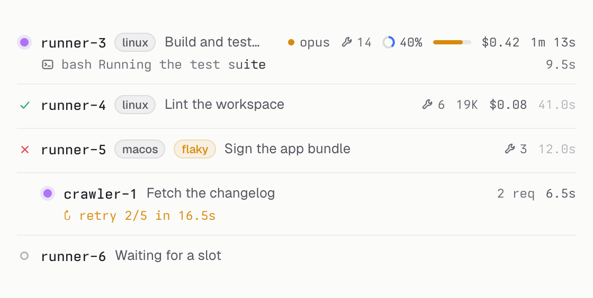
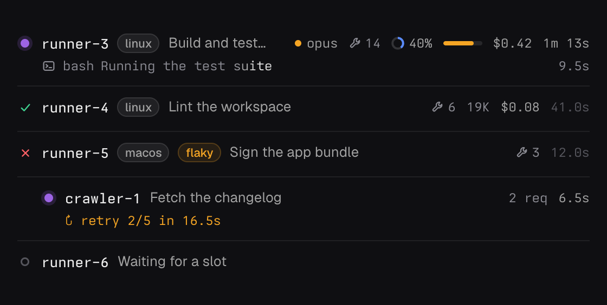
<figcaption>The context meter turns amber at 75%.</figcaption>
</figure>

**Build it:** `tern.ui.node("agent", { … }, { …content })`.

| Prop | Type | Default | Meaning |
| --- | --- | --- | --- |
| `name` | string | `""` | Display name; with the status, the row's accessible name. |
| `agent` | string | none | Type shown as the first `.sf-badge` (no tone). |
| `badges` | array of `{ text, tone? }` | `[]` | More `.sf-badge` chips. |
| `task` | text | none | One-line task; ellipsized, full text as tooltip unless the agent has a `hovercard`. |
| `status` | see above | `"pending"` | Class `st-<status>`, glyph, timer mode. |
| `model` | string | none | Model chip. |
| `thinking` | string | none | Span token for the model chip's dot. |
| `stats` | `{ tools?, requests?, done?, context?, contextLabel?, tokens?, cost?, age?, took? }` | none | The stats above. Without `stats` there is no timer. |
| `tool` | `{ name, intent?, age? }` | none | The tool running now (line 2, `running` only). |
| `retry` | `{ attempt?, max?, delay?, age?, error? }` | none | Retry countdown on line 2 (wins over `tool`); `attempt`/`max` default to 1. |
| `depth` | integer | `0` | Nesting depth, capped at 6. |
| `collapsible` | boolean | `false` | Row toggles the children. |
| `collapsed` | boolean | none | Initial collapse state. |
| `key` | string | node id | Identity among siblings; collapse is remembered by this key under the same parent. |

**Children:** drawn in order in `.sf-agent-kids` (hidden when there are none, or
while collapsed).

**Hover card:** the common `hovercard` opens over the row only, not over the
children. omp sends the subagent's whole assignment as an `md` card, the row's
`task` being its one-line summary.

**Events:** `toggle { id, collapsed, key? }` when the user flips a collapsible row.
Plus the common `actions`.

**Styling:**

```html
<div class="sf sf-agent st-running collapsible [collapsed]" data-id="…" style="--sf-depth: 1">
	<div class="sf-agent-row" role="button" tabindex="0" aria-expanded="true">
		<span class="sf-agent-g"><i class="live"></i></span>
		<span class="sf-agent-name">runner-3</span>
		<span class="sf-badge">linux</span>
		<span class="sf-agent-task">Build and test main</span>
		<span class="sf-sp"></span>
		<span class="sf-agent-stats">
			<span class="model"><i class="dot"></i>opus</span>
			<span class="tools"><!-- wrench -->14</span>
			<span class="req">9 req</span>
			<span class="done"><!-- ring -->40%</span>
			<span class="sf-agent-meter warn"><i class="fill"></i></span>
			<span class="cost">$0.42</span>
			<span class="time" role="timer">1m 12s</span>
		</span>
	</div>
	<div class="sf-agent-now">
		<span class="ic"><!-- icon --></span><span class="tn">bash</span>
		<span class="intent">Running tests</span><span class="time">8s</span>
	</div>
	<div class="sf-agent-kids"><!-- children --></div>
</div>
```

| Target | Selector |
| --- | --- |
| The node | `.sf-agent` |
| A status | `.sf-agent.st-running`, `.st-done`, `.st-failed`, `.st-aborted`, `.st-idle`, `.st-parked`, `.st-pending` |
| Collapse | `.sf-agent.collapsible`, `.sf-agent.collapsed` |
| Row, glyph | `.sf-agent-row`, `.sf-agent-g` (`.live`, `.hollow`, icon) (inner, may change) |
| Name, task | `.sf-agent-name`, `.sf-agent-task` (inner, may change) |
| Stats | `.sf-agent-stats` with `.model`, `.model .dot`, `.tools`, `.req`, `.done`, `.tok`, `.cost`, `.time` (inner, may change) |
| Context meter | `.sf-agent-meter` (`.warn`, `.bad`), `.sf-agent-meter .fill` (inner, may change) |
| Line 2 | `.sf-agent-now` with `.ic`, `.tn`, `.intent`, `.time`, `.retry` (inner, may change) |
| Content | `.sf-agent-kids` (inner, may change) |

Variables: `--sf-depth` (set per node). The pulse and the meter fill animate,
and stop under reduced motion and in still views.

```lua
local ui = tern.ui

local function worker(w)
	return ui.node("agent", {
		key = "w." .. w.id,
		name = w.id,
		agent = w.pool,
		task = w.job,
		status = w.state, -- "running", "idle", "done", "failed"
		stats = { tools = w.steps, cost = w.cost, age = w.elapsed, took = w.took },
		tool = w.state == "running" and { name = "bash", intent = w.step, age = w.step_age } or nil,
		collapsible = true,
		collapsed = true,
	}, {
		ui.node("md", { text = w.log_summary }),
	})
end
```

## `trace`

An agent's steps as data: each line is one step (a status-tinted icon, a title, a
mono target such as a command or path, an optional detail line, its time and the
sources it read), and any line can open in place to show what it produced. Reach for
it for an agent's trace or chain of thought, a reasoning block with its sources, a
queue of jobs; use [`tool`](#tool) for one tool call with a body of its own,
[`agent`](#agent) for a worker row and [`checklist`](#checklist) for a plan.

**Variants.** `variant` picks the look:

| Variant | Look | Head | Open by default |
| --- | --- | --- | --- |
| `rail` (default) | Lines on a vertical hairline rail, one glyph per step; the running line shimmers with a live timer; a line with content opens in place under its row. | Only with `title`, as a caption (does not fold) | Always open |
| `summary` | One line, `Worked for 12s · 5 steps ⌄` (derived from `status` and `took`/`age` unless `summary` is set), that unfolds into a compact list without a rail. | The summary line; a click folds | Folded |
| `card` | A bare card: a head (`title`, else `Reasoning` while running and `Thought for 4s` once settled) shimmering while running with an elapsed clock (`0:04`), a prose body on a hairline (the children), a row of source chips. | Head; a click folds | Open |

**Status.** `status` on each line and on the trace is one of `pending`, `running`,
`done`, `error` (anything else reads as `pending`). The glyph is the line's `icon`
tinted by status (`pending` dim, `running` in the live color, `done` secondary,
`error` red); without an icon, a spinning ring (`running`), a green check (`done`)
or a hollow dot (`pending`). An `error` line shows an ✕ in a circle and its title in
red. The same ring, check and shimmer as [`tool`](#tool) and [`agent`](#agent).

**Time.** A `running` line shows a live timer counting on from its `age` (ms already
elapsed when sent; sending the same `age` again keeps it counting). A settled line
shows `took` (else `age`) dimmed; `pending` lines show none. The trace's own
`age`/`took` drive the head: a live timer while `running`/`pending`, else the frozen
time (`rail` heads always show it; `summary` and `card` heads only while running,
the settled ones say it in words).

**Content.** A child whose `key` (else id) equals a line's `id` is that line's
expanded content: the line gets a chevron, its row becomes a button, and the content
shows under it while the line is open. Every other child is the body: the prose of a
`card`, below the lines in `rail` and `summary`.

**Sources.** `sources` on a line draws chips under it; `sources` on the trace draws a
`Sources` row at the foot (the `card` look). A chip shows `site` (else the `href`'s
host without `www.`) after a dot whose color is picked from the site, `title` and
`href` as tooltip; a click opens `href` as any surface link does.

**Open state.** Pointer only, local and immediate, like a card's fold: a click on a
line with content (or on a `summary`/`card` head) flips it at once, the choice is
remembered by line id (the head's under none) and a `toggle` event follows. A
program `open` that changes from what was last drawn wins again (a line's `open`,
the trace's `open` for the head). ⌘-click does not flip. Inert when the surface is
closed or opened with `listen: false`: it draws, never flips and sends nothing
(source chips still open their link).

**Keyboard.** Nodes never take focus; the program drives the open state through
`open` (on the trace and on each line) and sends the trace again.

```lua
local ui = tern.ui

ui.node("trace", {
	lines = {
		{ id = "think", icon = "clock", title = "Thought for 5s", status = "done", took = 5000 },
		{ id = "v", icon = "terminal", title = "Ran", target = "pnpm --version", status = "done", took = 420 },
		{ id = "diff", icon = "terminal", title = "Ran", target = "git diff --stat HEAD~1",
			status = "done", took = 180, open = true },
		{ id = "inst", icon = "terminal", title = "Failed", target = "pnpm install --frozen-lockfile",
			status = "error", took = 3100, detail = "ERR_PNPM_OUTDATED_LOCKFILE" },
		{ id = "src", icon = "globe", title = "Used 2 sources", status = "done", sources = {
			{ title = "pnpm install", href = "https://pnpm.io/cli/install", site = "pnpm.io" },
			{ title = "Frozen lockfile in CI", href = "https://github.com/pnpm/pnpm/issues/1890", site = "github.com" },
		} },
	},
}, {
	ui.node("code", { key = "diff", lang = "text",
		text = "package.json | 2 +-\n1 file changed, 1 insertion(+), 1 deletion(-)" }),
})
```

<figure class="tn-figure">


<figcaption>The default rail: a line with content opens in place; the running line shimmers and counts.</figcaption>
</figure>

A reasoning block is the same node with `variant = "card"`: its children are the
prose and `sources` the chips at its foot.

```lua
ui.node("trace", {
	variant = "card",
	status = thinking and "running" or "done",
	age = thinking and elapsed or nil,
	took = not thinking and took or nil,
	sources = { { title = "pnpm install", href = "https://pnpm.io/cli/install", site = "pnpm.io" } },
}, {
	ui.node("text", { text = "The frozen install fails because the lockfile was not updated after the version bump." }),
})
```

<figure class="tn-figure">
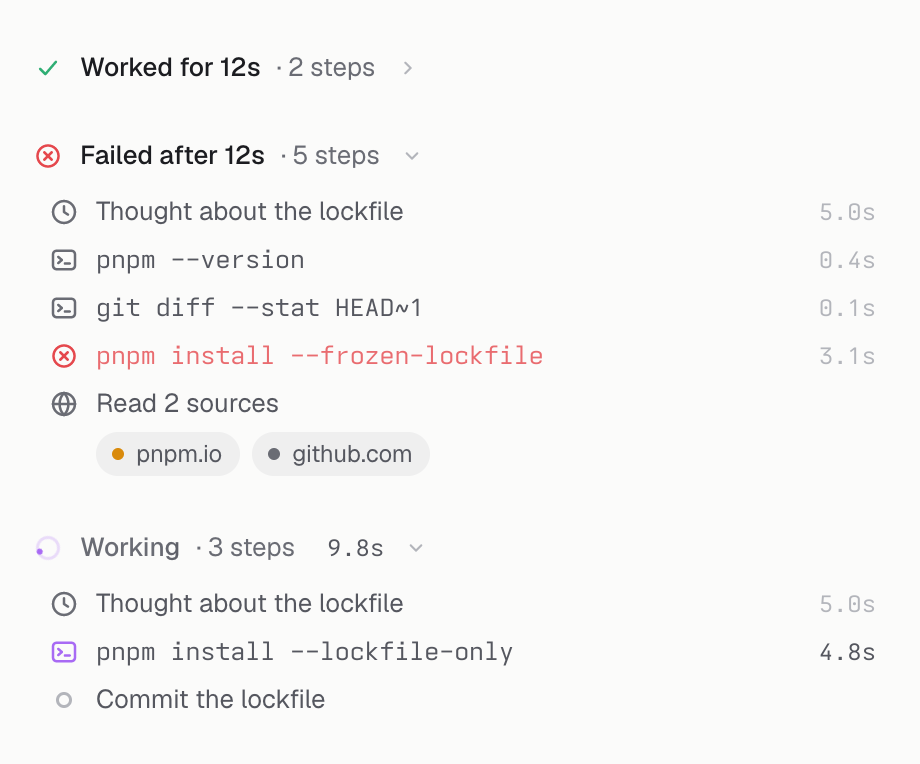
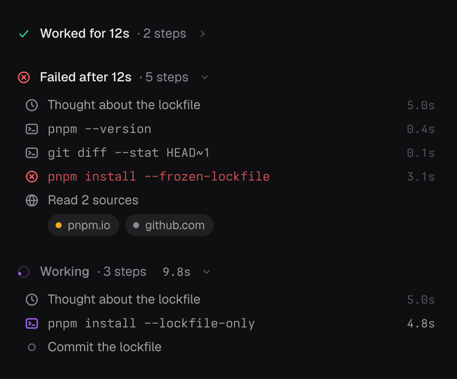
<figcaption><code>variant = "summary"</code> derives its line from the status and time.</figcaption>
</figure>

<figure class="tn-figure">
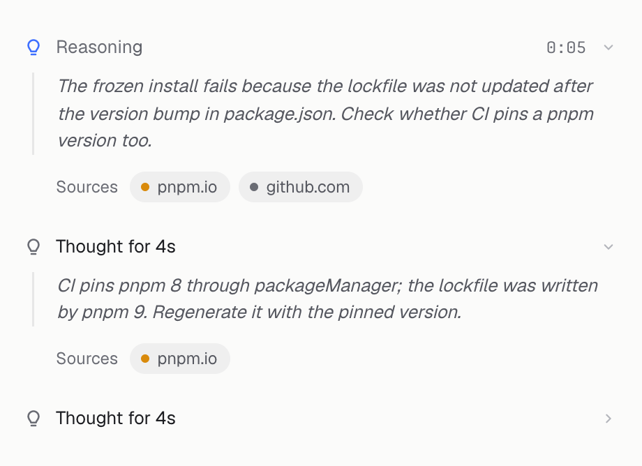
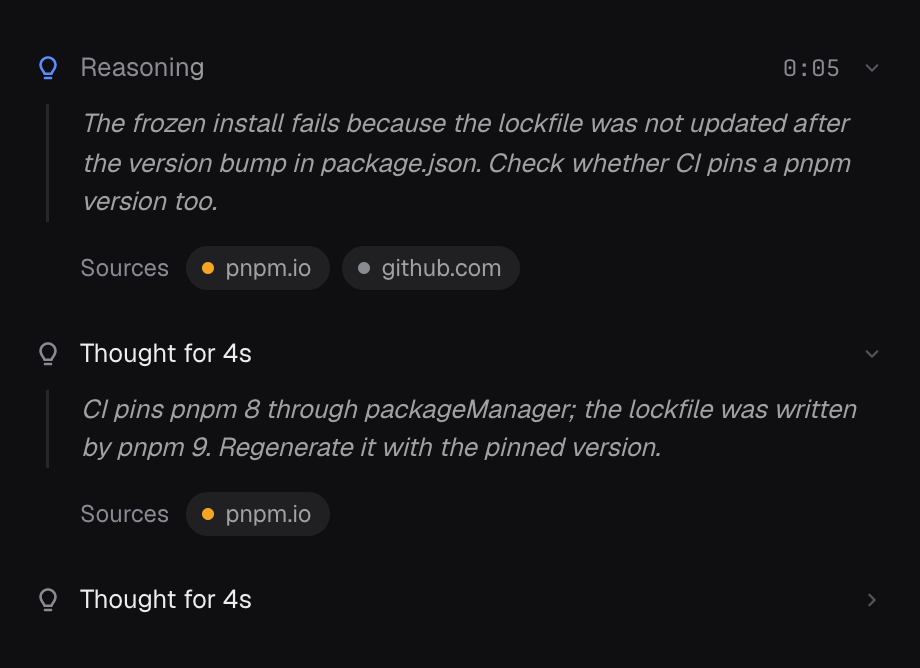
<figcaption><code>variant = "card"</code>: reasoning with its sources.</figcaption>
</figure>

**Build it:** `tern.ui.node("trace", { … }, { …content })`.

| Prop | Type | Default | Meaning |
| --- | --- | --- | --- |
| `variant` | `"rail"` \| `"summary"` \| `"card"` | `"rail"` | The look (table above). |
| `lines` | array of line (below) | `[]` | The steps, in order. |
| `status` | `"pending"` \| `"running"` \| `"done"` \| `"error"` | `"pending"` | The whole trace's status: head glyph, shimmer, timer mode, derived summary. |
| `title` | text | none | Head text (`card`: default `Reasoning` / `Thought for <took>`; `rail`: a caption, no head without it). Not a tooltip here. |
| `summary` | text | derived | The `summary` head's text; derived: `Working` (running), `Queued` (pending), `Worked for 12s` (done), `Failed after 12s` (error). |
| `icon` | string (icon name) | `lightbulb` on `card`, none else | Head glyph when not running or failed. |
| `age` | number (ms) | none | Elapsed when sent; the head's live timer while running or pending. |
| `took` | number (ms) | none | Total time once settled (else `age`). |
| `open` | boolean | `false` on `summary`, `true` else | Whether the head's fold is open (`summary`, `card`); a change wins over the user's choice. |
| `sources` | array of source (below) | `[]` | The trace's `Sources` row at the foot. |
| `key` | string | node id | Identity among siblings. |

A line:

| Field | Type | Default | Meaning |
| --- | --- | --- | --- |
| `id` | string | its index | Identity: keys its content child, its open state and the `toggle` event's `item`. |
| `icon` | string (icon name) | none | Its glyph (`clock`, `terminal`, `globe`, `search`, …), tinted by status. |
| `title` | text (spans) | none | The step in words; shimmers while `running`. |
| `target` | text | none | What it acted on, in mono (command, path, query); ellipsized, full text as tooltip. |
| `detail` | text | none | A dim line under the row. |
| `status` | `"pending"` \| `"running"` \| `"done"` \| `"error"` | `"pending"` | Class `st-<status>`, glyph, timer. |
| `age` | number (ms) | none | Elapsed when sent; live timer while `running`. |
| `took` | number (ms) | none | Its time once settled (else `age`). |
| `open` | boolean | `false` | Whether its content shows; a change wins over the user's choice. Ignored without content. |
| `sources` | array of source | `[]` | Chips under the line. |

A source: `{ title?, href?, site? }` (`site` defaults to the host of `href` without
`www.`).

**Children:** a child whose `key` (else id) is a line's `id` is placed under that
line; the rest, in order, are the body (`.sf-trace-prose`, hidden when empty).

**Events:** `toggle { id, item?, open }` when the user flips a line (`item` = its id)
or the head (no `item`). A source chip asks the host to open its `href` (no event).
Plus the common `actions` on the node.

**Styling:**

```html
<div class="sf sf-trace rail st-running open" role="group" data-id="…">
	<div class="sf-trace-head" role="button" aria-expanded="true"><!-- summary, card, titled rail -->
		<span class="sf-trace-g"><!-- glyph --></span>
		<span class="sf-trace-title">Worked for 12s</span>
		<span class="sf-trace-n">· 5 steps</span>
		<span class="sf-trace-sp"></span>
		<span class="sf-trace-time" role="timer">0:04</span>
		<span class="sf-chev"></span>
	</div>
	<div class="sf-trace-fold"><div class="sf-trace-in">
		<div class="sf-trace-lines" role="list">
			<div class="sf-trace-line st-done has-body open [last]" role="listitem">
				<div class="sf-trace-row" role="button" aria-expanded="true">
					<span class="sf-trace-g"><!-- icon, i.sf-trace-spin, i.hollow; .tick --></span>
					<span class="sf-trace-t">
						<span class="sf-trace-title">Ran</span>
						<span class="sf-trace-target">git diff --stat HEAD~1</span>
					</span>
					<span class="sf-trace-time" role="timer">0.1s</span>
					<span class="sf-chev"></span>
				</div>
				<div class="sf-trace-detail">…</div>
				<div class="sf-trace-srcs">
					<button class="sf-trace-src" data-hue="2"><i class="dot"></i>pnpm.io</button>
				</div>
				<div class="sf-trace-body"><div class="sf-trace-in"><!-- the line's children --></div></div>
			</div>
		</div>
		<div class="sf-trace-prose"><!-- the body --></div>
		<div class="sf-trace-srcs"><span class="sf-trace-srcs-l">Sources</span><!-- chips --></div>
	</div></div>
</div>
```

| Target | Selector |
| --- | --- |
| The node | `.sf-trace` |
| A variant | `.sf-trace.rail`, `.summary`, `.card` |
| A status | `.sf-trace.st-running`, `.st-done`, `.st-error`, `.st-pending` (and on `.sf-trace-line`) |
| Open | `.sf-trace.open`, `.sf-trace-line.open`, `.sf-trace-line.has-body` |
| Head | `.sf-trace-head` with `.sf-trace-g`, `.sf-trace-title`, `.sf-trace-n`, `.sf-trace-time`, `.sf-chev` (inner, may change) |
| A line | `.sf-trace-line` (`.last`), `.sf-trace-row`, `.sf-trace-g` (`.tick`, `.sf-trace-spin`, `.hollow`), `.sf-trace-title`, `.sf-trace-target`, `.sf-trace-time`, `.sf-trace-detail` (inner, may change) |
| The rail | `.sf-trace-line::before` (inner, may change) |
| Content, body | `.sf-trace-body`, `.sf-trace-prose` (inner, may change) |
| Sources | `.sf-trace-srcs`, `.sf-trace-srcs-l`, `.sf-trace-src[data-hue]` (0–5), `.sf-trace-src .dot` (inner, may change) |

The ring, the shimmer and the folds animate, and stop under reduced motion and in
still views (`.sf-still`); timers still tick.

## `stacktrace`

An error and the stack that threw it, drawn from data. Send the error's type and
message and the frames innermost first; Tern lights the frames in your code, folds
the library frames between them, and opens a frame's file at its line on a double
click. Reach for it wherever a run, a test or an agent's tool call failed with an
exception: a test runner's failure, a crash report, a server log entry. For a plain
log of text, use `ansi` or `code`.

**Variants.** `variant` picks the look:

- **`frames`** (default): an error card. The head shows an error icon, the type in
  the error color and the message under it, wrapped in full. Each app frame is two
  lines: the function in mono, then a dim directory and a strong `file:line`. Each
  run of library frames (`app = false`) folds into one quiet "▸ N library frames"
  row; a click opens it in place (local view state, never sent). A selected library
  frame opens its run.
- **`split`**: the error on one line over the frame list (function left,
  `file:line` right) beside the code excerpt of the selected frame, highlighted with
  Tern's highlighter as `code` is, the error line tinted and barred in the error
  color. Narrow, the code moves under the list. A frame without `code` shows "No
  source for this frame".
- **`mono`**: a compact well of `at fn (file:line:col)` lines under the
  `Type: message` line in the error color, the selected frame lit with an error bar,
  library frames dim, and a Copy button at the foot.

| Variant | Looks like | Reach for it |
| --- | --- | --- |
| `frames` | An error card: icon, type, message; app frames as function over `dir/file:line`; library runs folded | A failure in a transcript or result view |
| `split` | Error line over a frame list beside the selected frame's highlighted code, error line marked | A debugger-like view when you have the source |
| `mono` | A mono well of `at fn (file:line:col)` lines, selected frame lit, Copy at the foot | A compact log entry the user will paste elsewhere |

**Selection.** A click on a frame selects it at once (and, in `split`, shows its
code) and sends `select`; a double click sends `activate` and opens the file at the
frame's line and column, as a linked `path` span does (`src/a.ts#L42C13`; the host
resolves a relative path against the pane's directory). Until you set `selected`,
the first app frame is selected. When `selected` changes it wins over a local pick.

**Copy.** The Copy button, or a `copy` action on the node, puts the whole trace on
the clipboard as text:

```text
TypeError: Cannot read properties of undefined (reading 'id')
    at resolveUser (src/auth/session.ts:42:13)
    at Layer.handle (node_modules/express/lib/router/layer.js:95:5)
```

```lua
tern.ui.node("stacktrace", {
	key = "crash",
	variant = "split",
	lang = "typescript",
	error = { type = "TypeError", message = "Cannot read properties of undefined (reading 'id')" },
	frames = {
		{ fn = "resolveUser", file = "src/auth/session.ts", line = 42, col = 13,
			code = { start = 40, lines = {
				"  const s = await load(token);",
				"  if (!s) return null;",
				"  return users.get(s.user.id);",
				"}",
			} } },
		{ fn = "Layer.handle", file = "node_modules/express/lib/router/layer.js", line = 95, col = 5, app = false },
		{ fn = "main", file = "src/index.ts", line = 8, col = 3 },
	},
	selected = state.frame,
})
```

<figure class="tn-figure">
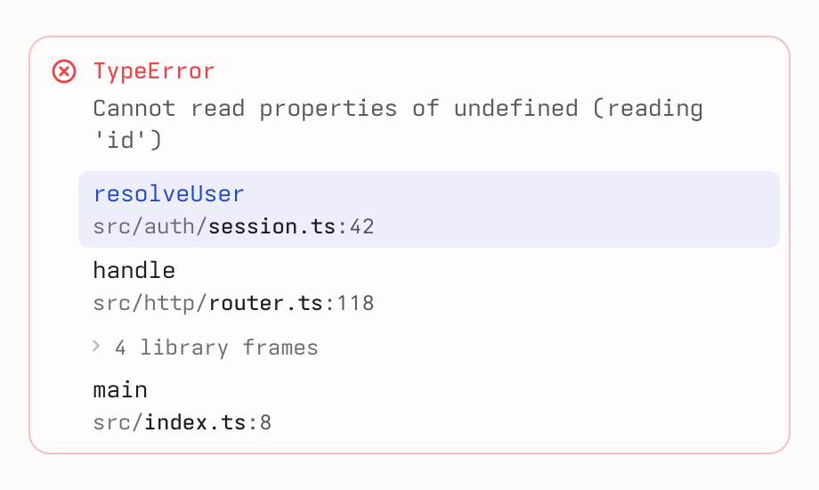
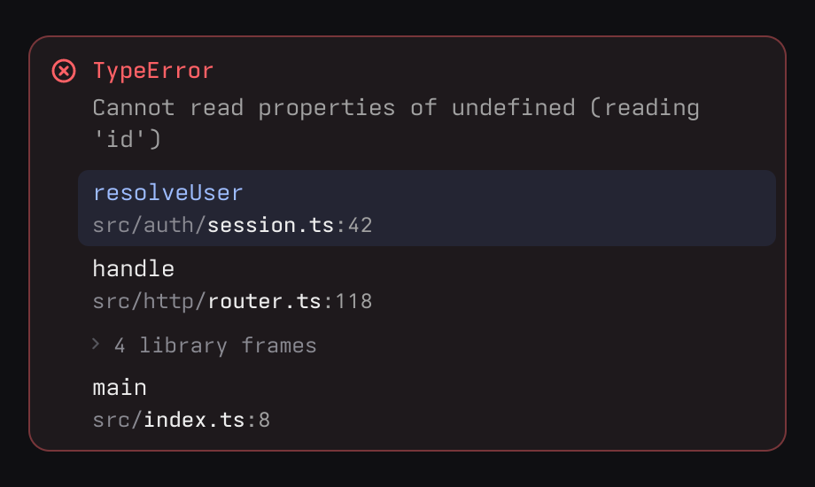
<figcaption><code>frames</code>: app frames lit, library frames folded.</figcaption>
</figure>

<figure class="tn-figure">
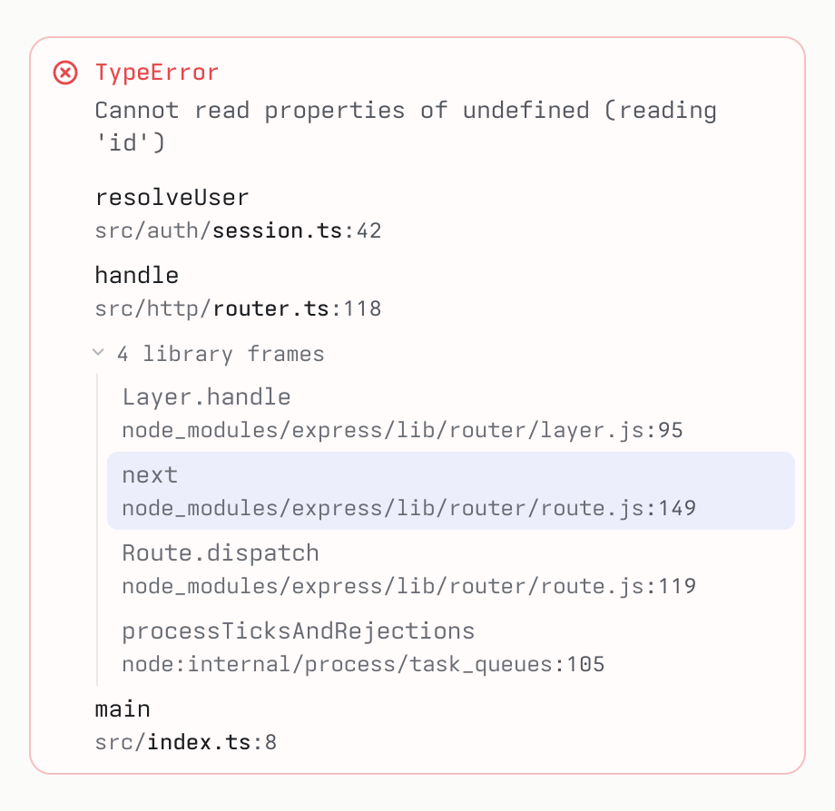
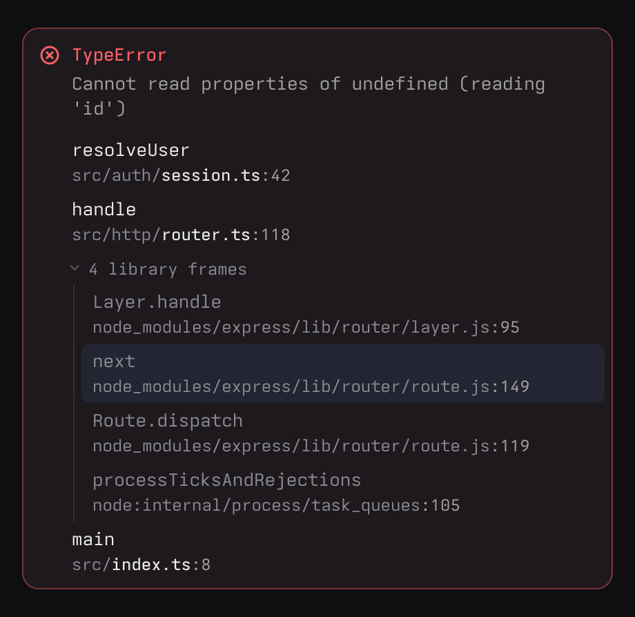
<figcaption>A selected library frame opens its run.</figcaption>
</figure>

<figure class="tn-figure">
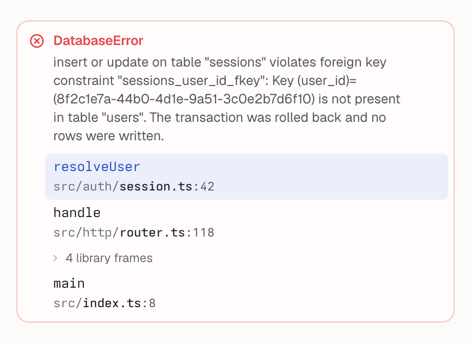
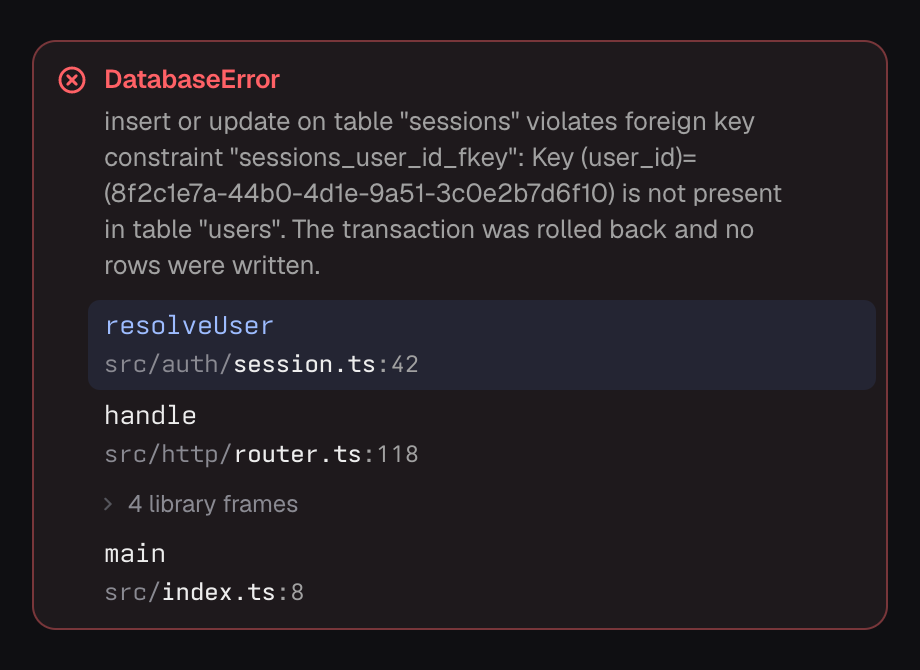
<figcaption>A long message wraps in full.</figcaption>
</figure>

<figure class="tn-figure">
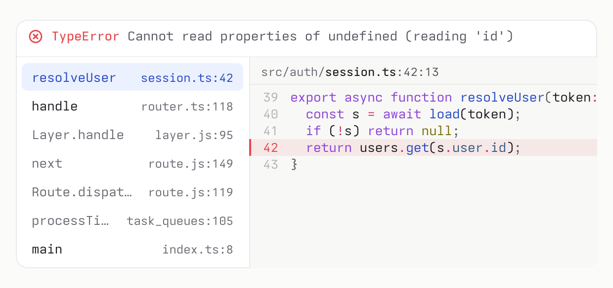
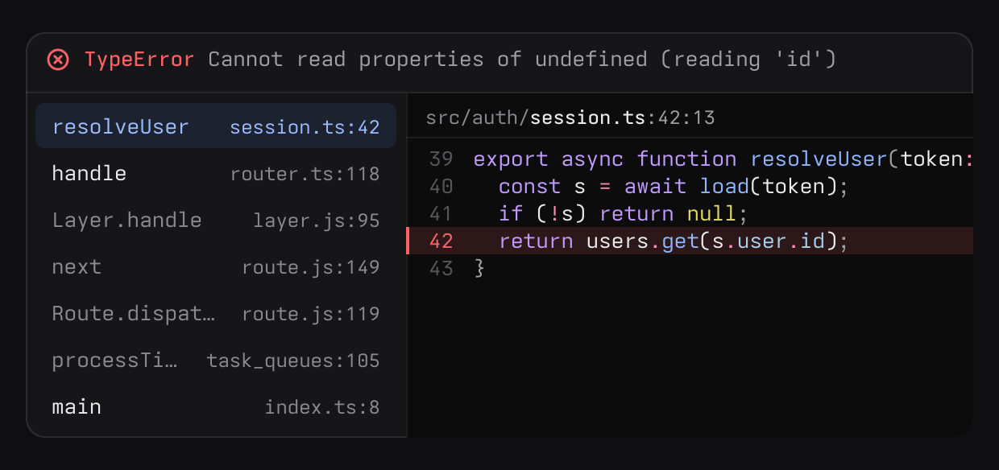
<figcaption><code>split</code>: the frame list beside the code at the selected frame.</figcaption>
</figure>

<figure class="tn-figure">
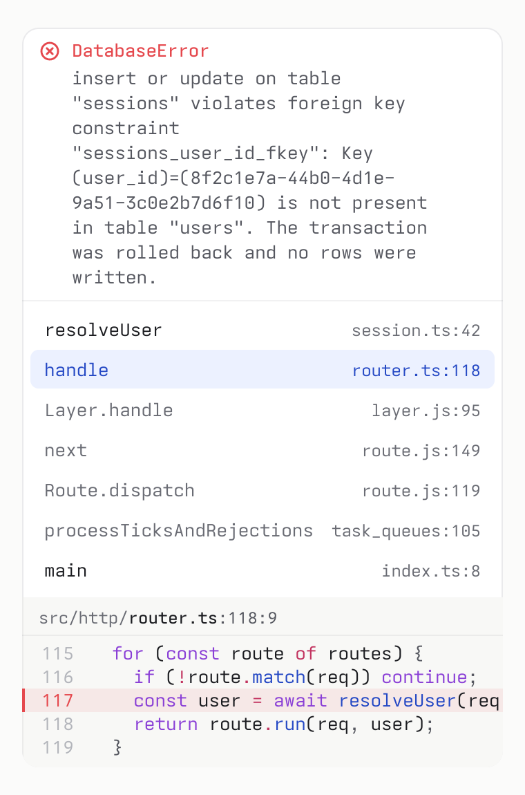
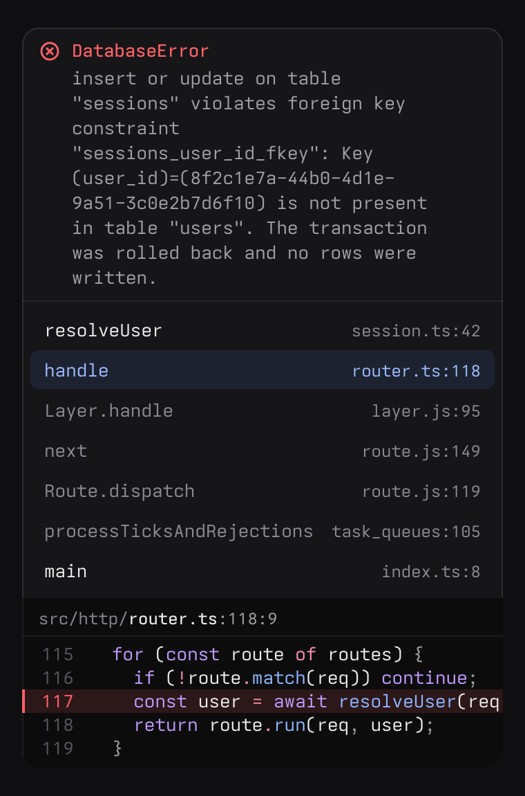
<figcaption>Narrow, the code moves under the list.</figcaption>
</figure>

<figure class="tn-figure">
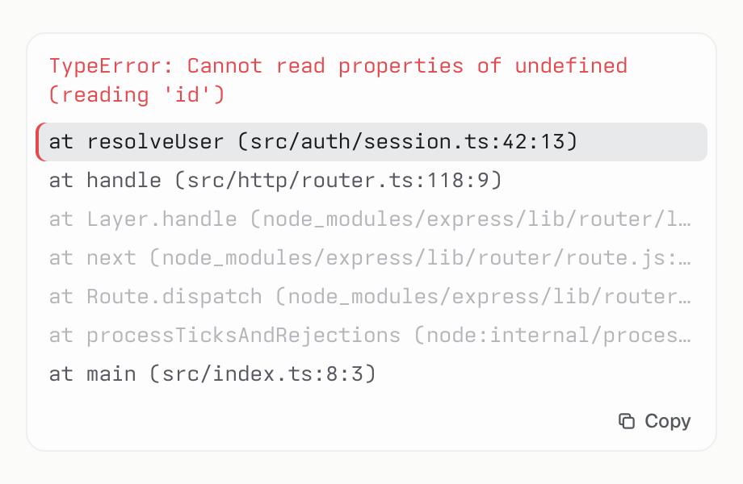
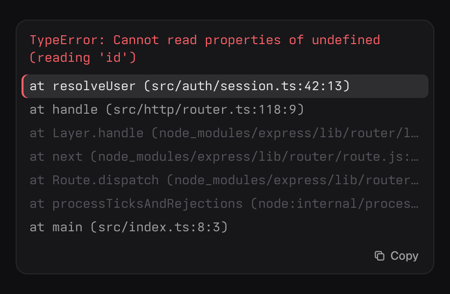
<figcaption><code>mono</code>: compact lines and Copy.</figcaption>
</figure>

<figure class="tn-figure">
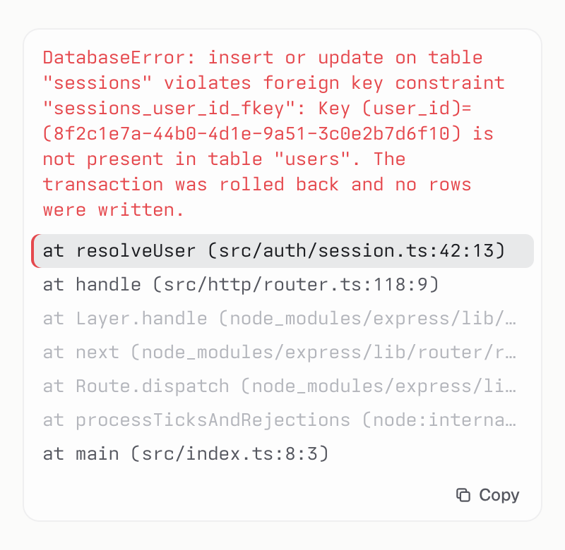
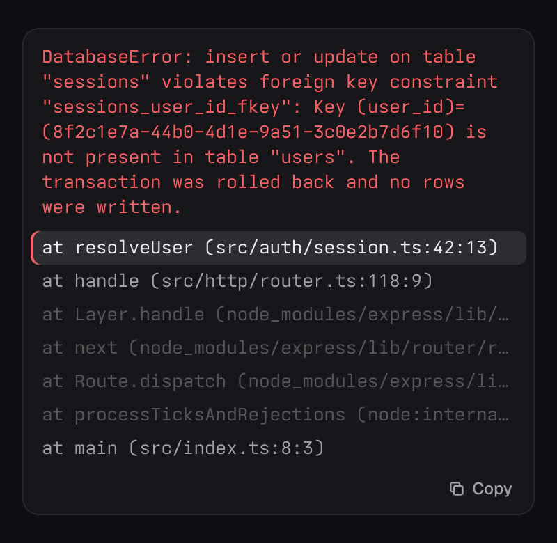
<figcaption>A long message in <code>mono</code>.</figcaption>
</figure>

**Build it:** `tern.ui.node("stacktrace", { error = …, frames = … })`.

| Prop | Type | Default | Meaning |
| --- | --- | --- | --- |
| `error` | `{ type?, message? }` | none | The error. The head shows the type and the message (`mono`: `Type: message`). |
| `frames` | array of frames | `[]` | The stack, innermost first. |
| `frames[].fn` | string | `""` | The function (`<anonymous>` when empty). |
| `frames[].file` | string | `""` | The file path, as the program knows it; a relative path opens against the pane's directory. |
| `frames[].line` | integer | none | 1-based line. |
| `frames[].col` | integer | none | 1-based column (`mono`, the `split` code head and the open link show it). |
| `frames[].app` | boolean | `true` | Your code (`true`) or a library's (`false`: folded in `frames`, dim elsewhere). |
| `frames[].code` | `{ start?, lines, line? }` | none | A source excerpt for `split`: its first line number (default 1), its lines, and the line to mark (default the frame's `line`). |
| `selected` | integer | the first app frame | The selected frame's index. A change wins over the user's last pick. |
| `lang` | string | by the first excerpt's file name | The excerpts' language for highlighting (`typescript`, `rust`, …). |
| `variant` | `"frames"` \| `"split"` \| `"mono"` | `"frames"` | The look. |

**Children:** none (ignored).

**Events:** `select { id, item }` on a click on frame `item` (its index; it shows
selected at once); `activate { id, item }` on a double click, as Tern opens its file
at its line. Library folds and Copy are local and send nothing. On a surface opened
with `listen: false` (or closed) a click selects nothing and sends nothing; folds,
Copy and opening files still work. Plus the common `actions` on the node.

**Keyboard:** the trace never takes focus. Drive the selection from your keys by
setting `selected` (↑↓ through the frames), and open a frame yourself on Enter (send
the host's open, or reuse what you do for `activate`).

**Styling:**

```html
<div class="sf sf-stacktrace" data-id="…" data-variant="frames">
	<div class="sf-st-head" data-variant="frames">
		<span class="sf-st-ic" aria-hidden="true"><svg class="ico">…</svg></span>
		<div class="sf-st-title">
			<span class="sf-st-type">TypeError</span>
			<span class="sf-st-msg">Cannot read properties of undefined</span>
		</div>
		<button class="sf-st-copy sf-button" data-variant="quiet" data-size="sm" data-act="copy" aria-label="Copy trace"></button>
	</div>
	<div class="sf-st-body">
		<!-- frames -->
		<div class="sf-st-frames" role="listbox">
			<div class="sf-st-frame [sel]" data-frame="0" role="option" aria-selected="true">
				<span class="sf-st-fn">resolveUser</span>
				<span class="sf-st-loc"><span class="dir">src/auth/</span><span class="name">session.ts</span><span class="pos">:42</span></span>
			</div>
			<div class="sf-st-fold [open]">
				<div class="sf-st-fold-head" role="button" data-fold="1" aria-expanded="false">
					<span class="sf-chev"></span><span class="sf-st-fold-label">2 library frames</span>
				</div>
				<div class="sf-st-fold-body"><div class="sf-st-frame lib" data-frame="1">…</div></div>
			</div>
		</div>
		<!-- split -->
		<div class="sf-st-split">
			<div class="sf-st-list" role="listbox">
				<div class="sf-st-frame [lib] [sel]" data-frame="0"><span class="sf-st-fn"></span><span class="sf-st-at">session.ts:42</span></div>
			</div>
			<div class="sf-st-code">
				<div class="sf-st-nocode [sf-hidden]">No source for this frame</div>
				<div class="sf-st-pane [sf-hidden]" data-pane="0">
					<div class="sf-st-path"><span class="sf-st-loc">…</span></div>
					<div class="sf-st-lines">
						<div class="sf-st-ln [err]"><span class="sf-st-gut">42</span><span class="sf-st-lt"><span class="tk-keyword">return</span> …</span></div>
					</div>
				</div>
			</div>
		</div>
		<!-- mono -->
		<div class="sf-st-frame mono [lib] [sel]" data-frame="0">at resolveUser (src/auth/session.ts:42:13)</div>
	</div>
	<div class="sf-st-foot"><!-- mono: the Copy button --></div>
</div>
```

| Target | Selector |
| --- | --- |
| The node | `.sf-stacktrace`, `[data-variant='frames' \| 'split' \| 'mono']` |
| Head | `.sf-st-head`, `.sf-st-ic`, `.sf-st-title`, `.sf-st-type`, `.sf-st-msg`, `.sf-st-copy` (inner, may change) |
| A frame | `.sf-st-frame[data-frame='<index>']` with `.sel`, `.lib`, `.mono`; `.sf-st-fn`, `.sf-st-loc` (`.dir`, `.name`, `.pos`), `.sf-st-at` (inner, may change) |
| Library folds | `.sf-st-frames`, `.sf-st-fold` (`.open`), `.sf-st-fold-head`, `.sf-st-fold-label`, `.sf-st-fold-body` (inner, may change) |
| Split | `.sf-st-split`, `.sf-st-list`, `.sf-st-code`, `.sf-st-nocode`, `.sf-st-pane`, `.sf-st-path`, `.sf-st-lines`, `.sf-st-ln` (`.err`), `.sf-st-gut`, `.sf-st-lt` with the highlighter's `.tk-*` (inner, may change) |
| Foot | `.sf-st-foot` (inner, may change) |

Variables: `--st-row` on the node is the height of a `mono` line and of a
library-fold row (24px). The folds and the `split` code pane animate in; that stops
under reduced motion and in still views (`.sf-still`).

## `checklist`

A todo list in phases, drawn from data in one of three presentations. omp uses it
for its todo tool (`full`), the pill above its composer (`hud`) and an end-of-turn
notice (`reminder`). In a plugin it fits a release checklist, a migration plan, any
phased progress.

**Items.** Each item has a `status`: `pending` (a hollow ring), `active` (a
pulsing dot in a ring, text emphasized), `done` (a check, text struck), `dropped`
(a dash, struck, dim) or `blocked` (a warning triangle; its note in the warning
color). Unknown statuses draw as `pending`. A phase's progress counts `done` and
`dropped` items.

**`full`** (default). Each phase is a row with a progress ring, its title and
`done/total`, then its items. A single phase without a title drops its row. A
completed phase folds to its row; `collapsed` on the phase overrides that. A click
(or Enter/Space) on a phase row folds or unfolds it locally, remembered per phase
id while the node lives. Phases without an `id` share one fold.

**`hud`.** A pill button at the right edge: the overall ring, the text of the
first `active` item (else the first `pending`; else "All done" or "Todos") and
`done/total`. A click opens or closes a popover (`.sf-ck-pop`) above the pill
holding the `full` list, and sends `activate { id, item = "hud" }`.

**`reminder`.** A header button: a warning icon, "`N todos still open`" (open
means `pending`, `active` or `blocked`), the `note` and a chevron. A click discloses
the open items only.

Items that turned `done` since the last draw get `.fresh` once: the check scales in
and the strike draws, never again on later redraws. Send updates as new `phases` on
the same node to keep that.

**Build it:** `tern.ui.node("checklist", { mode = …, phases = { … } })`.

| Prop | Type | Default | Meaning |
| --- | --- | --- | --- |
| `phases` | array of phases | `[]` | The list. |
| `phases[].id` | string | `""` | Phase id; keys the local fold. |
| `phases[].title` | text | none | Phase title. |
| `phases[].items` | array of items | `[]` | Items (an item without `id` is skipped). |
| `phases[].collapsed` | boolean | folded when complete | Initial fold. |
| `items[].id` | string | required | Item id; keys the `.fresh` animation. |
| `items[].text` | text | `""` | Item text. |
| `items[].status` | `"pending"` \| `"active"` \| `"done"` \| `"dropped"` \| `"blocked"` | `"pending"` | Item state. |
| `items[].note` | text | none | A line under the item. |
| `mode` | `"full"` \| `"hud"` \| `"reminder"` | `"full"` | Presentation; also a class on the node. |
| `note` | text | none | `reminder` only: text after the count ("reminder 1/3"). |

**Children:** none (ignored).

**Events:** `activate { id, item = "hud" }` when the `hud` pill is clicked. Phase
folds and the reminder disclosure are local and send nothing.

**Styling:**

```html
<!-- full -->
<div class="sf sf-checklist full" data-id="…" role="group" aria-label="Todos, 3 of 7 done">
	<div class="sf-ck-phase [done] [folded]">
		<div class="sf-ck-ph" role="button" tabindex="0" aria-expanded="true">
			<svg class="sf-ring [full]"><circle class="tr"/><circle class="fl"/></svg>
			<span class="t">Ship</span><span class="n">2/3</span>
		</div>
		<div class="sf-ck-items">
			<div class="sf-ck-item st-done [fresh]">
				<span class="sf-ck-g"><!-- check / dash / warn / <i class="dot"> --></span>
				<span class="sf-ck-t">Tag the release</span>
				<div class="sf-ck-note">waiting on CI</div>
			</div>
		</div>
	</div>
</div>
<!-- hud -->
<div class="sf sf-checklist hud [open]">
	<button class="sf-ck-pill" aria-expanded="false"><svg class="sf-ring">…</svg><span class="t">Tag the release</span><span class="n">3/7</span></button>
	<div class="sf-ck-pop [sf-hidden]"><!-- the full list --></div>
</div>
<!-- reminder -->
<div class="sf sf-checklist reminder [open]">
	<div class="sf-ck-rh" role="button" tabindex="0"><span class="ic"><!-- warn --></span><span class="t">4 todos still open</span><span class="n">reminder 1/3</span><span class="sf-chev"></span></div>
	<div class="sf-ck-items"><!-- open items --></div>
</div>
```

| Target | Selector |
| --- | --- |
| The node | `.sf-checklist` |
| Presentation | `.sf-checklist.full`, `.hud`, `.reminder`; `.open` (popover or reminder open) |
| Phase | `.sf-ck-phase` (`.done`, `.folded`), `.sf-ck-ph` with `.t`, `.n` (inner, may change) |
| Progress ring | `.sf-ring` (`.full` when complete), `.sf-ring .tr`, `.sf-ring .fl` (inner, may change) |
| Items | `.sf-ck-items`, `.sf-ck-item.st-<status>`, `.sf-ck-item.fresh` (inner, may change) |
| Item parts | `.sf-ck-g` (`.dot` when active), `.sf-ck-t`, `.sf-ck-note` (inner, may change) |
| HUD | `.sf-ck-pill` with `.t`, `.n`; `.sf-ck-pop` (inner, may change) |
| Reminder | `.sf-ck-rh` with `.ic`, `.t`, `.n`, `.sf-chev` (inner, may change) |

The ring's fill is a `stroke-dasharray` set inline. The pop, strike, popover and
active-dot motion stop under reduced motion and in still views.

```lua
local ui = tern.ui

local phases = {
	{ id = "build", title = "Build", items = {
		{ id = "b1", text = "Compile", status = "done" },
		{ id = "b2", text = "Test", status = "done" },
	} },
	{ id = "ship", title = "Ship", items = {
		{ id = "s1", text = "Write the changelog", status = "done" },
		{ id = "s2", text = "Tag the release", status = "active" },
		{ id = "s3", text = "Publish", status = "blocked", note = "waiting on approval" },
		{ id = "s4", text = "Announce", status = "pending" },
		{ id = "s5", text = "Update the old docs", status = "dropped" },
	} },
}

ui.node("col", { gap = "md" }, {
	ui.node("checklist", { mode = "full", phases = phases }),
	ui.node("checklist", { mode = "hud", phases = phases }),
	ui.node("checklist", { mode = "reminder", note = "reminder 1/3", phases = phases }),
})
```

<figure class="tn-figure">
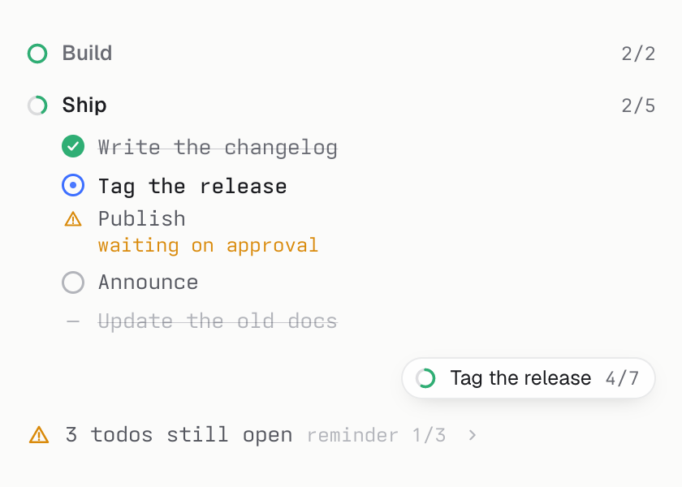
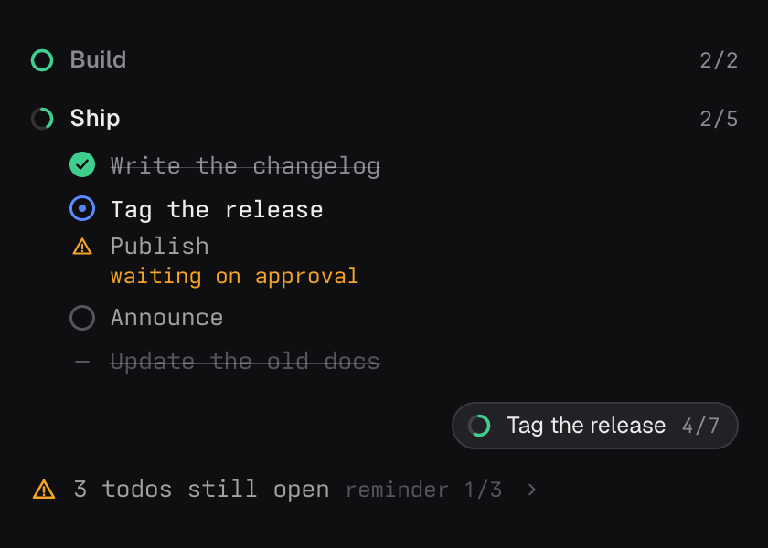
<figcaption><code>full</code>, <code>hud</code> and <code>reminder</code> of the same phases. Build is complete, so it folds to its row.</figcaption>
</figure>

## `message`

One message of a conversation. The node draws the frame of a chat message (who wrote
it and when, their avatar, the reactions people left, a row of hover actions and a
status line) and its children are the body: an `md` for prose, a `code` block,
images, a `tool` card, anything. One kind covers the three ways chats look, picked by
`variant`:

- **`auto`** (the default) is the agent chat, as omp's Reader draws it: the local
  user's messages (`side = "end"`) sit at the right in an accent-tinted bubble; the
  others' read as plain prose across the measure, under a small avatar, the name and
  the time.
- **`bubble`** is the messenger: bubbles on both sides, the avatar beside the
  start-side ones, reaction chips under the bubble, a status under the local user's.
- **`flat`** is the team thread (Slack, Linear comments): every row starts at the
  left with a 32px avatar, the name and the time, the text under them; the row
  shades under the pointer and its actions float at its top right.

Reach for `auto` when one side is an agent, `flat` when people talk to each other,
`bubble` for a phone-like messenger. Put the messages in a `col` with no gap: each
message keeps its own distance from the one before (12px, 2px when `continued`).

| Variant | Look | Reach for it for |
| --- | --- | --- |
| `auto` | End side: an accent-tinted bubble (13% light, 24% dark) at the right, at most 78% of the width or 560px, radius 18 with a 6px tail corner. Start side: plain body across the width under a 20px avatar, the name (weight 550) and the time in mono `--t3` | Agent chats: the user asks, the agent answers in prose, code and tool cards |
| `bubble` | Bubbles on both sides: the end side accent-tinted at the right, the start side a soft gray (`--t1` at 6.5%/8.5%) beside a 28px avatar with the name above; reactions under the bubble; continued bubbles tighten their corner on their side | Messengers, support chats, anything phone-like |
| `flat` | Rows from the left: a 32px avatar, the name and the time, the body under them; the row shades (`--sf-shade`) under the pointer; continued rows show their time in the gutter on hover; actions float in a small `--pop-bg` toolbar at the row's top right | Team threads, comments, review discussions |

**Side.** `side = "end"` marks the local user's messages. In `auto` and `bubble` they
take the right side and an accent-tinted bubble, show no header (the user knows who
they are) and put `time` in the footer unless a `status` takes its place. In `flat`
the side changes nothing: every row reads from the left.

**Runs.** `continued = true` says the message has the same author as the one before:
it drops the header and the avatar (the column stays, so the run lines up), sits 2px
under the previous one and, in `bubble`, tightens the bubble's corner on its side. In
`flat` a continued row shows its `time` in the avatar gutter on hover.

**Avatar.** `avatar` names one of the node's children (an [`avatar`](data.md#avatar)
node, or an `icon` or `image`); it is drawn in the avatar slot, sized by the variant
(20px in `auto`, 28px in `bubble`, 32px in `flat`), and is not part of the body. In
`auto` the slot sits beside the name; in `bubble` and `flat` it heads the left
column. End-side messages in `auto` and `bubble` hide it.

**Reactions.** `reactions` lists chips under the body: `text` (an emoji or a glyph,
also the reaction's identity), `count` (how many reacted, the local user included)
and `on` (the local user is one of them). A click flips the chip at once, counting
the user in or out, and sends `change { value = text, on }`; the flip is remembered
by the node's `key` and the chip's text, so it survives a rebuild under a new id,
until your next frame changes that reaction's `on`, which wins again. Mirror the
event into `on` and `count`.

**Actions.** `actions` is this kind's own list of icon buttons in the footer (in
`flat`, a small toolbar floating at the row's top right), not the common
`{ click, menu }` object. They show while the pointer is over the message, or always
with `reveal = "always"` (the latest answer in an agent chat). A click runs the act
as a click action does (see [Elements](index.md)): `copy` copies the message's text
(its children's: Markdown source for `md`) and shows Copied, the built-ins (`open`,
`toggle`, `zoom`, `select`, `activate`) behave as they do everywhere, and any other
act sends `action { act }`. Without an `icon` an act draws its usual one (`copy`,
`retry`/`regenerate`/`refresh` ↻, `edit`, `share`, `rewind`, anything else `more`
⋯); without a `title` the tooltip is the act, capitalized.

**Status.** `status` is a short line under the message in quiet mono ("Read 14:03",
"Delivered", "Edited"). `pending = true` shimmers it and, on the end side, dims the
bubble: the message is still on its way.

```lua
local ui = tern.ui

local function message(m, prev)
	local same = prev and prev.author == m.author
	local kids = {}
	if not same and m.author ~= me then
		kids[#kids + 1] = ui.node("avatar", { id = m.id .. ".av", text = m.author, size = "sm" })
	end
	kids[#kids + 1] = ui.node("md", { text = m.text })
	return ui.node("message", {
		key = m.id,
		side = m.author == me and "end" or "start",
		author = m.author,
		time = m.time,
		continued = same,
		avatar = (not same and m.author ~= me) and (m.id .. ".av") or nil,
		reactions = m.reactions, -- { { text = "♥", count = 2, on = true } }
		actions = m.author == "omp" and {
			{ act = "copy" },
			{ act = "retry", title = "Regenerate" },
		} or nil,
		reveal = m.last and "always" or nil,
		status = m.author == me and m.read and ("Read " .. m.read) or nil,
		pending = m.sending,
	}, kids)
end

-- in the block's event handler
if ev.ev == "change" and ev.id:match("^msg") then
	toggle_reaction(ev.id, ev.value, ev.on)
elseif ev.ev == "action" and ev.act == "retry" then
	regenerate(ev.id)
end
```

<figure class="tn-figure">
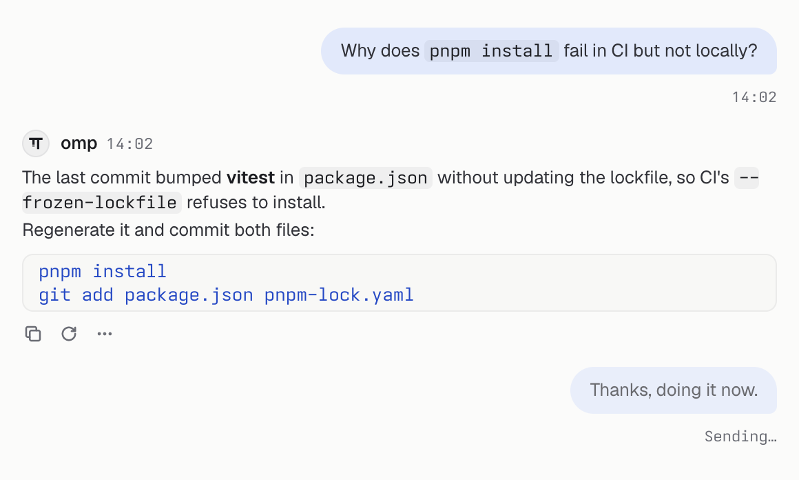
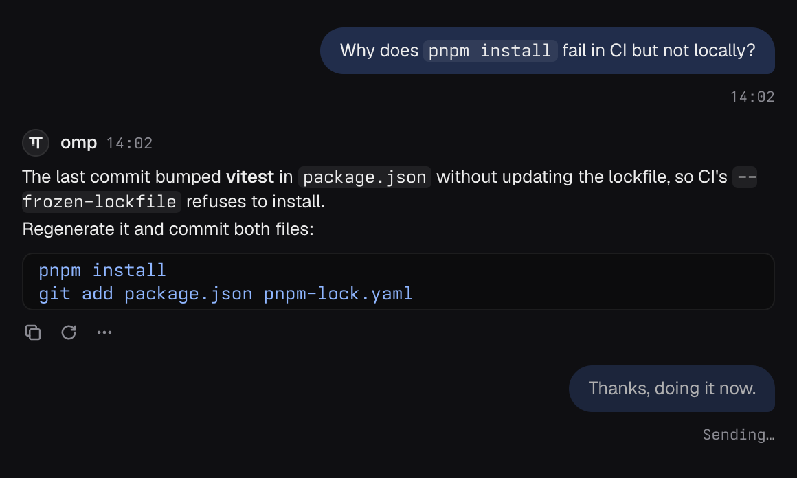
<figcaption><code>auto</code>: the user in a bubble at the right, the agent as plain prose with its actions.</figcaption>
</figure>

<figure class="tn-figure">
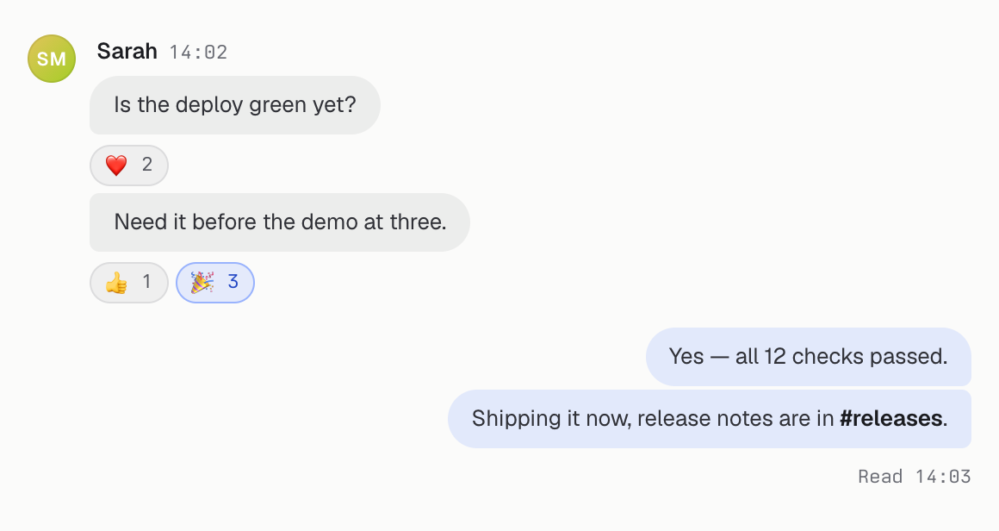
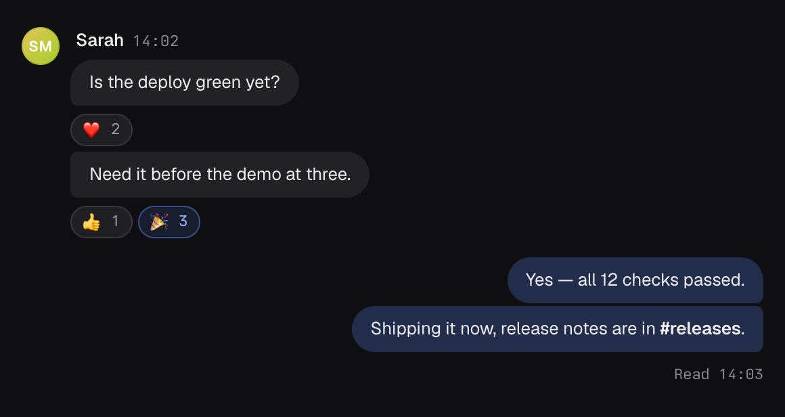
<figcaption><code>bubble</code>: bubbles on both sides, reactions and a read status.</figcaption>
</figure>

<figure class="tn-figure">
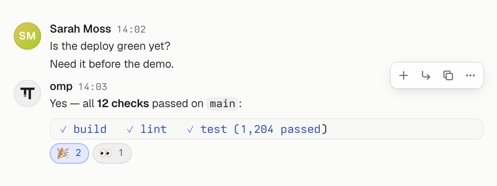
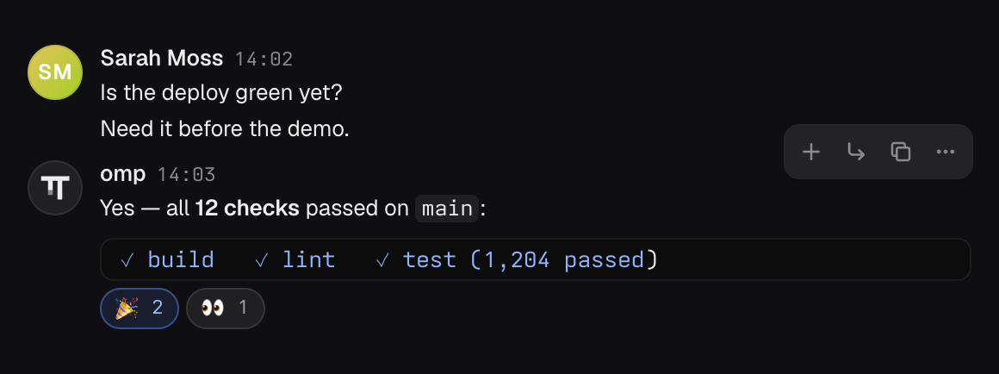
<figcaption><code>flat</code>: rows grouped by author, the actions floating over the row.</figcaption>
</figure>

<figure class="tn-figure">
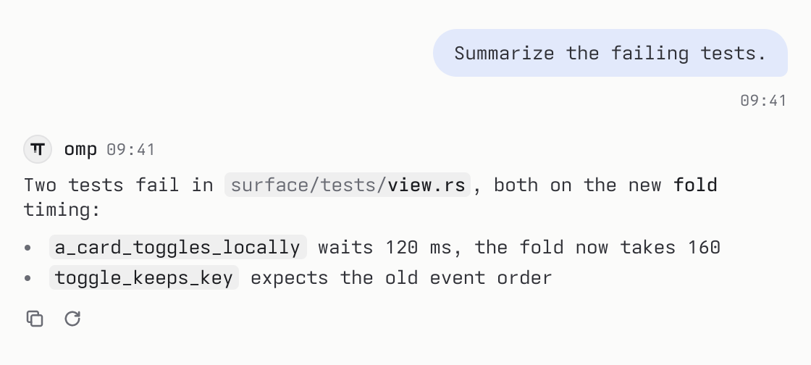
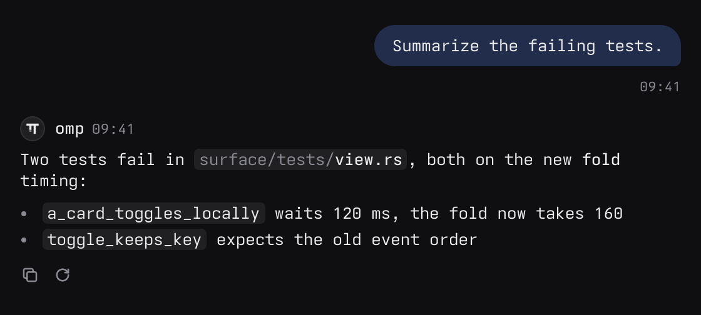
<figcaption>In a mono region the messages keep their shape in the terminal's face.</figcaption>
</figure>

**Build it:** `tern.ui.node("message", { … }, { avatar, …body })`.

| Prop | Type | Default | Meaning |
| --- | --- | --- | --- |
| `variant` | `"auto"` \| `"bubble"` \| `"flat"` | `"auto"` | The look (table above). Unknown values read as `auto`. |
| `side` | `"start"` \| `"end"` | `"start"` | `end` is the local user: the right side and the accent bubble in `auto` and `bubble`. |
| `author` | string | none | The name in the header. |
| `time` | string | none | The time in the header, mono (`"14:02"`, `"Yesterday"`); on an end-side `auto`/`bubble` message it shows in the footer when there is no `status`; in a continued `flat` row it shows in the gutter on hover. |
| `avatar` | string | none | The id of the child drawn in the avatar slot (an `avatar` node, or an `icon` or `image`). A missing id draws no avatar and leaves the child in the body. |
| `continued` | boolean | `false` | Same author as the message before: no header, no avatar, 2px from it. |
| `reactions` | array of `{ text, count?, on? }` | `[]` | Reaction chips: `text` an emoji or glyph (its identity; entries without one are skipped), `count` (integer ≥ 0, default 0; hidden at 0) how many reacted with the local user, `on` (boolean, default `false`) the local user reacted. |
| `actions` | array of `{ act, icon?, title? }` | `[]` | Icon buttons shown on hover: `act` the action a click runs (entries without one are skipped), `icon` any Tern icon name (else the act's own, see Actions), `title` the tooltip and accessible name (else the act, capitalized). |
| `reveal` | `"hover"` \| `"always"` | `"hover"` | When the actions show; `always` keeps them up (the latest answer). |
| `status` | string | none | A quiet mono line under the message ("Read 14:03", "Delivered"). |
| `pending` | boolean | `false` | Still on its way: the status shimmers and an end-side bubble dims. |
| `key` | string | node id | Identity among siblings; reaction flips are remembered by this key under the same parent. |

**Children:** the `avatar` child goes to the avatar slot; every other child is the
body, drawn in order 8px apart (any kinds: `md`, `code`, `image`, `tool`, `row`s of
`attachment`s). A message with no body children draws its header and chips alone.

**Events:** `change { id, value, on }` when the user flips a reaction chip (`value`
is the chip's text); `action { id, act, value?, mods? }` when the user clicks an
action whose act is not a built-in (an act `name=value` sends `value` apart, as
everywhere). `copy` sends nothing: Tern copies the message's text. A surface closed
or opened with `listen: false` draws the chips and buttons but neither flips nor
sends anything.

**Keyboard:** none; the message never takes focus and its buttons keep the keys with
the program. Drive what the keyboard does through props: put the reactions you
toggle on a key into `reactions` (`on`, `count`), show the actions of the message
your cursor is on with `reveal = "always"`.

**Styling:**

```html
<div class="sf sf-message [continued] [has-av] [reveal] [pending]" data-id="…"
	data-variant="auto" data-side="start" role="article">
	<div class="sf-msg-av">
		<div class="sf-msg-pic"><!-- the avatar child --></div>
		<span class="sf-msg-stamp" aria-hidden="true">14:02</span>
	</div>
	<div class="sf-msg-head">
		<span class="sf-msg-author">omp</span>
		<span class="sf-msg-time">14:02</span>
	</div>
	<div class="sf-msg-body"><!-- the other children --></div>
	<div class="sf-msg-reacts" role="group" aria-label="Reactions">
		<button class="sf-msg-react on" aria-pressed="true" aria-label="🎉 3" data-i="0">
			<span class="sf-msg-emoji">🎉</span><span class="sf-msg-count">3</span>
		</button>
	</div>
	<div class="sf-msg-foot">
		<div class="sf-msg-acts" role="toolbar" aria-label="Message actions">
			<button class="sf-msg-act" data-act="copy" title="Copy" aria-label="Copy"><svg class="ico">…</svg></button>
		</div>
		<span class="sf-msg-status [sf-fx-shimmer]">Read 14:03</span>
	</div>
</div>
```

Parts with nothing to show carry `.sf-hidden`.

| Target | Selector |
| --- | --- |
| The node | `.sf-message`, `[data-variant='auto' \| 'bubble' \| 'flat']`, `[data-side='start' \| 'end']` |
| States | `.sf-message.continued`, `.has-av` (an avatar child is drawn), `.reveal` (actions always shown), `.pending` |
| Avatar column, slot, gutter time | `.sf-msg-av`, `.sf-msg-pic`, `.sf-msg-stamp` (inner, may change) |
| Header, name, time | `.sf-msg-head`, `.sf-msg-author`, `.sf-msg-time` (inner, may change) |
| Body (the bubble in `auto`/`bubble`) | `.sf-msg-body` (inner, may change) |
| Reaction chips | `.sf-msg-reacts`, `.sf-msg-react` (`.on`), `.sf-msg-emoji`, `.sf-msg-count` (inner, may change) |
| Footer, actions, status | `.sf-msg-foot`, `.sf-msg-acts`, `.sf-msg-act[data-act]`, `.sf-msg-status` (inner, may change) |

Variables on the node: `--msg-bubble` (the end-side bubble fill), `--msg-other` (the
start-side bubble fill in `bubble`), `--msg-av` (the avatar column's width and the
avatar's size). Messages arrive with a short rise and fade; it, the hover fades and
the pending shimmer stop under reduced motion and in still views (`.sf-still`).

## `suggestions`

Things the user could ask next, each sent with one click: under an agent's answer, in
an empty chat, after an error. The node draws the items and says which one was
clicked; the program puts the text in the composer or sends it.

**Variants.** `variant` picks the look:

- `chips` (default): wrapping pills, each led by a sparkle (or the item's `icon`).
  For a few short prompts. An item's `detail` is its tooltip.
- `rows`: full-width rows led by a `›` (or the item's `icon`), the `detail` muted
  after the text and a number keycap 1–9 (or the item's own `keys`) at the right. For
  prompts the program also binds to keys.
- `cards`: a two-column grid of small cards, the text over a muted `detail` (the
  reason to pick it). An item's `icon` shows at its top left.

Items arrive staggered and lift a little under the pointer (neither under reduced
motion). Long texts end in an ellipsis: on one line in chips and rows, after two
lines in cards.

```lua
local ui = tern.ui

ui.node("suggestions", {
	id = "next",
	variant = "rows",
	items = {
		{ id = "explain", text = "Explain this error" },
		{ id = "test", text = "Write a test for resolveUser" },
		{ id = "lint", text = "Fix the 3 lint warnings", detail = "src/user.ts" },
	},
})

-- in the block's event handler
if ev.ev == "activate" and ev.id == "next" then
	send(prompts[ev.item])
end
```

<figure class="tn-figure">
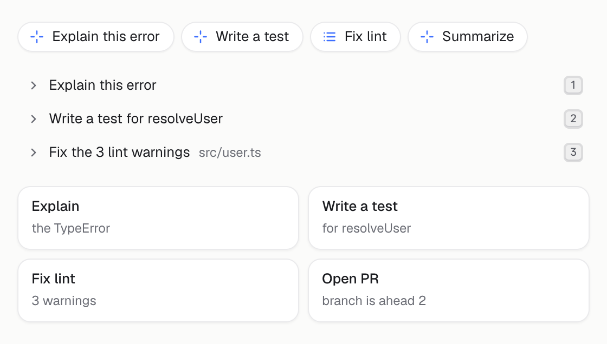
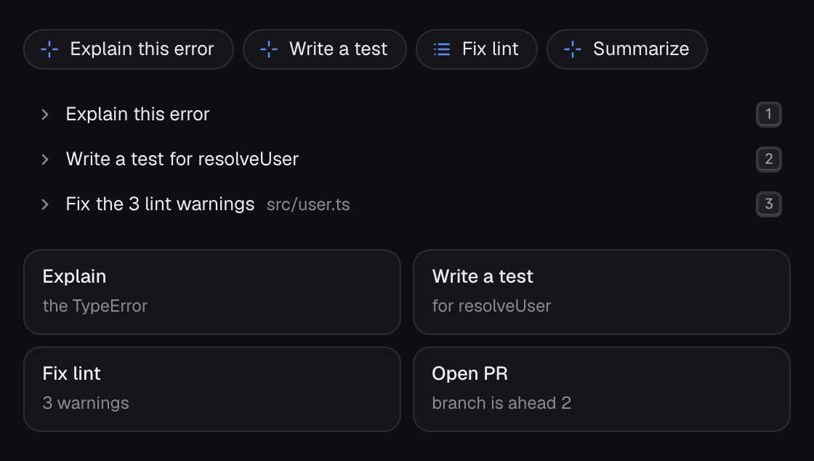
<figcaption><code>chips</code>, <code>rows</code> and <code>cards</code>.</figcaption>
</figure>

<figure class="tn-figure">
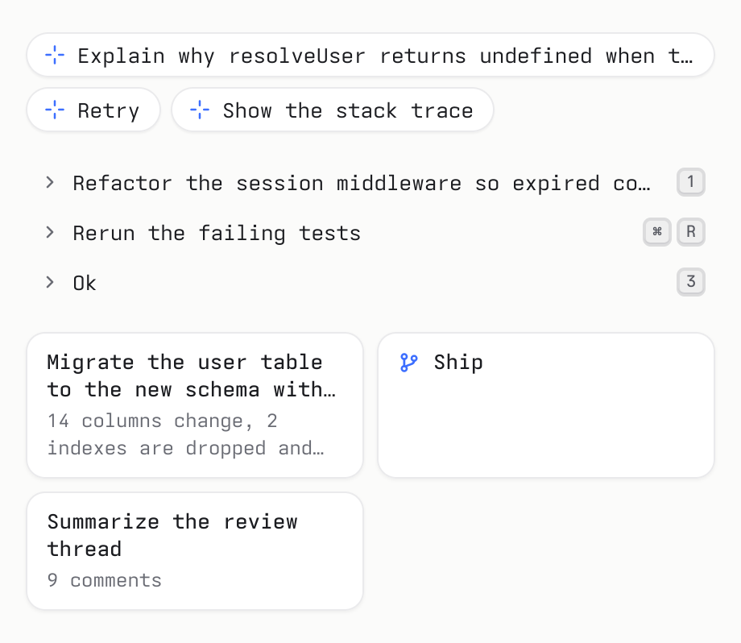
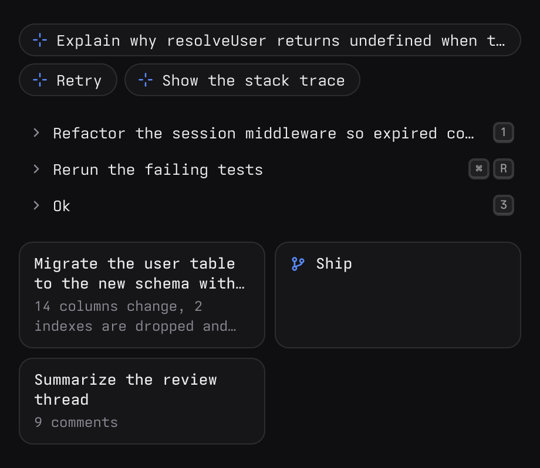
<figcaption>Long and short texts in a mono region, with an item's own <code>keys</code> and <code>icon</code>.</figcaption>
</figure>

**Build it:** `tern.ui.node("suggestions", { variant = …, items = { … } })`.

| Prop | Type | Default | Meaning |
| --- | --- | --- | --- |
| `variant` | `"chips"` \| `"rows"` \| `"cards"` | `"chips"` | The look (list above). |
| `items` | array of `{ id?, text, detail?, icon?, keys? }` | `[]` | The suggestions, in order. Items without `text` are skipped. |
| `items[].id` | string | the item's `text` | What `activate` names. |
| `items[].text` | string | required | The prompt as shown. |
| `items[].detail` | string | none | `rows`: muted after the text; `cards`: the muted line under it; `chips`: the tooltip. |
| `items[].icon` | string (icon name) | `sparkles` (chips), `›` (rows), none (cards) | The leading icon. |
| `items[].keys` | array of key names | `rows`: the item's number, 1–9 | `rows` only: the keycaps at the right, as `kbd` draws them; `[]` for none. |

**Children:** none (ignored).

**Events:** `activate { id, item }` on a click on an item (`item` = its `id`, else its
`text`). Not sent when the surface is closed or opened with `listen: false`. Plus the
common `actions` on the node.

**Keyboard:** the node never takes focus. A program that offers keys (the `rows`
numbers) binds them itself and acts as on `activate`; the keycaps only show them.

**Styling:**

```html
<div class="sf sf-suggestions" data-id="…" data-variant="rows" role="list">
	<div class="sf-sug" role="listitem" data-item="lint" style="--i: 2">
		<span class="sf-sug-ic"><svg class="ico">…</svg></span>
		<span class="sf-sug-body">
			<span class="sf-sug-text">Fix the 3 lint warnings</span>
			<span class="sf-sug-detail">src/user.ts</span>
		</span>
		<span class="sf-sug-keys kbds"><span class="kbd">3</span></span>
	</div>
</div>
```

| Target | Selector |
| --- | --- |
| The node | `.sf-suggestions`, `[data-variant='chips' \| 'rows' \| 'cards']` |
| An item | `.sf-sug[data-item='<id>']` |
| Icon, text, detail | `.sf-sug-ic`, `.sf-sug-body`, `.sf-sug-text`, `.sf-sug-detail` (inner, may change) |
| Keycaps (`rows`) | `.sf-sug-keys.kbds > .kbd` (inner, may change) |

Variables: `--i` on an item is its index (up to 12), which staggers the entrance. The
entrance and the lift stop under reduced motion and in still views (`.sf-still`).

## `questions`

A questionnaire: questions with choices, answered one step at a time. Reach for it
when a program or agent needs a decision before it goes on: what to build next, which
parts to include, a deadline. One question with a few choices in the transcript is
`variant = "inline"`; a short survey is `steps` (the default) or `list`. For
free-form forms use `el` controls; for one yes/no, two buttons.

**Items.** Each question has an `id`, a `prompt`, an optional `description`,
`choices` (`{ value, label, detail? }`, or a bare string as value and label), and
three flags: `multi` (pick several: checks instead of radios), `required` (no Skip;
Next and Submit wait for an answer) and `other` (`{ placeholder }`: a free-text
answer). The first nine choices show their number as a keycap, so a program can take
`1`–`9` from the keyboard.

**Other.** The free-text answer is an `input` child of the node with `key =
"<question id>.other"`, drawn under the question's choices while they show (else not
drawn). The program owns its text like any `input`, and mirrors it into `answers` (a
text answer that matches no choice's value is drawn as that text in summaries).

**Variants.** `variant` picks the look:

| Variant | Looks like | Use it for |
| --- | --- | --- |
| `steps` | One card per question, progress, choice cards, Back / Skip / Next | A short survey that has the user's attention |
| `inline` | Prompt, keyed chips, hint, in the flow | One quick question an agent asks mid-transcript |
| `list` | Every question; answered ones fold to "✓ prompt · answer" | Several questions the user may answer in any order |

- **`steps`** (default): a card per question. Segmented progress and "2 of 4", the
  prompt (a red `*` when required) and description, choice cards (a radio or check,
  label, detail, keycap), the Other field, then Back, Skip (only when not required)
  and Next, which turns into Submit (or the `submit` label) on the last step.
- **`inline`**: compact, in the flow. A sparkle and the prompt ("2/3" when there are
  more questions), keyed chips (a check after picked labels when `multi`), the Other
  field and a hint line (`hint`, else derived: "1–3 picks · or type an answer · skip
  to leave it"). No buttons: the program takes keys.
- **`list`**: every question in order. The current one (`step`) shows its chips and
  Other field; answered ones fold to one line, a green check, the prompt and the
  answer ("Delegation", or labels joined by ", "); unanswered ones show their number.
  A click on a folded question opens it. A foot counts "2 of 4 answered" next to
  Submit.

**Local state.** Like `el` controls, the pointer acts at once and the program hears
after: a pick shows immediately, Back / Next / Skip move the step, a list row opens.
The node remembers this while it is drawn. A `step` or an answer the program changes
from what it last sent wins over the user's. On a closed surface or one opened with
`listen: false` nothing flips and nothing is sent.

```lua
local ui = tern.ui

ui.node("questions", {
	id = "plan",
	step = 1,
	answers = { dir = "deleg" },
	items = {
		{ id = "dir", prompt = "Direction", required = true,
			choices = { { value = "deleg", label = "Delegation" }, { value = "ask", label = "Question prompts" } } },
		{ id = "detail", prompt = "What should we prototype next?", description = "Pick one, or write your own.",
			other = { placeholder = "Another answer…" },
			choices = {
				{ value = "deleg", label = "Delegation", detail = "Work moving to a specialist" },
				{ value = "ask", label = "Question prompts", detail = "Choices while the UI waits" },
			} },
	},
}, {
	ui.node("input", { key = "detail.other", placeholder = "Another answer…" }),
})
```

<figure class="tn-figure">
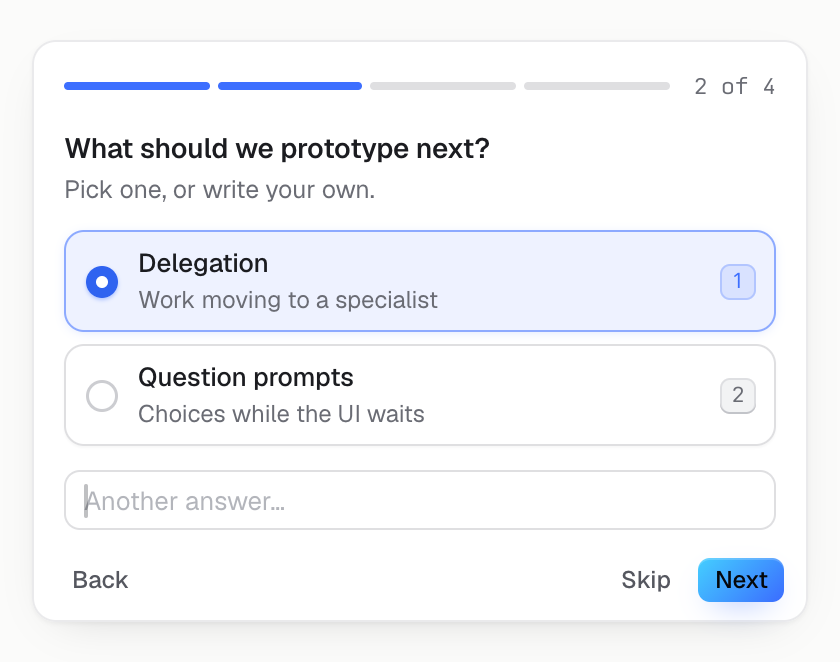
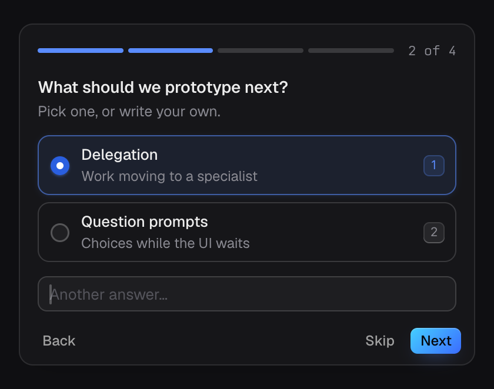
<figcaption><code>steps</code>: a single pick mid-way.</figcaption>
</figure>

<figure class="tn-figure">
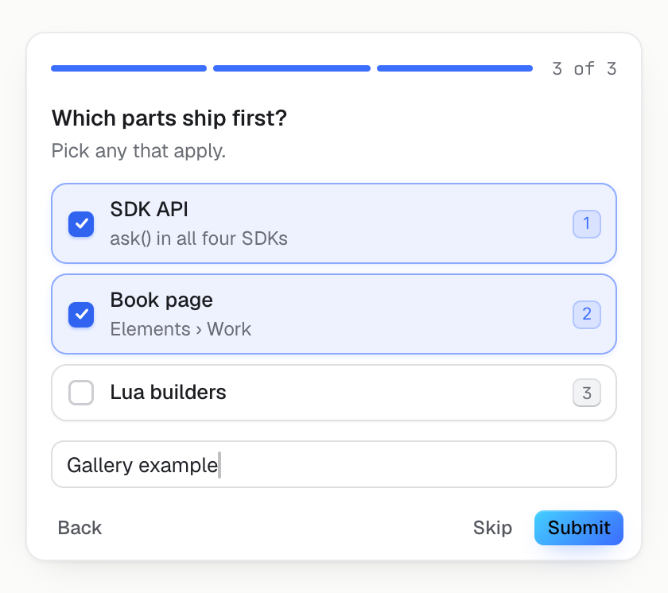
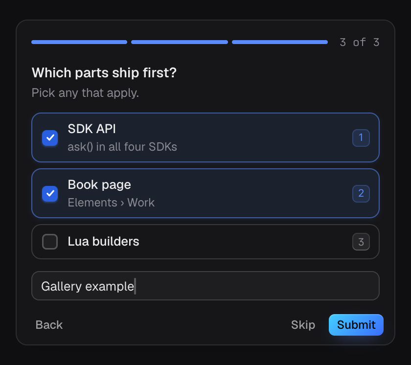
<figcaption><code>steps</code> on the last step: a <code>multi</code> question with an Other answer.</figcaption>
</figure>

<figure class="tn-figure">
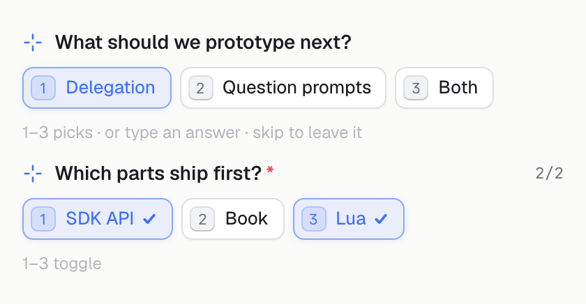
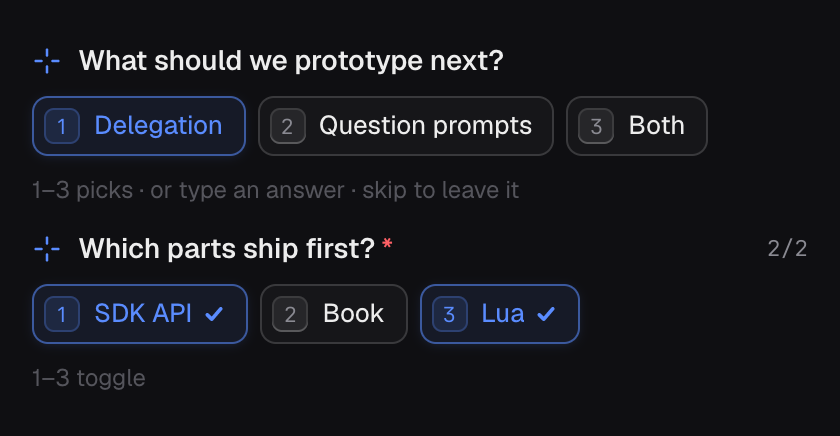
<figcaption><code>inline</code>: a single pick with Other, and a required <code>multi</code> pick.</figcaption>
</figure>

<figure class="tn-figure">
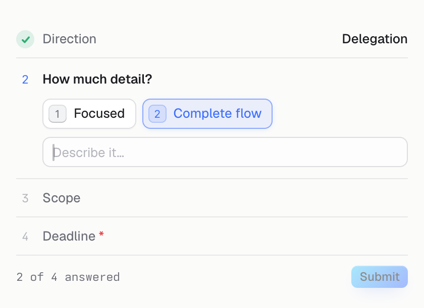
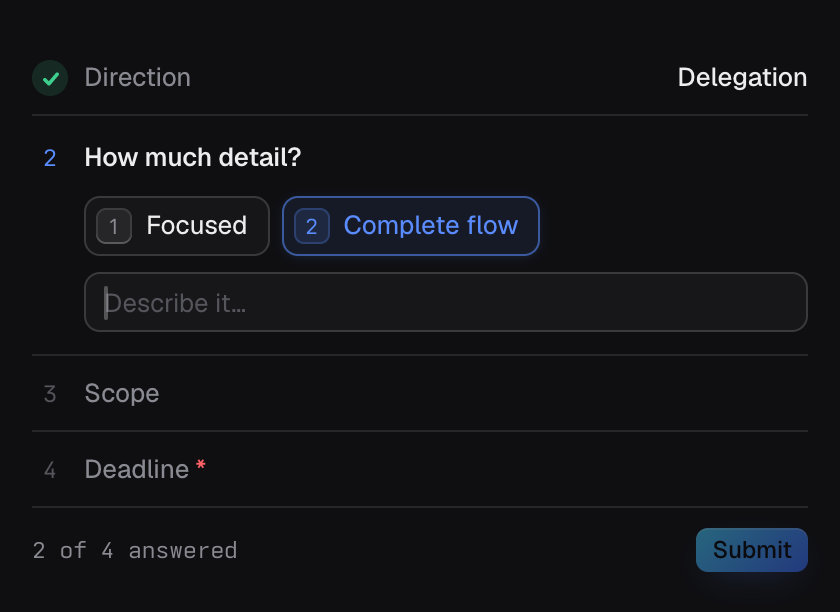
<figcaption><code>list</code>: answered questions fold to one line.</figcaption>
</figure>

**Build it:** `tern.ui.node("questions", { items = { … }, step = …, answers = { … } }, { …other inputs })`.

| Prop | Type | Default | Meaning |
| --- | --- | --- | --- |
| `items` | array of questions | `[]` | The questions (one without `id` is skipped). |
| `items[].id` | string | required | Question id: the `item` of its events and its key in `answers`. |
| `items[].prompt` | string | `""` | The question. |
| `items[].description` | string | none | A line under the prompt. |
| `items[].choices` | array of `{ value, label?, detail? }` or strings | `[]` | The choices; `label` defaults to `value`. |
| `items[].choices[].detail` | string | none | A second line on a choice card (`steps` only). |
| `items[].multi` | boolean | `false` | Several picks: the answer is an array of values. |
| `items[].other` | `{ placeholder? }` \| boolean | none | Takes a free-text answer from the `input` child keyed `<id>.other`. |
| `items[].required` | boolean | `false` | No Skip; Next waits for its answer, Submit for every required one. |
| `step` | number | `0` | The current question's index, from 0 (clamped to the items). |
| `answers` | object of id → string \| array of strings | `{}` | The answers: a choice value, an array of values (`multi`), or text (Other). |
| `variant` | `"steps"` \| `"inline"` \| `"list"` | `"steps"` | The look. |
| `hint` | string | derived | `inline`'s hint line (`""` hides it). |
| `submit` | string | `"Submit"` | The last step's (and `list`'s) submit label. |

**Children:** only the `input`s keyed `<question id>.other` of the questions showing
their choices, each placed in its question's Other slot; other children are not
drawn.

**Events:**

| Event | Payload | When |
| --- | --- | --- |
| `change` | `{ id, item, value }`: `item` the question id, `value` the new answer (a choice value, or an array for `multi`) | A choice click picks (or flips) a choice. |
| `action` | `{ id, act, item }`: `act` = `next`, `back` or `skip`, `item` the question it left | Next, Back or Skip clicked. |
| `action` | `{ id, act = "submit", value }`: `value` every answer, the user's over `answers` | Submit clicked with every required question answered. |
| `select` | `{ id, item }`: `item` the question id | A click on another question of a `list`. |

**Keyboard:** the node never takes focus. The program drives it through props: `1`–`9`
pick the current question's choice (set `answers`), Enter / Tab move `step`, typing
goes to the Other `input` (`autofocus`, `cursor`). Mirror `change` into `answers` and
`action` into `step` to keep the program the owner.

**Accessibility.** The node is a `form`; choices are a `radiogroup` of `radio`s (or a
`group` of `checkbox`es) with `aria-checked`; `steps`'s progress is a `progressbar`
with `aria-valuenow`; a list question is a `group` named by its prompt.

**Styling:**

```html
<div class="sf sf-questions" data-id="…" data-variant="steps" role="form">
	<div class="q-body">
		<div class="q-top">
			<div class="q-progress" role="progressbar" aria-valuenow="2"><i class="q-seg on"></i><i class="q-seg on"></i><i class="q-seg"></i></div>
			<span class="q-count">2 of 3</span>
		</div>
		<div class="q-head">
			<span class="q-prompt">What should we prototype next?<span class="q-req">*</span></span>
			<span class="q-desc">Pick one, or write your own.</span>
		</div>
		<div class="q-choices" role="radiogroup">
			<div class="q-choice on" role="radio" aria-checked="true">
				<span class="q-mark q-dot"><i class="q-pip"></i></span>
				<span class="q-text"><span class="q-label">Delegation</span><span class="q-detail">Work moving to a specialist</span></span>
				<span class="q-key">1</span>
			</div>
		</div>
		<div class="q-other"><!-- the input keyed detail.other --></div>
		<div class="q-foot"><button class="sf-button">Back</button><span class="q-fill"></span><button class="sf-button">Skip</button><button class="sf-button">Next</button></div>
	</div>
</div>
```

| Target | Selector |
| --- | --- |
| The node | `.sf-questions`, `[data-variant='steps' \| 'inline' \| 'list']` |
| Body, progress | `.q-body`, `.q-top`, `.q-progress`, `.q-seg` (`.on`), `.q-count` (inner, may change) |
| Question | `.q-head`, `.q-prompt`, `.q-req`, `.q-desc`, `.q-spark` (`inline`) (inner, may change) |
| Choices | `.q-choices`, `.q-choice` (`.on`; `.q-chip` in `inline` and `list`), `.q-mark` (`.q-dot` with `.q-pip`, `.q-box`), `.q-tick`, `.q-text`, `.q-label`, `.q-detail`, `.q-key` (inner, may change) |
| Other, hint | `.q-other`, `.q-hint` (inner, may change) |
| A `list` question | `.q-q` (`.open`, `.done`), `.q-num`, `.q-ok`, `.q-sum` (inner, may change) |
| Foot | `.q-foot`, `.q-fill`; the buttons are `.sf-button`s (inner, may change) |

The choices' transitions stop under reduced motion and in still views (`.sf-still`).

## `block`

Tern's command-lens block: one shell command's output, diverted from the terminal
grid and read by a lens. Tern creates it; it is designed for the terminal, not for
plugin views. What you write for a [lens](../reference/api-host.md) is the view
inside it: Tern wraps your view in a `col` with id `native` and inserts it as the
block's first child, before `raw` (an `ansi` node with the captured bytes).

The block shows `native` when there is one and Settings › Terminal › **Native
command output** is on, else `raw`; turning the setting off or on switches the
blocks already shown. Switching a block with Native/Raw overrides the setting for
that block: a local, per-block choice remembered by `key` among the node's
siblings (else by id), not surface-wide. Deleting and adding a block with a new id and the same key under
the same parent preserves the choice; the same key under another parent has
independent state. Only the shown child is mounted, so
switching redraws the block. The chrome stays quiet so the block reads as command
output:

- a faint 2px left edge: brighter on hover, tinted `--live` while running and
  `--sf-bad` after a failed exit;
- a toolbar at the top right (of what shows, on a block taller than the pane)
  that appears on hover or keyboard focus: the lens
  label (icon plus the program and, for `git`, `cargo`, `docker`, `npm`, `kubectl`,
  … its subcommand, skipping `NAME=value` assignments and wrappers such as `sudo`,
  `env`, `time`, `npx`, `uvx`), with the typed `cmd` as tooltip; the Native/Raw
  segmented control (hidden when there is no native view); a Copy button;
- a muted foot line with an `exit N` badge (non-zero exit, once done) and the
  duration (`took`, once done, over one second). The foot hides when both are
  absent.

Copy runs the `copy` action: it copies the raw output as plain text, as a terminal
of the capture's width shows it.

**Build it:** Tern builds it. Its props, for reference:

| Prop | Type | Default | Meaning |
| --- | --- | --- | --- |
| `cmd` | string | `""` | The line as typed; the lens label's tooltip. |
| `line` | string | `cmd` | The recognized line; the label is derived from it. |
| `cwd` | string | none | Working directory (used by Tern on restore; not drawn). |
| `lens` | string | `""` | Lens id (`git.log`, `plugin.k8s.get`); `data-role` becomes `lens.<lens>` and picks the icon. Plugin lenses (`lens.plugin.…`) get the terminal icon. |
| `role` | string | `lens.<lens>` | Overrides `data-role`. |
| `state` | `"running"` \| `"done"` | `"done"` | Sets `data-state`; anything but `"running"` is `done`. |
| `exit` | integer | none | Exit status; non-zero (once done) adds `.failed` and the exit badge. |
| `took` | number (ms) | none | Duration in the foot (once done, over 1000 ms). |
| `age` | number (ms) | none | Carried by Tern but not drawn by the block. |
| `key` | string | node id | Identity among siblings; the Native/Raw choice is remembered by this key under the same parent. |

**Children:** `native` (your lens view inside a `col`, absent until the lens has a
view) and `raw` (`ansi`). The raw child is the one with id `raw`, else the last
`ansi` child; the native child is the first other child. Only one is shown.

**Events:** none. Nobody listens to a finished command, so Native/Raw and Copy
are local.

**Styling:** this is where lens authors scope their CSS.

```html
<div class="sf sf-block [failed]" data-id="b" data-role="lens.plugin.k8s.get" data-state="done" data-view="native">
	<div class="sf-block-bar">
		<span class="sf-block-lens" title="kubectl get pods -A">
			<span class="sf-block-ic"><!-- icon --></span><span class="lbl">kubectl get</span>
		</span>
		<div class="sf-block-seg" role="group" aria-label="Output">
			<button class="sf-block-opt on" aria-pressed="true">Native</button>
			<button class="sf-block-opt" aria-pressed="false">Raw</button>
		</div>
		<button class="sf-block-copy" aria-label="Copy output"><!-- icon --></button>
	</div>
	<div class="sf-block-body">
		<div class="sf sf-col" data-id="native"><!-- your lens view --></div>
	</div>
	<div class="sf-block-foot">
		<span class="sf-badge" data-tone="error">exit 1</span><span class="sf-block-took">2.4s</span>
	</div>
</div>
```

| Target | Selector |
| --- | --- |
| Your lens's blocks | `.sf-block[data-role='lens.plugin.<plugin>.<lens>']` |
| Running / finished | `.sf-block[data-state='running']` / `[data-state='done']` |
| Failed exit | `.sf-block.failed` |
| Showing native or raw | `.sf-block[data-view='native']` / `[data-view='raw']` |
| Your view | `.sf-block-body > [data-id='native'] > …`, or your own `role` on your nodes |
| Toolbar | `.sf-block-bar`, `.sf-block-lens`, `.sf-block-ic`, `.sf-block-lens .lbl` (inner, may change) |
| Native/Raw | `.sf-block-seg`, `.sf-block-opt`, `.sf-block-opt.on` (inner, may change) |
| Copy | `.sf-block-copy` (inner, may change) |
| Body | `.sf-block-body` (inner, may change) |
| Foot | `.sf-block-foot`, `.sf-block-foot > .sf-badge`, `.sf-block-took` (inner, may change) |

Two rules in `surface-lens.css` affect lens views: inside a block a card's body is indented
12px (`.sf-block-body .sf-card-body`), and a list with `role = "output"` reads as
output lines (selectable text, no hover, wrapping unless virtual). The body's gap is
`--sf-inner-gap`.

```css
/* A plugin sheet: highlight a failing kubectl lens, and dim it while it runs. */
.sf-block[data-role='lens.plugin.k8s.get'].failed .sf-table {
	box-shadow: inset 2px 0 0 var(--sf-bad);
}
.sf-block[data-role='lens.plugin.k8s.get'][data-state='running'] .sf-table {
	opacity: 0.7;
}
```

You may put a `block` node in your own block view, but it is not useful there: it
draws, but Copy copies an empty string outside a terminal's command block, since the
raw text comes from the block surface.

## `prefs`

A settings page drawn as the kit Preferences page, from your data. omp sends it
for `/settings`. It is the richest kind here: the program owns every setting and
every key, and the page sends each pointer action back as an event; you answer with
new props.

**Where it draws.** In `main` it fills the region's host as a full page: a nav
column (brand, search, page groups), the scrolling document and a Close button at
the top right. Below 760px wide the nav collapses to an icon rail (`.pf.rail`). In
`layer` it is the kit's sheet (`.pf.sheet`): docked at the right edge, `--tv-aside`
wide (440px when the host reserves none), with the close button in the brand row and
the pages as an icon strip. In a terminal's inline surface the host narrows the
transcript beside the sheet (the "aside"); a plugin block is a screen surface, so
nothing narrows beside it there: the sheet sits over the block's content.

**Data model.** The page is `pages` (nav), the current `page`, and `sections`
of rows. Each row has a `control` whose `k` is one of seven kinds.

| Prop | Type | Default | Meaning |
| --- | --- | --- | --- |
| `title` | string | `"Settings"` | Brand title and the page's accessible name. |
| `pages` | array of `{ id, label?, group?, icon?, disabled?, changed? }` | `[]` | Nav rows. Consecutive pages with the same `group` share a group with that heading. `icon` is an [icon name](data.md#icon) (default `sliders`). `disabled` (a reason string) dims the row and becomes its tooltip; it can't be opened, from its nav row or from its search result heading (marked `.off`, with the same tooltip). `changed` (a count above 0) shows a "N changed from default" count. |
| `page` | string | `""` | Current page id: highlighted in the nav; the header shows `NN · Label` and the label. |
| `lead` | string | none | A paragraph under the page title. |
| `sections` | array of sections | `[]` | The document's sections (see below). |
| `query` | string | `""` | Search text. Non-empty (trimmed): the document shows results, grouped by each section's `page` under a page heading, with the matching words of labels and hints in `<mark>`. Tern does not filter: you send only the matching sections, each with its `page`. |
| `cursor` | integer | none | UTF-16 caret position in the search field; set while your search field has the keys. Without it the field shows the trimmed query, or "Search settings". |
| `focus` | string | none | A row id or section id with the focus ring (`.focus`); the page scrolls it into view (sections to the top, rows to the nearest edge). |
| `editing` | `{ row, option?, draft?, cursor? }` | none | The row you are editing with the keyboard (see Editing). |

A section is `{ id?, title?, page?, rows }`. A section without rows is skipped
(except id `status-line`, see Children). A page with no rows at all shows "Nothing to
set here"; a search with no hits shows "No settings match …".

A row:

| Field | Type | Meaning |
| --- | --- | --- |
| `id` | string | Required; the row's `data-row` and the `item` of its events. |
| `label` | string | The label (default the id). |
| `hint` | string | A line under the label. |
| `warning` | string | A warning icon before the label and the text under it (`.warn`). |
| `disabled` | string | A reason: shown under the label and as tooltip; the row dims (`.off`) and its controls do nothing. |
| `changed` | boolean | An accent dot left of the label (tooltip "Changed from default: `defaultLabel`", or just "Changed from default") and a Reset button before the control (not for `action` and `keys` rows, nor disabled ones). |
| `defaultLabel` | string | The default, named in the dot's tooltip. |
| `control` | object | The control, by `k` (next table). |

The seven controls:

| `k` | Fields | Draws | On click |
| --- | --- | --- | --- |
| `switch` | `on` | `.pf-sw` toggle | Flips at once, sends `change { value = bool }` |
| `choice` | `value`, `options` (`{ value, label?, detail? }`), `style` (`"auto"` \| `"segmented"` \| `"menu"`), `mono` | `.pf-seg` segments when `segmented`, or with `auto` when 2–4 options whose labels total 28 characters or fewer; else a `.pf-pick` popup button showing the current label. `detail` is a segment's tooltip or a menu option's second line. | Segment: selects at once, sends `change { value = string }`. Popup: sends `activate`; while you set `editing` on the row it shows the menu; picking an option sends `change { value }`. |
| `number` | `value`, `min`, `max`, `step` (default 1), `unit`, `labels` (`{ ["<n>"] = label }`) | `.pf-step`: − value + | Sends `change { value = number }` with the next value: the next key of `labels` when given, else `value ± step` clamped to `min`/`max`. A button with nowhere to go is disabled. The value shows its `labels` entry, else the number and `unit`. |
| `text` | `value`, `placeholder` (default "Not set"), `secret`, `mono` | `.pf-in`: a field look, not an input | Sends `activate`; while editing it shows `editing.draft` with a caret at `editing.cursor`. `secret` shows dots. |
| `keys` | `keys` (array of chords, each an array of key names) | Keycap groups (`.pf-chord > .kbd`); the row gets `.pf-key` | Nothing (no control action) |
| `multi` | `values`, `options`, `ordered` | Toggle chips (`.pf-chips > .pf-chip`), or with `ordered` a reorderable list (`.pf-order > .pf-oi`: grip, position, label, switch), enabled ones first in `values` order | Sends `change { value = { …enabled values in order } }`. In an ordered list, dragging a grip onto another item moves it before that item (after it when dropped on its lower half), enables it, and sends the new order. |
| `action` | `act` (default `"edit"`), `label` (default "Edit…") | A small button | Sends `action { act, value = row }` |

**Editing.** Keys never reach the page; they reach your block's `key` handler. You
drive keyboard use through props: `focus` moves the ring; `editing = { row }` opens a
choice row's menu (with `option` highlighted, default the current value), puts a
multi row's highlight on `option`, or shows a text row's `draft` with a caret at
`cursor`. Clear `editing` to close.

**Updates.** The document rebuilds only when its structure changes (page, query,
sections, row ids, control kinds and options; a page or query change also scrolls to
the top and replays the arrive motion). Otherwise rows patch in place, so a switch
slides instead of redrawing.

**Children:** placed by `role`. A child with role `omp.prefs.preview.status` goes
after the `status-line` section (and is not drawn while that section isn't shown).
A child with role `omp.prefs.editor`, or any `picker`, goes into `.pf-editor`, a
glass card over the page (for an editor with no native control, or a large choice's
submenu). Anything else goes after the sections in `.pf-extra`.

**Events:** all of them carry `id` = the prefs node's id.

| User does | Event |
| --- | --- |
| Clicks a nav row or a search result page heading | `action { act = "page", value = <page id> }` (nothing for a disabled page, from either) |
| Clicks Close (or the sheet's x) | `action { act = "close" }` |
| Flips a switch, a segment, a menu option, a stepper, a chip, reorders, or presses Reset | `change { item = <row>, value }`: switch `bool`, choice `string`, number `number`, multi `string[]` in order, Reset `null` |
| Clicks a popup button or a text field | `activate { item = <row> }` |
| Clicks an open popup's button again, or clicks anywhere outside an open menu | `action { act = "close", value = <row> }` |
| Points at a menu option | `select { item = "<row>=<value>" }`, once per option (for a live preview) |
| Clicks an `action` button | `action { act = <control.act>, value = <row> }` |
| Clicks a row off its control | `select { item = <row> }` |
| Clicks the page while focus is in a field outside it | `focus` first, then the event above |

The page has no Escape handling of its own: Escape reaches your `key` handler,
where you close the page (or the open editor). All of these events reach a
plugin block's `event`.

**Styling:**

```html
<div class="sf sf-prefs" data-id="…">
	<div class="pf on [rail] [sheet]" aria-label="Settings">
		<nav class="pf-nav">
			<div class="pf-brand"><span class="pf-mark"></span><span class="pf-brand-t">Settings</span><button class="icon-btn pf-close"></button></div>
			<div class="pf-search"><!-- icon --><span class="q [ph]"><span class="pre"></span><span class="pf-caret"></span><span class="post"></span></span></div>
			<div class="pf-groups">
				<div class="nav-group pf-group"><div class="nav-head">General</div>
					<div class="pf-items"><button class="nav-row [on] [off]" data-v="look"><!-- icon --><span class="lbl">Look</span><span class="meta pf-changed">2</span></button></div>
				</div>
			</div>
		</nav>
		<div class="pf-scroll"><div class="pf-doc [arrive]">
			<header class="pf-head [pf-found]"><div class="pf-eyebrow mono">01 · Look</div><h1 class="pf-title">Look</h1><p class="pf-lead">…</p></header>
			<section class="pf-sec" data-sec="theme"><h2 class="pf-sec-t">Theme</h2>
				<div class="pf-rows">
					<div class="pf-row [changed] [warn] [off] [editing] [stack] [focus]" data-row="dark">
						<span class="pf-dot"></span>
						<div class="pf-lbl"><div class="t">Dark mode</div><div class="h">…</div></div>
						<div class="pf-ctl"><button class="pf-reset">Reset</button><button class="pf-sw on" role="switch"><i class="knob"></i></button></div>
					</div>
				</div>
				<div class="pf-preview"></div>
			</section>
			<div class="pf-extra"></div>
		</div></div>
		<div class="pf-top"><button class="btn sm quiet"><span class="kbd">esc</span>Close</button></div>
		<div class="pf-editor [on]"></div>
	</div>
</div>
```

| Target | Selector |
| --- | --- |
| The node | `.sf-prefs`; in the layer, `.sf-layer .sf-prefs` |
| Page, rail, sheet | `.pf`, `.pf.rail`, `.pf.sheet` (kit classes, inner, may change) |
| Nav | `.pf-nav`, `.pf-brand`, `.pf-close`, `.pf-search .q` (`.ph`, `.pf-caret`), `.pf-groups`, `.nav-group`, `.nav-head`, `.nav-row` (`.on`, `.off`), `.pf-changed` (inner, may change) |
| Document | `.pf-scroll`, `.pf-doc` (`.arrive`), `.pf-head` (`.pf-found` for search), `.pf-eyebrow`, `.pf-title`, `.pf-lead`, `.pf-part`, `.pf-part-h` (`.off`), `.pf-part-b`, `.pf-none` (inner, may change) |
| Sections | `.pf-sec[data-sec='<id>']` (`.focus`), `.pf-sec-t`, `.pf-rows`, `.pf-preview`, `.pf-extra`, `.pf-editor.on` (inner, may change) |
| Rows | `.pf-row[data-row='<id>']` with `.changed`, `.warn`, `.off`, `.editing`, `.stack` (multi), `.focus`, `.pf-key` (keys); `.pf-dot`, `.pf-lbl .t`, `.pf-lbl .h`, `.pf-warn`, `.pf-why`, `.pf-ctl`, `.pf-reset`, `mark` (inner, may change) |
| Controls | `.pf-sw` (`.on`, `.sm`, `.knob`); `.pf-seg > button.on`; `.pf-pop`, `.pf-pick`, `.pf-menu` (`.still`), `.mi` (`.cur`, `.sel`, `.two`), `.pf-check`, `.pf-ml .t`, `.pf-ml .d`; `.pf-step`, `.pf-step .v`; `.pf-in` (`.mono`, `.editing`, `.v`, `.ph`, `.secret`); `.pf-chord .kbd`; `.pf-chips`, `.pf-chip` (`.on`, `.sel`); `.pf-order`, `.pf-oi` (`.on`, `.sel`, `.drag`), `.pf-grip`, `.pf-oi .n` (inner, may change) |

Variables: `--tv-aside` (sheet width), `--sf-zoom`, `--pf-room` (set inline on an
open menu: its width budget, so long options wrap inside the row), and the kit's
`--accent`, `--accent-ink`, `--accent-fill`. The page sets its own height to its host.

```lua
local ui = tern.ui

local function settings(state)
	return ui.node("prefs", {
		title = "Deploy settings",
		lead = "How and where your pushes deploy.",
		pages = {
			{ id = "general", label = "General", icon = "sliders" },
			{ id = "targets", label = "Targets", icon = "server", changed = state.changed },
			{ id = "keys", label = "Shortcuts", icon = "keyboard" },
		},
		page = state.page,
		focus = state.focus,
		editing = state.editing,
		sections = {
			{ id = "run", title = "Runs", rows = {
				{ id = "auto", label = "Deploy on push", hint = "Every push to main starts a deploy.",
					control = { k = "switch", on = state.auto } },
				{ id = "env", label = "Environment", changed = state.env ~= "dev", defaultLabel = "Dev",
					control = { k = "choice", value = state.env, options = {
						{ value = "dev", label = "Dev" },
						{ value = "staging", label = "Staging" },
						{ value = "prod", label = "Prod" },
					} } },
				{ id = "jobs", label = "Parallel jobs", control = { k = "number", value = state.jobs, min = 1, max = 8 } },
				{ id = "token", label = "API token", control = { k = "text", value = state.token, secret = true } },
				{ id = "notify", label = "Notify", control = { k = "multi", values = state.notify, options = {
					{ value = "slack", label = "Slack" },
					{ value = "email", label = "Email" },
					{ value = "pager", label = "Pager" },
				} } },
				{ id = "logs", label = "Clear logs", hint = "Deletes the logs of finished runs.",
					control = { k = "action", act = "clear-logs", label = "Clear" } },
			} },
		},
	})
end

-- In the block's event(state, ev, cx):
-- ev.ev == "change" and ev.item == "auto" -> state.auto = ev.value
-- ev.ev == "action" and ev.act == "page"  -> state.page = ev.value
-- ev.ev == "activate" and ev.item == "token" -> state.editing = { row = "token", draft = state.token, cursor = #state.token }
```

<figure class="tn-figure">


<figcaption>With <code>page = "general"</code>, <code>focus = "env"</code>, <code>env = "prod"</code>, <code>changed = 2</code>. At 560px the nav is an icon rail; the figure caps the page's height, which otherwise fills its host.</figcaption>
</figure>

Text editing then happens in your `key` handler: update `editing.draft` and
`editing.cursor` per key, commit on Enter, clear `editing` on Escape.
