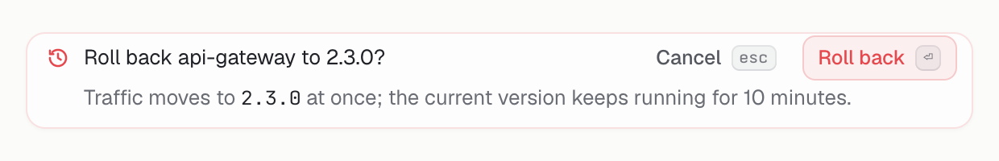
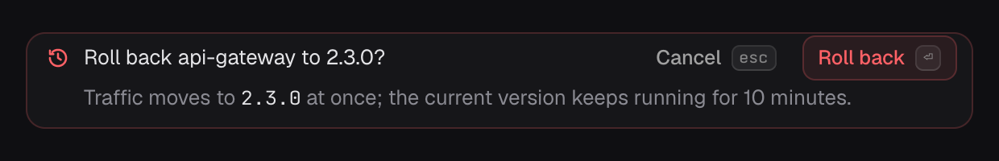
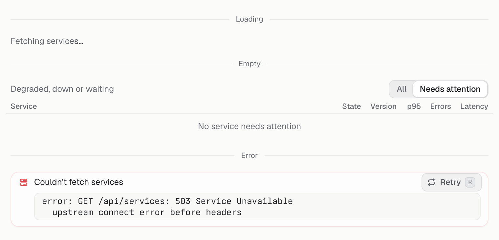
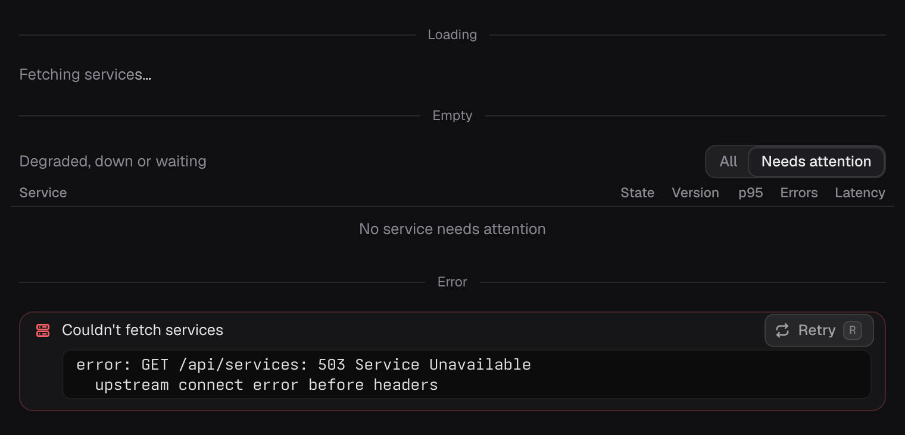
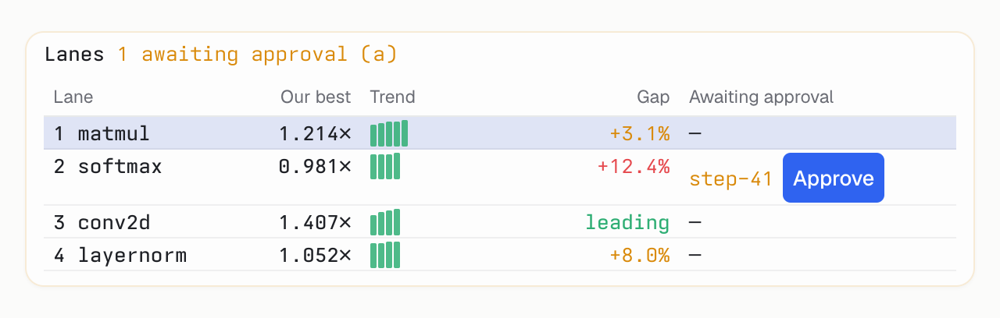
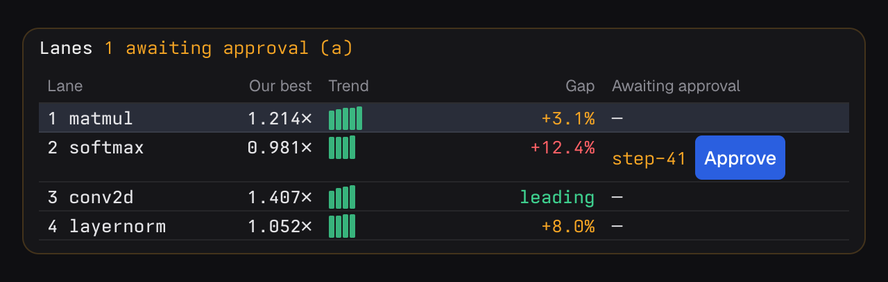

# Designing Views

Tern's own views (omp's sessions, the git block, settings, the pickers)
share one look: a calm desktop app drawn with Geist precision. Sans text for
people and mono for machine strings, quiet grays, hairlines instead of
borders, color only where it means something, one primary action on screen,
and every state designed. The kinds in [Elements](../elements/index.md) draw
that look for you. A view built from them, following the rules on this page,
looks like part of Tern without one line of CSS of yours.

This page is for anyone building a view: a plugin block in Luau, or a
program speaking the [Surface Protocol](../protocol/index.md) through an
[SDK](../protocol/sdks.md). Recipes are TSX (the TypeScript SDK) with the
Luau equivalent; the Rust, Python and Go SDKs name the same props, and each
SDK ships a `dashboard` example that puts every recipe below together.

<figure class="tn-figure">


<figcaption>A page, not a pile of cards: head row, stats strip, tabs, and a table beside the selected service's card. No stylesheet.</figcaption>
</figure>

## The rules

1. **Open apps in sans.** `font: "sans"` on the surface (or the block)
   draws text in the UI face; machine strings stay mono through span
   tokens and column flags. ([Typography](#typography))
2. **Build a page, not a pile of cards.** A head row, a stats strip, tabs
   between views, and in each view its table at full width beside the
   selected item's card. Cards hold one object each; never a table, a
   `stats` strip or another card. ([Page structure](#page-structure))
3. **Reach for a kind before an `el`.** A `button`, a `table`, a `stats`
   strip, a `tabs` strip, a `card`: each is drawn, sized, copied, read aloud
   and themed by Tern. ([What to reach for](#what-to-reach-for))
4. **Color carries meaning only.** Tones and span tokens, never hex,
   never your own color classes. ([Color](#color-only-for-meaning))
5. **One primary action on screen.** It acts on the selection: in the
   selected item's card, or on the selected row when there is no card.
   Everything else is a default or `quiet` button. ([Buttons](#buttons))
6. **Two densities.** The head row, bars and forms take `md` controls;
   rows, tables and a detail card take `sm`. ([Density](#density))
7. **Every view has four states:** loading, empty, error and success.
   ([The four states](#the-four-states))
8. **Keys are yours, and visible.** Your program handles every key; `keys`
   and a key legend show them. ([Keyboard](#keyboard))
9. **Tern owns the pointer.** Anything clickable already shows the hand;
   never set `cursor`. ([Cursor](#cursor))
10. **CSS last.** Rarely, scoped to your surface, colored with tokens.
    ([When to write CSS](#when-to-write-css))

## Page structure

A screen app (a dashboard, a tool's own window, a session) is one page read
from the top: what it is and how it's doing, where you can go, then the one
thing you're looking at.

```text
head row     Deploys  prod · eu-west-1 · updated 2 min ago     [Canary running] [Connected] [Refresh R]
stats strip  Services 6 │ Error rate 0.42% │ p95 latency 182 ms │ Awaiting promotion 2
tabs         Services 6   Deploys 41   Alerts 2   Config
view         description ··········· [All | Needs attention]   ┌ search 3.2.0-rc.1  [Promote P] ┐
             table, full width, one grow column              │ facts and actions               │
dock         key legend (and a confirm strip while one is open)
```

1. **The head row**, not a card: a `row` with `justify: "between"` and
   `align: "center"`, directly in `main`. On the left a `text` with the
   app's name in the `title` token and muted meta after it (the address it
   watches, uptime, when it last updated); on the right the status badges
   and the page's global controls (Refresh). No icon needed.
2. **The stats strip**: the few numbers the page is about, at most four
   tiles, right under the head row and directly in `main`. A `stats` node has
   no box of its own; never put it in a card. A page with nothing to sum up
   skips it.
3. **Tabs** for more than two panels: one [`tabs`](../elements/lists.md#tabs)
   strip (the default underline variant) under the head and stats, a tab per
   view, labeled with the view's name and a muted count where it helps
   (`Steps 1,240`, `Alerts 2`). One view shows at a time, at full width, and
   your program renders only the active one. Tab and ⇧Tab (or `[` and `]`)
   switch views; the key legend says so. Two panels can simply stack.
4. **A view** is its data, directly on the page: a full-width `table` with
   no card around it, optionally a toolbar `row` above it (a muted
   description on the left, a segmented `tabs` or buttons on the right) and
   the selected item's card beside it. Master and detail sit in a `row` with
   `align: "stretch"` and `gap: "lg"`: the table in a `col` with `grow: 1`
   and `basis: 0`, the card with `min: { w: '44ch' }` and
   `max: { w: '56ch' }`. Side by side is for master and detail only, never
   for two unrelated panels.
5. **Cards are objects**: the selected item's detail, a confirm strip, an
   error, one entity among siblings (a provider on a usage page). Never a
   frame around a table, a `stats` strip or another card.
6. **The dock** holds what stays at the bottom: a confirm strip while one
   is open, and a key legend (a muted `text` with `key` spans) or a
   [`status`](../elements/chrome.md#status) bar.

## What to reach for

| You want | Use | Not |
| --- | --- | --- |
| The page's name and status | A head `row`: a `text` with the `title` token and muted meta; badges and global buttons at the right | A head card holding everything |
| A few headline numbers | [`stats`](../elements/data.md#stats) directly under the head row | Stats in a card; a row of `text` and badges |
| Several panels | [`tabs`](../elements/lists.md#tabs) under the head, one view at a time | Every panel at once; a grid of cards |
| An app's top-level sections, some holding a few sub-pages | [`nav`](../elements/lists.md#nav) (pills in a toolbar, links under a page head); `tabs` when every section is one flat view | A row of `button`s that swap the view |
| An app's commands grouped the way a Mac app's menu bar groups them (File, Edit, View) | [`menubar`](../elements/lists.md#menubar): `strip` in a head row or the dock, `pill` floating over an app with its mark | One `menu` button per group in a row; a toolbar of `button`s past five or six |
| Rows that share columns; pick one | [`table`](../elements/data.md#table) with `selectable`, `selected`, full width on the page | A table in a card; `html.table` with a stylesheet |
| Act on several rows at once (restart, delete, export) | `table` with `multi: true` and `bar` actions; `variant: "bar"` when checkboxes would crowd a dense, keyboard-driven table | An `el` checkbox in every row; a button on every row |
| A long table or list, one page at a time | [`pager`](../elements/lists.md#pager) under it: `range` in a table's foot, `pages` when people jump around, `more` for a feed that grows | Prev/Next `button`s and a "Page 3" `text` |
| The selected row's facts and actions | A detail [`card`](../elements/layout.md#card) beside the table: a `kv`, the primary action in its head's `end` | A button on every row |
| Two or three views at once the user sizes (a list and its detail, a query and its results) | [`split`](../elements/layout.md#split): `hairline` in one framed box, `tiles` for separate cards | A `row` of `card`s with fixed `basis`; `tabs` when one view at a time is enough |
| One object among siblings, a confirm, an error | [`card`](../elements/layout.md#card) with `icon`, `head`, `meta`, `end` | A card around a table, stats or cards |
| A handful of labeled facts | [`kv`](../elements/data.md#kv) | An `el` `dl` grid |
| A column of things to pick from (label, detail, value) | [`list`](../elements/lists.md#list) of `item`s | A table of one column |
| A long list, log or chat in a fixed height | [`scroll`](../elements/layout.md#scroll) with `max.h`; `stick: "end"` for output that grows | `max.h` on a `col`, which cuts what runs past it |
| An action | [`button`](../elements/input.md#button) | `html.button` with a stylesheet |
| Two to five related actions or toggles (Undo/Redo, a view switch, an action and its menu, a pane's tool strip) | [`buttons`](../elements/input.md#buttons) around `button` nodes | Loose `button`s in a `row` |
| More commands than a toolbar holds; a sort or view menu | [`menu`](../elements/lists.md#menu): `default` for actions, `dense` for sort/filter groups, `detail` rows for a few weighty choices; `actions.menu` for right-click | A row of `button`s; a `picker` (that is for finding, not commands) |
| An on/off toggle in a bar | `button` with `on` | A checkbox outside a form |
| A setting that is on or off | [`switch`](../elements/input.md#switch): `default` with `label` and `hint` in settings, `compact` in dense lists | An `el` checkbox; a `button` with `on` outside a bar |
| A filter or a view's mode | `tabs` with `variant: "segmented"` in the view's toolbar row | Radios drawn as segments; a second underline strip |
| One value out of a set (a model, a region, a branch) | [`select`](../elements/input.md#select): `field` in forms, `quiet` in heads and bars, `search` past a dozen options | A `list` that opens on a button; a row of buttons; `el` radios for more than three choices |
| A status word | [`badge`](../elements/data.md#badge) with a `tone`, a table text cell's `dot`, or the word in its tone's span token | A color class of your own |
| Who did it, who is on it, which model or repo | [`avatar`](../elements/data.md#avatar) beside the name; [`avatars`](../elements/data.md#avatars) for several people (reviewers, watchers), `max` 3–5 | Initials in a `badge`; a row of `image`s |
| A key hint | `keys` on a `button`; the page's other keys in a key legend in the `dock` | `[r] refresh` as text |
| A trend | a table [spark cell](../elements/data.md#table), or [`chart`](../elements/motion.md#chart) `kind: "spark"` | `▁▂▃▅` glyphs |
| A value over time with its latest reading, or several series over the same time (p50/p95/p99) | `chart` `kind: "line"`; `values` series and `labels` for several | A `table` of numbers; a `spark` stretched tall; one chart per series stacked up |
| A share of something | [`meter`](../elements/motion.md#meter), a table meter cell, [`progress`](../elements/motion.md#progress) | A text percentage alone |
| How a whole splits into parts | `chart` `kind: "donut"` with a `caption` | A `meter` of many parts with a hand-made legend |
| Work in progress | [`spinner`](../elements/motion.md#spinner) or [`shimmer`](../elements/motion.md#shimmer) naming the work, [`elapsed`](../elements/motion.md#elapsed) (outside tables) | "Loading…" |
| A view whose data is on its way | [`skeleton`](../elements/motion.md#skeleton) in the view's place, the shape of what will arrive (`rows` for a table, `card` for stat tiles), with the view's `key` | A bare spinner in an empty pane, "Loading…" |
| A view, list or zone with nothing in it yet | [`empty`](../elements/layout.md#empty) in the view's place: what is missing, why, and the one `button` that fixes it | An empty frame, a lone "No data" `text` |
| A dialog or sheet | [`overlay`](../elements/chrome.md#overlay) with `foot` for its buttons | A card in `main` |
| Details or settings for the selection beside the view | [`overlay`](../elements/chrome.md#sheets-and-drawers) with `side: "right"` (an inspector sheet), `foot` for Apply | A centered dialog over what it describes |
| Logs, a terminal or a preview that rises from the bottom | `overlay` with `side: "bottom"` (a drawer) | A second view replacing the page |
| A fleeting confirmation | [`toast`](../elements/chrome.md#toast) (`cx:toast` in a block) | A line that stays |
| Facts along the bottom | [`status`](../elements/chrome.md#status) with `seg`s in `dock` | A `text` footer |
| Prose, logs, code | [`md`](../elements/text.md#md), [`ansi`](../elements/text.md#ansi), [`code`](../elements/text.md#code) | `text` with hand-made wrapping |
| An answer that names its sources | [`text`](../elements/text.md#text) spans with `cite`; `cite: "note"` with the sources list for long reads | Bare URLs; `[1]` typed into the text |
| A conversation (an agent chat, a team thread, comments on a change) | [`message`](../elements/work.md#message) nodes in a `col`, `variant: "auto"` for agent chats, `"flat"` for people; `md` and `code` children as the body | A `card` per message; your own bubbles out of `el`s |
| Files a message carries or a composer will send | [`attachment`](../elements/data.md#attachment): `chip` in messages, `tile` for images, `pill` in a composer tray | A `card` or `badge` per file; an `image` for a file that is not a picture |
| A handful of pictures or panels the user flips through (screenshots, renders, alternatives) | [`carousel`](../elements/data.md#carousel) of `image` (or any) slides | A `col` of full-size images; `tabs` for pictures |
| Offering the next things to ask an agent | [`suggestions`](../elements/work.md#suggestions) under the last answer: chips for a few short prompts, `rows` with number keys when the program binds 1–9, `cards` when each needs a reason | A row of `button`s, a bulleted `md` list of prompts |
| Ask the user one or more multiple-choice questions and wait | [`questions`](../elements/work.md#questions) (`inline` for one quick question in the flow) | Numbered choices in `md` and a typed answer |
| What an agent did, step by step, or its reasoning with sources | [`trace`](../elements/work.md#trace): `rail` for a live log, `summary` once it settled, `card` for reasoning | A `checklist` (a plan, not a log); a column of `text` rows with emoji |
| Ask before a risky step runs (delete, push, spend) | [`tool`](../elements/work.md#tool) with `status: "ask"` and `confirm` | A `card` of Allow and Deny `button`s |
| An exception or crash with its stack | [`stacktrace`](../elements/work.md#stacktrace): `frames` in a transcript, `split` when you have the source, `mono` for a compact copyable log | A `code` block of the raw trace; `ansi` with colored lines |
| Mark a moment in a transcript or log (a checkpoint to restore, someone joined, context compacted) | [`rule`](../elements/layout.md#rule) with `variant: "note"` or `"pin"`, a Restore button as its `end` child | A `card` per event; a bold `text` line |
| A text field | [`input`](../elements/input.md#input), [`editor`](../elements/input.md#editor) | — |
| A search or filter box with its shortcut | [`input`](../elements/input.md#addons) with `icon: "search"`, `keys`, `clear` | A `row` of an icon, an `input` and a `button` |
| A URL, a size, an amount with its unit | `input` with `prefix`/`suffix` or `stepper` + `unit` | Text beside the field; `+`/`-` buttons beside it |
| A message box with its Send button | `input` (or `editor`) with `buttons`, one `primary` | A field and a separate button row |
| A token or password | `input` with `secret` (and a `copy` button) | Drawing `•` yourself |
| A verification or one-time code | [`otp`](../elements/input.md#otp): your program takes the keys and sets `text` | An `input` with a placeholder like `______`; six `input`s |
| A number the user sets by feel (opacity, a size, a temperature, a time window) | [`slider`](../elements/input.md#slider), a `[lo, hi]` `value` for a range | An `input` the user types digits into; `+`/`−` buttons |
| A day or a date range the user picks | [`date`](../elements/input.md#date) in a form; [`calendar`](../elements/input.md#calendar) when the month itself is the view | An `input` that parses `2026-10-30`; a `table` of days |
| A form or settings: a control with its label, help and error | [`field`](../elements/input.md#field) around each control (`stacked` in a form, `row` for settings, `grid` in a dialog) | Your own label `text` over the control and a red `text` under it |
| A form of choices | an `el` `form` of labelled radios and checkboxes ([HTML Elements](../elements/el.md#controls)), submitted by a `button` | — |

## Typography

**Sans for people, mono for machine strings.** A program's surface draws in
the terminal's mono face by default, which suits output that lives among
shell output. An app (a `screen` surface, a session, a dashboard, a form)
opens in the UI face instead:

```tsx
const surface = session.open({ mode: 'screen', title: 'Deploys', font: 'sans' });
```

```lua
tern.block.define("deploys", {
	font = "sans",
	init = function(cx, args, saved) … end,
	view = function(state, cx) … end,
})
```

In a sans surface ([`font`](../protocol/surfaces.md#open-and-close)) text is
13px Geist, and what a person would copy stays mono:

- span tokens `mono`, `num`, `path`, `code` and `key` draw in mono at 12.5px:
  ids, hashes, versions, sizes, times, `+12 −3`;
- a table column with `mono: true` draws its cells in mono;
- `code`, `diff`, `ansi`, `json`, `kbd`, `editor` and `input` stay mono.

**The page's name** takes the `title` token: Geist 15px a weight step up,
for the head row only. Headings inside the page are a card's `head` or a
tab's label, not more titles.

**Numbers line up.** An `align: "end"` table column and the `num` and `mono`
tokens use tabular figures. Right-align every number in a column. In a `kv`
value or running text a number takes `mono`, not `num`: `num` paints it in
the code-number color, which reads as syntax highlighting.

**Emphasis is a weight step**, not a color: `strong` for the one word that
matters, `muted` for meta (counts, units, "updated 2 min ago"), `dim` for
what barely matters. Sentence case everywhere ("Error rate", not "ERROR
RATE"); column heads take no colon; a command that asks for more ends in
"…".

**Cut long strings where they are least distinctive.** Paths, branches and
refs truncate in the middle (`truncate: "middle"` on a column, the `path`
token), prose at the end; the full value goes in `title`.

## Color only for meaning

Most of a view is neutral. Color says one thing per use:

| Tone | Means |
| --- | --- |
| `accent` | Selection, the primary action, focus, a link; work in progress (running, thinking) |
| `info` | A second in-progress state running beside the first (evaluating while others think); neutral news |
| `pending` | Waiting on someone: queued, awaiting approval, not started |
| `success` | Healthy, passed, done, added |
| `warning` | Degraded, slow, needs attention soon, a conflict |
| `error` | Failed, down, deleted, destructive |
| `muted` | Idle, stale, off, skipped, cancelled |
| `user` | The user's own content |

- A **node** gets a `tone` (a badge, a card, a text cell's `dot`, a meter);
  a **word** gets a span token (`{ t: '3 failed', s: 'error' }`). The span
  tokens are `accent`, `info`, `pending`, `success`, `warning`, `error`,
  `muted` and `dim`: a waiting step's name beside its `pending` dot can be
  `pending` too.
- Color the word or the dot, not the row. A table whose rows are tinted by
  status reads as noise; a 6px dot before the name reads at a glance.
- A card takes a tone only when the whole panel means it: a failed run, a
  confirm strip. A panel with one bad number keeps a neutral ring and colors
  the number.
- Never a hex value and never classes of your own such as `.ok { color: … }`:
  tones and tokens follow light, dark and the user's theme, and screen readers
  and copies get the text without your styling.

## Density

Two tiers, as in macOS:

| Tier | Where | Controls | Text |
| --- | --- | --- | --- |
| Chrome | The head row, toolbars, the dock, forms, dialogs, confirm strips | `md` buttons (28px), segmented tabs (28px) | 13px |
| Content | Tables, lists, trees, rows, a detail card | `sm` buttons (22px), badges (18px), dots, sparklines | 12.5–13px, mono at 12.5px |

- Space with `gap` (`xs` 2px, `sm` 6px, `md` 10px, `lg` 16px), never
  margins. `main` already spaces its top-level nodes 16px apart: the head
  row, the stats, the tabs and the view need nothing more.
- Reading copy caps at about 66 characters: `max: { w: '66ch' }` on its `md`.
- Fewer, bigger things. A view is a table and the selected item's card, not
  six cards of three lines; more panels become [tabs](#page-structure).

## Buttons

The [`button`](../elements/input.md#button) kind draws Tern's buttons:

| `variant` | For | On screen |
| --- | --- | --- |
| `default` | Most actions: Refresh, Open, Retry | any |
| `primary` | The one action the screen exists for, on the selected item: Promote, Approve, Commit; the confirm button of a consequential confirm strip | one |
| `quiet` | Secondary actions in a bar or head, Cancel, toggles that sit in text | any |
| `danger` | The destructive action: the confirm button of its confirm strip or dialog, or a trigger that opens that strip (never acting directly) | one, in context |

- `size: "sm"` inside rows, tables and a detail card (its head included);
  `md` (the default) in the head row, bars, forms and confirm strips.
- `keys` shows the shortcut your program handles (`keys: ['cmd', 'enter']`);
  the tooltip repeats it.
- `busy` while the action runs: the button keeps its width, shows a spinner
  and sends nothing more. `disabled` with a reason string says why not.
- `on` makes a toggle (`Follow`, `Wrap`).
- Labels are verbs in sentence case ("Roll back", "Open logs"), not "OK".
- Never style `html.button`: the `button` kind already has the look, the
  press, the keycaps and the states. An `el` `button` exists for forms, where
  it gets the same default look ([HTML Elements](../elements/el.md#default-look)).

```tsx
<row gap="sm">
   <button icon="repeat" keys={['r']} onClick={refresh}>Refresh</button>
   <button variant="quiet" on={state.follow} onClick={toggleFollow}>Follow</button>
   <button variant="primary" keys={['cmd', 'enter']} busy={state.deploying} onClick={deploy}>
      Deploy
   </button>
</row>
```

```lua
ui.row({
	ui.button("Refresh", { key = "refresh", icon = "repeat", keys = { "r" }, actions = { click = "refresh" } }),
	ui.button("Follow", { key = "follow", variant = "quiet", on = state.follow, actions = { click = "follow" } }),
	ui.button("Deploy", { key = "deploy", variant = "primary", keys = { "cmd", "enter" }, busy = state.deploying,
		actions = { click = "deploy" } }),
})
```

## Tables

A [`table`](../elements/data.md#table) sizes its columns, hides the least
important ones when narrow, mounts only the rows on screen, copies as text and
reads as a table to assistive technology. With `selectable` its rows are the
pickable rows of a native app:

- `selectable` makes rows clickable: a click sends `select` with the row's id
  as `item`, a double click `activate`. You keep the selection: send it back as
  `selected`, which draws the accent tint and leading bar. Move it from your
  key handler (↑/↓, j/k) the same way.
- A changed `selected` scrolls its row into view while the table is on
  screen. A table scrolled out of sight is left alone, so a selection set from
  elsewhere doesn't pull the page back to it.
- **One `grow` column**: the main text one (the name, the step id, the
  description), which takes the spare width. Never `grow` on numbers,
  sparklines, badges or buttons: the spare width lands between a name and its
  values and leaves a gap. A grid is the exception: rows × like columns (lanes
  × models) give every value column `grow: 1`, equal shares, and the row-label
  column none.
- **Numbers** take `align: "end"` and `mono: true`, with their unit
  (`182 ms`); secondary values are `muted`. `mono: true` also for ids,
  versions, sizes and times; `truncate: "middle"` for paths.
- **`priority`** says what hides first when the table is narrow: a missing
  one is `0`, the first to go. Give the `grow` column the highest, so it
  never hides; the numbers next; sparklines, meters and secondary columns the
  lowest.
- Cells say what they hold: text with a status `dot` or an `icon`, a `badge`,
  a `button` (`sm`, its click sends `action` with the row as `item` and
  doesn't select), a `spark`, a `meter`.
- Rows: `menu` for the right-click actions, `title` for a tooltip,
  `disabled` (with a reason) for rows that can't be picked.
- `empty` is the line shown with no rows.
- **Actions.** With a detail card beside the table, the selected item's
  action is the `primary` button in the card's head, with its key, and the
  rows carry no buttons: a row waiting on that action says so in a text cell
  with a `pending` dot. Without a detail card, a row's action is an `sm`
  button cell, and only the **selected** row's is `primary`, with its key
  (`keys: ['a']`); every other row's is `default`. Either way the screen has
  one primary, and it follows the selection.
- **Length.** In a screen app a table needs no `max.h`: the page scrolls. A
  list inside a detail card shows a few rows (the last ten steps): slice the
  data rather than bounding the height. A `max.h` cuts at a height, not at a
  row or paragraph, so what it cuts fades out; keep it for previews that say
  where the rest is (an Enter that opens the whole thing).
- There is no elapsed cell. Write a duration as text (`4m 12s`) and render
  again as it grows: the view diff patches only the cells that changed. The
  [`elapsed`](../elements/motion.md#elapsed) kind is for outside tables.

Never `html.table` for data: it has none of the above, and its rows can't
look like Tern's without a stylesheet that fights every theme.

## Cards

A [`card`](../elements/layout.md#card) is one object: the selected item's
detail, a confirm strip, an error, one entity among siblings (a provider on a
usage page). Its head is the object's title bar:

- `icon`: what it is (`server`, `branch`, `activity`), where it helps.
- `head`: its name (`search`, `step-41`, "Couldn't fetch services").
- `meta`: muted facts about it (`3.2.0-rc.1`, "updated 2 min ago").
- `end`: its controls at the right: the item's primary action (`sm`, with its
  key), status `badge`s. A click there never folds the card.
- `status` for a running/done/failed chip, `selected` for the card that has
  the keys, `collapsible` for cards the user may fold.

The body takes the rest. Without an icon the body lines up with the head
text.

A card never frames a table, a `stats` strip or another card. The page is
already the frame: a card around a table costs it width and adds a ring for
nothing, and a card in a card reads as clutter.

## Recipes

### An app shell

A `screen` surface in sans. `main` holds the page: the head row, the stats
strip, the tabs and the active view, 16px apart; `dock` holds the confirm
strip while one is open and the key legend. Every handler changes state and
calls `render`; keys come through the loop. Only the active view is
rendered: the tabs' `select` and Tab/⇧Tab change `view`, and the next render
swaps it.

Outside Tern, `plain()` prints the same view as text.

```tsx
import { connect, plain, span, type Key } from '@stencil-hq/tern';

type View = 'services' | 'deploys' | 'alerts' | 'config';
const VIEWS: View[] = ['services', 'deploys', 'alerts', 'config'];

const session = await connect({ app: 'deploys' });
if (!session) {
   console.log(plain(page(state).main));
   process.exit(0);
}
const surface = session.open({ mode: 'screen', title: 'Deploys', font: 'sans', closable: true });
const render = (): void => surface.render(page(state));

function page(s: State) {
   return {
      main: (
         <col gap="lg">
            <Head s={s} />
            <Overview s={s} />
            <tabs
               key="nav"
               active={s.view}
               items={[
                  { id: 'services', label: ['Services ', span(String(s.services.length), 'muted')] },
                  { id: 'deploys', label: ['Deploys ', span(String(s.deploys.length), 'muted')] },
                  { id: 'alerts', label: ['Alerts ', span(String(s.alerts.length), 'muted')] },
                  { id: 'config', label: 'Config' },
               ]}
               onSelect={ev => { s.view = ev.item as View; render(); }}
            />
            {s.view === 'services' && <Services s={s} />}
            {s.view === 'deploys' && <Deploys s={s} />}
            {s.view === 'alerts' && <Alerts s={s} />}
            {s.view === 'config' && <Config s={s} />}
         </col>
      ),
      dock: (
         <col>
            {s.confirm && <Confirm s={s} />}
            <Legend />
         </col>
      ),
   };
}

/** Applies one key; false quits. */
function onKey(k: Key): boolean {
   const s = state;
   if (k.name === 'tab' || k.name === '[' || k.name === ']') {
      const step = k.shift || k.name === '[' ? -1 : 1;
      s.view = VIEWS[(VIEWS.indexOf(s.view) + step + VIEWS.length) % VIEWS.length];
   } else if (k.name === 'escape' && s.confirm) s.confirm = null;
   else if (k.name === 'escape' || k.name === 'q') return false;
   else if (k.name === 'up' || k.name === 'k') move(s, -1);
   else if (k.name === 'down' || k.name === 'j') move(s, 1);
   else if (k.name === 'r') refresh();
   else viewKey(s, k); // p, l, ⇧R, b: the selected service's actions
   return true;
}

render();
for await (const input of session) {
   if (input.type === 'key' && !onKey(input.key)) break;
   render();
}
await session.close();
```

```lua
local ui = tern.ui
local VIEWS = { "services", "deploys", "alerts", "config" }
local VIEW = { services = services, deploys = deploys, alerts = alerts, config = config }

local function nav(state)
	return ui.node("tabs", { key = "nav", active = state.view, items = {
		{ id = "services", label = { ui.span("Services "), ui.span(tostring(#state.services), "muted") } },
		{ id = "deploys", label = { ui.span("Deploys "), ui.span(tostring(#state.deploys), "muted") } },
		{ id = "alerts", label = { ui.span("Alerts "), ui.span(tostring(#state.alerts), "muted") } },
		{ id = "config", label = "Config" },
	} })
end

tern.block.define("deploys", {
	font = "sans",
	init = function(cx, args, saved)
		return { view = "services", services = {}, deploys = {}, alerts = {}, selected = nil, filter = "all", loading = true }
	end,
	view = function(state, cx)
		local dock = { legend() }
		if state.confirm then
			table.insert(dock, 1, confirm_strip(state))
		end
		return {
			main = ui.node("col", { gap = "lg" }, { head(state), overview(state), nav(state), VIEW[state.view](state) }),
			dock = ui.col(dock),
		}
	end,
	key = function(state, key, cx)
		if key.name == "tab" or key.name == "[" or key.name == "]" then
			local step = (key.shift or key.name == "[") and -1 or 1
			local at = table.find(VIEWS, state.view) or 1
			state.view = VIEWS[(at - 1 + step) % #VIEWS + 1]
			return true
		end
		return on_key(state, key, cx)
	end,
	event = function(state, ev, cx)
		if ev.ev == "select" and ev.id == "main.nav" then
			state.view = ev.item
		else
			on_event(state, ev, cx)
		end
	end,
})
```

Give each view's root its own key (`services`, `deploys`) so a switch
replaces the view instead of patching one into the other.

### The head row

The app's name in the `title` token with its identity facts muted after it;
status badges and the page's global controls at the right, `md`.

```tsx
function Head({ s }: { s: State }) {
   return (
      <row key="head" justify="between" align="center">
         <text key="title">
            <span s="title">Deploys</span>
            <span s="muted">{`   ${s.env} · ${s.region} · updated ${ago(s.updated)}`}</span>
         </text>
         <row key="end" gap="sm" align="center">
            {s.canary && <badge key="canary" tone="pending">Canary running</badge>}
            <badge key="link" tone={s.connected ? 'success' : 'error'}>{s.connected ? 'Connected' : 'Offline'}</badge>
            <button key="refresh" icon="repeat" keys={['r']} busy={s.refreshing} onClick={refresh}>Refresh</button>
         </row>
      </row>
   );
}
```

```lua
local function head(state)
	local status = {}
	if state.canary then
		status[#status + 1] = ui.badge("Canary running", "pending")
	end
	status[#status + 1] = state.connected and ui.badge("Connected", "success") or ui.badge("Offline", "error")
	status[#status + 1] = ui.button("Refresh", { key = "refresh", icon = "repeat", keys = { "r" }, busy = state.refreshing,
		actions = { click = "refresh" } })
	return ui.node("row", { key = "head", justify = "between", align = "center" }, {
		ui.text({ ui.span("Deploys", "title"),
			ui.span("   " .. state.env .. " · " .. state.region .. " · updated " .. ago(state.updated), "muted") }),
		ui.node("row", { key = "end", gap = "sm", align = "center" }, status),
	})
end
```

### A stats strip

The few numbers the page is about, flat on the page under the head row: no
card, no box; tiles take their own width with a hairline between and wrap
when narrow. Four tiles at most: further numbers go in a tile's `sub` or the
view. A `tone` colors a value that needs attention; `sub` says compared with
what.

```tsx
function Overview({ s }: { s: State }) {
   const canaries = s.services.filter(svc => svc.state === 'canary').map(svc => svc.name);
   return (
      <stats
         key="stats"
         items={[
            { label: 'Services', value: String(s.services.length), sub: `${count(s, 'degraded')} degraded · ${count(s, 'down')} down` },
            { label: 'Error rate', value: '0.42%', tone: 'warning', sub: 'last 15 min' },
            { label: 'p95 latency', value: '182 ms', sub: 'target 250 ms' },
            { label: 'Awaiting promotion', value: String(canaries.length), tone: 'pending', sub: canaries.join(', ') },
         ]}
      />
   );
}
```

```lua
local function overview(state)
	local canaries = names(state, "canary")
	return ui.node("stats", { key = "stats", items = {
		{ label = "Services", value = tostring(#state.services),
			sub = count(state, "degraded") .. " degraded · " .. count(state, "down") .. " down" },
		{ label = "Error rate", value = "0.42%", tone = "warning", sub = "last 15 min" },
		{ label = "p95 latency", value = "182 ms", sub = "target 250 ms" },
		{ label = "Awaiting promotion", value = tostring(#canaries), tone = "pending", sub = table.concat(canaries, ", ") },
	} })
end
```

### A view: table and detail

The Services view: a toolbar row (a muted description, a segmented filter),
a full-width selectable table with one `grow` column, and the selected
service's card beside it. The table's `select` sets the selection, `activate`
opens it, and the row menu sends `action` with the row as `item`. The card
holds the screen's one primary, Promote, in its head with its `p` key; its
other actions sit under its facts, `sm`. The rows carry no buttons: a canary's
`pending` dot and state word say it waits.

```tsx
const TONE = { live: 'success', degraded: 'warning', down: 'error', canary: 'pending' } as const;
const WORD = { live: 'muted', degraded: 'warning', down: 'error', canary: 'pending' } as const;

function ServicesView({ s }: { s: State }) {
   return (
      <row key="services" gap="lg" align="stretch">
         <col key="list" grow={1} basis={0}>
            <row key="bar" justify="between" align="center">
               <text key="about"><span s="muted">Canaries first, then by health</span></text>
               <tabs
                  key="filter"
                  variant="segmented"
                  active={s.filter}
                  items={[{ id: 'all', label: 'All' }, { id: 'attention', label: 'Needs attention' }]}
                  onSelect={ev => { s.filter = ev.item; render(); }}
               />
            </row>
            <table
               key="table"
               selectable
               selected={s.selected}
               empty="No service needs attention"
               cols={[
                  { id: 'name', head: 'Service', grow: 1, truncate: 'middle', priority: 9 },
                  { id: 'state', head: 'State', priority: 6 },
                  { id: 'version', head: 'Version', mono: true, priority: 2 },
                  { id: 'p95', head: 'p95', align: 'end', mono: true, priority: 8 },
                  { id: 'errors', head: 'Errors', align: 'end', mono: true, priority: 7 },
                  { id: 'trend', head: 'Latency', priority: 3 },
                  { id: 'deployed', head: 'Deployed', align: 'end', priority: 1 },
               ]}
               rows={shown(s).map(svc => ({
                  id: svc.name,
                  menu: ['logs', 'restart'],
                  cells: {
                     name: { text: svc.name, dot: TONE[svc.state] },
                     state: [{ t: svc.state, s: WORD[svc.state] }],
                     version: svc.version,
                     p95: `${svc.p95} ms`,
                     errors: svc.errors < 0.01 ? pct(svc.errors) : [{ t: pct(svc.errors), s: svc.state === 'down' ? 'error' : 'warning' }],
                     trend: { spark: { values: svc.latency } },
                     deployed: [{ t: ago(svc.deployedAt), s: 'muted' }],
                  },
               }))}
               onSelect={ev => { s.selected = ev.item; render(); }}
               onActivate={ev => openLogs(ev.item)}
               onAction={{ logs: ev => openLogs(ev.item), restart: ev => askRestart(ev.item) }}
            />
         </col>
         <Detail svc={s.services.find(svc => svc.name === s.selected)} />
      </row>
   );
}

function Detail({ svc }: { svc?: Service }) {
   if (!svc)
      return (
         <card key="detail" head="No service selected" min={{ w: '44ch' }} max={{ w: '56ch' }}>
            <text key="hint"><span s="muted">Select a service</span></text>
         </card>
      );
   return (
      <card
         key="detail"
         head={svc.name}
         meta={svc.version}
         min={{ w: '44ch' }}
         max={{ w: '56ch' }}
         end={
            svc.state === 'canary' && (
               <button variant="primary" size="sm" keys={['p']} onClick={() => promote(svc.name)}>Promote</button>
            )
         }
      >
         <kv
            key="facts"
            items={[
               { k: 'State', v: [{ t: svc.state, s: WORD[svc.state] }, { t: ` · ${svc.note}`, s: 'muted' }] },
               { k: 'Instances', v: [{ t: `${svc.ready}/${svc.instances}`, s: 'mono' }] },
               { k: 'p95', v: [{ t: `${svc.p95} ms`, s: 'mono' }, { t: `  ${svc.was.p95} ms on ${svc.was.version}`, s: 'muted' }] },
               { k: 'Errors', v: [{ t: pct(svc.errors), s: 'mono' }, { t: `  ${pct(svc.was.errors)} on ${svc.was.version}`, s: 'muted' }] },
               { k: 'Image', v: [{ t: svc.image, s: 'mono' }] },
               { k: 'Deployed by', v: [{ t: svc.deployedBy }, { t: ` · ${ago(svc.deployedAt)}`, s: 'muted' }] },
            ]}
         />
         <row key="actions" gap="sm">
            <button size="sm" keys={['l']} onClick={() => openLogs(svc.name)}>Logs</button>
            <button size="sm" keys={['shift', 'r']} onClick={() => askRestart(svc.name)}>Restart</button>
            <button variant="danger" size="sm" icon="history" keys={['b']} onClick={() => askRollback(svc.name)}>
               Roll back
            </button>
         </row>
      </card>
   );
}
```

```lua
local TONE = { live = "success", degraded = "warning", down = "error", canary = "pending" }
local WORD = { live = "muted", degraded = "warning", down = "error", canary = "pending" }

local function detail(state)
	local svc = find(state, state.selected)
	if not svc then
		return ui.card("No service selected", { ui.text({ ui.span("Select a service", "muted") }) },
			{ key = "detail", min = { w = "44ch" }, max = { w = "56ch" } })
	end
	local children, props = {}, { key = "detail", meta = svc.version, min = { w = "44ch" }, max = { w = "56ch" } }
	if svc.state == "canary" then
		children[#children + 1] = ui.button("Promote", { key = "end", variant = "primary", size = "sm", keys = { "p" },
			actions = { click = "promote" } })
		props["end"] = "main.services.detail.end"
	end
	children[#children + 1] = ui.kv({
		{ "State", { ui.span(svc.state, WORD[svc.state]), ui.span(" · " .. svc.note, "muted") } },
		{ "Instances", { ui.span(svc.ready .. "/" .. svc.instances, "mono") } },
		{ "p95", { ui.span(svc.p95 .. " ms", "mono"), ui.span("  " .. svc.was.p95 .. " ms on " .. svc.was.version, "muted") } },
		{ "Errors", { ui.span(pct(svc.errors), "mono"), ui.span("  " .. pct(svc.was.errors) .. " on " .. svc.was.version, "muted") } },
		{ "Image", { ui.span(svc.image, "mono") } },
		{ "Deployed by", { ui.span(svc.deployed_by), ui.span(" · " .. ago(svc.deployed_at), "muted") } },
	})
	children[#children + 1] = ui.node("row", { key = "actions", gap = "sm" }, {
		ui.button("Logs", { key = "logs", size = "sm", keys = { "l" }, actions = { click = "logs" } }),
		ui.button("Restart", { key = "restart", size = "sm", keys = { "shift", "r" }, actions = { click = "restart" } }),
		ui.button("Roll back", { key = "rollback", variant = "danger", size = "sm", icon = "history", keys = { "b" },
			actions = { click = "rollback" } }),
	})
	return ui.card(svc.name, children, props)
end

local function services(state)
	local rows = {}
	for i, svc in shown(state) do
		local errors = pct(svc.errors)
		if svc.errors >= 0.01 then
			errors = { ui.span(errors, svc.state == "down" and "error" or "warning") }
		end
		rows[i] = {
			id = svc.name,
			menu = { "logs", "restart" },
			cells = {
				name = { text = svc.name, dot = TONE[svc.state] },
				state = { ui.span(svc.state, WORD[svc.state]) },
				version = svc.version,
				p95 = svc.p95 .. " ms",
				errors = errors,
				trend = { spark = { values = svc.latency } },
				deployed = { ui.span(ago(svc.deployed_at), "muted") },
			},
		}
	end
	return ui.node("row", { key = "services", gap = "lg", align = "stretch" }, {
		ui.node("col", { key = "list", grow = 1, basis = 0 }, {
			ui.node("row", { key = "bar", justify = "between", align = "center" }, {
				ui.text({ ui.span("Canaries first, then by health", "muted") }),
				ui.node("tabs", { key = "filter", variant = "segmented", active = state.filter, items = {
					{ id = "all", label = "All" },
					{ id = "attention", label = "Needs attention" },
				} }),
			}),
			ui.node("table", {
				key = "table",
				selectable = true,
				selected = state.selected,
				empty = "No service needs attention",
				cols = {
					{ id = "name", head = "Service", grow = 1, truncate = "middle", priority = 9 },
					{ id = "state", head = "State", priority = 6 },
					{ id = "version", head = "Version", mono = true, priority = 2 },
					{ id = "p95", head = "p95", align = "end", mono = true, priority = 8 },
					{ id = "errors", head = "Errors", align = "end", mono = true, priority = 7 },
					{ id = "trend", head = "Latency", priority = 3 },
					{ id = "deployed", head = "Deployed", align = "end", priority = 1 },
				},
				rows = rows,
			}),
		}),
		detail(state),
	})
end

-- event(state, ev, cx): the table is main.services.list.table, the filter main.services.list.bar.filter
if ev.ev == "select" and ev.id == "main.services.list.table" then
	state.selected = ev.item
elseif ev.ev == "select" and ev.id == "main.services.list.bar.filter" then
	state.filter = ev.item
elseif ev.ev == "activate" or (ev.ev == "action" and ev.act == "logs") then
	open_logs(cx, ev.item or state.selected)
elseif ev.ev == "action" and ev.act == "promote" then
	promote_service(state, state.selected)
elseif ev.ev == "action" and ev.act == "restart" then
	ask_restart(state, ev.item or state.selected)
elseif ev.ev == "action" and ev.act == "rollback" then
	ask_rollback(state, state.selected)
end
```

The `p`, `l`, ⇧R and `b` keys act on the selected service, as its card
shows. Keep the card when nothing is selected, with a muted line ("Select a
service"), so the layout doesn't jump. A card that holds a list of its own
(the service's recent deploys) shows its last few rows, sliced from the data,
and a long text (a report, a log) whole: the card grows and the page scrolls.

### Without a detail card

A short list whose rows have one action each can skip the card: the action is
an `sm` button cell. Only the selected row's is `primary`, with its key; the
other rows that can take it get a `default` one, so the screen keeps one
primary and it follows the selection.

```tsx
act:
   svc.state !== 'canary'
      ? ''
      : svc.name === s.selected
        ? { button: { text: 'Promote', act: 'promote', variant: 'primary', keys: ['p'] } }
        : { button: { text: 'Promote', act: 'promote' } },
```

```lua
local promote = nil
if svc.state == "canary" then
	promote = { text = "Promote", act = "promote" }
	if svc.name == state.selected then
		promote.variant, promote.keys = "primary", { "p" }
	end
end
-- in the row's cells
act = promote and { button = promote } or "",
```

The `act` column takes `align: "end"` and no `grow`.

### A key legend

The page's keys in the `dock`: a muted `text` with `key` spans, in the order
a person reaches for them. Keys that sit on a button show there too.

```tsx
const LEGEND: [string[], string][] = [
   [['tab'], 'views'], [['up', 'down'], 'select'], [['p'], 'promote'], [['l'], 'logs'],
   [['shift+r'], 'restart'], [['b'], 'roll back'], [['r'], 'refresh'], [['q'], 'quit'],
];

function Legend() {
   return (
      <text key="keys">
         {LEGEND.flatMap(([keys, what]) => [...keys.map(k => span(k, 'key')), span(` ${what}  `, 'muted')])}
      </text>
   );
}
```

```lua
local LEGEND = {
	{ { "tab" }, "views" }, { { "up", "down" }, "select" }, { { "p" }, "promote" }, { { "l" }, "logs" },
	{ { "shift+r" }, "restart" }, { { "b" }, "roll back" }, { { "r" }, "refresh" }, { { "q" }, "quit" },
}

local function legend()
	local spans = {}
	for _, entry in LEGEND do
		for _, k in entry[1] do
			spans[#spans + 1] = ui.span(k, "key")
		end
		spans[#spans + 1] = ui.span(" " .. entry[2] .. "  ", "muted")
	end
	return ui.node("text", { key = "keys", spans = spans })
end
```

A program with facts to show along the bottom (a branch, a clock) uses a
[`status`](../elements/chrome.md#status) bar instead, its key hints in a
segment.

### A confirm strip

A destructive action asks in place: an error-toned card naming the
consequence in one sentence, with Cancel and the action itself in its head's
`end`. Cancel is `quiet` with `keys: ['esc']`, the action `danger` with
`keys: ['enter']`: Escape cancels, Enter confirms. Anything undoable is undone
instead of confirmed.

An action that is consequential but not destructive (it spends a quota or
can't be taken back, such as Approve on a scored run) asks the same way with
`tone="accent"` and a `primary` confirm button. While that strip is open its
button is the screen's one primary: draw the detail card's (or the row's)
button `default` until the strip closes.

```tsx
<card
   key="confirm"
   tone="error"
   icon="history"
   head={`Roll back ${s.confirm.service} to ${s.confirm.to}?`}
   end={
      <row gap="sm">
         <button variant="quiet" keys={['esc']} onClick={cancel}>Cancel</button>
         <button variant="danger" keys={['enter']} busy={s.rollingBack} onClick={rollBack}>Roll back</button>
      </row>
   }
>
   <text>
      <span s="muted">Traffic moves to </span>
      <span s="mono">{s.confirm.to}</span>
      <span s="muted"> at once; the current version keeps running for 10 minutes.</span>
   </text>
</card>
```

```lua
ui.card("Roll back " .. c.service .. " to " .. c.to .. "?", {
	ui.node("row", { key = "end", gap = "sm" }, {
		ui.button("Cancel", { key = "cancel", variant = "quiet", keys = { "esc" }, actions = { click = "cancel" } }),
		ui.button("Roll back", { key = "go", variant = "danger", keys = { "enter" }, busy = state.rolling_back,
			actions = { click = "rollback-confirm" } }),
	}),
	ui.text({ ui.span("Traffic moves to ", "muted"), ui.span(c.to, "mono"),
		ui.span(" at once; the current version keeps running for 10 minutes.", "muted") }),
}, { key = "confirm", tone = "error", icon = "history", ["end"] = "main.confirm.end" })
```

The consequential kind, in TSX:

```tsx
<card
   key="confirm"
   tone="accent"
   icon="check"
   head={`Approve ${s.ask.step} as a scored run?`}
   end={
      <row gap="sm">
         <button variant="quiet" keys={['esc']} onClick={cancel}>Cancel</button>
         <button variant="primary" keys={['enter']} onClick={approve}>Approve</button>
      </row>
   }
>
   <text><span s="muted">It uses 1 of today's 3 scored runs.</span></text>
</card>
```

Put the strip in the `dock`, above the key legend, so it stays in sight while
the page scrolls. A modal [`overlay`](../elements/chrome.md#overlay) with the
buttons in its `foot` is for decisions that need more than a sentence.

<figure class="tn-figure">


<figcaption>A confirm strip: the consequence in one sentence, the danger button tinted rather than filled.</figcaption>
</figure>

## The four states

Design each one; none is an afterthought.

| State | Show | Not |
| --- | --- | --- |
| Loading | The page as it will be: a [`skeleton`](../elements/motion.md#skeleton) shaped like the view where its data goes, or a `shimmer` or `spinner` naming the work ("Fetching services…") | A bare spinner in an empty pane, "Loading…" |
| Empty | The table's `empty` line, or an [`empty`](../elements/layout.md#empty) in the view's place: what is missing, why, and the one `button` that fixes it | An empty frame, a missing view |
| Error | A `card` with `tone: "error"` in place of the view: what failed in its head, the tool's own message in `code`, and a Retry `button` | A red line that scrolls away, a toast for a lasting failure |
| Success | The change itself: the row's state turns, the count ticks. A `toast` only when the effect is out of sight | A dialog, a banner that stays |

```tsx
function Services({ s }: { s: State }) {
   if (s.loading && s.services.length === 0) return <shimmer key="services">Fetching services…</shimmer>;
   if (s.error)
      return (
         <card key="services" icon="server" head="Couldn't fetch services" tone="error"
            end={<button icon="repeat" keys={['r']} onClick={refresh}>Retry</button>}>
            <code>{s.error}</code>
         </card>
      );
   return <ServicesView s={s} />;
}
```

```lua
local function services_state(state)
	if state.loading and #state.services == 0 then
		return ui.node("shimmer", { key = "services", text = "Fetching services…" })
	end
	if state.error then
		return ui.card("Couldn't fetch services", {
			ui.button("Retry", { key = "end", icon = "repeat", keys = { "r" }, actions = { click = "refresh" } }),
			ui.code(state.error),
		}, { key = "services", icon = "server", tone = "error", ["end"] = "main.services.end" })
	end
	return services(state)
end
```

Keep the view's key the same across the states, so it stays put while its
content changes. The head row, stats and tabs stay drawn throughout.

<figure class="tn-figure">


<figcaption>Loading, empty and error, in the place of the Services view.</figcaption>
</figure>

## Keyboard

Every action reachable by pointer is reachable by key, and the keys show.

- Your program owns the keys: they reach a block's `key` handler or a TSP
  program's input, never a node. A `button` never takes focus, so clicking
  one leaves the keys with you.
- Show each key where its action is: `keys` on the button, and the page's
  keys in a key legend in the `dock` (a muted `text` with `key` spans, or a
  `status` segment).
- Use the usual ones: Tab and ⇧Tab (or `[` and `]`) switch views, ↑/↓ and
  j/k move the selection, Enter opens it, `r` refreshes, `/` filters, ⌘Enter
  submits.
- Escape backs out one layer at a time: a confirm strip, then a filter or
  search, then an open detail. A selection is not a layer, so Escape doesn't
  clear it. With nothing left to back out of, Escape and `q` quit a
  full-screen app.
- Moving the selection by key changes `selected`; the table scrolls it into
  view. Don't animate what happens a hundred times a day.

## Cursor

Tern shows the pointing hand on everything clickable in a view: buttons,
selectable rows, tabs, list items, foldable heads, links, nodes with a
`click` action, and `el` labels, checkboxes and radios. Disabled and busy
controls show the arrow ([`.sf-act`](../styles/index.md#on-node-elements)).
Never set `cursor` yourself: a row with `cursor: pointer` beside a button
without it is the inconsistency the kinds avoid.

## When to write CSS

Rarely. Reach for a prop first: `tone`, span tokens, `gap`, `grow`,
`min`/`max`, `variant`, `size`, `mono`, `align`. When something truly has no
prop:

- scope every rule to your surface (`[data-surface='plugin.<plugin>.<block>']`)
  or your own `role`;
- color with tokens (`--t1`…`--t4`, `--l1`…`--l4`, `--accent`, `--ok`, `--warn`,
  `--bad`, `--tc`), tints as `rgb(from var(--accent) r g b / 10%)`, never a
  hex value or `#fff`;
- hairlines are `box-shadow: inset 0 0 0 1px var(--l2)`, not borders;
- don't restyle Tern's kinds, set `cursor`, or style `button` and `table`
  elements from scratch: their defaults already match.

See [Styling Views](../styles/index.md) for scoping and hooks.

## Anti-patterns

These come from real dashboards built from earlier versions of these docs.
Each one is fixed by structure and props, not by more CSS.

**A card in a card.** A head card with a `stats` well inside it, or a panel
card holding cards of its own: rings inside rings, and every level of
padding eats width.

```tsx
<card key="head" head="Arena">
   <stats key="stats" items={tiles} />
   <card key="lanes" head="Lanes"><table key="t" … /></card>
</card>
```

After: the head row and the stats strip sit directly in `main`, the table
directly in its view; a card holds one object and nothing card-like.

**A dashboard as a grid of cards.** A `row` with `wrap` of six cards, each
with `grow` and a `min.w`, each a different height: their edges never line
up and the eye zigzags. After: one `tabs` strip, a view per tab at full
width, and only the master/detail pair side by side.

**`grow` on a sparkline or number column.** `{ id: 'trend', grow: 1 }`
spreads the table: the spare width lands between the names and their
numbers, and the spark leaves a gap. After: `grow: 1` on the name column
only; numbers `align: "end"` and `mono`.

**A page head as a card holding everything.** The first card carries the
name, a line of facts, badges, a stats well and a Refresh button, and the
top of the page looks heavy and half empty at once. After: the head row (the
`title` token, muted meta, badges and Refresh at the right) and the stats
strip under it, both on the page.

**Every panel at once.** Lanes, workers, steps, checks and models stacked or
side by side, each squeezed to a few rows. After: tabs with counts
(`Steps 1,240`), the active view only, Tab/⇧Tab to switch, and a key legend
that says so.

**A stylesheet of hand-made tables, buttons and colors.** Seventy lines of
CSS to rebuild what the kinds draw, with literal `#fff` that breaks in themes
and a pointer cursor on rows only:

```css
.g { width: 100%; border-collapse: collapse; font-variant-numeric: tabular-nums; }
.g th { text-align: left; font-weight: 400; color: var(--sf-c-muted); padding: 1px 6px; … }
.g tr.pick { cursor: pointer; }
.g tr.pick:hover td { background: var(--l1); }
.g tr.sel td { background: rgb(from var(--sf-c-accent) r g b / 14%); }
.ok { color: var(--sf-c-success); }
.warn { color: var(--sf-c-warning); }
.bad { color: var(--sf-c-error); }
button.btn { padding: 0 9px; margin-left: 6px; border-radius: 5px; background: var(--l1); … }
.g td button.btn { padding: 0 6px; line-height: 1.2; }
button.btn.go { background: var(--accent-fill); color: #fff; box-shadow: none; }
```

After: no stylesheet. `selectable` and `selected` give the hover, the hand
and the selection; tones and span tokens give the colors; the `button` kind
and button cells give the buttons.

**An `html.table` dashboard with an accent slab in a cell.** Rows that are
`html.tr` with `onClick`, a sparkline nested in a `td`, colors by class, and
an accent-filled `html.button` squeezed into the row:

```tsx
<card key="lanes" head={[{ t: 'Lanes', s: 'strong' }, { t: '  1-5 select', s: 'dim' }]}>
   <html.table key="t" class="g">
      <html.tr key="h">
         <html.th key="a">Lane</html.th>
         <html.th key="b" class="n">Our best</html.th>
         <html.th key="c">Trend</html.th>
         <html.th key="f" class="n">Gap</html.th>
         <html.th key="i">Awaiting approval</html.th>
      </html.tr>
      {lanes.map(lane => (
         <html.tr key={lane.id} class={lane.id === m.lane ? 'pick sel' : 'pick'} onClick={() => selectLane(lane.id)}>
            <html.td key="lane" class="lane">{lane.name}</html.td>
            <html.td key="best" class="n"><html.span key="x" class="b">{x3(lane.best)}</html.span></html.td>
            <html.td key="trend" class="trend"><chart key="c" kind="spark" token="success" series={lane.series} /></html.td>
            <html.td key="gap" class={`n ${lane.gap < 0.1 ? 'warn' : 'bad'}`}>{pct(lane.gap)}</html.td>
            <html.td key="aw">
               {lane.awaiting ? <html.button key="b" class="btn go" onClick={() => askApprove(lane.id)}>Approve</html.button> : null}
            </html.td>
         </html.tr>
      ))}
   </html.table>
</card>
```

After: the page structure. A head row and a stats strip; tabs for Lanes,
Steps and the rest; in the Lanes view a full-width table that sizes,
selects, copies and hides columns by itself, with `grow` on the lane's name
only, beside the selected lane's card. The card holds the screen's one
primary, Approve, in its head with its `a` key; the rows carry no buttons,
and the awaiting step shows in a text cell after a `pending` dot.

```tsx
<row key="lanes" gap="lg" align="stretch">
   <col key="list" grow={1} basis={0}>
      <table
         key="table"
         selectable
         selected={m.lane}
         cols={[
            { id: 'lane', head: 'Lane', grow: 1, priority: 9 },
            { id: 'best', head: 'Our best', align: 'end', mono: true, priority: 8 },
            { id: 'trend', head: 'Trend', priority: 2 },
            { id: 'gap', head: 'Gap', align: 'end', mono: true, priority: 7 },
            { id: 'awaiting', head: 'Awaiting', priority: 6 },
         ]}
         rows={lanes.map(lane => ({
            id: lane.id,
            cells: {
               lane: lane.name,
               best: x3(lane.best),
               trend: { spark: { values: lane.series, tone: 'success' } },
               gap: [{ t: pct(lane.gap), s: lane.gap < 0.1 ? 'warning' : 'error' }],
               awaiting: lane.awaiting ? { text: lane.awaiting, dot: 'pending' } : '',
            },
         }))}
         onSelect={ev => selectLane(ev.item)}
      />
   </col>
   <card
      key="detail"
      head={sel.name}
      meta={`lane ${sel.n}`}
      min={{ w: '44ch' }}
      max={{ w: '56ch' }}
      end={
         sel.awaiting && (
            <button variant="primary" size="sm" keys={['a']} onClick={() => askApprove(sel.awaiting)}>
               {`Approve ${sel.awaiting}`}
            </button>
         )
      }
   >
      <kv
         key="facts"
         items={[
            { k: 'Our best', v: [{ t: x3(sel.best), s: 'mono' }, { t: `  CI ${ci(sel)}`, s: 'muted' }] },
            { k: 'Leader', v: [{ t: x3(sel.leader), s: 'mono' }] },
            { k: 'Gap', v: [{ t: `${pct(sel.gap)} to match`, s: 'error' }] },
            { k: 'Awaiting', v: sel.awaiting ? [{ t: sel.awaiting, s: 'pending' }] : [{ t: 'nothing', s: 'muted' }] },
         ]}
      />
   </card>
</row>
```

<figure class="tn-figure">


<figcaption>Before: <code>html.table</code>, a stylesheet and mono everywhere.</figcaption>
</figure>

<figure class="tn-figure">


<figcaption>After: the same data as a page: head row, stats strip, tabs, and the table beside the selected lane's card.</figcaption>
</figure>

**Facts as a run of text.** A header line of `muted` labels and values
(`tokens 1.2M in / 340k out · cost ≈ $4.10`) packs numbers where the eye
can't find them. After: the head row with the identity facts (the arena URL,
uptime) muted after the title and the status facts (live or dry judge,
connection) as badges at its right, then a `stats` strip of at most four
tiles, units and the rest in `sub`.

**Mono everywhere.** The surface opened without `font`, so labels, heads and
prose read like terminal output. After: `font: "sans"`, and `mono: true` or
the `mono` token on what is a machine string.

**Hand-made colors.** `.ok`, `.warn`, `.bad` and `.acc` classes over
`--sf-c-*` variables. After: the `success`, `warning`, `error` and `accent`
span tokens, or a `tone` on the node.

**Pointer on rows, arrow on buttons.** `cursor: pointer` on `tr.pick` only.
After: nothing; Tern shows the hand on everything clickable.

## Review checklist

Before you ship a view, check:

- [ ] An app opens with `font: "sans"`; ids, versions, paths, sizes and times
      are mono (`mono` column, `mono`/`path` tokens); numbers in `kv` and
      text take `mono`, not `num`.
- [ ] The page reads from the top: a head row (the name in the `title`
      token, muted meta, badges and global controls at the right), then at
      most four `stats` tiles, then tabs when there are more than two panels.
- [ ] No card holds a table, a `stats` strip or another card; cards are
      objects (the selected item, a confirm strip, an error).
- [ ] One view shows at a time, at full width; only master and detail sit
      side by side, the card at 44–56ch.
- [ ] No `html.table` holds data; no `html.button` outside a form; no
      stylesheet rebuilds a kind.
- [ ] No hex colors, no color classes of your own, no `cursor`.
- [ ] At most one `primary` button on screen: in the detail card's head, or
      without a card on the selected row (with its key), every other row's
      `default`.
- [ ] Each table has exactly one `grow` column, its main text (a grid: every
      value column `grow: 1`, the row label none); numbers are
      `align: "end"` and `mono` with their units; the `grow` column has the
      highest `priority`, sparklines and secondary columns the lowest.
- [ ] Destructive actions ask in an error-toned confirm strip with a `danger`
      button; consequential ones in an accent-toned strip with a `primary`
      one; Cancel is `quiet` with `esc`, the confirm has `enter`, both in the
      strip's `end`.
- [ ] Buttons in rows, tables and the detail card are `sm`; buttons in the
      head row, bars and confirm strips are `md`.
- [ ] Each card has a `head`, an `icon` where it helps, its facts in `meta`,
      and its actions and status badges in `end`.
- [ ] States take their tones: waiting `pending`, working `accent` (a second
      working state `info`), healthy `success`, degraded `warning`, failed
      `error`, idle `muted`.
- [ ] Durations in tables are text, re-rendered as they change.
- [ ] Long paths cut in the middle with the full value in `title`.
- [ ] Color appears only where it means a state, on a dot, a badge, a word.
- [ ] Loading, empty, error and success each look designed.
- [ ] Every action has a key, the key works, and `keys` or the key legend
      shows it; Tab and ⇧Tab switch views.
- [ ] Escape backs out one layer at a time (strip, filter, open detail; not
      the selection), and quits with `q` when nothing is left.
- [ ] Both light and dark themes read well; nothing is clipped at 80
      columns.
- [ ] Outside Tern, the program prints a plain-text fallback that reads well
      (or pass your own `fallback`).

## Related pages

- [Elements](../elements/index.md): every kind, prop and event.
- [Building Views](views.md) and [Blocks](blocks.md): views in plugins.
- [Surface Protocol](../protocol/index.md) and [SDKs](../protocol/sdks.md):
  views from programs.
- [Styling Views](../styles/index.md): when a prop isn't enough.
