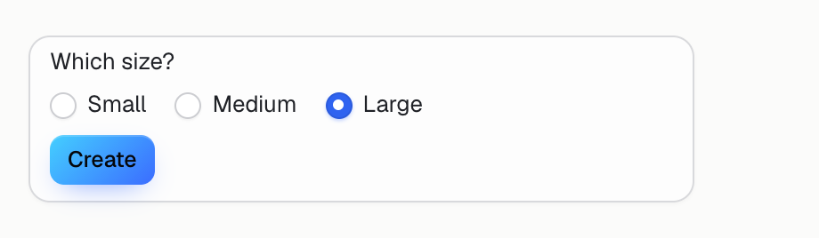
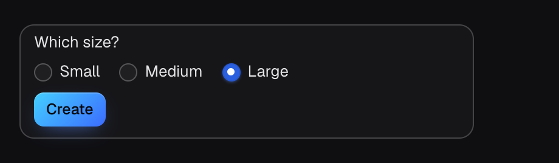

# Surface Protocol

The Tern Surface Protocol (TSP) lets a program in a terminal pane describe its
UI as a tree of semantic components. Tern lays that tree out, draws it and
animates it natively. A program that speaks TSP stops painting cells: no
box-drawing glyphs, no background-filled padding, no wrap or truncation math,
no spinner timers and no redraw on resize. It sends *what* is on screen, such
as "a card, pending, whose body is these ANSI bytes, folded to 10 lines", and
Tern decides *how* it looks.

**Before you build a UI, read [Designing Views](../guides/design.md).** It
lays an app out as a page (a head row, a `stats` strip, `tabs` between
views, a full-width `selectable` `table` beside the selected item's `card`),
maps each job to the kind that does it, opens apps in the sans face, and
lists the mistakes that make a view look like a web page. A view
that follows it looks like Tern's own with no stylesheet.

Plugins don't need this part of the book: Tern speaks TSP for a plugin's blocks
and lenses, and a plugin only returns [views](../guides/views.md). These pages
are for programs that run in a pane and write to its pty: a CLI that prints a
table or asks a question, a full-screen TUI, a coding agent such as omp. TSP
works over ssh and through Tern's session daemon, because it travels in-band
with the program's other output.

## Who owns what

| | Owner | How |
| --- | --- | --- |
| What is shown | The program | A document of nodes from the [element vocabulary](../elements/index.md), changed by frames of ops. |
| Layout | Tern | The program never measures text. It needs the width in cells (`cols` in the hello reply and `resize` events) only for the `rows` fallback and ANSI output width. |
| Animation | Tern | Motion kinds (`spinner`, `shimmer`, `elapsed`, …) are clocked by Tern, which honors Reduce Motion. The program sends no per-frame updates. |
| State and input | The program | Keys reach the program as pty input. Its editors, selection lists and modes stay its own state machines, drawn from the state it sends. Pointer actions come back as events. |
| View-only state | Tern | Hover and scroll position are Tern's alone and never reported. Folding and a click on an `el` checkbox or radio change at once in the window and are reported (`toggle`, `change`), so the program can mirror them. |
| Theme | Tern | Tern's theme colors the surface; a program can add its own stylesheets. |
| History | The program | Every node stays addressable by id while its surface is open, in the viewport or deep in scrollback, unless Tern drops it under its retention budget (a `gone` event). There are no "final" rows: a card that scrolled away can still change. A closed surface stays on screen with `keep` but takes no more frames. |

A terminal that doesn't speak TSP never answers the [handshake](handshake.md),
and the program keeps its own ANSI renderer.

## A whole session

A CLI asks one question below its own output, reads the answer from the click
that submits it, and exits, leaving its form in the scrollback (`→` program to
terminal on the pty's output, `←` terminal to program on its input):

```text
→ ESC _ tsp;q;{"q":"hello","v":[1],"app":"create-app"} ESC \  ESC [ c
← ESC _ tsp;r;{"r":"hello","v":1,…,"features":[…,"flow","font"],…} ESC \
← ESC [ ?62;52;c
→ ESC _ tsp;o;{"id":"pick","mode":"flow","font":"sans"} ESC \
→ ESC _ tsp;f;{"sf":"pick","s":1,"ops":[["add","main","pick",null,{"id":"main","k":"col","c":[…form…]}]]} ESC \
← ESC _ tsp;e;{"ev":"ack","sf":"pick","s":1} ESC \
← ESC _ tsp;e;{"ev":"change","sf":"pick","id":"l.r","value":"l","checked":true,"name":"size","values":{"size":"l"}} ESC \
← ESC _ tsp;e;{"ev":"action","sf":"pick","id":"go","act":"submit","values":{"size":"l"}} ESC \
→ ESC _ tsp;x;{"id":"pick","keep":true} ESC \
```

The hello reply comes before the DA1 answer, so the CLI knows to speak TSP.
It opens a [`flow` surface](surfaces.md), which sits at the cursor row among
its output, in the UI face (`font`), then adds the `main` region's root,
whose parent is the surface id. The question is a `card` in an `el` `form`:
labelled radios in a `row` and a primary [`button`](../elements/input.md#button).
No stylesheet: the kinds draw Tern's look (the node is one line on the wire):

```json
{"id":"main","k":"col","c":[
 {"id":"ask","k":"el","p":{"tag":"form"},"c":[
  {"id":"q","k":"card","p":{"head":"Which size?","max":{"w":"48ch"}},"c":[
   {"id":"sizes","k":"row","p":{"gap":"lg"},"c":[
    {"id":"s","k":"el","p":{"tag":"label"},"c":[
     {"id":"s.r","k":"el","p":{"tag":"input","type":"radio","name":"size","value":"s"}},
     {"id":"s.t","k":"el","p":{"tag":"span","text":"Small"}}]},
    {"id":"m","k":"el","p":{"tag":"label"},"c":[
     {"id":"m.r","k":"el","p":{"tag":"input","type":"radio","name":"size","value":"m"}},
     {"id":"m.t","k":"el","p":{"tag":"span","text":"Medium"}}]},
    {"id":"l","k":"el","p":{"tag":"label"},"c":[
     {"id":"l.r","k":"el","p":{"tag":"input","type":"radio","name":"size","value":"l"}},
     {"id":"l.t","k":"el","p":{"tag":"span","text":"Large"}}]}]},
   {"id":"go","k":"button","p":{"text":"Create","variant":"primary","actions":{"click":"submit"}}}]}]}]}
```

Tern acks frame 1 once it is drawn. A click on Large checks its radio at once
and reports `change` from the radio node `l.r`, with `values`, the form's
named controls. A click on Create sends `action` with the button's `click`
name as `act` and the same `values`. The CLI closes with `keep`, which leaves
the form, as last drawn, in the scrollback:

<figure class="tn-figure">


<figcaption>The form the session leaves behind, Large checked by the click.</figcaption>
</figure>

A fuller form is in [HTML Elements](../elements/el.md#recipe-a-styled-form).

## Pages

| Page | Covers |
| --- | --- |
| [Transport](transport.md) | Framing, the verbs, chunking, Windows |
| [Handshake](handshake.md) | Detecting Tern, the `hello` query and reply, features |
| [Surfaces](surfaces.md) | Opening and closing surfaces, the inline, screen and flow modes, anchoring, regions |
| [Documents and Frames](documents.md) | The document model, frame ops, time |
| [Input and Events](input.md) | Keys, native editing, pointer actions, every event Tern sends |
| [Stylesheets and Icons](theme.md) | Program stylesheets, icon glyphs |
| [Flow Control, Persistence and Security](operations.md) | Credits, retention, snapshots, debugging, limits |
| [SDKs](sdks.md) | Libraries for Rust, Python, Go and TypeScript that speak all of the above |

The node vocabulary, every kind with its props, is in [Elements](../elements/index.md),
and styling in [Styling Views](../styles/index.md).
