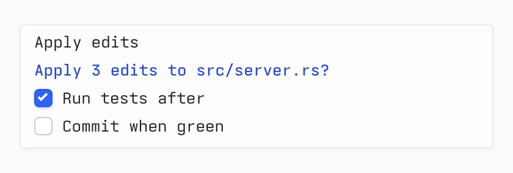
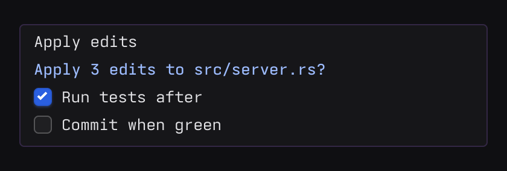

# Stylesheets and Icons

A program can bring its own CSS (`s`) and icon glyphs. Each is optional:
without them, Tern draws the surface in its own theme.

Tern reports its appearance as `dark` in the `hello` reply and sends
`{"ev":"theme","dark":bool}` when it changes. The `t` verb (the former
program palette) is accepted and ignored.

## Stylesheets

```text
ESC _ tsp;s;{"sf":"s1","name":"main","css":".ask label{display:flex;gap:8px}"} ESC \
```

`s` (feature `styles`) installs or replaces stylesheet `name` (1–64 of
`A–Z a–z 0–9 _ -`) of surface `sf`, the live surface when absent; a null,
absent or empty `css` removes it.

- A surface's sheets cascade after Tern's own in the order they were first
  sent; a replaced sheet keeps its place.
- They stay with the surface after close, so its scrollback keeps its look,
  and snapshots replay them.
- A surface holds at most 256 KiB of CSS, counted over all its sheets with
  the new text in place of the one it replaces. An `s` over that, with a bad
  name, with a `css` that isn't a string or for an unknown surface is
  rejected with an `error` event and changes nothing.
- **Confined to the surface.** Every selector is relative to the surface:
  `.ask label` matches inside its `main`, `dock` and `layer` regions and
  nowhere else. The region elements themselves are outside, so a selector
  naming `.sf-main` matches nothing. Tern's chrome, other panes and other
  surfaces are out of reach. The scope adds no specificity, so your rule
  beats a Tern rule of equal specificity.
- **Out of reach.** Declarations with `url()` and `position: fixed` are
  dropped and reported; `@font-face` is ignored and `@import` is reported
  as unsupported. A sheet's `@keyframes` are its own; an animation naming
  keyframes the sheet doesn't define gets Tern's.
- **Errors.** The window skips what it can't parse or drops and reports a
  sheet's problems once each time its CSS changes, all in one event:
  `{"ev":"error","sf","sheet":name,"msg":"<line>:<col>: …; <line>:<col>: …"}`.

A sheet that lays out a form of `el` nodes and squares off Tern's cards, which
it can reach because they sit inside the surface:

```css
.ask { display: flex; flex-direction: column; gap: 6px }
.ask label { display: flex; gap: 8px; align-items: center }
.ask .q { font-weight: 600; color: var(--sf-c-accent) }
.sf-card { border-radius: 4px }
```

```json
{"id":"n1","k":"card","p":{"tone":"pending","head":"Apply edits"},"c":[
 {"id":"n2","k":"el","p":{"tag":"form","class":"ask"},"c":[
  {"id":"n3","k":"el","p":{"tag":"div","class":"q","text":"Apply 3 edits to src/server.rs?"}},
  {"id":"n4","k":"el","p":{"tag":"label"},"c":[
   {"id":"n5","k":"el","p":{"tag":"input","type":"checkbox","checked":true}},
   {"id":"n6","k":"el","p":{"tag":"span","text":"Run tests after"}}]},
  {"id":"n7","k":"el","p":{"tag":"label"},"c":[
   {"id":"n8","k":"el","p":{"tag":"input","type":"checkbox"}},
   {"id":"n9","k":"el","p":{"tag":"span","text":"Commit when green"}}]}]}]}
```

<figure class="tn-figure">


</figure>

The hooks to target, the cascade and recipes are in
[Styling Views](../styles/index.md); what the CSS engine supports is in
[Supported CSS](../styles/css.md). Plugins don't send `s`: their sheets come
from the manifest and `tern.css`.

## Icons and glyphs

- **Named icons.** Fixed icon slots (`icon` nodes, an `item`'s or `seg`'s
  `icon`, the icon a `role` picks for a card) take names from Tern's icon set.
  The names are listed in [Data](../elements/data.md#icon-names).
- **Glyphs in text.** Icons inside running text are Nerd Font codepoints
  (Private Use Area) in spans with the `icon` token, keeping any color token
  (`"statusLineModel icon"`). Tern draws `icon` spans in its monospaced Nerd
  Font face at icon metrics, with its own gap when text follows, so drop the
  padding space you would put after a glyph in a terminal. Tern moves any
  other run of Private Use Area codepoints into an icon span itself, keeping
  its span's style: in spans without the `icon` token and in text that isn't
  spans (an editor's buffer, `md` prose). Don't send emoji or Unicode
  stand-ins for icons.
