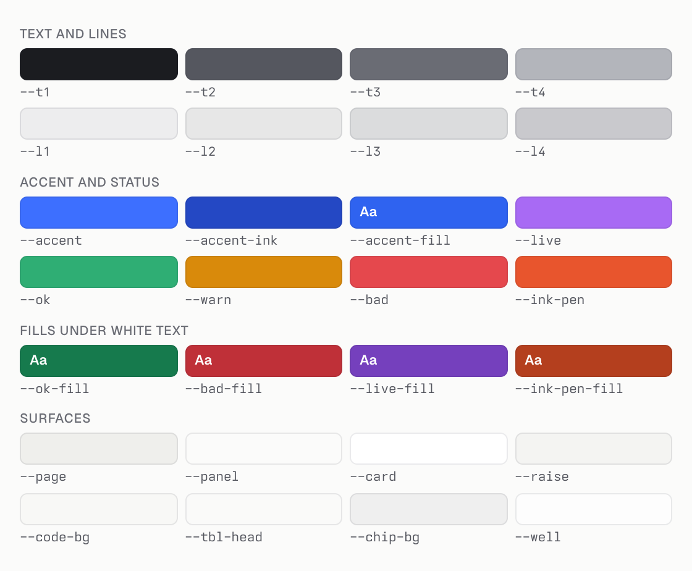
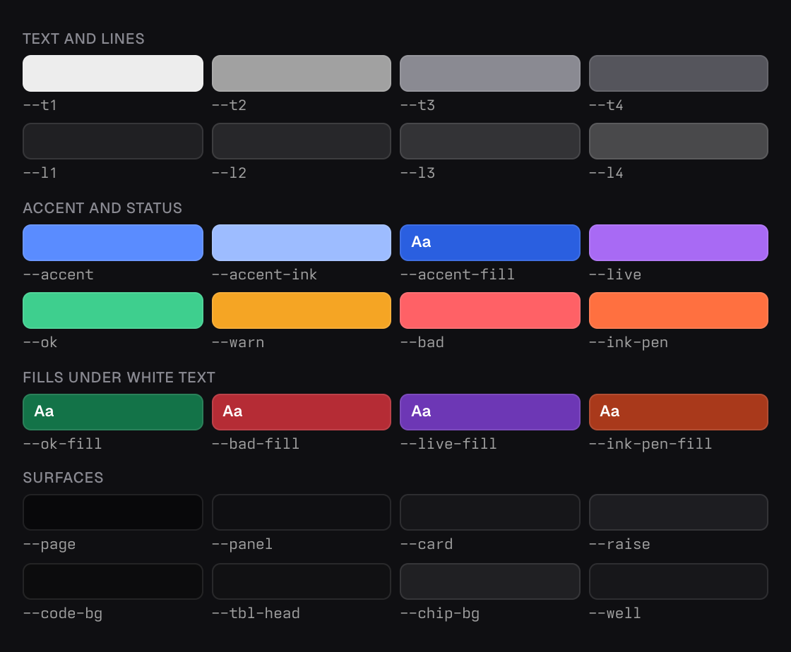
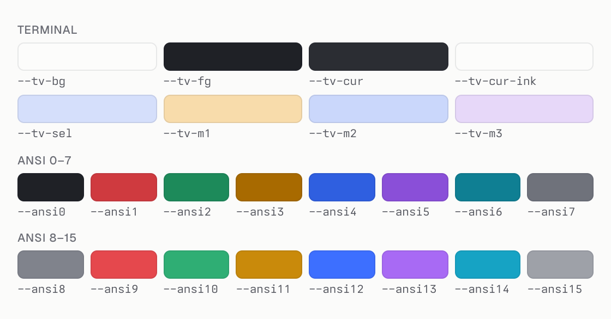
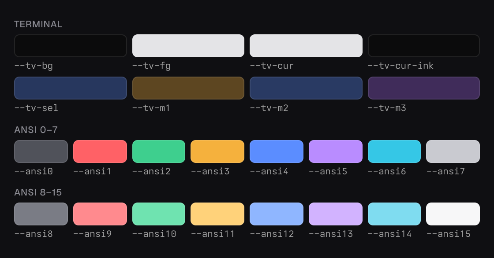
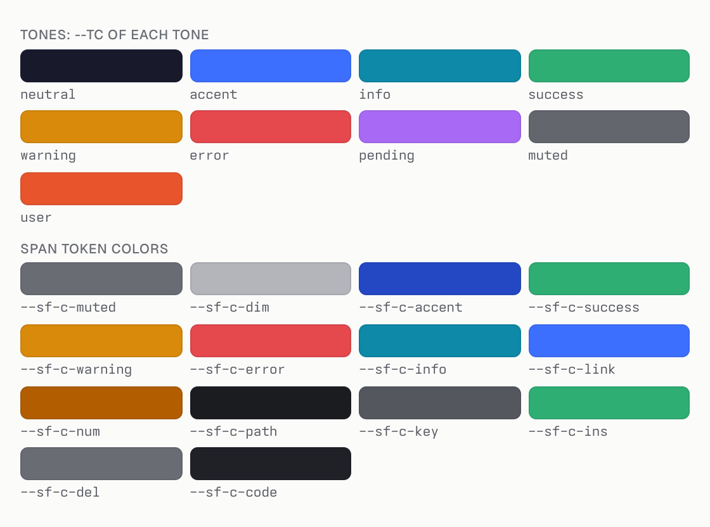
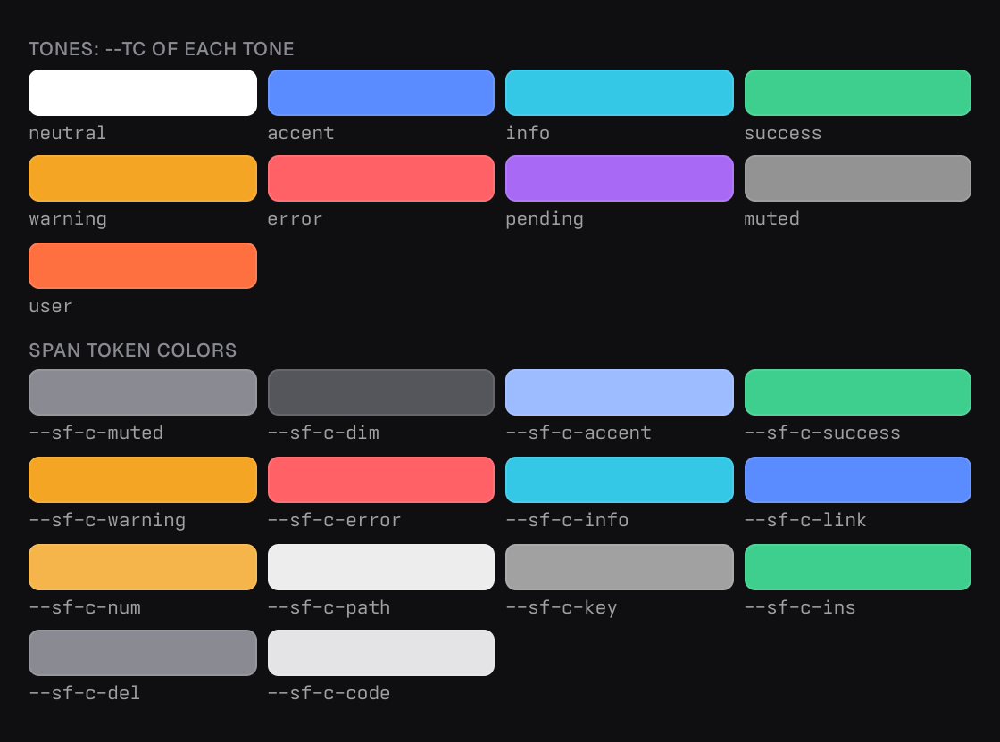
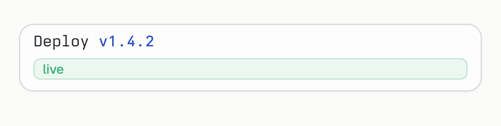
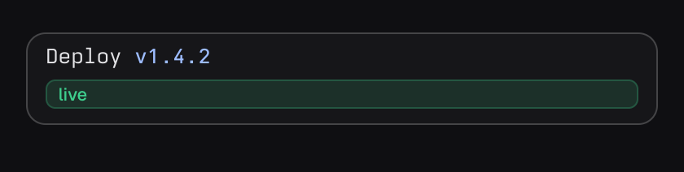

# CSS Variables

Your plugin's sheets draw in the same palette as Tern. Use CSS custom properties for every color, line,
radius, font and grid length instead of hard-coded values. Then your view follows the user's theme,
light and dark appearance, contrast and transparency settings, and font sizes without any extra work.

This page lists every custom property a plugin sheet can read, grouped by family. For each one it gives the
scope that defines it and whether you can rely on it. For how sheets load and cascade, see
[Styling Views](index.md). For the CSS syntax Tern supports (`var()`, `light-dark()`, relative colors,
`color-mix()`), see [Supported CSS](css.md).

## Where the values come from

Three layers set the variables. Each layer overrides the one before it:

1. **Kit defaults.** The `theme.css` sheet defines the design tokens on `:root`. `highlight.css` adds the
   `--tk-*` syntax colors. `termview.css` adds the terminal's `--tv-*` and `--ansi*` colors. `surface.css`
   adds the surface tones and span colors (`--sf-*`).
2. **The theme Tern applies.** For the chosen theme variant, Tern writes these properties inline on the
   root element: `--ink`, `--t1`…`--t4`,
   `--accent`, `--accent-ink`, `--accent-fill`, `--a1`, `--a2`, `--grad-ink`, `--ok`, `--ok-fill`, `--bad`,
   `--bad-fill`, `--warn`, `--live`, `--live-fill`, `--card`, `--raise`, `--code-bg`, `--tbl-head`, `--tv-bg`,
   `--tv-fg`, `--tv-cur`, `--tv-cur-ink`, `--tv-sel-a`, `--tv-sel-b`, `--ansi0`…`--ansi15`, the theme's
   `--omp-<token>` colors, plus internal `--tn-*` channels. `html.tn-themed` (`themes.css`) then derives
   `--page`, `--panel`, `--l1`…`--l4`, `--ink2`…`--ink4`, `--chip-bg`, `--well-line`, `--pop-bg`,
   `--topbar-bg`, `--sf-neutral` and `--tv-sel` from those values. A user's
   [CSS theme](../guides/themes.md#css-themes) lays its rules over all of this, every declaration
   `!important`, after every sheet a plugin adds too.
3. **The surface view.** On each region element (`.sf-main`, `.sf-dock`, `.sf-layer`), the view
   sets the grid metrics `--sf-zoom`, `--sf-fs`, `--sf-lh` and `--sf-cw`, and the tab width
   `--sf-tab`.

So the values in the kit tables below are the **defaults**. Under a Tern theme, the variables in layer 2
hold that theme's colors. The variable names don't change, so read the names and never copy the hex values.

## Light and dark

The kit's `:root` sets `color-scheme: light`, and `[data-theme='dark']` (which Tern sets on the root element)
sets `color-scheme: dark`. Most color tokens are written as
`light-dark(<light>, <dark>)`, so each one resolves for the appearance shown. You don't need a dark-mode
rule for tokens. When you need your own two-sided color, write it the same way:

```css
.sf-card[data-role='plugin.deploy.summary'] {
	background: light-dark(rgb(from var(--accent) r g b/6%), rgb(from var(--accent) r g b/12%));
}
```

To target the dark appearance in a selector instead, use `[data-theme='dark'] .your-selector`. The theme
writes its colors already resolved for the variant shown (one value per appearance), so variables in
layer 2 are plain colors, not `light-dark()` pairs.

Dark mode in the kit is flat. `[data-theme='dark']` replaces `--sheet-rim`, `--sheet-in` and `--sheet-drop`
with hairline and shadow values and sets `--cv-glow: none`.

Two system settings override tokens with `!important` (`motion.css`):

- `prefers-contrast: more` sets `--t1`…`--t4` to near-black/white steps and darkens `--l1`…`--l3`.
- `prefers-reduced-transparency: reduce` makes `--page`, `--panel`, `--pop-bg`, `--xp-bg`, `--topbar-bg`,
  `--tile-a`, `--tile-b`, `--sheet-a` and `--sheet-b` opaque.

Because these overrides go through the variables, your sheet follows them when it reads the tokens.

## Reading a variable with a fallback

`var(--name, fallback)` uses the fallback when `--name` is not defined at that element. Use a fallback for
every variable that only exists in some contexts: the grid metrics outside a region, the context fills,
and anything this page marks as internal.

```css
/* the terminal font size inside a surface region, 12px elsewhere */
.sf-text[data-role='plugin.logs.line'] {
	font-size: var(--sf-fs, 12px);
}

/* a card tint if one is set, else the card background */
.sf-card[data-role='plugin.ci.state'] {
	background: var(--sf-tint-success, var(--sf-card-bg));
}
```

Fallbacks nest. Tern's own rules do this, for example a region's text color is
`var(--tv-fg, var(--t1))`.

To get a translucent version of a token, use a relative color. Don't use a second variable:

```css
.sf-row[data-role='plugin.ci.failed'] {
	background: rgb(from var(--bad) r g b/10%);
	box-shadow: inset 2px 0 0 var(--bad);
}
```

## Stability

| Mark | Meaning |
| --- | --- |
| **stable** | Part of the theme contract. Every theme sets it or derives it. Safe to read from plugin sheets. |
| **stable, read-only** | Safe to read. Tern writes it per region or element, so values you set are overwritten or have no effect. |
| **context** | Defined only in some contexts (a specific element, a variable you set yourself). Always read it with a fallback. |
| **internal** | Layout plumbing for Tern's own chrome or for one kind's renderer. Documented so you can recognize it. It may change or disappear between versions. |

## Kit tokens: text and lines

Defined on `:root` in `theme.css`. These are the tokens you will use most.

<figure class="tn-figure">


<figcaption>Each cell is <code>background: var(--name)</code> in a surface: the kit defaults, light and dark. A Tern theme replaces the layer 2 values.</figcaption>
</figure>

| Variable | What it is | Light / dark default | Theme | Stability |
| --- | --- | --- | --- | --- |
| `--t1` | Primary text. | `#1b1c20` / `#ededed` | set (theme ink) | stable |
| `--t2` | Secondary text. | `#55575f` / `#a1a1a1` | set | stable |
| `--t3` | Meta text: labels, hints. | `#6a6c74` / `#8a8a92` | set | stable |
| `--t4` | Faint text: disabled, placeholders. | `#b3b5bb` / `#55555c` | set | stable |
| `--ink` | The theme's ink color (same as `--t1` by default). | `#1b1c20` / `#ededed` | set | stable |
| `--ink2` | Ink at 66% (70% in the kit's dark default). | translucent ink | derived from `--ink` | stable |
| `--ink3` | Ink at 44% (42% dark). | translucent ink | derived | stable |
| `--ink4` | Ink at 14%. | translucent ink | derived | stable |
| `--l1` | Hairline, faintest fill (hover rows, chips). | ink at 6% / white at 7% | derived (`--ink` at 6%) | stable |
| `--l2` | Hairline, borders. | 9% / 10% | derived (9%) | stable |
| `--l3` | Strong border. | 14% / 15% | derived (14%) | stable |
| `--l4` | Strongest line. | 22% / 24% | derived (22%) | stable |

`prefers-contrast: more` overrides `--t1`…`--t4` and `--l1`…`--l3`.

## Kit tokens: accent and status

| Variable | What it is | Light / dark default | Theme | Stability |
| --- | --- | --- | --- | --- |
| `--accent` | Accent color for rings, tints, links, selection marks. | `#3d6fff` / `#5a8cff` | set | stable |
| `--accent-ink` | Accent used as text color (readable on surfaces). | `#2448c4` / `#9dbcff` | set | stable |
| `--accent-fill` | Accent painted under white text or glyphs (filled badges, checks). At least 4.5:1 against `#fff` in both appearances. | `#2f63f0` / `#2a5fe0` | set | stable |
| `--a1`, `--a2` | The two stops of the brand gradient. | `#44cfff`, `#3b6cff` | set | stable |
| `--grad` | `linear-gradient(135deg, var(--a1), var(--a2))`. | — | follows `--a1`/`--a2` | stable |
| `--grad-ink` | Text color that reads on `--grad`. | `#05070b` | set | stable |
| `--ok` | Success. | `#2fae74` / `#3ecf8e` | set | stable |
| `--warn` | Warning. | `#d98a0b` / `#f5a524` | set | stable |
| `--bad` | Error, destructive. | `#e5484d` / `#ff6166` | set | stable |
| `--live` | Running, pending, live activity (purple). | `#a86af4` | set | stable |
| `--ok-fill` | `--ok` darkened to carry white text. | `#167a4d` / `#137348` | set (contrast-corrected) | stable |
| `--bad-fill` | `--bad` for white text. | `#bf3038` / `#b52c35` | set | stable |
| `--live-fill` | `--live` for white text. | `#7540bd` / `#6d37b5` | set | stable |
| `--ink-pen` | Orange pen color (Tern uses it for the user's own messages). | `#e8552d` / `#ff7040` | not set by themes | stable |
| `--ink-pen-fill` | `--ink-pen` for white text. | `#b43f1e` / `#a9391b` | not set | stable |

Use the plain colors for text, icons, rings and tints (`rgb(from var(--ok) r g b/12%)`). Use the
`*-fill` colors only for backgrounds that carry white text.

## Kit tokens: surfaces and materials

| Variable | What it is | Light / dark default | Theme | Stability |
| --- | --- | --- | --- | --- |
| `--page` | Window background behind panels. | `#efefec` / `#08080a` | derived from the theme's page color; translucent in glass windows | stable |
| `--panel` | Panel background. Under a theme, the terminal background. | `#fbfbfa` / `#0f0f12` | `var(--tv-bg)` (translucent in glass windows) | stable |
| `--card` | Card background. | `#ffffff` / `#161619` | set | stable |
| `--raise` | Raised control background. | `#f4f4f2` / `#1d1d21` | set | stable |
| `--code-bg` | Code block background. | `#f8f8f6` / `#0c0c0d` | set | stable |
| `--tbl-head` | Table header background. | `#fafaf9` / `#111113` | set (same as `--code-bg`) | stable |
| `--chip-bg` | Chip and inline-code fill. | ink 5.5% / white 7% | derived | stable |
| `--pop-bg` | Popover and menu background. | `rgba(255,255,255,.82)` / `rgba(35,35,39,.98)` | derived from the theme's popover color | stable |
| `--well` | Recessed well fill. | white 62% / white 3.5% | not set | stable |
| `--well-line` | A well's hairline. | ink 6.5% / white 7.5% | derived | stable |
| `--glass-hi` | Top highlight on glass. | `#fff` / white 5% | not set | stable |
| `--fog` | Opaque soft fill. | `#f3f4f7` / `#0f0f12` | not set | stable |
| `--dim` | Scrim behind modal sheets. | `rgba(244,244,241,.5)` / `rgba(0,0,0,.55)` | not set | stable |
| `--rail` | Rail and guide color. | `rgb(96,120,178)` / `rgb(110,150,255)` | not set | stable |
| `--grid-dot` | Dot-grid color. | ink 10% / white 6.5% | not set | stable |
| `--topbar-bg` | App top bar material. | translucent page | derived | internal |
| `--sheet-a`, `--sheet-b` | The two stops of a sheet's background. | translucent white / `var(--card)` | not set | internal |
| `--sheet-rim` | Sheet border gradient. | white gradient / 9% white hairline | dark override | internal |
| `--sheet-in` | Sheet inner highlight (box-shadow). | — | dark override | internal |
| `--sheet-drop` | Sheet drop shadow (box-shadow). | — | dark override | internal |
| `--xp-bg` | Expanded view backdrop. | — | not set | internal |
| `--tile-a`, `--tile-b` | Gallery tile background stops. | — | not set | internal |
| `--cv-base`, `--cv-glow` | Canvas base color and its ambient glow (`none` in dark). | — | not set | internal |

## Kit tokens: shape, type, motion, layout

| Variable | What it is | Value | Stability |
| --- | --- | --- | --- |
| `--r-chip` | Radius for chips and tags. | `6px` | stable |
| `--r-ctl` | Radius for controls (buttons, fields). | `8px` | stable |
| `--r-card` | Radius for cards. | `12px` | stable |
| `--r-panel` | Radius for panels and sheets. | `16px` | stable |
| `--sans` | UI font stack. | `'Geist', -apple-system, 'SF Pro Text', system-ui, sans-serif` | stable |
| `--mono` | Monospace stack. | `'Ioskeley Mono Term', ui-monospace, 'SF Mono', SFMono-Regular, Menlo, monospace` | stable |
| `--hand` | Handwritten stack. | `'Excalifont', 'Bradley Hand', 'Segoe Print', cursive` | stable |
| `--ease` | General easing. | `cubic-bezier(0.2, 0.7, 0.2, 1)` | stable |
| `--out` | Ease-out for entrances. | `cubic-bezier(0.16, 1, 0.3, 1)` | stable |
| `--top`, `--side` | Kit app shell top bar height and sidebar width (`56px`, `244px`; `224px` under 1360px, `0px` with `html.side-collapsed`). | — | internal |
| `--W`, `--H`, `--tw`, `--th`, `--CW`, `--CH` | Kit gallery and canvas sizes. | — | internal |

A surface region sets its own font. Its `font-family` is `var(--tv-font, var(--mono))` and its size is
`--sf-fs`, so in a mono view, `--sans` is for text you deliberately set apart from the terminal face. A region of a
surface opened with `font: "sans"` (class `sf-sans`, see [Surfaces](../protocol/surfaces.md#open-and-close)) is
`400 13px/18px var(--sans)` instead, with machine strings in `--mono`; there, set a font only on what you
deliberately set apart from the UI face.

Under `prefers-reduced-motion: reduce`, the kit sets every animation and transition duration to `0s`. Easing
variables keep their values.

## Syntax highlight tokens

Defined on `:root` in `highlight.css`. Highlighted code (the `code`, `diff` and `md` kinds)
marks tokens with `.tk-<name>` classes, and each class reads the matching variable.

| Variable | Class | Light / dark default | Stability |
| --- | --- | --- | --- |
| `--tk-comment` | `.tk-comment` | `var(--t3)` | stable |
| `--tk-doc` | `.tk-doc` | `#35726b` / `#7bb9b0` | stable |
| `--tk-keyword` | `.tk-keyword` | `#8a3fd6` / `#c29bff` | stable |
| `--tk-function` | `.tk-function` | `#2448c4` / `#8fb6ff` | stable |
| `--tk-macro` | `.tk-macro` | `#a52a9a` / `#f08ade` | stable |
| `--tk-variable` | `.tk-variable` | `var(--t1)` | stable |
| `--tk-property` | `.tk-property` | `#325a86` / `#a8d1ee` | stable |
| `--tk-string` | `.tk-string` | `#1d7f52` / `#5fd39c` | stable |
| `--tk-escape` | `.tk-escape` | `#055c3e` / `#a0f8c5` | stable |
| `--tk-number` | `.tk-number` | `#b25e00` / `#f5b54a` | stable |
| `--tk-constant` | `.tk-constant` | `#737007` / `#e0da69` | stable |
| `--tk-type` | `.tk-type` | `#0b7894` / `#4fd2ee` | stable |
| `--tk-tag` | `.tk-tag` | `#b63b32` / `#f8907f` | stable |
| `--tk-heading` | `.tk-heading` | `#6744c5` / `#b6a5fd` | stable |
| `--tk-link` | `.tk-link` | `#0070a6` / `#6fc1f6` | stable |
| `--tk-operator` | `.tk-operator` | `#c2335f` / `#ff8db2` | stable |
| `--tk-punct` | `.tk-punct` | `var(--t2)` | stable |
| `--tk-inserted` | `.tk-inserted` | `var(--ok)` | stable |
| `--tk-deleted` | `.tk-deleted` | `var(--bad)` | stable |

To recolor highlighting in your block only, set the variables on a scoped selector:

```css
[data-surface='plugin.notes.main'] {
	--tk-keyword: var(--accent-ink);
	--tk-string: var(--ok);
}
```

## Terminal tokens

Defined on `:root` in `termview.css`. The theme overrides them on the root
element. A surface region reads them for its text color and font. Use them when part of your view should
look like the terminal grid.

| Variable | What it is | Light / dark default | Theme | Stability |
| --- | --- | --- | --- | --- |
| `--tv-font` | Terminal font family. | `var(--mono)` | Tern sets it inline on the stage and peek roots from the user's font setting | stable |
| `--tv-bg` | Terminal background. | `#fcfcfb` / `#0b0b0c` | set | stable |
| `--tv-fg` | Terminal foreground. | `#1f2126` / `#e4e4e7` | set | stable |
| `--tv-cur` | Cursor color. | `#2b2d33` / `#e4e4e7` | set | stable |
| `--tv-cur-ink` | Text under the cursor. | `#fcfcfb` / `#0b0b0c` | set | stable |
| `--tv-sel` | Selection fill. | accent at 20% / 32% | derived from the theme's selection color (22% / 34%) | stable |
| `--tv-sel-a`, `--tv-sel-b` | Top and bottom stops of the selection wash. When set, they replace the flat `--tv-sel`. | not defined | set | context |
| `--tv-m1` | Search match highlight (mark group 1). | amber at 42% / 34% | not set | stable |
| `--tv-m2` | Current match highlight (mark group 2). | accent at 26% / 34% | follows the theme's `--accent` | stable |
| `--tv-m3` | Mark group 3. | `--live` at 24% / 32% | follows the theme's `--live` | stable |
| `--ansi0` … `--ansi15` | The 16 ANSI colors: 0–7 normal (black, red, green, yellow, blue, magenta, cyan, white), 8–15 bright. | Tern's own palette (`--ansi1` is `#cf3a3f` / `#ff6166`) | set from the theme | stable |
| `--tv-contrast` | Minimum WCAG ratio for automatic text contrast correction. | not defined | set by the "minimum contrast" option | internal |

The ANSI colors are the theme's real palette. To make a plugin color match what a shell program would
print in "red", use `var(--ansi1)`.

<figure class="tn-figure">


<figcaption>The <code>--tv-*</code> and <code>--ansi*</code> defaults from <code>termview.css</code>. Under a Tern theme they hold the theme's colors.</figcaption>
</figure>

Tern writes the following properties inline on the terminal element `.tv`. They
are defined only inside a terminal pane, so read them with a fallback.

| Variable | What it is | Stability |
| --- | --- | --- |
| `--tv-fs` | Terminal font size in px. | internal |
| `--tv-lh` | Terminal line height in px. | internal |
| `--tv-px`, `--tv-py` | The grid's horizontal and vertical padding. | internal |
| `--tv-aside` | Width of the sheet docked at the pane's right edge (the `prefs` kind). Divide by `--sf-zoom` inside a region. | internal |
| `--tv-dock-h` | Height of the dock, on the scroll-back pill. | internal |

Inside a surface, use `--sf-fs`, `--sf-lh` and `--sf-cw` instead of `--tv-fs`/`--tv-lh`. They are in the
region's zoomed px and stay exact.

## Surface grid metrics

Set inline on every region element (`.sf-main`, `.sf-dock`, `.sf-layer`) by the view
whenever the terminal font, the UI font size, the cell size or the tab width changes. They inherit into every
node.

| Variable | What it is | Stability |
| --- | --- | --- |
| `--sf-fs` | The terminal font size, in the region's px. The region's `font-size` (fallback `12px`). | stable, read-only |
| `--sf-lh` | The region's line: the terminal line height (cell height), or `18px` in a sans region (`.sf-sans`). The region's `line-height` (fallback `17px`). | stable, read-only |
| `--sf-grid-lh` | The terminal line height, in every region; what the mono kinds (`code`, `diff`, `ansi`, …) use in a sans region. | stable, read-only |
| `--sf-cw` | The terminal cell width (one `ch` of the grid font). | stable, read-only |
| `--sf-zoom` | The region's CSS `zoom` (UI font size ÷ 13), a plain number. Divide a host px length by it. | stable, read-only |
| `--sf-tab` | Columns per tab stop in `code`, `diff` and Markdown code: Tern's Tab width setting, a plain number for `tab-size`. | stable, read-only |

Tern's sheets are drawn for a 13px font, and each region is zoomed by the UI font size over 13 (Settings ›
Appearance; the terminal font size unless the user set it apart). So plain px in your sheet scale with the
interface around the view. The view writes the terminal metrics divided by the zoom, so after zoom they come
out exact on screen: `--sf-fs` reads `13px` while the two sizes agree, and `--sf-lh` and `--sf-cw` are the
cell's height and width in the same design units. Use `--sf-fs` for text that reads at the terminal's size,
and `--sf-lh` and `--sf-cw` when a length must land exactly on the grid. Prop extents compile to these
values: `"40ch"` becomes `calc(40 * var(--sf-cw))` and `"10lines"` becomes `calc(10 * var(--sf-lh))`.

```css
/* a gutter exactly six cells wide, a list exactly eight lines tall */
.sf-row[data-role='plugin.blame.line'] > :first-child {
	width: calc(6 * var(--sf-cw));
}
.sf-list[data-role='plugin.blame.commits'] {
	max-height: calc(8 * var(--sf-lh));
}
```

## Surface rhythm and fills

Defined on `:root` in `surface.css`.

| Variable | What it is | Light / dark default | Stability |
| --- | --- | --- | --- |
| `--sf-block-gap` | Gap between blocks in `main` (`.sf-main` is a flex column with this gap). | `16px` | stable |
| `--sf-inner-gap` | Gap between parts inside one block (a card's body rows). | `8px` | stable |
| `--sf-card-bg` | Card background (`.sf-card`). | white 55% / white 2.8% | stable |
| `--sf-shade` | Faint shaded fill (code gutters, card heads). | `--t1` at 2.8% / 3% | stable |

Tern controls spacing between nodes. Programs never send it. To change the rhythm in your block, override
these values on your region:

```css
.sf-main[data-surface='plugin.todo.board'] {
	--sf-block-gap: 10px;
	--cn-gap: 10px; /* the Console chat style */
}
```

Under the Console chat style, `main` spaces its blocks with `--cn-gap` (set on the region by
`.sf-chat-console`) instead of `--sf-block-gap`, so set both.

## Tone colors

Defined on `:root` in `surface.css`.

| Variable | Tone | Default | Stability |
| --- | --- | --- | --- |
| `--sf-ok` | success | `var(--ok)` | stable |
| `--sf-warn` | warning | `var(--warn)` | stable |
| `--sf-bad` | error | `var(--bad)` | stable |
| `--sf-info` | info | `#0e89a8` / `#35c7e6` | stable |
| `--sf-muted` | muted | `#64666e` / `#939393` | stable |
| `--sf-neutral` | neutral | `#181a2c` / `#fff`; `var(--ink)` under a Tern theme | stable |
| `--sf-user` | user | `var(--ink-pen)` | stable |
| `--sf-accent` | accent | not defined (falls back to `--accent`) | context |

### How tones resolve

Every node with a `tone` prop gets `data-tone="<tone>"`. In `surface.css`, each tone sets one variable,
`--tc`, on that element:

| `[data-tone]` | `--tc` |
| --- | --- |
| `neutral` | `var(--sf-neutral)` |
| `accent` | `var(--sf-accent, var(--accent))` |
| `info` | `var(--sf-info)` |
| `success` | `var(--sf-ok)` |
| `warning` | `var(--sf-warn)` |
| `error` | `var(--sf-bad)` |
| `pending` | `var(--live)` |
| `muted` | `var(--sf-muted)` |
| `user` | `var(--sf-user)` |

Every region starts with `--tc: var(--sf-neutral)`. Tone-aware kinds paint with `--tc` and with relative
colors made from it. For example, a badge uses `color: var(--tc)`, `background: rgb(from var(--tc) r g b/10%)`
and `box-shadow: inset 0 0 0 1px rgb(from var(--tc) r g b/22%)`. Your sheet can do the same, so a rule
follows whatever tone the node carries:

```css
.sf-card[data-role='plugin.ci.job'] {
	border-left: 3px solid var(--tc);
	background: rgb(from var(--tc) r g b/6%);
}
```

To restyle one tone in your block, override its source variable, not `--tc`:

```css
[data-surface='plugin.ci.main'] {
	--sf-warn: var(--ansi3);
}
```

`--tc` is stable to read. Set it yourself only on an element that has no `data-tone`. Otherwise the tone
rule wins on specificity.

## Span token colors

Defined on `:root` in `surface.css`. A span's style tokens become `.sf-t-<token>`
classes. Each colored token reads one `--sf-c-<token>` variable, which takes the theme's color for the
nearest omp token first ([Theme token colors](#theme-token-colors)) and Tern's own color when the
theme has none:

| Variable | Class | Default | Stability |
| --- | --- | --- | --- |
| `--sf-c-muted` | `.sf-t-muted` | `--omp-muted`, else `var(--t3)` | stable |
| `--sf-c-dim` | `.sf-t-dim` | `--omp-dim`, else `var(--t4)` | stable |
| `--sf-c-accent` | `.sf-t-accent` | `--omp-accent`, else `var(--accent-ink)` | stable |
| `--sf-c-success` | `.sf-t-success` | `--omp-success`, else `var(--ok)` | stable |
| `--sf-c-warning` | `.sf-t-warning` | `--omp-warning`, else `var(--warn)` | stable |
| `--sf-c-error` | `.sf-t-error` | `--omp-error`, else `var(--bad)` | stable |
| `--sf-c-info` | `.sf-t-info` | `--omp-syntaxType`, else `var(--sf-info)` | stable |
| `--sf-c-link` | `.sf-t-link`, `.sf-link` | `--omp-mdLink`, `--omp-accent`, else `var(--accent)` | stable |
| `--sf-c-num` | `.sf-t-num` | `--omp-syntaxNumber`, else `#b25e00` / `#f5b54a` | stable |
| `--sf-c-path` | `.sf-t-path` (its `.dir` part uses `--sf-c-muted`) | `--omp-statusLinePath`, `--omp-mdLinkUrl`, else `var(--t1)` | stable |
| `--sf-c-key` | `.sf-t-key` | `var(--t2)` | stable |
| `--sf-c-ins` | `.sf-t-ins` | `--omp-toolDiffAdded`, `--omp-success`, else `var(--ok)` | stable |
| `--sf-c-del` | `.sf-t-del` | `--omp-toolDiffRemoved`, `--omp-error`, else `var(--t3)` | stable |
| `--sf-c-code` | `.sf-t-code` | `--omp-mdCode`, else `currentColor` | stable |

The other span tokens don't use a color variable. `strong` uses `color: var(--t1)` with weight 600. `em`,
`mono`, `icon` and `hide` only set style, tabular numerals, face or visibility. `mark` uses `--sf-mark-bg`
with a fallback of `rgb(from var(--accent) r g b/16%)`. `typo` draws spelling dots in
`--spelling-error-color` (fallback `#ff3b30`). `code` and `key` add `--chip-bg`/`--l1` fills.

<figure class="tn-figure">


<figcaption>Top: <code>var(--tc)</code> on an <code>el</code> with each <code>tone</code>. Bottom: <code>var(--sf-c-&lt;token&gt;)</code>; <code>--sf-c-code</code> is <code>currentColor</code>, the region's text color.</figcaption>
</figure>

Kinds that take a color `token` (chart series, meter parts, effort) resolve it the same way. A semantic
token becomes `var(--sf-c-<token>)`; an omp token becomes `var(--omp-<token>, …)` over the nearest
semantic token's. So recoloring `--sf-c-success` also recolors a meter part with `token = "success"`.

```css
/* make "muted" spans quieter only in this block */
[data-surface='plugin.logs.main'] {
	--sf-c-muted: var(--t4);
}
```

See [Styling Views](index.md) for the full span token class list.

### Theme token colors

Tern's themes are omp themes ([Custom Themes](../guides/themes.md)), and Tern sets the theme's own color
for each of omp's text tokens on the root element as `--omp-<token>`: `--omp-mdHeading`,
`--omp-syntaxKeyword`, `--omp-toolDiffAdded` and the rest of the names in
[Text and Code](../elements/text.md#program-theme-tokens), except the `…Bg` fills. Each is already
relit to read on the terminal background, code blocks and popovers. A token the theme leaves out is not
defined, so always read one with a fallback.

They color what omp's colors would: a span styled with an omp token (`toolTitle`, `statusLineModel`)
reads its own variable before its semantic class's, highlighted code reads the `syntax*` ones before
the `--tk-*` colors, and markdown reads `mdHeading`, `mdLink`, `mdCode`, `mdQuote`, `mdQuoteBorder`,
`mdListBullet`, `mdHr` and `mdCodeBlock`.

```css
/* a plugin's section titles in the theme's heading color */
[data-surface='plugin.ci.main'] .title {
	color: var(--omp-mdHeading, var(--t1));
}
```

## Context fills

These variables are not defined by default. Tern's rules for card tints, selection, marks and the
status bar read them with fallbacks, so you can define them yourself on your region.

| Variable | What it is | Stability |
| --- | --- | --- |
| `--sf-tint-success` | Card fill for `success`, fallback `--sf-card-bg`. | context |
| `--sf-tint-error` | Card fill for `error`. | context |
| `--sf-tint-pending` | Card fill for `pending`. | context |
| `--sf-tint-user` | Card fill for `user`. | context |
| `--sf-tint-custom` | Card fill for custom-message cards. | context |
| `--sf-tint-neutral` | Fill for other cards. | context |
| `--sf-tint-info` | Card fill for `info`. | context |
| `--sf-sel` | The selected list item's fill (fallback: accent at 10% / 16%). | context |
| `--sf-mark-bg` | The `mark` span's fill. | context |
| `--sf-status-bg` | The status bar background (fallback `var(--page)`). | context |

For example:

```css
/* give a plugin's selected list rows and highlights a green wash */
[data-surface='plugin.todo.main'] {
	--sf-sel: rgb(from var(--ok) r g b/14%);
	--sf-mark-bg: rgb(from var(--ok) r g b/20%);
}
```

## Per-element variables

A few kinds write a variable inline on their own element. The renderer owns these values. They are listed
so you can read them in a rule for that kind. All are **internal**.

| Variable | Set on | What it is |
| --- | --- | --- |
| `--tc` | any `[data-tone]` element, every region | The node's tone color (see [How tones resolve](#how-tones-resolve)). Stable to read. |
| `--sf-gw` | `code`, `diff` | Line-number gutter width. |
| `--ind`, `--ind-unit` | `diff` rows | Indent width and indent unit, in `--sf-cw`. |
| `--sf-clamp` | collapsed `card`/`section` with a preview (`.clamped`), `tool` bodies | The clamp height in px. |
| `--sf-clip` | `term` | Clip height of an embedded terminal. |
| `--sf-depth` | `agent` | Nesting depth, 0–6. |
| `--sf-meter` | `meter` | Value, 0–1. Written only while the value is known (an unknown value adds `.unknown`). |
| `--sf-mt-gap` | `meter` (read) | Gap around marks on the track (fallback `14px`). You can set it. |
| `--d` | `tree` rows | Row depth (indent `calc(var(--d) * 14px)`). |
| `--sh-lo`, `--sh-mid`, `--sh-hi` | `shimmer` with a `palette` | The low, mid and high colors, as `var(--sf-c-<token>)`. Fallbacks `--t3`, `--t2`, `--t1`. |
| `--sh-band` | `shimmer`, `fx = "shimmer"` (read) | Width of the sweeping band (fallback `5em`, about ten characters). You can set it. |
| `--chart-c` | `chart` | The series color from its `token` (default `var(--accent)`). |
| `--v`, `--x`, `--at` | `chart` bars and heatmap cells | A bar's height (0–1), a bar's or column's index, a month label's column. |
| `--pf-room` | `prefs` menus | Room for an open menu, in px. |
| `--sf-spindle` | spinners | `still` holds the spinner's resting frame. `.sf-still`, `.sf-paused`, `.sf-covered` and reduced motion set it. |
| `--spelling-error-color` | `.sf-t-typo` (read) | Color of the misspelling dots (fallback `#ff3b30`). |

## Examples

A status badge and card that follow the theme, the node's tone and the terminal grid:

```lua
local ui = tern.ui

local function view(state)
	return {
		main = ui.card({ "Deploy ", ui.span(state.version, "accent") }, {
			ui.badge(state.ok and "live" or "failed", state.ok and "success" or "error"),
		}),
	}
end
```

```css
[data-surface^='plugin.deploy.'] .sf-badge {
	border-radius: var(--r-chip);
	background: light-dark(rgb(from var(--tc) r g b/8%), rgb(from var(--tc) r g b/14%));
	box-shadow: inset 0 0 0 1px rgb(from var(--tc) r g b/24%);
	padding: 0 var(--sf-cw);
}
[data-surface^='plugin.deploy.'] .sf-card {
	border-radius: var(--r-card);
	margin-bottom: calc(var(--sf-lh) / 2);
}
[data-surface^='plugin.deploy.'] .sf-t-accent {
	color: var(--accent-ink);
	font-weight: 600;
}
```

<figure class="tn-figure">


<figcaption>The view with <code>state.version = "v1.4.2"</code> and <code>state.ok = true</code>.</figcaption>
</figure>

A terminal-looking panel that uses the theme's own ANSI colors:

```css
.sf-col[data-role='plugin.logs.console'] {
	background: var(--tv-bg);
	color: var(--tv-fg);
	font-family: var(--tv-font, var(--mono));
	border: 1px solid var(--l2);
	border-radius: var(--r-ctl);
}
.sf-col[data-role='plugin.logs.console'] .sf-t-error {
	color: var(--ansi1);
}
.sf-col[data-role='plugin.logs.console'] .sf-t-warning {
	color: var(--ansi3);
}
```
