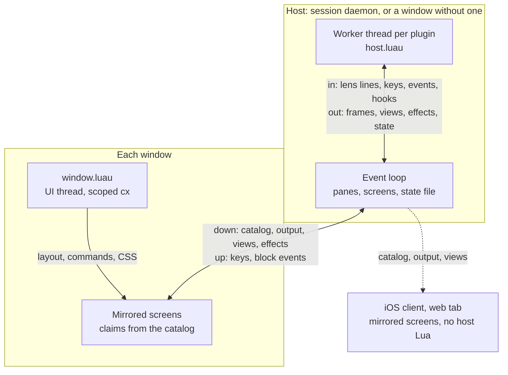

# 架构 {#architecture}

一个插件最多包含两个半区，各自在不同的位置运行自己的 Luau VM。host 半区在面板运行的位置运行，拥有必须同时为每个窗口存在的一切；window 半区在每个窗口内部运行，改变该窗口的行为。本页说明每个半区在哪里运行、边界为何落在该处，以及 block、lens 与插件 catalog 如何跨越这条边界。

## 两个半区 {#the-two-halves}

| | Host 半区 | Window 半区 |
| --- | --- | --- |
| 入口 | `host = "host.luau"` | `window = "window.luau"` |
| `tern.context` | `"host"` | `"window"` |
| 运行于 | 会话守护进程，或没有守护进程时承载其面板的窗口 | 机器上的每个 Tern 窗口 |
| 线程 | 每个插件一个工作线程 | 窗口的 UI 线程 |
| VM | 每个 host 上每个插件一个 | 每个窗口每个插件一个 |
| 拥有 | Block 类型、命令 lens、面板钩子、`spawn` 过滤器、`tern.pane` | 命令、快捷键、覆盖、路由、chrome 格式化器、Files 面板按钮、`tern.css`、窗口事件、`cx.layout` |
| 每次调用预算 | 2 s | chrome 格式化器与 `available` 为 4 ms，其余为 50 ms |

清单至少指定一个入口；只有一个半区的插件很常见。插件的两个半区共享其包目录与数据目录，但不共享 Lua 状态：它们运行在不同的 VM 中，通常位于不同的进程，并且只通过 Tern 在两者之间搬运的内容（面板、block、effect、文件）互相通信。

## 为何存在这种划分 {#why-the-split-exists}

Tern 的面板以及每个面板屏幕的权威副本都位于会话守护进程中。窗口附着到守护进程并镜像这些屏幕；窗口退出后，其面板继续运行。插件向面板添加的任何内容也必须位于那一侧，否则它会随添加它的窗口一起消失，永远无法到达其他窗口、iOS 客户端或 Web 标签页。这就是 host 半区。

UI 状态则不同：窗口的标签页、焦点、命令面板、键位映射、chrome 与样式表都属于该窗口，在其 UI 线程上一次一个事件地被修改。改变它们的代码必须在该线程上、在该窗口内部运行，并直接访问窗口的状态。这就是 window 半区，它正是为此获得一个 `cx`。

这种划分源于上述两个事实，而不是某种 API 选择的结果：host 代码从不接触窗口，window 代码也从不拥有面板的内容。

## 每个半区的运行位置 {#where-each-half-runs}

| 情形 | Host 半区 | Window 半区 |
| --- | --- | --- |
| 附着到会话守护进程的桌面窗口 | 在守护进程中 | 在窗口中 |
| 没有守护进程、自行运行面板的桌面窗口 | 在窗口的进程中，运行于工作线程 | 在窗口中 |
| 附着到你的窗口的远程 host | 在远程 host 上，位于其守护进程中，来自其插件文件夹 | 你的 window 半区作用于你窗口中的每个面板，包括远程面板 |
| iOS 客户端 | 不运行（跳过 host 入口） | 运行，以解释方式执行 |
| Web 标签页 | 不运行（没有 Lua） | 不运行（没有 Lua） |

**守护进程。** 守护进程在启动时、恢复已保存的面板之前加载本机的插件，因此恢复的插件 block 能找到自己的 block 类型。每个 host 半区获得一个工作线程；守护进程的事件循环从不运行 Lua。它通过 channel 把 lens 行、block 输入与面板事件交给工作线程，并在工作线程唤醒它时应用其送回的内容（面板字节、lens 视图、effect、已保存状态）。事件循环只在两处等待插件：`spawn` 过滤器（每个插件最多 50 ms，参见
[host 钩子与 spawn 过滤器](../guides/hooks.md)）以及加载或重新加载（每个工作线程在入口运行完毕时报告；退场的工作线程最多有 3 s 释放其 block）。

**没有守护进程的窗口。** 当窗口运行自己的面板时，它从第一个面板起就在自己的进程中启动同样的 host 运行时，并使用同样的工作线程。对插件来说没有任何变化，只是“host”变成了该窗口的进程。

**远程 host。** 远程 host 的守护进程以守护进程运行所用的用户身份，从该机器的插件文件夹加载远程机器的插件。它们的 block 与 lens 会像该 host 的任何面板一样出现在你的窗口中。你的 window 半区是本地的：它从你的插件文件夹运行，并看到你窗口中的每个面板，无论本地还是远程。应把 host 半区安装到它所要服务的面板所在的机器上。

**iOS。** iOS 客户端在解释器中运行其 Files App 插件文件夹中的 window 半区（参见[包与清单](packages.md#directories)），并跳过 host 入口。它显示所附着的 host 提供的 block 与 lens 视图。

**Web 标签页。** Web 标签页完全不运行 Lua。它仍会收到其唯一 host（即提供该页面的机器）的 catalog，因此它会打开与其他任何副本相同的 lens block，并显示同样的插件 block 与视图，样式来自该 catalog 中插件的清单 `styles`。只有 window 半区添加的 `tern.css` 样式表在那里缺失。

完整对照见[支持矩阵](support-matrix.md)。

## Host 工作线程 {#host-workers}

每个带有 `host` 入口的 host 半区都会获得一个名为 `plugin <id>` 的 OS 线程，由它拥有该插件的 VM。插件在 host 上所做的一切都在这里运行：block 处理器、lens 处理器、钩子、定时器与进程回调。一个循环到触发 2 s 预算的插件只会卡住自己的工作线程；其他插件与守护进程照常运行。

处理器通过 `cx` 排队的工作（重新渲染、保存、退出、一帧、effect、面板写入）在处理器返回之后应用，绝不会在其内部应用，因此不会有处理器在另一个处理器内部运行。

## Window VM 与 `cx` {#window-vms-and-cx}

Window 半区在每个窗口的 UI 线程上运行，每个窗口每个插件一个 VM。每个可能改变窗口的处理器都会收到一个专属于该次调用的新 `cx`：处理器返回后 `cx`、`cx.session` 与 `cx.layout` 即失效，保存下来的 `cx` 在之后使用时抛出错误。定时器、进程与 fetch 回调会收到各自的新 `cx`。

窗口处理器运行期间，窗口的插件会被移出该窗口。因此，从处理器内部调用的内置功能（从 `new_tab` 的覆盖中调用 `cx:command("new_tab")`，从路由中调用 `cx:open`）运行的是 Tern 自身的行为，而不会再次运行插件的行为。参见
[命令、按键与覆盖](../guides/commands.md)。

## Block：程序为 Lua 的面板 {#blocks-panes-whose-program-is-lua}

插件 block 是像 shell 一样的面板，只是它的程序是一张 Lua 表而不是一个进程。启动时，block 打开一个角色为 `plugin.<plugin>.<block>` 的屏幕 surface，并像程序那样使用 Tern Surface 协议：每个处理器之后都会向其视图写入一帧变更（标题变化时再加上标题更新），写入面板的输出。由于这些字节像任何程序一样经过面板：

- 附着到该会话的每个窗口都会镜像这个 block，iOS 与 Web 标签页也是如此；
- 脚本可以读取它，守护进程的状态文件也会像保存任何面板那样保存它；
- 守护进程重启后，它从 `save` 上次返回的状态重新启动该 block，屏幕为空白。

输入反向传递：按键与视图事件通过面板的链路到达 block 的工作线程。参见 [block](../guides/blocks.md)。

## Lens：声明式认领，视图带外传输 {#lenses-declarative-claims-views-out-of-band}

命令 lens 读取 shell 命令的输出，并在其位置显示一个原生视图。与 block 不同，面板的输出属于 shell，面板的每个副本（守护进程的屏幕、各窗口的镜像、iOS、Web 标签页）都解析同样的字节，并在命令启动的那一刻各自判断该输出是否成为 lens block。所有副本必须做出一致的判断，否则它们的屏幕会对存在哪些 block 产生分歧。

只有 host 运行 Lua，因此该判断不能依赖 Lua。某条命令是否获得插件 lens 完全由清单中的 `match` glob 决定，而每个副本都能从 host 的 catalog 中得到这些 glob。这就是 lens 的 `open` 处理器无法拒绝的原因：当它在 host 上运行时，每个副本早已打开了该 block。应改为收窄 glob。

视图同样不能随面板的输出传输：那条流属于 shell，在 block 中原样保留，并被每个副本共享。因此 host 把捕获到的行交给插件的工作线程，并把其生成的视图作为独立消息发送给每个副本，命令运行期间每个 block 最多每 250 ms 一次，结束时再一次。在视图到达之前，副本保留该 block 并显示原始输出；视图为 `nil` 时继续显示原始输出。参见[命令 lens](../guides/lenses.md)。

## Catalog {#the-catalog}

每个 host 都会为其插件构建一份 catalog，并发送给每个附着的窗口（每次重新加载后也会再发一次）。它是每个副本共享的唯一一份插件状态：

| 字段 | 用途 |
| --- | --- |
| 插件，每个带有 id、name、version、description、icon 与 status | 偏好设置 › 插件、`tern plugin list`、问题提示 |
| Block 类型（id、title、icon、`files`、`palette`） | “新建 *title* block”命令面板行、文件菜单中的“用 *title* 打开”、面板标题与图标 |
| Lens 规则（id、`match` glob） | 每个副本上的 lens 认领 |
| 清单 `styles`，拼接后 | 你的窗口中远程 host 的插件样式；Web 标签页中提供服务的 host 的样式 |
| 问题 | 无法作为插件使用的文件夹及其原因 |
| `jit` | host 是否以原生代码生成运行 Luau |

只有处于 Ready 的插件才会认领命令、提供 block 类型或贡献样式。状态说明与新 catalog 如何到达窗口，参见[生命周期与重新加载](lifecycle.md)。

## 数据流 {#data-flow}

## 归属 {#ownership}

| 事物 | 拥有者 | 所在位置 | 存续 |
| --- | --- | --- | --- |
| Block 类型定义 | Host 半区 | 工作线程 VM | 直到重新加载 |
| 运行中的 block 及其 Lua 状态 | Host 半区 | 守护进程面板 + 工作线程 VM | 通过 `save` 经受重新加载与守护进程重启 |
| Lens 认领 | 清单 | 每个副本上的 catalog | 直到清单改变 |
| Lens 捕获状态 | Host 半区 | 工作线程 VM，每个插件最近 256 次捕获 | 按需从 block 的原始输出重建 |
| Lens 视图 | Host 半区 | 每个副本的 lens block | 由 host 发送 |
| 面板钩子与 `spawn` 过滤器 | Host 半区 | 工作线程 VM | 直到重新加载 |
| 命令、快捷键、覆盖、路由、格式化器 | Window 半区 | 窗口 VM | 直到重新加载 |
| 插件样式表 | 窗口运行时（本地）、窗口（远程 host 的） | 窗口的样式级联 | 重新加载时重新添加 |
| `tern.kv` 数据 | 每个 VM | `<state>/plugin-data/<id>/kv.json` | 永久 |

## 相关页面 {#related-pages}

- [包与清单](packages.md)：包的目录结构与命名。
- [生命周期与重新加载](lifecycle.md)：加载、重新加载与重启。
- [运行时、预算与 JIT](runtime.md)：每个半区运行所在的 VM。
- [信任与安全](security.md)：每个半区能触及的范围。