# 条带、Toast 与浮层 {#bars-toasts-and-overlays}

chrome 类型为视图提供外框，而不承载其内容：沿边缘排列、由 `seg` 段组成的 `status` 条带，转瞬即逝的 `toast` 通知，以及悬浮在视图之上的 `overlay` 玻璃面板（弹层、选择器、对话框、sheet）。

| 类型 | 构建方式 | 绘制内容 |
| --- | --- | --- |
| [`status`](#status) | `tern.ui.node("status", …)` | 24 px 高的条带，含左右两个分段组，变窄时丢弃低优先级的分段 |
| [`seg`](#seg) | `tern.ui.node("seg", …)` | 一个状态分段：图标、spans、色调、可选的点击 |
| [`toast`](#toast) | `tern.ui.node("toast", …)` | 窗口 toast 层中的一则通知；节点本身不绘制任何内容 |
| [`overlay`](#overlay) | `tern.ui.node("overlay", …)` | 视图之上的一张玻璃卡片，居中或锚定，可选模态 |

这些类型都没有专用构建器；请使用
[`tern.ui.node`](../reference/ui.md#node)。

## `status` 状态条带 {#status}

一条 24 px 高的条带，外观同 kit 状态栏：11.5 px 的 `--t3` 文字，顶部一条
`--l1` 细线，填充为页面底色（`var(--sf-status-bg, var(--page))`），
除非设置了 `transparent`。它掌管自己的子节点：除带 `side = "right"` 的
`seg` 进入右组（推到右边缘）外，其余子节点都进入左组。子节点在组内保持原有顺序。

**适配。** Tern 在条带绘制时、在条带或其分段变化时，以及在其所在区域宽度变化时
测量条带。当各分段的宽度之和超出该行时，它会隐藏（`.sf-drop`）`priority`
最低的 `seg`。优先级相同时，先丢弃离所在边缘最远的那个分段
（两侧从各自边缘向内交错：左第 1 个、右第 1 个、左第 2 个、右第 2 个，……，
其中排在后者的先丢，因此完全相同时丢右侧的）。带 `min = { w = … }` 的 `seg`
只按最小宽度计入，并以省略号截断到该宽度（`.shrinks`），而不是被丢弃。
最后剩下的分段总会保留并被截断。非 `seg` 的子节点从不丢弃或收缩。

**构建：** `tern.ui.node("status", { … }, { segs… })`。

| 属性 | 类型 | 默认值 | 含义 |
| --- | --- | --- | --- |
| `transparent` | boolean | `false` | 无填充：条带透出背后的内容（`.transparent`） |
| `aria` | string | `"Status"` | 该组的无障碍名称（`aria-label`） |

通用属性与任何节点上的用法相同（参见[元素](index.md)）。

**子节点：** 由条带安排：带 `side = "right"` 的 `seg` 在右组，其余都在左组。

**事件：** 自身没有事件；`actions` 与任何节点上的用法相同。

**样式：**

```html
<div class="sf sf-status" data-id="dock.bar" role="group" aria-label="Status">
	<div class="sf-st-row">
		<div class="sf-st-l"><div class="sf sf-seg" …>…</div></div>
		<div class="sf-st-r"><div class="sf sf-seg" …>…</div></div>
	</div>
</div>
```

| 目标 | 选择器 |
| --- | --- |
| 节点本身 | `.sf-status` |
| 无填充 | `.sf-status.transparent` |
| 内边距中的行 | `.sf-st-row`（内部，可能变化） |
| 左组 | `.sf-st-l`（内部，可能变化） |
| 右组 | `.sf-st-r`（内部，可能变化） |
| 容纳截断分段的组（只有这一组会让出宽度，另一组的分段保持完整） | `.sf-st-l.shrinks`、`.sf-st-r.shrinks`（内部，可能变化） |

在条带或某个祖先上设置 `--sf-status-bg`，即可改变其填充，而无需覆盖
`background`。

## `seg` 状态分段 {#seg}

一个状态分段：图标、spans 与色调，高 20 px，左右内边距 6 px，圆角 5 px。
带 `actions.click`（或 `dblclick`）时，它会获得 `.sf-act` 与悬停填充
（底色 `--l1`，文字 `--t1`）。子节点（例如一个小 `meter`）位于图标与文字之间，
没有子节点时其容器隐藏。`status` 之外的 `seg` 会单独绘制为一个分段。

**构建：** `tern.ui.node("seg", { text = "main", icon = "branch" })`。

| 属性 | 类型 | 默认值 | 含义 |
| --- | --- | --- | --- |
| `text` | string | `""` | 纯文本（`spans` 缺失时使用） |
| `spans` | spans | none | 带样式的文本；优先于 `text` |
| `icon` | string | none | 图标名称（名称见[数据](data.md#icon)）。未知名称不显示图标 |
| `tone` | string | none | `neutral`、`accent`、`info`、`success`、`warning`、`error`、`pending`、`muted`、`user`：为图标着色（`--tc`）并把文字提亮到 `--t2`。`neutral` 不为图标着色 |
| `side` | `"right"` | left | 在 `status` 内，归入右组 |
| `priority` | number | `0` | 条带变窄时的丢弃顺序：数值越小越先丢弃 |
| `min` | `{ w = extent }` | none | 截断到该宽度而不是丢弃。`"20ch"`（字符单元）或该行的比例（`0.3`）；`"Nlines"` 在此处被忽略。在 `seg` 上，`min.w` 不是 CSS 的 `min-width`：由条带的适配逻辑施加，最后剩下的分段可以截断到低于该宽度 |
| `actions` | `{ click?, dblclick?, menu? }` | none | 通用动作：点击会发送 `action` 事件 |

`icon` 缺失时，`omp.status.<icon>` 形式的 `role` 也会选定一个图标；
这供 omp 使用。

**子节点：** 按顺序绘制在图标与文字之间的 `.sf-seg-k` 容器中。

**事件：** 自身没有事件；`actions` 与任何节点上一样发送 `action` 事件
（`{ev = "action", id, act}`）。

**样式：**

```html
<div class="sf sf-seg sf-act" data-id="dock.bar.branch" data-tone="accent">
	<span class="sf-seg-ic"><svg class="ico">…</svg></span>
	<span class="sf-seg-k sf-hidden"></span>
	<span class="sf-seg-t">main</span>
</div>
```

| 目标 | 选择器 |
| --- | --- |
| 节点本身 | `.sf-seg` |
| 可点击 | `.sf-seg.sf-act` |
| 带色调 | `.sf-seg[data-tone='warning']` |
| 因空间不足被丢弃 | `.sf-seg.sf-drop`（`display: none`） |
| 正在截断 | `.sf-seg.shrinks` |
| 图标容器 | `.sf-seg-ic`（12 px，内部，可能变化） |
| 子节点容器 | `.sf-seg-k`（内部，可能变化） |
| 文字 | `.sf-seg-t`（省略号、等宽数字，内部，可能变化） |

```lua
local ui = tern.ui

local function bar(state)
	return ui.node("status", { key = "bar" }, {
		ui.node("seg", { key = "branch", icon = "branch", text = state.branch, priority = 3 }),
		ui.node("seg", {
			key = "path",
			spans = { ui.span(state.path, "path") },
			min = { w = "12ch" },
			priority = 5,
		}),
		ui.node("seg", {
			key = "errors",
			side = "right",
			icon = "warn",
			tone = state.errors > 0 and "error" or "neutral",
			text = tostring(state.errors),
			priority = 4,
			actions = { click = "show-errors" },
		}),
		ui.node("seg", { key = "clock", side = "right", text = state.clock, priority = 1 }),
	})
end

return { dock = ui.col({ bar(state) }) }
```

面板变窄时，先丢弃 `clock`，再丢弃 `branch`；`path` 会先截断到
12 个字符单元，之后才会轮到丢弃 `errors`。

<figure class="tn-figure">
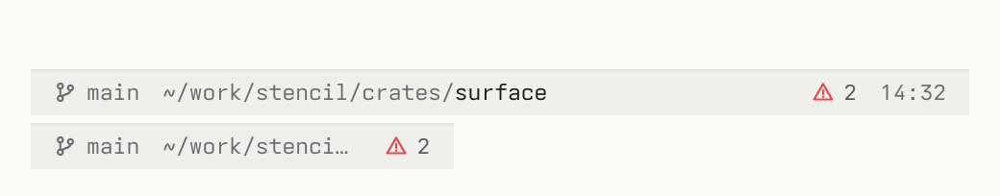
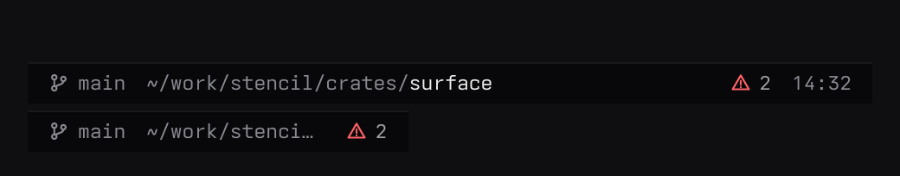
<figcaption>带 <code>errors = 2</code> 的条带，其下方是把同一条带限制为 dock 宽度的 45%（<code>max = { w = 0.45 }</code>）：<code>clock</code> 被丢弃，<code>path</code> 被截断。</figcaption>
</figure>

## `toast` 通知 {#toast}

一则转瞬即逝的通知。节点自身的元素为空且隐藏
（`.sf-toast { display: none }`、`aria-hidden`）；Tern 通过 kit 的 toast 层显示通知：
一张 12 px 圆角的玻璃通知，固定在窗口底部居中处（距底部 28 px），宽度随文字而定，
超过 560 px（或窗口宽度减去 32 px）后换行，位于 `<body>` 下而非你的 surface 中。
当 dock 中有内容显示在屏幕上（例如输入区）时，toast 改为升到其上方 12 px 处，
因此绝不会遮住你的输入。在手机上，toast 则改为在顶栏下方落下。它在节点首次绘制时显示，
并在其 `text`、`sub`、`tone` 或 `ttl` 变化时再次显示；其他属性的变化不会重新显示它，
节点滚出长转录再滚回来也不会。整个窗口同一时刻只显示一个 toast，因此新的一条
（你的或 Tern 的）会在原位替换当前这条：接连快速更新的 toast 只改文字，
不会再次播放进入动画。它停留 2.2 s（success）或 5.2 s（info、error），
随后在 260 ms 内淡出；`ttl` 会让它更早消失（在 200 ms 内淡出，启用减少动效时则立即消失）。
移除节点会移除仍在显示的那条 toast，无论它是否已滚出转录区域；之后以同一 id
新增的节点是一条新的 toast：即使属性相同也会显示。

要在处理函数中显示通知而不保留节点，请使用 `cx:toast`（参见
[Host API](../reference/api-host.md)）。

**构建：** `tern.ui.node("toast", { text = "Saved", tone = "success" })`。

| 属性 | 类型 | 默认值 | 含义 |
| --- | --- | --- | --- |
| `text` | string | `""` | 消息内容 |
| `sub` | string | `""` | 其后的等宽详情：只取首行，最多 120 个字符，为空时隐藏 |
| `tone` | string | success | `error` → 错误 toast（警告图标、`--bad` 描边、`role="alert"`）；`info` 或 `accent` → 信息 toast（信息图标、强调色）；其他值 → 成功（勾选图标） |
| `ttl` | number (ms) | none | 在这么多 ms 之后收起（向下取整；负值被忽略）。它只能缩短停留时间；超过 2.2 s / 5.2 s 时 toast 早已消失 |

**子节点：** 无（会被忽略）。

**事件：** 无。

**样式：**

```html
<!-- the node, in your surface -->
<div class="sf sf-toast" data-id="main.saved" data-tone="error" aria-hidden="true"></div>
<!-- what shows, under <body> -->
<div class="toast err" role="alert" aria-live="assertive">
	<svg class="ico" aria-hidden="true">…</svg><span>Save failed</span><span class="mono">disk full</span>
</div>
```

| 目标 | 选择器 |
| --- | --- |
| 节点本身（始终隐藏） | `.sf-toast` |
| 实际显示的通知 | kit 的 `.toast`、`.toast.info`、`.toast.err`（在你的 surface 之外） |

该通知位于你的区域之外，因此作用域为
`[data-surface='plugin.<plugin>.<block>']` 的样式表触及不到它。请把它的外观视为
Tern 的。

```lua
local ui = tern.ui
-- show a toast while state.notice is set; bump state.notice_n to re-show the
-- same text (a new key is a new node, which shows on its first draw)
local main = { ui.text(state.body) }
if state.notice then
	table.insert(main, ui.node("toast", {
		key = "notice" .. state.notice_n,
		text = state.notice,
		sub = state.detail,
		tone = state.failed and "error" or "success",
		ttl = 1500,
	}))
end
return { main = ui.col(main) }
```

当 `state.notice = "Save failed"`、`state.failed = true`、
`state.detail = "disk full: /Users/me/notes"` 时，通知显示在窗口底部：

<figure class="tn-figure">
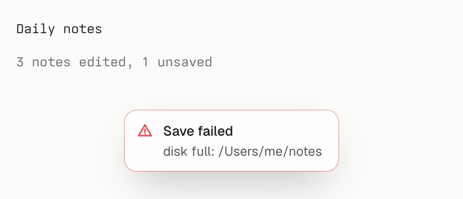
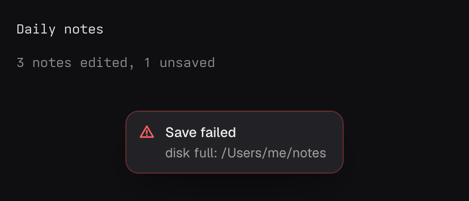
</figure>

## `overlay` 浮层 {#overlay}

`layer` 区域中的一张悬浮玻璃卡片：弹层、选择器、对话框、整页 sheet，或停靠在 layer 某条边缘的 sheet 或抽屉（[sheet 与抽屉](#sheets-and-drawers)）。节点的元素覆盖整个 layer，但让指针穿透；其中放置可选的暗化背景（配合 `modal`）与卡片。卡片有可选的标题行（`head`，含 `icon`、弱化的 `meta` 与 `end` 控件，与 [`card`](layout.md#card) 的 head 一样）、可滚动并容纳子节点的正文，以及可选的底部栏（`foot`），用于放置 sheet 的按钮。它以一次短促的弹出进入（缩放并淡入，220 ms），停靠的卡片则从所在边缘滑入，背景同时淡入；在减少动效下两者都保持静止（`.sf-still`）。

把 overlay 放进视图的 `layer` 中：

```lua
return { main = …, layer = ui.col({ ui.node("overlay", { … }, { … }) }) }
```

**位置（`anchor`）。**

| `anchor` | 类 | 位置 |
| --- | --- | --- |
| 缺失、`"center"`、任何未知值 | `.at-center` | 在 layer 中居中（内边距 12 px） |
| `"top"` | `.at-top` | 水平居中，距顶部 40 px |
| `"bottom"` | `.at-bottom` | 水平居中，距底部 16 px |
| `{ node = id, side = "below" \| "above" }` | `.at-node` | 在节点 `id` 的元素旁，与其左对齐，相距 4 px，位于 `side` 一侧（默认下方） |
| `{ caret = id }` | `.at-caret` | 在 editor/input `id` 的光标下方，较光标左移 10 px，使行内文字与所键入的文字对齐 |
| 任意值，配合 `side = "right"` 或 `"left"` | `.at-side.side-right`、`.side-left` | 停靠到该边缘的整高 sheet，宽度为 `size`（[sheet 与抽屉](#sheets-and-drawers)） |
| 任意值，配合 `side = "bottom"` | `.at-side.side-bottom` | 沿底边的抽屉，占满宽度，高度为 `size`，带抓取条 |

节点锚点与光标锚点在每次更新后重新放置（锚点可能移动）：当卡片在首选一侧放得下，
或该侧的空间不少于另一侧时，就放在首选一侧，否则翻转（最终位于上方时带 `.above`），
并被限制在距 layer 边缘 8 px 以内，空间不足时会获得 `max-height`（其正文滚动）。
锚点未被绘制时，卡片隐藏（`.lost`）；光标锚点所指的节点若不是 `editor` 或 `input`，
即视为未绘制。`id` 是完整的节点 id（`main.draft`）。

**尺寸（`size`）。** `sm` 宽 320 px，`md` 宽 480 px，`lg` 宽 720 px（永远不会宽于
layer），或者 `full`：填满 layer 的 sheet，内缩 8 px，圆角为 `--r-panel`。默认值：
节点锚点与光标锚点为 `sm`，其他情况为 `md`。未知值回退到默认值。在停靠的 overlay 上，
`size` 是 sheet 的宽度或抽屉的高度，也可以是 layer 的比例
（参见 [sheet 与抽屉](#sheets-and-drawers)）。

**覆盖视图。** 当 layer 中存在 `modal` 或 `full` 的 overlay（或一个 `picker`）时，
Tern 会给 `main` 与 `dock` 区域加上 `.sf-covered`：其下所有动画暂停
（`animation-play-state: paused`），使暗化与模糊之下的背景保持渲染时的样子。
sheet 消失时该类也随之移除。

**按键。** overlay 从不接管键盘。按键仍然送往你 block 的 `key` 处理器，因此要按你自己的状态分流（状态中存在打开的对话框，就意味着 ↑/↓/Enter/Escape 作用于它）。`modal` 的背景会接管指针：点击它不会到达下方任何东西，也不发送事件，因此请用 Escape 或卡片内部的按钮关闭 overlay。omp 的只读面板 sheet（`role` 为 `omp.overlay.report`、`.context`、`.usage`、`.sessionInfo`、`.jobs`、`.hotkeys`、`.btwHistory`、`.spotlight`）是例外：在其背景上按下会向程序键入 Escape，从而将其关闭，正如点击 Tern 自身弹层之外的区域那样。

**构建：** `tern.ui.node("overlay", { head = …, anchor = …, size = …, modal = … }, children)`。

| 属性 | 类型 | 默认值 | 含义 |
| --- | --- | --- | --- |
| `anchor` | `"center"`、`"top"`、`"bottom"`、`{node, side?}`、`{caret}` | `"center"` | 放置位置，见上 |
| `side` | `"right"`、`"left"`、`"bottom"` | none | 把卡片停靠到 layer 的该边缘：整高 sheet（`right`、`left`）或抽屉（`bottom`）。优先于 `anchor`；其他值不停靠到任何位置 |
| `variant` | `"edge"`、`"inset"` | `"edge"` | 配合 `side`：与边缘齐平，或浮离边缘 8 px 并带圆角。没有 `side` 时忽略；未知值按 `edge` 处理 |
| `size` | `"sm"`、`"md"`、`"lg"`、`"full"`，或 (0, 1] 中的数字 | 锚定时为 `sm`，否则为 `md` | 卡片宽度或整页 sheet。配合 `side` 时：sheet 的宽度或抽屉的高度，`"full"` 按 `md` 处理；数字为 layer 的比例，仅在带 `side` 时生效 |
| `modal` | boolean | `false` | 暗化背景（`--dim`）接管指针；`aria-modal="true"`；覆盖 `main`/`dock` |
| `head` | text（字符串或 spans） | none | 标题行；空文本或纯空白表示没有标题行（`.nohead`） |
| `icon` | 图标名称 | none | 标题前 16px 的 `--t3` 图标；优先于 omp role 隐含的图标 |
| `meta` | text（字符串或 spans） | none | 标题后的弱化文字 |
| `end` | 某个子节点的 id | none | 该子节点改为绘制在标题行右端，而不是正文中：一个关闭或设置 `button`、一组分段 `tabs` |
| `foot` | 某个子节点的 id | none | 该子节点绘制在正文下方的底部栏中：sheet 的操作按钮，一个由 `button` 组成的 `row`，主要的那个放最后 |
| `aria` | string | `head` 的文本 | 卡片的无障碍名称（卡片上的 `aria-label`；作为通用属性时也会标注该节点） |

`omp.overlay.<name>` 形式的 `role` 会为 omp 的面板 sheet 添加标题图标；
其他 role 不显示图标，除非你提供了 `icon`。与在 card 上一样，`end` 是 Luau 的关键字
（写作 `["end"] = …`），而各 SDK 接受节点作为 `end` 与 `foot`，并把它作为键为
`end` 或 `foot` 的子节点加入。

**sheet 度量。** 居中、top、bottom、full 或停靠的 overlay 都是 sheet：其标题行至少
52 px 高，`padding: 0 18px`，标题为 `550 14px/1.3` 的无衬线字体，字距 `-0.012em`，
正文为列布局，间距 16 px，`padding: 16px 18px`。锚定到节点或光标的 overlay
是弹层，保持紧凑的度量：正文为列布局，间距 4 px，内边距 4 px。底部栏（卡片上的
`foot` 类）贴在卡片底边、滚动正文之下：`padding: 9px 12px`，顶部一条 `--l1`
细线，对其下方滚动的内容做磨砂处理，并带卡片的底部圆角。omp 自身的 overlay
保持其原有外观。

**子节点：** 按顺序绘制在卡片的正文中，`end` 与 `foot` 子节点除外。卡片内的 `list`
使用弹层行的外观。

**事件：** 自身没有事件；子节点发送自己的事件（`select`、`activate`、`action` 等），
`actions` 与任何节点上的用法相同。

**样式：**

```html
<div class="sf sf-overlay sz-sm at-center modal" data-id="layer.confirm" data-role="notes.confirm">
	<div class="sf-ov-dim" aria-hidden="true"></div>
	<div class="sf-ov-card" role="dialog" aria-modal="true" aria-label="Delete 3 notes?">
		<div class="sf-ov-head">
			<span class="sf-ov-ic sf-hidden" aria-hidden="true"></span>
			<span class="sf-ov-title">Delete 3 notes?</span>
			<span class="sf-ov-meta"><!-- meta spans --></span>
			<div class="sf-ov-end"><!-- the end child --></div>
		</div>
		<div class="sf-ov-body">…children…</div>
		<div class="sf-ov-foot"><!-- the foot child --></div>
	</div>
</div>
```

| 目标 | 选择器 |
| --- | --- |
| 节点本身（覆盖 layer） | `.sf-overlay` |
| 锚点 | `.sf-overlay.at-center`、`.at-top`、`.at-bottom`、`.at-node`、`.at-caret` |
| 尺寸 | `.sf-overlay.sz-sm`、`.sz-md`、`.sz-lg`、`.sz-full`；比例为数字时没有类 |
| 停靠的 overlay 及其边缘 | `.sf-overlay.at-side`、`.side-right`、`.side-left`、`.side-bottom` |
| 内缩（停靠时） | `.sf-overlay.inset` |
| 模态 | `.sf-overlay.modal` |
| 背景 | `.sf-ov-dim`（内部，可能变化） |
| 卡片 | `.sf-ov-card`（内部，可能变化） |
| 卡片翻转到锚点上方 | `.sf-ov-card.above` |
| 卡片隐藏、锚点不在 | `.sf-ov-card.lost` |
| 无标题的卡片 | `.sf-ov-card.nohead` |
| 带底部栏的卡片 | `.sf-ov-card.foot` |
| 标题行 | `.sf-ov-head`、`.sf-ov-ic`、`.sf-ov-title`、`.sf-ov-meta`、`.sf-ov-end`（内部，可能变化） |
| 正文 | `.sf-ov-body`（内部，可能变化） |
| 底部栏 | `.sf-ov-foot`（内部，可能变化） |
| 抽屉的抓取条 | `.sf-overlay.side-bottom > .sf-ov-card::before`（内部，可能变化） |
| sheet 之下的区域 | `.sf-main.sf-covered`、`.sf-dock.sf-covered` |

卡片使用玻璃配方：12 px 圆角，`--pop-bg` 配
`backdrop-filter: blur(32px) saturate(190%)`，`--l2` 描边，`--glass-hi`
顶部高光，`::after` 的边缘光，以及在 `[data-theme='dark']` 下更深的阴影。
背景为 `--dim`。停靠卡片的宽度（sheet）或高度（抽屉）由 `--ov-size` 决定，
该变量由尺寸类设置在 `.sf-overlay.at-side` 上，或以比例形式设置在卡片上。参见
[变量](../styles/variables.md)。

一个由按键驱动的确认对话框，按钮放在底部栏，各自标出执行相同动作的按键：

```lua
local ui = tern.ui

local function view(state)
	local layer
	if state.confirm then
		layer = ui.col({
			ui.node("overlay", {
				key = "confirm",
				icon = "trash",
				head = { ui.span("Delete " .. #state.marked .. " notes?") },
				size = "sm",
				modal = true,
				foot = "layer.confirm.foot",
			}, {
				ui.text({ ui.span("This can't be undone.", "muted") }),
				ui.node("row", { key = "foot", gap = "sm", justify = "end" }, {
					ui.button("Cancel", { variant = "quiet", keys = { "esc" }, actions = { click = "cancel" } }),
					ui.button("Delete", { variant = "danger", keys = { "enter" }, actions = { click = "delete" } }),
				}),
			}),
		})
	end
	return { main = ui.col({ … }), layer = layer }
end

local function key(state, k)
	if not state.confirm then return false end
	if k.name == "escape" then state.confirm = false
	elseif k.name == "enter" then delete_marked(state); state.confirm = false
	else return false end
	return true
end
```

<figure class="tn-figure">
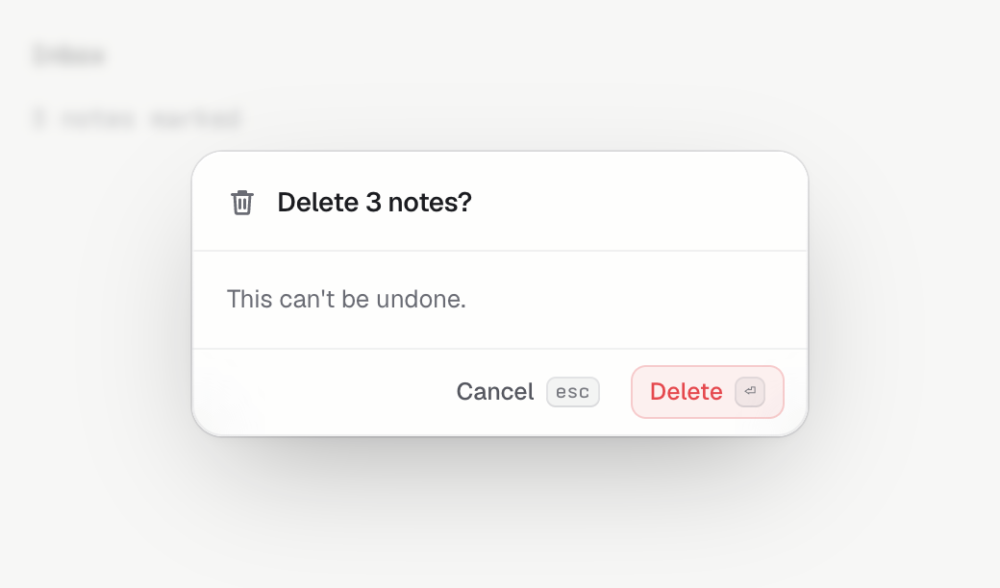
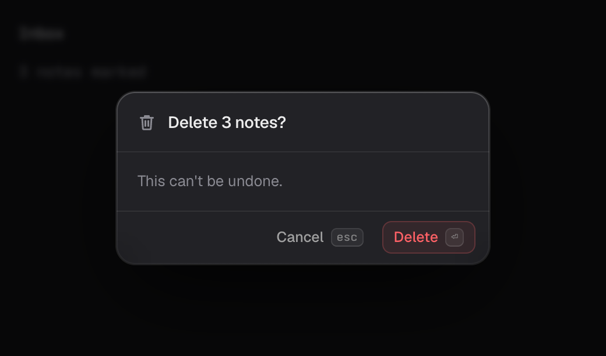
<figcaption>一个 <code>modal</code>、<code>sm</code> 的 overlay，带 <code>head</code>、<code>icon</code> 与 <code>foot</code>：背景压暗其下的视图。</figcaption>
</figure>

一个补全弹层，位于 dock 中键为 `draft` 的编辑器（`dock.draft`）的光标处。
没有 `size` 即为 `sm`；没有 `head`，因此卡片就只有这份列表：

```lua
layer = ui.col({
	ui.node("overlay", { key = "complete", anchor = { caret = "dock.draft" } }, {
		ui.node("list", { key = "items", selected = "layer.complete.items.review" }, {
			ui.node("item", { key = "review", label = "/review", detail = "review the working tree" }),
			ui.node("item", { key = "revert", label = "/revert", detail = "undo the last edit" }),
			ui.node("item", { key = "rename", label = "/rename", detail = "rename the session" }),
		}),
	}),
})
```

<figure class="tn-figure">
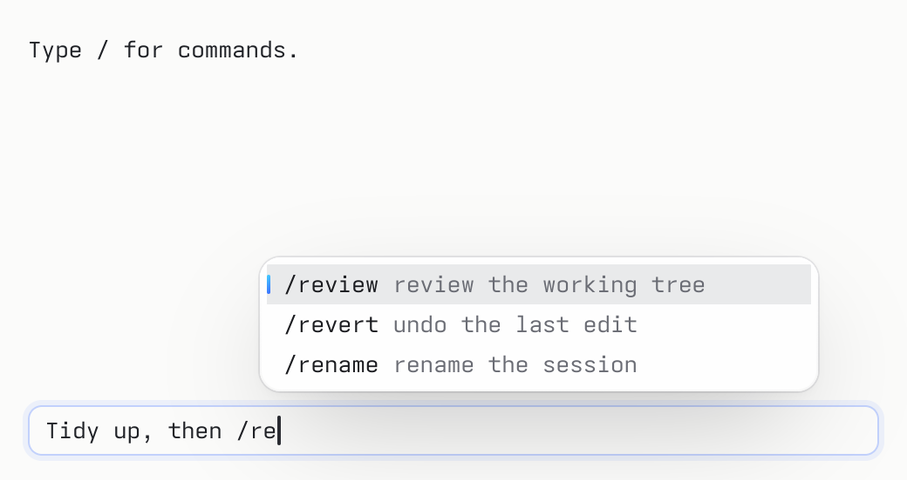
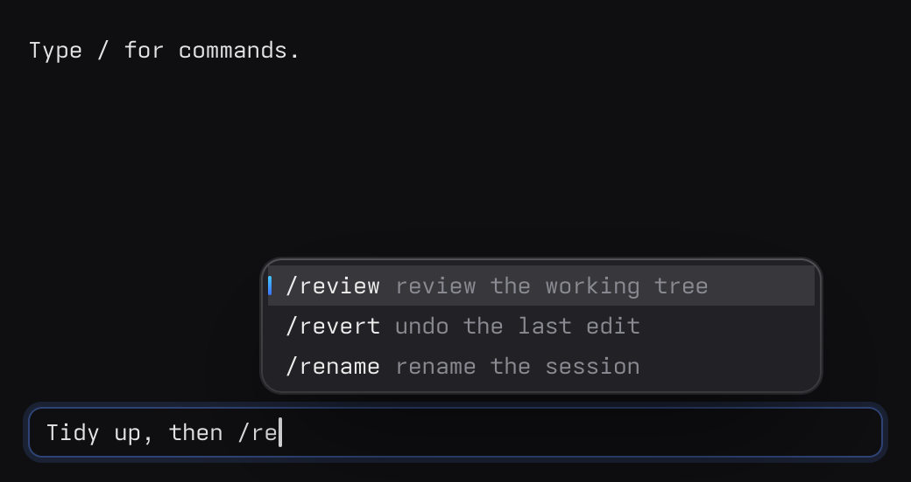
<figcaption>dock 的编辑器上方比下方空间更多，因此卡片翻转到光标上方（<code>.above</code>）。</figcaption>
</figure>

`list` 与 `item` 参见[列表](lists.md)，编辑器参见[文本输入](input.md)，把样式表限定到
你的 block 参见[视图样式](../styles/index.md)。

### sheet 与抽屉 {#sheets-and-drawers}

`side` 把 overlay 停靠到 layer 的某条边缘，而不是让它悬浮。`right` 或 `left` 的
**sheet** 是整高的面板：顶部是带标题与 `end` 控件的 head，正文在其下滚动，
`foot` 栏在底部。检查器、大纲，或属于所描述内容旁边的设置适合用它，这样视图始终
在视野内。`bottom` 的**抽屉**附着在底边，顶部圆角并带抓取条：日志、终端、预览，
或从下方升起的简短确认。overlay 的其他方面保持不变：`head`、`icon`、`meta`、
`end`、`foot`、`modal` 与 `aria` 的用法与居中 sheet 相同，标题行与正文也采用
sheet 的度量。

卡片从所在边缘滑入（320 ms，`--out`）；配合 `modal` 时，背景在其下方淡入、压暗
视图并接管指针。没有 `modal` 时，layer 的其余部分让指针穿透，因此 sheet 旁的视图
仍然可用。在减少动效下两者都保持静止（`.sf-still`）。

`variant` 决定外观：

| `variant` | 类 | 外观 |
| --- | --- | --- |
| `"edge"`（默认） | 无 | 与边缘齐平：sheet 为直角，抽屉为 `--r-panel` 顶部圆角，开放侧一条 `--l2` 细线，并向内容投下柔和阴影 |
| `"inset"` | `.inset` | 距每条停靠边缘 8 px，四角均为 `--r-panel`（16 px），带 overlay 的描边、边缘光与阴影。内缩的抽屉保留其抓取条 |

`side` 优先于 `anchor`；未知的 `side` 不停靠到任何位置，`anchor` 照旧放置卡片。
去掉 `side`，卡片就回到其锚点。

**尺寸。** 在 sheet 上 `size` 是宽度，在抽屉上是高度：一个名称，或 layer 的比例。

| `size` | sheet（`left`、`right`）的宽度 | 抽屉（`bottom`）的高度 |
| --- | --- | --- |
| `"sm"` | 320 px | layer 高度的 33 % |
| `"md"`（默认） | 400 px | layer 高度的 50 % |
| `"lg"` | 560 px | layer 高度的 75 % |
| 介于 0 与 1 之间（含 1）的数字 | layer 宽度的该比例 | layer 高度的该比例 |

sheet 永远不会宽于 layer。`"full"`、`0`、大于 1 的数字以及未知值都按 `"md"` 处理。

**按键。** 与所有 overlay 一样：它从不接管键盘。把打开的 sheet 或抽屉保存在你的
状态中，用 Escape 或其关闭按钮（一个 `end` 子节点）关闭它，并通过属性驱动其内容。
其子节点像在任何 overlay 中一样发送自己的事件。

针对所选服务的检查器 sheet，以及一个日志抽屉：

```lua
local ui = tern.ui

local function view(state)
	local layer
	if state.inspecting then
		local svc = state.inspecting
		layer = ui.col({
			ui.node("overlay", {
				key = "inspect",
				side = "right",
				modal = true,
				head = "Inspector",
				["end"] = "layer.inspect.close",
				foot = "layer.inspect.foot",
			}, {
				ui.button("", { key = "close", icon = "x", size = "sm", variant = "quiet", title = "Close", actions = { click = "close" } }),
				ui.kv({ { "service", svc.name }, { "image", svc.image }, { "replicas", tostring(svc.replicas) } }),
				ui.node("row", { key = "foot", gap = "sm", justify = "end" }, {
					ui.button("Cancel", { variant = "quiet", keys = { "esc" }, actions = { click = "close" } }),
					ui.button("Apply", { variant = "primary", keys = { "enter" }, actions = { click = "apply" } }),
				}),
			}),
		})
	elseif state.logs then
		layer = ui.col({
			ui.node("overlay", {
				key = "logs",
				side = "bottom",
				size = 0.55,
				icon = "terminal",
				head = "Logs",
				meta = state.logs.service,
				["end"] = "layer.logs.close",
			}, {
				ui.button("", { key = "close", icon = "x", size = "sm", variant = "quiet", title = "Close", actions = { click = "close" } }),
				ui.node("ansi", { text = state.logs.text }),
			}),
		})
	end
	return { main = ui.col({ … }), layer = layer }
end
```

TSX 中写法相同，其中 `end` 与 `foot` 接受节点：

```tsx
function Layer({ s }: { s: State }) {
   if (s.inspecting)
      return (
         <overlay key="inspect" side="right" modal head="Inspector"
            end={<button icon="x" size="sm" variant="quiet" title="Close" onClick={close} />}
            foot={
               <row gap="sm" justify="end">
                  <button variant="quiet" keys={['esc']} onClick={close}>Cancel</button>
                  <button variant="primary" keys={['enter']} onClick={apply}>Apply</button>
               </row>
            }>
            <kv items={[{ k: 'service', v: s.inspecting.name }, { k: 'replicas', v: String(s.inspecting.replicas) }]} />
         </overlay>
      );
   if (s.logs)
      return (
         <overlay key="logs" side="bottom" size={0.55} icon="terminal" head="Logs" meta={s.logs.service}
            end={<button icon="x" size="sm" variant="quiet" title="Close" onClick={close} />}>
            <ansi text={s.logs.text} />
         </overlay>
      );
   return null;
}
```

<figure class="tn-figure">
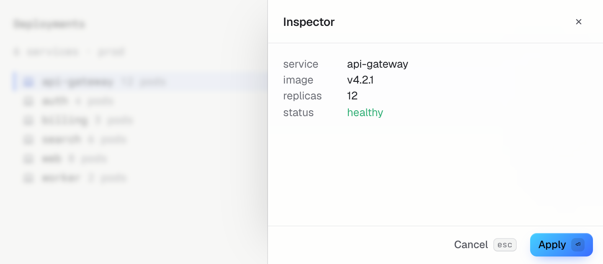
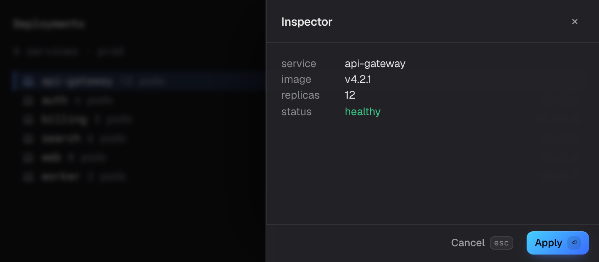
<figcaption>带 <code>side: "right"</code> 的 <code>modal</code> sheet：与边缘齐平，按钮位于 <code>foot</code> 中。</figcaption>
</figure>

<figure class="tn-figure">
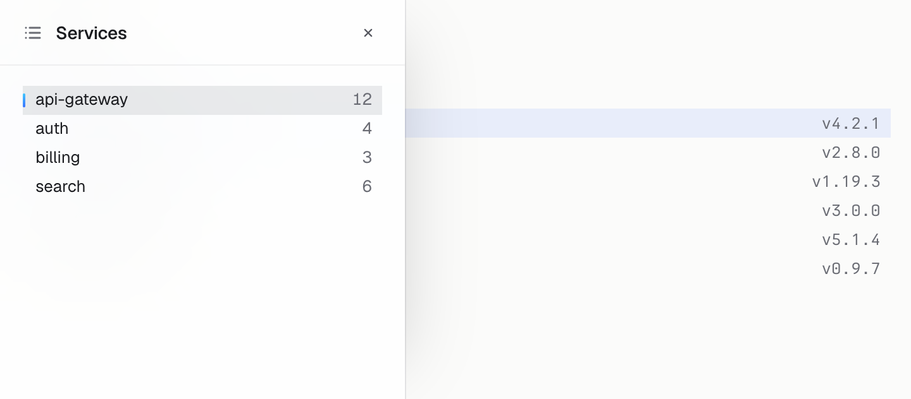
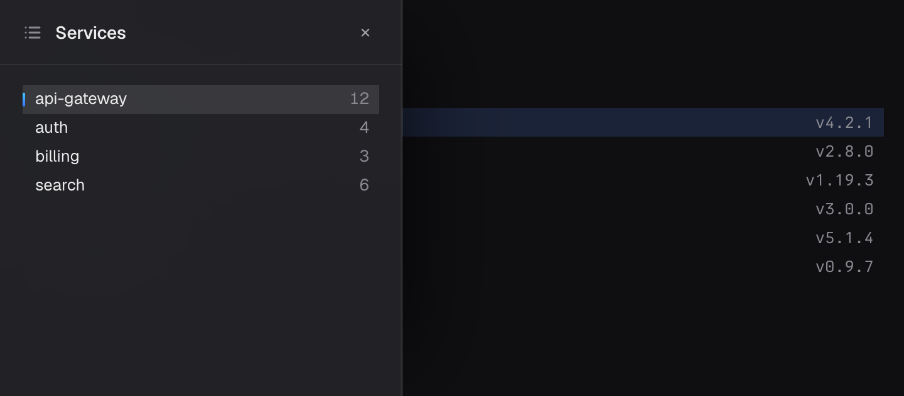
<figcaption><code>side: "left"</code>、<code>size: "sm"</code>，非模态：其旁的视图仍可使用指针。</figcaption>
</figure>

<figure class="tn-figure">
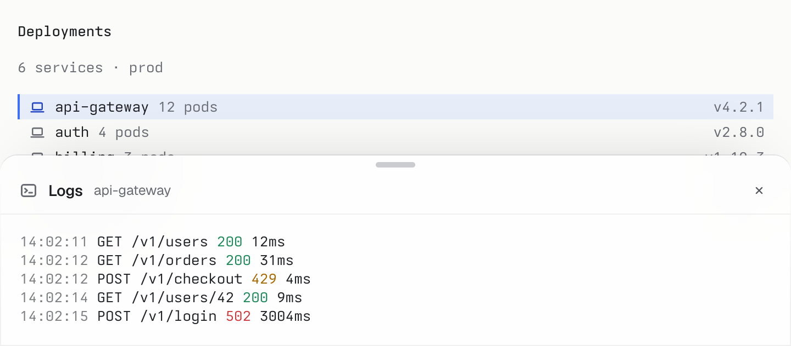
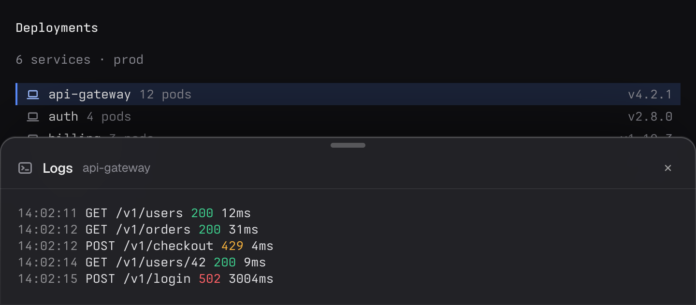
<figcaption>一个抽屉：<code>side: "bottom"</code> 配 <code>size: 0.55</code>，即 layer 高度的 55 %。</figcaption>
</figure>

<figure class="tn-figure">
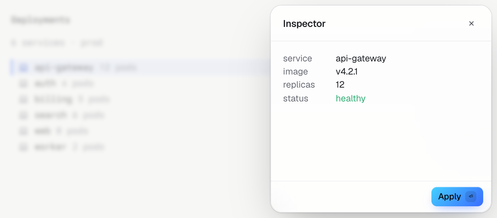
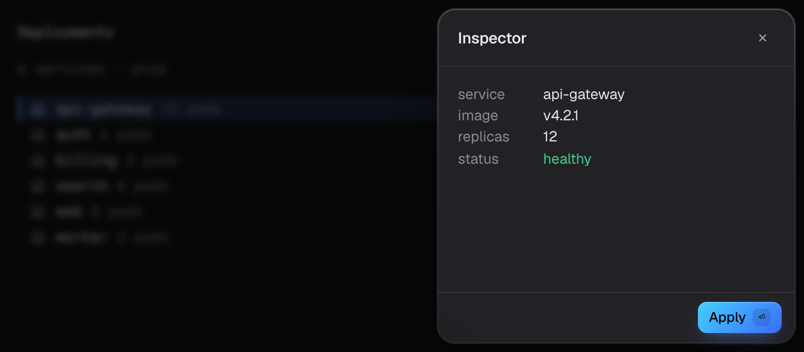
<figcaption>右侧 sheet 上的 <code>variant: "inset"</code>：它浮离边缘，带 overlay 的边缘光与阴影。</figcaption>
</figure>

<figure class="tn-figure">
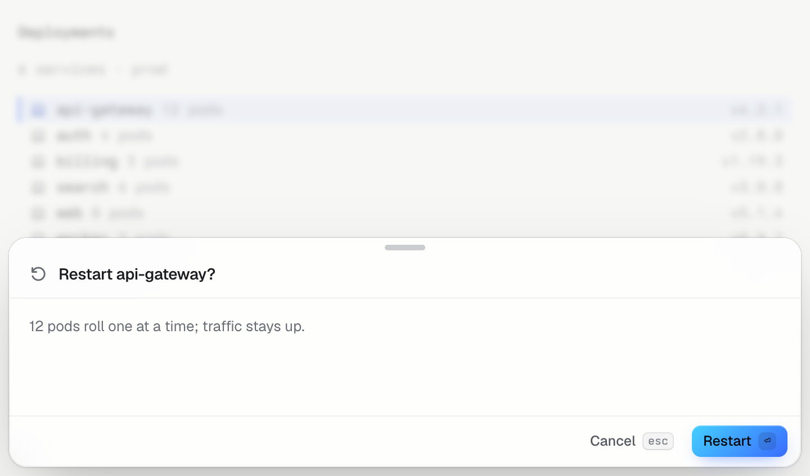
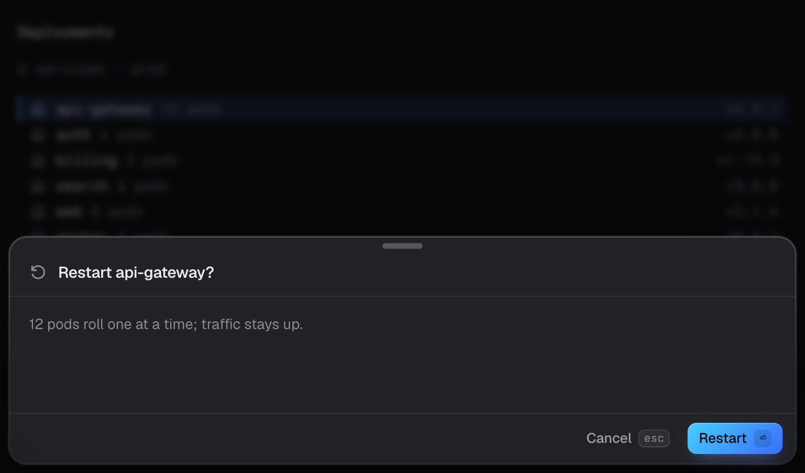
<figcaption>一个内缩的 <code>modal</code> 抽屉：从下方升起的确认框。</figcaption>
</figure>

停靠 overlay 的标记就是 overlay 自身的标记，只是边缘类在节点上：

```html
<div class="sf sf-overlay sz-md at-side side-right modal" data-id="layer.inspect">
	<div class="sf-ov-dim" aria-hidden="true"></div>
	<div class="sf-ov-card foot" role="dialog" aria-modal="true" aria-label="Inspector">
		<div class="sf-ov-head">…</div>
		<div class="sf-ov-body">…children…</div>
		<div class="sf-ov-foot"><!-- the foot child --></div>
	</div>
</div>
```
