# 数据 {#data}

数据类节点用于展示结构化取值：键值对、头条数字、表格、展开树，以及嵌在其中的小型行内芯片（徽标、键帽、图标、头像、图片）、可左右翻动的幻灯片，还有文件：在 Tern 的媒体查看器中打开，或作为附件呈现。需要少量带标签的取值时用 `kv`，视图所关注的那几个数字用 `stats`，共享列的行用 `table`（可用 `selectable` 选中、可排序、用 `multi` 一次选中多行），用户可展开与收起的嵌套项用 `tree`，把原始 JSON 取值显示为可折叠树用 `json`，在行、卡片与标题里用 `badge`、`kbd`、`icon`，表示“某件事是谁做的”用 `avatar` 与 `avatars`，用户要翻阅的少量图片用 `carousel`，按路径显示磁盘上的文件（或其某个 git 修订版）用 `media`，消息携带的、或编辑器即将发出的文件用 `attachment`。

| 类型 | 构建方式 | 绘制内容 |
| --- | --- | --- |
| [`kv`](#kv) | `tern.ui.kv(items)` | 对齐的键/值网格，或一行行内 `k v · k v` |
| [`stats`](#stats) | `tern.ui.stats(items)` | 一条扁平的数据瓦片带：标签、大号数值、副行 |
| [`table`](#table) | `tern.ui.table(cols, rows)` | 列网格，窄时隐藏低优先级列；表头可排序；行可选中或用多选，并带选择栏；支持文本、徽标、按钮、迷你折线与进度条单元格 |
| [`tree`](#tree) | `tern.ui.tree(nodes)` | 带引导线与翻转箭头的展开树 |
| [`json`](#json) | `tern.ui.node("json", { value = … })` | 把 JSON 取值画成带单行预览的可折叠树 |
| [`badge`](#badge) | `tern.ui.badge(text, tone)` | 按色调着色的胶囊 |
| [`kbd`](#kbd) | `tern.ui.node("kbd", { keys = … })` | 带平台字形的键帽（`⌃` `⇧` `⏎`） |
| [`icon`](#icon) | `tern.ui.node("icon", { name = … })` | Tern 图标集中的单个图标 |
| [`avatar`](#avatar) | `tern.ui.node("avatar", { text = … })` | 个人、机器人或提供方的标记：种子渐变上的姓名首字母、着色的圆角方块、图标或图片，并带状态点 |
| [`avatars`](#avatars) | `tern.ui.node("avatars", { items = … })` | 相互叠放的头像堆，带 `+N` 溢出芯片与弱化标签 |
| [`image`](#image) | `tern.ui.node("image", { blob = … })` | PNG、JPEG、GIF、WebP 或 SVG 图片（动画会播放），子节点绘制在图片之上；点击可缩放 |
| [`carousel`](#carousel) | `tern.ui.node("carousel", props, slides)` | 横向滑动的轨道上的幻灯片：预览与计数、箭头与圆点，或胶片条 |
| [`media`](#media) | `tern.ui.node("media", { path = … })` | 按路径（或其 git 修订版）在 Tern 的媒体查看器中显示文件：图片与 SVG、3D 模型、PDF、视频、音频 |
| [`attachment`](#attachment) | `tern.ui.node("attachment", { name = … })` | 文件芯片、缩略图瓦片或编辑器胶囊，带上传进度、错误与操作 |

每种类型还都接受公共属性（`id`、`role`、`tone`、`actions`、`min`/`max` 等）：参见
[元素](index.md)。每个节点都是 `<tag class="sf sf-<kind>" data-id="<id>">`。稳定的样式钩子是
`.sf-<kind>`、`[data-id]`、`[data-role]`、`[data-tone]`，以及所在区域的 `[data-surface]`。下文列出的
内部类（`.sf-kv-k`、`.sf-tbl-c` 等）属于 Tern 的内部结构：它们被记录下来是为了让你能为其设置样式，但它们
是内部实现，版本之间可能变化。样式表与层叠规则参见[视图样式](../styles/index.md)。

除 `image`（子节点绘制在图片之上）与 `carousel`（子节点即其幻灯片）之外，这些类型都不绘制子节点：
`kv`、`stats`、`table`、`tree`、`json`、`badge`、`kbd`、`icon`、`avatar`、`avatars`、`media`
或 `attachment` 的子节点会被忽略。

## `kv` 键值对 {#kv}

一组键/值对。默认的 `grid` 布局是两列网格：键使用弱化的 `--t3` 颜色，不换行；
值可在任意处换行（`white-space: pre-wrap`）。键列的宽度等于源数据中最宽的键，以
终端单元格计（中文、日文或韩文等宽字符算两个；在
[sans 区域](../protocol/surfaces.md#open-and-close)中，则以绘制出来的最宽键为准），因此即使长列表只挂载了
一部分，各行的值也依然对齐。`inline` 布局把每一对都放在同一条换行线上，写作 `key value · key value`，
而单对内部不换行。

键与值都是 span：一个字符串，或带样式 token 的 span 列表（参见[文本](text.md)）。

长列表的 `grid` 布局 `kv` 只挂载可视位置附近的对；未挂载的对在滚动高度中仍保留自己的位置。文本变化时，
各对就地打补丁更新。复制整个视图仍会取到每一对。

**构建方式：** `tern.ui.kv(items)`（参见 [UI 构建器](../reference/ui.md#kv)），或
`tern.ui.node("kv", { items = { { k = …, v = … } }, layout = "inline" })`。构建器没有 `layout` 参数：
在其结果上设置 `node.p.layout = "inline"`，或改用 `tern.ui.node`。

| 属性 | 类型 | 默认值 | 含义 |
| --- | --- | --- | --- |
| `items` | `{ { k: Spans, v: Spans } }` | `{}` | 各对，按顺序。位置即身份：对没有 id |
| `layout` | `"grid"` \| `"inline"` | `"grid"` | `"inline"` 绘制一条换行线；其他任何值都按网格处理 |

**子节点：** 无（会被忽略）。

**事件：** 自身不产生事件；`actions` 的用法与任何节点相同。

**样式：**

```html
<div class="sf sf-kv" data-id="…">            <!-- .inline with layout = "inline" -->
	<div class="sf-kv-item first">
		<span class="sf-kv-sep" aria-hidden="true">·</span>
		<div class="sf-kv-k">context</div>
		<div class="sf-kv-v">prod</div>
	</div>
	<div class="sf-kv-item">…</div>
</div>
```

| 目标 | 选择器 |
| --- | --- |
| 节点本身 | `.sf-kv` |
| 行内布局 | `.sf-kv.inline` |
| 一对 | `.sf-kv-item`（内部；网格中为占据 `.sf-kv` 各列的一行） |
| 第一对 | `.sf-kv-item.first`（内部；其分隔符被隐藏） |
| 键 | `.sf-kv-k`（内部，可能变化） |
| 值 | `.sf-kv-v`（内部，可能变化） |
| 行内各对之间的 `·` | `.sf-kv-sep`（内部；在网格中为 `display: none`） |

网格设置 `column-gap: 14px` 与 `row-gap: 1px`。在 transcript 里 Tern 会内联写入 `grid-template-columns`
（最宽键的 px 值，然后 `minmax(0, 1fr)`），因此要改动键列的样式表需要用 `!important`，或改用不同的
`column-gap`。键使用 `--t3`，行内分隔符使用 `--t4`（参见[变量](../styles/variables.md)）。

```lua
local ui = tern.ui

return ui.kv({
	{ "context", ui.span("prod", "error strong") },
	{ "namespace", "default" },
	{ "pods", ui.span("12 running", "success") },
})
```

一行行内摘要：

```lua
local line = ui.kv({ { "branch", "main" }, { "ahead", "2" }, { "dirty", "yes" } })
line.p.layout = "inline"
return line
```

<figure class="tn-figure">
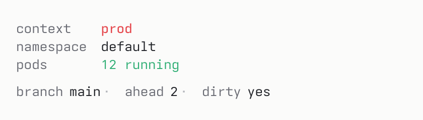
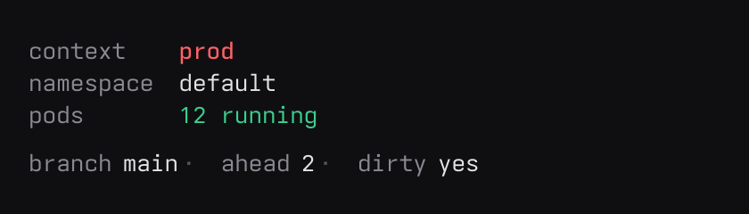
<figcaption>上为网格布局，下为行内布局。</figcaption>
</figure>

## `stats` 统计瓦片 {#stats}

一条扁平的数据瓦片带：页面上所关注的那几个数字，每个都在大号数值上方有一个小标签，下方可选一行副行。
这条带本身没有外框：它绘制在承载它的东西上，因此永远不会显得像卡片里套卡片。各瓦片从一开始就并排，
各自按自己的宽度排布（14 个字符到 280px），彼此之间以细线分隔；容不下时它们会换到更多行，而不是被挤压。
把它直接放在页面上、紧接标题行下方，最多四个瓦片，绝不要放进卡片里
（[设计视图](../guides/design.md#page-structure)）；要展示更多取值时用 [`kv`](#kv) 或 [`table`](#table)。

**构建方式：** `tern.ui.stats(items)`（参见 [UI 构建器](../reference/ui.md#stats)），或
`tern.ui.node("stats", { items = { { label = …, value = … } } })`。

| 属性 | 类型 | 默认值 | 含义 |
| --- | --- | --- | --- |
| `items` | `{ Stat }` | `{}` | 各瓦片，按顺序。位置即身份：瓦片没有 id |

`Stat` 字段：

| 字段 | 类型 | 默认值 | 含义 |
| --- | --- | --- | --- |
| `label` | Spans | `""` | 这个数字是什么（`Error rate`） |
| `value` | Spans | `""` | 数字及其单位（`0.42%`、`182 ms`） |
| `sub` | Spans | 无 | 数值下方的一行：对比值或时间窗口（`last 15 min`、`2 degraded`） |
| `tone` | tone | 无 | 用该色调的颜色（`--tc`）给数值上色，用于需要留意的值 |
| `title` | string | 无 | 该瓦片的工具提示 |

**子节点：** 无（会被忽略）。

**事件：** 自身不产生事件；`actions` 的用法与任何节点相同（作用于整条带）。

复制视图时，各瓦片写在同一行，每个都是 `label: value (sub)`，之间用 `  ·  ` 连接。

**样式：**

```html
<div class="sf sf-stats" data-id="main.overview" role="list">
	<div class="sf-stat" data-tone="warning" role="listitem" title="…">
		<div class="sf-stat-label">Error rate</div>
		<div class="sf-stat-value">0.42%</div>
		<div class="sf-stat-sub">last 15 min</div>   <!-- only with a sub -->
	</div>
	<div class="sf-stat" role="listitem">…</div>
</div>
```

| 目标 | 选择器 |
| --- | --- |
| 节点本身（整条带） | `.sf-stats` |
| 单个瓦片 | `.sf-stat`（内部，可能变化） |
| 标签 / 数值 / 副行 | `.sf-stat-label`、`.sf-stat-value`、`.sf-stat-sub`（内部，可能变化） |
| 带色调的瓦片 | `.sf-stat[data-tone]`（内部；其数值使用 `--tc`） |

这条带是一个可换行的 flex 行，无内边距、无背景、无描边，换行后的各行之间为 `12px`。瓦片为
`min-width: 14ch`、`max-width: 280px`、`padding: 0 28px 0 16px`，左侧带 `--l2` 细线。整条带
向左多出 17px（`margin-left: -17px`）并把这部分裁掉（`clip-path`），使每行的第一个瓦片与上方的文字对齐，
且不带细线。标签与副行为 `12px/16px` sans、`--t3` 色（标签字重 500），超出时以省略号截断；数值为
`550 22px/30px` sans、`--t1` 色，使用等宽数字与 `-0.02em` 字距。

```lua
local ui = tern.ui

return ui.stats({
	{ label = "Services", value = "24", sub = "2 degraded" },
	{ label = "Error rate", value = "0.42%", tone = "warning", sub = "last 15 min" },
	{ label = "p95 latency", value = "182 ms" },
	{ label = "Deploys today", value = "7", sub = "1 rolled back" },
})
```

<figure class="tn-figure">
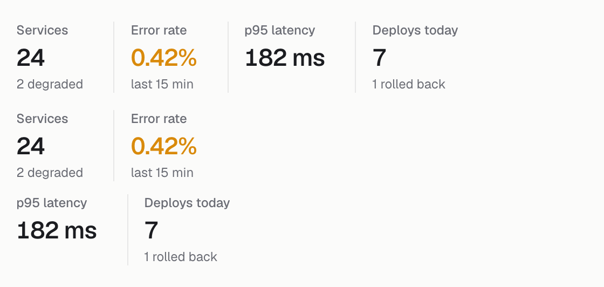
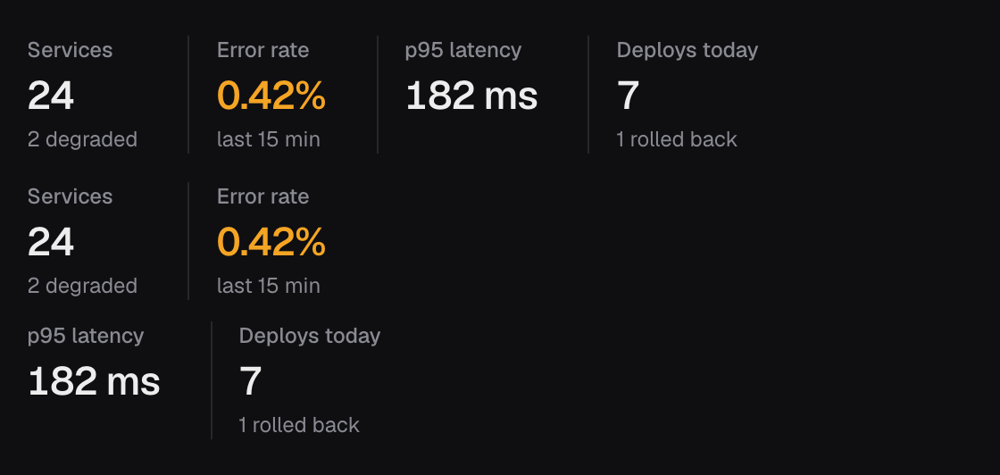
<figcaption>这条带在 560px 与 300px 下的样子：容不下的瓦片换到第二行。</figcaption>
</figure>

## `table` 表格 {#table}

带列名的行网格，顶部是小号 sans 表头，行与行之间以细线分隔。行以 `id` 为键，
因此单元格发生变化的行会就地打补丁更新，其余行保持挂载。加上 `selectable` 后行可被选中，
如同原生应用中的表格；表头可排序，加上 `multi` 后用户可以一次选中多行再统一操作；单元格
可容纳带状态点或图标的文本、徽标、小按钮、迷你折线或进度条。单元格按所在区域的
字体绘制：在 [`font: "sans"`](../protocol/surfaces.md#open-and-close) 区域中使用 sans，但标记为 `mono` 的列除外。

**列宽计算。** Tern 测量每列的自然宽度：该列最宽的单元格（按单元格字体的单元格计，中文、日文或韩文等
宽字符算两个；进度条或迷你折线单元格算 8，按钮单元格按其标签加内边距算）加上 14px 的单元格内边距，或
该列表头绘制后的宽度，取两者中更宽者。当各列装不下表格宽度时，列会被隐藏，先隐藏
`priority` 最低的（缺省优先级为 `0`；优先级相同时先隐藏最右侧的），直到其余列装得下或只剩一列。
在此判断中，`grow` 列的宽度最多按 24 个字符计：
较长的 `grow` 列会截断自己的单元格，而不是把其他列挤出去。多余宽度按各 `grow` 列的份额
分配；没有任何 `grow` 列时，表格保持自然宽度。显示的列仍然溢出时，先由 `grow` 列让出宽度（每列最多让到
24 个字符），然后所有列按比例收缩。表格尺寸变化时会重新计算。

**截断。** 单元格永不换行。宽度超过所在列时，按该列的 `truncate` 以省略号截断：
`end` 保留开头（`abcd…`，由 CSS `text-overflow` 实现），`start` 保留结尾（`…wxyz`），`middle` 保留
两端（路径会先丢掉目录）。

**单元格。** 单元格是 span（字符串或 span 列表），或下列表格之一：

| 单元格 | 绘制内容 |
| --- | --- |
| `{ text = …, dot = tone }` | 文本，其前是 6px 的状态点，取该色调的颜色 |
| `{ text = …, icon = name, tone = tone }` | 文本，其前是 12px 图标，取该色调的颜色（无色调时为 `--t3`） |
| `{ badge = { text, tone? } }` | 一个 [`badge`](#badge)，高 18px |
| `{ button = { text, act, … } }` | 一个 `sm` 尺寸的 [`button`](input.md#button) |
| `{ spark = { values, … } }` | 与文本等高的迷你折线，绘制方式同 [`chart`](motion.md#chart) 类型绘制 `spark` |
| `{ meter = { … } }` | 横跨单元格的细条，读取方式同 [`meter`](motion.md#meter) 类型读取同名属性 |

迷你折线与进度条的自然宽度为 8 个单元格，在 `grow` 列中则与列等宽。带 `title` 的单元格
悬停时显示提示。所有内容都适配行的固定高度，因此行永远不会变高。

**可选中行。** 设置 `selectable = true` 后，行会响应指针：悬停时以 `--l1` 着色并显示手形
光标；单击发送 `select`，双击发送 `activate`，两者的 `id` 都是表格的 id，`item` 是该行的 `id`。
选中状态由你掌握：把该行的 id 作为 `selected` 传回，即可让该行以强调色着色并在前缘绘制
2px 的强调色竖条（如同被选中的 [`list`](lists.md#item) 行）。`selected` 变化时，只要表格在屏幕上，
该行就会滚动到可见位置（最近的滚动容器移动）；已滚出视野的表格不受影响，因此在别处设置的选中项
不会把页面拉回它那里。`selected` 也可以在没有 `selectable` 时绘制，用于只靠按键移动的选中项。
带有 `disabled` 的行会淡化到 `--t4` 并且不发送任何内容：没有 `select`，没有 `activate`，也没有菜单。

**排序。** Tern 负责绘制，顺序由程序掌握：Tern 从不自行重排行。给某列设置 `sortable = true`，
并在表格上设置 `sort = { col, dir }`。排序列的表头用强调色绘制箭头，`"desc"` 向下，
`"asc"` 向上；其他可排序表头在悬停时显示淡箭头。单击可排序表头即按其排序：若已按该列排序则反向，
否则按升序。箭头立即翻转，表格发送 `action` `sort`，其 `value = { col, dir }`。请自行排序这些行并把它们
发回，同时把 `sort` 设为你所用的排序。你发送的 `sort` 只有在你上次发送的值发生变化时才胜过用户的点击，
因此某一帧只因别的事变化时，箭头会保持在用户放置的位置。

**多选行。** 当用户要对多行做同一件事时用 `multi`：重启服务、删除
分支、导出运行记录。详情面板展示单行时继续用 `selectable` / `selected`；两者可以组合（
选中的行是光标，被选中的行集合是选集）。设置 `multi = true` 后，单击某行会选中它，若已选中则
取消选中；shift 单击会选中上次单击的行与本次行之间所有可用的行。每次变化都发送
`change`，`value` 为被选中的 id，按选中顺序排列。禁用的行无法通过单击或
表头复选框被选中。选中结果由你掌握，与选中状态一样：`picked` 用于设置它们，且与 `sort` 一样只在你上次发送的值
发生变化时才生效（例如删除之后再发送它）。双击仍会发送 `activate`（其第二次
单击不会改变选中），在同时也是 `selectable` 的表格上，单击会在 `change` 之后发送 `select`。

外观取决于 `variant`：

- `"check"`（默认）：前面是一列复选框，表头的复选框为三态（所有可用行
  都选中时为勾选，部分选中时为横杠，或当 `picked` 持有行中不存在的 id 时），被选中的行以强调色着色。单击
  表头复选框会选中所有可用行，全部选中后再单击则全部取消。
- `"bar"`：没有复选框。被选中的行以强调色着色，并在前缘带 2px 强调色竖条，
  排序列的表头位于强调色胶囊中，该列下方有淡淡的着色。适合由
  键盘驱动的密集表格。

**选择栏。** 有行被选中时，最后一行下方会显示一条栏：“已选择 *N* 项”，接着是 `hint`（弱化文字，位于
一个点之后：你的程序接受的按键）、`bar` 中的按钮，以及末尾带 esc 键帽的 Clear。`bar` 按钮
发送 `action`，携带其 `act` 与 `value`（被选中的 id）；Clear 取消选中所有行并发送 `change`，值为 `{}`。
esc 键帽只是提示：按键会交给你的程序，由它在 Esc 时清空 `picked`。

**行操作。** 单击按钮单元格会发送 `action`，携带其 `act`，并把该行作为 `item`，且不会选中
该行。行的 `menu` 列出右键操作，每个都以同样的方式发送，随后是复制行（该行的单元格，
以制表符分隔）。这些都来自表格节点，因此一个处理函数即可服务所有行。

**时长。** 没有 elapsed 单元格：把时长写成文本（`4m 12s`），并随着它增长重新发送视图；
差分视图只会给发生变化的单元格打补丁。[`elapsed`](motion.md#elapsed) 类型用于表格之外。

**长表格。** 长表格只挂载可视位置附近的行（行有固定的步距：一行文字加 6px，
文字行高取决于区域：sans 区域中为 18px）；未挂载的行在滚动高度中保留自己的位置。复制
整个视图仍会取到每一行。

**空状态。** 没有行时，`empty` 会以弱化色居中显示在表头下方：说明为什么没有内容（“没有
服务匹配此筛选条件”）。

**构建方式：** `tern.ui.table(cols, rows, opts?)`，进度条单元格用 `tern.ui.meter_cell` /
`tern.ui.meter_parts_cell`（参见 [UI 构建器](../reference/ui.md#table)），或 `tern.ui.node("table", { cols = …, rows = … })`。以单元格列表
形式交给构建器的行会得到 id `r0`、`r1`……；若要一个能在重排后保持稳定的 id，请写成 `{ id = …, cells = … }`，
可选中表格需要这样的 id。`opts` 接受 `selectable`、`selected` 与 `empty`；排序和
多选行则要用节点形式。

| 属性 | 类型 | 默认值 | 含义 |
| --- | --- | --- | --- |
| `cols` | `{ Col }` | `{}` | 各列，从左到右。没有 `id` 的条目会被跳过 |
| `rows` | `{ Row }` | `{}` | 各行，从上到下。没有 `id` 的、或 `id` 已被使用的行会被跳过 |
| `selectable` | boolean | `false` | 行响应点击：悬停着色、手形光标、单击发送 `select`、双击发送 `activate` |
| `selected` | string | 无 | 绘制为选中状态的行的 `id`（类名 `sel`，`aria-selected="true"`），表格在屏幕上时其变化会将行带入视野 |
| `empty` | Spans | 无 | 没有行时以弱化色居中显示的内容 |
| `sort` | `{ col: string, dir: "asc" \| "desc" }` | 无 | 行所依据的排序列，并用箭头绘制（`dir` 不为 `"desc"` 时按 `"asc"` 处理）。变化时胜过用户上次的表头点击 |
| `multi` | boolean | `false` | 行可多选：单击切换单个，shift 单击选中一个范围，每次变化都发送 `change` |
| `picked` | `{ string }` | `{}` | 被选中行的 id（配合 `multi`）。行中不存在的 id 会保留并计入。变化时胜过用户的点击 |
| `variant` | `"check"` \| `"bar"` | `"check"` | 选中与排序的外观（见下文）。其他值按 `"check"` 处理 |
| `bar` | `{ BarAction }` | `{}` | 选择栏中的按钮，从左到右 |
| `hint` | Spans | 无 | 选择栏中计数之后的弱化文本，例如程序接受的按键 |

`Col` 字段：

| 字段 | 类型 | 默认值 | 含义 |
| --- | --- | --- | --- |
| `id` | string | 必填 | 该列单元格在每行 `cells` 中的键 |
| `head` | Spans | 无 | 表头文字。仅当某列的 `head` 非空时才存在表头行 |
| `align` | `"start"` \| `"center"` \| `"end"` | `"start"` | 表头与单元格的文字对齐方式；数字用 `"end"`。其他值按 `"start"` 处理 |
| `truncate` | `"end"` \| `"start"` \| `"middle"` | `"end"` | 装不下的单元格在哪里截断 |
| `priority` | number | `0` | 表格过窄时数值越小越先隐藏。`grow` 列给最高值，数字次之，迷你折线与次要列给最低值 |
| `grow` | number | `0` | 多余宽度的份额；`0` 或更小则从不增长。只给一列，即主文本列：给数字、迷你折线、徽标或按钮列时，多余宽度只会留下空隙。在网格（行 × 同类列）中，每个取值列给 `1`，行标签列不给 |
| `mono` | boolean | `false` | 用于 id、哈希、版本、大小、时间：在 sans 区域中单元格以 12.5px 的等宽字体绘制（等宽区域本就是等宽）。无论哪种情况，所有 `"end"` 列都使用等宽数字 |
| `sortable` | boolean | `false` | 其表头响应点击并发送 `action` `sort` |

`Row` 字段：

| 字段 | 类型 | 默认值 | 含义 |
| --- | --- | --- | --- |
| `id` | string | 必填 | 行的身份，在表格内唯一（显示为 `data-key`）；其事件的 `item` |
| `cells` | `{ [colId]: Cell }` | `{}` | 每个列 id 一个单元格：`Spans`、`TextCell`、`BadgeCell`、`ButtonCell`、`SparkCell` 或 `MeterCell`。缺失的单元格为空；不匹配任何列的键会被忽略 |
| `disabled` | boolean 或 string | `false` | 把行淡化到 `--t4`；它不发送任何事件，也没有菜单。字符串为原因，作为该行的工具提示显示，取代 `title` |
| `menu` | `{ string }` | 无 | 该行的右键操作，每个都作为 `action` 发送，并把该行作为 `item`；其后是复制行 |
| `title` | string | 无 | 该行的工具提示 |

`TextCell` 为 `{ text = Spans, dot?, icon?, tone?, title? }`：

| 字段 | 类型 | 默认值 | 含义 |
| --- | --- | --- | --- |
| `text` | Spans | `""` | 单元格的文字 |
| `dot` | tone | 无 | 文本前一个 6px 的点，取该色调的颜色 |
| `icon` | 图标名 | 无 | 文本前一个 12px 的[图标](#icon-names)（取代点） |
| `tone` | tone | 无 | 图标的颜色；无色调时为 `--t3` |
| `title` | string | 无 | 该单元格的工具提示 |

`BadgeCell` 为 `{ badge = { text, tone?, title? } }`：带该文本、色调与工具提示的 [`badge`](#badge)，高 18px。

`ButtonCell` 为 `{ button = { text, act, icon?, keys?, variant?, disabled? } }`：一个 `size = "sm"` 的
[`button`](input.md#button)。`act` 是其单击所发送的操作（未设置时为 `"click"`）；`icon`、`keys`、`variant`
与 `disabled` 的读取方式同 `button` 类型。

`BarAction` 为 `{ act, text?, icon?, keys?, variant?, disabled?, title? }`：选择栏中一个 `size = "sm"` 的
[`button`](input.md#button)。`act` 是其单击所发送的操作（未设置时为 `"click"`）；
其余字段的读取方式同 `button` 类型。禁用或忙碌的按钮不发送任何内容。

形状不同的单元格表格会绘制其 `text`（或其中唯一那个表格的 `text`）；数字与布尔值
按字面绘制。

`SparkCell` 为 `{ spark = { values, tone?, min?, max?, title? } }`：

| 字段 | 类型 | 默认值 | 含义 |
| --- | --- | --- | --- |
| `values` | `{ number }` | `{}` | 各数据点，最旧的在前 |
| `tone` | tone | `accent` | 折线的颜色 |
| `min`、`max` | number | 各值的范围 | 取值域，使各行共享同一刻度 |
| `title` | string | 无 | 该单元格的工具提示 |

`MeterCell` 为 `{ meter = { … } }`：

| 字段 | 类型 | 默认值 | 含义 |
| --- | --- | --- | --- |
| `value` | number | `parts` 之和，否则未知 | 填充量，限制在 0–1。既无 `value` 也无 `parts` 时，条为空并标记 `.unknown` |
| `parts` | `{ { value, token, label?, hatch? } }` | 无 | 自左向右堆叠的填充；各值受限，使其总和最多为 1。`token` 是主题颜色 token（`success`、`error`、`toolDiffAdded` 等），`label` 在工具提示中命名该部分，`hatch = true` 为其加条纹 |
| `thresholds` | `{ warn: number?, bad: number? }` | 无 | 达到或超过 `warn` 时设 `data-level="warn"`，达到或超过 `bad` 时设 `"bad"`，并给填充上色 |
| `tone` | tone | 无 | 给填充上色：取 `neutral`、`accent`、`info`、`success`、`warning`、`error`、`pending`、`muted`、`user` 之一；其他值被忽略 |
| `title` | string | 带标签的部分 | 工具提示；未设置时为带标签的部分及其占比（`used 42% · cache 8%`） |

**变体。**

| `variant` | 被选中的行 | 排序列 | 适用场景 |
| --- | --- | --- | --- |
| `"check"` | 前面一列复选框，表头为三态复选框；被选中的行以强调色着色 | 表头为 `--t1` 色并带强调色箭头 | 大多数表格：选中状态可见、易被发现 |
| `"bar"` | 强调色着色，前缘带 2px 强调色竖条；没有复选框 | 表头在强调色胶囊中，该列淡淡着色 | 用户用键盘驱动的密集表格 |

**子节点：** 无（会被忽略）。

**事件：** 设置 `selectable` 后，单击某行（不在按钮单元格上）与双击：

```lua
{ ev = "select", id = "main.services", item = "api-gateway" }
{ ev = "activate", id = "main.services", item = "api-gateway" }
```

按钮单元格或行的 `menu` 条目：

```lua
{ ev = "action", id = "main.services", act = "promote", item = "api-gateway" }
```

单击 `sortable` 表头，携带其请求的顺序：

```lua
{ ev = "action", id = "main.services", act = "sort", value = { col = "age", dir = "asc" } }
```

设置 `multi` 后，单击行、shift 单击、表头复选框或 Clear 都会发送选中结果（按选中顺序；Clear 之后为 `{}`），
`bar` 按钮则携带选中结果发送其 `act`：

```lua
{ ev = "change", id = "main.services", value = { "billing", "web" } }
{ ev = "action", id = "main.services", act = "restart", value = { "billing", "web" } }
```

`id` 是表格节点，`item` 是该行的 `id`。禁用的行既不发送 `select` 也不发送 `activate`；禁用的按钮
单元格不发送任何内容。在同时是 `selectable` 的 `multi` 表格上，单击行会在 `change` 之后发送 `select`。在以
[`listen:false`](../protocol/surfaces.md#open-and-close) 关闭或打开的 surface 上，表头、行、
表头复选框与选择栏都会绘制，但既不翻转也不发送。其他情况下 `actions` 的用法与任何节点相同。

**键盘：** 行永远不获得焦点；按键交给你的程序，由它通过属性驱动表格：`picked` 用于
Space（切换光标行）、⌘A（全选）与 Esc（全不选），`selected` 用于配合 ↑/↓ 移动光标行，`sort` 用于任何
排序键。请在 `hint` 中写明这些按键，让用户能找到它们。

**样式：**

```html
<div class="sf sf-table selectable" data-id="…">
	<div class="sf-tbl" role="table" aria-rowcount="3">
		<div class="sf-tbl-row head" role="row" aria-rowindex="1">
			<div class="sf-tbl-h" role="columnheader">Pod</div>
			<div class="sf-tbl-h ta-end" role="columnheader">CPU</div>
			<div class="sf-tbl-h off" role="columnheader">Memory</div>   <!-- hidden by priority -->
		</div>
		<div class="sf-tbl-body" role="rowgroup">
		<div class="sf-tbl-row sel" role="row" aria-rowindex="2" aria-selected="true" data-key="api">
			<div class="sf-tbl-c c-text" role="cell">
				<span class="sf-tbl-dot" data-tone="success"></span><span class="sf-tbl-t">api-7d9f</span>
			</div>
			<div class="sf-tbl-c ta-end mono" role="cell">120m</div>
			<div class="sf-tbl-c c-btn" role="cell">
				<button class="sf-button" data-variant="primary" data-size="sm" data-act="promote">…</button>
			</div>
			<div class="sf-tbl-c meter off" role="cell">
				<div class="sf-meter" data-style="bar" data-size="sm" data-level="warn" data-tone="…"
					role="meter" aria-valuemin="0" aria-valuemax="100" aria-valuenow="72" title="…">
					<div class="sf-mt-track"><div class="sf-mt-fill"></div></div>
				</div>
			</div>
		</div>
		<div class="sf-tbl-row last" role="row" aria-rowindex="3" data-key="worker">…</div>
		</div>
	</div>
	<div class="sf-tbl-probe" aria-hidden="true">…</div>   <!-- hidden, measured for sizing -->
</div>
```

一张带排序列的 `multi` 表格：

```html
<div class="sf sf-table multi" data-variant="check" data-id="…">
	<div class="sf-tbl" role="table" aria-multiselectable="true" aria-rowcount="5">
		<div class="sf-tbl-row head" role="row" aria-rowindex="1">
			<div class="sf-tbl-h c-check" role="columnheader">
				<span class="cbx mixed" role="checkbox" aria-checked="mixed" aria-label="Select all rows">…</span>
			</div>
			<div class="sf-tbl-h sortable sorted" role="columnheader" data-col="name" aria-sort="descending">
				<span class="sf-tbl-hw"><span class="sf-tbl-hl">Service</span><span class="sf-tbl-sort">…</span></span>
			</div>
			<div class="sf-tbl-h" role="columnheader" data-col="status">Status</div>
		</div>
		<div class="sf-tbl-body" role="rowgroup">
			<div class="sf-tbl-row picked" role="row" aria-selected="true" data-key="billing">
				<div class="sf-tbl-c c-check" role="cell"><span class="cbx on" role="checkbox" aria-checked="true">…</span></div>
				<div class="sf-tbl-c sorted" role="cell">billing</div>
				…
			</div>
		</div>
	</div>
	<div class="sf-tbl-probe" aria-hidden="true">…</div>
	<div class="sf-tbl-bar" role="toolbar" aria-label="Selection">
		<span class="sf-tbl-count">2 selected</span><span class="sf-tbl-sep">·</span><span class="sf-tbl-hint">…</span>
		<div class="sf-tbl-acts"><button class="sf-button" data-size="sm" data-act="restart">…</button></div>
		<button class="sf-button sf-tbl-clear" data-variant="quiet" data-size="sm" data-act="clear">Clear <span class="sf-kbd kbds">…</span></button>
	</div>
</div>
```

| 目标 | 选择器 |
| --- | --- |
| 节点本身 | `.sf-table` |
| 网格 | `.sf-tbl`（内部，可能变化） |
| 表头行 / 一行 | `.sf-tbl-row.head` / `.sf-tbl-row`（内部；一行占据 `.sf-tbl` 的各列） |
| 表头下方的行 | `.sf-tbl-body`（内部，可能变化） |
| 按 id 指定的行 | `.sf-tbl-row[data-key='api']`（内部） |
| 最后一行 | `.sf-tbl-row.last`（内部；其单元格不带细线） |
| 表头单元格 / 单元格 | `.sf-tbl-h` / `.sf-tbl-c`（内部，可能变化） |
| 对齐的单元格 | `.ta-center`、`.ta-end`（内部） |
| 被隐藏的列 | `.sf-tbl-h.off`、`.sf-tbl-c.off`（内部；`display: none`） |
| 进度条单元格 | `.sf-tbl-c.meter`（内部）；其条为 `.sf-meter`、`.sf-mt-track`、`.sf-mt-fill`、`.sf-mt-part` |
| 进度条级别 / 色调 | `.sf-meter[data-level='warn' \| 'bad']`、`.sf-meter[data-tone]`、`.sf-meter.unknown` |
| 可选中表格 | `.sf-table.selectable` |
| 选中 / 禁用的行 | `.sf-tbl-row.sel`（`[aria-selected='true']`）、`.sf-tbl-row.dis`（`[aria-disabled='true']`）（内部） |
| 多选表格 / 其外观 | `.sf-table.multi`、`.sf-table[data-variant='check' \| 'bar']` |
| 可排序 / 已排序表头 | `.sf-tbl-h.sortable`、`.sf-tbl-h.sorted`（`.asc` 为升序；`[aria-sort]`） |
| 表头标签与箭头 | `.sf-tbl-hw`（标签与箭头；`bar` 中的胶囊）、`.sf-tbl-hl`、`.sf-tbl-sort`（内部，可能变化） |
| 排序列的单元格 | `.sf-tbl-c.sorted`（内部） |
| 被选中的行 | `.sf-tbl-row.picked`（`[aria-selected='true']`）（内部） |
| 复选框列 | `.sf-tbl-h.c-check`、`.sf-tbl-c.c-check`；复选框为 kit 的 `.cbx`（`.on`、`.mixed`）（内部） |
| 选择栏 | `.sf-tbl-bar`（无选中项时为 `.sf-hidden`）：`.sf-tbl-count`、`.sf-tbl-sep`、`.sf-tbl-hint`、`.sf-tbl-acts .sf-button`、`.sf-tbl-clear`（内部，可能变化） |
| 等宽列的单元格 | `.sf-tbl-c.mono`（内部） |
| 文本单元格 | `.sf-tbl-c.c-text`：其点 `.sf-tbl-dot[data-tone]` 或图标 `.sf-tbl-ic[data-tone]`，然后是文本 `.sf-tbl-t`（内部，可能变化） |
| 徽标、按钮、迷你折线单元格 | `.sf-tbl-c.c-badge .sf-badge`、`.sf-tbl-c.c-btn .sf-button`、`.sf-tbl-c.c-spark .sf-chart`（内部，可能变化） |
| 空状态行 | `.sf-tbl-empty`（内部，可能变化；有行时为 `.sf-hidden`） |
| 宽度探针 | `.sf-tbl-probe`（内部；永不显示，不要为它设置样式） |

单元格的内边距为 `padding: 3px 7px`，并带 `var(--l1)` 细线（`box-shadow: inset 0 -1px 0`）；表头单元格高 24px，
为 `500 11.5px` sans、`--t3` 色，下方为 `var(--l2)` 细线。网格在两侧各超出节点 7px，使单元格文字
与周围文字对齐。列宽是 Tern 内联设置的 `grid-template-columns`；改动单元格
内边距要谨慎，因为尺寸计算假定每个单元格为 14px。`:nth-child` 这类行选择器只统计
视口附近已挂载的行：请改为定位 `[data-key]` 或 `.last`。被选中的行是 10% 的强调色（深色模式下 16%），
并在前缘带 `inset 2px 0 0 var(--accent)` 竖条（画在行上，因此列隐藏时它仍在）；悬停的
可选中行为 `--l1`。被选中的行是 8% 的强调色（深色模式下 14%）；`--sf-sel` 会覆盖这两种着色。`bar` 在被选中的行上
额外加上 `inset 2px 0 0 var(--accent)`。复选框列是数据列之前固定的 30px 轨道，因此
优先级只会隐藏数据列。选择栏位于 `var(--l2)` 细线之下，为 `500 12px` sans，
并以短暂的淡入出现（开启减少动态效果时不淡入）。

```lua
local ui = tern.ui

local pods = {
	{ name = "api-7d9f8c6b5-x2kqp", cpu = 120, mem = 0.42 },
	{ name = "worker-5c8d7f9b4-m7lzt", cpu = 860, mem = 0.76 },
	{ name = "scheduler-6b9c4d8f7-qq8rn", cpu = 35, mem = 0.93 },
}
local rows = {}
for i, pod in pods do
	rows[i] = {
		id = pod.name,
		cells = {
			name = pod.name,
			cpu = string.format("%dm", pod.cpu),
			mem = { meter = {
				value = pod.mem,
				thresholds = { warn = 0.7, bad = 0.9 },
				title = string.format("%d%% of 2Gi", math.floor(pod.mem * 100)),
			} },
		},
	}
end
return ui.node("table", {
	cols = {
		{ id = "name", head = "Pod", grow = 1, truncate = "middle", priority = 3 },
		{ id = "cpu", head = "CPU", align = "end", priority = 1 },
		{ id = "mem", head = "Memory", grow = 1, priority = 2 },
	},
	rows = rows,
})
```

<figure class="tn-figure">
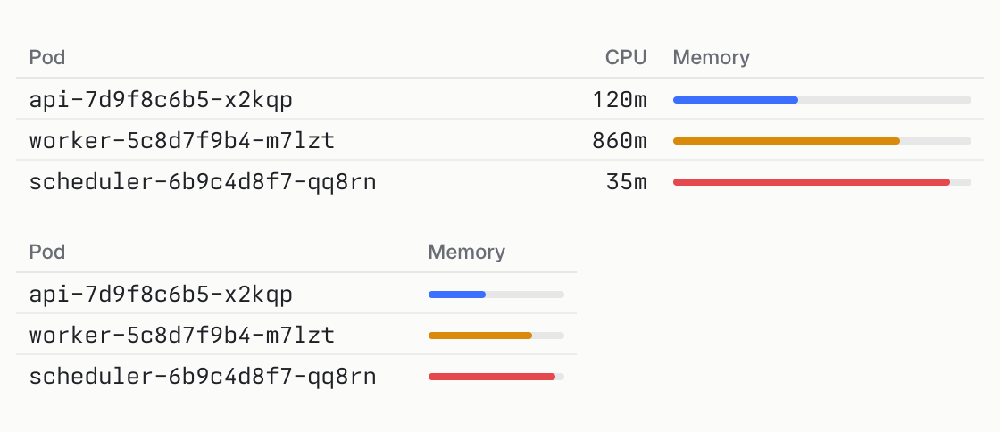
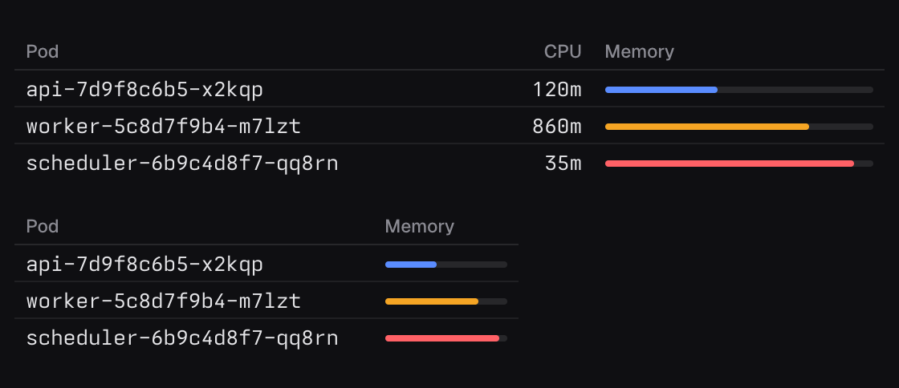
<figcaption>同一张表格在 560px 与 300px 下的样子：CPU（优先级 1）最先被隐藏。进度条越过了 <code>warn</code> 与 <code>bad</code> 阈值。</figcaption>
</figure>

一张可选中、包含各种单元格类型的服务表格，位于以 `font = "sans"` 打开的 block 中。该 block 把
选中状态保存在自己的状态里，并在其 `key` 处理函数中用 ↑/↓ 移动它。旁边没有详情卡片时，
每个等待中的行都带一个 Promote 按钮，且只有选中行的按钮为 `primary`（带其 `p` 键），因此界面上只保留一个
主按钮；有详情卡片时，主按钮移到卡片的头部，各行都不再带按钮
（[设计视图](../guides/design.md#tables)）：

```lua
local ui = tern.ui

local TONE = { live = "success", degraded = "warning", down = "error", waiting = "pending" }

local function services(state)
	local rows = {}
	for i, s in state.services do
		local promote = nil
		if s.state == "waiting" then
			promote = { text = "Promote", act = "promote" }
			if s.name == state.selected then
				promote.variant, promote.keys = "primary", { "p" }
			end
		end
		rows[i] = {
			id = s.name,
			menu = { "logs", "restart" },
			disabled = s.state == "down" and "Restarting" or nil,
			cells = {
				name = { text = s.name, dot = TONE[s.state] },
				state = { badge = { text = s.state, tone = TONE[s.state] } },
				version = s.version,
				p95 = s.p95 .. " ms",
				trend = { spark = { values = s.latency, min = 0 } },
				act = promote and { button = promote } or "",
			},
		}
	end
	return ui.node("table", {
		key = "services",
		selectable = true,
		selected = state.selected,
		empty = "No services",
		cols = {
			{ id = "name", head = "Service", grow = 1, truncate = "middle", priority = 9 },
			{ id = "state", head = "State", priority = 6 },
			{ id = "version", head = "Version", mono = true, priority = 2 },
			{ id = "p95", head = "p95", align = "end", mono = true, priority = 7 },
			{ id = "trend", head = "Latency", priority = 1 },
			{ id = "act", align = "end", priority = 8 },
		},
		rows = rows,
	})
end

-- event(state, ev, cx)
if ev.ev == "select" and ev.id == "main.services" then
	state.selected = ev.item
elseif ev.ev == "action" and ev.act == "promote" then
	promote(state, ev.item)
end
```

<figure class="tn-figure">
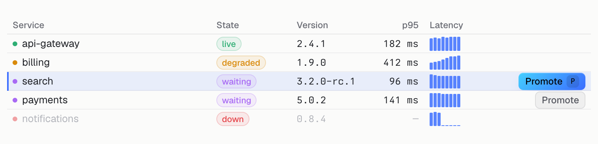
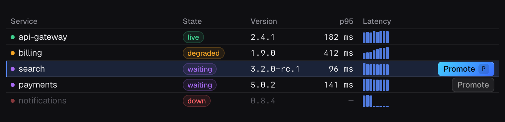
<figcaption>点、徽标、等宽、迷你折线与按钮单元格；<code>selected</code> 落在一个等待中的行上（其按钮是视图唯一的主按钮），另有一行被 <code>disabled</code>。</figcaption>
</figure>

一张服务表格，用户可对其排序，并一次重启或删除多行。程序把排序与
选中结果保存在状态中，自行排序各行，并在需要改变它们时把 `picked` 传回：

```lua
local ui = tern.ui

local function services(state)
	local rows = {}
	for i, s in state.services do
		rows[i] = {
			id = s.name,
			disabled = s.locked and "locked by a deploy" or nil,
			cells = {
				name = s.name,
				status = { text = s.status, dot = s.tone },
				age = s.age,
			},
		}
	end
	return ui.node("table", {
		key = "services",
		multi = true,
		picked = state.picked,
		sort = state.sort, -- { col = "name", dir = "desc" }
		bar = {
			{ act = "restart", text = "Restart", icon = "refresh" },
			{ act = "delete", text = "Delete", variant = "danger" },
		},
		cols = {
			{ id = "name", head = "Service", grow = 1, mono = true, sortable = true, priority = 9 },
			{ id = "status", head = "Status", sortable = true, priority = 5 },
			{ id = "age", head = "Updated", align = "end", mono = true, sortable = true, priority = 7 },
		},
		rows = rows,
	})
end

-- event(state, ev, cx)
if ev.ev == "action" and ev.act == "sort" then
	state.sort = ev.value -- then sort state.services by it
elseif ev.ev == "change" and ev.id == "main.services" then
	state.picked = ev.value
elseif ev.ev == "action" and ev.act == "restart" then
	restart(state, ev.value) -- keep or clear state.picked
end
```

TSX（TypeScript SDK）中的同一实现：

```tsx
<table
   key="services"
   multi
   picked={picked}
   sort={sort}
   onChange={(ev) => setPicked(ev.value)}
   bar={[
      { act: 'restart', text: 'Restart', icon: 'refresh' },
      { act: 'delete', text: 'Delete', variant: 'danger' },
   ]}
   onAction={{
      sort: (ev) => setSort(ev.value),
      restart: (ev) => restart(ev.value),
      delete: (ev) => remove(ev.value),
   }}
   cols={[
      { id: 'name', head: 'Service', grow: 1, mono: true, sortable: true, priority: 9 },
      { id: 'status', head: 'Status', sortable: true, priority: 5 },
      { id: 'age', head: 'Updated', align: 'end', mono: true, sortable: true, priority: 7 },
   ]}
   rows={rows}
/>
```

<figure class="tn-figure">
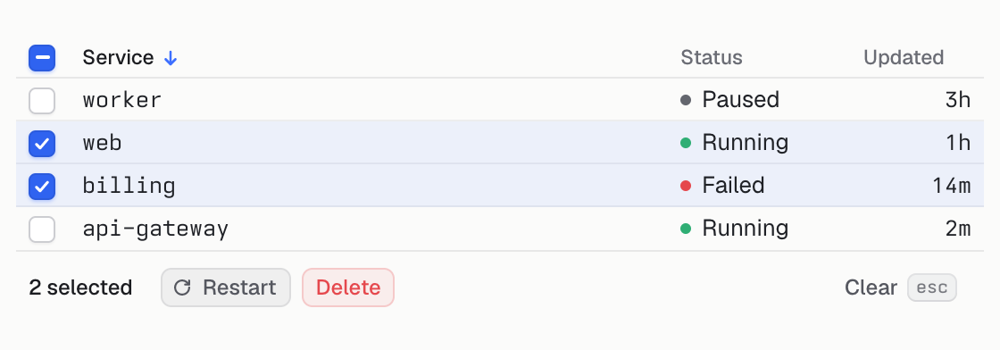
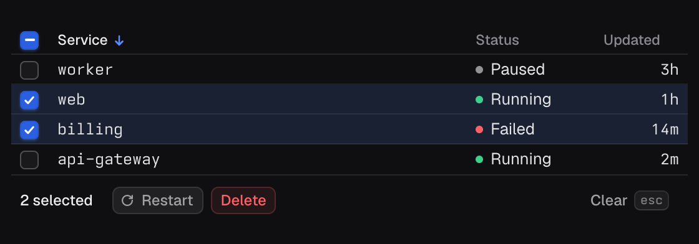
<figcaption><code>variant = "check"</code>：四行中有两行被选中，因此表头复选框为混合态；选择栏承载 <code>bar</code> 中的操作。</figcaption>
</figure>

<figure class="tn-figure">
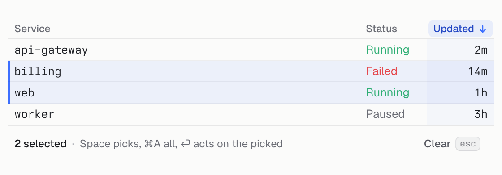
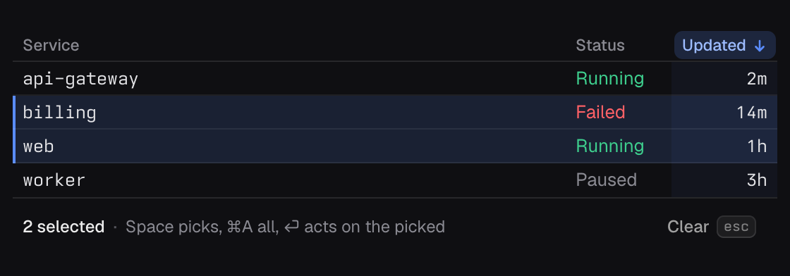
<figcaption><code>variant = "bar"</code>，并用 <code>hint</code> 写明程序接受的按键。</figcaption>
</figure>

<figure class="tn-figure">
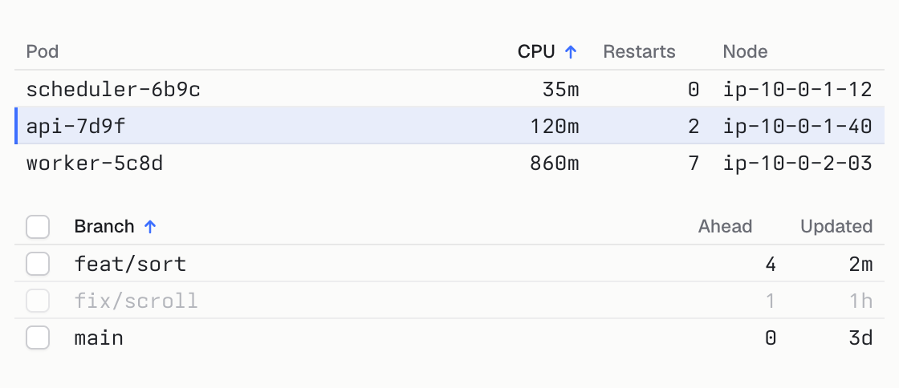
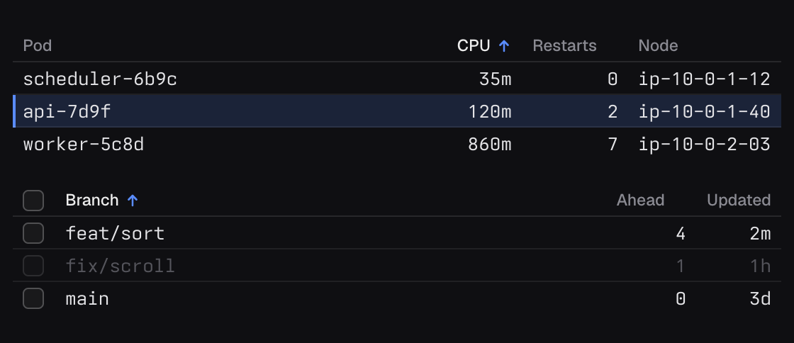
<figcaption>等宽区域中的升序排序；没有任何选中项的 <code>multi</code> 表格不显示选择栏。</figcaption>
</figure>

## `tree` 树 {#tree}

展开树：每个条目一行，每层缩进 14px，每个展开的父项下方有一条竖向引导线，箭头在条目展开或收起时
翻转。子项折叠时带有短暂的高度与不透明度过渡。没有子项的条目不显示箭头（箭头仍占位，使标签对齐）。

**展开与收起。** `open` 决定某个条目的子项是否显示（默认收起）。单击箭头会立即展开或
收起该条目，无需往返通信；Tern 按条目 id 记住该状态，直到你的视图为该条目发送
*不同* 的 `open`：重发相同的 `open` 会保留用户的选择；改变它则覆盖该
选择。id 消失的条目会遗忘其本地状态。只有箭头会切换状态：单击标签
本身不产生任何动作。

**长树。** 树把展开的条目按前序绘制为扁平行（类名 `.windowed`），并且只挂载可视位置
附近的行；未挂载的条目仍保留展开/收起状态。完整捕获会绘制嵌套形式。

**构建方式：** `tern.ui.tree(nodes)`（参见 [UI 构建器](../reference/ui.md#tree)），或
`tern.ui.node("tree", { nodes = … })`。构建器按深度优先分配 id `t0`、`t1`……；当在上方新增条目时这些 id 会移动，
从而把记住的状态移到其他条目上。当树在用户浏览期间发生变化时，请自行构造属性，使用稳定的 id（路径、
键名）。

| 属性 | 类型 | 默认值 | 含义 |
| --- | --- | --- | --- |
| `nodes` | `{ TreeNode }` | `{}` | 顶层条目 |

`TreeNode` 字段：

| 字段 | 类型 | 默认值 | 含义 |
| --- | --- | --- | --- |
| `id` | string | 必填 | 条目身份，在树内唯一。没有 id 的条目、或 id 已被使用的条目会连同其子项一起被跳过 |
| `label` | Spans | 空 | 该行的文字；超出时以省略号截断 |
| `icon` | string | 无 | 标签前显示的[图标名](#icon-names)；未知名称会留下一个空的 14px 槽位 |
| `open` | boolean | `false` | 子项是否显示（见上文） |
| `children` | `{ TreeNode }` | 无 | 嵌套条目；仅当条目至少有一个有效子项时才是父项 |

**子节点：** 无（会被忽略）；嵌套关系放在 `nodes` 里。

**事件：** 单击箭头会向你的 block 的 `event` 处理函数发送 `toggle`：

```lua
{ ev = "toggle", id = "<tree node id>", key = "<item id>", collapsed = true }  -- collapsed = not open
```

若要在自己重新渲染后保留选择，请从该事件中保存它，并作为 `open` 传回。`actions` 的用法与
任何节点相同。

**样式：**

```html
<div class="sf sf-tree" role="tree" data-id="…">          <!-- .windowed when flattened -->
	<div class="sf-tree-node" role="treeitem" aria-level="1" aria-expanded="true" style="--d: 0">
		<div class="sf-tree-row">
			<button class="sf-tree-tw" data-key="src" title="Collapse" aria-label="Collapse"><svg class="ico">…</svg></button>
			<span class="sf-tree-ic" aria-hidden="true"><svg class="ico">…</svg></span>
			<div class="sf-tree-lbl">src</div>
		</div>
		<div class="sf-tree-kids" role="group">
			<div>
				<div class="sf-tree-node" role="treeitem" aria-level="2" style="--d: 1">
					<div class="sf-tree-row leaf">…</div>
					<div class="sf-tree-kids sf-hidden" role="group"><div></div></div>
				</div>
			</div>
		</div>
	</div>
</div>
```

| 目标 | 选择器 |
| --- | --- |
| 节点本身 | `.sf-tree` |
| 扁平化的 windowed 模式 | `.sf-tree.windowed` |
| 单个条目 | `.sf-tree-node`（内部，可能变化）；深度在 `--d` 中（顶层为 0） |
| 收起的条目 | `.sf-tree-node.shut`（内部） |
| 行 | `.sf-tree-row`（内部）；无子项时为 `.sf-tree-row.leaf` |
| 箭头 | `.sf-tree-tw`（内部）；`[data-key]` 为条目 id |
| 图标 | `.sf-tree-ic`（内部；无 `icon` 时为 `.sf-hidden`） |
| 标签 | `.sf-tree-lbl`（内部） |
| 子项分组 | `.sf-tree-kids > div`（内部；其 `::before` 绘制引导线） |

行高为 `var(--sf-lh) + 6px`，圆角 5px，悬停时为 `var(--l1)`；箭头为 `--t4`，图标为 `--t3`，
引导线为 `--l2`。在 windowed 模式下，引导线是画在 `.sf-tree-row::before` 上的重复渐变。折叠、箭头
翻转与行悬停过渡都会在 Tern 的减少动态效果设置（`.sf-still`）以及
`prefers-reduced-motion` 下停止。

```lua
local ui = tern.ui

return ui.node("tree", {
	nodes = {
		{ id = "src", label = "src", icon = "folder", open = state.open["src"] ~= false, children = {
			{ id = "src/main.rs", label = "main.rs", icon = "file-code" },
			{ id = "src/lib.rs", label = ui.span("lib.rs", "muted"), icon = "file-code" },
			{ id = "src/kinds", label = "kinds", icon = "folder", open = state.open["src/kinds"], children = {
				{ id = "src/kinds/data.rs", label = "data.rs", icon = "file-code" },
			} },
		} },
		{ id = "Cargo.toml", label = "Cargo.toml", icon = "file" },
	},
})
```

<figure class="tn-figure">
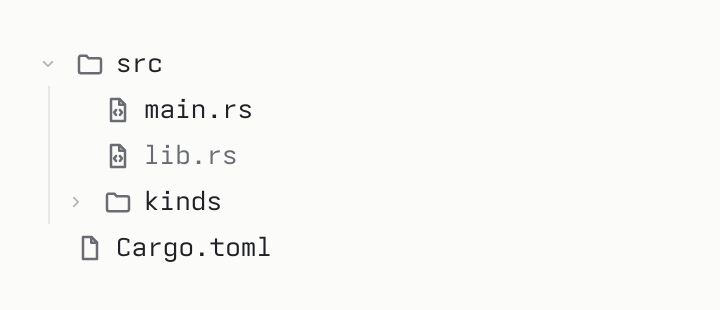
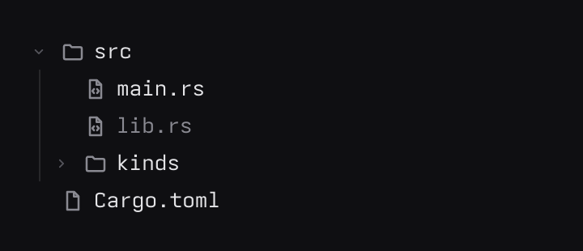
<figcaption>上文那棵树，其中 <code>src/kinds</code>（只有一个子项，没有 <code>open</code>）显示为收起。</figcaption>
</figure>

```lua
-- in the block definition
event = function(state, ev, cx)
	if ev.ev == "toggle" then
		state.open[ev.key] = not ev.collapsed
	end
end,
```

## `json` JSON {#json}

原始的 JSON 取值，由 Tern 原生绘制为可交互的树，就像浏览器的开发者工具显示
对象那样。直接把取值交给它，而不是用它拼出一棵 `tree`。

- **条目。** 各行是该取值的顶层条目：根对象的键、根数组的元素；标量根
  只有一行。数组下标不加括号并右对齐（`0`，而不是 `[0]`）。
- **短容器保持完整。** 单行形式约为 60 个字符以内的容器显示为一行：
  `0: [[3, "vt"], 98]`、`args: {stream: 0, lines: 70}`。
- **较大的容器折叠** 为单行预览 `{name: "highlight_batch", ts: 62213.5, args: {…}}`，数组显示
  其长度 `(30) [{…}, {…}, …]`，单击即可展开。
- **多行字符串** 展开为其各行。
- **折叠是本地行为。** `open` 设置初始展开多少层容器：`0` 只列出顶层条目，
  其中的容器全部折叠，`1` 还会展开这些容器，依此类推。用户的点击在此基础上折叠与
  展开；他们不发送事件。

**检查支持情况。** `json` 比 `tree` 新：在 hello 回复的 `kinds` 中查看（SDK 的
`supports("json")`），缺失时用该取值构建一棵 `tree`。

**构建方式：** `tern.ui.node("json", { value = … })`；各 SDK 中为 `ui::json(value).open(1)`（Rust）、
`ui.JSON{Value: v, Open: 1}`（Go）、`ui.json(value, open=1)`（Python）、`ui.json({ value, open: 1 })`（TypeScript）。
纯文本回退会以 2 空格缩进美化输出该取值。

| 属性 | 类型 | 默认值 | 含义 |
| --- | --- | --- | --- |
| `value` | 任意 JSON 取值 | `null` | 要绘制的取值（对象、数组、字符串、数字、布尔值或 null） |
| `open` | 不小于 0 的整数 | `0` | 初始展开多少层容器 |

**子节点：** 无（会被忽略）。

**事件：** 无。

```lua
return tern.ui.node("json", {
	value = { name = "highlight_batch", ts = 62213.5, args = { stream = 0, lines = 70 } },
	open = 1,
})
```

## `badge` 徽标 {#badge}

带纯文本的小圆角胶囊，按其色调着色：文字为色调色、背景为 10% 的色调、描边为 22% 的
色调。没有色调（或为 `neutral`）时是灰色芯片。它永不换行或收缩。

**构建方式：** `tern.ui.badge(text, tone)`（参见 [UI 构建器](../reference/ui.md#badge)），或
`tern.ui.node("badge", { text = …, tone = … })`。

| 属性 | 类型 | 默认值 | 含义 |
| --- | --- | --- | --- |
| `text` | string | `""` | 标签。仅纯文本：不会读取 span |
| `tone` | tone | 无 | 公共属性：`neutral`、`accent`、`info`、`success`、`warning`、`error`、`pending`、`muted` 或 `user`；其他值被忽略 |

**子节点：** 无（会被忽略）。

**事件：** 自身不产生事件；`actions` 的用法与任何节点相同。

**样式：**

```html
<span class="sf sf-badge" data-id="…" data-tone="success">ok</span>
```

| 目标 | 选择器 |
| --- | --- |
| 节点本身 | `.sf-badge` |
| 某个色调 | `.sf-badge[data-tone='error']` |
| 无色调 | `.sf-badge:not([data-tone])` |

徽标高 18px，`padding: 0 7px`，`500 11px` sans，颜色取自 `--tc`（即 `[data-tone]`
规则设置的色调色；参见[变量](../styles/variables.md)）。neutral 外观使用 `--t2`、`--chip-bg` 与 `--l2`。

```lua
local ui = tern.ui

return ui.row({ ui.text("deploy"), ui.badge(ok and "passed" or "failed", ok and "success" or "error") })
```

各种色调，前面是一个无色调的徽标：

```lua
local tones = { "neutral", "accent", "info", "success", "warning", "error", "pending", "muted", "user" }
local badges = { ui.node("badge", { text = "untoned" }) }
for _, tone in tones do
	table.insert(badges, ui.badge(tone, tone))
end
return ui.node("row", { gap = "sm", wrap = true }, badges)
```

<figure class="tn-figure">
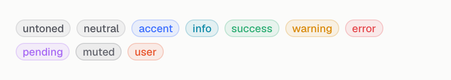
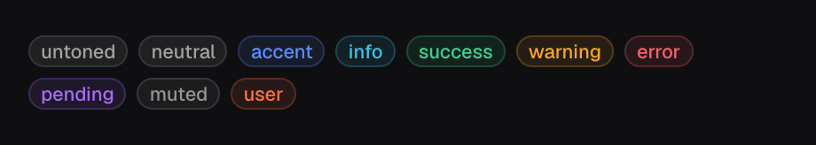
</figure>

## `kbd` 键帽 {#kbd}

以键帽表示的按键组合，每个键一个 `.kbd`，彼此间隔 3px。修饰键与具名键使用 macOS 字形；单个
字母与功能键转为大写；其他内容按原样显示。屏幕阅读器会读出念读名称
（`Control O`）。

| 键名（不区分大小写） | 键帽 | 念读 |
| --- | --- | --- |
| `ctrl`、`control` | `⌃` | Control |
| `alt`、`option`、`opt` | `⌥` | Option |
| `shift` | `⇧` | Shift |
| `cmd`、`command`、`meta`、`super`、`win` | `⌘` | Command |
| `enter`、`return` | `⏎` | Return |
| `esc`、`escape` | `esc` | Escape |
| `tab` | `⇥` | |
| `backspace` | `⌫` | |
| `delete`、`del` | `⌦` | |
| `space` | `space` | |
| `up`、`down`、`left`、`right` | `↑` `↓` `←` `→` | |
| `pageup`、`pagedown` | `⇞` `⇟` | |
| `home`、`end` | `↖` `↘` | |
| 单个字符（`o`、`/`） | 转为大写（`O`、`/`） | |
| `f1`…`f24`（`f` 加数字） | `F1`…`F24` | |
| 其他（`fn`、`⌘`） | 按原样 | |

没有念读名称的行会以其键帽作为念读内容。这些字形在所有平台上都相同。

**构建方式：** `tern.ui.node("kbd", { keys = { "ctrl", "o" } })`。没有专用构建器。

| 属性 | 类型 | 默认值 | 含义 |
| --- | --- | --- | --- |
| `keys` | `{ string }` | `{}` | 键名，按顺序；非字符串条目会被跳过 |
| `aria` | string | 无 | 公共属性：`aria-label`。设置后，Tern 既不设 `role="img"` 也不设念读标签 |

**子节点：** 无（会被忽略）。

**事件：** 自身不产生事件；`actions` 的用法与任何节点相同。键帽仅用于显示：无论 `kbd` 是否
显示这些键，按键都会到达你的 block 的 `key` 处理函数。

**样式：**

```html
<span class="sf sf-kbd kbds" data-id="…" role="img" aria-label="Control O">
	<span class="kbd">⌃</span>
	<span class="kbd">O</span>
</span>
```

| 目标 | 选择器 |
| --- | --- |
| 节点本身 | `.sf-kbd` |
| 单个键帽 | `.sf-kbd .kbd`（Tern 共享的键帽类；列表提示中也使用） |

键帽高 18px、至少宽 18px，为 `500 10.5px` 等宽字体、`--t2` 色，背景 `--l1`，描边 `--l2`。

```lua
local ui = tern.ui

return ui.row({ ui.node("kbd", { keys = { "cmd", "shift", "p" } }), ui.text(ui.span("command palette", "muted")) })
```

<figure class="tn-figure">
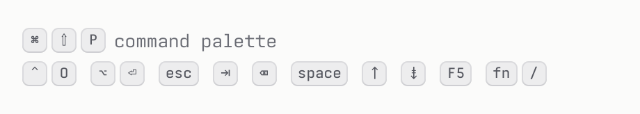
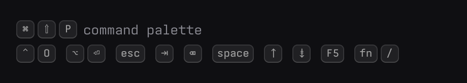
<figcaption>示例，随后是 <code>ctrl o</code>、<code>alt enter</code>、<code>esc</code>、<code>tab</code>、<code>backspace</code>、<code>space</code>、<code>up</code>、<code>pagedown</code>、<code>f5</code> 与 <code>fn /</code>。</figcaption>
</figure>

## `icon` 图标 {#icon}

Tern 图标集中的一个图标：一个 16×16 的盒子中放一个 14px 的图标，使用当前文字颜色；带 `tone` 时
使用该色调的颜色。多数图标为描边；`logo`、`app-omp` 与 `slash` 为填充。未知名称绘制一个空盒子。图标
是装饰性的：除非传入 `aria`，否则 Tern 会设置 `aria-hidden="true"`。

**构建方式：** `tern.ui.node("icon", { name = "folder" })`。没有专用构建器。同样的名称也可用于
`tree` 条目的 `icon`、列表 `item` 的 `icon` 以及其他类型的 `icon` 属性。

| 属性 | 类型 | 默认值 | 含义 |
| --- | --- | --- | --- |
| `name` | string | 无 | 图标名或别名（见下文），区分大小写。最后一个 `.` 之前的部分会被丢弃，因此 `icon.folder` 与 `status.error` 也能用 |
| `tone` | tone | 无 | 公共属性；给图标上色 |
| `aria` | string | 无 | 公共属性：`aria-label`。设置后，Tern 不会对屏幕阅读器隐藏该图标 |

**子节点：** 无（会被忽略）。

**事件：** 自身不产生事件；`actions` 的用法与任何节点相同（带 `click` 操作的图标就是一个紧凑按钮）。

**样式：**

```html
<span class="sf sf-icon" data-id="…" aria-hidden="true">
	<svg class="ico" aria-hidden="true">…</svg>
</span>
```

| 目标 | 选择器 |
| --- | --- |
| 节点本身 | `.sf-icon` |
| 带色调 | `.sf-icon[data-tone]`（颜色为 `var(--tc)`） |
| 字形 | `.sf-icon .ico` |

图标以 `currentColor` 描边，因此 `color` 会改变它们；调整大小需同时设置节点与 `.ico` 的 `width`/`height`。

```lua
local ui = tern.ui

return ui.row({ ui.node("icon", { name = "branch", tone = "accent" }), ui.text("main") })
```

### 图标名称 {#icon-names}

Tern 随附以下 208 个图标：

| 分组 | 名称 |
| --- | --- |
| 应用与品牌 | `app-btop`、`app-bun`、`app-claude`、`app-codex`、`app-deno`、`app-docker`、`app-go`、`app-hammer`、`app-helix`、`app-hermes`、`app-htop`、`app-java`、`app-node`、`app-omp`、`app-python`、`app-ruby`、`app-rust`、`app-vim`、`logo`、`tern`、`pi-mark` |
| 箭头与导航 | `arrow-up`、`arrow-down`、`arrow-left`、`arrow-right`、`back`、`forward`、`chev`、`chev-r`、`chev-up`、`corner-down-right`、`expand`、`shrink`、`minimize`、`fit`、`zoom-in`、`zoom-out`、`more`、`grip`、`compass` |
| 状态与提醒 | `check`、`x`、`x-circle`、`warn`、`info`、`help`、`bell`、`shield`、`shield-alert`、`slash`、`slash-circle`、`lock`、`key`、`key-round`、`plus`、`minus`、`clock`、`timer` |
| 文件与文档 | `doc`、`file`、`file-code`、`file-image`、`file-pdf`、`file-plus`、`files`、`folder`、`folder-go`、`folder-minus`、`folder-open`、`folder-plus`、`markdown`、`note`、`clipboard`、`save`、`inbox`、`image`、`newspaper`、`trash` |
| 版本控制 | `branch`、`commit`、`merge`、`rebase`、`pull`、`push`、`fetch`、`stash`、`cherry`、`diff`、`unified`、`split`、`split-down`、`revert`、`history` |
| 播放与操作 | `play`、`pause`、`stop`、`rewind`、`fast-forward`、`frame-next`、`frame-prev`、`repeat`、`redo`、`undo`、`run`、`reel`、`mic`、`wave`、`vibrate`、`power`、`send`、`share`、`open`、`download`、`copy`、`scissors` |
| 文本与编辑 | `bold`、`italic`、`underline`、`type`、`align-left`、`align-center`、`align-right`、`align-justify`、`pen`、`eraser`、`wand`、`cursor`、`selection`、`path-insert`、`prompt`、`vector`、`blur`、`ink`、`palette` |
| 布局与窗口 | `columns`、`grid`、`sidebar`、`tabs-h`、`tabs-v`、`dock-up`、`dock-down`、`dock-left`、`dock-right`、`pip`、`pip-tl`、`pip-tr`、`pip-bl`、`pip-exit`、`layers`、`stack`、`kanban`、`canvas`、`diagram`、`flow`、`peek`、`tree`、`box`、`eye`、`eye-off` |
| 开发与系统 | `terminal`、`code`、`braces`、`binary`、`bug`、`cpu`、`database`、`server`、`laptop`、`monitor`、`gauge`、`activity`、`chart`、`plug`、`puzzle`、`wrench`、`gear`、`sliders`、`stethoscope`、`hash`、`tag`、`link`、`globe`、`broadcast`、`search`、`funnel`、`funnel-x`、`sort-x`、`swap`、`list`、`list-checks`、`pin`、`keyboard` |
| 人物与杂项 | `user`、`users`、`message`、`brain`、`sparkle`、`lightbulb`、`bolt`、`flame`、`rocket`、`moon`、`sun`、`cart`、`footprints`、`scale`、`log-in`、`log-out` |

各 SDK 为除 `app-*` 之外的每个图标都命名了常量，而 `app-*` 跟随 Tern 已知的程序；此类图标以普通
字符串传入（`"app-vim"`）。


<figure class="tn-figure">
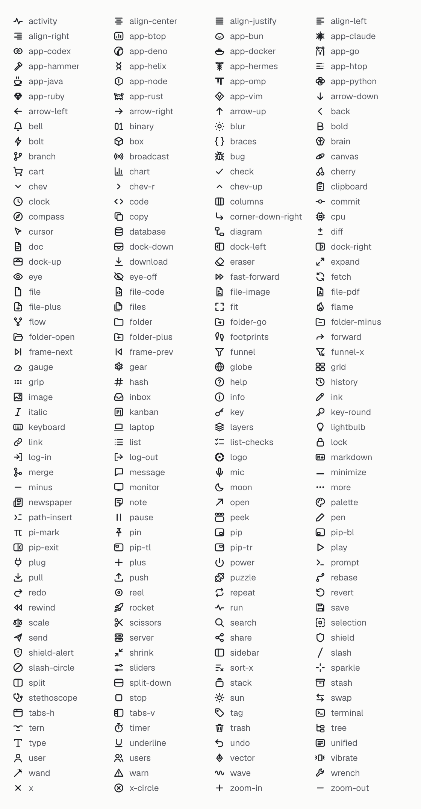
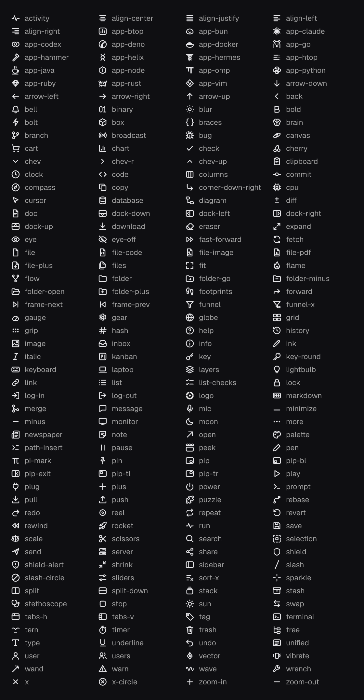
<figcaption>每个图标，都是当前文字颜色下的 <code>icon</code> 节点。</figcaption>
</figure>

此外还有上千个填充式的文件与文件夹字形，即 Files 面板按名称挑选的那些：来自 Material Icon Theme，
以 `mi-` 加其图标 id 命名（`mi-rust`、`mi-typescript`、`mi-docker`、`mi-folder-src`、`mi-folder-src-open`）。

还有模型提供方的标志，使用其品牌色、当前文字颜色，或两者兼用（aiand 的箭头跟随
文字颜色，旁边是它的红色条纹）：`provider-` 加提供方 id
（`provider-anthropic`、`provider-openai`、`provider-llama-cpp`）。`provider:<id>` 按 omp 的提供方 id 原样命名：
字母与数字之外的字符会变成 `-`（`provider:llama.cpp` 即 `provider-llama-cpp`），没有自己
标志的提供方显示其品牌的标志（`apple` → `provider-apple-intelligence`、`bedrock-mantle` →
`provider-amazon-bedrock`、`cloudflare-workers-ai` → `provider-cloudflare-ai-gateway`）。Tern 没有其标志的
提供方不会指定图标，因此选择器中的 `mark` 会回退到姓名首字母。

别名（omp 的符号名与常用词）在没有同名图标时会解析为一个图标；图标名总是
优先于别名：

`success` → `check`, `done` → `check`, `error` → `x`, `failed` → `x`, `warning` → `warn`, `pending` → `clock`,
`running` → `activity`, `aborted` → `stop`, `cancelled` → `stop`, `disabled` → `minus`, `model` → `sparkle`, `plan` →
`list`, `goal` → `pin`, `loop` → `redo`, `git` → `branch`, `pr` → `merge`, `tokens` → `hash`, `speculation` →
`selection`, `compaction` → `wand`, `context` → `layers`, `cost` → `hash`, `time` → `clock`, `omp` → `app-omp`, `hermes` → `app-hermes`,
`agents` → `user`, `agent` → `user`, `job` → `run`, `cache` → `database`, `input` → `download`, `output` → `send`,
`host` → `laptop`, `session` → `history`, `worktree` → `tree`, `bash` → `terminal`, `shell` → `terminal`, `python` →
`app-python`, `edit` → `pen`, `write` → `pen`, `read` → `doc`, `web` → `globe`, `url` → `link`, `todo` → `list`,
`task` → `layers`, `thinking` → `sparkle`, `settings` → `sliders`, `appearance` → `ink`, `interaction` → `keyboard`,
`memory` → `brain`, `tools` → `wand`, `tasks` → `list`, `providers` → `server`, `plugins` → `box`, `advisor` →
`sparkle`, `git-branch` → `branch`, `sparkles` → `sparkle`, `action` → `terminal`, `extension` → `puzzle`, `computer`
→ `monitor`, `stats` → `chart`, `news` → `newspaper`, `export` → `open`, `restart` → `revert`, `compress` → `shrink`,
`handoff` → `forward`, `question` → `help`, `pencil` → `pen`, `folderMove` → `folder-go`, `folderPlus` →
`folder-plus`, `folderMinus` → `folder-minus`, `hammer` → `app-hammer`, `prewalk` → `footprints`, `jobs` → `run`,
`signIn` → `log-in`, `signOut` → `log-out`, `package` → `box`, `fast` → `bolt`, `voice` → `mic`, `rule` → `scale`,
`skill` → `lightbulb`, `mcp` → `plug`, `path` → `folder`, `token_total` → `hash`, `time_spent` → `clock`.

## `avatar` 头像 {#avatar}

用于人、机器人、组织、仓库或模型提供方的小标记。默认的 `circle` 把 `text` 的姓名首字母绘制在
由 `seed` 选出的双色渐变上（同一种子总是得到相同的颜色，而且这些正是
[`picker`](lists.md#picker) 绘制的标记，因此同一个人在 Tern 各处的样子都一致）。`square`
是按种子色相着色的圆角方块，其首字母使用该色相的墨色：对象而非人物（机器人、组织、仓库、CI）用它。
两者都可以显示 `icon` 而不显示首字母（任意 Tern 图标，或 `provider:<id>` 标志，以自己的颜色显示在素底上），
并在给定时用 `blob` 图片覆盖面部。`status` 色调会在右下角加一个小点，并以外壳颜色
描边，使其在面部上清晰可辨。没有 `text`、`icon` 或 `blob` 时，它绘制一个素色的人物字形。

把它放在它所代表的名字之前，位于行、列表行或消息头部；大小与旁边的文字相称（正文旁用 `sm`，
行中用 `md`，头部用 `lg`）。不要在标记内放名字：`text` 只用于首字母
与工具提示。要同时表示多人，请用 [`avatars`](#avatars)。

**构建方式：** `tern.ui.node("avatar", { text = "Cara Alvarez", seed = "cara@acme.dev", status = "success" })`。

| 属性 | 类型 | 默认值 | 含义 |
| --- | --- | --- | --- |
| `variant` | `"circle"` \| `"square"` | `"circle"` | 外观（见下文） |
| `text` | string | `""` | 标记所代表的名字：前两个非空格字符即首字母（圆形上显示为大写，方形上按原样） |
| `seed` | string | `text` | 选择颜色；传入稳定的 id（邮箱、仓库 slug），使重命名后颜色不变 |
| `icon` | string | 无 | [图标名](#icon-names)或 `provider:<id>`，取代首字母绘制。未知名称回退到首字母 |
| `blob` | string | 无 | 图片的 blob id（PNG、JPEG、GIF、WebP、SVG），裁切为面部；加载中或缺失时显示首字母 |
| `size` | `"xs"` \| `"sm"` \| `"md"` \| `"lg"` | `"md"` | 16、20、28 或 36px 见方 |
| `status` | tone | 无 | 右下角一个该色调色的点（`success` 在线、`warning` 暂离、`error` 忙碌、`pending` 处理中、`accent`/`info`/`user` 为强调色；其他为灰色） |
| `title` | string | `text` | 工具提示与无障碍名称 |

**变体。**

| `variant` | 外观 | 适用场景 |
| --- | --- | --- |
| `circle` | 135° 双色渐变上的白色首字母；标志或图标显示在素色的 `--chip-bg` 底上 | 人物与提供方 |
| `square` | 圆角方块（圆角为边长的 30%），以种子色相的 18% 着色，首字母为该色相墨色的等宽字体 | 机器人、组织、仓库、服务 |

**子节点：** 无（会被忽略）。

**事件：** 自身不产生事件；`actions` 的用法与任何节点相同。

**键盘：** 无；它不获得焦点。程序在事物变化时改变 `status`、`text`、`blob`。

**样式：**

```html
<div class="sf sf-avatar circle s-md" data-id="main.me" role="img" aria-label="Sam Moss" title="Sam Moss">
	<span class="av-face" aria-hidden="true">Sa</span>     <!-- inline gradient; --av-h on a square -->
	<span class="av-dot" data-tone="success" aria-hidden="true"></span>   <!-- only with a status -->
</div>
```

| 目标 | 选择器 |
| --- | --- |
| 节点本身 | `.sf-avatar`（`.circle` / `.square`、`.s-xs` … `.s-lg`，圆形上的图标为 `.logo`，无内容可显示时为 `.blank`） |
| 面部 | `.sf-avatar .av-face`（内部，可能变化） |
| 状态点 | `.sf-avatar .av-dot[data-tone]`（内部） |
| 描边颜色 | `--av-ring`（默认 `--panel`）：把它设为头像所在的背景色 |

尺寸在节点上由 `--av`（边长）、`--av-fs`（首字母）与 `--av-dot` 决定。

```lua
local ui = tern.ui

ui.node("row", { gap = "sm", align = "center" }, {
	ui.node("avatar", { text = "Sam Moss", seed = user.email, size = "sm", status = user.online and "success" or nil }),
	ui.text(user.name),
})
ui.node("avatar", { variant = "square", text = "ci", seed = "acme/ci", title = "acme/ci" })
ui.node("avatar", { icon = "provider:anthropic", title = "Anthropic", size = "lg" })
```

TSX（TypeScript SDK）中的同一实现：

```tsx
<row gap="sm" align="center">
   <avatar text="Sam Moss" seed={user.email} size="sm" status={user.online ? 'success' : undefined} />
   <text>{user.name}</text>
</row>
<avatar variant="square" text="ci" seed="acme/ci" title="acme/ci" />
<avatar icon="provider:anthropic" title="Anthropic" size="lg" />
```

<figure class="tn-figure">
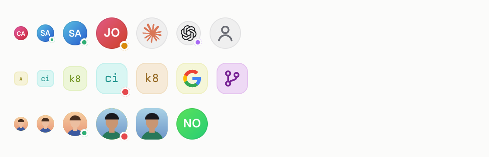
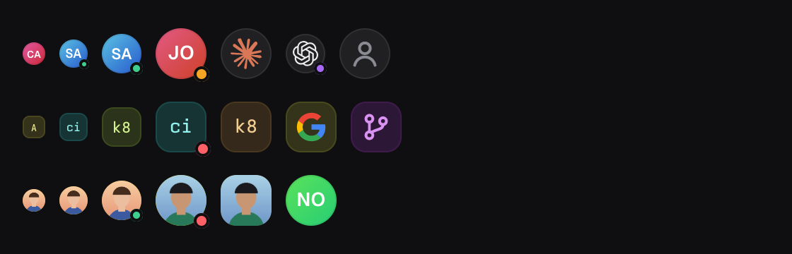
<figcaption>圆形、方形与图片，从 xs 到 lg，带首字母、标志、图标与状态点。</figcaption>
</figure>

## `avatars` 头像堆 {#avatars}

相互叠放的头像：一次评审的参与者、一次运行中的 agent、一个组织下的仓库。每个都按边长的 28% 与
前一个重叠，并以外壳颜色描边，使边缘保持清晰。设置 `max` 后，前 `max` 个之后的头像
折叠为一个 `+N` 芯片，其工具提示逐行列出它们的名字（只隐藏一个头像时显示该头像本身，
而不是 `+1`）。头像堆之后可有一个弱化的 `label` 说明它是什么（`7 reviewers`）。悬停某个头像会把它抬到
相邻头像之上并显示其名称。`max` 保持在 3–5。

**构建方式：** `tern.ui.node("avatars", { items = { { text = "Cara Alvarez" }, … }, max = 4, label = "7 reviewers" })`。

| 属性 | 类型 | 默认值 | 含义 |
| --- | --- | --- | --- |
| `items` | `{ Avatar }` | `{}` | 各头像，靠前的在前：每个都接受 [`avatar`](#avatar) 的属性，但 `size` 除外（`variant`、`text`、`seed`、`icon`、`blob`、`status`、`title`）；堆叠中不绘制 `status` 点（下一个头像会盖住它们） |
| `max` | 整数 | 全部 | 显示多少个之后开始出现 `+N` 芯片 |
| `size` | `"xs"` \| `"sm"` \| `"md"` \| `"lg"` | `"md"` | 每个头像的大小 |
| `label` | string | 无 | 头像堆之后的弱化文字，以及该组的无障碍名称（否则为各名称的连接） |

**子节点：** 无（会被忽略）。

**事件：** 自身不产生事件；`actions` 的用法与任何节点相同。

**键盘：** 无；它不获得焦点。

**样式：**

```html
<div class="sf sf-avatars s-md" data-id="main.reviewers" role="group" aria-label="7 reviewers">
	<div class="av-stack">
		<span class="av circle s-md" role="img" aria-label="Cara Alvarez" title="Cara Alvarez">
			<span class="av-face" aria-hidden="true">Ca</span>
		</span>
		…
		<span class="av more s-md" title="Ada Lim&#10;Ben Ortiz&#10;Eve Park" aria-label="3 more: …"><span class="av-face" aria-hidden="true">+3</span></span>
	</div>
	<span class="av-label" aria-hidden="true">7 reviewers</span>
</div>
```

| 目标 | 选择器 |
| --- | --- |
| 节点本身 | `.sf-avatars`（`.s-xs` … `.s-lg`） |
| 单个头像 | `.sf-avatars .av`（构建方式同 `.sf-avatar`，带 2px `--av-ring` 内衬，内部） |
| 溢出芯片 | `.sf-avatars .av.more`（内部） |
| 标签 | `.sf-avatars .av-label`（内部） |
| 描边颜色 | `--av-ring`（默认 `--panel`） |

```lua
local items = {}
for i, r in pr.reviewers do
	items[i] = { text = r.name, seed = r.email, status = r.approved and "success" or nil }
end
tern.ui.node("avatars", { items = items, max = 4, size = "md", label = #items .. " reviewers" })
```

TSX（TypeScript SDK）中的同一实现：

```tsx
<avatars
   items={pr.reviewers.map((r) => ({ text: r.name, seed: r.email, status: r.approved ? 'success' : undefined }))}
   max={4}
   label={`${pr.reviewers.length} reviewers`}
/>
```

<figure class="tn-figure">
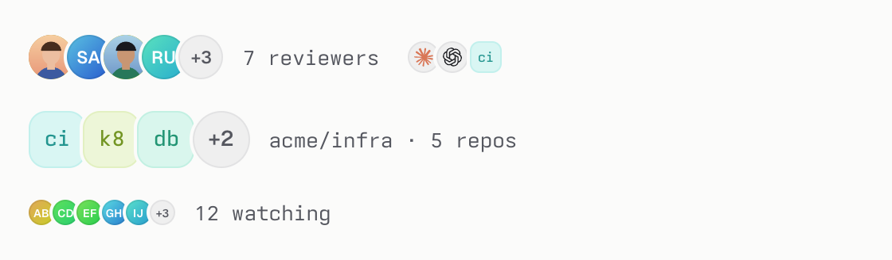
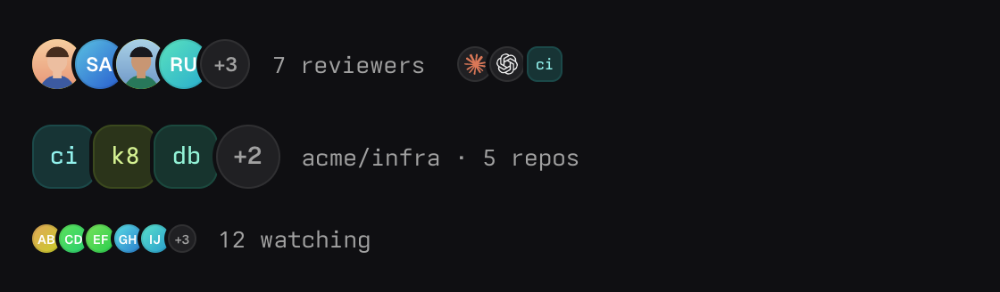
<figcaption>带溢出芯片与标签的头像堆。</figcaption>
</figure>

## `image` 图片 {#image}

来自你所发送 blob 的图片，或 Tern 自带的一张图片。栅格 blob（PNG、JPEG、GIF、WebP，每边最多 4096 px）
在主线程之外解码，绘制时带 6px 圆角与淡淡的 `--l1` 描边。SVG blob（`image/svg+xml`，最大
256 KiB）会作为真实的 SVG 元素挂载，因此你的样式表可以为其设置样式并添加动画。

**尺寸。** `w`/`h` 给出以 px 计的自然尺寸（因而也给出宽高比）；只给其中一个时，由
解码后的比例补全另一个；两者都不给时使用解码尺寸。栅格与 SVG 预览会同时按比例缩小两个轴，以适配
可用宽度与高度边界。`max.h` 限制高度（`"10lines"` 或 `"40ch"`；小数会被忽略）；
`max.w` 通过公共属性限制宽度。

**适配与缩放。** 栅格像素按 `object-fit` 放入该盒子，且总是居中：`contain`（默认，
因此声明的尺寸或 CSS 尺寸与源比例不一致时图片也不会被拉伸）、`cover`（填满
盒子，裁掉溢出）、`fill`（拉伸到盒子）、`none`（解码尺寸，一个图片像素对应一个 CSS px，
裁切到盒子）或 `scale-down`（`none`，当后者更小时用 `contain`）。`image-rendering: pixelated`（或
`crisp-edges`）以最近像素缩放，保留像素画的硬边；`auto`、`smooth` 与 `high-quality`
平滑过滤。在节点上同时设置两者，例如 `.sf-image[data-role='sprite'] { object-fit: cover; image-rendering:
pixelated }`; `object-position` 不受支持。

**动画。** 动态 GIF、APNG 或动态 WebP 会自动播放：每帧按其延迟显示（10 ms 及以下的
延迟按 100 ms 播放，与浏览器一致），播放次数按文件的循环次数（若为无限则一直循环），然后
停在最后一帧。它在图片首次绘制时开始，并运行在窗口的动画时钟上，因此会随
时钟暂停，并在滚出视野后跳到正确的帧，滚出视野期间不消耗帧。超过 1024 帧或解码像素达 64 MiB 的
动画只显示第一帧，静止不动。

**子节点。** 图片的子节点绘制在图片之上，位于覆盖节点盒子的一层（`.sf-img-over`）中：
该盒子的高度为图片高度，宽度为节点宽度。这一层像 `col` 一样是纵向排列，因此背景上的精灵图就是 `image`
里套 `image`，用 `row`/`col` 或你自己的 CSS 摆放；无需绝对定位。只有子节点
接收指针事件：单击子节点周围的图片仍会放大，单击子节点则不会。

```lua
-- an animated sprite standing at the bottom right of a background, its pixels scaled hard-edged
ui.node("image", { blob = state.meadow, alt = "Meadow", role = "meadow" }, {
	ui.node("col", { grow = 1 }),
	ui.node("row", { justify = "end" }, {
		ui.node("image", { blob = state.pikachu, alt = "Pikachu", role = "sprite", w = 96, h = 96 }),
	}),
})
-- your sheet: .sf-image[data-role='sprite'] { image-rendering: pixelated }
```

**缺失时。** 在 blob 到达之前、解码期间，或当它不是 Tern 能解码的图片时，节点
会显示一张虚线占位卡片，带图片图标与 `alt`（或“正在加载图片” / “图片不可用”），并带
说明原因的工具提示：“图片数据尚未到达”、“图片正在加载” 或 “Tern 无法显示的图片格式”
（超过 256 KiB 或没有尺寸的 SVG 也算）。图片绘制之后才到达的 blob 会一到达就显示。
面板从未收到、但面板所在机器上 Tern 的 blob 缓存保留的 id（曾发送给其他面板或 block，或在
重启之前发送）可从缓存显示，凡是显示该面板的窗口都能看到。

**缩放。** 单击已绘制出来的 blob 图片会在 Tern 的图片查看器中打开它，悬停时光标为放大镜。当
图片的父节点还持有其他 blob 图片（一条消息的附件）时，查看器会依次浏览全部，从
这一张开始。查看器标题为 `alt`（否则为 `title`）。节点若自带 `click` 操作，则改为运行该操作。`builtin`
图片永不缩放。

**SVG。** Tern 绘制 `svg`、`g`、`defs`、`linearGradient`、`stop`、`path`、`circle`、`line`、`rect`、`mask` 与
`text` 元素；其他任何元素（`script`、`foreignObject`、`image`、`use`、`title` 等）会连同其子树一起丢弃。
属性按原样透传，因为 SVG 中没有任何内容会运行或加载：表现属性（`fill`、
`font-family`、`letter-spacing` 等）为图形设置样式，而内联 `style`、事件处理函数与外部 `url(…)`
引用不起作用。每个 `id` 与本地 `url(#id)` 都按节点加前缀，使两份拷贝永不冲突；`class` 值
保留，因此 `.sf-image .my-class` 选择器可用；`tabindex` 被丢弃，使图形永不获得键盘焦点。
根元素的 `width` 与 `height` 只给出其自然尺寸，并且它需要 `viewBox`（或同时具备这两者）。

**Canvas。** `tern.canvas` 拒绝 `image` 节点（`canvas kind "image" is not supported`）：图片只能用于 block 与
lens 视图。

**构建方式：** 在 block 的处理函数中用 `cx:blob(bytes, mime)` 发送字节（参见
[Host API](../reference/api-host.md)），把返回的 id 保存在状态中，然后渲染
`tern.ui.node("image", { blob = id, alt = … })`。没有专用构建器。

| 属性 | 类型 | 默认值 | 含义 |
| --- | --- | --- | --- |
| `blob` | string | 无 | blob id（即 `cx:blob` 返回的 SHA-256） |
| `builtin` | string | 无 | Tern 自带的图片，替代 `blob` 绘制。唯一一个是 `"omp"`（omp 的动态渐变标记） |
| `alt` | string | 屏幕阅读器用 `"Image"` | 无障碍名称、占位文字与查看器标题 |
| `w`、`h` | number | 解码尺寸 | 以 px 计的自然宽度与高度；零或负数会被忽略 |
| `max` | `{ w?, h? }` | 无 | 公共属性；`h` 以 `"Nlines"` 或 `"Nch"` 限制图片高度 |
| `title` | string | 无 | 公共属性：工具提示。没有 `alt` 时，缩放查看器也用它作为名称 |
| `href`、`path` | string | 无 | 由缩放查看器读取，它可能会提示打开该文件或页面（`href` 优先） |

**子节点：** 任意节点，绘制在图片之上（见上文 **子节点**）。

**事件：** 自身不产生事件。单击可缩放的图片会运行 `zoom` 操作（它显示查看器；你的 block
不会收到任何东西）。你自己的 `actions` 用法与任何节点相同，并对 `click` 优先。

**样式：**

```html
<!-- raster -->
<div class="sf sf-image sf-zoom" data-id="…">
	
	<div class="sf-img-over">…children…</div>
</div>
<!-- SVG -->
<div class="sf sf-image sf-zoom" data-id="…">
	<svg class="sf-img-svg" role="img" aria-label="Build graph" viewBox="…">…</svg>
	<div class="sf-img-over">…children…</div>
</div>
<!-- missing or loading -->
<div class="sf sf-image missing" data-id="…">
	<div class="sf-img-card" role="img" aria-busy="true" title="The image is loading" aria-label="Build graph (image loading)">
		<span class="sf-img-ic"><svg class="ico">…</svg></span>
		<span class="sf-img-alt">Build graph</span>
	</div>
	<div class="sf-img-over">…children…</div>
</div>
```

| 目标 | 选择器 |
| --- | --- |
| 节点本身 | `.sf-image` |
| 可缩放 | `.sf-image.sf-zoom` |
| 未绘制（缺失、加载中、无法解码） | `.sf-image.missing` |
| 栅格框架 | `.sf-img-frame`（内部，可能变化） |
| 内联 SVG | `.sf-img-svg`（内部）以及其中的你自己的类 |
| 子节点层 | `.sf-img-over`（内部，可能变化） |
| 占位卡片 | `.sf-img-card`、`.sf-img-ic`、`.sf-img-alt`（内部，可能变化）；加载中为 `[aria-busy='true']` |

框架的描边在悬停时变亮到 `--l3`，按下时变暗到 85% 不透明度。占位卡片
高 `2 × --sf-lh`，在 `--sf-shade` 上带 `--l3` 虚线边框。

```lua
local ui = tern.ui

tern.block.define("graph", {
	init = function(cx, args, saved)
		return { chart = cx:blob(tern.fs.read("graph.png"), "image/png") }
	end,
	view = function(state, cx)
		return {
			main = ui.col({
				ui.text(ui.span("Build graph", "strong")),
				ui.node("image", { blob = state.chart, alt = "Build graph", w = 480, h = 240, max = { h = "10lines" } }),
				-- state.coverage: a blob id whose bytes were not sent yet
				ui.node("image", { blob = state.coverage, alt = "Coverage chart" }),
			}),
		}
	end,
})
```

<figure class="tn-figure">
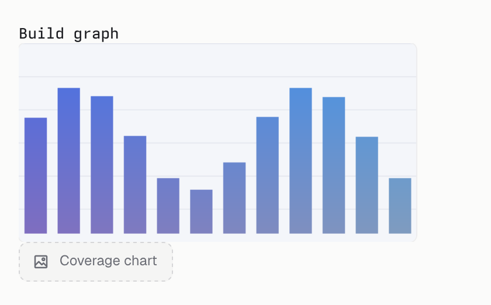
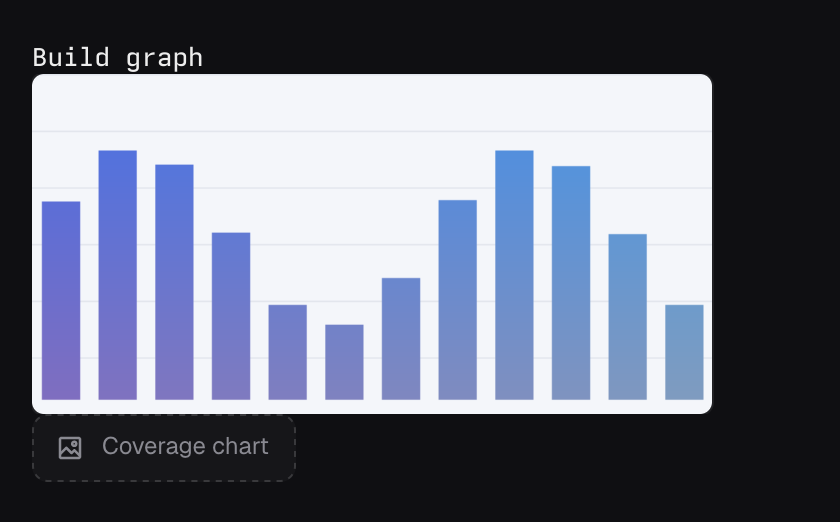
<figcaption>在 <code>max.h = "10lines"</code> 下，一张 480×240 的 PNG 缩小并保持比例；<code>state.coverage</code> 指定的 blob 从未到达，因此其节点显示占位卡片。</figcaption>
</figure>

## `carousel` 幻灯片 {#carousel}

在可横向滑动的轨道上逐张显示的幻灯片。用于同一类、需要用户翻看而不是并排阅读的少量内容：
一次运行产出的截图、一组渲染图或图表、可供挑选的备选设计方案。它的子节点就是幻灯片：通常是
[`image`](#image) 节点，但任何节点都可以（一个 `card`、一段 `md` 笔记、一行 `stats`）。
超过十来张幻灯片，或用户需要对比它们时，请改用 [`table`](#table)、
[`list`](lists.md#list) 或卡片网格。

三种外观。`peek`（默认）显示当前幻灯片，下一张从右边缘露出一部分，幻灯片上方有一个玻璃质感的
`2 / 5` 计数，下方是一行说明：该幻灯片的 `title`（否则用其 `alt`）和两个小的
上一张/下一张按钮。它在聊天或日志中阅读效果好，露出的一角以无需任何 chrome 的方式表示“还有更多”。
`arrows` 在幻灯片边缘放置圆形玻璃箭头按钮，下方是页码圆点，即常见的画廊。`strip`
在幻灯片下方放一条缩略图胶片条：`image` 幻灯片用其自身的图片并缩放；其他幻灯片则是带图标的
通用瓦片。当前缩略图以强调色描边。

导航是本地且即时的，与 [`el`](el.md#el) 控件一样：箭头、说明行按钮、圆点、
缩略图、单击露出的那张幻灯片，或在触控板上横向双指滑动，都会立刻移动轨道（0.32 s 的
滑动过渡；在 Tern 的减少动态效果或系统设置下为直接切换），程序会收到 `change`，携带新的索引。
用户选择的位置会保留，直到你程序的 `index` 发生变化，后者胜出；把 `change` 镜像到
`index` 的程序则始终是掌控者。没有 `loop` 时两端会停住：尽头的箭头淡出，说明行按钮
变暗。设置 `loop` 后，最后一张会前进到第一张，第一张后退到最后一张。

**构建方式：** `tern.ui.node("carousel", { variant = "arrows", index = 0 }, { …slides })`。

| 属性 | 类型 | 默认值 | 含义 |
| --- | --- | --- | --- |
| `index` | number | `0` | 显示的幻灯片，从 0 开始。超过最后一张时显示最后一张。`index` 变化会取代用户移动到的位置 |
| `loop` | boolean | `false` | 越过任一端时循环。关闭时两端会停住，其按钮被禁用 |
| `variant` | `"peek"` \| `"arrows"` \| `"strip"` | `"peek"` | 外观（见下文）。其他值按 `peek` 处理 |
| `h` | number 或 string | `200`（px） | 幻灯片的高度：以 px 计的数字，或在 surface 行高与单元格宽度下的 `"10lines"` / `"40ch"`。每张幻灯片都是这个高度；图片铺满它，其他幻灯片带外边距放在其中并被裁切 |

公共属性同样可用：`title`、`aria`、`tone`、`key`、`actions` 以及 flex 属性。幻灯片占满
分配给它的宽度。

每张幻灯片自己的 `title`（`image` 没有 `title` 时用其 `alt`）即其说明文字（`peek`），并作为
屏幕阅读器中其圆点与缩略图的名称（“幻灯片 2：screenshot-2.png”）。

**变体。**

| `variant` | 外观 | 适用场景 |
| --- | --- | --- |
| `peek` | 当前幻灯片占宽度的 84%，下一张以一半的强度露出（悬停时变亮，单击即切入；在最后一张时改由上一张从左边缘露出）；幻灯片右上方有一个等宽 `2 / 5` 的玻璃胶囊；其下是说明行：`--t2` 色的标题，然后是 22px 的上一张/下一张按钮 | 默认：聊天、日志或报告中的图片，露出的一角表示还有更多 |
| `arrows` | 幻灯片占满宽度；左右边缘上方各有一个 30px 圆形玻璃箭头按钮（没有 `loop` 时尽头的那个淡出）；不是图片的幻灯片会保持内容避开它们；下方居中显示页码圆点，当前一个是更宽的胶囊 | 用户逐步浏览的画廊；幻灯片较少 |
| `strip` | 幻灯片占满宽度；其下方一行 44px 缩略图（共享宽度，每张最多 104px），其余变暗，当前一个以 `--accent` 描边；非图片幻灯片的瓦片显示文档图标 | 图片较多、需要看到接下来是什么的场合：渲染通道、帧、页面 |

**子节点：** 各幻灯片，按顺序。任何类型都可以；`image` 幻灯片铺满其幻灯片
（`object-fit: cover`），并为 `strip` 提供缩略图。只有当前幻灯片接收指针事件（包括图片的
点击缩放）；单击其他幻灯片会切入它。

**事件：** 用户移动时发送

```lua
{ ev = "change", id = "main.shots", value = 2 } -- the index now shown
```

移动到已显示的幻灯片、你的程序通过 `index` 造成的移动，或没有 `loop` 时越过尽头，都不发送任何内容。
以 [`listen:false`](../protocol/surfaces.md#open-and-close) 关闭或打开的 surface 上的幻灯片会绘制，但不移动，也不发送任何内容。

**键盘：** 幻灯片永不获得焦点。要用键盘逐步切换，请在你的程序中处理按键（←/→、
Home/End）并设置 `index`；用[按键图例](../guides/design.md#a-key-legend)展示这些按键。

**手势：** 在幻灯片上横向双指滑动会沿手指方向移动一张（手指向左：
下一张），前提是该方向上还有幻灯片。手指移动时轨道跟随手指（减少动态效果下不跟随），
滑动取消时弹回原位。

**样式：**

```html
<div class="sf sf-carousel" data-id="main.shots" data-variant="peek" role="region" aria-roledescription="carousel">
	<div class="sf-carousel-stage" style="--sf-carousel-h: 200px">
		<div class="sf-carousel-view">
			<div class="sf-carousel-track" style="--sf-carousel-i: 1" aria-live="polite">
				<div class="sf-carousel-slide" role="group" aria-roledescription="slide" aria-label="1 of 5" aria-hidden="true">…</div>
				<div class="sf-carousel-slide on" role="group" aria-roledescription="slide" aria-label="2 of 5" aria-hidden="false">…</div>
				<div class="sf-carousel-slide peek" …>…</div>
				…
			</div>
		</div>
		<button class="sf-carousel-arrow prev" aria-label="Previous slide">…</button>
		<button class="sf-carousel-arrow next" aria-label="Next slide">…</button>
		<span class="sf-carousel-count" aria-hidden="true">2 / 5</span>
	</div>
	<div class="sf-carousel-foot">
		<span class="sf-carousel-cap">screenshot-2.png</span>
		<span class="sf-carousel-nav">
			<button class="sf-carousel-step prev" aria-label="Previous slide">…</button>
			<button class="sf-carousel-step next" aria-label="Next slide">…</button>
		</span>
	</div>
	<div class="sf-carousel-dots" role="group" aria-label="Slides">
		<button class="sf-carousel-dot" aria-label="Slide 1: screenshot-1.png"></button>
		<button class="sf-carousel-dot on" aria-current="true" …></button>
		…
	</div>
	<div class="sf-carousel-strip" role="group" aria-label="Slides">
		<button class="sf-carousel-thumb sf-thumb-ready" aria-label="Slide 1: screenshot-1.png">
			<span class="sf-carousel-ph" aria-hidden="true">…</span>
		</button>
		…
	</div>
</div>
```

每种变体都包含所有部分；变体规则显示其自身的那一套（`data-variant`）。

| 目标 | 选择器 |
| --- | --- |
| 节点本身 | `.sf-carousel` |
| 变体 | `.sf-carousel[data-variant='arrows']` |
| 幻灯片盒子（裁切轨道） | `.sf-carousel-view` |
| 一张幻灯片 / 当前 / 露出的那张 | `.sf-carousel-slide`、`.sf-carousel-slide.on`、`.sf-carousel-slide.peek` |
| 箭头按钮（`arrows`） | `.sf-carousel-arrow.prev`、`.sf-carousel-arrow.next`（在尽头时为 `[disabled]`） |
| 计数（`peek`） | `.sf-carousel-count` |
| 说明行、说明文字、步进按钮（`peek`） | `.sf-carousel-foot`、`.sf-carousel-cap`、`.sf-carousel-step` |
| 圆点（`arrows`） | `.sf-carousel-dots`、`.sf-carousel-dot`（`.on`） |
| 胶片条与缩略图（`strip`） | `.sf-carousel-strip`、`.sf-carousel-thumb`（`.on`；图片显示后为 `.sf-thumb-ready`） |
| 幻灯片高度、幻灯片宽度、间隙 | `--sf-carousel-h`、`--sf-carousel-w`（`peek` 中为 `84%`，否则为 `100%`）、`--sf-carousel-gap` |

说明文字按区域的字体绘制（应用中为 sans，默认区域中为等宽）；计数始终为等宽字体并使用
等宽数字。

```lua
local ui = tern.ui

local shots = {}
for i, shot in state.shots do
	shots[i] = ui.node("image", { blob = shot.blob, alt = shot.name, title = shot.name })
end

return ui.col({
	ui.node("carousel", { key = "shots", index = state.shot }, shots),
	ui.node("carousel", { variant = "strip", h = "12lines", loop = true }, shots),
})
```

程序镜像该事件：

```lua
-- event(state, ev, cx)
if ev.ev == "change" and ev.id == "main.shots" then
	state.shot = ev.value
end
```

TSX（TypeScript SDK）中的同一实现：

```tsx
<col>
   <carousel key="shots" index={shot} onChange={(ev) => setShot(ev.value)}>
      {shots.map((s) => <image blob={s.blob} alt={s.name} title={s.name} />)}
   </carousel>
   <carousel variant="strip" h="12lines" loop>
      {shots.map((s) => <image blob={s.blob} alt={s.name} title={s.name} />)}
   </carousel>
</col>
```

<figure class="tn-figure">
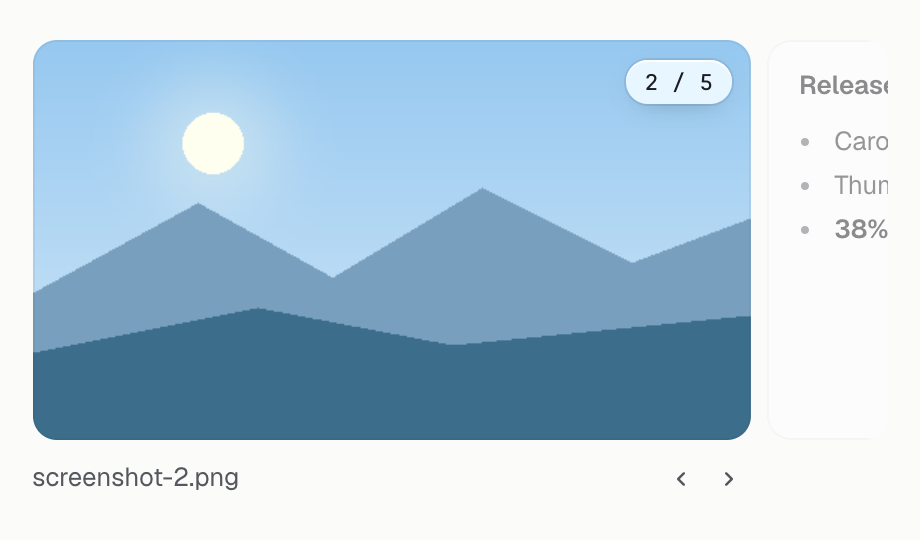
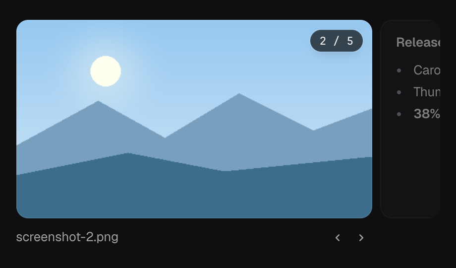
<figcaption>默认的 <code>peek</code> 外观：下一张露出一部分，幻灯片上方有计数，幻灯片的 <code>title</code> 作为说明文字。</figcaption>
</figure>

<figure class="tn-figure">
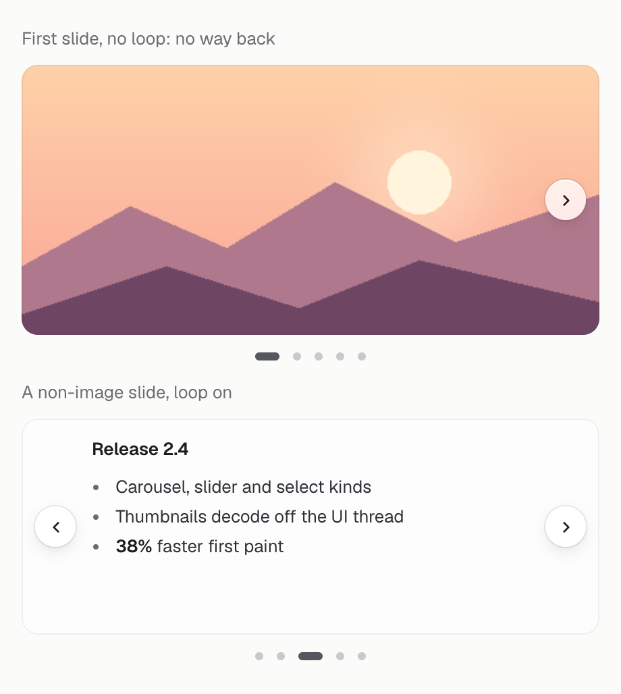
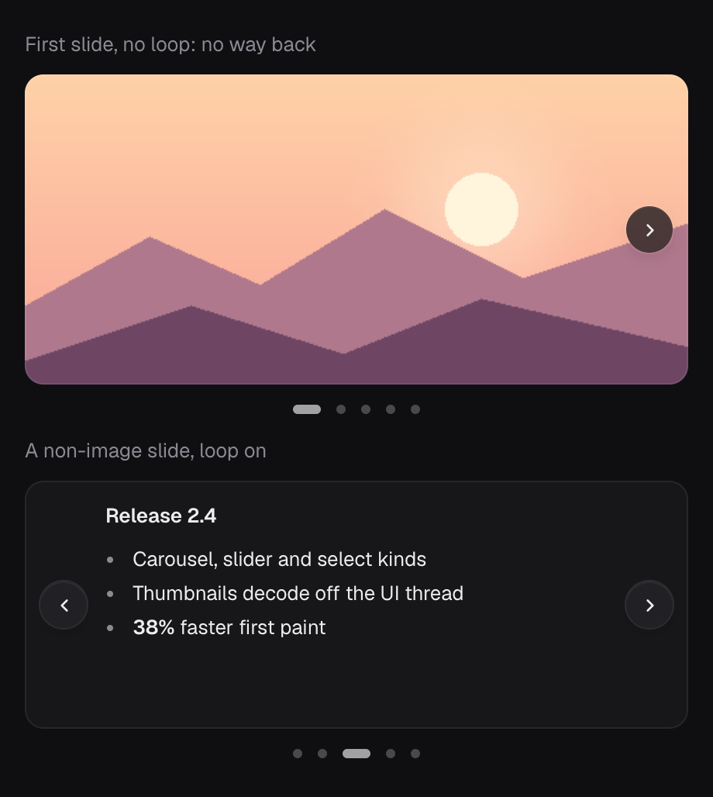
<figcaption><code>arrows</code> 外观：没有 <code>loop</code> 时在第一张无法后退；有 <code>loop</code> 时两个箭头都保留。</figcaption>
</figure>

<figure class="tn-figure">
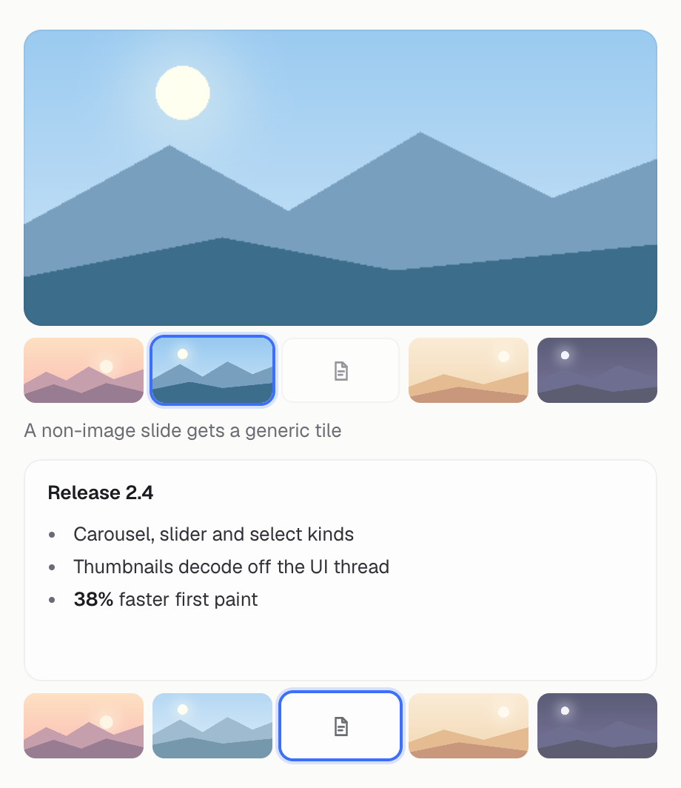
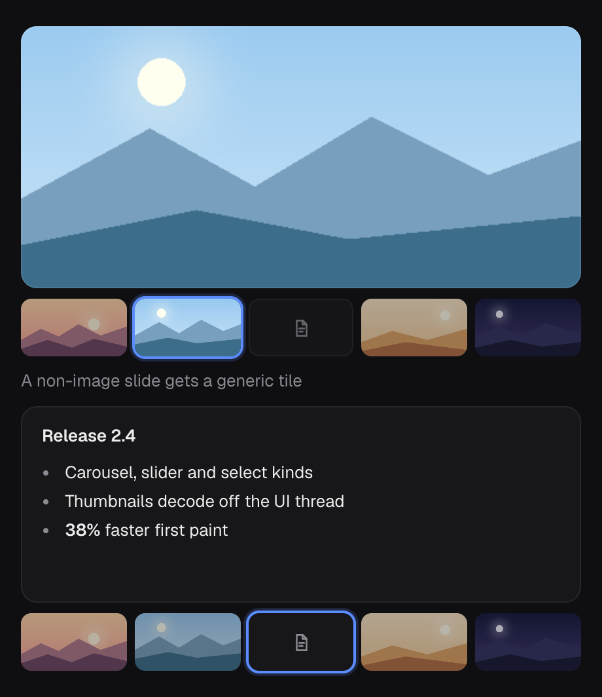
<figcaption><code>strip</code> 外观：<code>image</code> 幻灯片的缩略图就是它自己的图片，其他幻灯片则得到通用瓦片。</figcaption>
</figure>

<figure class="tn-figure">
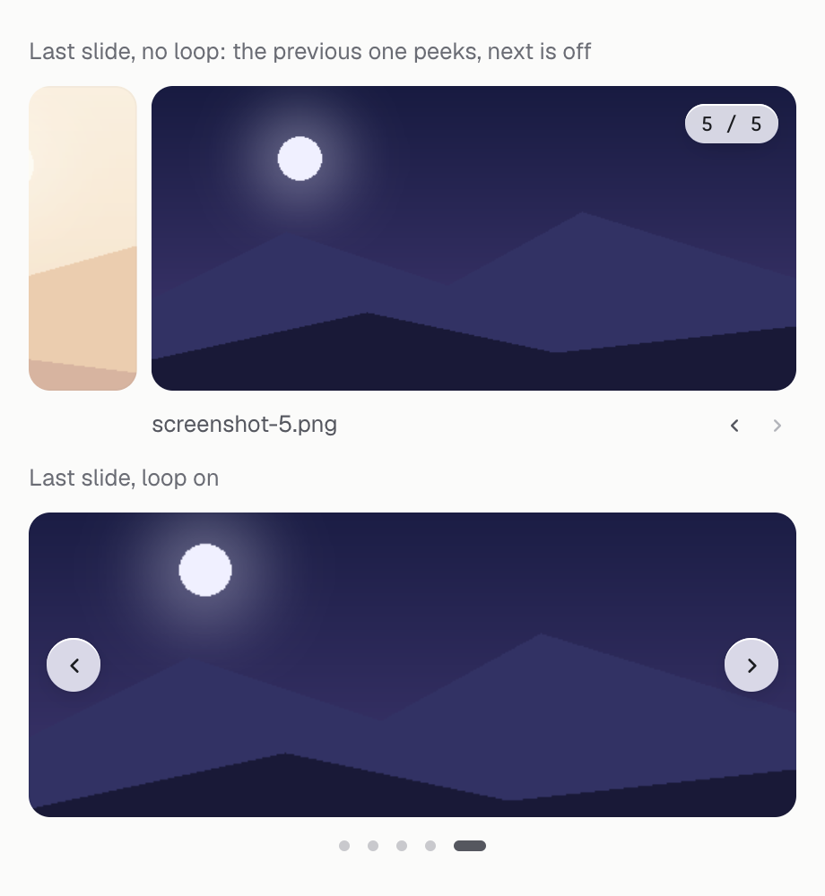
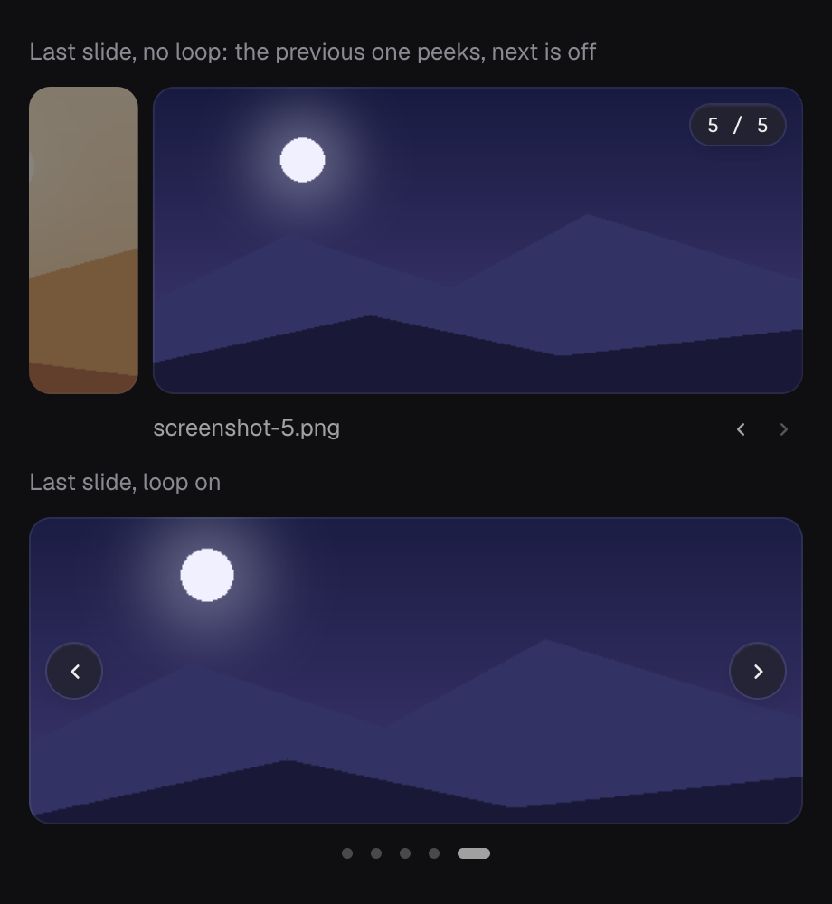
<figcaption>最后一张：没有 <code>loop</code> 时前进方向关闭；有 <code>loop</code> 时下一张箭头会绕回第一张。</figcaption>
</figure>

## `media` 媒体 {#media}

按路径命名的文件，由 Tern 读取并在它打开文件所用的同一个媒体查看器中显示。只发送
路径，不发送其他内容：Tern 自己加载字节。用于显示你的程序写出的截图、某个工具读到的文件，或
一张改动图片的前后对比；只存在于程序内存中的图片请改为发送 [`image`](#image)。

**显示什么。** Tern 按内容而非扩展名判定文件，并用其媒体查看器绘制：
栅格图片与 SVG（可缩放与平移，一个 ⓘ 显示图片信息）、3D 模型，以及用平台的阅读器或播放器打开的 PDF、视频与音频。
查看器上方的栏会显示文件名（及其 `rev`），并放置查看器的缩放
菜单、ⓘ，以及对图片还有 Expand，它会在 Tern 的图片查看器中打开图片，效果等同于双击图片。
3D 模型的材质与纹理文件从模型所在目录加载（设置
`rev` 时从同一修订版加载）。其他内容则以卡片代替预览：“无预览”（给出文件的类型）、“文件过大”（超过
64 MB；磁盘上的 PDF、视频或音频文件没有限制）、“未找到”（给出路径或修订版）、“LFS 对象
未获取”、“不在 git 仓库中”，或 “无法读取该文件”（附原因）。

**哪个文件。** `path` 为绝对路径，或相对于面板的工作目录（与 `open` 操作的路径
解析方式相同）。对于运行在另一台机器上的程序（远程面板，或 ssh 到已附着 host 的 shell），
路径位于那台机器上，Tern 会像处理文件 block 那样在那里读取它；该处若有 PDF、视频或音频文件，
会先复制到本机，供平台的阅读器或播放器使用。

**修订版。** 设置 `rev` 后，Tern 显示 git 存储的版本而非磁盘上的文件：对象为
`<rev>:<path relative to its repository root>`，其中 `rev` 是 commit-ish（`HEAD`、某个 sha、`main~2`）或
表示索引（stage 0）的 `:0`。仓库即包含该文件目录的那个，在其所在机器上读取，因此 Git
LFS 指针从该机器的 LFS 存储解析。没有 `rev` 时显示工作树中的文件。

**快照。** Tern 在命名图片、SVG 或模型的帧到达时读取它，即使在视野之外或
transcript 远处的面板中也是如此，并保留其字节。当节点进入视野、滚回其中，或以相同的 `id` 与 `path`
被移除后重新加入时，Tern 直接显示这些字节而不再读取文件，因此你的程序在命名之后
立刻删除或覆盖的截图仍按原样显示。这持续到 surface 消失为止。
从磁盘显示的文件（PDF、视频、音频）、`rev` 节点，以及 Tern 重启后恢复的 transcript，会在
显示时读取。`screen` surface 的节点不保留任何内容：每次都重新读取文件。

**对比。** 同一 surface 中 `link` 相同的 `media` 节点会一起平移与缩放：放大前后对比中
左边的那张，右边会缩放到同一位置。

**尺寸。** 节点填满其容器的宽度。在父节点按内容确定尺寸时（例如聊天 transcript 或卡片主体），
其高度为 20 行（`20 × --sf-lh`）。在有余量可分配、带 `min.h` 或你的样式表给定高度的 flex 列中
（`screen` surface 的 `main`、`col`），它会伸展填满，并在列较短时收缩到不少于 6 行。
`max.h` 像在 `image` 上那样限制高度（`"10lines"` 或 `"40ch"`），在限制之下 6 行的下限
让位，因此 `max = { h = "4lines" }` 就是 4 行高。`max.w` 限制宽度。在 `row` 中并排时，
各节点均分其宽度，各自为默认高度（或其 `max.h`）。

**回退。** Tern 在其 `hello` 应答的 `kinds` 中列出 `media`。讲
[Surface 协议](../protocol/index.md) 的程序在发送前会检查它（各 SDK 中为 `cx.supports("media")`），
否则回退，例如改用 `image` 并以文件字节作为 blob，或改用一行文字说明该文件。

**Canvas。** `tern.canvas` 拒绝 `media` 节点（`canvas kind "media" is not supported`）。

**构建方式：** `tern.ui.node("media", { path = "shots/home.png" })`。没有专用构建器。

| 属性 | 类型 | 默认值 | 含义 |
| --- | --- | --- | --- |
| `path` | string | 必填 | 文件：绝对路径，或相对于面板的工作目录 |
| `rev` | string | 无（磁盘上的文件） | 显示 git 的对象 `<rev>:<path>`：commit-ish，或表示索引的 `:0` |
| `link` | string | 无 | 同一 surface 中 `link` 相同的节点一起平移与缩放 |
| `max` | `{ w?, h? }` | 无 | 公共属性；`h` 以 `"Nlines"` 或 `"Nch"` 限制高度 |

**子节点：** 无（会被忽略）。

**事件：** 此版本中无。查看器自身的控件（缩放、平移、ⓘ 信息）属于 Tern，不会向你的
程序传达任何内容。

**样式：**

```html
<div class="sf sf-media" data-id="…">
	<div class="tn-smedia-bar">…the file's name, its rev, the viewer's controls…</div>
	…Tern's media viewer…
</div>
```

| 目标 | 选择器 |
| --- | --- |
| 节点本身 | `.sf-media` |
| 被 `max.h` 限制的高度 | `.sf-media.sf-clip` |

节点带 6px 圆角与淡淡的 `--l1` 描边，并把查看器裁切在其中。其默认高度与下限
是 `.sf-media` 上的 `height` 与 `min-height`，因此样式表可以修改它们，例如
`.sf-media[data-role='shot'] { height: calc(12 * var(--sf-lh)) }`。

```lua
local ui = tern.ui

-- the same image before and after a change, side by side, panning together
ui.row({
	ui.node("media", { path = "assets/logo.png", rev = "HEAD", link = "logo" }),
	ui.node("media", { path = "assets/logo.png", link = "logo" }),
})
```

## `attachment` 附件 {#attachment}

一个文件：消息携带的文件，或编辑器即将发送的文件。给它一个 `name`，其余由 Tern 完成：
扩展名（取自 `ext`，否则取自名称，再否则取自 `mime`）决定文件族及其色调（文档与 PDF 用
强调色，表格绿色，代码琥珀色，图片与媒体橙色，其余灰色），以字节计的 `size` 按人们的说法显示
（“2.4 MB”），图片的 `blob` 成为其缩略图。上传状态是内置的：处于 `uploading` 或
`processing` 时，名称在进度线上闪烁（`progress` 为 0–1；没有它时进度线来回扫动），`error` 用红色
圈住附件并附上你的 `error` 文字与一个重试按钮，`removable` 添加一个 ×（忙碌时标题为 “取消上传”）。
对于要展示而不是只给出名称的文件，请用 [`media`](#media) 或 [`image`](#image)。

三种外观，由 `variant` 决定：

- **`chip`**（默认）用于消息与列表中的文件：一个 36px 的类型瓦片（文件族颜色浅底上的扩展名，
  或图片的缩略图）、名称及其下方的等宽元信息行（“PDF · 2.4 MB”，或你的 `meta`），末尾是素净的操作
  图标。
- **`tile`** 用于以图片为主的托盘与画廊：一个 68px 的缩略图（图片本身，否则用文件族图标与扩展名），
  其下方是等宽字体的名称，从中间截断以保留扩展名（`homep…back.pdf`）。角上的 × 在悬停时显示
  （出错时始终显示）；失败的瓦片在悬停时提供重试。瓦片没有空间容纳其他 `actions`。
- **`pill`** 用于编辑器的托盘：一个 28px 胶囊，含文件族图标、等宽名称（从中间截断）与 ×。

单击操作按钮会发送 `action`，携带其 `act`；`remove` 还会立即让附件淡出，
使托盘先于你的程序做出回应（若你改为改变其 `state` 而不移除它，它会重新出现）。单击
其他任何位置会像其他可打开节点那样打开 `href`（否则 `path`）：Tern 打开该 URL 或文件。两者都没有时，
主体不可点击。

**构建方式：** `tern.ui.node("attachment", { name = …, size = …, path = … })`。

| 属性 | 类型 | 默认值 | 含义 |
| --- | --- | --- | --- |
| `name` | string | `""` | 文件名。同时也是工具提示与无障碍名称 |
| `variant` | `"chip"` \| `"tile"` \| `"pill"` | `"chip"` | 外观（见下文）。其他值按 `"chip"` 处理 |
| `ext` | string | 取自 `name`，否则 `mime` | 显示并用于判定文件族的扩展名（开头的 `.` 会被去掉） |
| `mime` | string | `""` | MIME 类型；扩展名不足以判断时据此确定文件族（`image/*`、`audio/*`、`video/*`、`text/*`、`application/pdf`） |
| `size` | number | 无 | 以字节计的大小，默认元信息中以十进制单位显示（“2.4 MB”） |
| `meta` | string | `"EXT · size"` | 静止状态下 chip 的元信息行，替换默认内容 |
| `blob` | string | 无 | 图片 blob id（`b` 动词的 sha256）：图片文件的缩略图（chip 的类型瓦片与 `tile`）。按 [`image`](#image) blob 解码；到达后显示 |
| `href` | string | 无 | 单击附件时打开 |
| `path` | string | 无 | 没有 `href` 时，单击所打开的文件 |
| `state` | `"idle"` \| `"uploading"` \| `"processing"` \| `"error"` \| `"done"` | `"idle"` | 上传状态；忙碌状态会让名称闪烁并绘制进度线，`error` 用红色圈住它 |
| `progress` | number | 无 | 忙碌时为 0–1（受限）；元信息显示为 “正在上传 · 62%”。没有它时进度线来回扫动 |
| `error` | string | `"Upload failed"` | `error` 状态下的元信息行与工具提示后缀 |
| `removable` | boolean | `false` | 添加一个发送 `remove` 的 ×（忙碌时标题为 “取消上传”） |
| `actions` | `{ { act: string, icon?: string, title?: string } }` | `{}` | × 之前的操作图标，按顺序（`chip` 与 `pill`）：附件上的它是一张列表，而非公共的 `{ click, menu }` 表。`icon` 为[图标名](#icon-names)（默认 `act`），`title` 为工具提示与无障碍名称（默认 `act` 首字母大写）。`error` 状态会添加 `retry`，除非已列出 |

**变体。**

| `variant` | 外观 | 适用场景 |
| --- | --- | --- |
| `chip` | 类型瓦片、名称、元信息行、操作图标 | 消息、列表与卡片中的文件 |
| `tile` | 68px 缩略图、其下方名称、角上的 × | 图片托盘与画廊 |
| `pill` | 28px 胶囊：图标、等宽名称、× | 编辑器的附件托盘 |

**子节点：** 无（会被忽略）。

**事件：** 单击操作按钮：`remove`（×）、`retry`，或你的某个 `actions`：

```lua
{ ev = "action", id = "main.report", act = "remove" }
```

在以 [`listen:false`](../protocol/surfaces.md#open-and-close) 关闭或打开的 surface 上，附件会绘制，
但不发送任何内容，移除时也不淡出。

**键盘：** 附件永不获得焦点。键盘选择在你的程序中实现（例如编辑器中按 Backspace
移除最后一个胶囊：把该节点去掉即可）。

**样式：**

```html
<div class="sf sf-attachment busy" data-id="…" data-variant="chip" data-state="uploading" data-type="sheet"
	role="group" aria-label="runs-2026-10.csv" aria-busy="true" title="runs-2026-10.csv">
	<div class="att-tile" aria-hidden="true"><span class="att-ext">CSV</span></div>
	<div class="att-body">
		<span class="att-name sf-fx-shimmer">runs-2026-10.csv</span>
		<span class="att-meta">Uploading · 62%</span>
	</div>
	<div class="att-acts">
		<button class="att-act" data-act="remove" title="Cancel upload" aria-label="Cancel upload">…</button>
	</div>
	<div class="att-bar" role="progressbar" aria-valuenow="62"><i></i></div>
</div>
```

`tile` 把 `.att-name` 放在 `.att-tile` 下方，其图标与扩展名放在 `.att-face` 中，其 × 作为
`button.att-act.att-x` 放在瓦片内；`pill` 则是 `.att-ic`、`.att-name` 与 `.att-acts`。

| 目标 | 选择器 |
| --- | --- |
| 节点本身 | `.sf-attachment` |
| 外观、状态、文件族 | `.sf-attachment[data-variant]`、`[data-state]`、`[data-type]`（`image`、`pdf`、`sheet`、`code`、`archive`、`audio`、`video`、`doc` 或 `file`） |
| 可打开 / 忙碌 / 正在移除 | `.sf-attachment.openable`（有 `href`/`path`）、`.busy`（上传中或处理中）、`.removing`（已点击移除、等待你的程序） |
| 类型瓦片或缩略图盒 | `.att-tile`（内部；图片显示时为 `.sf-thumb-ready`，图片为 `img.sf-thumb`） |
| 瓦片的面、扩展名，胶囊的图标 | `.att-face`、`.att-ext`、`.att-ic`（内部，可能变化） |
| 名称与元信息 | `.att-body`、`.att-name`、`.att-meta`（内部，可能变化） |
| 操作按钮 | `.att-acts`、`.att-act[data-act]`（内部）；瓦片角上的 × 为 `.att-x`，其重试为 `.att-retry` |
| 进度线 | `.att-bar > i`（内部；没有 `progress` 时为 `.indeterminate`） |

`data-type` 设置 `--tc`，即文件族颜色。`--att-bar` 是进度线的颜色，处理中为 `--live`。

```lua
local ui = tern.ui

ui.node("attachment", { name = "homepage-feedback.pdf", size = 2400000, path = "/tmp/homepage-feedback.pdf",
	actions = { { act = "download", icon = "download", title = "Download" } } })
ui.node("attachment", { name = "runs-2026-10.csv", state = "uploading", progress = 0.62, removable = true })
-- a composer tray
ui.node("row", { gap = "sm", wrap = true }, {
	ui.node("attachment", { variant = "pill", name = "report.pdf", removable = true, key = "report" }),
	ui.node("attachment", { variant = "tile", name = "shot-1.png", blob = state.shot, removable = true }),
})
```

TSX（TypeScript SDK）中的同一实现：

```tsx
<attachment name="homepage-feedback.pdf" size={2_400_000} path="/tmp/homepage-feedback.pdf"
   actions={[{ act: 'download', icon: 'download', title: 'Download' }]} />
<attachment name="runs-2026-10.csv" state="uploading" progress={0.62} removable
   onAction={{ remove: () => cancel('runs') }} />
<attachment variant="tile" name="spec.pdf" state="error" error="Too large" removable />
```

<figure class="tn-figure">
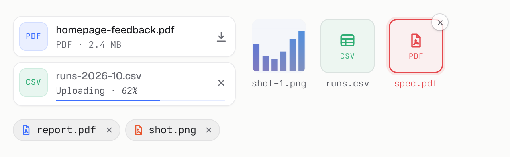
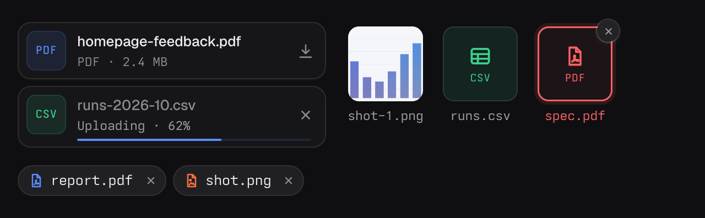
<figcaption>三种外观：chip、tile 与编辑器胶囊。</figcaption>
</figure>

<figure class="tn-figure">
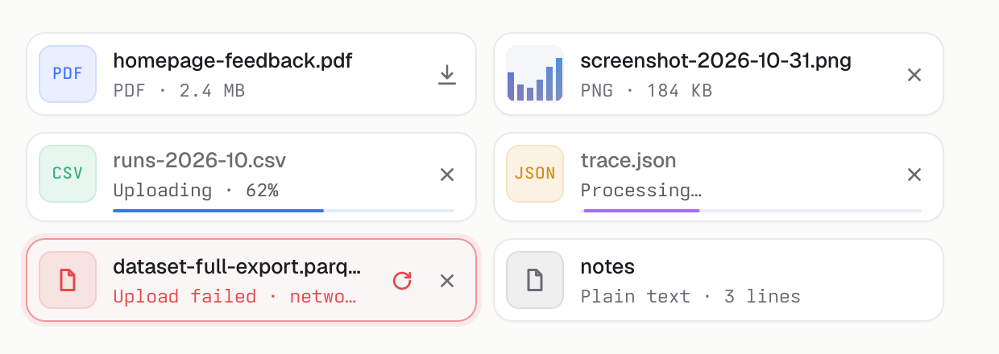
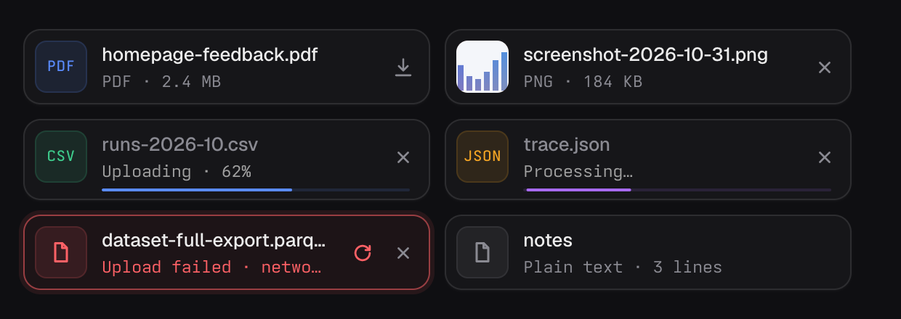
<figcaption>静止、上传中、处理中与失败的 chip；图片在类型瓦片中显示其缩略图。</figcaption>
</figure>

<figure class="tn-figure">
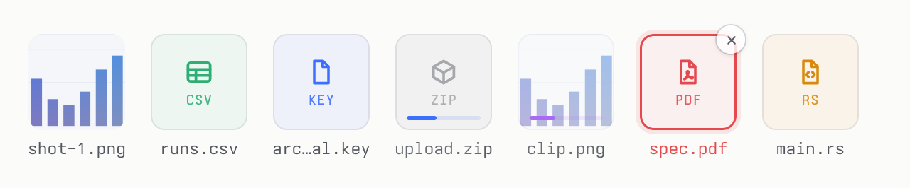
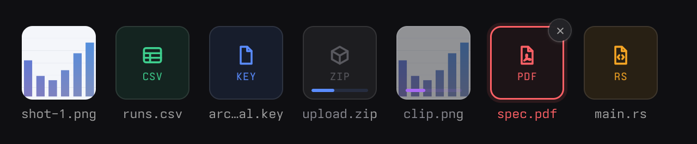
<figcaption>瓦片：图片显示缩略图，其余显示文件族图标与扩展名；名称从中间截断。</figcaption>
</figure>

<figure class="tn-figure">
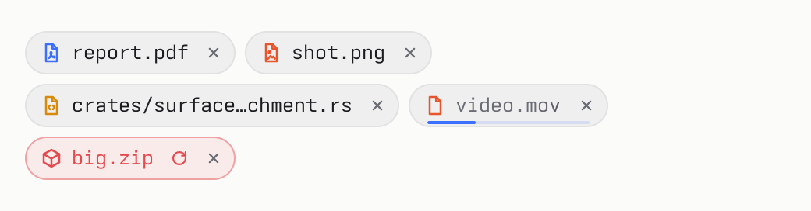
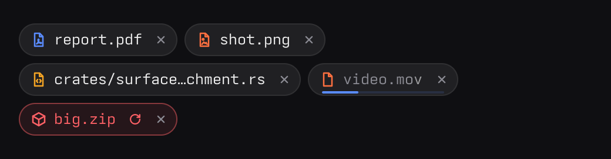
<figcaption>编辑器托盘中的胶囊。</figcaption>
</figure>

## 相关页面 {#related-pages}

- [元素](index.md)：公共属性、操作与类型索引
- [动效](motion.md)：支撑进度条单元格的 `meter` 类型
- [列表](lists.md)：可选中行，以及 `avatar` 所绘制其标记的 `picker`
- [输入与按钮](input.md)：支撑按钮单元格与选择栏操作的 `button`
- [UI 构建器](../reference/ui.md)：构建器的确切输出
- [视图样式](../styles/index.md)、[变量](../styles/variables.md)、[支持的 CSS](../styles/css.md)
