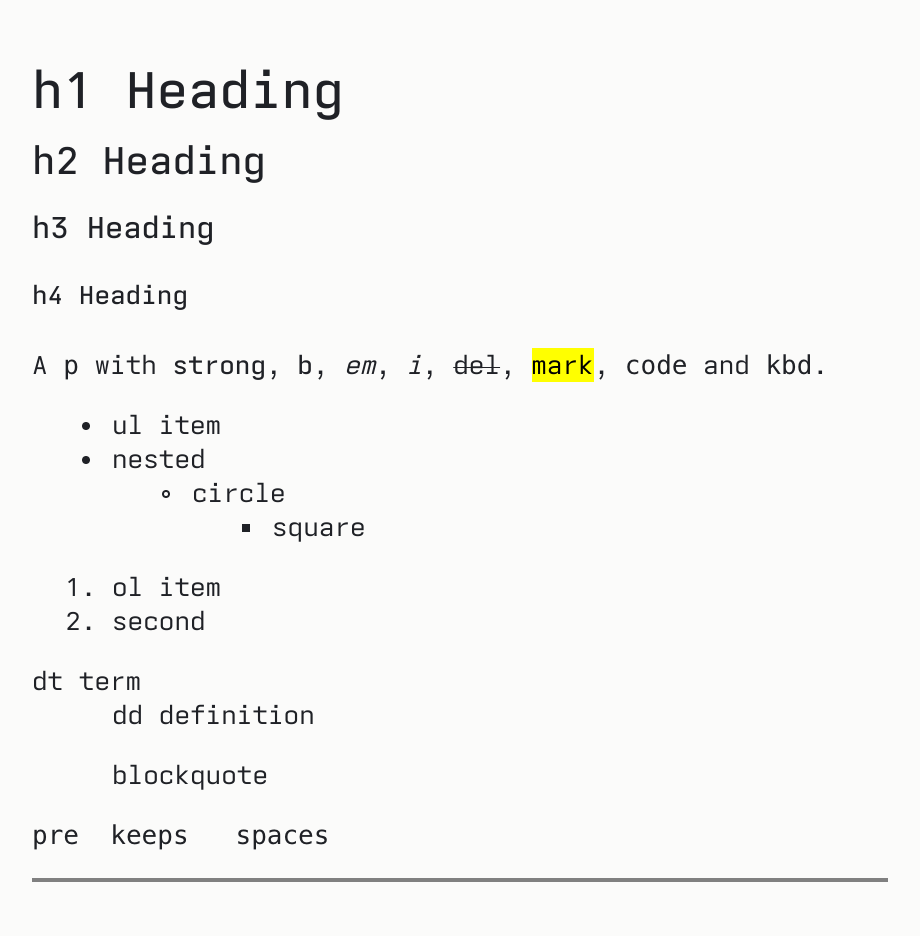
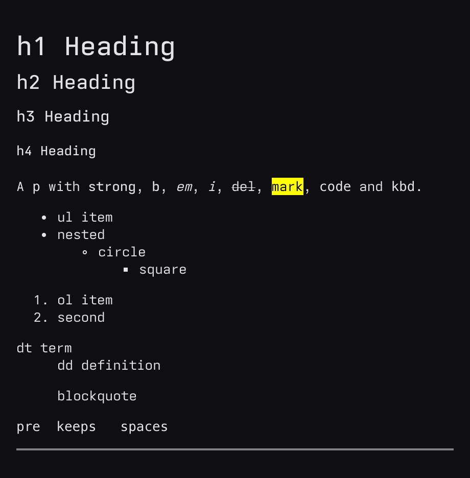
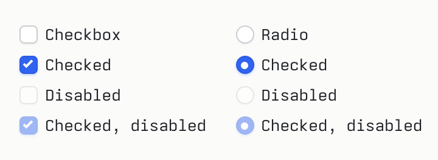
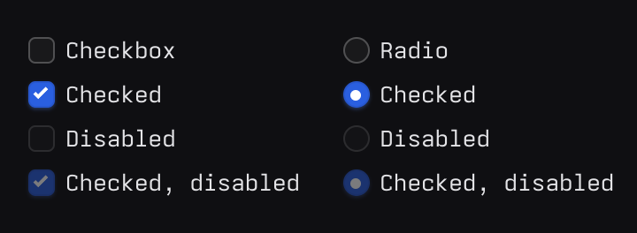
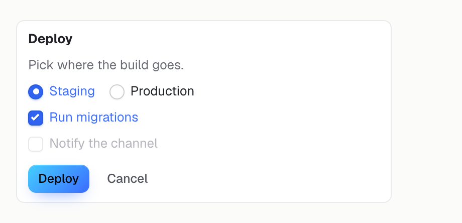
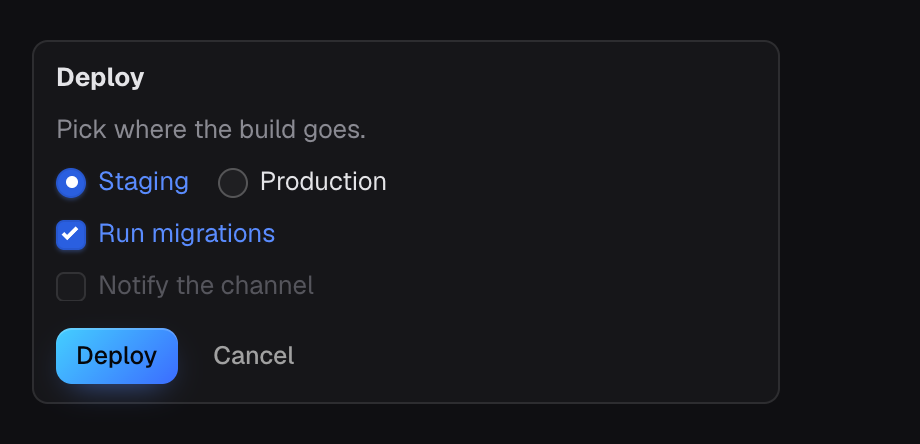
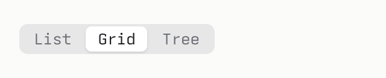
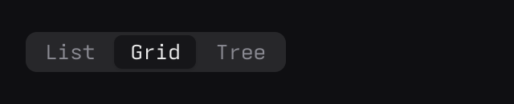
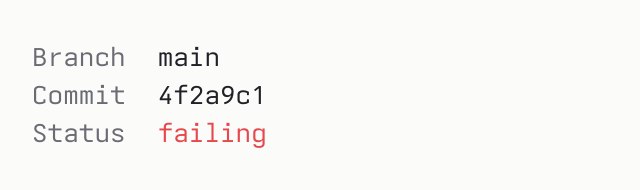
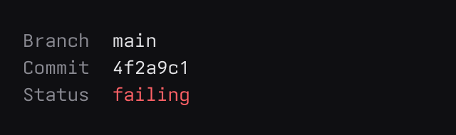

# HTML 元素 {#html-elements}

`el` 从一份固定的标签列表中绘制普通 HTML 元素，由你自己的 CSS 设置样式。当没有其他
类型能描述你的需求时使用它：带复选框与单选框的表单、定制的部件、自行设计的网格。
如果内置类型已经能绘制（列表、表格、键/值对、徽标、按钮），优先用该类型：它自带
Tern 的外观、键盘与复制行为（参见[设计视图](../guides/design.md#what-to-reach-for)）。

| 类型 | 构建方式 | 绘制内容 |
| --- | --- | --- |
| [`el`](#el) | `tern.ui.el(tag, props?, children?)` 或 `tern.ui.node("el", { tag = … })` | 允许标签中的一个 HTML 元素，先绘制其 `text`，再绘制子节点；`input` 绘制复选框或单选框控件 |

## `el` 元素 {#el}

一个 `el` 就是一个元素：`<tag class="sf sf-el …your classes" data-id="<id>">`。
Tern 除了标签的 user-agent 默认值（参见[标签](#tags)）、所在区域的字体，以及标签、
控件、按钮与表格的默认外观（参见[默认外观](#default-look)）之外，不会给它添加任何东西。
其余一切都来自你的样式表。

**构建方式：** `tern.ui.el(tag, props, children)`（参见
[UI 构建器](../reference/ui.md#el)）。构建器会把 `props` 中除 `tag` 之外的每个键
复制进节点，因此 `tern.ui.el("p", { text = "Hi" })` 就是
`{k = "el", p = {tag = "p", text = "Hi"}}`。而
`tern.ui.node("el", { tag = "p", text = "Hi" })` 构建同一个节点。

| 属性 | 类型 | 默认值 | 含义 |
| --- | --- | --- | --- |
| `tag` | string | `"div"` | 元素，取[允许的标签](#tags)之一。`form` 绘制为对控件分组的 `div`；`type` 为 `checkbox` 或 `radio` 的 `input` 绘制一个[控件](#controls)。其他任何标签（或其他类型的 `input`）都绘制为 `div` 并上报（参见[未知标签](#unknown-tags)）。 |
| `class` | string | 无 | 供你的样式表使用的、以空格分隔的类名。`sf` 与任何 `sf-*` 类属于 Tern，会被丢弃。从该属性中移除的类会在下一次更新时从元素上移除。 |
| `attrs` | string → string、number 或 boolean 的表 | 无 | 来自[允许列表](#attributes)的额外属性：`data-*`、`aria-*`、`role`、`colspan`、`rowspan`。其他名称与其他取值类型会被忽略。 |
| `text` | string | `""` | 绘制为文本节点、位于子节点**之前**的纯文本。空字符串表示移除。 |
| `type` | `"checkbox"` \| `"radio"` | 无 | 仅 `input`：控件的类型。 |
| `name` | string | 无 | 仅 `input`：控件在其表单的 `values` 中、以及其单选组中的名称。空字符串视为无。 |
| `value` | string | `"on"` | 仅 `input`：它在 `change` 与 `values` 中上报的取值。 |
| `checked` | boolean | `false` | 仅 `input`：你设置的选中状态（参见[本地状态](#local-state-and-checked)）。 |
| `disabled` | boolean | `false` | 仅 `input`：绘制为变暗，永不翻转，不进入 `values`。 |

每个[公共属性](index.md)也适用。在 `el` 上它们的作用如下：

| 公共属性 | 对元素的影响 |
| --- | --- |
| `role` | 为你的选择器设置 `data-role="…"`（不是 ARIA role；后者请用 `attrs.role`） |
| `tone` | 对已知色调（`neutral`、`accent`、`info`、`success`、`warning`、`error`、`pending`、`muted`、`user`）设置 `data-tone="…"`；其他值不设置任何东西 |
| `mark` | `data-mark="…"` |
| `href` | `data-href="…"`：⌘-点击会打开它，与 `href` span 一样 |
| `title` | `title="…"`：悬停提示 |
| `hovercard` | 悬停时以浮层卡片显示该节点树，替代 `title` 提示 |
| `aria` | `aria-label="…"`：元素的无障碍名称 |
| `hidden` | 加上 `.sf-hidden`（`display: none`） |
| `key` | 在兄弟节点中的标识；控件的本地翻转由此键在其父节点下被记住，而非整个 surface 范围 |
| `actions` | 让元素成为点击目标，在其带有 `click` 或 `dblclick` 时加上 `.sf-act` 与手形指针（参见[操作](#actions-on-any-el)） |
| `grow`、`shrink`、`basis`、`min`、`max` | 行内 flex 与尺寸样式，与任何节点相同 |

**子节点：** 任何类型，按顺序绘制在 `text` 之后。`input` 与 `hr` 不绘制子节点
（其子节点会被忽略）。

**事件：** 来自控件的 `change`（参见 [`change`
事件](#the-change-event)）；来自 `actions` 的 `action`、`select` 与 `activate`，
在 `form` 内会携带表单的 `values`。未知标签的 `error` 属于协议流量：插件 block 的
`event` 处理器永远看不到它。

### 标签 {#tags}

Tern 为每个标签创建的元素、其 user-agent 默认值，以及辅助技术读取的 role。
默认值来自 Tern 的 user-agent 样式表，是 Chrome 样式表的一个子集；文本继承区域的
字体（`--sf-fs` 下的终端等宽字体，行高 `--sf-lh`），因此 `em` 尺寸相对于它计算。
区域按 UI 字号除以 13 缩放，所以 13px 绘制为界面自身的尺寸，其他所有长度随之缩放；
`--sf-fs` 以这些单位读取终端字号（两者一致时为 13px）。Tern 的窗口会加载 Kit 的
基础样式表，它让每个盒子都是 `box-sizing: border-box`，Tern 又在此基础上为 `button`
与表格标签加上[默认外观](#default-look)。

| 标签 | 绘制为 | Display | UA 外边距、内边距、字体 | Role |
| --- | --- | --- | --- | --- |
| `div` | `div` | block | none | generic |
| `span` | `span` | inline | none | generic |
| `p` | `p` | block | 外边距 `1em 0` | paragraph |
| `section` | `section` | block | none | 有名称时（`aria`、`title` 或 `aria-labelledby`）为 region，否则为 generic |
| `header` | `header` | block | none | banner；位于 `article`、`aside`、`main`、`nav` 或 `section` 内时为 section header |
| `footer` | `footer` | block | none | content info；位于上述元素内时为 section footer |
| `nav` | `nav` | block | none | navigation |
| `aside` | `aside` | block | none | complementary |
| `main` | `main` | block | none | main |
| `article` | `article` | block | none | article |
| `figure` | `figure` | block | 外边距 `1em 40px` | figure |
| `blockquote` | `blockquote` | block | 外边距 `1em 40px` | blockquote |
| `ul` | `ul` | block | 外边距 `1em 0`、`padding-left: 40px`、`disc` 项目符号（嵌套一层为 `circle`，两层为 `square`）；嵌套列表失去垂直外边距 | list |
| `ol` | `ol` | block | 外边距 `1em 0`、`padding-left: 40px`、`decimal` 编号 | list |
| `li` | `li` | list-item | none | list item |
| `dl` | `dl` | block | 外边距 `1em 0` | description list |
| `dt` | `dt` | block | none | term |
| `dd` | `dd` | block | `margin-left: 40px` | definition |
| `h1` | `h1` | block | `2em`、粗体、外边距 `0.67em 0` | heading |
| `h2` | `h2` | block | `1.5em`、粗体、外边距 `0.83em 0` | heading |
| `h3` | `h3` | block | `1.17em`、粗体、外边距 `1em 0` | heading |
| `h4` | `h4` | block | 粗体、外边距 `1.33em 0` | heading |
| `pre` | `pre` | block | `white-space: pre`、外边距 `1em 0`、等宽字体 | generic |
| `code` | `code` | inline | 等宽字体 | code |
| `kbd` | `kbd` | inline | 等宽字体 | generic |
| `strong`、`b` | `strong`、`b` | inline | `font-weight: bolder` | generic |
| `em`、`i` | `em`、`i` | inline | 斜体 | generic |
| `del` | `del` | inline | 删除线 | content deletion |
| `mark` | `mark` | inline | 黄色背景、黑色文字 | mark |
| `hr` | `hr` | block | 外边距 `0.5em auto`、1px inset 灰色边框、无子节点 | splitter |
| `table` | `table` | table | `border-collapse: collapse` 与等宽数字（Tern）、`box-sizing: border-box` | table |
| `thead` | `thead` | table-header-group | `vertical-align: middle` | row group |
| `tbody` | `tbody` | table-row-group | `vertical-align: middle` | row group |
| `tr` | `tr` | table-row | none | row |
| `th` | `th` | table-cell | Tern：`500 11.5px/24px` 的 sans 字体，颜色 `--t3`，左对齐，`padding: 0 7px` | 列标题（`scope` 无法设置，见说明） |
| `td` | `td` | table-cell | Tern：`padding: 3px 7px` | cell |
| `label` | `label` | inline-flex（Tern） | `gap: 6px`，项目居中 | generic；为其内的控件命名 |
| `button` | `button` | inline-flex（Tern） | `button` 类型的外观，见说明 | button |
| `form` | `div` | block | none | generic |
| `input` | `span` | inline-block（Tern） | 15px 控件，参见[默认外观](#default-look) | 复选框或单选框 |

说明：

- **`form`** 绘制为普通的 `div`。让它成为表单的是分组：其内部的控件（不在嵌套的
  `form` 内）构成它的单选组与它的 [`values`](#form-values)。
- **`input`** 永远不是文本输入框：`type = "checkbox"` 或 `"radio"` 绘制一个 `span`
  控件。其他任何类型都绘制空的 `div` 并上报
  `unknown el tag input type <type>`（缺少 `type` 时为
  `unknown el tag input`）。文本输入请使用 [`input` 类型](input.md)。
- **`button`** 是真正的 `button` 元素（button role，由内容命名），但在你给它
  `actions` 之前什么也不做。它开箱即为 [`button` 类型](input.md#button)的外观，
  由 `primary`、`quiet`、`danger` 与 `sm` 这些类选择其变体与尺寸（参见
  [默认外观](#default-look)）。在表单之外，请直接用 `button` 类型：它额外提供图标、
  键帽、`busy` 与 `disabled` 的原因。
- **表格各部分**（`table`、`thead`、`tbody`、`tr`、`th`、`td`）构建真正的表格布局。
  `colspan` 与 `rowspan` 可通过 `attrs` 设置。`scope` 不在允许列表中，因此每个
  `th` 都读作列标题。它们默认使用 Tern 的细线与表头字体绘制。数据表格请使用
  [`table` 类型](data.md#table)，它负责尺寸、选中、滚动与复制。
- **`hr`** 不接受子节点，也不接受 `text`。
- 没有 `a`、`img`、`textarea` 或 `select`。链接：`href` 公共属性，或
  [`text` 节点](text.md)中的 `href` span；图片：用
  [`image` 类型](data.md#image)。
- **在区域顶层**，`el` 是 flex 项目：`main` 是节点之间间隔 16px 的 flex 列，
  `ui.col` 也是 flex 列。此处的行内标签会拉伸到整个宽度（顶层的 `mark` 会涂满整行），
  外边距不会合并，`hr` 的 `auto` 侧外边距会把它压缩到零。如各配方所示，把你的元素
  放进一个容器 `el`（`div` 或 `form`），即可获得正常的块级流。

只带这些默认值的文本标签，放在一个 `div` 内：

<figure class="tn-figure">


<figcaption>终端字体下的 user-agent 默认值。<code>mark</code> 在两种主题下都是黑底黄字；<code>code</code>、<code>kbd</code> 与 <code>pre</code> 在你的样式表另设字体之前不做任何改变。</figcaption>
</figure>

### 未知标签 {#unknown-tags}

列表之外的标签绘制为 `div`（其类、属性、`text` 与子节点照常处理）；其他类型或没有
`type` 的 `input` 绘制为空 `div`（保留类与属性，没有 `text`，没有子节点）。Tern 发送
`{ev = "error", id, msg = "unknown el tag <tag>"}`（有类型的 input 为
`"unknown el tag input type <type>"`，无类型的为 `"unknown el tag input"`），每个节点版本一次：重绘不发送任何
内容，节点变化时才再次发送。插件 block 处理器不会收到
`error` 事件；请改为检查标签列表，或使用[调试](../guides/debugging.md)中的工具观察
surface 流量。

### 修改 `tag` {#changing-tag}

不同的 `tag` 就是不同的元素：Tern 丢弃旧元素，用相同的 id、`text` 与子节点构建新的。
旧元素中存活的一切（悬停、正在运行的 CSS 过渡）都会重新开始。类、属性与 `text`
仅在它们单独变化时就地打补丁。

### 属性 {#attributes}

`attrs` 在元素上设置属性。名称在满足以下条件时被允许：

| 名称 | 允许条件 |
| --- | --- |
| `data-<x>` | `<x>` 为非空的小写 ASCII 字母、数字、`-` 或 `_` |
| `aria-<x>` | `<x>` 遵循同一规则 |
| `role` | 任何元素，控件除外（控件的 role 为 `checkbox` 或 `radio`） |
| `aria-labelledby` | 任何元素，控件除外（Tern 会设置它，参见[无障碍](#accessibility)） |
| `colspan`、`rowspan` | 始终允许 |

取值是字符串、数字（写作 `2`、`1.5`）或布尔值（写作
`true`/`false`）；表、数组与 nil 会被忽略。从 `attrs` 中移除的属性会在下一次更新时
删除。

Tern 拥有以下属性，`attrs` 永不设置它们：`data-id`、
`data-role`、`data-tone`、`data-mark`、`data-href`、`data-scope`、
`aria-label`、`aria-checked`。对其中有对应公共属性的，请使用公共属性 `role`、`tone`、`mark`、
`href` 与 `aria`。其他一切（`id`、
`style`、`onclick`、`href`、`src`、`type`、`title`、…）都会被忽略；`title`
有自己的公共属性。

```lua
ui.el("td", {
	class = "num",
	attrs = { colspan = 2, ["data-col"] = "size", ["aria-sort"] = "descending" },
	text = "4.2 MB",
})
-- <td class="sf sf-el num" data-id="…" colspan="2" data-col="size" aria-sort="descending">4.2 MB</td>
```

### 子节点之前的文本 {#text-before-children}

`text` 是一个文本节点，即元素的第一个子节点，其后按顺序是各子元素的节点。它是节点的
主文本，因此 `splice` 操作会编辑它，`copy` 会先读取它。要为其一部分文字设置样式，
就把那部分变成子节点：

```lua
ui.el("p", { class = "lead", text = "Deploy to " }, {
	ui.el("strong", { text = "production" }),
	ui.el("span", { text = "?" }),
})
-- <p class="sf sf-el lead">Deploy to <strong class="sf sf-el">production</strong><span class="sf sf-el">?</span></p>
```

`text` 是纯文本：没有 span、色调或链接。需要带样式的文字片段时，用一个
[`text` 节点](text.md)作为子节点。

### 控件 {#controls}

`tag = "input"` 且 `type = "checkbox"` 或 `type = "radio"` 时即为控件。
它绘制为空 `span`，带 `role="checkbox"` 或 `role="radio"`、
`aria-checked`、`aria-disabled`，以及在其生效期间的 `checked` 与
`disabled` 属性。它没有子节点，也没有 `text`；请把它的标签放在它旁边，同处一个 `label` 内。

**仅支持指针操作。** 控件没有 `tabindex`，永远不获得焦点，因此点击它永远不会从你手里
夺走键盘：方向键与空格键仍然送达你的 block 的 `key` 处理器。若想要键盘选择，请自行
处理按键并设置 `checked`。

**点击行为。**

- 点击复选框会切换它。
- 点击单选框会选中它；其组内其他单选框在下一次同步时取消选中，同时它的 `change`
  被发送。已选中的单选框再次点击仍保持选中（不发事件）。
- 点击 `label` 内其他任何位置，会翻转其中绘制的第一个控件。点击 label 内的某个控件
  只属于该控件，因此含两个控件的 label 只翻转被点击的那个（或当点击落在 label 的文字
  上时翻转第一个）。
- 点击禁用的控件什么也不做，即使它所在的 label 还含有其他控件。点击首个控件已禁用的
  label 同样什么也不做。

翻转立即显示，早于你的代码运行；`change` 在下一次同步时跟上。

**单选组。** 单选框的组是与之 `name` 相同的其他单选框：

| 单选框所在位置 | 它的组 |
| --- | --- |
| `form` 内 | 最近一层外层 `form` 中同名的单选框，不含其内嵌套 `form` 中的 |
| 所有 `form` 之外 | 视图文档中所有 `form` 之外的同名单选框 |
| 无 `name`（或 `name = ""`） | 无组：点击它只会选中它 |

两个表单可以都有 `size` 组；它们永远不会互相取消选中。

**惰性控件。** 控件仅在其 surface 打开且其程序正在监听时翻转。已关闭的 surface
（block 已结束，其视图仍在屏幕上）与以 `listen:false` 打开的 surface 会让每个控件
保持绘制时的样子，不发送任何内容。lens 视图绘制在终端的命令 block 内，而后者是已关闭的
surface，因此 lens 视图中的控件也永不翻转：请改为给 lens 视图 `actions`，它们能到达
其 `event` 处理器。

### 本地状态与 `checked` {#local-state-and-checked}

点击产生的翻转属于本地状态，由节点的 `key` 在其兄弟节点中被记住（否则按其 id），
与卡片的折叠状态同理。删除并在同一父节点下添加一个新 id、但 key 相同的节点会保留
该翻转；同一 key 在另一个父节点下则拥有独立的状态。
你的 `checked` 属性始终是所有者：

- **`checked` 的变化优先。** 当节点到达时其 `checked` 与上次绘制时不同，Tern 丢弃本地
  翻转并绘制你的取值。以这种方式设为 `true` 的单选框也会丢弃其组的翻转，于是其他
  单选框显示各自的 `checked`。
- **其他属性保留翻转。** 一次更新若改变 `class`、`text` 或除 `checked` 之外的任何内容，
  都会把用户的选择留在屏幕上。
- **镜像 `change` 以保持控制权。** 把 `ev.checked`（或
  `ev.values`）存入你的状态，并将其渲染为 `checked`。这样视图便
  与用户所见一致，你之后的修改也会生效。

如果从不镜像，用户的翻转会在多次重绘之间保留，直到你改变
`checked`。若你渲染 `checked = state.x` 而 `state.x` 永不变化，重置为相同取值不会产生
任何效果：要改变它（或节点的 `key`）来强制生效。

### `change` 事件 {#the-change-event}

每次翻转在下一次同步时发送：

```lua
{
	ev = "change",
	id = "<the control's id>",
	name = "size",        -- only when the control has a name
	value = "large",      -- its value ("on" by default)
	checked = true,       -- its new state
	values = { … },       -- only inside a form: the form's values after the flip
}
```

已选中的单选框会在事件之前取消选中其组，因此 `values` 已经反映出新的选择。插件 block
在 `event(state, ev, cx)` 中接收它。

### 表单取值 {#form-values}

来自 `el` `form` 内某个节点的每个 `action`、`select`、`activate` 与 `change` 事件
都携带 `values`：该表单的控件在那一刻绘制时的状态，包含用户的翻转。算法如下：

1. 取节点最近一层外层 `form`（节点本身就是该 form 时取自身）。在所有 form 之外没有
   `values`。
2. 按文档顺序遍历表单子树，跳过嵌套的表单及其中的一切。保留每个已启用且有 `name`
   的控件。
3. 按 `name` 分组，顺序为各名称首次出现的顺序。
4. 对每个组：
   - 若任一个成员是单选框：取被选中单选框的 `value`，都没有选中时为 `nil`
     （线上传输时为 `null`）。该组中的复选框会被忽略。
   - 否则，只有一个复选框：`true` 或 `false`。
   - 否则，有多个复选框：按文档顺序取被选中项的 `value` 组成的数组（都没有选中时为
     空数组）。

示例：

```lua
ui.el("form", {}, {
	ui.el("input", { type = "radio", name = "size", value = "s" }),
	ui.el("input", { type = "radio", name = "size", value = "l" }),
	ui.el("input", { type = "checkbox", name = "notify", checked = true }),
	ui.el("input", { type = "checkbox", name = "tags", value = "a", checked = true }),
	ui.el("input", { type = "checkbox", name = "tags", value = "b" }),
	ui.el("input", { type = "checkbox", name = "tags", value = "c", checked = true }),
	ui.el("input", { type = "checkbox", name = "off", checked = true, disabled = true }),
	ui.el("input", { type = "checkbox", checked = true }),
	ui.el("button", { text = "Go", actions = { click = "submit" } }),
})
```

点击 Go 会发送
`{ev = "action", act = "submit", values = {notify = true, tags = {"a", "c"}}}`
（`size` 存在但为 `nil`，所以 Lua 表不显示它；`off` 已禁用，最后一个复选框没有 name）。
在用户点击 `l` 与 `b` 之后，Go 发送
`values = {size = "l", notify = true, tags = {"a", "b", "c"}}`。表单之外的按钮不发送 `values`。

### 任意 `el` 上的操作 {#actions-on-any-el}

`actions` 在每种 `el` 上都有效，不只是 `button`：一行 `div`、一个 `li`、一个
`td`。`{click = "show"}` 发送 `{ev = "action", id, act = "show"}`，按住修饰键时
带 `mods`，在表单内带 `values`。触发方式是 `click` 与 `dblclick`（各对应一个 action id）
以及 `menu`（右键菜单的 action id 列表，除非其中列出 `copy`，否则它会得到一个“复制”项）；
参见[视图](../guides/views.md)与[公共
属性](index.md)。Tern 自己保留 `toggle`、`copy`、`open` 与 `zoom`
（没有可折叠、打开或缩放对象时的 `toggle`、`open` 与 `zoom` 会作为
`action` 事件到达），并把 `select` 与 `activate` 作为各自的事件发送；为你的操作
另选一个名称。单独的操作，[`button` 类型](input.md#button)是自然之选；在表单内，
它或 `el` 的 `button` 都会提交表单的 `values`。可点击的 `tr`
（其上有 `actions`）默认获得悬停色调与
手形指针；用于数据时，`selectable` 的 [`table`](data.md#table)
以原生选择实现同样的效果。

```lua
ui.el("li", { class = "file", text = path, actions = { click = "show", dblclick = "edit" } })
```

### 无障碍 {#accessibility}

- 每个标签有其原生 role（参见[标签](#tags)）。`attrs.role` 会在除控件之外的任何元素上
  用 ARIA role 名称覆盖它。
- `aria`（公共属性）设置 `aria-label`，即元素的名称。其他 `aria-*`
  属性通过 `attrs` 设置（`aria-hidden`、`aria-describedby`、
  `aria-expanded`、…）。
- `label` 会获得一个由 surface 与其节点 id 派生出的 `id`。label 内的控件若自身没有
  `aria`，就会获得指向其最近一层外层 label 的 `aria-labelledby`，
  因而以该 label 的文字命名。带 `aria` 的控件则改由该值命名。
- 要用某个 label 为另一个元素命名，请设置 `attrs["aria-labelledby"]`；生成的 `id`
  无法读取，因此除控件之外，其他情况优先用
  `aria`。
- 控件在翻转时上报 `aria-checked` 与 `aria-disabled`。

### 默认外观 {#default-look}

Tern 在你的样式之前绘制的内容。`button` 与表格的默认样式具有裸标签选择器的
优先级（`button:where(.sf-el…)`，表格的那些则完全没有），且你的样式表在 Tern 的之后
加载，因此你的任何规则都会胜出。

- `label`：`inline-flex`，项目居中，`gap: 6px`；除首个控件被禁用的情况外，
  显示手形指针。
- 复选框：15×15px 方块，圆角 4px，`--card` 色（深色主题下为淡白底色），带 1px
  `--l4` 内嵌描边，悬停时变为 `--t4`。选中时：`--accent-fill` 背景加白色对勾，
  以缩放动画出现。
- 单选框：相同，但为圆形，选中时带白色圆点。
- 禁用：仅控件本身 `opacity: 0.45`；其 label 文字保持绘制时的样子。启用的控件显示手形
  指针，禁用的显示箭头。
- 无焦点环：控件永不获得焦点。
- `button`：[`button` 类型](input.md#button)的 `md` 外观（28px，`500 12.5px` sans，
  `--t2` 于 `--chip-bg` 之上并带 `--l2` 描边，8px 圆角）。类 `primary` 绘制渐变变体，
  `quiet` 绘制朴素变体，`danger` 绘制红色调，`sm` 使用 22px 尺寸。带 `click` 或
  `dblclick` 操作时显示手形指针。
- `table`：`border-collapse: collapse` 与等宽数字。`th` 为 `500 11.5px/24px` sans，
  颜色 `--t3`，左对齐，`padding: 0 7px`，下方为 `--l2` 细线；`td` 为
  `padding: 3px 7px`，下方为 `--l1` 细线，最后一行下方无线。带 `click` 操作的 `tr`
  悬停时着色为 `--l1` 并显示手形指针。

其他标签只有其 user-agent 默认值。

每个控件都在各自的 `label` 内，放在以两列网格布局的 `form` 中；一个单元格是：

```lua
ui.el("label", {}, {
	ui.el("input", { type = "checkbox", name = "b", checked = true }),
	ui.el("span", { text = "Checked" }),
})
```

<figure class="tn-figure">


<figcaption>没有任何自定义样式表的复选框与单选框：未选中、选中、禁用、选中且禁用。</figcaption>
</figure>

### 样式 {#styling}

```html
<div class="sf-region sf-main" data-scope="…" data-surface="plugin.shop.order">
	<div class="sf sf-el order" data-id="f">            <!-- tag "form" -->
		<p class="sf sf-el" data-id="q">Pick a size</p>
		<label class="sf sf-el opt" data-id="s" id="…-s">
			<span class="sf sf-el" data-id="s.r" role="radio" aria-checked="true"
				checked aria-disabled="false" aria-labelledby="…-s"></span>
			<span class="sf sf-el" data-id="s.t">Small</span>
		</label>
		<button class="sf sf-el sf-act go" data-id="go" data-role="shop.submit">Order</button>
	</div>
</div>
```

| 目标 | 选择器 |
| --- | --- |
| 任何 `el` | `.sf-el` |
| 某个标签 | `p.sf-el`、`label.sf-el`、`button.sf-el`（`form` 为 `div.sf-el`） |
| 你的类 | `.order`、`.opt` |
| 按 id 或 role | `[data-id='go']`、`[data-role='shop.submit']` |
| 你的属性 | `[data-col='size']`、`[aria-sort]` |
| 控件 | `.sf-el[aria-checked]` |
| 复选框 / 单选框 | `[role='checkbox']`、`[role='radio']` |
| 选中 | `:checked`（等同于 `[checked]`）或 `[aria-checked='true']` |
| 禁用 | `:disabled`（等同于 `[disabled]`） |
| 可点击 | `.sf-act`（带 `click` 或 `dblclick` 操作） |
| 隐藏 | `.sf-hidden` |
| 色调 | `[data-tone='warning']` |
| 仅你的 block | 加上前缀 `[data-surface='plugin.<plugin>.<block>']` |

这些都是稳定的钩子：`.sf-el`、标签、你的类与属性、
`[data-id]`、`[data-role]`、`[data-tone]`、`[data-mark]`、`[data-href]`
以及区域的 `[data-surface]`。label 生成的 `id` 则不：不要对它做选择。
Tern 的样式表没有 `:has()`；要以某个 label 的选中控件为它设置样式，请用兄弟选择器
（`:checked + span`），如下面的配方所示。参见[视图样式](../styles/index.md)、
[CSS 变量](../styles/variables.md)与[支持的 CSS](../styles/css.md)。

## 配方：带样式的表单 {#recipe-a-styled-form}

插件 `deploy` 的一个 block `ask`，询问部署目标与选项，样式来自清单。

`plugin.toml`：

```toml
schema = 1
id = "deploy"
name = "Deploy"
version = "0.1.0"
host = "host.luau"
styles = ["deploy.css"]

[[blocks]]
id = "ask"
title = "Deploy"
```

`host.luau`：

```lua
local ui = tern.ui

local function radio(state, value, label)
	return ui.el("label", { class = "opt" }, {
		ui.el("input", { type = "radio", name = "env", value = value, checked = state.env == value }),
		ui.el("span", { text = label }),
	})
end

local function check(state, name, label, disabled)
	return ui.el("label", { class = "opt" }, {
		ui.el("input", { type = "checkbox", name = name, checked = state[name], disabled = disabled }),
		ui.el("span", { text = label }),
	})
end

tern.block.define("ask", {
	font = "sans",
	init = function(_cx, _args, saved)
		return saved or { env = "staging", migrate = true, notify = false }
	end,
	view = function(state, _cx)
		return { main = ui.col({
			ui.el("form", { class = "deploy" }, {
				ui.el("h3", { text = "Deploy" }),
				ui.el("p", { class = "hint", text = "Pick where the build goes." }),
				ui.el("div", { class = "group", aria = "Environment", attrs = { role = "radiogroup" } }, {
					radio(state, "staging", "Staging"),
					radio(state, "production", "Production"),
				}),
				check(state, "migrate", "Run migrations"),
				check(state, "notify", "Notify the channel", state.env ~= "production"),
				ui.el("div", { class = "actions" }, {
					ui.el("button", { class = "primary", text = "Deploy", actions = { click = "deploy" } }),
					ui.el("button", { class = "quiet", text = "Cancel", actions = { click = "cancel" } }),
				}),
			}),
		}) }
	end,
	event = function(state, ev, cx)
		if ev.ev == "change" then
			-- mirror the flip so `checked` stays yours
			if ev.name == "env" then
				state.env = ev.value
			else
				state[ev.name] = ev.checked
			end
		elseif ev.ev == "action" and ev.act == "deploy" then
			local v = ev.values
			cx:toast("info", "Deploying to " .. v.env, v.migrate and "with migrations" or nil)
			cx:exit(0)
		elseif ev.ev == "action" and ev.act == "cancel" then
			cx:exit(1)
		end
	end,
})
```

禁用的复选框不会进入 `values`，因此在选中 staging 时
`v.notify` 为 `nil`。

`deploy.css`：

```css
[data-surface='plugin.deploy.ask'] .deploy {
	display: flex;
	flex-direction: column;
	gap: 8px;
	max-width: calc(48 * var(--sf-cw, 8px));
	padding: 10px 12px;
	border-radius: 8px;
	background: var(--card);
	box-shadow: inset 0 0 0 1px var(--l2);
}

[data-surface='plugin.deploy.ask'] .deploy h3 {
	margin: 0;
	font-size: 13px;
}

[data-surface='plugin.deploy.ask'] .hint {
	margin: 0;
	color: var(--t3);
}

[data-surface='plugin.deploy.ask'] .group {
	display: flex;
	gap: 14px;
}

[data-surface='plugin.deploy.ask'] .opt :checked + span {
	color: var(--accent);
}

[data-surface='plugin.deploy.ask'] .opt [role='checkbox']:disabled + span {
	color: var(--t4);
}

[data-surface='plugin.deploy.ask'] .actions {
	display: flex;
	gap: 8px;
	margin-top: 4px;
}
```

`[data-surface='plugin.<plugin>.<block>']` 前缀把这些规则限定在本
block 的各区域上；没有它，它们会波及所有具有相同类名的 surface。组名写在 `aria`
公共属性里：`aria-label` 属于 Tern，因此 `attrs` 无法设置它。按钮不需要任何规则：`primary` 与
`quiet` 选用各自的[默认外观](#default-look)，block 上的 `font = "sans"`
让表单以 UI 字体绘制。

首次打开时（选中 staging、开启迁移、禁用通知）：

<figure class="tn-figure">


</figure>

## 配方：分段控件 {#recipe-a-segmented-control}

方框被隐藏的单选框，每个 label 绘制为一个分段。点击分段上任何位置都会翻转其
单选框，因为点击 label 会翻转其中的第一个控件，无论它是否隐藏。若某个选择属于表单的
`values`，就用它；要切换或过滤视图，`variant = "segmented"` 的 [`tabs`](lists.md#tabs)
无需任何 CSS 即可绘制同样的控件。

```lua
local ui = tern.ui

local function segmented(name, current, options)
	local segs = {}
	for _, o in ipairs(options) do
		segs[#segs + 1] = ui.el("label", { class = "seg" }, {
			ui.el("input", { type = "radio", name = name, value = o.value, checked = current == o.value }),
			ui.el("span", { text = o.label }),
		})
	end
	return ui.el("div", { class = "segs", aria = name, attrs = { role = "radiogroup" } }, segs)
end

-- in view:
segmented("view", state.view, {
	{ value = "list", label = "List" },
	{ value = "grid", label = "Grid" },
	{ value = "tree", label = "Tree" },
})

-- in event:
if ev.ev == "change" and ev.name == "view" then
	state.view = ev.value
end
```

在表单之外，名为 `view` 的单选框在整个视图中构成一个组；若已存在另一个 `view`
组，请把该控件包在它自己的 `ui.el("form", …)` 中。

```css
[data-surface='plugin.files.browse'] .segs {
	display: inline-flex;
	align-self: flex-start;
	padding: 2px;
	gap: 2px;
	border-radius: 7px;
	background: var(--l2);
}

[data-surface='plugin.files.browse'] .seg {
	gap: 0;
}

[data-surface='plugin.files.browse'] .seg [role='radio'] {
	display: none;
}

[data-surface='plugin.files.browse'] .seg span {
	padding: 2px 10px;
	border-radius: 5px;
	color: var(--t3);
}

[data-surface='plugin.files.browse'] .seg span:hover {
	color: var(--t1);
}

[data-surface='plugin.files.browse'] .seg :checked + span {
	background: var(--card);
	color: var(--t1);
	box-shadow: 0 1px 2px rgba(0, 0, 0, 0.12);
}
```

`align-self: flex-start` 让控件在 flex 列（`main`、`ui.col`）中保持自身宽度，
否则它会被拉伸。

当 `state.view = "grid"` 时：

<figure class="tn-figure">


</figure>

## 配方：键/值网格 {#recipe-a-key-value-grid}

以两列网格布局的定义列表，其中一个值带色调。

```lua
local function grid(rows)
	local kids = {}
	for _, r in ipairs(rows) do
		kids[#kids + 1] = ui.el("dt", { text = r[1] })
		kids[#kids + 1] = ui.el("dd", { text = r[2], tone = r.tone, title = r.title })
	end
	return ui.el("dl", { class = "facts" }, kids)
end

grid({
	{ "Branch", "main" },
	{ "Commit", "4f2a9c1", title = "4f2a9c1e0b…" },
	{ "Status", "failing", tone = "error" },
})
```

```css
[data-surface='plugin.ci.run'] dl.facts {
	display: grid;
	grid-template-columns: max-content 1fr;
	gap: 2px 16px;
	margin: 0;
}

[data-surface='plugin.ci.run'] .facts dt {
	color: var(--t3);
}

[data-surface='plugin.ci.run'] .facts dd {
	margin: 0;
}

[data-surface='plugin.ci.run'] .facts dd[data-tone='error'] {
	color: var(--bad);
}
```

<figure class="tn-figure">


</figure>

若要用 Tern 的外观与复制功能的普通键/值列表，
[`kv` 类型](data.md#kv)更简短。
