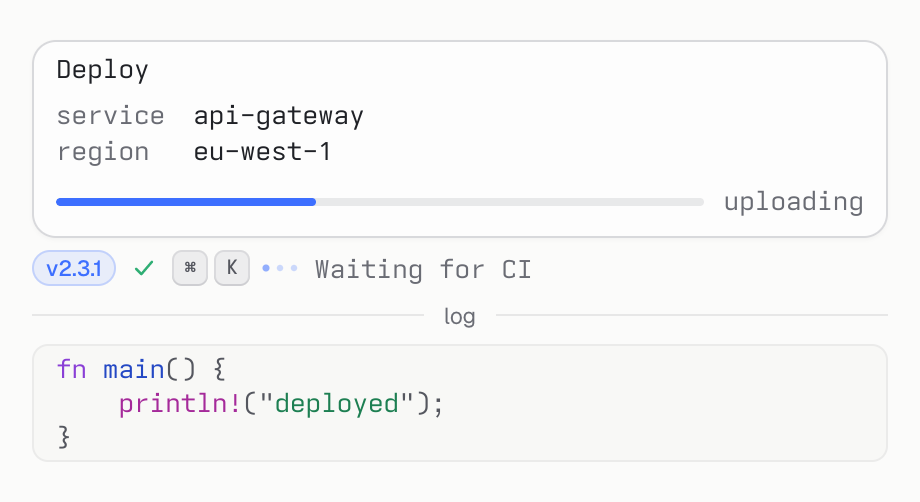
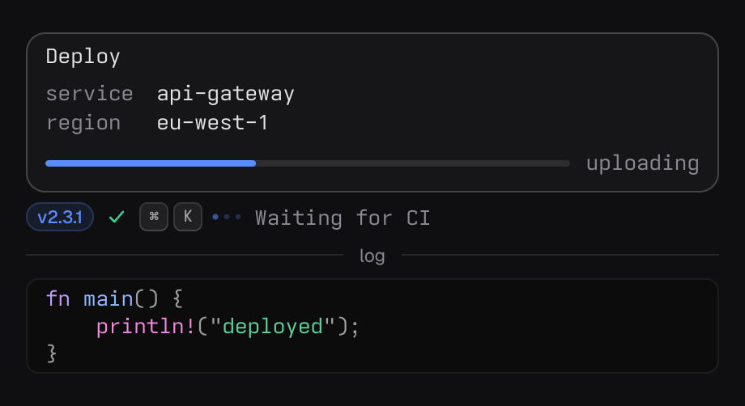
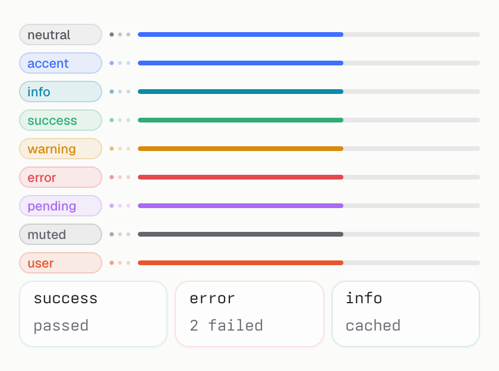
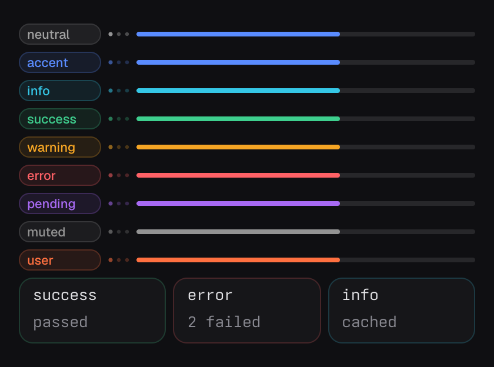

# 元素 {#elements}

视图是一棵节点树，每个节点都有一种类型：`text`、`card`、
`table`、`el` 等等。Tern 原生绘制每一种类型。它负责节点的布局、按主题着色、
动画以及维护视图状态，而你的代码只需说明屏幕上有什么。本部分文档记录每一种类型：
它的属性、行为方式、发出的事件，以及样式表可以针对的元素与类。

**构建视图之前，请先阅读 [设计视图](../guides/design.md)：**
该选用哪种类型、面向应用的无衬线字形、按钮、可选择的表格、
面板头部、四种状态，以及不应做什么。遵循它的视图无需 CSS 就与 Tern 自带的界面一致。

```lua
type Node = {
	k: string,               -- the kind
	p: { [string]: any }?,   -- props
	c: { Node }?,            -- children
}
```

`tern.ui` 为常见类型提供了构建器（参见 [UI 构建器](../reference/ui.md)），
`tern.ui.node(kind, props, children)` 可构建任意类型：

```lua
local ui = tern.ui
ui.col({
	ui.card("Deploy", {
		ui.kv({ { "service", "api-gateway" }, { "region", "eu-west-1" } }),
		ui.progress(0.4, "uploading"),
	}),
	ui.row({
		ui.badge("v2.3.1", "accent"),
		ui.node("icon", { name = "success", tone = "success" }),
		ui.node("kbd", { keys = { "cmd", "K" } }),
		ui.node("spinner", { style = "dots", label = { ui.span("Waiting for CI", "muted") } }),
	}),
	ui.rule("log"),
	ui.code('fn main() {\n    println!("deployed");\n}', "rust"),
})
```

<figure class="tn-figure">


<figcaption>一次构建器调用产生的十一种类型：col、card、kv、progress、row、badge、icon、kbd、spinner、rule 与 code。</figcaption>
</figure>

视图如何到达屏幕、block 节点 id 与 key 如何工作，以及事件如何返回，见
[构建视图](../guides/views.md) 与 [Block](../guides/blocks.md)。不是插件的程序
通过 [Surface 协议](../protocol/index.md) 发送相同的节点。
如何为这些页面描述的内容设定样式，见 [视图样式](../styles/index.md)。

## 所有类型 {#every-kind}

| 类型 | 页面 | 构建器 | 子节点 | 绘制内容 |
| --- | --- | --- | --- | --- |
| `col` | [布局](layout.md#col) | `col`, `lines` | 按顺序 | 垂直堆叠 |
| `row` | [布局](layout.md#row) | `row` | 按顺序 | 水平弹性行 |
| `card` | [布局](layout.md#card) | `card`, `diagnostic` | 由卡片决定 | 一个面板：带图标、元信息与控件的头部覆盖在正文之上，可选择折叠 |
| `section` | [布局](layout.md#section) | `section` | 由分组决定 | 更轻量的折叠分组，无描边 |
| `rule` | [布局](layout.md#rule) | `rule` | `end` 子节点，由分隔线决定 | 一条分隔细线、一行注释，或固定的会话记录标记（检查点、加入、压缩） |
| `spacer` | [布局](layout.md#spacer) | `node` | 无 | 垂直空白 |
| `split` | [布局](layout.md#split) | `node` | 各个面板，按顺序 | 并排或上下堆叠、可拖动其间把手调整大小的面板 |
| `scroll` | [布局](layout.md#scroll) | `node` | 按顺序 | 在自身边界内滚动子节点的盒子，可选择始终停在末尾（日志、聊天） |
| `empty` | [布局](layout.md#empty) | `node` | 其动作，按顺序 | 空状态：图标、标题、一行弱化文本，以及填充它的动作 |
| `text` | [文本与代码](text.md#text) | `text`, `overflow` | 无 | 带样式的 span，可换行或截断，可选择标注其来源 |
| `md` | [文本与代码](text.md#md) | `md` | 无 | Markdown |
| `code` | [文本与代码](text.md#code) | `code` | 无 | 高亮代码，可选择带行号 |
| `diff` | [文本与代码](text.md#diff) | `diff` | 无 | 统一格式或分栏的 diff |
| `ansi` | [文本与代码](text.md#ansi) | `ansi` | 无 | 接收转义序列的小型终端 |
| `rows` | [文本与代码](text.md#rows) | `node` | 无 | 预渲染的 ANSI 行（迁移回退方案） |
| `math` | [文本与代码](text.md#math) | `node` | 无 | TeX 数学公式 |
| `kv` | [数据](data.md#kv) | `kv` | 无 | 对齐的键值列表 |
| `stats` | [数据](data.md#stats) | `stats` | 无 | 一条平铺的统计磁贴带：标签、值、副行 |
| `table` | [数据](data.md#table) | `table` | 无 | 一张表：列可按优先级隐藏，表头可排序，行可选中或多选并带选择栏，单元格支持文本、徽标、按钮、迷你趋势图与仪表 |
| `tree` | [数据](data.md#tree) | `tree`, `parse.json_tree` | 无 | 可展开折叠的树 |
| `json` | [数据](data.md#json) | `node` | 无 | 以可折叠树呈现的 JSON 值 |
| `badge` | [数据](data.md#badge) | `badge` | 无 | 药丸形标签 |
| `kbd` | [数据](data.md#kbd) | `node` | 无 | 键帽 |
| `icon` | [数据](data.md#icon) | `node` | 无 | 具名图标 |
| `avatar` | [数据](data.md#avatar) | `node` | 无 | 人物、bot 或提供方的标记：种子渐变上的首字母、着色圆角方形磁贴、图标或图片，并带状态圆点 |
| `avatars` | [数据](data.md#avatars) | `node` | 无 | 相互重叠的头像堆叠，带 `+N` 溢出标签与弱化文字 |
| `image` | [数据](data.md#image) | `node` | 覆盖在图片之上 | 来自 blob 的图片（动画会播放） |
| `media` | [数据](data.md#media) | `node` | 无 | 在 Tern 的媒体查看器中按路径（或 git 修订）打开的文件 |
| `carousel` | [数据](data.md#carousel) | `node` | 各个幻灯片，一次显示一张 | 在轨道上横向滑动的幻灯片：露出下一张并带计数，或箭头与圆点，或胶片式排列 |
| `attachment` | [数据](data.md#attachment) | `node` | 无 | 文件标签片、缩略图磁贴或撰写区药丸，带上传进度、错误与动作 |
| `list` | [列表、菜单与导航](lists.md#list) | `list` | 它的 `item` | 可选择列表 |
| `item` | [列表、菜单与导航](lists.md#item) | `list` | 无 | 一行列表项 |
| `tabs` | [列表、菜单与导航](lists.md#tabs) | `node` | 无 | 标签栏，带下划线或分段样式 |
| `picker` | [列表、菜单与导航](lists.md#picker) | `node` | 预览 | 可搜索的选择面板 |
| `menu` | [列表、菜单与导航](lists.md#menu) | `node` | 无 | 一个按钮，打开命令下拉菜单：图标、快捷键、勾选、单选组、子菜单、两行富文本 |
| `menubar` | [列表、菜单与导航](lists.md#menubar) | `node` | 无 | 一行菜单标题，每个在其下方打开菜单：安静的一条，或悬浮的玻璃药丸 |
| `nav` | [列表、菜单与导航](lists.md#nav) | `node` | 无 | 导航药丸或链接；带子项的项会打开菜单或富面板 |
| `breadcrumb` | [列表、菜单与导航](lists.md#breadcrumb) | `node` | 无 | 从根到当前位置的路径：带图标的尖角面包屑，或等宽路径；过长时中段折叠为“…”菜单 |
| `pager` | [列表、菜单与导航](lists.md#pager) | `node` | 无 | 分页：带箭头的范围、编号页码或显示更多一行 |
| `spinner` | [进度与动效](motion.md#spinner) | `node` | 无 | 活动指示器 |
| `shimmer` | [进度与动效](motion.md#shimmer) | `node` | 无 | 闪烁的标签 |
| `skeleton` | [进度与动效](motion.md#skeleton) | `node` | 无 | 内容仍在加载时的占位形状（行、头像、若干行、磁贴或整块） |
| `elapsed` | [进度与动效](motion.md#elapsed) | `node` | 无 | 实时计时器 |
| `rate` | [进度与动效](motion.md#rate) | `node` | 无 | 在多次更新之间平滑过渡的数字 |
| `progress` | [进度与动效](motion.md#progress) | `progress` | 无 | 进度条 |
| `meter` | [进度与动效](motion.md#meter) | `meter`, `test_summary` | 无 | 以条形、环形或网格表示的值 |
| `chart` | [进度与动效](motion.md#chart) | `bars`, `spark` | 无 | 条形、迷你趋势图、热力图、随时间变化的折线或面积图（单序列或多序列），或表示占比的环形图 |
| `effort` | [进度与动效](motion.md#effort) | `node` | 无 | 表示思考投入程度的字形 |
| `editor` | [输入与按钮](input.md#editor) | `node` | 无 | 带光标的多行文本输入框 |
| `input` | [输入与按钮](input.md#input) | `node` | 无 | 单行文本输入框，朴素或带边框，可带图标、键帽、清除 ×、附加区域、按钮与步进器 |
| `button` | [输入与按钮](input.md#button) | `button` | 无 | 按钮：标签、图标、键帽、变体与尺寸 |
| `buttons` | [输入与按钮](input.md#buttons) | `node` | `button` 节点 | 作为单一控件绘制的按钮：相接、拆分，或工具栏区域 |
| `select` | [输入与按钮](input.md#select) | `node` | 无 | 从菜单中选取的值：输入框、安静的触发器，或可搜索的组合框 |
| `switch` | [输入与按钮](input.md#switch) | `node` | 无 | 开关设置：设置行、紧凑的列表开关，或 Off \| On 分段 |
| `slider` | [输入与按钮](input.md#slider) | `node` | 无 | 沿轨道拖动的值或范围 |
| `otp` | [输入与按钮](input.md#otp) | `node` | 无 | 一次性验证码，每个字符一格：独立格、单个相连输入框或下划线 |
| `calendar` | [输入与按钮](input.md#calendar) | `node` | 无 | 月历网格，或一周条旁的预设，用于选择某一天或某个范围 |
| `date` | [输入与按钮](input.md#date) | `node` | 无 | 日期输入框，在其下方打开月历 |
| `field` | [输入与按钮](input.md#field) | `node` | 它的各个控件，按顺序 | 带标签的表单行：标签、控件、帮助或错误信息 |
| `status` | [状态栏、提示与浮层](chrome.md#status) | `node` | 它的 `seg` | 一条状态栏 |
| `seg` | [状态栏、提示与浮层](chrome.md#seg) | `node` | 按顺序，位于其图标与文本之间 | 一个状态栏片段 |
| `toast` | [状态栏、提示与浮层](chrome.md#toast) | `node` | 无 | 短暂的提示 |
| `overlay` | [状态栏、提示与浮层](chrome.md#overlay) | `node` | 由浮层决定 | `layer` 中的浮层面板、对话框、边缘面板或底部抽屉，带头部与底部栏 |
| `tool` | [Agent、聊天与任务类型](work.md#tool) | `node` | 由工具决定 | 一次编码 agent 工具调用，或一次等待批准 |
| `agent` | [Agent、聊天与任务类型](work.md#agent) | `node` | 由 agent 决定 | 一行子 agent |
| `trace` | [Agent、聊天与任务类型](work.md#trace) | `node` | 与某行绑定：在其下方；其余：正文 | agent 的步骤、思维链、带来源的推理块 |
| `checklist` | [Agent、聊天与任务类型](work.md#checklist) | `node` | 无 | 待办清单 |
| `message` | [Agent、聊天与任务类型](work.md#message) | `node` | 头像槽中的 `avatar` 子节点，其余作为正文 | 一条聊天消息：作者、时间、头像、正文、回应、悬停动作与状态行 |
| `suggestions` | [Agent、聊天与任务类型](work.md#suggestions) | `node` | 无 | 以标签片、编号行或小卡片呈现的建议提示；点击会以该项发送 `activate` |
| `questions` | [Agent、聊天与任务类型](work.md#questions) | `node` | 其各问题的 `input`，以 `<id>.other` 为键 | 问卷：分步、内联标签片或可折叠列表 |
| `stacktrace` | [Agent、聊天与任务类型](work.md#stacktrace) | `node` | 无 | 一个错误及其栈帧：高亮应用帧、折叠库帧、某一帧处的代码 |
| `block` | [Agent、聊天与任务类型](work.md#block) | Tern 自带 | 由 block 决定 | shell 命令的输出及其 lens 视图 |
| `prefs` | [Agent、聊天与任务类型](work.md#prefs) | `node` | 按 role 决定 | 设置页或设置面板 |
| `el` | [HTML 元素](el.md) | `el` | 按顺序（`input` 与 `hr` 无子节点） | 普通 HTML 元素，或复选框、单选框 |

“按顺序”表示 Tern 在该节点内部依次绘制其子节点。“由……决定”表示该类型自行决定
每个子节点的位置，例如卡片把它的头部子节点放入标题行。标记为“无”的类型会忽略其子节点。

文本类类型（`text`、`md`、`code`、`ansi`、`math`、`editor`、`input`、
`shimmer`、`el`）把文本保存在 `text` 属性中。在 block 视图中，以追加后缀方式增长的
`text` 属性会作为 append 发送到窗口，因此流式输出长内容只需付出新增字节的代价（参见
[Host API](../reference/api-host.md#view-model)）。

## 所有节点都接受的属性 {#props-every-node-takes}

除各类型自身的属性之外，以下属性对每种类型都有效。

| 属性 | 类型 | 作用 |
| --- | --- | --- |
| `key` | string | 在 block 视图中标识同级节点间的身份。它让节点在重排后保持其 id。Tern 按此 key 在节点的同级之间记住本地状态，而不是在整个 surface 范围内：在同一父节点下删除并以新 id、相同 key 重新添加节点，会保留该状态。相同 key 位于另一父节点下则拥有独立状态。没有 key 时，本地状态使用节点的 id。两个同级节点使用相同 key 属于错误（`duplicate child key`） |
| `role` | string | 由你命名的名称，以 `data-role` 暴露给 CSS。请使用插件 id 之下的名称（`myplugin.row`） |
| `tone` | `neutral`, `accent`, `info`, `success`, `warning`, `error`, `pending`, `muted`, `user` | 节点界面外壳的语义颜色（卡片的描边环、徽标的药丸、加载指示器、进度填充、列表行的图标）。以 `data-tone` 暴露，它在该元素上设置 tone 颜色 `--tc`；其他值会被忽略 |
| `hidden` | boolean | 让节点保持挂载但不参与布局（类 `sf-hidden`、`display: none`）。比移除后再添加更省 |
| `mark` | `pick`, `drop` | 绘制在节点上而不改变其样式的临时选中态，以 `data-mark` 暴露：`pick` 在节点左侧绘制强调色条，`drop` 使其变暗。其他字符串只会设置该属性 |
| `actions` | `{click?, dblclick?, menu?}` | 指针执行的操作：`menu` 列出右键提供的动作，若你没有列出 `copy`，其后会补上 Copy。参见 [动作与事件](../guides/views.md#actions-and-events)。带单击或双击动作的节点会获得类 `sf-act` 与手形光标 |
| `title` | string | 一个提示文字 |
| `hovercard` | 节点树 `{k, p?, c?}` | 更丰富的提示：一张由无 id 节点树绘制的悬浮玻璃卡片（任意类型，通常是 `col`；其中的 `id`/`key` 会被忽略）。指针停留在节点上时打开（约 350 ms；刚刚显示过提示或卡片时为 200 ms），位于节点下方（空间不足时在上方），并保持在面板之内。指针位于节点或卡片上时保持打开，在离开（150 ms 宽限后）、按下、按键或滚动时关闭。打开期间它会取代 `title` 提示。由单个 `md` 构成的卡片是文本的只读预览：宽 640 px，指针会穿过它，因此它只在节点上方保持打开；移到另一个其下有卡片的节点时，卡片会切换。设置新的树即可更新它（Tern 会做 diff，保留未变化的部分）；设为 `null` 会移除它。卡片中的节点无法通过 op 寻址。较旧的 Tern 会忽略它并显示 `title`。同一张卡片也可以挂在节点的某一部分上：[`code`](text.md#code) 元素的 `folds[].hovercard` 会在该折叠行上打开 |
| `aria` | string | 不显示文本的节点的无障碍名称（`aria-label`）。它取代类型自带的名称（`kbd` 的朗读按键） |
| `href` | string | 节点的链接：⌘-单击会打开它，`copy` 与 `open` 动作也会使用它。以 `data-href` 暴露 |
| `grow`, `shrink` | number | 在 `row` 或 `col` 中的 flex 伸展与收缩 |
| `basis` | number 或 `"content"` | Flex 基准：父节点的一个比例（`0.5` 为一半），或 `"content"` 表示按节点自身尺寸且不收缩 |
| `min`, `max` | `{w?, h?}` | 尺寸边界。每项为 `"<n>ch"`（字符格）、`"<n>lines"`（文本行），或表示父节点比例的数字（`0.5` 为一半）；负值与其他值会被忽略。绝不用像素，因此视图会随字体缩放。`max.h` 还会裁剪节点（类 `sf-clip`、`overflow: hidden`）；当它裁掉内容时还会获得类 `sf-clipped`，且在 omp 自带视图之外其最后两行会淡出。`seg` 的 `min.w` 不设置 CSS 边界：它决定状态条允许该片段截断到何种程度（[`seg`](chrome.md#seg)） |

各种类型中的 tone，如同徽标、加载指示器、进度与卡片类型所绘制的那样：

```lua
local rows = {}
for _, tone in ipairs({ "neutral", "accent", "info", "success", "warning", "error", "pending", "muted", "user" }) do
	table.insert(rows, ui.row({
		ui.node("badge", { text = tone, tone = tone, min = { w = "9ch" } }),
		ui.node("spinner", { style = "dots", tone = tone }),
		ui.node("progress", { value = 0.6, tone = tone, grow = 1 }),
	}))
end
local function card(tone, note)
	local c = ui.card(tone, { ui.text({ ui.span(note, "muted") }) })
	c.p.tone, c.p.grow, c.p.basis = tone, 1, 0.3
	return c
end
table.insert(rows, ui.row({ card("success", "passed"), card("error", "2 failed"), card("info", "cached") }))
return ui.col(rows)
```

<figure class="tn-figure">


<figcaption><code>neutral</code> 徽标是灰色标签片，<code>neutral</code> 进度条则以强调色填充。</figcaption>
</figure>

自己的样式表也可以使用 tone 颜色：任何带 `tone` 的节点（包括 `el`）都会设置 `--tc`，
因此 `color: var(--tc)` 会跟随它。

`collapsible` 与 `collapsed` 是 `card` 与 `section` 的属性（也是工具与 agent 类型的属性）；
参见 [布局](layout.md#card)。

## 节点变成什么 {#what-a-node-becomes}

区域根节点之下的每个节点都会成为窗口文档中的一个元素：

```html
<div class="sf sf-card" data-id="main.0" data-role="deploy.summary" data-tone="success">
	<!-- the kind's own parts, then its children -->
</div>
```

- 该元素是 `div`。内联类型（`badge`、`kbd`、`icon`、
  `spinner`、`shimmer`、`elapsed`、`rate`、`effort`）是 `span`。
  `el` 使用其 `tag`，但 `form` 或未知标签会变成 `div`，
  复选框或单选 `input` 会变成 `span`。
- 类 `sf` 与 `sf-<kind>` 始终存在。`data-id` 是节点的
  id。某些类型会给元素添加自己的类与属性
  （`kbd` 上的 `kbds` 与 `role="img"`，`progress` 上的 `role="progressbar"`）。
- 通用属性会添加 `data-role`、`data-tone`、`data-mark`、
  `data-href`、`title` 与 `aria-label`，以及类 `sf-hidden`、
  `sf-act` 与 `sf-clip`。flex 与尺寸属性会成为元素的
  内联样式。
- 在内部，每个类型以自己的类构建各部分，例如
  `.sf-card-head`。各类型页面会列出它们。它们属于 Tern 的内部结构，
  可能随版本变化。尽可能按类型、role、tone 以及你自己的 `el` 类
  设定样式。

区域根节点（`main`、`dock`、`layer`）没有自己的元素。它们的子节点进入三个区域元素，
每个区域一个：

```html
<div class="sf-region sf-main" data-scope="sf1" data-surface="plugin.deploy.status" data-role="deploy.main">
	<!-- the elements of main's children -->
</div>
```

- 类 `sf-region` 与 `sf-main`、`sf-dock` 或 `sf-layer`，外加 Tern 自带的状态类
  （当该面板不是正在输入的那个时为 `sf-unfocused`，当它同时折叠了 omp 的撰写区时为
  `sf-folded`，当 markdown 标题保持正文大小时为 `sf-h-annotated`）。
- `data-scope` 是视图的作用域标记（`sf<N>`）。Tern 把程序的样式表限制在携带该标记的
  区域中。
- `data-surface` 是 surface 的 role：block 的为 `plugin.<plugin>.<block>`。
  surface 没有 role 时该属性不存在。
- `data-role` 是区域根节点的 `role` 属性。

关于每个钩子、层叠与示例配方，参见 [视图样式](../styles/index.md)。

## 常见错误 {#mistakes}

Tern 会在每个节点到达时检查它。未知类型、对不存在节点的 op，或带未知标签的 `el`，
都会被拒绝或绘制为普通 `div`，并以 `error` 事件报告。这些事件不会到达 block 的
`event` 处理器，后者只接收用户事件，因此当某个节点没有出现时，可用控制 socket 的
`tree` 命令列出该 block 的元素（`tree "[data-surface='plugin.<plugin>.<block>']"`，参见
[调试](../guides/debugging.md)）。`tern.ui` 构建器会在更早的阶段捕获大多数错误，
并连带参数的路径抛出。
