# 输入与按钮 {#inputs-and-buttons}

有两种类型用于绘制文本框，其文本内容由你的程序持有：`editor` 用于多行文本
（撰写框、消息框、代码草稿），`input` 用于单行文本（过滤器、表单字段），后者
还可以附带图标、well（内嵌的浅色输入槽）、按钮与步进器。Tern 只绘制文本、光标、
选区和装饰，从不自行编辑文本。按键会送达你的程序，你的程序再用新的 `text` 与
`cursor` prop 作出回应。`otp` 用同样的方式绘制一次性验证码，每个字符一格。

其余控件持有的是值而不是文本：`select` 从一组候选中选出一个，`calendar` 与
`date` 选取某一天或某个区间，`slider` 沿轨道设定数值，`switch` 开启或关闭某项
设置。它们只响应指针：点击立即显示结果并发送事件，按键仍归你的程序处理，你的
下一个 prop 会胜过用户的选择。`button` 是与之并列的动作控件：Tern 自己的按钮
外观，并为执行同一动作的按键标注快捷键；`buttons` 把若干按钮绘制成一个控件。
`field` 为其中任意一种控件加上标签、帮助文本与错误提示。

| 类型 | 构造函数 | 绘制内容 |
| --- | --- | --- |
| [`editor`](#editor) | `tern.ui.node("editor", …)` | 多行字段：软换行、可选的行数上限、代码高亮 |
| [`input`](#input) | `tern.ui.node("input", …)` | 单行字段，可横向滚动，外观朴素，或加边框并配有图标、well、按钮与步进器 |
| [`otp`](#otp) | `tern.ui.node("otp", …)` | 一次性验证码，每个字符一格：独立单元格、连排的单个字段或下划线 |
| [`select`](#select) | `tern.ui.node("select", …)` | 从菜单中选出的值：字段、低调的触发器或可搜索的组合框 |
| [`calendar`](#calendar) | `tern.ui.node("calendar", …)` | 月份网格，或周条旁的预设项，用于选取某一天或某个区间 |
| [`date`](#date) | `tern.ui.node("date", …)` | 日期字段，在其下方展开月历 |
| [`slider`](#slider) | `tern.ui.node("slider", …)` | 沿轨道拖动的数值或区间 |
| [`switch`](#switch) | `tern.ui.node("switch", …)` | 开关式设置：设置行、紧凑开关或 Off \| On 分段 |
| [`button`](#button) | `tern.ui.button(text, props?)` | 按钮：标签、图标、快捷键标注、变体与尺寸 |
| [`buttons`](#buttons) | `tern.ui.node("buttons", …, buttons)` | 绘制成单个控件的若干按钮：连排、分体或工具栏槽 |
| [`field`](#field) | `tern.ui.node("field", …, controls)` | 带标签的表单行：标签、控件、帮助文本或错误提示 |

只有 `button` 有自己的构造函数；其余请使用 [`tern.ui.node`](../reference/ui.md#node)。
`tern.canvas` 拒绝这两种文本字段：`editor` 或 `input`（以及
`image`）类型的 canvas 节点会以 `canvas kind "editor" is not supported` 失败。
请在 block 的视图中使用它们。

## 程序持有文本 {#the-program-owns-the-text}

字段是你状态的一幅图景。在你视图发出新的 `text` 之前，任何输入都不会改变它：

1. 用户在 block 的面板获得焦点时按下某个键。这个键会送到
   block 的 `key` 处理器（参见 [block](../guides/blocks.md#keys-and-paste)），
   绝不会作为 DOM 事件送到字段。
2. 你的处理器修改自己的状态（插入字符、移动光标）后返回。
3. 你的下一次 `view` 带着新的 `text` 与 `cursor` 返回该字段；Tern
   重绘发生变化的那几段，并让光标保持在视野内。

偏移量（`cursor`、`anchor`、`decor` 的范围）以 **UTF-16 码元**计，与
JavaScript 字符串一致。在 Luau 中字符串以字节计，需要换算：ASCII 文本
两种算法下的偏移相同；其他文本需按 UTF-16 码元计数
（`utf8.codepoint` 大于 `0xFFFF` 的计为 2）。落在代理对内部的偏移
向下取整到它被拆开的那个字符；超出末尾的偏移钳制到末尾。

## 焦点与光标 {#focus-and-the-caret}

光标是一条 2 px 的光束（`span.sf-caret`），不占空间。它在每个字段上都显示，
但会变暗（`opacity: 0.3`），`readonly` 字段除外；只有拥有 Surface **焦点**的
字段才以满强度闪烁（获得焦点的 `readonly` 字段也会显示）。焦点是 TSP 的
`focus` 帧操作（`["focus", id]` 或 `["focus", null]`）；它指定哪个节点拥有
光标和 IME。视图 diff 从不会发送它，因此 block 要用原始操作来设置：

```lua
cx:frame({ { "focus", "main.query" } })
```

`id` 是节点在视图中的 id（`main` 下键为 `query` 的子节点即 `main.query`；
参见 [block](../guides/blocks.md)）。原始操作绕过 diff，焦点会一直保留，直到另一个
`focus` 操作改变它。请给字段一个稳定的 `key`，以免它的 id 变动。在获得焦点的
字段上，节点会带上 `.focused`（一圈强调色边框），光标开始闪烁；在减弱动效、面板
隐藏以及面板未接受键盘输入时，光标保持静止（祖先上带 `.sf-still`、`.sf-paused`、
`.sf-unfocused`）。

焦点只决定哪个字段显示活动光标。无论哪个字段获得焦点，按键仍然送到你的
`key` 处理器；请按你自己的状态分发（把获得焦点的字段的键与它的文本一起保存在状态里）。

在不是焦点（也不是 `readonly`）的字段中按下主键点击，不会放置光标，而是发送
`focus` 事件：

```lua
ev = { ev = "focus", id = "main.query" }
```

回应的方式是把你自己的焦点移过去并发送 `focus` 操作，或者忽略它（模态浮层
可能想留住按键）。只有在原生编辑开启时（见下文），在已获得焦点的字段中点击才会
放置光标：对 block 而言，只有启用了 `edit` 特性的 block 才行。

## 原生编辑、`edit` 与 `undo` {#native-editing-edit-and-undo}

TSP 允许终端在绘制出的文本之上保留自己的选区（⇧ 加方向键、⌘A、⌘C、拖拽），
对其应用编辑并以 `edit` 事件发送（`{ev = "edit", id, from, to, text, cursor, len}`，
用 `text` 替换 `from..to`，光标位于 `cursor`，`len` 是计算该编辑时所依据的文本长度），
并把 ⌃Z 作为 `undo` 事件接收（`{ev = "undo", id}`）。拼写检查器在 `typo`
装饰上弹出的上下文菜单同样以 `edit` 事件回应。

Tern 只对 `hello` 中列出 `edit` 特性（⌃Z 还需 `undo`）的程序开启这一功能，
只对没有 `mode` 且非 `readonly` 的字段开启，并且仅在用户的设置 › 终端 ›
原生撰写框编辑处于开启状态时生效。block 的 hello 在其定义的 `features` 中列出
这些特性（[`BlockDef`](../reference/api-host.md#blockdef)）；未列出时（默认情况）：

- 每个按键，包括 ⇧ 加方向键、⌘A 与 ⌃Z，都送到你的 `key` 处理器；
- 没有原生选区：需要自己用 `anchor` 绘制；
- 不会收到 `edit` 或 `undo` 事件，在已获得焦点的字段中点击不起作用，
  并且 `typo` 上下文菜单不会给出候选词。

启用该特性的 block 在其 `event` 处理器中应用 `edit` 事件：

```lua
tern.block.define("notes", {
	features = { "edit", "undo" },
	-- init, view, key …
	event = function(state, ev)
		if ev.ev == "edit" and ev.len == utf16_len(state.text) then
			state.text = splice16(state.text, ev.from, ev.to, ev.text)
			state.cursor = ev.cursor
		elseif ev.ev == "undo" then
			undo(state)
		end
	end,
})
```

（`utf16_len`、`splice16` 与 `undo` 都由你实现：如前所述，偏移以 UTF-16 计。）
开启 `edit` 后，在已获得焦点的字段中点击会发送一个不替换任何内容、只移动光标的
`edit`（`from == to`、`text = ""`），拖拽或双击、三击会建立选区，在绘制出的行之间按
↑/↓、按 ⌘←/⌘→ 跳到某一行两端，也会以移动光标的 `edit` 形式送达。当 Tern 的选区
显示时，输入、删除和剪切会以一个 `edit` 替换它。其余一切仍然送到 `key`：没有选区
时的输入与删除、首行的 ↑ 与末行的 ↓、Enter、Tab 与 Escape。

## IME {#ime}

Tern 在自己的隐藏文本区域中组合 IME 输入，把组合窗口放在已获得焦点字段的光标处
（IME 正是以光标元素为定位基准），随后把组合完成的文本作为键入文本提交给程序。
字段必须是 `focus`，组合内容才会出现在它的光标处。block 的 `key` 处理器收到提交的
文本，形式与键入相同：每个字符一个按键，各带自己的 `text`。

## `editor` 多行字段 {#editor}

多行字段。文本软换行（`white-space: pre-wrap`，可在任意位置断行），因此长行
不会横向滚动；`nowrap` 则改为裁切长行，像终端行一样。没有 `maxLines` 时，
字段随文本一起增高；设置 `maxLines = N` 时，字段增高到 N 行后在其内部滚动，
每帧之后都让光标保持在视野内；`topline` 把滚动交给程序掌控（该行固定在顶部，
光标不再移动它）。`gutter` span（行号、标记）绘制在每行开头，`virt` span
（内联提示、诊断）绘制在每行末尾；两者都随文本一起布局，但不属于文本，
因此 `cursor`、`decor` 与原生编辑都看不到它们。使用 `lang` 时，文本即代码：
Tern 的高亮器在后台为其着色（被编辑的行在新颜色就绪前保留旧颜色，所以输入
不会闪成纯文本），字段还会加上 `.code`。每个 Surface 本来就用等宽字体绘制，
因此 `lang` 改变的是颜色，而不是字体。

**构建方式：** `tern.ui.node("editor", { text = …, cursor = … })`。

对于由程序掌控的代码视口，发送完整文本，并按逻辑行索引 `gutter` 与
`virt`（每项是一个字符串或 span 数组）：

```lua
tern.ui.node("editor", {
	text = "local answer = 42\nprint(answer)\n",
	cursor = 6,
	lang = "lua",
	highlight = false,
	decor = { { from = 6, to = 12, s = "syntaxVariable" } },
	gutter = { "1 │ ", "2 │ ", "3 │ " },
	virt = { "  : number", "", "" },
	nowrap = true,
	maxLines = 2,
	topline = 1,
})
```

`topline` 从 0 开始计数；发送前请把从 1 开始的缓冲区行号换算过来。省略
`topline` 并设置 `followCursor = false` 会保留现有滚动位置，而不固定到某一行。
`decor`、`gutter` 与 `virt` 中的颜色使用与普通文本相同的 span token。

| Prop | 类型 | 默认值 | 含义 |
| --- | --- | --- | --- |
| `text` | string | `""` | 文本。主文本：仅追加的 diff 会发送追加操作 |
| `cursor` | number (UTF-16) | 文本末尾 | 光标位置。会钳制到文本范围内 |
| `anchor` | number (UTF-16) or nil | nil | 选区锚点；选区为 `anchor`..`cursor`，两个方向均可；相等或为 nil 时没有选区 |
| `decor` | `{ {from, to, s, fx?} }` | `{}` | 装饰：用 span token `s` 为 UTF-16 范围 `from`..`to` 设置样式（以空格分隔，参见 [文本](text.md)）；`fx` 是 span 效果（`shimmer`、`pulse`）。空范围会被忽略；重叠项按顺序合并 token。`typo` 标记拼写错误 |
| `ghost` | string | `""` | 紧跟在光标之后以淡色绘制的行内补全后缀 |
| `placeholder` | string or spans | `""` | `text` 为空（且没有 `ghost`）时显示的淡色文本；span token 可为其设置样式（`em` 表示斜体）。其纯文本同时作为 `aria-placeholder` |
| `prompt` | spans | 无 | 首行之前的 span（`> `、shell 提示符） |
| `mode` | string | 无 | vim 模式标签：在模式 chip（小标签）中显示（`title` 为 `Mode: <label>`），并在字段与 chip 上设置 `data-mode`（小写）；会关闭原生编辑。chip 为中性胶囊形；`insert` chip 染上强调色。光标在任何模式下都保持光束形态 |
| `lang` | string | 无 | 文本是此语言的代码：除非 `highlight` 为 false，否则高亮；带 `.code` |
| `highlight` | boolean | `true` | 设为 false 时使用程序自己的 `decor` 颜色，不走 Tern 的语法高亮，同时保留 `lang` 的代码呈现 |
| `readonly` | boolean | `false` | 不可编辑：除非获得焦点否则隐藏光标，使用默认光标，带 `aria-readonly`，点击不触发 `focus` 事件，无原生编辑，无 `send` |
| `sendable` | boolean | `false` | 所有者接受向该字段发送原子 `send`（[发送](../protocol/input.md#native-editing)，需 `send` hello 特性）。对不是 `sendable: true` 的字段，以及 `readonly`、`disabled` 或 `hidden` 的字段，Tern 会丢弃 `send`。插件 block 不声明 `send`，因此从 block 发出时无效 |
| `typeahead` | boolean | `false` | 程序尚无法读取输入：设置期间且字段获得焦点时，Tern 会把键入到字段中的文本保留下来，绘制在光标处（`span.sf-ed-ahead`），并在你清除后按原样写入 pty（[预输入](../protocol/input.md#typeahead)）。与 `mode` 或 `readonly` 同时存在时无效 |
| `maxLines` | number | 无 | 把高度限制为 N 行（`calc(N * var(--sf-lh))`）并在内部滚动；添加 `.capped`。`0` 或省略：不限制 |
| `nowrap` | boolean | `false` | 长行像终端行一样裁切，而不软换行（`white-space: pre`）；添加 `.nowrap`。已限制高度的字段仍可纵向滚动 |
| `topline` | number (0-based line) | 无 | 程序掌控滚动：该行位于顶部，光标不再滚动字段。省略：Tern 让光标保持在视野内（配合 `maxLines`） |
| `followCursor` | boolean | `true` | 设为 false 时，光标移动不改变滚动位置。只要提供了 `topline`，无论此标志如何都以它为准 |
| `gutter` | `{ TspText }`（每行一项） | `{}` | 共享且不换行的 gutter 列中的 span，对齐到每个逻辑行的首个可视行，即使文本换行也如此（`span.sf-ed-gutter`、`aria-hidden`）。最宽的一项决定列宽。不属于 `text`；缺失的项不绘制 |
| `virt` | `{ TspText }`（每行一项） | `{}` | 绘制在每行末尾的行尾 span（`span.sf-ed-virt`），用于内联提示与诊断；最后一行也会绘制。不属于 `text`；缺失的项不绘制 |
| `variant` | `"well"` \| `"field"` | 有 `buttons` 时为 `"field"`，否则 `"well"` | `field` 用 kit 的文本框外观为编辑器加边框（参见 [附加组件](#addons)） |
| `buttons` | `{ Button }` | 无 | 编辑器右下角的按钮，默认按钮为低调的圆角图标：提示输入框的 Attach 与 Send（参见 [附加组件](#addons)） |
| `aria` | string | `"Message"` | 无障碍名称（通用 prop） |

通用 prop（`role`、`tone`、`hidden`、`grow`、`min`、`max`、`actions` 等）
与任何节点上的用法相同；参见 [元素](index.md)。

**子节点：** 无（会被忽略）。

**事件：** `focus`（在未获得焦点的可编辑字段中点击）。`edit` 与 `undo`
仅适用于带相应 hello 特性的程序（block 的 `features`）。`actions`
与任何节点上的用法相同。

**样式：**

```html
<div class="sf sf-editor focused code" data-id="main.draft" role="textbox"
     aria-multiline="true" data-mode="insert">
	<div class="sf-ed-scroll">
		<div class="sf-ed-text">
			<span class="sf-ed-prompt">…</span>
			<span class="sf-ed-gutter" aria-hidden="true">12 </span>
			plain run
			<span class="sf-ed-sel"><span class="tk-keyword">sel</span></span>
			<span class="sf-t-accent">@file</span>
			<span class="sf-caret"></span>
			<span class="sf-ed-ghost">suggested suffix</span>
			rest of the text
			<span class="sf-ed-virt" aria-hidden="true">◀ hint</span>
		</div>
	</div>
	<span class="sf-ed-mode on" data-mode="insert" title="Mode: INSERT">INSERT</span>
</div>
```

`span.sf-ed-ph` 在文本为空且没有 ghost 时代替 ghost。当 IME 在获得焦点的字段中
组合输入时，其标记文本以 `span.sf-ed-preedit`（带下划线）绘制在光标处，取代
上面两者，光标位于输入法在该片段内部的光标位置；提交的内容会作为键入文本送到
你这里。

| 目标 | 选择器 |
| --- | --- |
| 节点 | `.sf-editor` |
| 获得焦点 | `.sf-editor.focused` |
| 只读 | `.sf-editor.readonly` |
| 文本为空 | `.sf-editor.empty` |
| 代码（`lang`） | `.sf-editor.code` |
| 高度受限（`maxLines`） | `.sf-editor.capped` |
| 从不换行（`nowrap`） | `.sf-editor.nowrap` |
| 显示原生选区 | `.sf-editor.selecting`（在 block 中，仅在启用 `edit` 特性时） |
| Vim 模式 | `.sf-editor[data-mode='normal']` |
| 滚动容器 | `.sf-ed-scroll`（内部结构，可能变化） |
| 文本流 | `.sf-ed-text`（内部结构，可能变化） |
| 提示符 | `.sf-ed-prompt`（内部结构，可能变化） |
| Gutter run | `.sf-ed-gutter`（内部结构，可能变化） |
| 行尾虚拟文本 | `.sf-ed-virt`（内部结构，可能变化） |
| 选中的 run | `.sf-ed-sel`（内部结构，可能变化） |
| 装饰 run | `.sf-t-<token>`（稳定的 token 类，参见 [文本](text.md)） |
| 高亮代码 run | `.tk-<token>`（kit 高亮器） |
| 光标 | `.sf-caret`（内部结构，可能变化） |
| Ghost 后缀 | `.sf-ed-ghost`（内部结构，可能变化） |
| 占位符 | `.sf-ed-ph`（内部结构，可能变化） |
| IME 组合内容 | `.sf-ed-preedit`（内部结构，可能变化） |
| 模式 chip | `.sf-ed-mode.on`、`.sf-ed-mode[data-mode='insert']`（内部结构，可能变化） |

稳定的钩子是 `.sf-editor`、`[data-id]`、`[data-role]`、`[data-tone]` 以及
该区域的 `[data-surface]`；上面那些内部类属于 Tern 的结构。

外观：内边距 `6px 10px`，`--r-ctl` 圆角，顶部一条 `--l1` 细线，获得焦点时
有一圈强调色边框。文本颜色为 `var(--tv-fg, var(--t1))`；光标为
`var(--tv-cur, var(--accent))`：在面板中取终端主题的光标颜色，而不是强调色；
选区为强调色的 20 %（浅色）/ 34 %（深色）；提示符 `--t3`；ghost 与占位符
`--t4`。行高为 `--sf-lh`（参见 [变量](../styles/variables.md)）。`.code`
字段的外观与其他字段相同：变的是颜色，外框不变。

omp 的撰写框（`omp.editor*` 角色中的编辑器）以内联方式绘制其 Markdown
（`.markdown` 配 `md-*` span），并有自己的一套 vim 外观：隐藏 `insert`
chip，`normal` 染上强调色，`visual` 为警告色，且在 `normal` 与 `visual` 下
使用块状光标。这些外观只在那里生效，绝不会出现在插件视图中。

```lua
local ui = tern.ui

local function view(state)
	return {
		main = ui.col({ ui.text(state.sent or "") }),
		dock = ui.col({
			ui.node("editor", {
				key = "draft",
				text = state.draft,
				cursor = state.cursor,
				placeholder = "Write a note, Enter to save",
				prompt = { ui.span("› ", "muted") },
				maxLines = 6,
			}),
		}),
	}
end

local function key(state, k, cx)
	if k.name == "enter" and not k.shift then
		state.sent, state.draft, state.cursor = state.draft, "", 0
	elseif k.name == "backspace" and state.cursor > 0 then
		state.draft = state.draft:sub(1, state.cursor - 1) .. state.draft:sub(state.cursor + 1)
		state.cursor -= 1
	elseif k.name == "left" then
		state.cursor = math.max(0, state.cursor - 1)
	elseif k.name == "right" then
		state.cursor = math.min(#state.draft, state.cursor + 1)
	elseif k.text and not (k.ctrl or k.meta) then
		-- typed text, or a whole paste (name = "paste")
		state.draft = state.draft:sub(1, state.cursor) .. k.text .. state.draft:sub(state.cursor + 1)
		state.cursor += #k.text
	else
		return false
	end
end
```

在按下第一个键之前，字段会显示其提示符、变暗的光标和占位符：

<figure class="tn-figure">
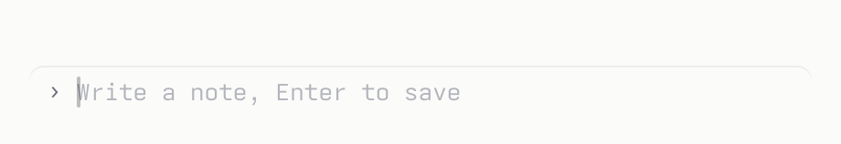
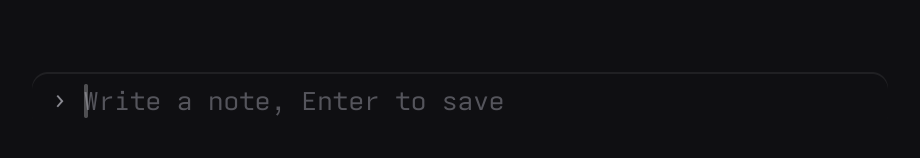
</figure>

这个例子把偏移当作字节处理，这只对 ASCII 文本成立。字段绘制完成后，可在任何
持有 `cx` 的处理器中让它获得焦点，例如在 `focus` 事件到达时：

```lua
event = function(state, ev, cx)
	if ev.ev == "focus" then
		cx:frame({ { "focus", ev.id } })
	end
end
```

获得焦点、已有文本、带一处装饰，并在光标处给出补全建议：

```lua
ui.node("editor", {
	key = "draft",
	text = "Ship the notes after @review",
	cursor = 28,
	ghost = " signs off",
	decor = { { from = 21, to = 28, s = "accent" } },
	placeholder = "Write a note, Enter to save",
	prompt = { ui.span("› ", "muted") },
	maxLines = 6,
})
-- and once: cx:frame({ { "focus", "dock.draft" } })
```

<figure class="tn-figure">
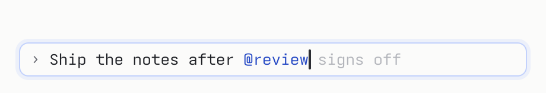
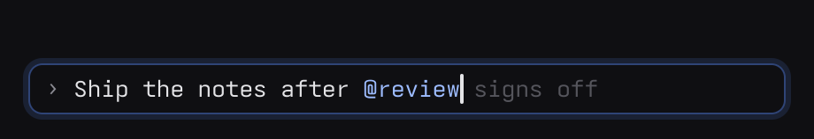
<figcaption>焦点边框与满强度光标来自 focus 操作，而不是某个 prop。</figcaption>
</figure>

## `input` 单行字段 {#input}

位于着色 well 中的一个单行字段。它接受与 `editor` 相同的 prop，绘制相同的
DOM，区别如下：

- 文本从不换行（`white-space: pre`）；字段横向滚动
  （滚动条隐藏），并让光标保持在视野内。
- `maxLines` 被忽略。
- `aria-multiline="false"`；默认可访问名称是
  `placeholder`，没有时则为 `"Search"`。
- 高度为一行加 8 px（`calc(var(--sf-lh) + 8px)`），内边距 `0 8px`，
  背景 `--l1`；获得焦点时背景透明并显示强调色边框。这就是 `well` 外观；
  [附加组件](#addons)（图标、清除 ×、well、按钮、步进器、密钥）则改为
  给字段加边框。

**构建方式：** `tern.ui.node("input", { text = …, cursor = … })`。

| Prop | 类型 | 默认值 | 含义 |
| --- | --- | --- | --- |
| `text`, `cursor`, `anchor`, `decor`, `ghost`, `placeholder`, `prompt`, `mode`, `lang`, `readonly`, `sendable` | 同 [`editor`](#editor) | | |
| `variant`, `icon`, `keys`, `mono`, `clear`, `prefix`, `suffix`, `unit`, `stepper`, `secret`, `reveal`, `buttons` | 参见 [附加组件](#addons) | | |
| `aria` | string | `placeholder` 或 `"Search"`（`secret` 时为 `"Password"`） | 无障碍名称 |

一个闲置字段与获得焦点的字段并排，后者用 `anchor` 绘制选区：

```lua
ui.col({
	ui.node("input", {
		key = "filter",
		placeholder = "Filter",
		prompt = { ui.span("/", "muted") },
	}),
	ui.node("input", {
		key = "query",
		text = "deploy logs",
		cursor = 6,
		anchor = 0,
		placeholder = "Filter",
		prompt = { ui.span("/", "muted") },
	}),
})
-- focused with cx:frame({ { "focus", "main.query" } })
```

<figure class="tn-figure">
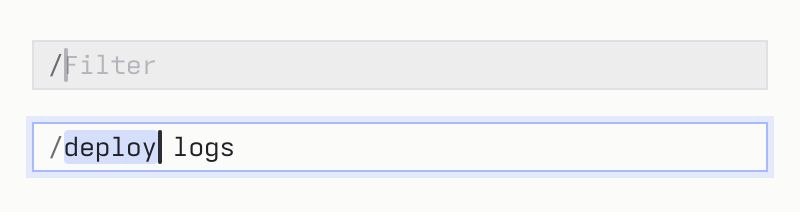
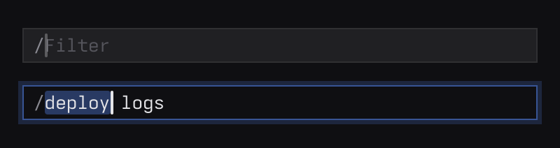
</figure>

**子节点：** 无（会被忽略）。

**事件：** 同 [`editor`](#editor)；附加组件会发送 `action`（参见 [附加组件](#addons)）。

**样式：**

```html
<div class="sf sf-input focused" data-id="main.filter" role="textbox"
     aria-multiline="false" aria-placeholder="Filter">
	<div class="sf-ed-scroll">
		<div class="sf-ed-text">abc<span class="sf-caret"></span></div>
	</div>
	<span class="sf-ed-mode"></span>
</div>
```

| 目标 | 选择器 |
| --- | --- |
| 节点 | `.sf-input` |
| 状态 | `.sf-input.focused`、`.readonly`、`.empty`、`.code`、`.selecting`、`[data-mode]` |
| 组成部分 | `.sf-ed-scroll`、`.sf-ed-text`、`.sf-ed-prompt`、`.sf-ed-sel`、`.sf-caret`、`.sf-ed-ghost`、`.sf-ed-ph`、`.sf-ed-preedit`、`.sf-ed-mode`（内部结构，可能变化） |

列表上方的一个过滤字段，列表中标出查询命中的项：

```lua
local ui = tern.ui

local function view(state)
	return {
		main = ui.col({
			ui.node("input", {
				key = "filter",
				text = state.query,
				cursor = #state.query,
				placeholder = "Filter",
				prompt = { ui.span("/", "muted") },
			}),
			ui.node("list", { key = "rows", filter = state.query }, state.items),
		}),
	}
end
```

用自己的样式表重绘该字段：

```css
[data-surface^='plugin.notes.'] .sf-input {
	background: transparent;
	box-shadow: inset 0 -1px 0 var(--l2);
	border-radius: 0;
}
[data-surface^='plugin.notes.'] .sf-input.focused {
	box-shadow: inset 0 -2px 0 var(--accent);
}
[data-surface^='plugin.notes.'] .sf-input .sf-caret {
	background: var(--accent);
}
```

<figure class="tn-figure">
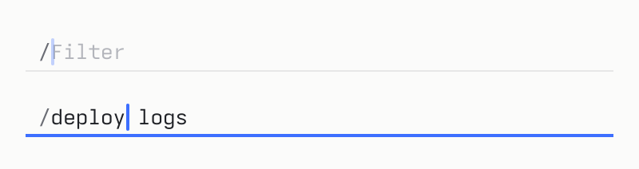
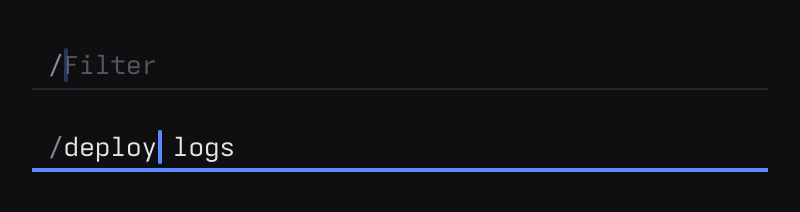
</figure>

第一条规则的优先级高于 Tern 的 `.sf-input.focused`（特异性相同，样式表更靠后），
因此它同时去掉了焦点边框；`.focused` 规则又把焦点提示加了回来。

### 附加组件 {#addons}

`input` 可以带上一向围绕字段文本的那些部件：前置图标、说明如何到达该字段的
键帽、清除 ×、承载值中固定片段的 well（`https://`、`.com`）、单位、⌃⌄
步进器、附着在其边框上的按钮（如 Send），以及密钥字段的眼睛按钮。请优先使用
它们，而不是用 `row` 拼出图标、字段和按钮：它们位于同一个边框内，在各种字号下
都对齐，并且不会从你的程序手中夺走按键。

附加组件以 Tern 的 **field** 外观绘制，即 kit 带边框的文本框：30 px 的 well
（`--well`）配细线边框与 8 px 圆角，字段获得焦点时边框收紧为强调色边框。
任何附加组件都会隐含这种外观；`variant` 可自行指定：

| `variant` | 外观 |
| --- | --- |
| `"well"`（没有附加组件时的默认值） | 上文那种着色的单行 well：`--l1`，一行加 8 px，获得焦点前没有边框 |
| `"field"`（有附加组件时的默认值） | kit 的带边框字段：30 px，`--well`，细线边框，获得焦点时有强调色边框与 3 px 光晕 |

既没有附加组件也没有 `variant` 的字段保持 well 外观。

在 sans 区域（`font: "sans"`）中，`field` 就是应用自身的控件：其文本与占位符
使用 kit 的 13 px UI 字体，而不是终端的等宽字体，除非 `mono: true` 为机器值
（URL、token、id）保留等宽字体。它的光标仅在获得焦点时显示，闲置字段从开头
显示内容（长值只在获得焦点时滚动到光标处），与 kit 的字段一致；`well` 外观
则保留其变暗的闲置光标与滚动行为。

**字段内部。** `icon` 位于文本之前（`--t3`，获得焦点时为 `--t2`）。`keys`
在字段闲置且为空时于末尾为一个组合键绘制键帽（`["cmd","f"]` 显示为 ⌘F）
（它说明如何到达该字段，因此字段一旦拿到按键或已有文本就消失）。`clear: true`
在字段有文本且不是 `readonly` 时于末尾绘制一个实心圆底 ×；点击会发送 `action`
`clear`，由你的程序清空 `text`。`unit` 是文本之后的等宽词（`bytes`、`ms`、`MB`）。

**附着在边框上。** `prefix` 与 `suffix` 是淡色着色的等宽 well，一直延伸到
边框，并用一条细线与文本分隔：它们是值中固定的部分，不属于 `text`。
`stepper: true` 在末尾附着一个 ⌃⌄ 分段；两半分别发送 `action` `inc` 与
`dec`，由你的程序设置新的 `text`。`buttons` 附着动作：`default` 按钮是一段
细线分隔的片段（一个图标或一个短词），`primary`、`quiet` 与 `danger` 是边框内
嵌入式的小按钮（`input` 中 22 px，`editor` 中 24 px；只能有一个 `primary`
的 Send）。每次点击都会带上按钮的 `act` 发送 `action`；内置 act 与任何指针
动作一样执行，因此 `copy` 复制字段的文本（密钥字段复制其真实文本，而不是圆点）。

**密钥。** `secret: true` 为 `text` 的每个 UTF-16 码元绘制一个 `•`（BMP 之外的
emoji 算两个），因此 `cursor`、`anchor`、`decor` 与 `edit` 的偏移含义一如既往，
并附着一个可原地显示文本的眼睛按钮。眼睛按钮是本地状态，如同卡片的折叠：它
立即翻转，不发送任何内容，并由节点的 `key`（否则是其 id）在同级之间记住。
当你的 `reveal` prop 变化时，控制权重新回到该 prop：发送 `reveal: true` 显示
文本（例如“显示密码”设置），`false` 隐藏它。密钥字段从不参与高亮（`lang`
被忽略），不显示 `ghost`，复制其圆点的原生选区得到的也是圆点；用 `typeahead`
保留的输入同样以圆点绘制。其默认可访问名称为 `"Password"`。

`editor` 接受 `variant` 与 `buttons`（用于提示输入框）：field 外观为它加边框，
其按钮位于右下角，默认按钮为低调的圆角图标。

从开头起的顺序为：`prefix`、`icon`、文本、`unit`、×、`keys`、vim 模式 chip，
然后是附着部分：`suffix`、眼睛、按顺序排列的 `buttons`、步进器。

```lua
local ui = tern.ui

local function view(state)
	return {
		main = ui.col({
			ui.node("input", {
				key = "find",
				text = state.query,
				cursor = #state.query,
				placeholder = "Find in table",
				icon = "search",
				keys = { "cmd", "f" },
				clear = true,
			}),
			ui.node("input", {
				key = "size",
				text = tostring(state.size),
				stepper = true,
				unit = "bytes",
			}),
			ui.node("input", {
				key = "token",
				text = state.token,
				secret = true,
				buttons = { { act = "copy", icon = "copy", title = "Copy token" } },
			}),
			ui.node("input", {
				key = "ask",
				text = state.draft,
				placeholder = "Ask anything…",
				buttons = { { act = "send", text = "Send", variant = "primary", keys = { "enter" } } },
			}),
		}),
	}
end

local function event(state, ev)
	if ev.ev == "action" and ev.act == "clear" then
		state.query = ""
	elseif ev.ev == "action" and ev.act == "inc" then
		state.size = state.size * 2
	elseif ev.ev == "action" and ev.act == "dec" then
		state.size = math.max(1, state.size // 2)
	elseif ev.ev == "action" and ev.act == "send" then
		send(state.draft)
	end
end
```

TSX（TypeScript SDK）中的同一示例：

```tsx
<col>
   <input key="find" text={s.query} cursor={s.query.length} placeholder="Find in table"
          icon="search" keys={['cmd', 'f']} clear
          onAction={{ clear: () => { s.query = ''; render(); } }} />
   <input key="url" text={s.host} prefix="https://" suffix=".com" />
   <input key="size" text={String(s.size)} stepper unit="bytes"
          onAction={{ inc: () => step(2), dec: () => step(0.5) }} />
   <input key="token" text={s.token} secret
          buttons={[{ act: 'copy', icon: 'copy', title: 'Copy token' }]} />
   <input key="ask" text={s.draft} placeholder="Ask anything…"
          buttons={[{ act: 'send', text: 'Send', variant: 'primary', keys: ['enter'] }]}
          onAction={{ send: () => send(s.draft) }} />
</col>
```

<figure class="tn-figure">
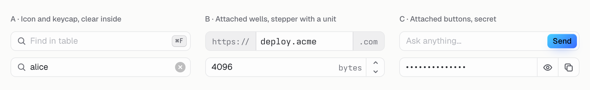
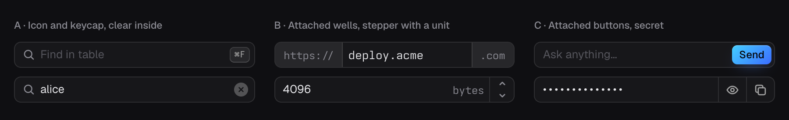
<figcaption>字段内部（A）、附着的 well 与步进器（B）、附着的按钮与密钥字段（C），位于 sans 区域。</figcaption>
</figure>

<figure class="tn-figure">
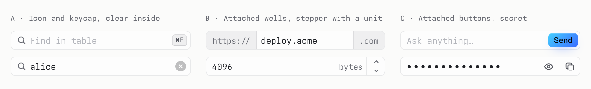
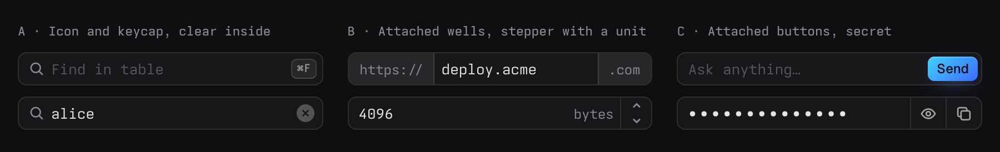
<figcaption>同样的字段，位于默认等宽区域。</figcaption>
</figure>

<figure class="tn-figure">
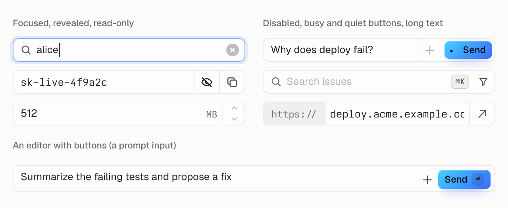
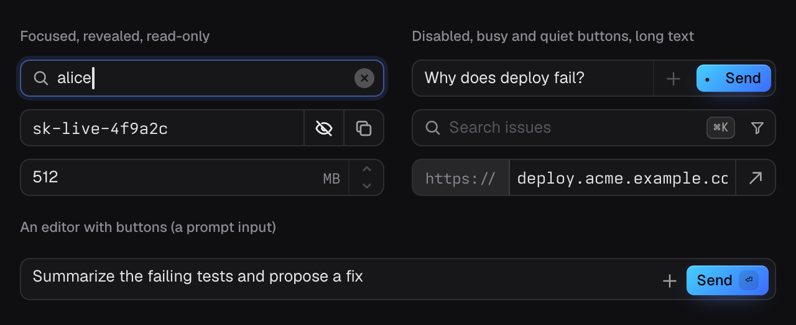
<figcaption>焦点、<code>reveal</code>、<code>readonly</code>、<code>mono</code>、禁用、忙碌与低调按钮，以及带 <code>buttons</code> 的 <code>editor</code>。</figcaption>
</figure>

**Prop**（在 `input` 自身之外新增；`editor` 接受 `variant` 与 `buttons`）：

| Prop | 类型 | 默认值 | 含义 |
| --- | --- | --- | --- |
| `variant` | `"well"` \| `"field"` | 有任一附加组件时为 `"field"`，否则为 `"well"` | 外观；未知值按默认值处理 |
| `icon` | string (icon name) | 无 | 前置图标；未知名称不绘制 |
| `keys` | string \| string[] (key names) | 无 | 字段闲置且为空时，在末尾为一个组合键绘制键帽（`["cmd","f"]` 显示为 ⌘F） |
| `mono` | boolean | `false` | 在 sans 区域中，`field` 的文本保留终端的等宽字体（URL、token） |
| `clear` | boolean | `false` | 文本非空且字段不是 `readonly` 时在末尾显示圆底 ×；发送 `action` `clear` |
| `prefix` | string | 无 | 文本之前的等宽 well，附着在边框上 |
| `suffix` | string | 无 | 文本之后的等宽 well，附着在边框上 |
| `unit` | string | 无 | 文本之后的等宽单位，位于字段内部 |
| `stepper` | boolean | `false` | 附着的 ⌃⌄ 分段；发送 `action` `inc` / `dec`；`readonly` 时变暗且不响应 |
| `secret` | boolean | `false` | 为 `text` 的每个 UTF-16 码元绘制一个 `•`，并附着可原地显示内容的眼睛按钮 |
| `reveal` | boolean | `false` | 密钥字段的显示状态；一旦变化即胜过眼睛按钮 |
| `buttons` | `Button[]` | 无 | 附着的按钮，按顺序排列，位于眼睛之后、步进器之前 |

`Button`：

| 字段 | 类型 | 默认值 | 含义 |
| --- | --- | --- | --- |
| `act` | string | 必填 | 点击时发送的 act（`"copy"` 复制文本；`"x=y"` 发送 `act` `x`，`value` 为 `y`）；没有 act 的条目会被跳过 |
| `text` | string | 无 | 标签；没有时按钮只显示图标 |
| `icon` | string (icon name) | 无 | 前置图标 |
| `variant` | `"default"` \| `"primary"` \| `"quiet"` \| `"danger"` | `"default"` | `default`：附着的细线片段；其余：`button` 类型外观中的嵌入式 `sm` 按钮（`editor` 中为 24 px） |
| `keys` | string[] | 无 | 标签之后的键帽（嵌入式按钮） |
| `title` | string | 标签与键帽 | 提示文本；也是纯图标按钮的无障碍名称（否则为它的 `act`） |
| `disabled` | boolean \| string | `false` | 变淡且不响应；字符串为提示中给出的原因 |
| `busy` | boolean | `false` | 图标位置显示加载指示（嵌入式按钮），不响应 |

**事件：** 除 [`editor`](#editor) 的 `focus`、`edit` 与 `undo` 之外：

| 事件 | 触发时机 | 载荷 |
| --- | --- | --- |
| `action` `clear` | 点击 × | `{ev = "action", id, act = "clear", mods?, values?}` |
| `action` `inc` / `dec` | 点击步进器的某一半 | `{ev = "action", id, act = "inc"}` / `"dec"` |
| `action` `<act>` | 点击按钮 | `{ev = "action", id, act, value?, mods?, values?}`；内置 act（`copy`、`open` 等）按指针动作执行 |

它们都不会请求焦点或移动光标，眼睛按钮也不发送任何内容。在已关闭的 Surface
上，或以 `listen = false` 打开的 Surface 上，这些部件会绘制但不发送任何内容，
眼睛按钮也不会翻转。

**键盘模型。** 附加组件与 `button` 一样只响应指针：按下它们绝不会从你的程序
手中夺走按键。请自行绑定按键并驱动 prop：⌘F 让字段获得焦点（`focus` 操作；
`keys` 只负责显示键帽），Esc 像 `clear` 那样清空 `text`，↑/↓ 像 `inc`/`dec`
那样改变数值，Enter 像 Send 按钮那样发送，“显示密码”键设置 `reveal`。

**样式：**

```html
<div class="sf sf-input focused" data-id="main.find" data-variant="field" role="textbox"
     aria-multiline="false" aria-placeholder="Find in table">
	<span class="sf-in-pre sf-in-well">https://</span>
	<span class="sf-in-ic" aria-hidden="true"><svg class="ico">…</svg></span>
	<div class="sf-ed-scroll"><div class="sf-ed-text">alice<span class="sf-caret"></span></div></div>
	<span class="sf-in-unit">bytes</span>
	<button class="sf-in-x sf-in-act" data-act="clear" aria-label="Clear" title="Clear"><svg class="ico">…</svg></button>
	<span class="sf-kbd kbds sf-in-keys" aria-hidden="true"><span class="kbd">⌘F</span></span>
	<span class="sf-ed-mode"></span>
	<span class="sf-in-end">
		<span class="sf-in-suf sf-in-well">.com</span>
		<button class="sf-in-seg sf-in-act sf-in-eye only-ic" aria-label="Show" aria-pressed="false"><svg class="ico">…</svg></button>
		<button class="sf-in-seg sf-in-act only-ic" data-act="copy" aria-label="Copy key" title="Copy key"><svg class="ico">…</svg></button>
		<button class="sf-button sf-in-btn sf-in-act" data-act="send" data-variant="primary" data-size="sm"><span class="sf-btn-label">Send</span></button>
		<span class="sf-in-step" role="group">
			<button class="sf-in-stepb sf-in-act" data-act="inc" aria-label="Increment"><svg class="ico">…</svg></button>
			<button class="sf-in-stepb sf-in-act" data-act="dec" aria-label="Decrement"><svg class="ico">…</svg></button>
		</span>
	</span>
</div>
```

每个部件只在对应的 prop 要求时才出现。

| 目标 | 选择器 |
| --- | --- |
| 外观 | `.sf-input[data-variant='field']`、`.sf-editor[data-variant='field']` |
| 状态 | `.sf-input.secret`、`.revealed`（显示自身文本的密钥字段）、`.mono`，以及上述 `.focused`、`.readonly`、`.empty` |
| 内部 | `.sf-in-ic`、`.sf-in-unit`、`.sf-in-x`、`.sf-in-keys` |
| 附着部分 | `.sf-in-well`（`.sf-in-pre`、`.sf-in-suf`）、`.sf-in-end`、`.sf-in-seg`（`.only-ic`、`.on`、`.disabled`、`.busy`）、`.sf-in-eye`、`.sf-in-btn`（一个 `.sf-button`）、`.sf-in-step`、`.sf-in-stepb` |
| 每个可交互部件 | `.sf-in-act[data-act]` |

## `otp` 一次性验证码 {#otp}

一种短代码，每个字符占一格：登录验证码的六位数字、配对 PIN、设备码。每个字符
位于各自的单元格中，组之间用短横线分隔，下一个按键将落入的单元格带强调色边框和
闪烁的光标，因此用户始终能看到还剩多少位。只要代码长度固定，就该用它；自由文本
请使用 [`input`](#input)。

与视图中的每个字段一样，代码归你所有：按键以输入的形式到达你的程序，你用
`text` 回应（当光标不在文本末尾时还需 `cursor`）。Tern 只绘制，从不编辑。
单元格永远不会获得键盘焦点。

**构建方式：** `tern.ui.node("otp", { text = …, length = 6 })`。

| Prop | 类型 | 默认值 | 含义 |
| --- | --- | --- | --- |
| `text` | string | `""` | 目前为止输入的字符，每格一个。超出 `length` 的字符不会被绘制 |
| `length` | integer | `6` | 单元格数量，钳制到 1–12 |
| `group` | integer | `3` | 每组单元格数；短横线（`.sf-otp-sep`）分隔各组。`0`，或不小于 `length` 的值，都绘制为一组 |
| `cursor` | integer \| `false` | `text` 的长度 | 活动单元格（从 0 开始）：带强调色边框，为空时还带光标。会钳制到第一个空单元格；等于 `length`（默认为已填满的代码）、为负或 `false` 时不显示活动单元格 |
| `variant` | `"cells"` \| `"joined"` \| `"underline"` | `"cells"` | 外观（见下文）。其他值按 `cells` 处理 |
| `mask` | boolean \| string | `false` | 隐藏已输入的内容：`true` 在每个已填单元格中绘制圆点，字符串则绘制其首个字符（`"*"`） |
| `state` | `"error"` \| `"success"` | 无 | `error` 用 `--bad` 为单元格描边、为提示着色，并让代码抖动一次（减弱动效时不抖）；`success` 用 `--ok` 描边。其他值按无状态处理 |
| `hint` | string | 无 | 单元格下方的一行低调文字，12px `--t3`：代码发往何处、重发倒计时、错误信息。采用 state 对应的颜色 |
| `disabled` | boolean or string | `false` | 变暗，没有活动单元格，点击不发送任何内容；类为 `disabled`，`aria-disabled="true"` |

通用 prop 同样可用：`title`、`aria`（组的名称，默认为
“One-time code”）、`tone`，以及 flex 系列 prop。代码的尺寸取决于其单元格，从不
拉伸（`align-self: flex-start`）。

**变体。**

| `variant` | 外观 | 用途 |
| --- | --- | --- |
| `cells` | 独立的 34×40 方块，背景 `--card`，`--l2` 细线边框（填入后为 `--l3`），18px 等宽数字，组间一条短横线；活动单元格为 1.5px 强调色边框加 3px 强调色光晕 | 默认值：登录验证码、PIN |
| `joined` | 每组是一个字段（`--card`，`--l3` 边框），用 `--l2` 细线分隔成 38×38 的单元格；活动单元格染上强调色 | 密集的表单与面板，六个独立的方块显得过于喧闹 |
| `underline` | 没有方框：数字位于 2px 线条之上（`--l3`，填入为 `--t4`，活动为强调色），提示在下方 | 安静的流程、引导页、独立页面上显示的一次性验证码 |

输入的字符会在 .18 s 内升入其单元格；悬停会加强单元格的边框（或线条），
按下时回落到 96%。光标像字段一样闪烁，在减弱动效、面板暂停或未获得焦点时
保持静止。错误抖动（.32 s，横向偏移几个像素）在每次 `state` 变为 `"error"`
时播放，减弱动效时从不播放；在中间设置另一个状态（或不设状态）即可再次抖动。

**子节点：** 无（会被忽略）。

**事件：** 在代码启用且 Surface 正在监听时点击某个单元格，光标会立即移过去，
并发送

```lua
{ ev = "action", id = "<the otp's id>", act = "focus", value = 2 }
```

`value` 是光标移到的单元格：被点击的那一格；当点击落在文本之外时，则是第一个
空单元格（因此点击只输入了一半的代码的最后一格，仍表示“在这里输入”）。把你的
焦点移到该代码并把 `cursor` 设为 `value`（或忽略它：模态浮层会留住按键）。本地
光标会保留，直到你下一次改动 `text` 或 `cursor`，以那次改动为准。禁用的代码、
已关闭的 Surface 或以 `listen = false` 打开的 Surface 不发送任何内容，也不移动
任何东西。对单元格的点击不会到达代码周围的节点。

**键盘模型。** 你的程序持有每个按键；一种常见映射：

| 按键 | 作用 |
| --- | --- |
| 代码接受的字符 | 替换 `cursor` 处的字符（在末尾则追加），然后前进：设置 `text`，仅当光标不在文本末尾时设置 `cursor` |
| Backspace | 删除光标之前的内容（当光标位于已填单元格上时，删除该字符） |
| ← / → | 在文本内移动 `cursor` |
| 粘贴（括号包裹） | 取其中符合要求的字符，最多 `length` 个，作为整个 `text` |
| Enter，或最后一个字符 | 提交；用 `state = "error"` 与 `hint`，或 `"success"` 回应 |

用户再次输入时立即清除 `state`。

**样式：**

```html
<div class="sf sf-otp" data-id="main.code" data-variant="cells" data-state="error"
	role="group" aria-label="One-time code" aria-invalid="true" aria-disabled="false">
	<div class="sf-otp-row">
		<div class="sf-otp-group">
			<span class="sf-otp-cell filled" role="button" aria-label="Character 1 of 6: 4"><span class="sf-otp-ch">4</span></span>
			<span class="sf-otp-cell filled" role="button" aria-label="Character 2 of 6: 8"><span class="sf-otp-ch">8</span></span>
			<span class="sf-otp-cell filled" role="button" aria-label="Character 3 of 6: 1"><span class="sf-otp-ch">1</span></span>
		</div>
		<span class="sf-otp-sep" aria-hidden="true"></span>
		<div class="sf-otp-group">
			<span class="sf-otp-cell on" role="button" aria-current="true" aria-label="Character 4 of 6"><i class="sf-otp-caret" aria-hidden="true"></i></span>
			<span class="sf-otp-cell" role="button" aria-label="Character 5 of 6"></span>
			<span class="sf-otp-cell" role="button" aria-label="Character 6 of 6"></span>
		</div>
	</div>
	<div class="sf-otp-hint">That code didn’t work. Try again.</div>
</div>
```

| 目标 | 选择器 |
| --- | --- |
| 节点 | `.sf-otp` |
| 变体 / 状态 | `.sf-otp[data-variant='joined']`、`.sf-otp[data-state='error']`（`[aria-invalid='true']`）、`[data-state='success']` |
| 禁用 / 已填满 | `.sf-otp.disabled`（`[aria-disabled='true']`）、`.sf-otp.full`（每个单元格都已填） |
| 一个组（joined 外观的字段） | `.sf-otp-group` |
| 一个单元格 | `.sf-otp-cell`，已填 `.filled`，活动 `.on`（`[aria-current='true']`） |
| 组分隔短横线 | `.sf-otp-sep` |
| 字符 / 掩码圆点 / 光标 | `.sf-otp-ch`、`.sf-otp-dot`、`.sf-otp-caret`（内部结构，可能变化） |
| 下划线 | `.sf-otp[data-variant='underline'] .sf-otp-cell::after` |
| 提示 | `.sf-otp-hint` |

单元格的边框用 `box-shadow` 绘制（joined 外观绘制在 `.sf-otp-group` 上），
数字在任何区域（等宽或 sans）中都是 `500 18px` 等宽字体并启用等宽数字。
掩码单元格的标签显示“已填”而不是具体字符。

```lua
local ui = tern.ui

return ui.col({
	ui.text({ ui.span("Enter the code we sent to •••• 42", "muted") }),
	ui.node("otp", {
		key = "code",
		text = state.code,
		cursor = state.cursor,
		state = state.wrong and "error" or nil,
		hint = state.wrong and "That code didn’t work. Try again." or ("Resend in 0:" .. state.wait),
	}),
})
```

TSX 中的同一示例，其中 `onAction` 把 act 映射到处理器：

```tsx
<col gap="sm">
   <text>Enter the code we sent to •••• 42</text>
   <otp
      key="code"
      text={s.code}
      cursor={s.cursor}
      state={s.wrong ? 'error' : undefined}
      hint={s.wrong ? 'That code didn’t work. Try again.' : `Resend in 0:${s.wait}`}
      onAction={{ focus: ev => { s.cursor = ev.value as number; render(); } }}
   />
</col>
```

<figure class="tn-figure">
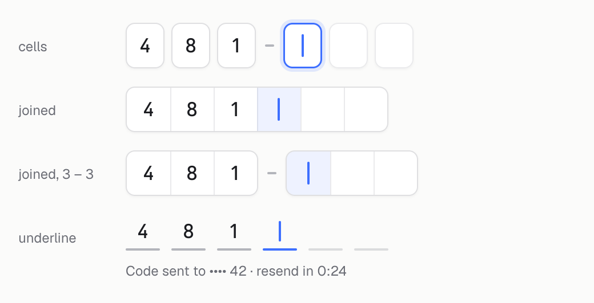
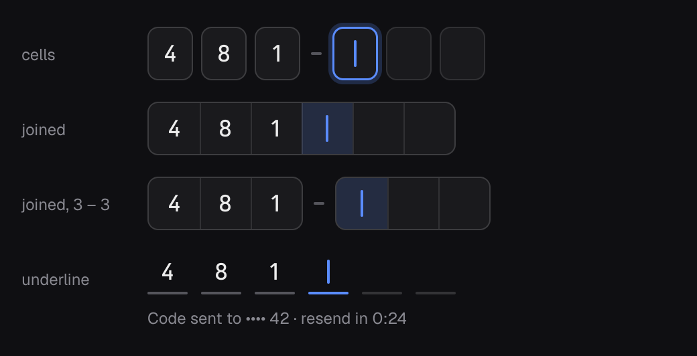
<figcaption>三种外观：<code>cells</code>、<code>joined</code>（单组，然后是 3 – 3）和带 <code>hint</code> 的 <code>underline</code>。</figcaption>
</figure>

<figure class="tn-figure">
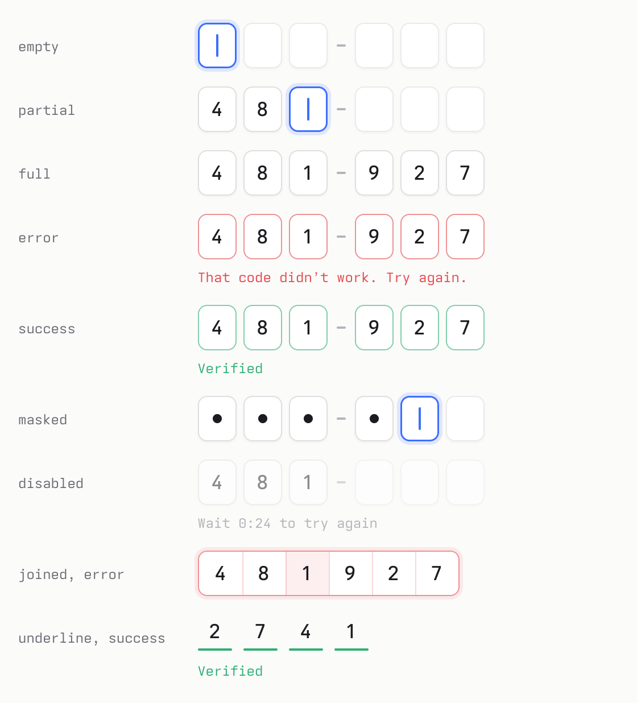
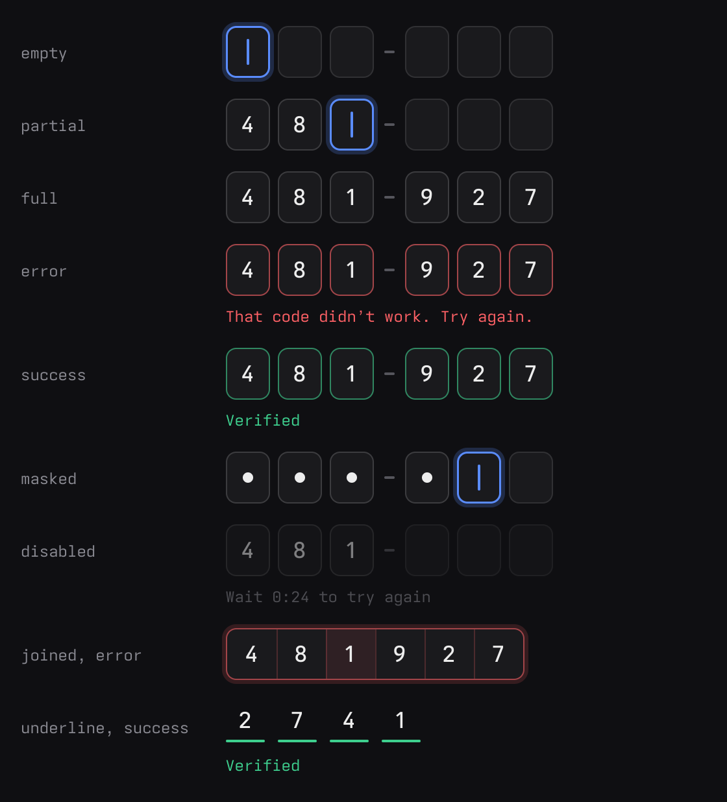
<figcaption>为空、部分、填满、<code>error</code>、<code>success</code>、<code>mask</code>、<code>disabled</code>，以及其他外观下的这些状态。</figcaption>
</figure>

## `select` 选择器 {#select}

从菜单中选取一个值，采用 kit 的 select 外观：触发器上显示当前选项，展开后是
玻璃质感的选项菜单，当前项带勾选标记。它覆盖 select、原生弹出按钮与组合框三种
形态。只要分段选择会超过三四个选项，就该用它从一组值中选出一个：模型、区域、
分支、排序方式。

两种外观，由 `variant` 决定，另有一个行为 prop：

- **`field`**（默认值）是一个 30px 的卡片式按钮，带细线边框，显示值与一个
  箭头，用于表单与设置。其菜单勾选当前选项，并在右侧以低调的等宽字体绘制
  每个选项的 `detail`。
- **`quiet`** 没有边框：值（位于一个低调的 `label` 之后，如
  “Model  Sonnet 4.5”）显示在一个胶囊上，悬停时与展开时显现，用于面板头部与
  工具条。其菜单用强调色染当前选项，而不是勾选它。
- **`search = true`** 让任一外观变成组合框。展开时，`field` 的触发器变成
  搜索行（搜索图标、你的 `query` 与光标，以及 `3 of 24` 这样的计数）；
  `quiet` 触发器保留其胶囊，搜索行位于菜单顶部。标签像 `list` 标记其
  `filter` 那样标记查询的命中项，`group` 名称绘制分组标题。

在 `col` 中，select 保持 `align-self: flex-start`，并且在任何区域（等宽或
sans）中都以 Tern 的 UI 字体（Geist）绘制；detail 与计数使用等宽字体。
菜单悬挂在触发器下方 4px 处，位于节点内部，因此其外围的卡片或行不会裁切它；
布局完成后，如果面板上方空间更大而下方放不下菜单，它会改为在触发器上方展开；
当它会超出面板边界时，则与触发器的右边缘对齐。一次最多显示约十行 30px 的行；
更多时在菜单内部滚动，并让高亮的选项保持在视野内。

**构建方式：** `tern.ui.node("select", props)`。没有专用构造函数。

**指针与按键。** 与 `el` 系列控件一样，select 从不获取焦点：按键送到你的
`key` 处理器，由它通过 prop 驱动菜单。指针立即生效，随后再通知你：

- 点击触发器会展开或收起菜单，并发送 `toggle`；
- 点击某个选项会把它显示为值、收起菜单，并发送 `change`（当它是另一个值时），
  随后发送 `toggle`；
- 在已展开的菜单及其触发器之外的任何位置按下都会收起菜单，并发送
  `toggle`（轻量关闭）。

Tern 在节点绘制期间记住该展开状态与选择，并在你的 `open` 或 `value` 与它上次
绘制的内容不同之前，把它们绘制在你的 prop 之上：把 `change` 镜像到 `value`、
把 `toggle` 镜像到 `open`，你就始终是所有者。在展开的组合框的搜索行中点击会
使其保持展开（按键在那里输入）。禁用的 select，以及位于已关闭或以
`listen = false` 打开的 Surface 上的任何 select，都会绘制，但不会展开，也不会
发送任何内容。

**在组合框中输入。** 搜索行是绘制出来的，不是原生字段，正如
[`picker`](lists.md#picker) 的搜索行一样：你的 `key` 处理器保存查询及其光标，
把它们作为 `query` 与 `cursor` 发回，并自行过滤 `options`（Tern 标记的是同一
段文本）。编辑查询可参照 input 类型的[按键处理器](#input)；搜索行不提供 ⌘C、
选区与 IME 组合。一种典型的键盘模型：

| 按键 | 收起时 | 展开时 |
| --- | --- | --- |
| Enter、Space、↓ | `open = true`，`active = value` | Enter：`value = active`，`open = false` |
| ↑ / ↓ | | 在启用的选项间移动 `active` |
| Escape | | `open = false`（组合框还会清空 `query`） |
| 文本、Backspace、← → | | 组合框：编辑 `query` 与 `cursor`，重新过滤 `options`，`active` = 第一个匹配项 |

| Prop | 类型 | 默认值 | 含义 |
| --- | --- | --- | --- |
| `value` | string | 无 | 当前选项的 `value`。没有时触发器显示 `placeholder`。没有任何选项具备的值（例如搜索缩小后的列表）按其自身显示 |
| `options` | `{ string \| SelectOption }` | `{}` | 按顺序排列的选项。字符串即一个 value 与 label 都是该字符串的选项。`SelectOption` 见下文 |
| `variant` | `"field"` \| `"quiet"` | `"field"` | 外观（见上文）。其他值按 `field` 处理 |
| `label` | string | 无 | 触发器上值之前的低调标签（“Model”），以及组合框的无障碍名称（除非 `aria` 给出） |
| `placeholder` | string | `"Select…"`；搜索时为 `"Search…"` | 没有 `value` 时触发器的文本，以及没有 `query` 时搜索行的文本 |
| `size` | `"sm"` \| `"md"` | `"md"` | `field`：30px（`sm` 为 26px）。`quiet`：28px（`sm` 为 22px）。`sm` 菜单的行高为 26px |
| `disabled` | boolean or string | `false` | 变暗且不响应：不展开、不发送，类为 `disabled`，`aria-disabled="true"`。字符串为原因，作为触发器的提示 |
| `open` | boolean | `false` | 菜单显示（由你驱动的键盘状态）。一旦变化即胜过指针的展开或收起 |
| `active` | string | 当前的 `value` | 高亮选项的 `value`（键盘光标，类 `sel`）；变化时滚动到可见位置。没有选项具有它时忽略 |
| `search` | boolean | `false` | 组合框（见上文） |
| `query` | string | `""` | 绘制在搜索行中的搜索文本；其命中项在标签中被标记 |
| `cursor` | number | `query` 末尾 | `query` 中的光标，以 UTF-16 码元计 |
| `total` | number | 无 | 整个集合的大小：有 `query` 时，计数读作 `<options shown> of <total>`（没有时只显示数字） |
| `empty` | string | 有 `query` 时为 `"No matches"`，否则为 `"No options"` | `options` 为空时菜单的文本 |

**`SelectOption`：**

| 字段 | 类型 | 默认值 | 含义 |
| --- | --- | --- | --- |
| `value` | string | 必填 | `value`、`active` 与 `change` 携带的内容。没有该字段的条目会被跳过 |
| `label` | string | `value` | 选项显示的文本，以及当前时触发器显示的文本 |
| `detail` | string | 无 | 选项右侧的低调等宽文本（`default`、`200k`、`$3 / $15`） |
| `icon` | icon name | 无 | 来自 [Tern 的图标集](data.md#icon-names) 的前置图标（提供方 logo 用 `provider:anthropic`）；当前选项的图标也会出现在触发器上 |
| `group` | string | 无 | 在每段 `group` 相同的连续选项的第一个之上绘制的分组标题 |
| `disabled` | boolean | `false` | 绘制得较淡，永远不会被选中 |

通用 prop 同样可用：`title`、`aria`（组合框的名称）、`key`、
`tone`（为你的样式表设置 `--tc`）、`hidden` 以及 flex 系列 prop。

**变体。**

| `variant` | 触发器 | 菜单 | 用途 |
| --- | --- | --- | --- |
| `field` | Kit 的 `.sel-btn`：`--card`（深色主题为 `--raise`）配 `--l2` 细线边框；悬停时边框为 `--l3`；展开时为 55% 强调色边框加 3px 强调色光晕 | 玻璃质感的 `.pop.sel-menu`：当前选项之前一个强调色勾选，等宽字体的 detail | 表单、设置、对话框 |
| `quiet` | 无填充、无边框，值以 500 字重显示在 `--t3` 的标签之后；悬停 `--l1`，展开与按下 `--l2` | 当前选项以 `--accent-ink` 显示在 10% 强调色底上，没有勾选列 | 面板头部、工具条、工具栏 |
| 任一外观，`search = true` | 展开时：`field` 在其强调色边框内变为搜索行；`quiet` 保留其胶囊 | `quiet`：搜索行位于 `--l1` 胶囊中，处于菜单顶部 | 超过十几个选项，或选项来自搜索 |

菜单以 kit 的 `popIn`（.22s）弹入；按下时触发器立即缩放到 98.5%；悬停与选区的
着色在 .12–.15s 内渐变。在 Tern 的减弱动效（`.sf-still`）或系统的减弱动效下，
菜单不带动画地出现，光标也停止闪烁。

**子节点：** 无（会被忽略）。

**事件：**

```lua
{ ev = "change", id = "<the select's id>", value = "haiku" }  -- an option was picked
{ ev = "toggle", id = "<the select's id>", open = true }      -- the pointer opened or closed the menu
```

`change` 仅在所选与显示的值不同时发送；一次选择总会收起菜单，因此其后会跟随
一个 `open = false` 的 `toggle`。与卡片的 `toggle` 不同，select 携带的是
`open`，而不是 `collapsed`。在 `el` 表单内，select 不发送 `values`；请从你的
状态中读取它的值。

**样式：**

```html
<div class="sf sf-select open search" data-id="main.model" data-variant="field" data-size="md">
	<button class="sf-select-btn sel-btn" role="combobox" aria-haspopup="listbox" aria-expanded="false">
		<span class="sf-select-ic"><svg class="ico">…</svg></span>     <!-- the current option's icon -->
		<span class="sf-select-label">Model</span>
		<span class="sf-select-v v">Sonnet 4.5</span>                  <!-- .ph: the placeholder -->
		<svg class="ico sf-select-chev">…</svg>
	</button>
	<!-- a field combobox while open: the trigger is the search line -->
	<button class="sf-select-btn sel-btn searching" role="combobox" aria-expanded="true">
		<span class="sf-select-find-ic"><svg class="ico">…</svg></span>
		<span class="sf-select-field"><span class="sf-select-q">son</span><span class="sf-select-caret"></span></span>
		<span class="sf-select-count">3 of 24</span>
	</button>
	<div class="pop sel-menu sf-select-menu" role="listbox">       <!-- .up over the trigger, .end right-aligned -->
		<div class="sf-select-find">…the search line (quiet)…</div>
		<div class="sf-select-rows">
			<div class="mi-sec sf-select-group" role="presentation">Anthropic</div>
			<div class="mi sf-select-opt cur sel" role="option" aria-selected="true" data-i="0">
				<span class="mi-ck"><svg class="ico">…</svg></span>     <!-- field only -->
				<span class="sf-select-ic">…</span>
				<span class="sf-select-text"><mark class="sf-mark">Son</mark>net 4.5</span>
				<span class="sub">200k</span>
			</div>
			<div class="sf-select-empty">No matches</div>
		</div>
	</div>
</div>
```

| 目标 | 选择器 |
| --- | --- |
| 节点 | `.sf-select` |
| 外观 / 尺寸 | `.sf-select[data-variant='quiet']`、`[data-size='sm']` |
| 状态 | `.sf-select.open`、`.search`、`.disabled` |
| 触发器 | `.sf-select-btn`（展开时为 `[aria-expanded='true']`，作为搜索行时为 `.searching`） |
| 触发器部件 | `.sf-select-ic`、`.sf-select-label`、`.sf-select-v`（`.ph`）、`.sf-select-chev`（内部结构，可能变化） |
| 搜索行 | `.sf-select-find-ic`、`.sf-select-field`、`.sf-select-q`、`.sf-select-caret`、`.sf-select-ph`、`.sf-select-count`、`.sf-select-find`（内部结构，可能变化） |
| 菜单 | `.sf-select-menu`（`.up`、`.end`）、`.sf-select-rows` |
| 选项 | `.sf-select-opt`（`.cur` 为当前值，`.sel` 为活动项，`.dis`） |
| 选项部件 | `.mi-ck`、`.sf-select-text`、`.sub`、`mark.sf-mark`（内部结构，可能变化） |
| 分组标题 / 空文本 | `.sf-select-group`、`.sf-select-empty` |

触发器与菜单复用 kit 的类（`.sel-btn`、`.pop`、`.sel-menu`、`.mi`、
`.mi-ck`、`.mi-sec`、`.sub`），因此外观与 Tern 自带的选择器一致；请通过
`.sf-select…` 类重绘，它们的优先级高于 kit 的类。

面板头部的一个模型选择器，quiet 外观，由键盘驱动：

```lua
local ui = tern.ui

local MODELS = {
	{ value = "sonnet", label = "Sonnet 4.5", detail = "$3 / $15" },
	{ value = "opus", label = "Opus 4.1", detail = "$15 / $75" },
	{ value = "haiku", label = "Haiku 4.5", detail = "$1 / $5" },
}

local function view(state)
	return {
		main = ui.col({
			ui.node("card", { key = "review", head = "Review", ["end"] = "main.review.model" }, {
				ui.node("select", {
					key = "model",
					variant = "quiet",
					label = "Model",
					value = state.model,
					options = MODELS,
					open = state.open,
					active = state.active,
				}),
				ui.text("Reads the diff and leaves comments on the lines it would change."),
			}),
		}),
	}
end

local function index(value)
	for i, m in MODELS do
		if m.value == value then
			return i
		end
	end
	return 1
end

local function key(state, k, cx)
	if not state.open then
		if k.name == "enter" or k.name == "space" or k.name == "down" then
			state.open, state.active = true, state.model
		else
			return false
		end
	elseif k.name == "up" or k.name == "down" then
		local i = index(state.active) + (k.name == "down" and 1 or -1)
		state.active = MODELS[math.clamp(i, 1, #MODELS)].value
	elseif k.name == "enter" then
		state.model, state.open = state.active, false
	elseif k.name == "escape" then
		state.open = false
	else
		return false
	end
end

local function event(state, ev, cx)
	if ev.ev == "change" then
		state.model = ev.value
	elseif ev.ev == "toggle" then
		state.open, state.active = ev.open, state.model
	end
end
```

TSX（TypeScript SDK）中的组合框：程序负责过滤，Tern 负责标记：

```tsx
const shown = models.filter((m) => m.label.toLowerCase().includes(query.toLowerCase()))

<select
   variant="field"
   search
   value={model}
   options={shown.map((m) => ({ value: m.id, label: m.label, detail: m.context, group: m.provider }))}
   query={query}
   cursor={cursor}
   total={models.length}
   open={open}
   active={active}
   placeholder="Search models…"
   onChange={(ev) => setModel(ev.value)}
   onToggle={(ev) => setOpen(ev.open)}
/>
```

<figure class="tn-figure">
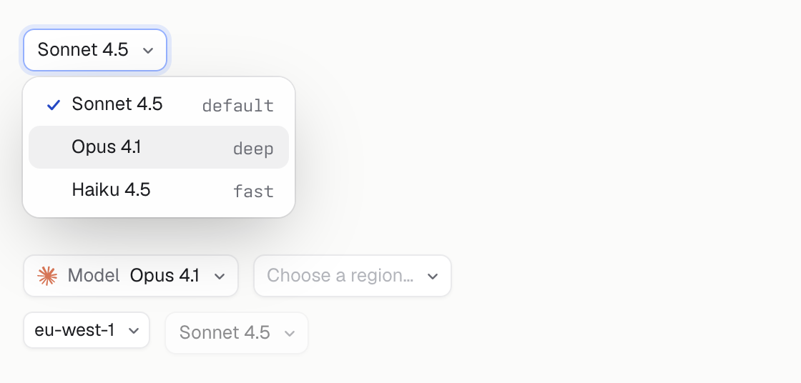
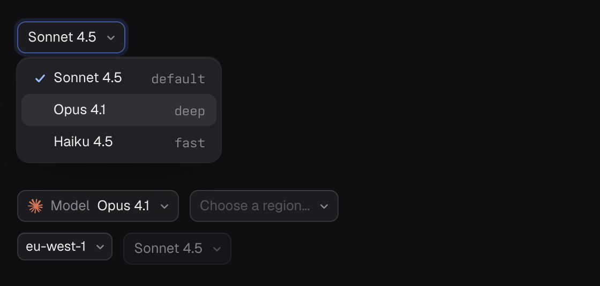
<figcaption><code>field</code> 外观：展开时 <code>active</code> 位于 Opus，随后是带 <code>label</code> 与图标的形态、<code>sm</code>、占位符以及 <code>disabled</code>。</figcaption>
</figure>

<figure class="tn-figure">
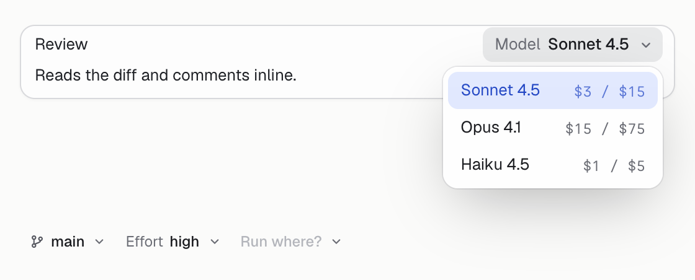
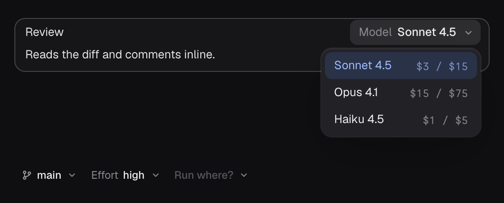
<figcaption>卡片头部中的 <code>quiet</code> 外观（其菜单与触发器的右边缘对齐），以及工具条中的 <code>sm</code> quiet 选择器。</figcaption>
</figure>

<figure class="tn-figure">
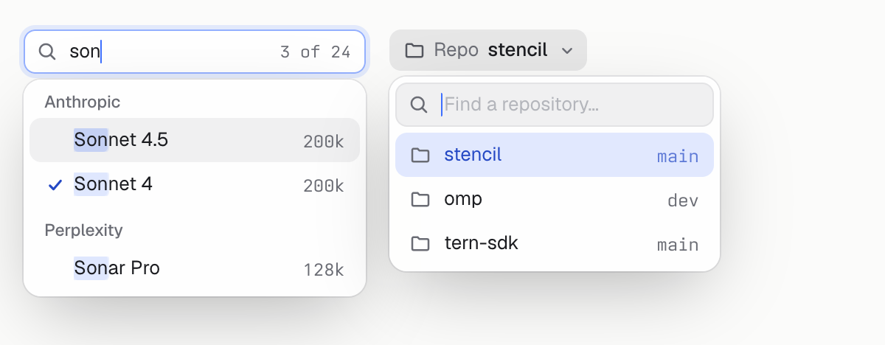
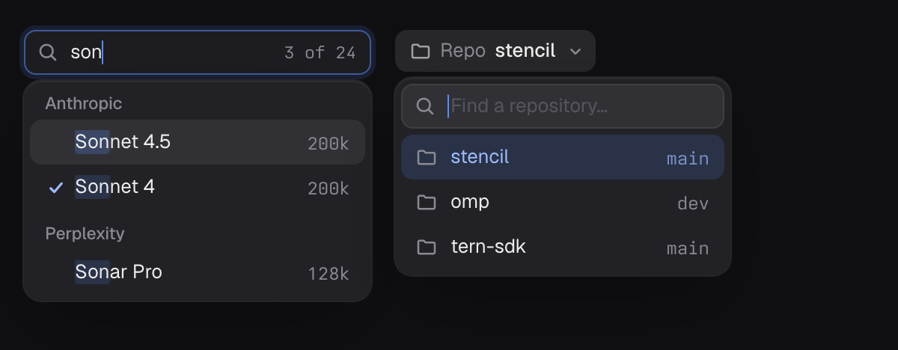
<figcaption><code>search = true</code> 用在 <code>field</code> 上（触发器即搜索行）与用在 <code>quiet</code> 选择器上（搜索行位于菜单顶部）。</figcaption>
</figure>

<figure class="tn-figure">
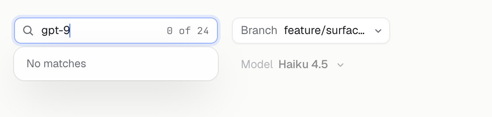
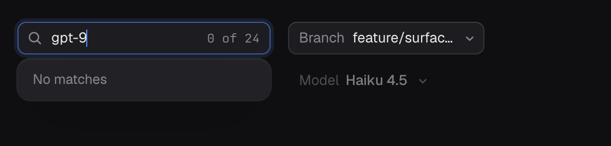
<figcaption>查询没有匹配项、长值以省略号截断、一个禁用的 <code>quiet</code> 选择器。</figcaption>
</figure>

## `calendar` 日历 {#calendar}

可供挑选的日期。默认的 `month` 变体是月份网格：星期字母、选中日显示为强调色
圆盘、区间为两个圆盘由一条着色的带连接、今天描边、周末颜色变淡、你标记的日期
带圆点，以及用于切换月份的 ‹ ›。`week` 变体用于较矮的面板：一列预设
（“Today”、“Last 7 days”）旁边是一条七天，区间在其中着色显示。当挑选日期
本身就是视图内容时（日程、报告的统计窗口），请使用日历；在表单中则使用
[`date`](#date) 字段，它把同一网格折叠进一个浮层。

一切以数据为先：你发送 `value`（一个 `"YYYY-MM-DD"` 日期，或在
`range = true` 时为 `[from, to]` 一对值），Tern 负责绘制。点击立即显示结果，
事件随后到达；你的下一个 `value` 会胜过用户的选择。区间需要点击两次，顺序
不限：第一次的一端单独显示，同时带在指针下预览，第二次则以两端排序后的形式
发送一个 `change`。早于 `min` 或晚于 `max` 的日期会变淡并拒绝点击，‹ › 会在
不含任何允许日期的月份处停下。

日期是用户的日历日期，不含时间与区域。`today` 默认为系统的本地日期；当你的
“今天”概念与之不同时（服务器的区域、测试），请发送它。

```lua
local ui = tern.ui

ui.node("row", { gap = "lg" }, {
	ui.node("calendar", {
		key = "trip",
		range = true,
		value = { "2026-10-12", "2026-10-16" },
		month = "2026-10",
	}),
	ui.node("calendar", {
		key = "deploy",
		value = "2026-10-21",
		min = "2026-10-06",
		max = "2026-10-27",
		weekStart = "sun",
		marks = { "2026-10-08", { date = "2026-10-14", tone = "warning" } },
		note = "Deploys run Tue–Thu · 3 scheduled",
	}),
})
```

TSX（TypeScript SDK）中的同一示例：

```tsx
<row gap="lg">
   <calendar key="trip" range value={[from, to]} month="2026-10"
      onChange={(e) => setTrip(e.value)} />
   <calendar key="deploy" value={day} min="2026-10-06" max="2026-10-27"
      weekStart="sun" marks={deploys} note="Deploys run Tue–Thu · 3 scheduled"
      onChange={(e) => setDay(e.value)} />
</row>
```

<figure class="tn-figure">
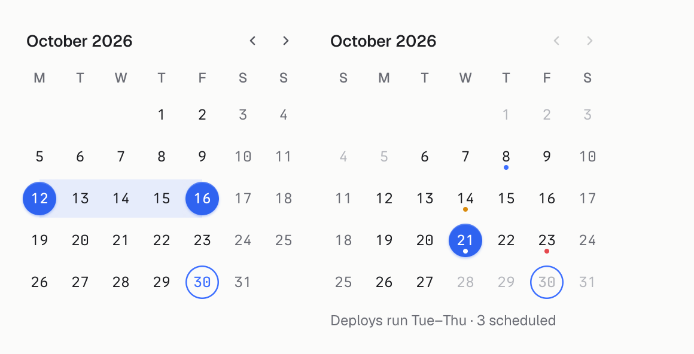
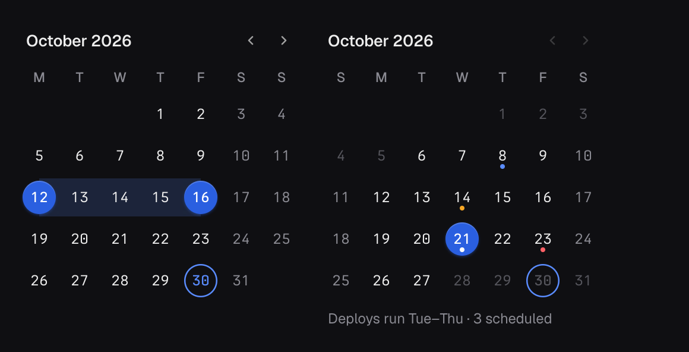
<figcaption>一个 <code>range</code>，今天被描边；以及一个单日，带 <code>min</code>、<code>max</code>、<code>marks</code>、<code>weekStart = "sun"</code> 和一处 <code>note</code>。</figcaption>
</figure>

`week` 变体，带预设：

```lua
ui.node("calendar", {
	key = "window",
	variant = "week",
	range = true,
	value = { "2026-10-24", "2026-10-30" },
	preset = "7d",
	presets = {
		{ id = "today", label = "Today" },
		{ id = "yesterday", label = "Yesterday" },
		{ id = "7d", label = "Last 7 days" },
		{ id = "30d", label = "Last 30 days" },
		{ id = "custom", label = "Custom…" },
	},
	note = "7 days · 1,284 runs",
})
```

TSX 中的同一示例：

```tsx
<calendar key="window" variant="week" range value={win} preset={preset}
   presets={PRESETS} note={`${days} days · ${runs} runs`}
   onSelect={(e) => applyPreset(e.item)} onChange={(e) => setWin(e.value)} />
```

<figure class="tn-figure">
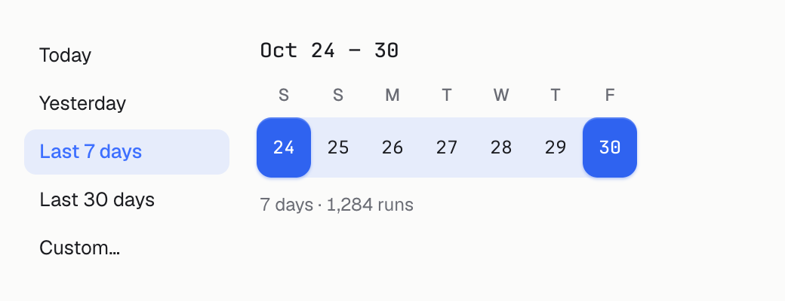
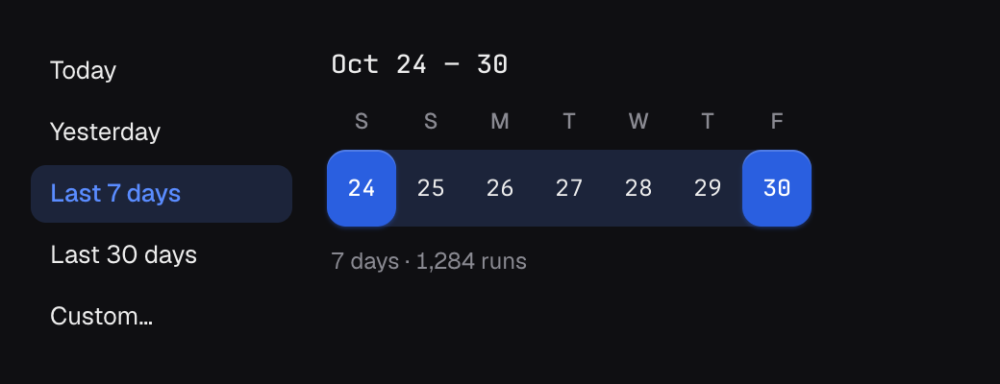
<figcaption><code>variant = "week"</code>：预设位于七天旁边，七天以区间末端结束。</figcaption>
</figure>

| Prop | 类型 | 默认值 | 含义 |
| --- | --- | --- | --- |
| `variant` | `"month"` \| `"week"` | `"month"` | 月份网格，或周条旁的预设 |
| `value` | `string` \| `[string, string \| null]` | 无 | 选择：一个 `"YYYY-MM-DD"` 日期，或在 `range` 时为 `[from, to]` 两端（顺序不限；`[from, null]` 表示区间正在等待另一端）。变化即胜过用户的选择 |
| `range` | `boolean` | `false` | 选取区间（需两次点击）而非单日 |
| `month` | `string` | `value` 起始所在的月份，否则为 `today` 所在的月份 | 显示的月份，`"YYYY-MM"`（`month` 变体）。‹ › 在本地切换；变化即生效 |
| `today` | `string` | 系统的本地日期 | 作为今天描边的日期，`"YYYY-MM-DD"` |
| `min` | `string` | 无 | 可选取的第一天；更早的日期变淡并拒绝点击 |
| `max` | `string` | 无 | 可选取的最后一天 |
| `weekStart` | `"mon"` \| `"sun"` | `"mon"` | 月份网格的第一列 |
| `marks` | `(string \| {date: string, tone?: string})[]` | `[]` | 带圆点的日期，圆点用强调色或 [tone](../styles/index.md#tones) 的颜色 |
| `cursor` | `string` | 无 | 你的按键当前所在的日期，用焦点边框绘制 |
| `presets` | `{id: string, label?: string}[]` | `[]` | `week` 变体的预设列（`label` 默认为 `id`）；不提供则隐藏该列 |
| `preset` | `string` | 无 | 活动预设的 `id`。变化即胜过用户的选择 |
| `note` | `string` | 无 | 日期下方的一行低调文字（计数、提示） |

| 变体 | 外观 | 适用 |
| --- | --- | --- |
| `month`（默认） | 标题、‹ ›、星期字母、七列圆形日期网格 | 月份即视图时需要选择某一天或某个区间 |
| `week` | 预设列；等宽字体的区间标题，七天显示为圆角方块，区间着色 | 较矮面板中的报告或日志窗口 |

**子节点：** 无（会被忽略）。

**事件：**

| 事件 | 载荷 | 触发时机 |
| --- | --- | --- |
| `change` | `{ev = "change", id, value}`：一个 `"YYYY-MM-DD"` 字符串，或在 `range` 时为排序后的 `[from, to]` | 用户选择了某一天，或区间的第二端 |
| `select` | `{ev = "select", id, item}`：预设的 `id` | 用户选择了某个预设（`week`）。设置 `value`（以及 `preset`）来应用它 |
| `action` | `{ev = "action", id, act = "month", value = "YYYY-MM"}` | 用户用 ‹ › 切到了另一个月。若你要绘制 `marks`，请加载该月的 `marks`；把它镜像到 `month` 是可选的 |

在 `week` 变体中做一次选择还会在本地清除活动预设（此时区间属于用户自己）；
发送 `preset` 可重新设置它。

**键盘：** 日历从不获取焦点；你的程序持有按键并驱动 prop：用方向键移动
`cursor`（←→ 一天，↑↓ 一周），用 Page Up/Down 改变 `month`，在 Enter 时
设置 `value`。对于区间，在第一次 Enter 后发送 `[from, null]`，第二次后发送
`[from, to]`。

**不响应的 Surface：** 已关闭的 Surface，或以 `listen = false` 打开的 Surface
仍会绘制并切换月份，但不会选择任何内容，也不会发送任何内容。

**样式：**

```html
<div class="sf sf-calendar" data-id="main.trip" data-variant="month">
	<div class="sf-cal-month">
		<div class="sf-cal-head">
			<span class="sf-cal-title">October 2026</span>
			<span class="sf-cal-nav"><button class="sf-cal-step" data-nav="-1">…</button><button class="sf-cal-step" data-nav="1">…</button></span>
		</div>
		<div class="sf-cal-wds"><span class="sf-cal-wd">M</span>…</div>
		<div class="sf-cal-days" role="grid">
			<span class="sf-cal-pad"></span>…
			<span class="sf-cal-day from" data-day="2026-10-12" role="gridcell" aria-selected="true"><span class="n">12</span></span>…
		</div>
		<div class="sf-cal-note" hidden></div>
	</div>
</div>
```

| 目标 | 选择器 |
| --- | --- |
| 节点及其变体 | `.sf-calendar`、`[data-variant='week']` |
| 月份标题、切换按钮 | `.sf-cal-title`、`.sf-cal-step`（越过 `min`/`max` 时为 `.off`） |
| 星期字母 | `.sf-cal-wd` |
| 日期、其数字、其圆点 | `.sf-cal-day`、`.sf-cal-day .n`、`.sf-cal-day .dot` |
| 日期状态 | `.today`、`.wkend`、`.off`、`.cur`、`.sel`（单日）、`.from`、`.to`、`.in`（区间内部）、`.pre`（选取区间时悬停的那一端；这些日期带 `.previewing`） |
| 某一行的第一 / 最后一天 | `.sf-cal-day.l`、`.sf-cal-day.r` |
| 预设（`week`） | `.sf-cal-presets`、`.sf-cal-preset`（`.on` 为活动） |
| 备注 | `.sf-cal-note` |

日期在任何区域中都是 `12.5px` 等宽字体并使用等宽数字；标题、星期字母与预设
为 sans。月份视图的日期是 34 × 32px 的单元格配 28px 圆盘；周视图的日期是
36 × 40px 配圆角方块。`.sf-calendar` 上的自定义属性 `--cal-w`、`--cal-h`、
`--cal-n`（单元格宽、高、圆盘）与 `--cal-band`（区间着色）可调整其尺寸与着色。

## `date` 日期字段 {#date}

一个日期字段：值以等宽字体显示（“Oct 30, 2026”）并带一个日历图标。点击会在
字段下方的浮层中展开月历；选择某一天（或区间的第二端）会发送 `change` 并收起，
点击外部也会收起。在表单与设置中，完整日历会占用过多空间，这时就该用它。
它接受与 `calendar` 的月份相同的日期 prop，并绘制同一网格。

```lua
ui.node("col", { gap = "md" }, {
	ui.node("date", { key = "due", value = "2026-10-30" }),
	ui.node("date", { key = "start", placeholder = "Start date", min = state.today }),
	ui.node("date", { key = "sprint", range = true, value = { "2026-10-19", "2026-10-30" } }),
})
```

TSX 中的同一示例：

```tsx
<col gap="md">
   <date key="due" value={due} onChange={(e) => setDue(e.value)} />
   <date key="start" placeholder="Start date" min={today} onChange={(e) => setStart(e.value)} />
   <date key="sprint" range value={sprint} onChange={(e) => setSprint(e.value)} />
</col>
```

<figure class="tn-figure">
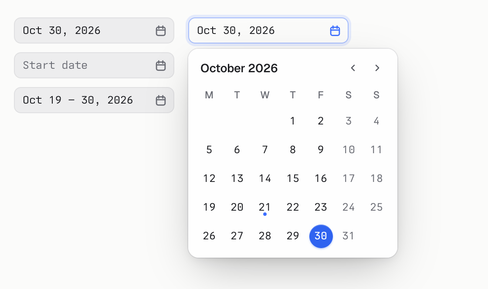
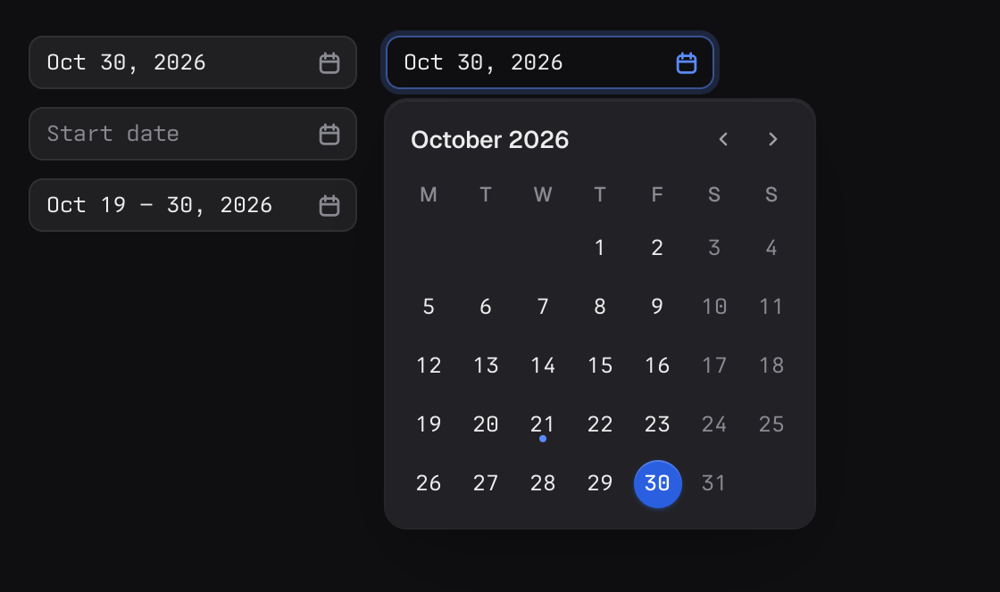
<figcaption>收起的字段（单日、<code>placeholder</code>、<code>range</code>），以及一个带日历的 <code>open</code> 字段。</figcaption>
</figure>

| Prop | 类型 | 默认值 | 含义 |
| --- | --- | --- | --- |
| `value` | `string` \| `[string, string \| null]` | 无 | 同 `calendar`；字段显示 `"Oct 30, 2026"`，区间显示 `"Oct 19 – 30, 2026"` |
| `range` | `boolean` | `false` | 选取区间；浮层保持展开直到第二端 |
| `open` | `boolean` | `false` | 浮层显示。点击字段会在本地翻转它；变化即生效 |
| `placeholder` | `string` | `"Pick a date"`（`range` 时为 `"Pick dates"`） | 没有 `value` 时显示在字段中 |
| `month`、`today`、`min`、`max`、`weekStart`、`marks`、`cursor`、`note` | | | 同 `calendar`，用于浮层的月份 |

**子节点：** 无（会被忽略）。

**事件：**

| 事件 | 载荷 | 触发时机 |
| --- | --- | --- |
| `toggle` | `{ev = "toggle", id, collapsed}`：打开时为 `false`，关闭时为 `true` | 点击字段、点击展开浮层之外，或某次选择导致了收起 |
| `change` | `{ev = "change", id, value}` | 同 `calendar`；随后跟一个 `collapsed = true` 的 `toggle` |
| `action` | `{ev = "action", id, act = "month", value = "YYYY-MM"}` | 同 `calendar` |

**键盘：** 字段从不获取焦点。要从键盘打开它，请设置 `open = true`，像
`calendar` 那样驱动 `cursor` 与 `month`，在 Enter 时设置 `value`，并在
Enter 或 Escape 时设置 `open = false`。

**样式：**

```html
<div class="sf sf-date open" data-id="main.due" data-variant="month">
	<button class="sf-date-box" aria-haspopup="dialog" aria-expanded="true">
		<span class="sf-date-val">Oct 30, 2026</span><svg class="sf-date-ic">…</svg>
	</button>
	<div class="sf-date-pop" role="dialog">
		<div class="sf-cal-month">…as calendar…</div>
	</div>
</div>
```

| 目标 | 选择器 |
| --- | --- |
| 节点及其展开状态 | `.sf-date`、`.sf-date.open` |
| 字段框 | `.sf-date-box`（边框即其 `box-shadow`） |
| 值与占位符 | `.sf-date-val`、`.sf-date-val.ph` |
| 图标 | `.sf-date-ic` |
| 浮层 | `.sf-date-pop` |
| 其月份 | 上文所有 `calendar` 选择器，位于 `.sf-date` 之下 |

字段高 30px，宽至少 184px，像 `input` 一样是一个 `--l1` well，展开时带强调色
边框。浮层为玻璃质感（`--pop-bg`，带模糊），12px 圆角，位于字段下方 6px，
其日期为 32 × 30px。

## `slider` 滑块 {#slider}

沿轨道拖动的数值，或带两个滑块的区间。用于用户凭感觉设定而非键入的数字：
不透明度、字号、模型的 temperature、延迟窗口。值以等宽字体显示在轨道旁，按你
指定的格式呈现（`72%`、`13 px`、`200 ms – 1.2 s`）。

两种外观。`default` 是 kit 的滑块，也就是 Tern 自身设置所用的那种：一条中性的
细轨道填充到白色滑块，标签在左、值在右，一行 28px 高，能在设置列的 `col` 中
对齐。`accent` 用于视图所聚焦的那一个控件：标签与值位于强调色填充的轨道之上，
步进处带刻度，两端值在轨道下方，指针位于轨道上或拖动时，滑块上方会浮出显示
当前值的气泡。`value` 为成对值时，任一外观都会变成区间。

滑块与 `el` 系列控件一样只响应指针：在轨道上按下会把最近的滑块移到该处，
拖动跟随指针并立即绘制；它从不获取焦点，因此按键仍归你。松开时发送带新值的
`change`。用户设定的值会留在屏幕上，直到你程序的 `value` 发生变化，并以那次
变化为准；把 `change` 镜像到 `value` 的程序始终是所有者。

**构建方式：** `tern.ui.node("slider", { value = …, min = …, max = … })`。

| Prop | 类型 | 默认值 | 含义 |
| --- | --- | --- | --- |
| `value` | 数字或 `{ number, number }` | `min` | 数值。成对值（`{ lo, hi }`）绘制带两个滑块的区间；会被排序。钳制到 `min`..`max` 并对齐到最近的步进 |
| `min` | number | `0` | 低端 |
| `max` | number | `100` | 高端。小于 `min` 时按 `min` 处理 |
| `step` | number | 跨度数量级的百分之一 | 值之间的间隔，从 `min` 算起：绘制与发送的每个值都是 `min + n × step`。未指定时，0–1 区间为 `0.01`，0–100 为 `1`，0–2000 为 `10`。不在步进上的 `max` 只有恰好落在某个步进上时才可达 |
| `label` | string | 无 | 左侧的名称（`accent` 中位于轨道上方）；滑块会读出它（`aria-label`，区间上为 “`label`, minimum/maximum”） |
| `unit` | string | 无 | 写在数字之后：`%`、`°`、`×`、`x`、`‰`、`′`、`″` 紧贴数字（`72%`），其他单位则隔一个空格（`13 px`）。仅用于 `format: "number"` |
| `format` | `"number"` \| `"percent"` \| `"duration"` | `"number"` | 值的显示方式。`number`：值加上步进的小数位（步进 `0.1` 时为 `0.6`），再接 `unit`。`percent`：把分数显示为百分比（`0.9` → `90%`）。`duration`：毫秒显示为 `0`、`200 ms`、`1.2 s`、`1 min 30 s` |
| `ticks` | 布尔值、数字或 `{ number }` | `accent`：你给出的每个 `step`，最多 40 个时；`default`：无 | 轨道下方的刻度标记。`true` 在每一步进处放一个（最多 100 个），数字则把轨道等分为该数量的部分（`4` → 0、25、50、75、100%），列表则在其中每个值处放一个。`false` 不绘制 |
| `variant` | `"default"` \| `"accent"` | `"default"` | 外观（见下文）。其他值按 `default` 处理 |
| `disabled` | boolean or string | `false` | 变暗且不响应：滑块不移动，也不发送任何内容；类为 `disabled`，`aria-disabled="true"`。字符串为原因，作为轨道的提示显示 |

通用 prop 同样可用：`title`、`aria`、`tone`、`key`、`actions` 以及
flex 系列 prop。滑块填满分配给它的宽度；轨道占据标签与值之外的空间（至少 96px）。

**变体。**

| `variant` | 外观 | 用途 |
| --- | --- | --- |
| `default` | 一行：`--t2` 的标签，4px 的 `--l2` 轨道用 `--t3` 填充到 14px 的白色滑块，值以 `12px` 等宽 `--t2` 靠右（处于最小值时为 `--t3`）。悬停时填充加深为 `--t2` | 设置、一组相关数值，以及任何与其他控件并列的场合 |
| `accent` | 标签（`--t1`）与值位于轨道之上；填充为 `--accent`，16px 滑块是 `--card` 圆盘外加 2.5px 强调色圆环；刻度以 `--l4` 位于轨道下方，两端值以 `11.5px` 等宽 `--t3` 位于刻度之下；悬停或拖动时，滑块上方浮出反色的值气泡 | 视图或步骤所聚焦的那一个数值：模型的 temperature、预算、窗口 |

按住滑块时它会略微膨胀（到 114%，`accent` 中为 112%），并一比一跟随指针；
点击会让滑块与填充在 .14 s 内滑到该处。值列保持其最宽值的宽度（至少七个
字符），因此拖动时轨道不会移动，一列短值滑块也能对齐轨道。在区间上，离按下处
更近的滑块接手，并在另一个滑块处停下，绝不越过它；两个滑块重合时，拖动会移动
它前进方向一侧的那个。在 Tern 的减弱动效或系统的减弱动效下，不会有滑动动画。

**子节点：** 无（会被忽略）。

**事件：** 松开一次改变了值的拖动（或轨道上的点击）会发送

```lua
{ ev = "change", id = "<the slider's id>", value = 0.6 }          -- one value
{ ev = "change", id = "<the slider's id>", value = { 200, 1200 } } -- a range
```

值会按绘制时的规则钳制与对齐步进；整数以整数形式送达。拖动期间不发送任何
内容，松开后值未变也不发送。禁用的滑块，或位于已关闭或以 `listen = false`
打开的 Surface 上的滑块，不发送任何内容，也不会移动。

**键盘：** 滑块从不获取焦点。要从键盘移动它，请在程序中处理按键（←/→ 移动
一个 `step`，Home/End 到两端）并设置 `value`；用键位说明把这些键展示出来。

**样式：**

```html
<div class="sf sf-slider range ticked" data-id="main.latency" data-variant="accent">
	<span class="sf-slider-label">Latency</span>
	<div class="sf-slider-track">
		<div class="sf-slider-rail">
			<div class="sf-slider-fill"></div>
			<div class="sf-slider-ticks" aria-hidden="true"><i class="sf-slider-tick"></i>…</div>
			<span class="sf-slider-thumb lo" role="slider" aria-label="Latency, minimum"
				aria-valuemin="0" aria-valuemax="2000" aria-valuenow="200" aria-valuetext="200 ms">
				<span class="sf-slider-bubble" aria-hidden="true">200 ms</span>
			</span>
			<span class="sf-slider-thumb hi" role="slider" …><span class="sf-slider-bubble">1.2 s</span></span>
		</div>
		<div class="sf-slider-ends" aria-hidden="true"><span class="lo">0</span><span class="hi">2 s</span></div>
	</div>
	<span class="sf-slider-value" aria-hidden="true">200 ms – 1.2 s</span>
</div>
```

| 目标 | 选择器 |
| --- | --- |
| 节点 | `.sf-slider` |
| 变体 | `.sf-slider[data-variant='accent']` |
| 区间 / 带刻度 | `.sf-slider.range`、`.sf-slider.ticked` |
| 禁用 | `.sf-slider.disabled`（滑块为 `[aria-disabled='true']`） |
| 拖动时 | `.sf-slider.drag`，被按住的滑块为 `.sf-slider-thumb.held` |
| 标签 / 值文本 | `.sf-slider-label`、`.sf-slider-value`（处于最小值时为 `.min`） |
| 轨道（指针所在的）/ 轨道条 / 填充 | `.sf-slider-track`、`.sf-slider-rail`、`.sf-slider-fill` |
| 滑块 | `.sf-slider-thumb`（`.lo`、`.hi`；`.hi` 仅在区间上显示） |
| 刻度 | `.sf-slider-tick`（内部结构，可能变化） |
| 气泡 / 两端值 | `.sf-slider-bubble`、`.sf-slider-ends`（仅 `accent`；内部结构，可能变化） |

标签以所在区域的字体绘制（应用中为 sans，默认区域中为等宽）；值、两端与气泡
始终为等宽字体并使用等宽数字。

```lua
local ui = tern.ui

return ui.node("col", { gap = "sm" }, {
	ui.node("slider", { label = "Opacity", value = 72, step = 1, unit = "%" }),
	ui.node("slider", { label = "Font size", min = 9, max = 24, step = 1, value = 13, unit = "px" }),
	ui.node("slider", {
		label = "Latency", min = 0, max = 2000, step = 50,
		value = { 200, 1200 }, format = "duration",
	}),
	ui.node("slider", {
		key = "temperature", label = "Temperature", variant = "accent",
		min = 0, max = 1, step = 0.1, value = state.temperature,
	}),
})
```

对应 block 把事件镜像到状态：

```lua
local function event(state, ev)
	if ev.ev == "change" and ev.id == "main.temperature" then
		state.temperature = ev.value
	end
end
```

TSX（TypeScript SDK）中的同一示例：

```tsx
<col gap="sm">
   <slider label="Opacity" value={opacity} step={1} unit="%" onChange={(v) => setOpacity(v)} />
   <slider label="Latency" min={0} max={2000} step={50} value={[lo, hi]} format="duration"
      onChange={([a, b]) => setWindow(a, b)} />
   <slider variant="accent" label="Temperature" min={0} max={1} step={0.1} value={temperature}
      onChange={setTemperature} />
</col>
```

<figure class="tn-figure">
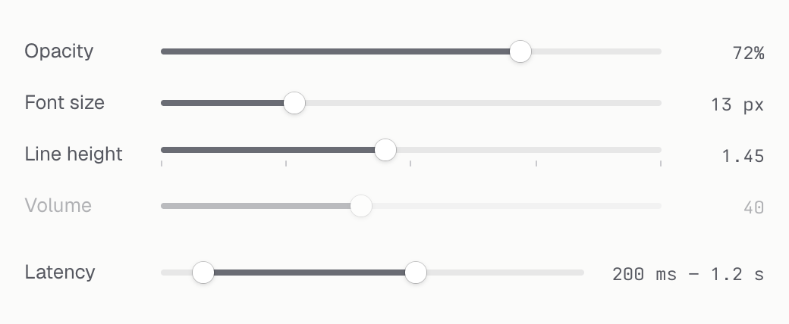
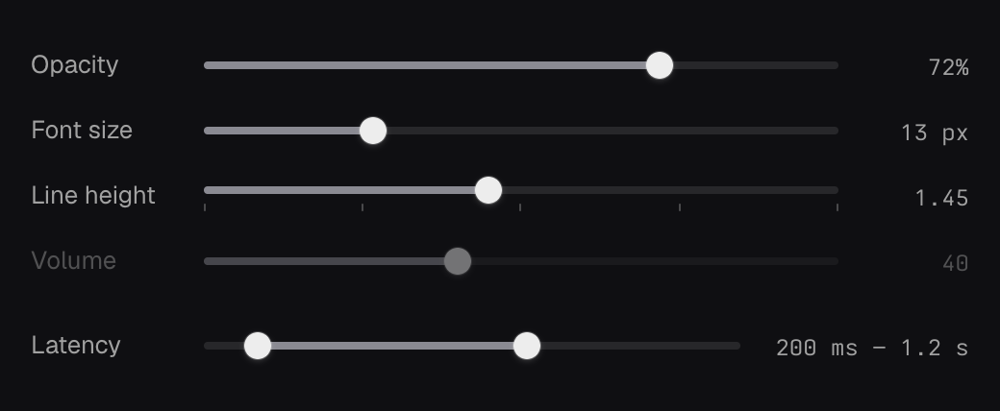
<figcaption><code>default</code> 外观：带单位的值、<code>ticks</code>、一个禁用的滑块，以及带 <code>format: "duration"</code> 的区间。</figcaption>
</figure>

<figure class="tn-figure">
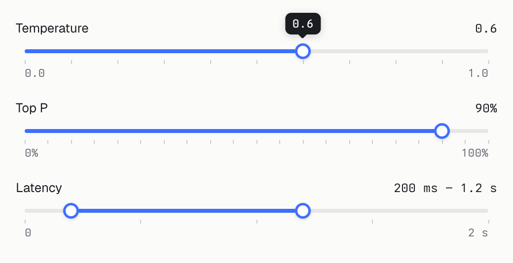
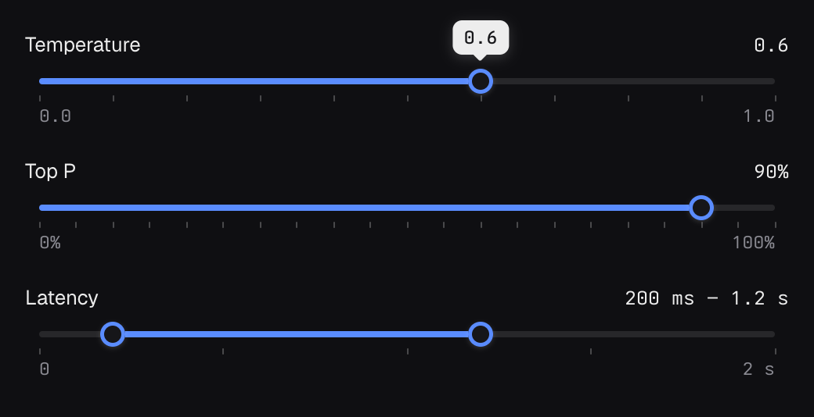
<figcaption><code>accent</code> 外观：每一步进处都有刻度、两端值、一个区间，以及悬停或拖动时滑块携带的气泡。</figcaption>
</figure>

## `switch` 开关 {#switch}

采用 Tern 外观的开关设置，与 Tern 自身设置所用的开关相同。点击开关或其标签会
立即翻转并发送 `change`；你的程序保存状态并用 `on` 回应。当某个选择立即生效时
（自动换行、跟随输出、遥测），就该用它；随表单一起提交的选择，请使用
[`el` 复选框](el.md)。

三种外观：`default` 是 kit 的 36×22 开关，带 `label`（以及其下的 `hint`）时，
它会填满整行，成为一行设置项：文字在左，开关在右。`compact` 是 26×15 的开关，
标签在其右侧，用于密集列表与工具栏。`segment` 是双状态的分段控件，
Off | On，在等宽区域中也很易读；`labels` 可重命名两侧的文字。

它与 `el` 系列控件一样只响应指针：从不获取焦点，因此按键仍归你。要从键盘驱动
它，请自行改变 `on`。

**构建方式：** `tern.ui.node("switch", { label = …, on = … })`。

```lua
local ui = tern.ui

ui.node("col", { gap = "sm" }, {
	ui.node("switch", { key = "wrap", label = "Wrap long lines",
		hint = "Soft-wrap instead of scrolling", on = state.wrap }),
	ui.node("switch", { key = "follow", variant = "compact",
		label = "Follow output", on = state.follow }),
	ui.node("switch", { key = "telemetry", variant = "segment",
		label = "Telemetry", on = state.telemetry }),
})
```

TSX（TypeScript SDK）中的同一示例：

```tsx
<col gap="sm">
   <switch label="Wrap long lines" hint="Soft-wrap instead of scrolling" on={wrap} onChange={(v) => setWrap(v)} />
   <switch variant="compact" label="Follow output" on={follow} onChange={setFollow} />
   <switch variant="segment" label="Theme" labels={['Light', 'Dark']} on={dark} onChange={setDark} />
</col>
```

<figure class="tn-figure">
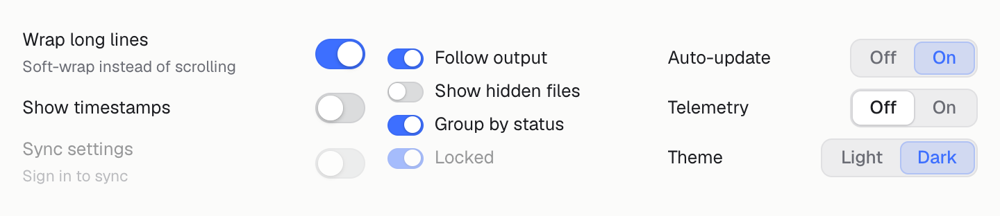
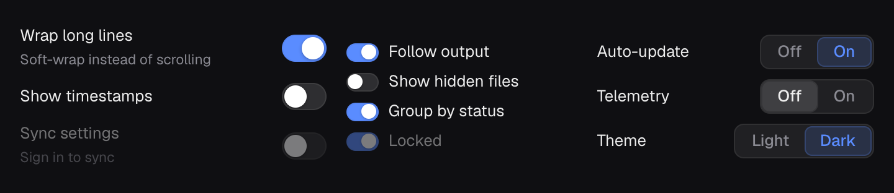
<figcaption>三种外观：<code>default</code> 设置行、<code>compact</code> 列表开关与 <code>segment</code> 控件。</figcaption>
</figure>

<figure class="tn-figure">
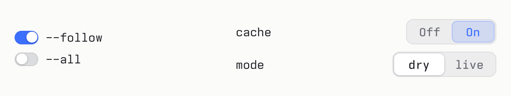
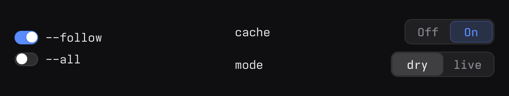
<figcaption>默认等宽区域中的 <code>compact</code> 与 <code>segment</code>。</figcaption>
</figure>

| Prop | 类型 | 默认值 | 含义 |
| --- | --- | --- | --- |
| `on` | boolean | `false` | 开关是否开启：类为 `on`，`aria-checked="true"`。`on` 的变化胜过用户的本地翻转 |
| `variant` | `"default"` \| `"compact"` \| `"segment"` | `"default"` | 外观（见下文）。其他值按 `default` 处理 |
| `label` | string | 无 | 设置的名称；也是开关的无障碍名称。带标签的开关会填满整行（类 `row`） |
| `hint` | string | 无 | 标签下方的一行低调文字，必要时换行 |
| `labels` | `{ string, string }` | `{ "Off", "On" }` | `segment` 两侧的文字，关闭在前。其他变体忽略 |
| `disabled` | boolean or string | `false` | 变暗且不响应：点击不翻转、不发送，类为 `disabled`，`aria-disabled="true"`。字符串为原因，作为提示显示（胜过 `title`） |

通用 prop 同样可用：`key`（本地翻转由它在同级之间记住，否则由 id 记住）、
`title`、`tone`、`actions` 以及 flex 系列 prop。

**变体。**

| `variant` | 外观 | 用途 |
| --- | --- | --- |
| `default` | 36×22 的胶囊，关闭时 `--l3`（深色主题为 13% 白），开启时 `--accent`，两个主题下旋钮都为白色；标签与提示在左，开关在右 | 设置页与偏好卡片 |
| `compact` | 26×15 的胶囊配 12px 旋钮，标签在其右侧；行高 22px | 密集列表、过滤器、工具栏 |
| `segment` | `--l1` 上的 28px 分段控件：Off 下方为凸起的卡片滑块，On 下方为强调色底与强调色文字；标签在左 | 用文字表达更清楚的设置、等宽区域 |

旋钮以弹簧动画滑动（`--out`，.32 s），按下时会朝目标方向拉伸；分段的滑块以
同样方式滑动。减弱动效、`.sf-still` 与 `.sf-paused` 下动画停止。禁用的开关以
45% 不透明度绘制。

**子节点：** 无（会被忽略）。

**事件：** 点击开关或其标签（`segment` 上则是点击它当前未处于的那一侧，或点击
标签切换）会发送

```lua
{ ev = "change", id = "<the switch's id>", value = true }  -- the new state
```

开关立即绘制新状态，并按 `key` 保留它，直到你程序发送的 `on` 与上次绘制的内容
不同；此时以 `on` 为准。把 `value` 镜像到 `on`，你就始终是所有者。禁用的开关，
以及位于已关闭或以 `listen = false` 打开的 Surface 上的每个开关，都不翻转、
不发送任何内容。

**键盘：** 自身不处理任何按键。你的程序持有按键：翻转状态并发送新的 `on`
（例如在获得焦点的行上按 Space）。

**样式：**

```html
<div class="sf sf-switch row on" data-id="main.wrap" data-variant="default"
	role="switch" aria-checked="true" aria-disabled="false" aria-label="Wrap long lines">
	<span class="sf-switch-text">
		<span class="sf-switch-label">Wrap long lines</span>
		<span class="sf-switch-hint">Soft-wrap instead of scrolling</span>
	</span>
	<span class="sf-switch-track" aria-hidden="true"><span class="sf-switch-knob"></span></span>
	<!-- segment: <span class="sf-switch-seg" aria-hidden="true">
		<span class="sf-switch-thumb"></span>
		<span class="sf-switch-opt off">Off</span><span class="sf-switch-opt on">On</span>
	</span> -->
</div>
```

`compact` 把轨道放在文本之前。

| 目标 | 选择器 |
| --- | --- |
| 节点 | `.sf-switch` |
| 变体 | `.sf-switch[data-variant='compact']`、`[data-variant='segment']` |
| 开启 / 禁用 | `.sf-switch.on`（`[aria-checked='true']`）、`.sf-switch.disabled`（`[aria-disabled='true']`） |
| 带标签的行 | `.sf-switch.row` |
| 标签 / 提示 | `.sf-switch-label`、`.sf-switch-hint`（位于 `.sf-switch-text` 中） |
| 轨道 / 旋钮 | `.sf-switch-track`、`.sf-switch-knob` |
| 分段、滑块、两侧 | `.sf-switch-seg`、`.sf-switch-thumb`、`.sf-switch-opt.off`、`.sf-switch-opt.on` |

## `button` 按钮 {#button}

采用 Tern 外观的按钮：一个标签、可选的前置图标，以及执行同一动作的按键的
键帽。点击会发送 `action` 事件；在你程序回应之前不会有其他事情发生。视图中的
每个动作都应使用它；[设计指南](../guides/design.md#buttons) 说明了哪种变体与
尺寸用在何处。

按钮的尺寸由内容决定，从不拉伸，即使作为 `col` 的子节点也是如此（除非给它
`grow`，否则保持 `align-self: flex-start`）。它与 `el` 系列控件一样只响应
指针：从不获取焦点，因此按键仍归你，`keys` 则告诉用户该按哪个键。

**构建方式：** `tern.ui.button(text, props?)`（参见
[UI 构造函数](../reference/ui.md#button)），或
`tern.ui.node("button", { text = …, variant = … })`。在 SDK 中，按钮的
字符串子节点会成为其 `text`，与 badge 相同。

| Prop | 类型 | 默认值 | 含义 |
| --- | --- | --- | --- |
| `text` | string | `""` | 标签。为空且带 `icon` 时绘制纯图标按钮：请提供 `title` 或 `aria` |
| `icon` | icon name | 无 | 来自 [Tern 的图标集](data.md#icon-names) 的前置图标：14px，`sm` 时为 12px |
| `keys` | `{ string }` | 无 | 标签之后的键帽，命名方式同 [`kbd`](data.md#kbd)。仅用于显示：按键由你的程序处理。没有 `title` 时，提示即标签与键帽（`Refresh  R`） |
| `variant` | `"default"` \| `"primary"` \| `"quiet"` \| `"danger"` | `"default"` | 外观（见下文）。其他值按 `default` 处理 |
| `size` | `"sm"` \| `"md"` | `"md"` | `md` 高 28px，用于头部、工具条与表单；`sm` 高 22px，用于行内与内联场景 |
| `on` | boolean | `false` | 按下的切换状态：类为 `on`，`aria-pressed="true"`，以强调色底绘制 |
| `disabled` | boolean or string | `false` | 变暗且不响应：不发送任何内容，类为 `disabled`，`aria-disabled="true"`。字符串为原因，作为提示显示（胜过 `title`） |
| `busy` | boolean | `false` | 加载指示取代图标（或位于标签之前），按钮不发送任何内容并保持宽度；类为 `busy`，`aria-busy="true"` |

通用 prop 同样可用：`title`、`aria`、`tone`（为你的样式表设置 `--tc`）、
`actions` 以及 flex 系列 prop。

**变体。**

| `variant` | 外观 | 用途 |
| --- | --- | --- |
| `default` | `--chip-bg` 上的 `--t2` 文字，配 `--l2` 细线边框；悬停时变为 `--l2` 上的 `--t1` | 大多数动作 |
| `primary` | 品牌渐变（`--grad`）上的 `--grad-ink` 文字，带柔和的强调色光晕；键帽采用文字颜色 | 视图为之存在的那一个动作 |
| `quiet` | 无填充、无边框，`--t2` 文字；悬停时着色 `--l1` | 工具条与头部中的次要动作、Cancel |
| `danger` | 8% `--bad` 底色上的 `--bad` 文字，配 22% 的 `--bad` 边框 | 破坏性动作本身 |

按下时按钮立即缩放到 98%，并在 .3 s 内回弹；悬停立即生效，离开时在 .15 s 内
渐变。禁用的按钮以 45% 不透明度绘制。光标为指向的手形，禁用或忙碌时为箭头。

**子节点：** 无（会被忽略）。

**事件：** 点击会发送

```lua
{ ev = "action", id = "<the button's id>", act = "click" }
```

当按钮有 `actions.click` 时，`act` 就是它，因此
`actions = { click = "deploy" }` 发送 `act = "deploy"`（`name=value` 形式的
动作还会带 `value`，按住修饰键时带 `mods`，在 `el` 表单内带 `values`，与任何
动作相同）。禁用或忙碌的按钮不发送任何内容，连它的 `dblclick` 也不发送。除此
之外，`dblclick` 与 `menu` 动作与任何节点上的用法相同。复制视图会把按钮写成
`[Label]`。

**样式：**

```html
<button class="sf sf-button" data-id="main.bar.deploy" data-variant="primary" data-size="md"
	title="Deploy  ⌘ ⏎">
	<span class="sf-btn-ic"><svg class="ico">…</svg></span>   <!-- busy: <span class="sf-orbit"><i></i></span> -->
	<span class="sf-btn-label">Deploy</span>
	<span class="sf-kbd kbds"><span class="kbd">⌘</span><span class="kbd">⏎</span></span>
</button>
```

| 目标 | 选择器 |
| --- | --- |
| 节点 | `.sf-button` |
| 变体 / 尺寸 | `.sf-button[data-variant='primary']`、`[data-size='sm']` |
| 按下的切换 | `.sf-button.on`、`[aria-pressed='true']` |
| 禁用 / 忙碌 | `.sf-button.disabled`（`[aria-disabled='true']`）、`.sf-button.busy`（`[aria-busy='true']`） |
| 纯图标 | `.sf-button.only-ic` |
| 图标 / 标签 | `.sf-btn-ic`、`.sf-btn-label`（内部结构，可能变化） |
| 忙碌指示 | `.sf-button .sf-orbit`（内部结构，可能变化） |
| 键帽 | `.sf-button .kbd`（内部结构；高 16px，文字 10px） |

`md` 为 `500 12.5px` sans，`padding: 0 10px`，间隙 6px，圆角 8px；`sm`
为 `500 12px` sans，`padding: 0 8px`，间隙 5px，圆角 6px。两者在任何区域
（无论是否等宽）中都以 sans 绘制。按钮不带 `.sf-act`；它按自身规则显示指向的
手形。

```lua
local ui = tern.ui

return ui.col({
	ui.row({
		ui.button("Deploy", { variant = "primary", keys = { "cmd", "enter" }, actions = { click = "deploy" } }),
		ui.button("Refresh", { icon = "repeat", keys = { "r" }, actions = { click = "refresh" } }),
		ui.button("Follow", { variant = "quiet", on = true, actions = { click = "follow" } }),
		ui.button("Delete", { variant = "danger", actions = { click = "delete" } }),
	}),
	ui.row({
		ui.button("Approve", { size = "sm", actions = { click = "approve" } }),
		ui.button("Retry", { size = "sm", icon = "repeat" }),
		ui.button("Saving", { size = "sm", busy = true }),
		ui.button("Publish", { size = "sm", disabled = "Sign in to publish" }),
		ui.button("", { size = "sm", icon = "more", title = "More actions" }),
	}),
})
```

TSX（TypeScript SDK）中的同一示例，其中处理器会替你设置点击动作：

```tsx
<row>
   <button variant="primary" keys={['cmd', 'enter']} onClick={deploy}>Deploy</button>
   <button icon="repeat" keys={['r']} onClick={refresh}>Refresh</button>
   <button variant="quiet" on={follow} onClick={toggleFollow}>Follow</button>
   <button variant="danger" onClick={askDelete}>Delete</button>
</row>
```

<figure class="tn-figure">
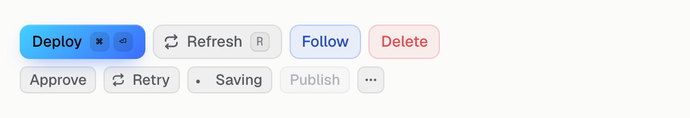
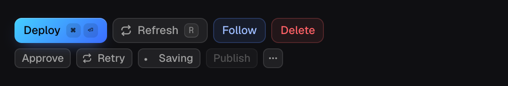
<figcaption><code>md</code> 尺寸下的四种变体，然后是 <code>sm</code> 尺寸配 <code>busy</code>、<code>disabled</code> 以及一个纯图标按钮。</figcaption>
</figure>

表格行内的按钮请使用 [button 单元格](data.md#table)，它会把该行随动作一起发送。

## `buttons` 按钮组 {#buttons}

一组绘制成单个控件的 [`button`](#button) 节点。当若干动作属于同一组时使用它：
Undo 与 Redo、上一项 / Today / 下一项、由 `on` 切换组成的视图开关、带选项菜单
的动作，或面板顶部的图标工具栏条。子节点仍是普通按钮：各自发送自己的
`action`、显示自己的提示，并可以是 `on`、`disabled` 或 `busy`。按钮组只负责把
它们绘制在一起。

按钮组的尺寸由内容决定，从不拉伸（在 `col` 中保持 `align-self: flex-start`）。
它从不获取焦点；其按钮也不获取。

**构建方式：** `tern.ui.node("buttons", { variant = … }, { …buttons })`。

```lua
local ui = tern.ui

return ui.row({
	ui.node("buttons", { label = "History" }, {
		ui.button("Undo", { icon = "undo", actions = { click = "undo" } }),
		ui.button("Redo", { icon = "redo", actions = { click = "redo" } }),
	}),
	ui.node("buttons", { variant = "split" }, {
		ui.button("Deploy", { variant = "primary", icon = "rocket", actions = { click = "deploy" } }),
		ui.button("", { variant = "primary", icon = "chev", title = "Deploy options",
			actions = { click = "deploy-menu" } }),
	}),
	ui.node("buttons", { variant = "toolbar", label = "View" }, {
		ui.button("", { icon = "search", title = "Find", actions = { click = "find" } }),
		ui.button("", { icon = "eye", title = "Preview", on = state.preview,
			actions = { click = "preview" } }),
	}),
})
```

TSX（TypeScript SDK）中的同一示例：

```tsx
<row>
   <buttons label="History">
      <button icon="undo" onClick={undo}>Undo</button>
      <button icon="redo" onClick={redo}>Redo</button>
   </buttons>
   <buttons variant="split">
      <button variant="primary" icon="rocket" onClick={deploy}>Deploy</button>
      <button variant="primary" icon="chev" title="Deploy options" onClick={openDeployMenu} />
   </buttons>
   <buttons variant="toolbar" label="View">
      <button icon="search" title="Find" onClick={find} />
      <button icon="eye" title="Preview" on={preview} onClick={togglePreview} />
   </buttons>
</row>
```

<figure class="tn-figure">
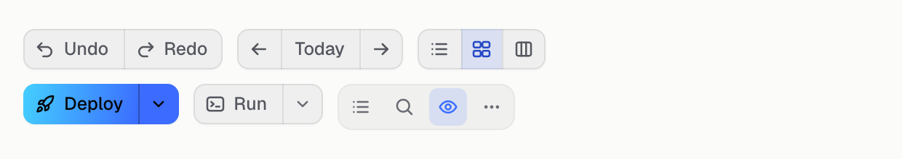
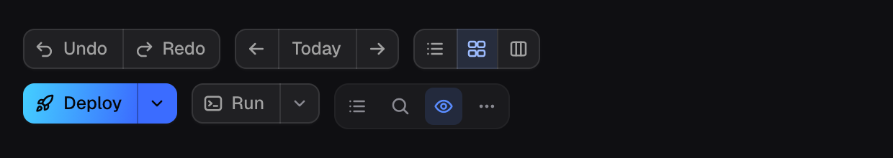
<figcaption>三种变体：连排、分体与工具栏。</figcaption>
</figure>

<figure class="tn-figure">
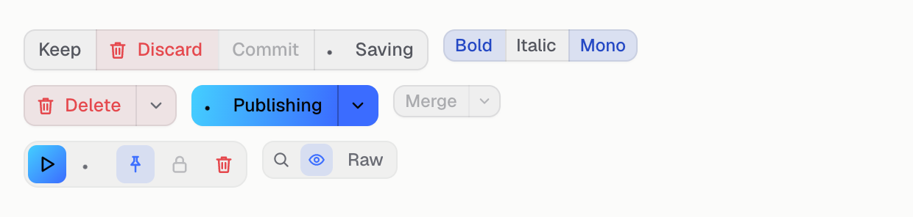
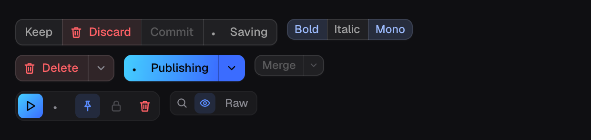
<figcaption>子节点在每个组中都保留自己的变体与状态；<code>size = "sm"</code> 会统一缩小它们。</figcaption>
</figure>

| Prop | 类型 | 默认值 | 含义 |
| --- | --- | --- | --- |
| `variant` | `"joined"` \| `"split"` \| `"toolbar"` | `"joined"` | 外观（见下文）。其他值按 `joined` 处理 |
| `size` | `"sm"` \| `"md"` | `"md"` | 子节点的尺寸，胜过它们各自的 `size`：`md` 高 28px（工具栏中为 26px），`sm` 为 22px |
| `label` | string | 无 | 按钮组的无障碍名称（`aria-label`），例如 `"History"` |

通用 prop 同样可用：`title`、`aria`、`tone` 以及 flex 系列 prop。

**变体。**

| `variant` | 外观 | 用途 |
| --- | --- | --- |
| `joined` | 所有子节点外围共用一圈 `--l2` 细线边框与 8px 外圆角，彼此之间以 `--l2` 细线分隔；子节点失去自己的边框与内侧圆角。`on` 的子节点染 12% `--accent`，`danger` 的染 7% `--bad`，`primary` 的保留渐变 | 相关动作（Undo/Redo）、步进器（← Today →）、由 `on` 切换组成的视图开关 |
| `split` | 两个子节点的 `joined`：先是动作，然后是 28px（`sm` 时为 22px）的菜单部分，以 `--t3` 绘制，通常是纯图标的 `chev` 按钮。两个 `primary` 子节点读起来像一个胶囊：渐变横跨动作部分，菜单部分保持其末端颜色，中间以 28% `--grad-ink` 细线分隔 | 带选项的动作：Deploy ▾、Run ▾ |
| `toolbar` | 一个柔和的槽（`--t1` 5%，10px 圆角，3px 内边距），其中是间隔 4px 的裸按钮：26px 见方的图标按钮（`sm` 时 22px），`--t3` 图标，悬停 `--l2`；`on` 按钮以 14% 强调色底绘制 `--accent` | 面板的工具栏条：大纲、查找、预览、更多 |

每一段都有自己的悬停与按下着色（按下时着色而不缩放，以免相邻项移位）；禁用的
段以 45% 不透明度绘制（工具栏中为 40%），忙碌的段显示按钮的加载指示。

**子节点：** 按顺序排列的 `button` 节点。其他类型会在行中绘制，但不会应用组的
样式。

**事件：** 自身没有事件。每个子节点像单独的 [`button`](#button) 那样发送自己的
`action`（`{ ev = "action", id = "<the button's id>", act = … }`）；
禁用与忙碌的子节点不发送任何内容。

**键盘：** 按钮组及其按钮从不获取焦点。你的程序持有按键：用子节点的 `keys`
显示它们（提示中也会列出），并用 prop 驱动状态（活动切换用 `on`，处理中
`busy`，带原因的 `disabled`）。

**无障碍：** `role="group"`（`toolbar` 为 `role="toolbar"`），`label` 作为
`aria-label`；子节点保留 `aria-pressed` / `aria-disabled` / `aria-busy`。
纯图标的子节点请提供 `title`。

**样式：**

```html
<div class="sf sf-buttons" data-id="main.bar.view" data-variant="toolbar" data-size="md"
	role="toolbar" aria-label="View">
	<button class="sf sf-button only-ic" data-variant="default" data-size="md" title="Find">…</button>
	<button class="sf sf-button only-ic on" aria-pressed="true" title="Preview">…</button>
</div>
```

| 目标 | 选择器 |
| --- | --- |
| 节点 | `.sf-buttons` |
| 变体 / 尺寸 | `.sf-buttons[data-variant='split']`、`[data-size='sm']` |
| 一个段 | `.sf-buttons > .sf-button` |
| 按下的段 | `.sf-buttons > .sf-button.on` |
| 分体的菜单部分 | `.sf-buttons[data-variant='split'] > .sf-button:last-child` |

## `field` 表单行 {#field}

一个带标签的表单行：标签、控件（或几个控件），以及其下方一行文字——在你程序
指出有问题之前，它是帮助文本。只要控件需要名称，就该用它：面板中的表单、设置
列表、对话框的字段。它只负责布局与状态：子节点是普通控件（[`input`](#input)、
[`editor`](#editor)、[`select`](#select)、[`date`](#date)、[`otp`](#otp)、
[`switch`](#switch)、按钮、[`el`](el.md) 复选框），各自保留自己的 prop 与
事件。字段只绘制它们周围的文字，并在 `error` 或 `warning` 时把位于其中的控件
描成红色或琥珀色，因此你从不需要在控件本身上设置错误 prop。

三种外观，每种对应一个 `variant`：

- **`stacked`**（默认值）：标签位于控件之上，然后是帮助行，或带 `--bad` 警告
  图标的错误。文本字段填满宽度。这是一列表单的形态。
- **`row`**：设置行，类似 Tern 自身的设置：标签及其提示在左，控件在右，垂直
  居中。连续的 `row` 字段之间绘制一条细线，因此一 `col` 的它们读起来像一个
  列表。警告或错误会以相应色调替换提示，图标位于标签之前。
- **`grid`**：表单网格，类似对话框的布局：控件之前是右对齐的标签列
  （`labelWidth`，默认为 12 个字符格），说明位于控件下方。同一列中的每个字段
  标签宽度相同，因此控件对齐；没有 `label` 的字段保留空列（可用于在其他字段
  下方放一个孤立的复选框）。

标签是文本，不是 HTML 的 `<label>`：点击它不会有任何作用，因此按键留在你程序
放置它们的位置（节点从不获取焦点）。把字段的名称放在 `label` 中；控件从字段的
分组获得无障碍名称（`role="group"`，由标签标记，由说明描述）。

**构建方式：** `tern.ui.node("field", { label = …, … }, { control })`。在 SDK
中，字段的子节点就是它的控件。

```lua
local ui = tern.ui

local port_error = nil
if state.port < 1 or state.port > 65535 then
	port_error = "Must be 1–65535"
end

return ui.node("col", { gap = "lg" }, {
	ui.node("field", { label = "Service name", hint = "Lowercase letters, digits and dashes", required = true }, {
		ui.node("input", { key = "name", text = state.name }),
	}),
	ui.node("field", { label = "Port", error = port_error }, {
		ui.node("input", { key = "port", text = tostring(state.port) }),
	}),
})
```

TSX（TypeScript SDK）中的设置列表与对话框网格：

```tsx
<col>
   <field variant="row" label="Auto-update" hint="Check daily, install on quit">
      <select key="update" value={update} options={['Never', 'Daily', 'Weekly']} />
   </field>
   <field variant="row" label="Endpoint" warning={reachable ? undefined : 'Unreachable: timed out'}>
      <input key="endpoint" text={endpoint} />
   </field>
   <field variant="row" label="Launch at login" hint="Start Tern when you sign in">
      <switch key="login" on={login} />
   </field>
</col>

<col gap="md">
   <field variant="grid" label="Name"><input key="name" text={name} /></field>
   <field variant="grid" label="Replicas" error={replicas > quota ? `Quota allows ${quota} replicas in this region` : undefined}>
      <input key="replicas" text={String(replicas)} />
   </field>
</col>
```

<figure class="tn-figure">
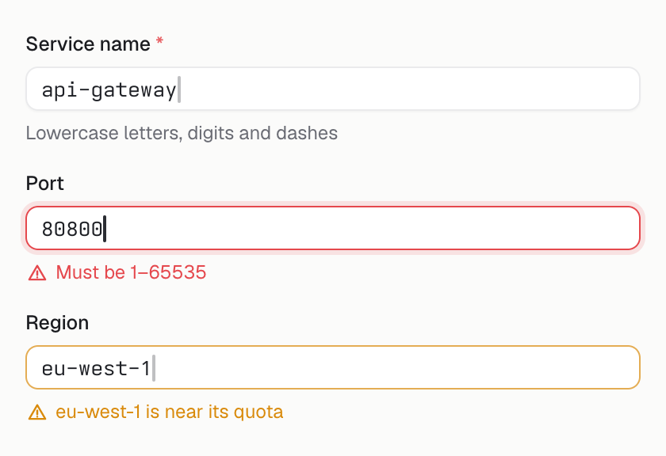
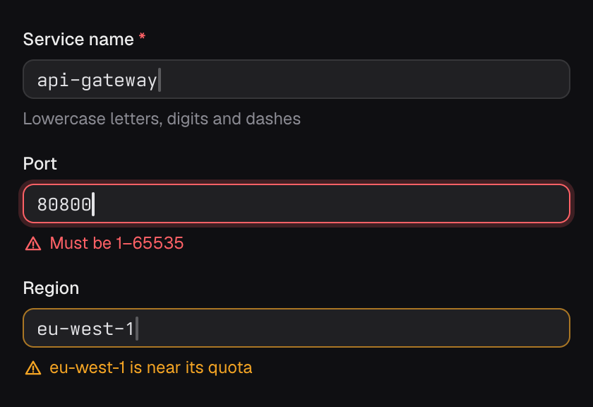
<figcaption><code>stacked</code>：帮助文本、<code>required</code>、获得焦点的输入框上的 <code>error</code>，以及一处 <code>warning</code>。</figcaption>
</figure>

<figure class="tn-figure">
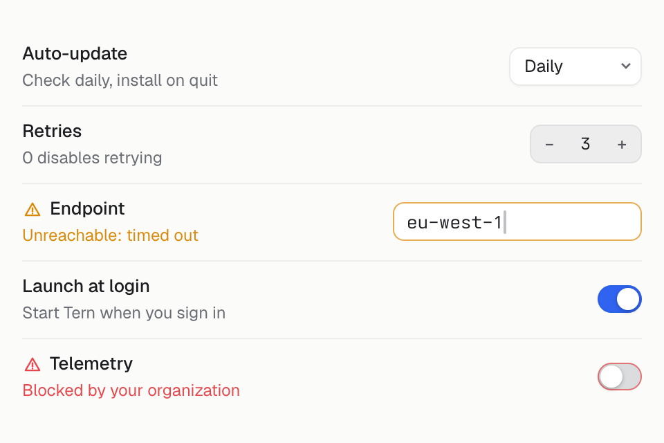
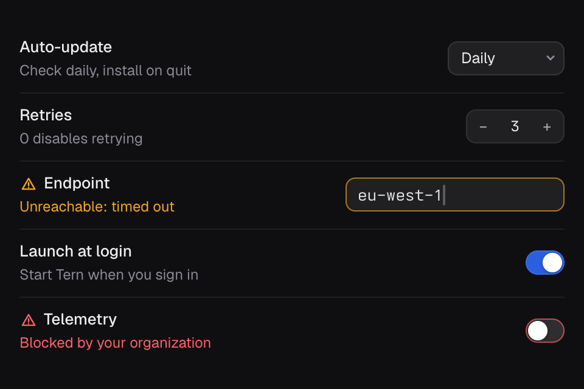
<figcaption><code>row</code>：一个设置列表，<code>warning</code> 与 <code>error</code> 取代了提示。</figcaption>
</figure>

<figure class="tn-figure">


<figcaption><code>grid</code>：单一标签列，因此控件对齐；没有 <code>label</code> 的字段也保留该列。</figcaption>
</figure>

| Prop | 类型 | 默认值 | 含义 |
| --- | --- | --- | --- |
| `label` | text (string or spans) | 无 | 字段的名称。没有时 `stacked` 与 `row` 不绘制标签行；`grid` 保留空列 |
| `hint` | text | 无 | 帮助行：位于控件下方（`stacked`、`grid`）或标签下方（`row`），颜色 `--t3`。`error` 或 `warning` 显示时隐藏 |
| `error` | text or boolean | 无 | 出了问题：说明以 `--bad` 显示它并带警告图标，其中的控件获得 `--bad` 边框。`true` 只设置状态（与边框）而不显示文字；`""`、`false` 或省略则清除。胜过 `warning` |
| `warning` | text or boolean | 无 | 值得注意但不算错误：与 `error` 相同，用 `--warn`。`error` 设置时被忽略 |
| `required` | boolean | `false` | 标签之后一个小的 `--bad` `*`（`title` 为 "Required"），类为 `req`。仅用于显示：校验由你的程序负责 |
| `labelWidth` | 长度（`"14ch"`，或像 `0.3` 这样的比例） | `"12ch"` | 仅 `grid`：标签列的宽度，以区域的字符格（`--sf-cw`）计，或为字段宽度的比例。同一表单的每个字段请给相同的值 |
| `variant` | `"stacked"` \| `"row"` \| `"grid"` | `"stacked"` | 外观（见下文）。其他值按 `stacked` 处理 |

通用 prop 同样可用（`title`、`aria`、`tone`、`actions`、flex 系列 prop 以及
`w`/`min`/`max`）。文本类 prop 接受 spans，因此提示可以带 `code` 或 `path`
token。

**变体。**

| `variant` | 外观 | 用途 |
| --- | --- | --- |
| `stacked` | 标签（`500 12.5px` sans，`--t1`）位于控件之上，控件位于说明之上，间隔 6px；文本字段填满宽度 | 面板或卡片中的表单 |
| `row` | 网格：标签（`500 13px`）位于左侧的说明之上，控件在右侧并垂直居中，间距 24px，行高至少 52px，上下各 10px；每个紧跟在另一个之后的 `row` 字段上方有一条 `--l1` 细线；文本字段宽 180px | 设置、偏好、开关项 |
| `grid` | 右对齐的标签列（`400 13px`，`--t2`，`labelWidth`）位于控件之前 14px（行距 28px），说明位于控件下方 4px | 带若干字段的对话框与密集表单 |

`error` 或 `warning` 以短暂的淡入与下移出现（.22 s，减弱动效下无动画）；边框
跟随控件自身的过渡。当控件持有按键（处于 `focused` 的 `input` 或 `editor`）
或处于展开状态（`select`、`date`）时，边框收紧为完整色调并增加 3px 光晕，取代
强调色焦点边框。

**子节点：** 控件，排布在间隔 8px 的可换行行中：`input` 与 `editor` 会增长以
填满（`flex: 1 1 140px`；`row` 中固定 180px），其他一切保持自身宽度。字段内的
单行 `input` 采用表单字段的字体与外形（28px，8px 圆角，`--card` 表面配 `--l2`
细线边框），而不是其着色的 well。子节点也可以是一个 `row`。

**事件：** 自身没有事件。其中的控件像在其他地方一样发送自己的事件（`change`、
`edit`、`action` 等）；点击标签或说明不发送任何内容，也不移动焦点。

**键盘：** 字段从不获取焦点。你的程序像往常一样驱动控件的键盘状态（`focus`
操作、`cursor`、`open`、`value`），并通过 `error` / `warning` 驱动字段的状态：
在 `edit` 或 `change` 时校验，并设置或清除它们。

**无障碍：** 字段是 `role="group"`，用 `aria-labelledby` 指向其标签，并在说明
显示时用 `aria-describedby` 指向说明；错误或警告说明为 `role="alert"`，因此
出现时会被读出。图标为 `aria-hidden`。

**样式：**

```html
<div class="sf sf-field bad" data-id="main.port" data-variant="stacked" role="group"
	aria-labelledby="…-label" aria-describedby="…-note">
	<div class="sf-field-lbl" id="…-label">
		<span class="sf-field-ic" aria-hidden="true"><svg class="ico">…</svg></span>  <!-- row look only -->
		<span class="sf-field-t">Port</span>
		<span class="sf-field-req sf-hidden" title="Required">*</span>  <!-- shown with `required` -->
	</div>
	<div class="sf-field-ctl"><!-- the children --></div>
	<div class="sf-field-note" id="…-note" role="alert">
		<span class="sf-field-ic" aria-hidden="true"><svg class="ico">…</svg></span>
		<span class="sf-field-msg">Must be 1–65535</span>
	</div>
</div>
```

| 目标 | 选择器 |
| --- | --- |
| 节点 | `.sf-field` |
| 变体 | `.sf-field[data-variant='row']`、`[data-variant='grid']` |
| 错误 / 警告状态 | `.sf-field.bad`、`.sf-field.warn`；色调由节点上的 `--sf-field-tc` 提供 |
| 必填 / 无标签 / 无说明 | `.sf-field.req`、`.sf-field.nolbl`、`.sf-field.nonote` |
| 标签列 | `.sf-field-lbl`（其文本为 `.sf-field-t`，标记为 `.sf-field-req`） |
| 控件 | `.sf-field-ctl`（子节点的父级） |
| 说明 | `.sf-field-note`（其文本为 `.sf-field-msg`） |
| 图标 | `.sf-field-ic`（内部结构，可能变化） |

边框规则挂在字段的类上，而不是控件上：它们作用于 `.sf-field-ctl` 内的
`.sf-input`、`.sf-editor`、`.sf-select-btn`、`.sf-date-box`、`otp` 的单元格、
`switch` 的轨道、按钮与 `el` 复选框。你自己的控件可以用
`.sf-field.bad .sf-field-ctl .mine { box-shadow: inset 0 0 0 1px var(--sf-field-tc) }`
跟随这些规则。

样式表的作用域方式参见 [视图样式](../styles/index.md)，规则可用的内容参见
[支持的 CSS](../styles/css.md)。

