# 布局 {#layout}

布局类节点用于排布其他节点。用 `col` 和 `row` 把节点纵向堆叠或横向并排，用 `card` 为一个工作单元加框，
框中带一个头部、一个状态和一个可选的折叠，用 `section` 表示不带边框的轻量折叠，用 `split` 表示用户可调整
大小的面板，用 `scroll` 表示让子节点在其内部滚动的盒子，用 `empty` 表示视图在没有任何内容时的呈现，
用 `rule` 表示分隔线或对话记录标记，用 `spacer` 表示固定的垂直空间。

| 类型 | 构建器 | 绘制内容 |
| --- | --- | --- |
| [`col`](#col) | `tern.ui.col(…)`、`tern.ui.lines(…)` | 其子节点的纵向 flex 堆叠 |
| [`row`](#row) | `tern.ui.row(…)` | 其子节点的横向 flex 排列 |
| [`card`](#card) | `tern.ui.card(head, …)` | 带框的盒子：头部行（角色图标、头部、状态徽标、折叠箭头）、主体、预览裁剪 |
| [`section`](#section) | `tern.ui.section(head, …)` | 无框的展开组：折叠箭头与头部，下方是缩进的主体 |
| [`split`](#split) | `tern.ui.node("split", { sizes = … }, …)` | 并排或堆叠的面板，用户拖动它们之间的手柄即可调整大小 |
| [`scroll`](#scroll) | `tern.ui.node("scroll", { max = … }, …)` | 在其边界内滚动子节点的盒子，可选择保持在末尾（日志、聊天） |
| [`empty`](#empty) | `tern.ui.node("empty", { title = … }, …)` | 空状态：图标、标题、一行弱化文字，以及用于填充它的操作 |
| [`rule`](#rule) | `tern.ui.rule(label?)`、`tern.ui.node("rule", { variant = … })` | 细分隔线，可选带标签；一条备注行或一个固定的对话记录标记（检查点、加入、压缩） |
| [`spacer`](#spacer) | `tern.ui.node("spacer", { size = … })` | 一块固定的垂直空间 |

## 布局节点上的通用属性 {#common-props-on-layout-nodes}

每个节点都接受通用属性（参见[元素](index.md)）。对布局而言最重要的有两组：flex 属性，
它在父级 `col` 或 `row` 中决定节点的尺寸，以及 `hidden`。它们写在子节点上，而不是写在堆叠容器上。

| 属性 | 类型 | 作用 |
| --- | --- | --- |
| `grow` | number | 内联 `flex-grow` |
| `shrink` | number | 内联 `flex-shrink` |
| `basis` | number 或 `"content"` | 数字表示相对父级的比例（`0.5` → `flex-basis: 50%`）。`"content"` 设置 `flex-basis: auto` 与 `flex-shrink: 0`：节点保持其内容尺寸。其他值会被忽略 |
| `min` | `{ w?, h? }` | 内联 `min-width` / `min-height` |
| `max` | `{ w?, h? }` | 内联 `max-width` / `max-height`。`max.h` 还会添加类 `sf-clip`（`overflow: hidden`），在它截断内容期间还会添加 `sf-clipped`，此时最后两行会淡出。要让被截断的部分仍可访问，请使用 [`scroll`](#scroll) |
| `hidden` | boolean | 添加 `sf-hidden`（`display: none !important`） |

`min` 与 `max` 接受以下尺寸度量：

| 度量 | 示例 | CSS |
| --- | --- | --- |
| 字符单元 | `"40ch"` | `calc(40 * var(--sf-cw))` |
| 文本行 | `"10lines"` | `calc(10 * var(--sf-lh))` |
| 比例 | `0.25` | `25%` |

像素字符串（`"200px"`）、负数和其余字符串会被忽略。`--sf-cw` 与 `--sf-lh` 是
surface 的字符单元宽度与行高（参见[变量](../styles/variables.md)）。

flex 属性会写成元素的内联样式，因此样式表规则需要 `!important` 才能覆盖它们。
其他通用属性会写成 HTML 特性：`role` → `data-role`，`tone` → `data-tone`（仅限已知的 tone：`neutral`、
`accent`、`info`、`success`、`warning`、`error`、`pending`、`muted`、`user`），`mark` → `data-mark`，`href` →
`data-href`，`title` → `title`，`aria` → `aria-label`。

## `col`：纵向堆叠 {#col}

纵向 flex 堆叠（`display: flex; flex-direction: column; min-width: 0`）。子节点按顺序直接绘制
到元素中：没有内部包装层。没有 `align` 属性时，子节点拉伸到该列的宽度（即
flex 的默认行为）。

**空的堆叠不占空间。** 子节点放置完成后，若一个 `col` 绘制出的子节点全部隐藏或
本身为空（或它没有子节点），它会获得类 `sf-void`（`display: none !important`），因此也不会给
父级增加间隙。`grow > 0` 的空堆叠会被保留：它充当可伸缩的间隔。

**大列依然保持低开销。** `col` 位于 `main` 之下的每个子节点都会被绘制，但远离视口的
子节点不会被布局：它保持上一次的高度（在它首次显示之前，是根据其文本估算的值），并带有
`content-visibility: auto`。这不需要你选择开启，而且子节点在滚入滚出时会保持自身状态。
`section` 的主体子节点、`card`（不含其 `head` 子节点）以及 `main` 之下带框的 `tool` 也是如此；
被裁剪的预览算作视口，因此其裁剪所隐藏的内容同样不会被布局。

**构建方式：** `tern.ui.col(children)`（`gap = "sm"`）或 `tern.ui.lines(children)`（`gap = "none"`，用于
同一文本流的各行）；参见 [UI 构建器](../reference/ui.md#layout)。或使用 `tern.ui.node("col", { gap = "md" }, children)`。

| 属性 | 类型 | 默认值 | 含义 |
| --- | --- | --- | --- |
| `gap` | `"none"` \| `"xs"` \| `"sm"` \| `"md"` \| `"lg"` | `"none"`（构建器会传 `"sm"`） | 子节点之间的间距：0、2px、6px、10px、16px。添加类 `gap-<value>` |
| `align` | `"start"` \| `"center"` \| `"end"` \| `"baseline"` \| `"stretch"` | 无（stretch） | 交叉轴对齐（`align-items`）。添加 `al-<value>`；其他值不添加任何内容 |
| `justify` | `"between"` \| `"end"` | 无（start） | 主轴分布（`justify-content: space-between` / `flex-end`）。添加 `js-<value>`；`"start"` 及其他值不添加任何内容 |
| `wrap` | boolean | `false` | 添加类 `wrap`。在 `col` 上它没有自己的样式（`.sf-row.wrap` 是唯一的规则） |

未知的 `gap` 仍会添加 `gap-<value>`，但没有规则匹配它，因此间距为 0。样式表可以定义自己的写法：
`.sf-col.gap-huge { gap: 40px }` 搭配 `gap = "huge"`。

```lua
local ui = tern.ui

local rows = {}
for _, gap in { "none", "xs", "sm", "md", "lg" } do
	table.insert(rows, ui.node("row", { gap = "md" }, {
		ui.node("text", { spans = { ui.span(gap, "muted") }, min = { w = "6ch" } }),
		ui.node("row", { gap = gap }, {
			ui.badge("build", "info"),
			ui.badge("test", "info"),
			ui.badge("deploy", "info"),
		}),
	}))
end
return { main = ui.col(rows) }
```

<figure class="tn-figure">
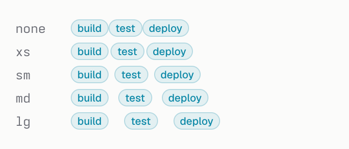
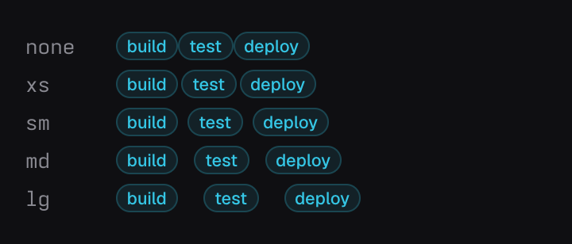
<figcaption>五种间距，作用在 row 上；列对子节点的间隔方式与此相同。</figcaption>
</figure>

**子节点：** 按顺序绘制，直接位于元素内部。

**事件：** 自身没有事件；`actions` 的作用与任何节点上相同。

**样式：**

```html
<div class="sf sf-col gap-sm al-center js-between" data-id="main.list">
	<!-- children -->
</div>
```

| 目标 | 选择器 |
| --- | --- |
| 该节点 | `.sf-col` |
| 间距 | `.sf-col.gap-none` … `.gap-lg` |
| 对齐 | `.al-start`、`.al-center`、`.al-end`、`.al-baseline`、`.al-stretch` |
| 分布 | `.js-between`、`.js-end` |
| 换行标志 | `.sf-col.wrap` |
| 无内容可显示 | `.sf-void` |

`.sf-col`、`[data-id]`、`[data-role]` 与 `[data-tone]` 是稳定的钩子；`gap-*`、`al-*`、`js-*` 与 `wrap`
这些类则随属性变化。block 的区域根（`main`、`dock`、`layer`）会作为它们的子节点绘制，而不是作为
`col` 元素（参见[视图样式](../styles/index.md)）。

```lua
local ui = tern.ui

return {
	main = ui.node("col", { gap = "md" }, {
		ui.text("Deploy"),
		ui.lines({ ui.text("step 1: build"), ui.text("step 2: upload") }),
	}),
}
```

## `row`：横向排列 {#row}

横向 flex 行（`display: flex; flex-direction: row; align-items: center; min-width: 0`）。每个直接子节点
都会获得 `min-width: 0`，因此长文本会收缩并截断，而不是把行撑宽。子节点默认
垂直居中，除非 `align` 另有指定。

行的子节点总是会被布局。空行与列一样会获得 `sf-void`（参见 [`col`](#col)）；`grow > 0` 且
没有子节点的 `row` 会保留为间隔，这是把后续子节点推到最远端的常见做法。

**构建方式：** `tern.ui.row(children)`（`gap = "sm"`，参见 [UI 构建器](../reference/ui.md#layout)），或使用
`tern.ui.node("row", { gap = "md", justify = "between" }, children)`。

| 属性 | 类型 | 默认值 | 含义 |
| --- | --- | --- | --- |
| `gap` | `"none"` \| `"xs"` \| `"sm"` \| `"md"` \| `"lg"` | `"none"`（构建器会传 `"sm"`） | 子节点之间的间距：0、2px、6px、10px、16px（`gap-<value>`） |
| `align` | `"start"` \| `"center"` \| `"end"` \| `"baseline"` \| `"stretch"` | 无（样式表给出 `center`） | `align-items`（`al-<value>`）。用 `"baseline"` 对齐不同大小的文本，多行子节点用 `"start"` |
| `justify` | `"between"` \| `"end"` | 无（start） | `justify-content: space-between` / `flex-end`（`js-<value>`） |
| `wrap` | boolean | `false` | `flex-wrap: wrap`（类 `wrap`）：子节点放不下时会流到更多行上 |

一个两行的列，旁边是一个标签和一个徽标，分别在四种 `align` 值下：

```lua
local ui = tern.ui

local rows = {}
for _, align in { "start", "center", "end", "baseline" } do
	table.insert(rows, ui.node("row", { gap = "md", align = align }, {
		ui.node("text", { spans = { ui.span(align, "muted") }, min = { w = "8ch" } }),
		ui.node("col", {}, { ui.text("main.rs"), ui.text("lib.rs") }),
		ui.badge("2 files", "info"),
	}))
end
return { main = ui.node("col", { gap = "lg" }, rows) }
```

<figure class="tn-figure">
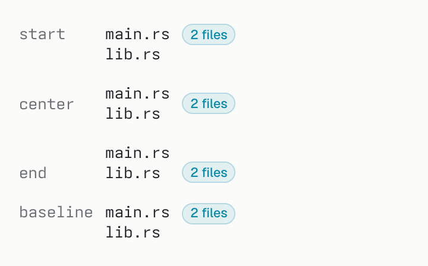
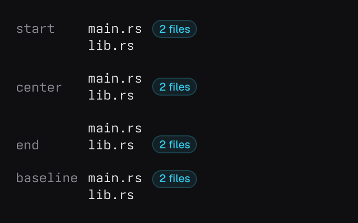
</figure>

**子节点：** 按顺序绘制，直接位于元素内部。用[通用 flex 属性](#common-props-on-layout-nodes)设置它们的尺寸。

**事件：** 自身没有事件；`actions` 的作用与任何节点上相同。

**样式：**

```html
<div class="sf sf-row gap-sm wrap" data-id="main.toolbar">
	<!-- children -->
</div>
```

| 目标 | 选择器 |
| --- | --- |
| 该节点 | `.sf-row` |
| 子节点 | `.sf-row > *` |
| 换行 | `.sf-row.wrap` |
| 间距、对齐、分布 | `.gap-*`、`.al-*`、`.js-*`，与 `col` 上相同 |
| 无内容可显示 | `.sf-void` |

```lua
local ui = tern.ui

return ui.node("row", { gap = "md", align = "baseline" }, {
	ui.text({ ui.span("api", "strong") }),
	ui.node("row", { grow = 1 }), -- empty and growing: pushes the badge right
	ui.badge("healthy", "success"),
})
```

<figure class="tn-figure">
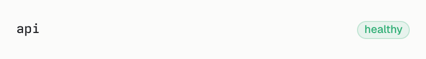
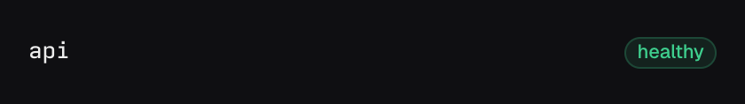
</figure>

## `card`：卡片 {#card}

一个圆角盒子，带有按 `tone` 着色的细边环、一个头部行和一个主体：即一个面板。头部从左到右依次显示：
一个图标（由 `icon` 指定，否则由 `role` 隐含）、头部内容、弱化的 `meta`，然后在其右端是 `end` 子节点
（你的控件）、一个状态徽标和一个展开折叠箭头。主体以列的形式容纳其余子节点，它们之间相隔
`--sf-inner-gap`（8px），并缩进到与头部文本对齐：有图标时为 `padding: 0 12px 10px 36px`，
无图标时为 `0 12px 10px`（类 `noic`；omp 自带的卡片保留其内边距）。在应用中，卡片是一个对象
（选中项的详情、一条确认条、一个错误），绝不是围绕表格、`stats` 条或另一张卡片的框；
哪些内容该放在哪里，参见[设计视图](../guides/design.md#cards)。

**头部控件。** `end` 指定卡片自身某个子节点（按 id，与 `head` 相同）；Tern 把它绘制在
头部的右侧，而不是主体中：一个由 [`button`](input.md#button) 组成的 `row`、一个分段式 [`tabs`](lists.md#tabs)、
一个 [`badge`](data.md#badge)。点击它永远不会折叠可折叠的卡片。`meta` 是绘制在头部内容之后的文本，
颜色为 `--t3`（在 sans 区域中为 12.5px sans），与头部内容相距 8px：计数、版本号、“updated 2 min ago”。

`end` 是 Luau 的关键字，因此该属性写作 `["end"] = …`。SDK 让 `end`（以及 `head`）接受一个节点：它们
把该节点作为卡片的子节点加入，键为 `end`（或 `head`），并发送它的 id。

```lua
local ui = tern.ui

return ui.col({
	ui.node("card", { key = "services", icon = "server", head = "Services", meta = "24 · 2 degraded",
		["end"] = "main.services.end" }, {
		ui.node("row", { key = "end", gap = "sm" }, {
			ui.node("tabs", { key = "filter", variant = "segmented", active = "all", items = {
				{ id = "all", label = "All" }, { id = "degraded", label = "Degraded" },
			} }),
			ui.button("Refresh", { icon = "repeat", keys = { "r" }, actions = { click = "refresh" } }),
		}),
		ui.text({ ui.span("api-gateway, billing, search and 21 more", "muted") }),
	}),
	ui.node("card", { key = "notes", head = "Notes", meta = "no icon: the body lines up with the head" }, {
		ui.text("Body text starts under the head text."),
	}),
})
```

<figure class="tn-figure">
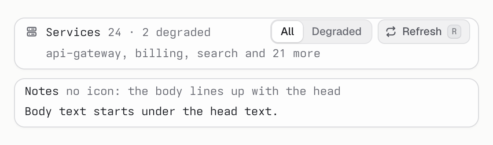
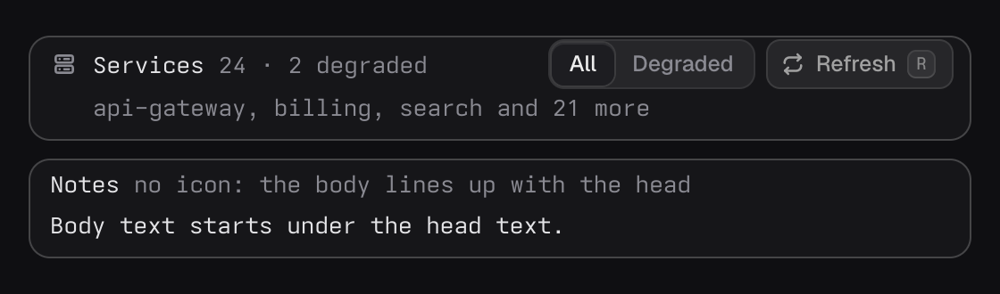
<figcaption>带 <code>icon</code>、<code>meta</code> 与 <code>end</code> 控件的面板头部，以及一张没有图标的卡片。</figcaption>
</figure>

**头部。** `head` 要么是一个绘制到 `div.sf-head` 的 span 列表（`TspText`：一个字符串或若干 span），要么是
卡片自身某个子节点的 id，此时该子节点会绘制在头部而不是主体中。不是子节点 id 的字符串会作为
纯文本。在 block 中，子节点 id 是 `<parent id>.<key>`（没有 key 时为 `<parent id>.<index>`），因此 id 为
`main.build` 的卡片下带 `key = "title"` 的子节点名为 `"main.build.title"`。`tern.ui.card(head, …)` 总是
把 `head` 作为 span 发送；要指定某个子节点，可把 `p.head` 设为其 id，或用 `tern.ui.node` 构建卡片。

**主体。** 主体在没有子节点时仍保留其底部内边距，因此带头部而主体为空的卡片会在
头部行下方绘制 10px 的空间。

**无头部。** 当卡片没有头部内容、没有状态且不是 `collapsible` 时，头部行会隐藏（类
`nohead`），主体采用均匀的内边距（`10px 12px`）。仅有角色图标并不构成头部。

**角色图标。** `icon` 直接指定头部图标（[图标名称](data.md#icon-names)），优先于角色隐含的图标。
没有它时，`role` 会挑选一个图标：`lens.<family>…` 角色按其家族映射（`lens.git.log` → branch，未知家族
→ terminal），`omp.tool.<tool>…` 按工具映射（未知工具 → plug），其他角色则在其以点分隔的
第二段名称有对应图标时按该段映射（`omp.user` → user，`plugin.search.results` → search，
`plugin.bash` → terminal）。已知名称包括 `bash`、`shell`、`edit`、`read`、`search`、`web`、`todo`、`task`、
`user` 与 `error`。多数插件角色的该段没有对应图标（`plugin.ci.job` 取 `ci`），因此图标位保持隐藏。图标
采用 tone 颜色（中性或无 tone 的卡片为 `--t3`）。

**状态徽标。** `status` 为 `pending`（时钟，“Pending”）、`running`（脉动圆点，“Running”）、`done`
（对勾，“Done”）、`error`（叉号，“Failed”）或 `cancelled`（停止，“Canceled”）之一。其他值不显示徽标。卡片
自身不绘制计时器：需要计时器时，在头部放一个 [`elapsed`](motion.md#elapsed) 节点。

每种 tone，其中一些带状态：

```lua
local ui = tern.ui

local cards = {}
for _, t in {
	{ "untoned", nil, "running" }, { "neutral", "neutral" }, { "accent", "accent" }, { "info", "info" },
	{ "success", "success", "done" }, { "warning", "warning" }, { "error", "error", "error" },
	{ "pending", "pending", "pending" }, { "muted", "muted", "cancelled" }, { "user", "user" },
} do
	table.insert(cards, ui.node("card", { head = t[1], tone = t[2], status = t[3], basis = 0.48, grow = 1 }, {
		ui.text("Body"),
	}))
end
return { main = ui.node("row", { gap = "sm", wrap = true }, cards) }
```

<figure class="tn-figure">
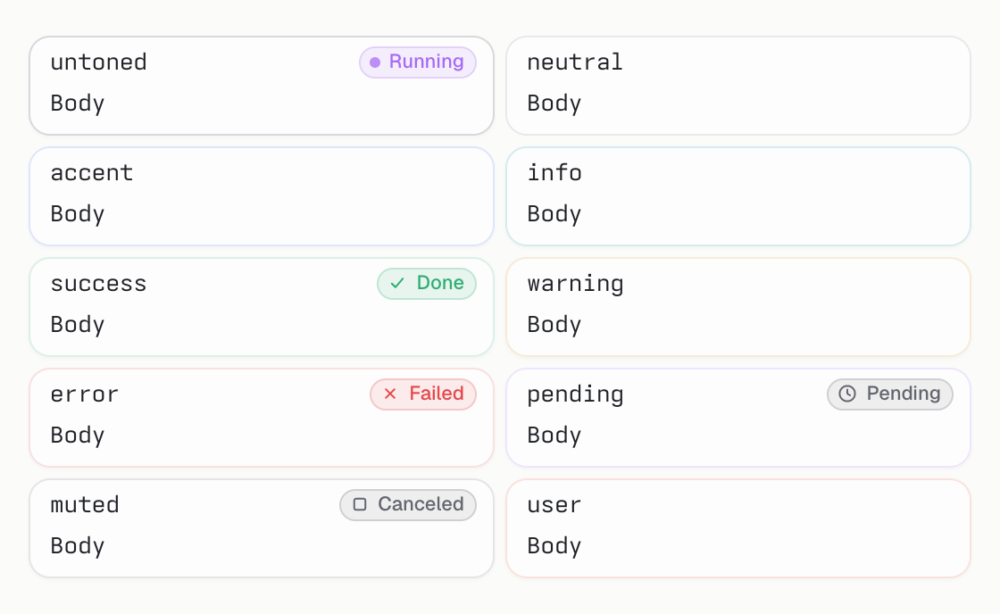
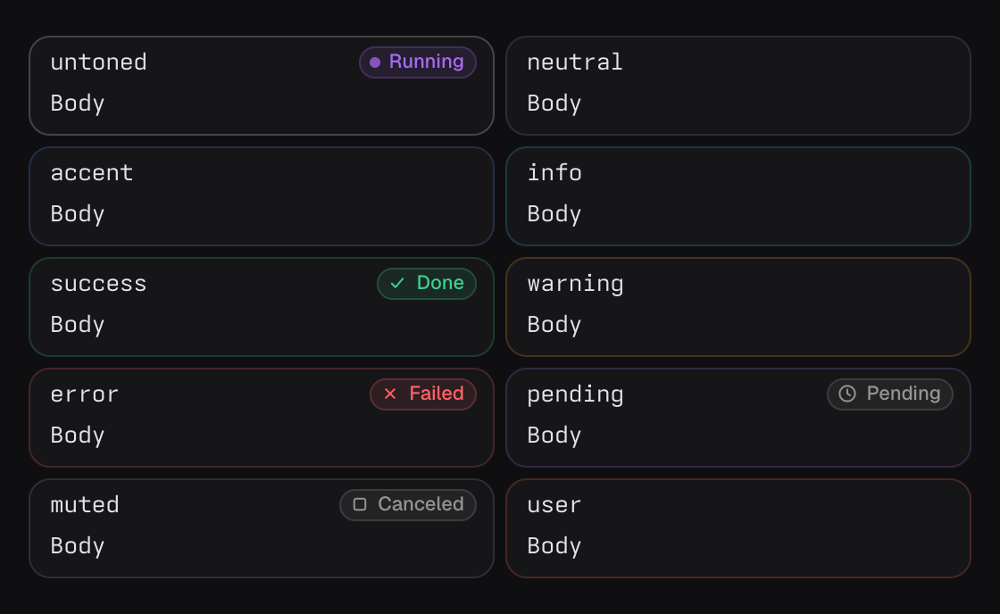
<figcaption>填充保持 <code>--sf-card-bg</code>；tone 体现在边环上。</figcaption>
</figure>

**折叠。** 设置 `collapsible = true` 后，头部变成一个按钮（`role="button"`、`tabindex="0"`、
`aria-expanded`）：单击、Enter 或空格会切换它。⌘-click 头部不会切换，因此头部中的链接仍可
打开。折叠时：

- 没有 `preview` 时，主体和“more”按钮都会被隐藏（类 `nopreview`）；
- 有 `preview` 时，主体会被裁剪到该行数（`preview × line height`）。当内容更高时，
  卡片获得类 `clamped`：主体的 `max-height` 为 `var(--sf-clamp)`，其最后约 2 行上有淡出，其下方
  一个 `button.sf-more` 显示“N more lines”（或“1 more line”），带一个折叠箭头和
  `Show all  N more lines` 的 `title`。点击它会展开卡片（与头部相同的本地切换）。当内容恰好放得下时，
  不会有任何裁剪，也不显示按钮。不完整的一行只有超过四分之一行时才计为被隐藏。裁剪
  会在卡片尺寸变化时重新测量。

`collapsed` 而不带 `collapsible` 不会起任何作用：卡片会绘制为展开状态。

```lua
local ui = tern.ui

local log = "step 1: ok\nstep 2: ok\nstep 3: ok\nstep 4: ok\nstep 5: ok"
local function build(head, p)
	p.head, p.role, p.collapsible = head, "lens.build", true
	return ui.node("card", p, { ui.ansi(log) })
end
return {
	main = ui.col({
		build("Open", { status = "done" }),
		build("Collapsed", { status = "done", collapsed = true }),
		build("Collapsed, preview 2 lines", {
			status = "error", tone = "error", collapsed = true, preview = { lines = 2 },
		}),
	}),
}
```

<figure class="tn-figure">
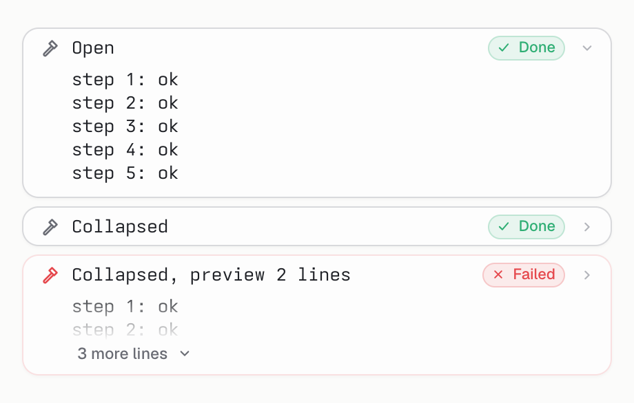
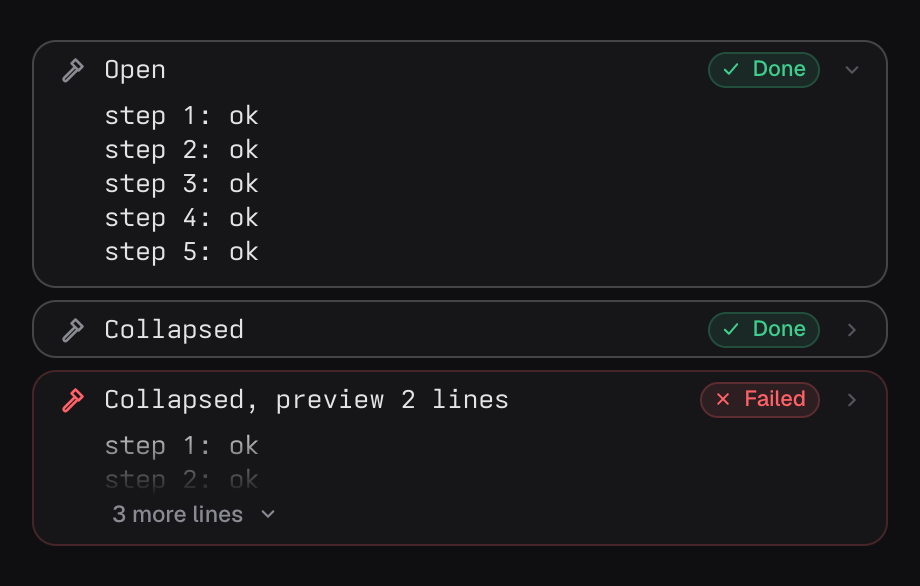
<figcaption>展开时折叠箭头朝下，折叠时朝右；<code>lens.build</code> 隐含锤子图标。</figcaption>
</figure>

**折叠状态是本地状态。** 用户切换后立即生效，无需往返通信，并由节点的 `key` 在其同级节点之间
记住（没有 key 时用其 id），而不是在 surface 范围内记住。删除一张卡片，再在同一父级下添加一张
id 不同而 key 相同的卡片，折叠状态会保留；另一个父级下的同一 key 具有独立的
状态。`collapsed` 属性设置起始状态；用户切换之后，本地状态优先，直到你的视图发送*不同*的
`collapsed` 值，此时它会重置（再次发送相同的值不会改变任何内容）。程序会收到 `toggle` 事件。

**内部的预览。** 自带 `preview` 的类型（`ansi`、`code`）只在折叠时应用它：在展开的可折叠卡片、
section 或 [`tool`](work.md#tool)（树上最近的那个）内部，它们的预览让位并完整显示，
一旦该容器折叠（通过单击或程序的 `collapsed`），它们会再次裁剪。当那个展开容器处于
折叠状态时，它们的“N more lines” / “N earlier lines”按钮会打开它（即 `toggle` 事件，与单击头部相同），
而不是只展开它们自己的块。

**构建方式：** `tern.ui.card(head, children)`（参见 [UI 构建器](../reference/ui.md#layout)），然后在 `p` 上设置属性，
或使用 `tern.ui.node("card", { head = …, status = "running", collapsible = true }, children)`。

| 属性 | 类型 | 默认值 | 含义 |
| --- | --- | --- | --- |
| `head` | spans、字符串，或某个子节点的 id | 无 | 头部内容（见上文） |
| `icon` | 图标名称 | 无 | 头部图标；优先于 `role` 隐含的那个 |
| `meta` | spans 或字符串 | 无 | 头部内容之后的弱化文本 |
| `end` | 某个子节点的 id | 无 | 该子节点绘制在头部的右端而不是主体中（见上文） |
| `status` | `"pending"` \| `"running"` \| `"done"` \| `"error"` \| `"cancelled"` | 无 | 状态徽标；添加 `.sf-chip.st-<status>` |
| `role` | 字符串 | 无 | `data-role`，以及它隐含的头部图标 |
| `tone` | tone 名称 | 无 | `data-tone`：边环颜色与填充色调（见下文） |
| `collapsible` | boolean | `false` | 头部切换折叠；添加 `collapsible` 并显示折叠箭头 |
| `collapsed` | boolean | `false` | 起始折叠状态（需要 `collapsible`）；添加 `collapsed` |
| `preview` | `"auto"` 或 `{ lines = n }` | 无 | 折叠时显示的行数。`"auto"` 为 10；小数 `lines` 会被截断，小于 1 或其他形状的值表示不预览 |
| `key` | 字符串 | 无 | 在兄弟节点中的标识；本地折叠在该 key 下按同一父级记住（没有 key 时按节点 id） |
| `selected` | boolean | `false` | 类 `selected`：一个强调色边环和一个柔和的 3px 强调光晕 |
| `inset` | boolean | `false` | 类 `inset`：主体没有内边距（`0 0 1px`），其子节点采用卡片底部圆角，因此 `code`、`diff` 或 `table` 从一条边铺到另一条边 |
| `variant` | `"bare"` | 无 | 类 `bare`：无边框、填充或圆角；头部是无内边距的普通行高行，主体缩进 24px。保留头部、状态、折叠与预览。用于分组、紧凑的呈现，例如一组行，或较大卡片中的一个文件 |

```lua
local ui = tern.ui

return {
	main = ui.node("col", { gap = "md" }, {
		ui.node("card", { head = "selected", selected = true }, { ui.text("An accent ring and halo.") }),
		ui.node("card", { head = "inset", inset = true }, { ui.code('[build]\ntarget = "release"', "toml") }),
		ui.node("card", { head = "variant = bare", variant = "bare", status = "done", collapsible = true }, {
			ui.text("A plain head row over an indented body."),
		}),
		ui.node("card", {}, { ui.text("No head: the head row hides.") }),
	}),
}
```

<figure class="tn-figure">
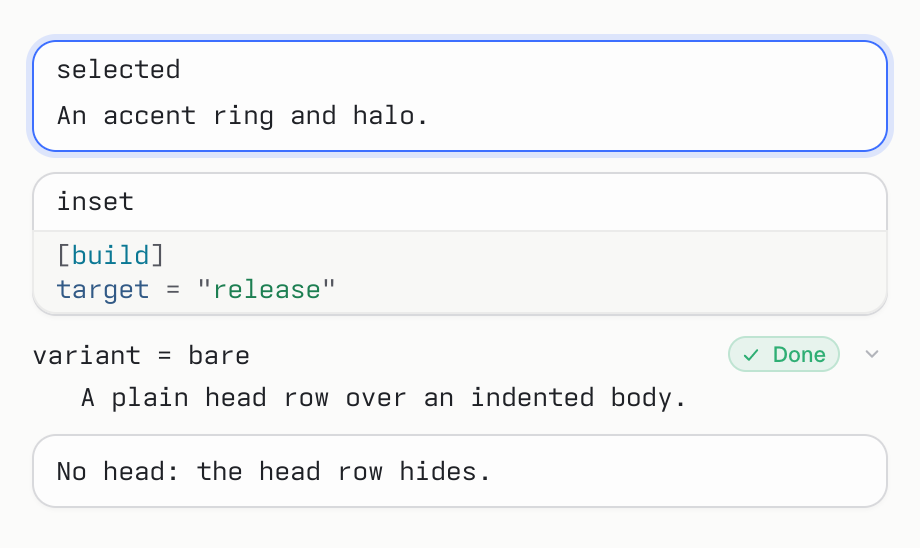
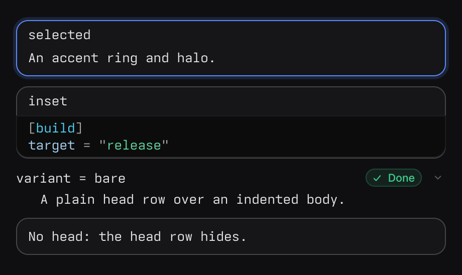
</figure>

**子节点：** `head` 子节点（若 `head` 指定了某个子节点）进入 `div.sf-head`，`end` 子节点（若 `end` 指定了某个子节点）
进入 `div.sf-card-end`；其余每个子节点按顺序进入 `div.sf-card-body`。

**事件：** 用户切换可折叠卡片时（单击头部、在聚焦的头部上按 Enter/Space，或
“more”按钮）触发 `toggle`：

```lua
{ ev = "toggle", id = "main.build", collapsed = true, key = "build" } -- key only when the node has one
```

block 的 `event(state, ev, cx)` 会收到它。卡片自身的 `actions = { click = "toggle" }` 也会切换它。
除此之外，`actions` 的作用与任何节点上相同。

**样式：**

```html
<div class="sf sf-card collapsible collapsed clamped" data-id="main.build" data-role="plugin.ci.job" data-tone="error"
	style="--sf-clamp: 200px">
	<div class="sf-card-head meta" role="button" tabindex="0" aria-expanded="false">   <!-- .meta with a meta -->
		<span class="sf-card-ic sf-hidden" aria-hidden="true"></span>
		<div class="sf-head"><!-- head spans or the head child --></div>
		<span class="sf-card-meta"><!-- meta spans --></span>
		<div class="sf-card-end"><!-- the end child --></div>
		<span class="sf-chip st-error"><svg class="ico">…</svg>Failed</span>
		<span class="sf-chev" aria-hidden="true"><svg class="ico">…</svg></span>
	</div>
	<div class="sf-card-body"><!-- children --></div>
	<button class="sf-more" aria-hidden="false" title="Show all  12 more lines">12 more lines<svg class="ico">…</svg></button>
</div>
```

| 目标 | 选择器 |
| --- | --- |
| 该节点 | `.sf-card` |
| 按角色 / tone | `.sf-card[data-role='…']`、`.sf-card[data-tone='error']` |
| 头部行 | `.sf-card-head`（内部结构，可能变化） |
| 头部内容 | `.sf-card-head > .sf-head`（内部结构，可能变化） |
| 头部图标 | `.sf-card-ic`（内部结构，可能变化） |
| Meta / 头部控件 | `.sf-card-meta`、`.sf-card-end`（内部结构，可能变化） |
| 状态徽标 | `.sf-chip`、`.sf-chip.st-pending` … `.st-cancelled`，运行圆点 `.sf-chip .dot`（内部结构，可能变化） |
| 折叠箭头 | `.sf-chev`（内部结构，可能变化）；除非 `.collapsible` 否则隐藏，`.collapsed` 时旋转 −90° |
| 主体 | `.sf-card-body`（内部结构，可能变化） |
| “N more lines” | `.sf-more`（内部结构，可能变化）；仅在 `.sf-card.clamped` 中显示 |
| 折叠 | `.sf-card.collapsible`、`.sf-card.collapsed`、`.sf-card.nopreview`、`.sf-card.clamped` |
| 标志 | `.sf-card.selected`、`.sf-card.inset`、`.sf-card.bare`、`.sf-card.nohead`、`.sf-card.noic`（无头部图标） |

Tone 与颜色：

- 边环为 `rgb(from var(--tc) r g b / 16%)`（深色模式下为 20%），其中 `--tc` 是由
  `[data-tone]` 设置的 tone 颜色。无 tone 的卡片使用 `--sf-neutral`；`tone = "neutral"` 使用普通的 `--l2` 细线。
- 填充为 `--sf-card-bg`，对于 `success`、`error`、`pending`、`user`、`info` 以及 `neutral`/无 tone 的卡片，
  在 `--sf-tint-<tone>` 已定义时会被其替换（参见[变量](../styles/variables.md#context-fills)）。
- 主体间距为 `--sf-inner-gap`；圆角半径为 `--r-card`；裁剪高度为 `--sf-clamp`，在裁剪
  期间以内联方式设置。
- 状态徽标的颜色来自 `--cc`：`--sf-muted`（pending、cancelled）、`--live`（running）、`--sf-ok`（done）、
  `--sf-bad`（error）。
- 可折叠头部在悬停时用 `--sf-shade` 加深。
- 被裁剪主体的子节点会获得 `flex-shrink: 0`：让它们收缩的样式表会破坏“N more lines”的计数。

`bare` 外观（无填充、边环、圆角）在区域内部生效（`.sf-region .sf-card.bare`）。

```lua
local ui = tern.ui

local function job(j)
	local card = ui.card({ ui.span(j.name, "strong"), ui.span("  " .. j.branch, "muted") }, {
		ui.node("ansi", { text = j.log }),
	})
	local p: { [string]: any } = card.p or {}
	p.key = j.id
	p.role = "plugin.ci.job"
	p.status = j.failed and "error" or "done"
	p.tone = j.failed and "error" or nil
	p.collapsible = true
	p.collapsed = not j.failed
	p.preview = { lines = 6 }
	card.p = p
	return card
end
```

## `section`：无框展开组 {#section}

一种更轻量的展开组，没有边框：头部行由折叠箭头和头部内容组成，位于主体上方，主体向左越过一条 1px 的
细线缩进 22px（`box-shadow: inset 1px 0 0 var(--l2)`）。主体子节点之间相隔 `--sf-inner-gap`。

`head`、`collapsible`、`collapsed` 与 `key` 的作用与 [`card`](#card) 上完全相同：头部作为 span 或某个子节点的 id，
可折叠时头部是一个可用 Enter/Space 操作的按钮并带 `aria-expanded`，本地折叠状态按 `key` 在兄弟节点之间保留，
以及 `toggle` 事件。折叠时主体隐藏。section 没有角色图标、状态徽标、预览裁剪、“more”
按钮、`selected`、`inset` 或 `variant`；这些属性会被忽略。折叠箭头始终显示，展开时
朝下，即使 section 不可折叠也是如此。

**构建方式：** `tern.ui.section(head, children)`（参见 [UI 构建器](../reference/ui.md#layout)），或使用
`tern.ui.node("section", { head = "Details", collapsible = true }, children)`。

| 属性 | 类型 | 默认值 | 含义 |
| --- | --- | --- | --- |
| `head` | spans、字符串，或某个子节点的 id | 无 | 头部内容 |
| `collapsible` | boolean | `false` | 头部切换折叠；添加 `collapsible` |
| `collapsed` | boolean | `false` | 起始折叠状态（需要 `collapsible`）；添加 `collapsed` 与 `nopreview`（主体隐藏；`preview` 属性被忽略） |
| `key` | 字符串 | 无 | 在兄弟节点中的标识；本地折叠在该 key 下按同一父级记住（没有 key 时按节点 id） |

**子节点：** `head` 子节点进入 `div.sf-head`，其余进入 `div.sf-section-body`。

**事件：** `toggle`，与 [`card`](#card) 上相同。

**样式：**

```html
<div class="sf sf-section collapsible" data-id="main.env">
	<div class="sf-section-head" role="button" tabindex="0" aria-expanded="true">
		<span class="sf-chev" aria-hidden="true"><svg class="ico">…</svg></span>
		<div class="sf-head"><!-- head --></div>
	</div>
	<div class="sf-section-body"><!-- children --></div>
</div>
```

| 目标 | 选择器 |
| --- | --- |
| 该节点 | `.sf-section` |
| 头部行 | `.sf-section-head`（内部结构，可能变化） |
| 头部内容 | `.sf-section-head > .sf-head`（内部结构，可能变化） |
| 折叠箭头 | `.sf-section-head .sf-chev`（内部结构，可能变化）；折叠时旋转 −90° |
| 主体 | `.sf-section-body`（内部结构，可能变化） |
| 折叠 | `.sf-section.collapsible`、`.sf-section.collapsed` |

头部文本为 `--t2`。可折叠的头部会变为 `--t1`，悬停时带 `--l1` 的阴影。主体的细线位于向内 7px 处，
在折叠箭头下方。

```lua
local ui = tern.ui

local function env(key: string, collapsed: boolean)
	local s = ui.section({ ui.span("Environment"), ui.span(" 2", "muted") }, {
		ui.kv({ { "PATH", "/usr/bin" }, { "HOME", "/Users/me" } }),
	})
	local p: { [string]: any } = s.p or {}
	p.key = key
	p.collapsible = true
	p.collapsed = collapsed
	s.p = p
	return s
end

return { main = ui.col({ env("env", false), env("env2", true) }) }
```

<figure class="tn-figure">
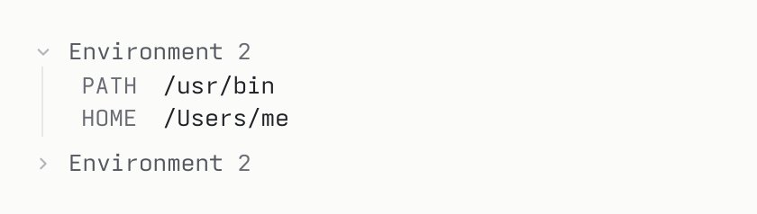
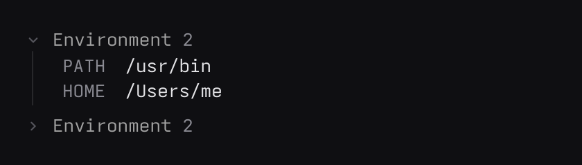
</figure>

## `split`：可调整大小的面板 {#split}

由用户调整大小的面板：每个子节点是一个面板，两个面板之间有一个可由指针拖动的分隔手柄。当两三个视图
共享同一块空间、且应由用户决定各自占多少时使用它：文件旁边的文件列表、
查询与其结果、对话与其详情。固定不变的布局请使用带 `basis` 的 `row` 或 `col`；
一次只显示一个视图时使用 [`tabs`](lists.md#tabs)。

三种外观。`hairline`（默认）是一整个带框的盒子，面板之间有 1px 分隔线；悬停分隔线
会为其着色并显示一个抓手小条，按住分隔线时它变为强调色，并带一个玻璃质感的提示，显示两个面板的占比。
`gutter` 让每个面板各自成为一张卡片，相隔 6px，间隙中有一个点状抓手。`tiles` 让每个面板成为一张卡片，
相隔 8px，间隙本身就是手柄：悬停时其中显示一条强调色线，按住时保持显示。

`dir = "col"` 把面板纵向堆叠，手柄上下移动。堆叠的 split 需要高度：`h`（默认 12 行），
或在自身有高度的父级（屏幕 surface 的 `main`）中使用 `grow`，它会填满该高度。

**构建方式：** `tern.ui.node("split", { sizes = { 0.36, 0.64 } }, { pane, pane })`（没有专用构建器）。

| 属性 | 类型 | 默认值 | 含义 |
| --- | --- | --- | --- |
| `variant` | `"hairline"` \| `"gutter"` \| `"tiles"` | `"hairline"` | 外观（见下文）。未知值会被当作 `hairline` |
| `dir` | `"row"` \| `"col"` | `"row"` | `row`：面板并排，手柄左右移动。`col`：面板纵向堆叠，手柄上下移动 |
| `sizes` | number[] | 均等面板 | 每个面板的占比，按子节点顺序。归一化为总和 1（`{ 2, 1 }` 即 `{ 0.667, 0.333 }`）；缺失、为零或为负的项分得其余项在 1 中留下的份额（其余项一点不留时取它们的平均）。它决定用户拖动前面板显示的大小，也是双击手柄后回到的状态。`sizes` 变化会优先于用户的拖动 |
| `min` | (字符串 \| 数字 \| nil)[]、字符串或数字 | 无 | 每个面板沿 split 方向的最小值：`"<n>ch"`（字符单元）、`"<n>lines"`（文本行）或表示 split 占比的数字（`0.2`）；`nil`（`null`）表示无限制。单个值会应用到所有面板。无论 `sizes` 如何，面板都保持该值，拖动到此为止。对象 `{ w?, h? }` 仍然是 split 自身的[通用尺寸边界](#common-props-on-layout-nodes) |
| `h` | 字符串或数字 | `row`：面板的内容高度；`col`：`"12lines"` | split 的高度：`"<n>lines"`、`"<n>ch"` 或相对父级高度的比例。高于其份额的面板会滚动 |
| `grow` | 数字 | 无 | 通用属性：可增长的 split 还会填满其盒子高度（屏幕 surface 的 `main`），因此 `col` 方向的 split 在那里无需 `h` |
| `active` | 数字 | 无 | 你的程序正在用按键移动的手柄（0 是第一个面板之后的那一个）：绘制为按住状态，并显示其份额提示 |
| `key` | 字符串 | 无 | 用户的拖动按此在 split 的兄弟节点之间记住（否则按节点 id），因此重建的 split 能保留它 |

| 变体 | 外观 | 适用场景 |
| --- | --- | --- |
| `hairline` | 一个带框的盒子，1px 分隔线；悬停时分隔线着上强调色并带抓手小条；按住时：强调色，并带玻璃质感的 `36% │ 64%` 提示 | 属于一体的视图：列表与其详情、编辑器与其输出 |
| `gutter` | 每个面板各自一张卡片，相隔 6px，间隙中有一个 2 × 3 的点状抓手（悬停时更深，按住时为强调色） | 并排的独立对象，且抓手应始终可见 |
| `tiles` | 每个面板各自一张卡片，相隔 8px；间隙就是手柄，悬停时其中有一条强调色线，按住时变为实线 | 仪表盘和磁贴式工具，与 Tern 的 tiles 布局一致 |

```lua
local ui = tern.ui

return {
	main = ui.node("split", { key = "browser", sizes = state.sizes or { 0.36, 0.64 }, min = { "18ch", "30ch" } }, {
		ui.list(state.files),
		ui.code(state.source, "lua"),
	}),
}
```

<figure class="tn-figure">
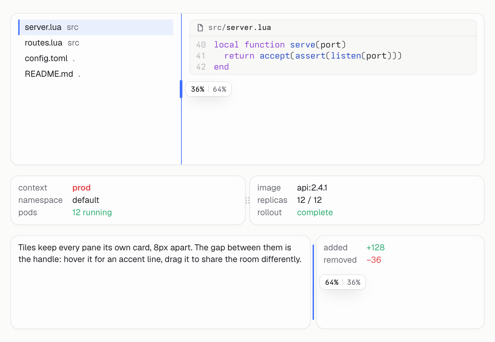
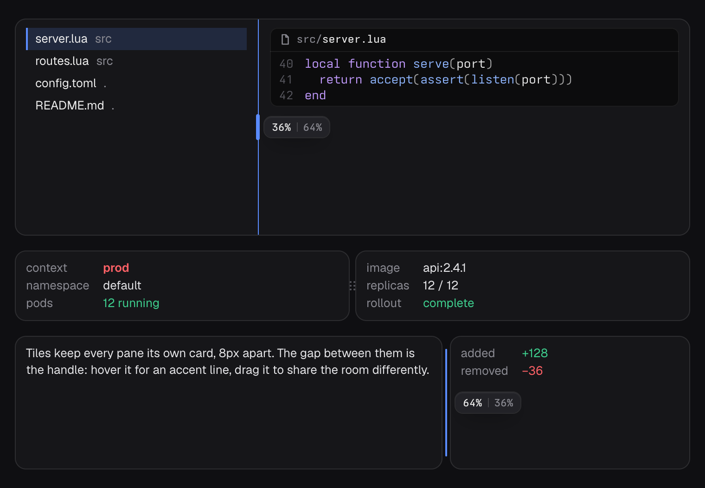
<figcaption>三种外观：<code>hairline</code>（其手柄处于按住状态，即 <code>active</code> 绘制的样子）、<code>gutter</code> 与 <code>tiles</code>（按住状态）。</figcaption>
</figure>

<figure class="tn-figure">
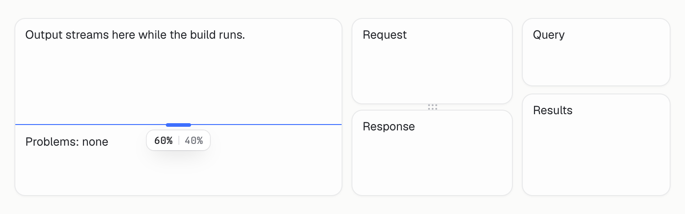
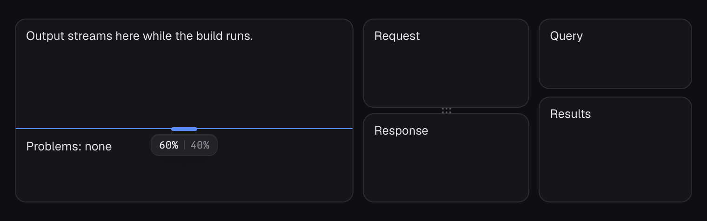
<figcaption>每种外观下的 <code>dir = "col"</code>，<code>h = "11lines"</code>。</figcaption>
</figure>

<figure class="tn-figure">
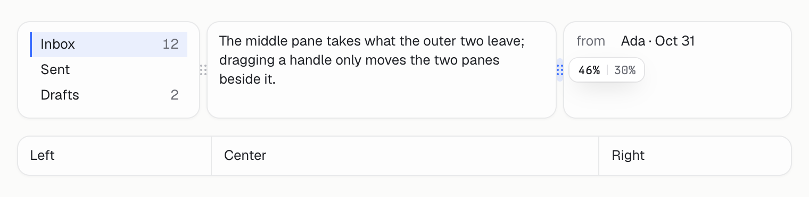
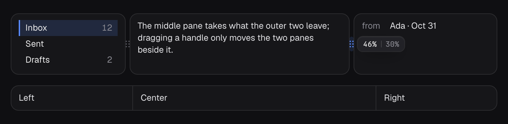
<figcaption>三个面板：一个手柄只移动它两侧的两个面板。</figcaption>
</figure>

<figure class="tn-figure">
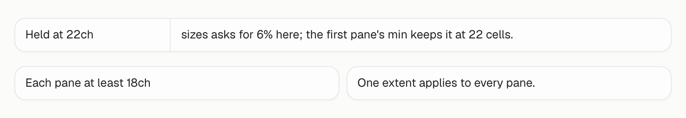
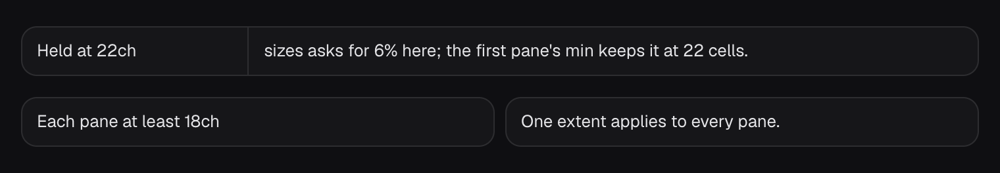
<figcaption>无论 <code>sizes</code> 如何要求、指针如何拖动，<code>min</code> 都会把面板保持在其尺寸上。</figcaption>
</figure>

**子节点：** 即各个面板，按顺序，每个子节点一个。每个子节点位于面板主体中，内边距为 10px × 12px，
当子节点高于其面板时该主体会滚动。只有一个子节点的 split 是单个面板，没有手柄。

**事件：** 松开被移动过的手柄时会发送

```lua
{ ev = "change", id = "main.browser", value = { 0.3, 0.7 } } -- every pane's share, summing to 1
```

`value` 为每个面板一个分数（四位小数），按绘制结果测量，因此最小值已经计入。双击
任意手柄会把每个面板恢复到 `sizes`，若这引起了变化，则用这些值发送 `change`。

面板会立即跟随指针，split 会按 `key` 保留用户的分数，直到你的程序发送与上次绘制的值不同的
`sizes`；此时 `sizes` 优先。要持久化布局，请保存 `value` 并在下次作为
`sizes` 传入；若希望双击回到某个默认值，请另外保留一个默认值。split 位于已关闭的 surface 上，
或以 `listen = false` 打开时（参见 [Surface](../protocol/surfaces.md#open-and-close)），会绘制其手柄但
不会移动，也不发送任何内容。

```lua
-- event(state, ev, cx)
if ev.ev == "change" and ev.id == "main.browser" then
	state.sizes = ev.value
end
```

**键盘：** 自身没有键盘处理（节点从不获得焦点）。键盘由你的程序负责：把 `active` 设为正在
移动的手柄，并在每次按键时发送新的 `sizes`（例如 ←/→ 移动 2%，⇧ 移动 10%）；`active` 会把该手柄绘制为按住状态并
显示其提示。完成后清除 `active`。

**无障碍：** 每个手柄为 `role="separator"`，带 `aria-orientation`（并排面板之间为 `vertical`）、
`aria-valuenow`（其前面那个面板的占比，以百分比表示）、`aria-valuemin="0"`、`aria-valuemax="100"`
以及 `aria-label="Resize panes"`；其抓手和提示为 `aria-hidden`。

**动效：** 抓手在悬停时淡入并缩放（0.22s `--out`），分隔线和圆点着色（0.15s `--ease`），
提示淡入（0.14s）。在减少动效、`.sf-still` 与 `.sf-paused` 下关闭。

**样式：**

```html
<div class="sf sf-split" data-id="main.browser" data-variant="hairline" data-dir="row">
	<div class="sf-split-box">
		<div class="sf-split-pane" style="flex-grow: 360; min-width: calc(18 * var(--sf-cw))">
			<div class="sf-split-body"><!-- the first child --></div>
		</div>
		<div class="sf-split-handle held" role="separator" aria-orientation="vertical"
			aria-valuenow="36" aria-valuemin="0" aria-valuemax="100" aria-label="Resize panes">
			<span class="sf-split-grip" aria-hidden="true">
				<span class="sf-split-dot"></span><!-- ×6, shown by gutter -->
			</span>
			<span class="sf-split-tip" aria-hidden="true">
				<span class="a">36%</span><span class="sep"></span><span class="b">64%</span>
			</span>
		</div>
		<div class="sf-split-pane" style="flex-grow: 640">
			<div class="sf-split-body"><!-- the second child --></div>
		</div>
	</div>
</div>
```

拖动某个手柄期间，`.sf-split` 元素本身会获得类 `held`。依赖外观或
方向的规则会经由 `> .sf-split-box >`，因此嵌套在面板中的 split 会保留自己的样式。

| 目标 | 选择器 |
| --- | --- |
| 该节点 | `.sf-split` |
| 变体 / 方向 | `.sf-split[data-variant='gutter']`、`[data-variant='tiles']`；`.sf-split[data-dir='col']` |
| 正在拖动 | `.sf-split.held` |
| 盒子（`hairline` 的边框、`col` 的高度） | `.sf-split-box`（split 可增长时为 `.fill`）（内部结构，可能变化） |
| 面板 / 其滚动主体 | `.sf-split-pane`、`.sf-split-body`（内部结构，可能变化） |
| 手柄；按住、程序激活 | `.sf-split-handle`、`.sf-split-handle.held`、`.sf-split-handle.active`（内部结构，可能变化） |
| 抓手 / gutter 圆点 | `.sf-split-grip`、`.sf-split-dot`（内部结构，可能变化） |
| 份额提示 | `.sf-split-tip`（`.a`、`.sep`、`.b`）（内部结构，可能变化） |
| 间隙 / 分隔线宽度 | `.sf-split` 上的 `--sf-split-gap`（按外观为 1px、6px、8px） |

## `scroll`：滚动盒 {#scroll}

一个让子节点滚动而不是被截断的盒子。给它一个边界，`max = { h = "12lines" }`，或由父级赋予高度
（在有尺寸的 `col` 中用 `grow`），它的子节点（任意节点，像 `col` 的子节点一样按顺序绘制）就会在其中
Tern 的细浮层滚动条下滚动。其他节点上的 `max.h` 会截断超出部分并让截断处淡出（参见
[通用属性](#common-props-on-layout-nodes)）；当其余内容仍应可访问时，请使用 `scroll`。

有两种行为使它也能充当消息滚动视图。`stick = "end"` 在内容增长时保持它在末尾，无论
子节点不断到来还是最后一个持续流式输出（`text` 的 [append](text.md#text-kinds-and-text-ops)），直到用户向上
滚动；此时一个浮动的 **↓ N new** 胶囊会统计在视野之外到来的子节点数，点击后跳回并再次跟随末尾。
`variant = "fade"` 会在内容仍有延续的边缘处淡出，并在 **N more ↓**
小标签上统计下方剩余的内容。

**构建方式：** `tern.ui.node("scroll", { stick = "end", max = { h = "14lines" } }, children)`（没有专用构建器）。

| 属性 | 类型 | 默认值 | 含义 |
| --- | --- | --- | --- |
| `variant` | `"bar"` \| `"fade"` | `"bar"` | 外观（见下文）。其他值会被当作 `bar` |
| `stick` | `"end"` | 无 | 内容增长时保持在末尾，直到用户从末尾向上滚动；此后显示 **↓ N new** 胶囊 |
| `pinned` | boolean | 带 `stick` 时为 `true` | 处于吸附状态的视图是否跟随其末尾。用户的滚动会在本地改变它；与上次绘制的值不同的值会生效（`false` 让日志从开头打开，但仍提供胶囊） |
| `bar` | `"auto"` \| `"always"` | `"auto"` | 滑块何时显示：滚动时（以及指针进入时），或有内容可滚动时始终显示 |
| `gap` | `"none"` \| `"xs"` \| `"sm"` \| `"md"` \| `"lg"` | `"none"` | 子节点之间的间距，与 [`col`](#col) 相同 |
| `noun` | 字符串或 `{ string, string }` | 无 | 计数所指的对象：`"line"`（复数加 `s`）或 `{ "entry", "entries" }`：“4 more lines”、“2 new entries”。不设置时为：“4 more”、“2 new” |

边界即通用的 `max.h`（或来自父级的高度：在有尺寸的 `col` 中用 `grow`，或用 `basis`）；没有边界时盒子
随内容增长，什么都不会滚动。其他通用属性同样有效：`title`、`aria`、`role`、`hidden`，以及
flex 属性。

| 变体 | 外观 | 用途 |
| --- | --- | --- |
| `bar` | 内容铺到边缘；一个 6px 的浮层滑块距离右边缘 2px，在视图滚动时显示，随后淡出（如同 macOS 的滚动视图），指针在其上时变宽。其 12px 的条带可接受按压：拖动滑块，或按压轨道把滑块带到指针下 | 列表、面板，以及用户会主动滚动的任何内容 |
| `fade` | 滚动条，加上内容有延续的顶部和底部边缘淡出，以及右下角一个小的玻璃质感 **N more ↓** 小标签，统计完全位于折线之下的子节点数（其余内容都在视野中最后一个子节点内时为“More ↓”）。单击会向下滚动将近一屏 | 需要一眼看出“还有更多”的预览和摘要 |

`stick = "end"` 与两种变体都兼容。处于吸附状态时，视图会接收每个新子节点以及最后一个子节点的每次增长
（流式 `text` 追加），而不离开末尾。向上滚动会放开；滚回末尾、点击
胶囊，或程序的 `scroll` 操作到 `"end"`，都会再次吸附。放开期间，胶囊显示 **↓ N new**
以及已在下方到来但尚未进入视野的子节点数（用户滚过它们时该数字会减少），或在没有新内容时
只显示一个圆形箭头；此时底部边缘在其下方淡出。使用 `fade` 时，胶囊取代
小标签。

```lua
local ui = tern.ui

return {
	main = ui.col({
		-- A build log that follows its output.
		ui.node("scroll", { key = "log", stick = "end", max = { h = "14lines" } }, state.lines),
		-- Release notes with fading edges and a "4 more changes" chip.
		ui.node("scroll", { key = "notes", variant = "fade", noun = "change", max = { h = "8lines" } }, state.notes),
		-- A chat: messages 6px apart, the pill reading "2 new messages".
		ui.node("scroll", {
			key = "chat", stick = "end", gap = "sm", noun = { "message", "messages" }, max = { h = "20lines" },
		}, state.messages),
	}),
}
```

<figure class="tn-figure">
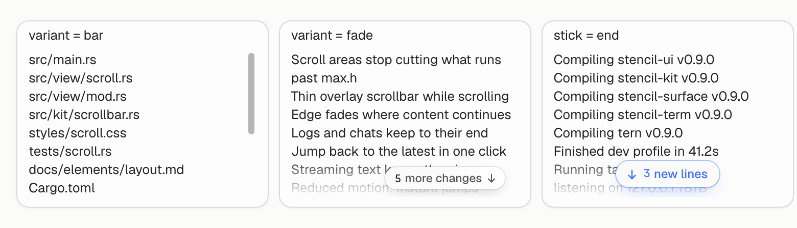
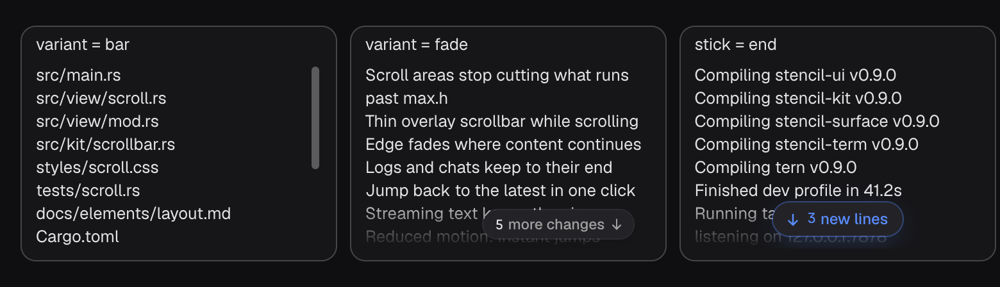
<figcaption>三种外观：浮层滚动条（此处以 <code>bar = "always"</code> 显示；默认只在滚动时显示）、带小标签的 <code>variant = "fade"</code>，以及从末尾滚开的 <code>stick = "end"</code>。</figcaption>
</figure>

<figure class="tn-figure">
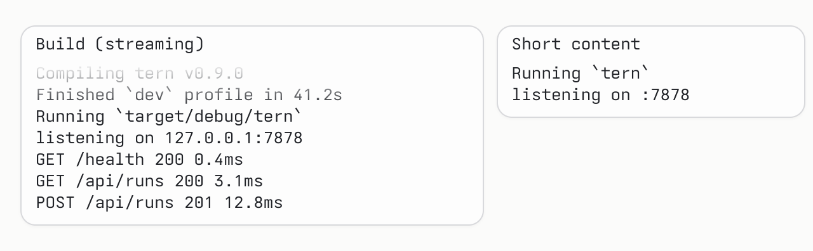
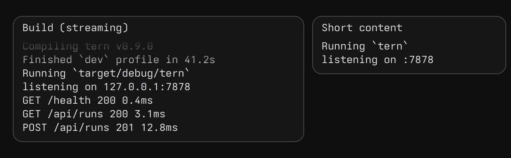
<figcaption>处于吸附状态的日志在行不断加入、最后一行流式输出时保持在末尾；刚好放得下的内容不显示任何界面外壳。</figcaption>
</figure>

<figure class="tn-figure">
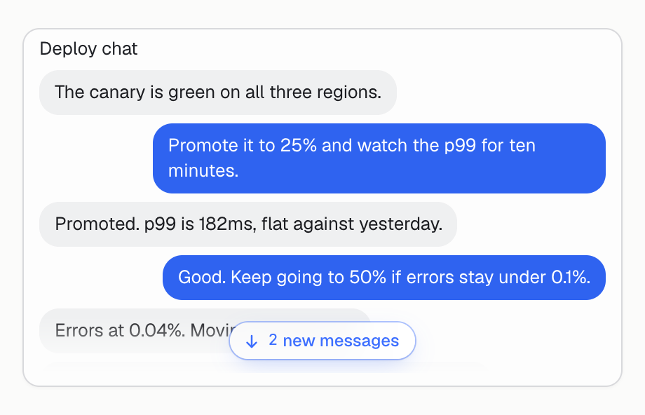
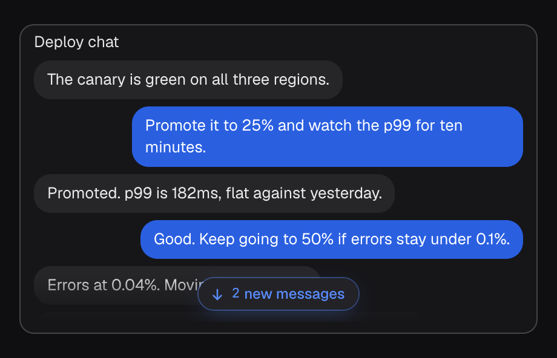
<figcaption>一个被用户向上滚动的消息滚动视图：胶囊统计下方尚未看到的消息数，并跳转到最新消息。</figcaption>
</figure>

**子节点：** 任意节点，按顺序绘制（按 `gap` 间隔）。

**事件：** 无。滚动、吸附和计数都归查看方，因此在已关闭的 surface 上或以 `listen = false`
打开的 surface 中的 `scroll`，滚动行为完全相同。

**键盘：** 节点从不获得焦点。程序通过其 id（或其内部任意节点）上的 [`scroll` 操作](../protocol/documents.md#frame-ops)
滚动盒子：`"page-up"`、`"page-down"`、`"line-up"`、`"line-down"`、`"start"`、`"end"`。在
block 中：`cx:frame({ { "scroll", "main.log", "page-up" } })`。`"end"` 会再次吸附处于吸附状态的视图（在用户
发送消息时这样做）。`pinned` 直接设置吸附状态。

**无障碍：** 处于吸附状态的视图，其滚动容器的角色为 `role="log"`（新子节点会得到礼貌播报）。小标签和
胶囊是按钮，其名称说明了作用（“4 more lines below, scroll down”、“2 new messages, jump to latest”），
在未显示时对辅助技术隐藏；滚动条仅作装饰。

**样式：**

```html
<div class="sf sf-scroll scroll fade stick can sf-clip" data-id="main.log">
	<div class="sf-scroll-view gap-sm down up" role="log"><!-- children --></div>
	<div class="sf-scroll-bar fa" aria-hidden="true"><div class="sf-scroll-thumb"></div></div>
	<button class="sf-scroll-more">
		<span class="n">4</span><span class="w">more</span><svg class="ico">…</svg>
	</button>
	<div class="sf-scroll-dock">
		<button class="sf-scroll-jump on" aria-label="2 new messages, jump to latest">
			<svg class="ico">…</svg><span class="n">2</span><span class="w">new messages</span>
		</button>
	</div>
</div>
```

| 目标 | 选择器 |
| --- | --- |
| 该节点（有边界的框架） | `.sf-scroll` |
| 变体 / 行为 | `.sf-scroll.fade`、`.sf-scroll.stick`、`.sf-scroll.always` |
| 有内容可滚动 | `.sf-scroll.can` |
| 滚动容器（子节点的父级） | `.sf-scroll-view`（内部结构，可能变化） |
| 视图上方 / 下方的内容 | `.sf-scroll-view.up`、`.sf-scroll-view.down`（内部结构，可能变化） |
| 滑块（轨道，拖动期间） | `.sf-scroll-thumb`（`.sf-scroll-bar`、`.sf-scroll-bar.held`）（内部结构，可能变化） |
| “N more”小标签，显示时 | `.sf-scroll-more`、`.sf-scroll-more.on`（内部结构，可能变化） |
| “↓ N new”胶囊，显示时 / 仅箭头 | `.sf-scroll-jump.on`、`.sf-scroll-jump.bare`（内部结构，可能变化） |
| 计数 / 其文字 | `.sf-scroll-more .n`、`.sf-scroll-jump .w`（内部结构，可能变化） |

## `empty`：空状态 {#empty}

面板、卡片、列表或拖放目标在尚无内容时所显示的内容。它在标题中说明缺少什么，在一行弱化文字中说明
原因（或该怎么做），并把用于填充它的操作作为子节点承载，通常是一个
[`button`](input.md#button)。用它在缺少数据的视图位置取代该视图，而不是放在它旁边；保留该视图的
key，让空状态和内容在同一处轮流出现。

它是每个视图都拥有的[四种状态](../guides/design.md#the-four-states)之一（加载中、空、错误、成功）：
`tone = "error"` 会让它成为整个面板的错误状态，其子节点中可包含一个 Retry 按钮。

三种外观，由 `variant` 选择：

- `center`（默认）：一个位于柔和圆形凹槽中的图标、标题、一行文字，以及其下方的操作，在所得空间中
  居中。用于卡片或面板。
- `inline`：一行：图标、标题和弱化文本，操作在其末端。用于表格大小的区域或小面板；
  `frame = true` 会把它绘制在细线卡片中。给它的按钮设置 `variant = "quiet"` 与 `size = "sm"`。
- `drop`：一个虚线区域，图标位于凸起的磁贴中，另有标题、文字和操作；按钮的 `keys` 会绘制其键帽
  提示。程序检测到拖动悬停其上时，`over = true` 会让它亮起强调色。

所有内容都以短暂的淡入出现（减少动效时为无）。

**构建方式：** `tern.ui.node("empty", { icon = …, title = …, text = … }, { button })`（没有专用构建器）。

| 属性 | 类型 | 默认值 | 含义 |
| --- | --- | --- | --- |
| `variant` | `"center"` \| `"inline"` \| `"drop"` | `"center"` | 外观（见下文）。其他值会被当作 `center` |
| `icon` | 图标名称 | 按外观：`inbox`、`info`、`file-plus`；带 `error` 或 `warning` tone 时为 `warn` | 图标（[图标名称](data.md#icon-names)）；`""` 表示无 |
| `title` | spans 或字符串 | 无 | 缺少什么，用几个词说明 |
| `text` | spans 或字符串 | 无 | 一行弱化文字：原因，或该怎么做 |
| `tone` | tone 名称 | 无 | `error` 或 `warning` 为图标（以及 `drop` 的边框）着色：一个错误空状态 |
| `frame` | boolean | `false` | 仅 `inline`：把该行绘制在细线卡片中 |
| `over` | boolean | `false` | 仅 `drop`：有拖动悬停在区域上，它以强调色亮起 |

通用属性（`grow`、`key`、`min`、`max`……）均适用；给 `center` 与 `drop` 设置 `grow` 可以填满面板。

| 变体 | 外观 | 适用 |
| --- | --- | --- |
| `center` | 图标在圆形凹槽中，标题、一行文字，操作在下方，整体居中 | 卡片、面板、视图的首次运行 |
| `inline` | 一行：图标、标题、弱化文本，操作在末端 | 表格大小的区域、小面板、没有命中的过滤器 |
| `drop` | 虚线区域、图标磁贴、标题、文字，操作带键帽 | 接受拖入文件的位置 |

```lua
local ui = tern.ui

return {
	main = ui.col({
		ui.node("empty", { icon = "inbox", title = "No deployments yet", text = "Push to main or run tern deploy." }, {
			ui.button("New deployment", { variant = "primary", icon = "rocket", actions = { click = "deploy" } }),
		}),
		ui.node("empty", { variant = "inline", frame = true, icon = "search", text = "Nothing matches “zzz”" }, {
			ui.button("Clear", { variant = "quiet", size = "sm", keys = { "esc" }, actions = { click = "clear" } }),
		}),
	}),
}
```

<figure class="tn-figure">
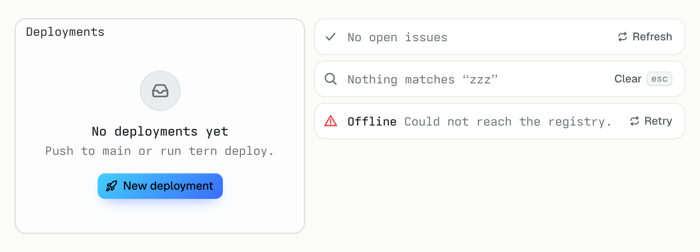
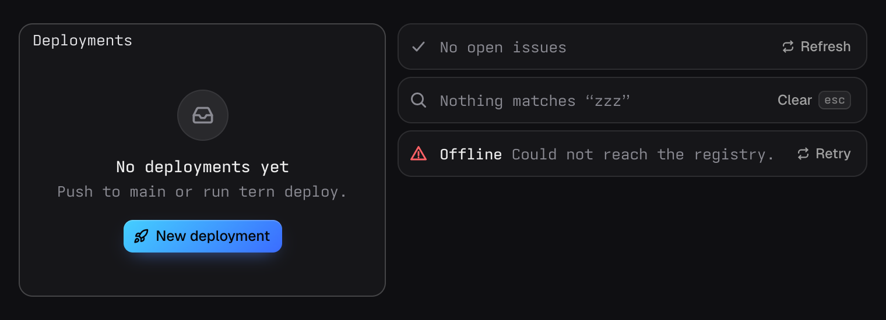
<figcaption>卡片中的 <code>center</code>，以及带 <code>frame</code> 的 <code>inline</code>，最后一个使用 <code>tone = "error"</code>。</figcaption>
</figure>

<figure class="tn-figure">
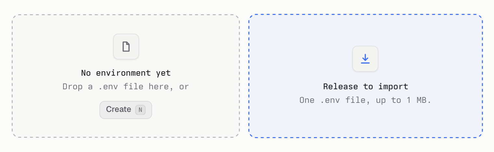
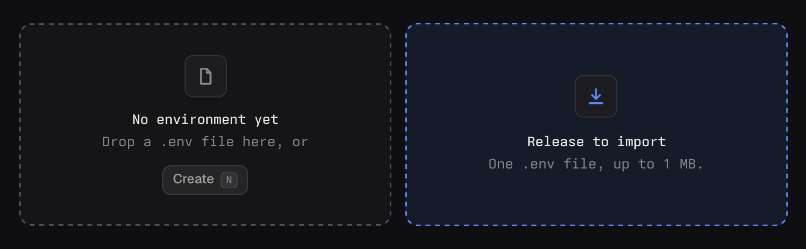
<figcaption><code>drop</code>，静止状态与 <code>over = true</code> 状态。</figcaption>
</figure>

<figure class="tn-figure">
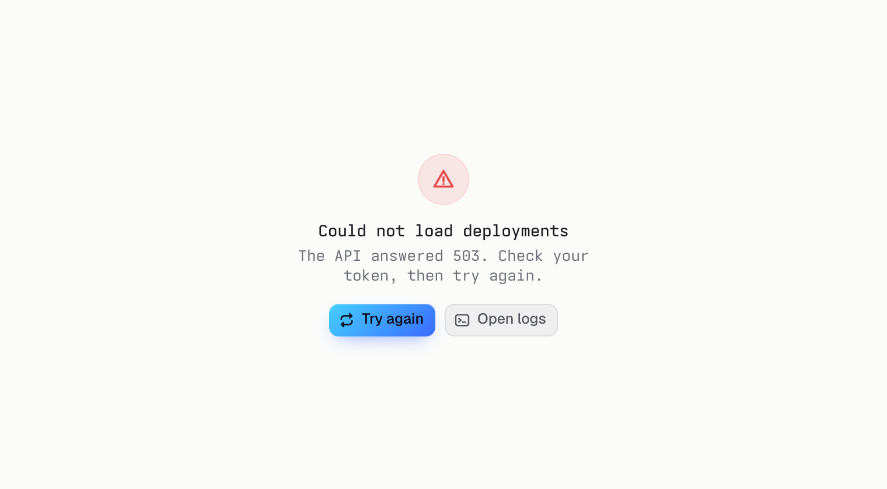
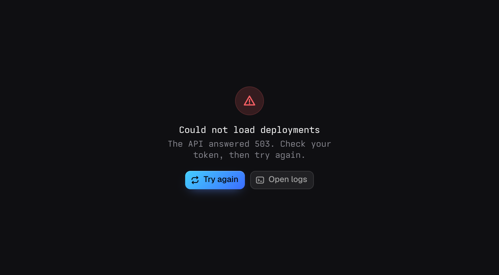
<figcaption>处于错误状态的完整面板：<code>tone = "error"</code>，并带 <code>grow</code>。</figcaption>
</figure>

**子节点：** 即各个操作，按顺序进入 `div.sf-empty-acts`。

**事件：** 自身没有事件。其子节点发送各自的事件（`button` 的 `action` 带 `act`）。

**键盘：** 节点从不获得焦点。在程序中绑定各操作的按键，并把它们作为按钮的 `keys` 显示；
根据程序自身的拖动跟踪设置 `over`。

**无障碍：** 节点的角色为 `role="status"`；图标为 `aria-hidden`。

**样式：**

```html
<div class="sf sf-empty framed" data-id="main.issues" data-variant="inline" data-tone="error" role="status">
	<div class="sf-empty-in">
		<span class="sf-empty-ic" aria-hidden="true"><svg class="ico">…</svg></span>
		<div class="sf-empty-copy">
			<div class="sf-empty-title">Offline</div>
			<div class="sf-empty-text">Could not reach the API</div>
		</div>
		<div class="sf-empty-acts"><!-- children --></div>
	</div>
</div>
```

| 目标 | 选择器 |
| --- | --- |
| 该节点 | `.sf-empty` |
| 变体 / tone | `.sf-empty[data-variant='inline']`、`[data-variant='drop']`；`.sf-empty[data-tone='error']` |
| 带框的行 / 拖动悬停 | `.sf-empty.framed`、`.sf-empty.over` |
| 内部盒子 | `.sf-empty-in`（内部结构，可能变化） |
| 图标 | `.sf-empty-ic`（内部结构，可能变化） |
| 标题与一行文字 | `.sf-empty-copy`、`.sf-empty-title`、`.sf-empty-text`（内部结构，可能变化） |
| 操作 | `.sf-empty-acts`（内部结构，可能变化） |

## `rule`：分隔线与标记 {#rule}

一条横向细线（`--l2`），高度为一行（`--sf-lh`），带 `role="separator"`。带 `label` 时，标签位于
两条细线之间居中，使用 11.5px sans 与 `--t3`。没有标签、图标、时间或 `end` 时，rule 是一条
占满整行宽度的单线，并获得类 `bare`。

rule 也是对话记录标记某个时刻的方式：一天的间断、一个检查点、某人加入、一次压缩。三种
外观，由 `variant` 选择：

- `line`（默认）：细线分隔，标签前可选一个 `icon`，标签后可选一个 `time`
  （`Checkpoint 3 · 14:02`），在两条细线之间居中。
- `note`：一行左对齐的弱化文字：图标、标签，以及在右边缘以等宽字体显示的 `time`。带一个 `end` 子节点
  （一个 Restore 按钮）时，它变成带框的检查点行：一条卡片色调的圆角行，带细线边环，标签为
  `--t1`，图标为强调色（或 tone 的颜色），控件在右侧。
- `pin`：对话记录轨道上的一个胶囊：一条 1.5px 的竖直轨道在该行左侧穿过（连续多个 pin 和
  行会连成一条轨道），胶囊位于其上，内含图标、标签（中等字重）和以等宽字体显示的 `time`，
  色调为强调色或 `tone`。`end` 子节点位于胶囊旁。

要分隔分组（天、章节）时使用 `line`，位于对话记录流中的事件使用 `note`，
用户可跳回的点使用 `pin`。把操作放在 `end` 中，而不是放在 rule 旁边：由 rule 来摆放它，
对它的点击就是按钮自身的事件。

**构建方式：** `tern.ui.rule(label?)`（参见 [UI 构建器](../reference/ui.md#layout)），或使用
`tern.ui.node("rule", { label = "Older" })`。变体与其他属性需要 `tern.ui.node`：
`tern.ui.node("rule", { variant = "note", label = …, icon = …, time = …, ["end"] = id }, { button })`。与
[`card`](#card) 上相同，`end` 是 Luau 的关键字，写作 `["end"] = …`，并按 id 指定 rule 自身某个子节点。

| 属性 | 类型 | 默认值 | 含义 |
| --- | --- | --- | --- |
| `variant` | `"line"` \| `"note"` \| `"pin"` | `"line"` | 外观（见下文）。未知值绘制为 `line`。添加类 `v-note` / `v-pin` |
| `label` | spans 或字符串 | 无 | 标签；span 样式标记可用（如 `12 files` 这类细节用 `muted`） |
| `icon` | 图标名称 | 无 | 标签前的图标（[图标名称](data.md#icon-names)：`history`、`user`、`warn`）。未知名称不绘制 |
| `time` | 字符串 | 无 | 时间或短时间戳：`line` 中作为 ` · 14:02` 跟在标签后，`note` 中在右边缘以等宽字体显示，`pin` 中在胶囊内以等宽字体显示 |
| `tone` | tone 名称 | 无 | 为图标着色（`line`、`note`）或为整个胶囊着色调（`pin`）；即通用的 `data-tone` |
| `end` | 某个子节点的 id | 无 | 该子节点绘制在末端：标签之后（`line`）、带框行的右侧（`note`）、胶囊旁边（`pin`） |

| 变体 | 外观 | 带 `end` 时 |
| --- | --- | --- |
| `line` | 两条细线之间居中的图标 · 标签 · 时间 | 子节点跟在标签之后 |
| `note` | 左对齐的弱化行：图标、标签（省略号截断）、时间在右侧 | 带框的检查点行（类 `framed`）：卡片背景、细线边环、`--r-ctl` 圆角、标签为 `--t1`、图标为强调色 |
| `pin` | 竖直对话记录轨道上的着色胶囊（图标、标签、时间） | 子节点位于胶囊旁 |

**子节点：** 仅 `end` 指定的子节点，绘制到 `span.sf-rule-end`；其他子节点不会被绘制。

**事件：** 自身没有事件；`actions` 的作用与任何节点上相同。`end` 子节点发送自己的事件（`button` 的 `action`），
使用它自己的 id。

**键盘：** rule 从不获得焦点。提供键盘恢复的程序会在 `end` 按钮上绑定按键
（`keys`）。

**无障碍：** 为 `role="separator"`，当 rule 带 `end` 子节点时为 `role="group"`（separator 的内容是
展示性的，会隐藏其中的控件）。图标为 `aria-hidden`。

**样式：**

```html
<!-- line -->
<div class="sf sf-rule" data-id="main.3" role="separator">
	<span class="sf-rule-label"><svg class="ico sf-rule-ic">…</svg>Checkpoint 3<span class="sf-rule-time"> · 14:02</span></span>
</div>
<!-- note with end -->
<div class="sf sf-rule v-note framed" data-id="main.note" role="group">
	<svg class="ico sf-rule-ic">…</svg><span class="sf-rule-label">Checkpoint 3</span><span class="sf-rule-time">14:02</span>
	<span class="sf-rule-end"><!-- the end child --></span>
</div>
<!-- pin -->
<div class="sf sf-rule v-pin" data-id="main.pin" role="group">
	<span class="sf-rule-pill"><svg class="ico sf-rule-ic">…</svg><span class="sf-rule-label">Checkpoint 3</span><span class="sf-rule-time">14:02</span></span>
	<span class="sf-rule-end"><!-- the end child --></span>
</div>
```

| 目标 | 选择器 |
| --- | --- |
| 该节点 | `.sf-rule` |
| 细线 | `.sf-rule::before`、`.sf-rule::after`（`.sf-rule.bare` 上隐藏 `::after`） |
| 无标签 | `.sf-rule.bare` |
| 变体 | `.sf-rule.v-note`、`.sf-rule.v-pin`；带框的 note 为 `.sf-rule.v-note.framed` |
| 轨道（`pin`） | `.sf-rule.v-pin::before` |
| 标签 | `.sf-rule-label`（内部结构，可能变化） |
| 图标、时间、胶囊、end 容器 | `.sf-rule-ic`、`.sf-rule-time`、`.sf-rule-pill`、`.sf-rule-end`（内部结构，可能变化） |
| 胶囊颜色 | `.sf-rule-pill` 上的 `--pc`（强调色，或带 tone 时的 `--tc`） |

```lua
local ui = tern.ui

return {
	main = ui.col({ ui.text("today"), ui.rule("Yesterday"), ui.text("yesterday"), ui.rule(), ui.text("older") }),
}
```

<figure class="tn-figure">
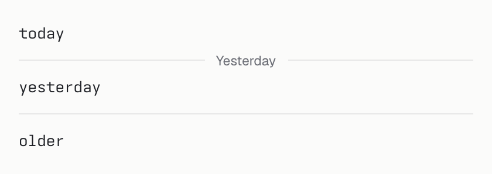
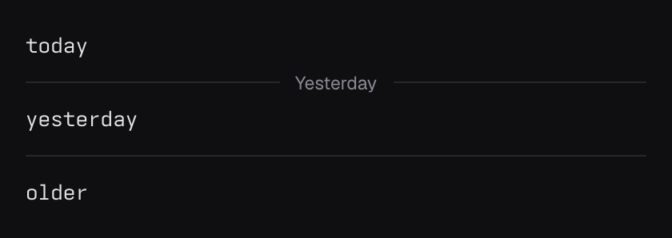
</figure>

对话记录标记，带框 note 与 pin 的 `end` 子节点均为一个 Restore 按钮：

```lua
local ui = tern.ui

return {
	main = ui.col({
		ui.node("rule", { label = "Checkpoint 3", icon = "history", time = "14:02" }),
		ui.node("rule", { variant = "note", label = "Sarah joined the session", icon = "user", time = "14:01" }),
		ui.node("rule", { variant = "note", label = "Context compacted · 182k → 41k", icon = "warn", tone = "warning" }),
		ui.node("rule", {
			key = "note", variant = "note", label = "Checkpoint 3", icon = "history", time = "14:02",
			["end"] = "main.note.restore",
		}, {
			ui.button("Restore", { key = "restore", variant = "quiet", size = "sm", actions = { click = "restore:3" } }),
		}),
		ui.node("rule", {
			key = "pin", variant = "pin", label = "Checkpoint 3", icon = "history", time = "14:02",
			["end"] = "main.pin.restore",
		}, {
			ui.button("Restore", {
				key = "restore", variant = "quiet", size = "sm", icon = "undo", actions = { click = "restore:3" },
			}),
		}),
	}),
}
```

<figure class="tn-figure">
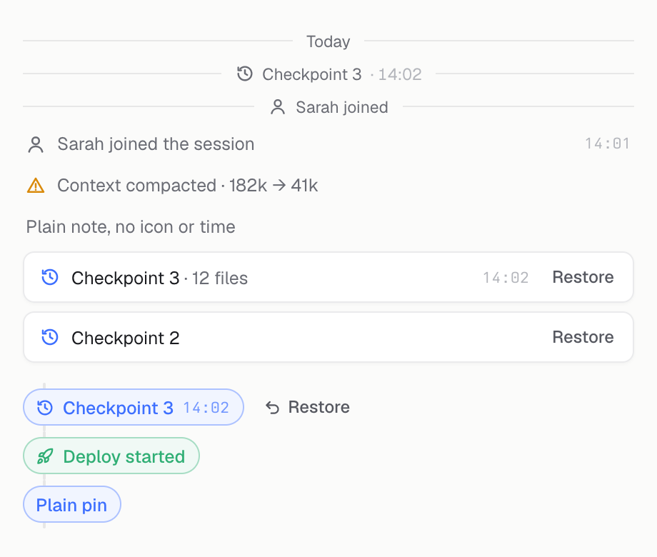
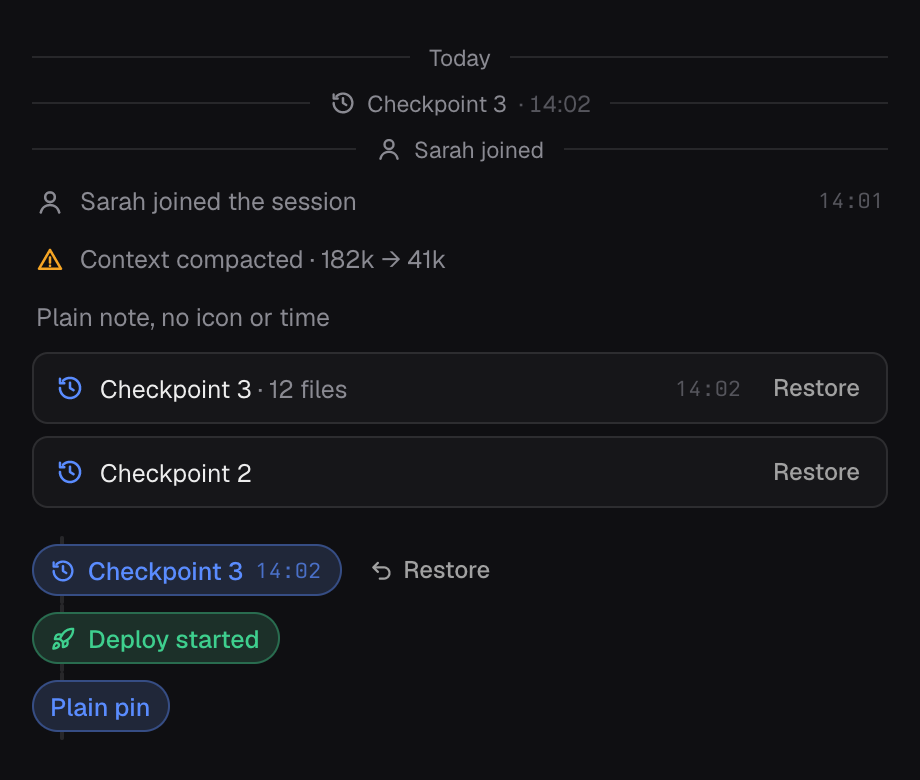
<figcaption>三种 rule 变体：<code>line</code>、<code>note</code>（以 <code>end</code> 子节点带框）与 <code>pin</code>。</figcaption>
</figure>

## `spacer`：固定间隔 {#spacer}

一块固定的垂直空间（`flex: none`），`aria-hidden`。`row` 或 `col` 中的可伸缩空间请改用
带 `grow = 1` 的空堆叠（参见 [`row`](#row)）。Tern 自身会为 block 及其各部分留出间距
（`--sf-block-gap`、`--sf-inner-gap`）；只有当那种节奏给不了你所需的空间时才使用 spacer。

**构建方式：** `tern.ui.node("spacer", { size = "lg" })`（没有专用构建器）。

| 属性 | 类型 | 默认值 | 含义 |
| --- | --- | --- | --- |
| `size` | `"none"` \| `"xs"` \| `"sm"` \| `"md"` \| `"lg"` | `"md"` | 高度：0、2px、6px、12px、20px。添加类 `sz-<value>`；未知值不匹配任何规则，回退到基础的 8px |

**子节点：** 无（会被忽略）。

**事件：** 自身没有事件。

**样式：**

```html
<div class="sf sf-spacer sz-md" data-id="main.4" aria-hidden="true"></div>
```

| 目标 | 选择器 |
| --- | --- |
| 该节点 | `.sf-spacer` |
| 尺寸 | `.sf-spacer.sz-none` … `.sz-lg` |

```lua
local ui = tern.ui

return { main = ui.col({ ui.text("header"), ui.node("spacer", { size = "lg" }), ui.text("body") }) }
```

每种尺寸，置于两个徽标之间：

```lua
local ui = tern.ui

local cols = {}
for _, size in { "none", "xs", "sm", "md", "lg" } do
	table.insert(cols, ui.node("col", {}, {
		ui.badge(size, "accent"),
		ui.node("spacer", { size = size }),
		ui.badge(size, "accent"),
	}))
end
return { main = ui.node("row", { gap = "lg", align = "start" }, cols) }
```

<figure class="tn-figure">
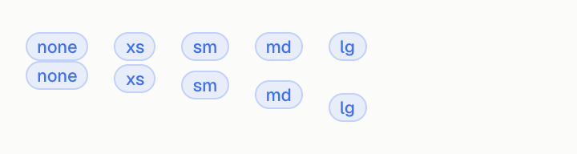
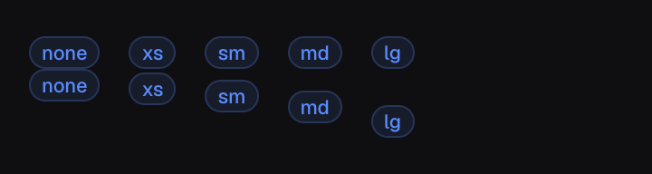
</figure>

## 稳定的钩子 {#stable-hooks}

`.sf-col`、`.sf-row`、`.sf-card`、`.sf-section`、`.sf-split`、`.sf-scroll`、`.sf-empty`、`.sf-rule`、`.sf-spacer`、
`[data-id]`、`[data-role]`、`[data-tone]`、`[data-variant]`、`[data-dir]`、`[data-mark]`、`[data-href]` 以及
区域的 `[data-surface]` 都是稳定的。随属性变化的状态类（`gap-*`、`al-*`、`js-*`、`wrap`、`sz-*`、
`collapsible`、`collapsed`、`selected`、`inset`、`bare`、`fade`、`stick`、`always`、`framed`、`over`、`v-note`、
`v-pin`）遵循上文的属性；`held`（split 的拖动）与 `can`（有内容可滚动的 scroll）则遵循
用户操作。内部部件上的类（`.sf-card-head`、`.sf-head`、`.sf-card-ic`、`.sf-chip`、`.sf-chev`、`.sf-card-body`、
`.sf-more`、`.sf-section-head`、`.sf-section-body`、`.sf-split-*`、`.sf-scroll-*`、`.sf-empty-*`、`.sf-rule-label`、
`.sf-rule-ic`、`.sf-rule-time`、`.sf-rule-pill`、`.sf-rule-end`）属于 Tern 的内部结构：内部结构，可能在不同
版本之间变化。参见[视图样式](../styles/index.md)与
[支持的 CSS](../styles/css.md)。
