# 列表、菜单与导航 {#lists-menus-and-navigation}

用户指向、由你的代码决定选中的行，承载应用命令的菜单，以及在视图之间切换的控件。用 `list` 搭配 `item` 子节点得到可选中的一列行；用 `menu` 得到打开命令下拉菜单的按钮；用 `menubar` 得到一排应用菜单；用 `tabs` 得到一条切换显示内容的标签栏；用 `nav` 得到应用的各个分区及其子页面；用 `breadcrumb` 得到沿层级向上回溯的路径；用 `pager` 放在逐页显示的表格或列表下方；需要一整套完全由数据绘制的模态面板（搜索、范围、事实列、预览、操作栏）时，用 `picker`。

| 类型 | 构建方式 | 绘制内容 |
| --- | --- | --- |
| [`list`](#list) | `tern.ui.list(items)` 或 `tern.ui.node("list", …)` | 由 `item` 行组成的 listbox，带你的选中态、筛选高亮和一行空状态 |
| [`item`](#item) | 位于 `tern.ui.list` 内，或 `tern.ui.node("item", …)` | 一行：图标、标签、详情、值、按键提示 |
| [`menu`](#menu) | `tern.ui.node("menu", …)` | 打开命令下拉菜单的按钮：图标、按键、勾选、单选组、子菜单、富两行行 |
| [`menubar`](#menubar) | `tern.ui.node("menubar", …)` | 一排菜单标题，各自在其下方打开菜单：安静的条带或悬浮玻璃胶囊 |
| [`tabs`](#tabs) | `tern.ui.node("tabs", …)` | 带下划线激活标签的标签栏，或分段控件 |
| [`nav`](#nav) | `tern.ui.node("nav", …)` | 导航胶囊或链接；带子项的项会打开菜单或富面板 |
| [`breadcrumb`](#breadcrumb) | `tern.ui.node("breadcrumb", …)` | 从根到用户当前位置的路径；每一段都能带用户回到上级 |
| [`pager`](#pager) | `tern.ui.node("pager", …)` | 分页：带箭头的范围、页码或"显示更多"行 |
| [`picker`](#picker) | `tern.ui.node("picker", …)` | 模态玻璃面板：搜索头、范围、标签、虚拟行、预览、操作栏 |

它们都把选中的决定交给你的代码。单击或双击会发出事件；你更新自己的状态，并在下一个视图中回传新的 `selected`（或 `active`、`open`、`page`、`tab`）。`list`、`tabs` 和 `picker` 只在那时才变化；`menu`、`menubar`、`nav`、`breadcrumb` 和 `pager` 会立即显示点击，并一直保持到某个你回传的值与上一次不同。它们都不获取焦点，所以按键在这里永远不会变成事件：按键会到达你 block 的 `key` 处理器，由它同样地移动选中项。

## `list` 列表 {#list}

由 `item` 子节点组成的垂直 listbox。它绘制：

- 选中项（你的 `selected` 属性），带强调色底色和 2px 前置色条，其他行带悬停底色；
- 每个项标签中 `filter` 查询的 `<mark>` 高亮；
- 没有项时显示 `empty` 行。

列表本身不筛选、不排序、也不移动选中项。`filter` 只做标记：传入你想显示的项（已筛选好），以及产生它们的查询。

**筛选标记。** 查询会被去除首尾空白，并与标签的纯文本做不区分大小写的匹配。整个查询第一次连续出现的位置会被标记；若没有连续出现，则套件的模糊子序列匹配会标记其命中的字符，相邻命中合并为连续段。无匹配则不标记任何内容。标签中的 span 样式在切割处保持。例如 `LIFE` 在 `Session Lifecycle` 中标记 `Life`；`sl` 标记 `session-lifecycle` 的 `s` 和 `l`。

**高度与滚动。** 没有 `max` 时，列表与其行同高，并随周围区域一起滚动。有 `max` 时，它限制自身高度并在内部滚动（`.sf-list-scroll.max`、细滚动条、限制越界滚动）。每一行是终端字体的一行加 6px。

**让选中项保持可见。** `selected` 变化时，列表会滚动自己的滚动容器（仅在设置了 `max` 时）以显示该项，只走所需的最短距离。针对列表中某项的协议 `reveal` 请求也以同样方式滚动列表自己的滚动容器，对齐方式为 start、end 或 nearest；没有 `max` 的列表把滚动交给所在区域。插件没有发送 `reveal` 的调用；改变 `selected` 就是插件把某项带入视野的方式。在随 `main` 一起滚动的列表中，选中的项不会被列表滚动到。

**虚拟列表。** 子节点超过 200 个且全部为 `item`，或设置了 `virtual = true` 时，各项不会作为节点挂载。各行共享同一高度（一行加 6px，或你的样式表把行变高时的最高绘制行），只有视口附近的行绘制在 `.sf-list-slot` 内（其他行的空间保留为内边距）。子节点中混有其他类型（标题、链接）的长列表仍会挂载。只有在其行被绘制时才会读取该项的内容。点击仍会带着该项的节点 id 发送 `select` 和 `activate`。在虚拟列表中，项自身的 `actions` 及其链接不会被接上：行只负责选中和激活。

**构建：** `tern.ui.list(items)` 从 `{label, detail?, value?, icon?, tone?}` 表构建由 `item` 子节点组成的 `list`（参见
[UI 构建器](../reference/ui.md#list)）。在返回节点的 `p` 上设置 `selected`、`filter`、`empty`、`max` 或 `virtual`，或使用 `tern.ui.node("list", { … }, items)`。

| 属性 | 类型 | 默认值 | 含义 |
| --- | --- | --- | --- |
| `selected` | `string` | 无 | 选中项的节点 id。按选中绘制（`.sel`、`aria-selected="true"`），并在其变化时保持可见。不是子节点的 id 不绘制任何选中项 |
| `filter` | `string` | `""` | 其匹配项在每个项的标签中以 `mark.sf-mark` 标记的查询。只做标记；不会隐藏任何内容 |
| `empty` | Spans | 无 | 列表没有子节点时显示的行。未设置时不显示 |
| `max` | `{lines = n}` 或 `number` | 无 | 高度上限。`{lines = n}`：`n` 行 `--sf-row`（一行加 6px；样式表可在非虚拟列表上提高它）。数字：窗口高度的该比例（`0.5` = `50vh`）。非正值或其他值被忽略。有上限时列表自行滚动 |
| `virtual` | `boolean` | `false` | 即使不足 200 项也虚拟化各行 |

[通用属性](index.md)同样适用（`key`、`role`、`tone`、`actions`）。

**子节点：** `item` 节点，按顺序绘制在 `.sf-list-slot` 内。其他类型也会被放置，但没有行行为。在虚拟列表中，子节点不会被挂载：每个子节点的 item 属性会被读入绘制的行。

**事件：** 自身没有事件。其项会发送指名该列表的 `select` 和 `activate`（参见 [`item`](#item)）。

**样式：**

```html
<div class="sf sf-list" data-id="main.items" role="listbox">
	<div class="sf-list-scroll max">            <!-- .max only with `max` -->
		<div class="sf-list-slot">
			<div class="sf sf-item sel" data-id="main.items.i1" role="option" aria-selected="true">…</div>
			<!-- virtual: <div class="sf sf-item" role="option" data-item="main.items.i1">…</div> -->
		</div>
	</div>
	<div class="sf-list-empty sf-hidden">No results</div>
</div>
```

| 目标 | 选择器 |
| --- | --- |
| 节点 | `.sf-list`、`.sf-list[data-id=…]`、`.sf-list[data-role=…]` |
| 虚拟列表 | `.sf-list.virtual` |
| 其滚动容器 | `.sf-list-scroll`（内部，可能变化）；有上限时为 `.sf-list-scroll.max` |
| 已挂载的项 | `.sf-list-slot`（内部，可能变化） |
| 虚拟行 | `.sf-list.virtual .sf-item[data-item=…]`（内部，可能变化） |
| 空状态行 | `.sf-list-empty`（内部，可能变化） |
| 选中项 | `.sf-list .sf-item.sel`、`[aria-selected='true']` |
| 筛选命中 | `.sf-list mark.sf-mark` |

`.sf-hidden` 隐藏没有内容可显示的部分（有项时的空状态行、无项时的滚动容器）。选中底色在你设置时为 `var(--sf-sel)`，否则为强调色的 10%（浅色）或 16%（深色）；色条为 `inset 2px 0 0 var(--accent)`。悬停使用 `--l1`。在 `overlay` 卡片（`.sf-ov-card`）内，选中改为中性的 `--l2` 填充，并带 `--grad` 边缘。行使用 `--sf-lh` 作为高度。参见
[变量](../styles/variables.md)。

稳定的钩子是 `.sf-list`、`.sf-item`、`[data-id]`、`[data-role]`、`[data-tone]` 以及 ARIA 属性；`sf-list-*` 与 `sf-item-*` 部分是 Tern 的内部结构。

```lua
local ui = tern.ui

-- view: state.visible holds the branches matching state.query ("log"),
-- state.sel the selected branch name ("fix-login")
local rows = {}
for _, b in state.visible do
	local row = ui.list({ {
		label = b.name,
		detail = b.upstream or "no upstream",
		value = b.drift, -- "↑2", "↓5" or nil
		icon = "git-branch",
		tone = b.behind and "warning" or nil,
	} }).c[1]
	row.p.key = b.name
	row.p.disabled = b.upstream == nil
	table.insert(rows, row)
end
return {
	main = ui.col({
		ui.node("list", {
			key = "branches",
			selected = state.sel and ("main.branches." .. state.sel) or nil,
			filter = state.query,
			empty = { ui.span("No branches match", "muted") },
			max = { lines = 12 },
		}, rows),
	}),
}
```

<figure class="tn-figure">
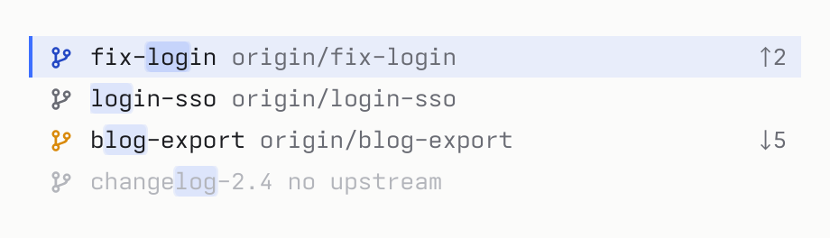
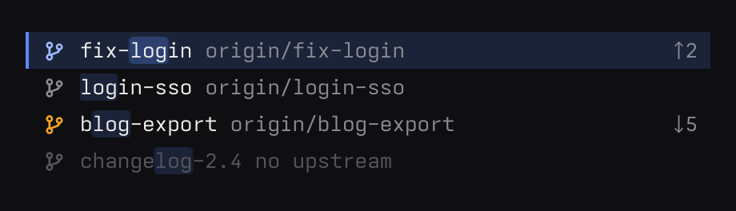
<figcaption>选中态、<code>filter</code> 标记、<code>warning</code> 色调和一行禁用行。</figcaption>
</figure>

## `item` 行 {#item}

一行：一个图标、标签、占据剩余空间并截断的暗色详情、右对齐的值，以及键帽。在 `list` 内它是 listbox 的一个 `option`；单独使用时，它就是带相同部分的普通行。文本从不换行；标签、详情和值以省略号截断。

**构建：** 作为 `tern.ui.list(items)` 的元素（参见
[UI 构建器](../reference/ui.md#list)），它覆盖 `label`、`detail`、`value`、`icon` 和 `tone`。`hint` 和 `disabled` 需要用
`tern.ui.node("item", { … })`，或在已构建子节点的 `p` 上设置。

| 属性 | 类型 | 默认值 | 含义 |
| --- | --- | --- | --- |
| `label` | Spans | `""` | 该行的文本。筛选命中在其中被标记 |
| `detail` | Spans | `""` | 标签之后的暗色文本；可伸缩，并优先截断 |
| `value` | Spans | `""` | 右对齐文本（等宽数字，最多占行的 40%）。为空时隐藏 |
| `icon` | `string` | 无 | 图标名（参见 [`icon`](data.md#icon)）；未知名称不显示图标 |
| `hint` | `{ string }` | `{}` | 在末尾绘制为键帽的按键名，例如 `{ "cmd", "enter" }`。仅用于显示：不绑定任何东西 |
| `disabled` | `boolean` | `false` | 置灰该行（`.off`、`aria-disabled="true"`），不接收指针事件，也不发送 `select` 或 `activate` |
| `tone` | tone name | 无 | 设置 `data-tone`；给图标着色。取值之一：`neutral`、`accent`、`info`、`success`、`warning`、`error`、`pending`、`muted`、`user`；其他名称被忽略 |

**子节点：** 无（被忽略）。

**事件：**

| 手势 | 事件 |
| --- | --- |
| 单击 | `{ev = "select", id = <list id>, item = <item id>}` |
| 双击 | `{ev = "activate", id = <list id>, item = <item id>}` |

双击也会发送其第一次单击的 `select`。在列表之外，`id` 和 `item` 都是该项自身的 id。禁用的项两者都不发送。单击项中的链接 span 会打开链接（配合 ⌘）而不是选中。当项有自己的 `actions.click` 时，该动作取代
`select`；其自身的 `actions.dblclick` 取代 `activate`。事件送到你 block 的 `event(state, ev, cx)`；在你视图回传新的 `selected` 之前，屏幕不会有任何变化。

按键（方向键、Enter）不由列表处理：它们会到达你 block 的 `key` 处理器。在那里移动你的选中项并返回新视图。

**样式：**

```html
<div class="sf sf-item sel" data-id="main.items.i1" data-tone="warning"
		role="option" aria-selected="true">
	<span class="sf-item-ic"><!-- icon --></span>
	<span class="sf-item-label">fix-<mark class="sf-mark">log</mark>in</span>
	<span class="sf-item-detail">origin/fix-login</span>
	<span class="sf-item-value">↑2</span>
	<span class="sf-item-hint kbds"><!-- keycaps (.kbd) --></span>
</div>
```

| 目标 | 选择器 |
| --- | --- |
| 节点 | `.sf-item`、`.sf-item[data-id=…]` |
| 选中 | `.sf-item.sel` |
| 禁用 | `.sf-item.off`、`[aria-disabled='true']` |
| 着色 | `.sf-item[data-tone='warning']` |
| 图标 | `.sf-item-ic`（内部，可能变化） |
| 标签 | `.sf-item-label`（内部，可能变化） |
| 详情 | `.sf-item-detail`（内部，可能变化） |
| 值 | `.sf-item-value`（内部，可能变化） |
| 按键提示 | `.sf-item-hint`、`.sf-item-hint .kbd`（内部，可能变化） |
| 筛选命中 | `.sf-item mark.sf-mark` |

空的图标、值和提示部分带 `.sf-hidden`。设置了 `data-tone` 时，图标取 `--tc`（色调颜色）；`neutral` 用 `--t3`，无色调的选中行用 `--accent-ink`。详情和值为 `--t3`，禁用行为 `--t4`。在减弱动效下（`.sf-still` 或
`prefers-reduced-motion`），悬停与选中过渡被关闭。

```lua
local ui = tern.ui

ui.node("item", {
	key = "deploy",
	label = "Deploy",
	detail = "production",
	icon = "jobs",
	hint = { "cmd", "enter" },
	tone = "accent",
})
```

## `menu` 菜单 {#menu}

一个打开命令下拉菜单的按钮，采用 Tern 自己的菜单外观（Tern 菜单所用的磨砂面板）。当一个节点的命令多到放不下按钮时（一个"…"按钮）、需要带单选组和勾选组的排序或视图菜单时，或需要几个各自配一句说明的重要选项时（Promote、Roll back），就用它。该节点*本身*就是触发器：它绘制得像
[`button`](input.md#button)，菜单悬挂在其下方。

行是数据：一个带 `icon` 的动作、绘制在右侧的快捷键 `keys`、标签下方的 `detail` 行（富两行行）、一个勾选（`checked`）或单选圆点（`radio` 指明其分组）、一个子菜单（`items`）、一个 `disabled` 原因、一个 `danger` 色调；`"-"` 是分隔线，`{ header = "…" }` 是分区标题。同样的行在任何节点的右键菜单中也能用
（下方的 [`actions.menu`](#right-click-menus-actionsmenu)）。

两种外观：`default` 是套件菜单，行高 32px；`dense` 把 12.5px 文字的行压到 24px，用于很长的排序和筛选菜单。带 `detail` 的行在两者中都绘制为富行：图标放在柔和色块中，标签压在详情之上。

它与 [`el`](el.md) 控件一样只响应指针：从不获取焦点，所以按键仍归你处理。单击会立即打开；用
`open` 和 `active` 从键盘驱动它。

**构建：** `tern.ui.node("menu", { text = …, items = { … } })`。没有专用构建器。

```lua
local ui = tern.ui

ui.row({
	ui.node("menu", {
		key = "more",
		title = "Deployment actions",
		items = {
			{ header = "Deployment" },
			{ id = "logs", label = "Open logs", icon = "list", keys = { "cmd", "L" } },
			{ id = "follow", label = "Follow output", checked = state.follow },
			"-",
			{ id = "export", label = "Export", icon = "download", items = {
				{ id = "json", label = "JSON" },
				{ id = "csv", label = "CSV" },
			} },
			"-",
			{ id = "delete", label = "Delete…", icon = "trash", danger = true },
		},
	}),
	ui.node("menu", {
		key = "sort",
		text = "Sort",
		icon = "list",
		variant = "dense",
		items = {
			{ header = "Sort by" },
			{ id = "name", label = "Name", radio = "sort", checked = state.sort == "name" },
			{ id = "deploy", label = "Last deploy", radio = "sort", checked = state.sort == "deploy" },
		},
	}),
})

-- event(state, ev, cx)
-- ev.ev == "action" and ev.act == "follow" -> state.follow = ev.checked
-- ev.ev == "action" and ev.id == "main.sort" -> state.sort = ev.act
```

<figure class="tn-figure">
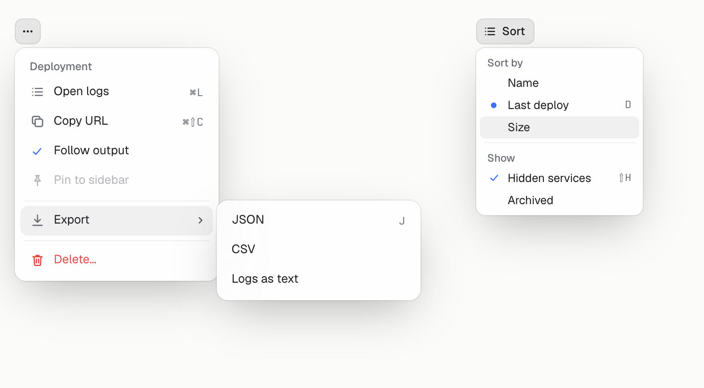
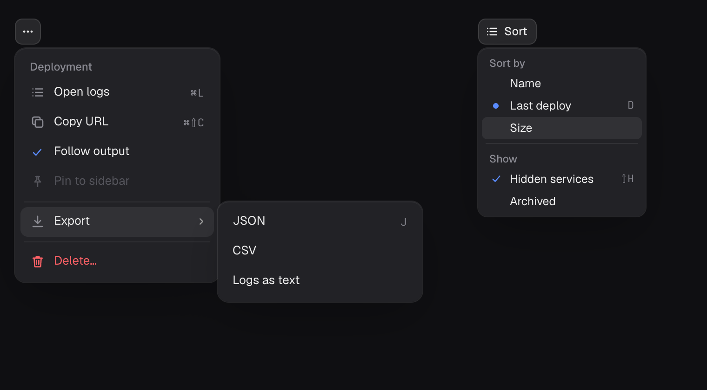
<figcaption><code>default</code> 含全部行类型并展开一个子菜单，以及带单选组和勾选组的 <code>dense</code>。</figcaption>
</figure>

带标签的触发器下有几个重要选项，每个配一句说明：

```lua
ui.node("menu", {
	key = "release",
	text = "Release",
	icon = "rocket",
	caret = true,
	items = {
		{ id = "promote", label = "Promote", icon = "rocket", detail = "Copy staging to production" },
		{ id = "rollback", label = "Roll back", icon = "undo", detail = "Restore the previous release" },
	},
})
```

<figure class="tn-figure">
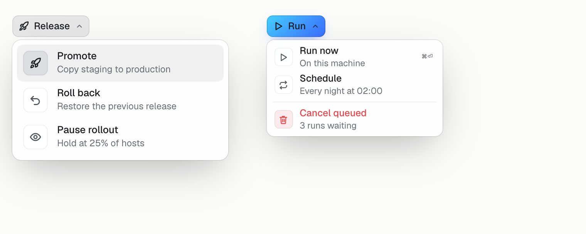
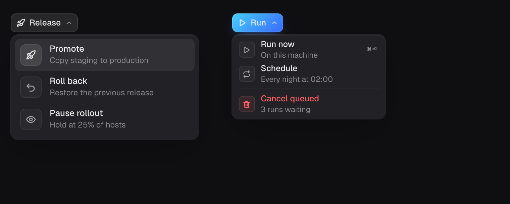
<figcaption>带 <code>detail</code> 的行绘制为富两行行，在 <code>default</code> 与 <code>dense</code> 中皆然；<code>caret</code> 与 <code>trigger</code> 决定按钮的样式。</figcaption>
</figure>

<figure class="tn-figure">
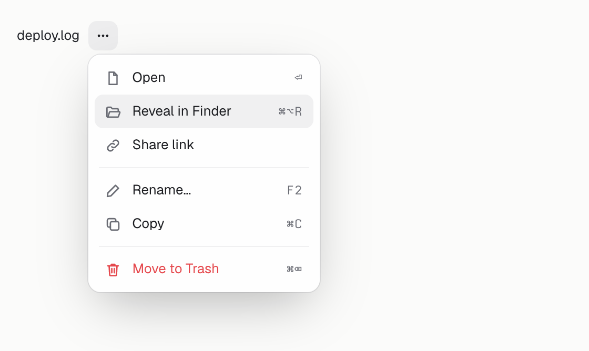
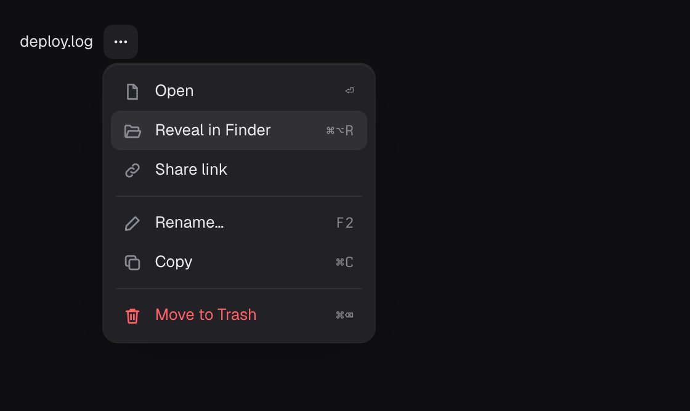
<figcaption>右键菜单可用的行：图标、快捷键、分隔线和危险行（此处位于 <code>quiet</code> 触发器下）。</figcaption>
</figure>

| 属性 | 类型 | 默认值 | 含义 |
| --- | --- | --- | --- |
| `items` | `{ item }` | `{}` | 各行，按顺序（参见 *Items*） |
| `text` | `string` | 无 | 触发器的标签。没有 `text` 也没有 `icon` 时，触发器是方形的 … 按钮 |
| `icon` | `string` | 无 | 触发器的前置图标（图标名，与 `button` 相同） |
| `trigger` | `"default"` \| `"quiet"` \| `"primary"` | `"default"` | 触发器的外观：与同名 `button` 变体相同 |
| `caret` | `boolean` | `false` | 标签后的一个插入符，打开时翻转 |
| `size` | `"md"` \| `"sm"` | `"md"` | 触发器尺寸（28px 或 22px），与 `button` 相同 |
| `variant` | `"default"` \| `"dense"` | `"default"` | 菜单的外观（见下文）。其他值按 `default` 处理 |
| `open` | `boolean` | `false` | 菜单是否显示。`open` 的变化优先于用户本地的打开或关闭 |
| `active` | `string` | 无 | 高亮行的 `id`（你的键盘光标）。包含它的子菜单会保持打开；带子菜单的高亮行也会打开自己的子菜单 |
| `align` | `"start"` \| `"end"` | `"start"` | 菜单与触发器哪条边对齐；触发器位于行右侧时用 `end` |
| `disabled` | `boolean` \| `string` | `false` | 触发器置灰且不打开；字符串为原因，作为工具提示显示 |
| `title` | `string` | 无 | 触发器的工具提示；没有 `text` 时也作为其无障碍名称（默认 "Menu"） |

[通用属性](index.md#props-every-node-takes)同样有效：`key`（本地状态按节点保存）、`tone` 以及 flex 相关属性。

**项。** `items`（以及 `actions.menu`）的每个条目是以下之一：

| 条目 | 含义 |
| --- | --- |
| `"-"` | 一条分隔线 |
| `{ header = "…" }` | 一个暗色分区标题 |
| `"<id>"` | 一个以 id 为标签的动作（`open-file` → "Open file"） |
| `{ id, … }` | 一个项，字段见下表 |

| 字段 | 类型 | 默认值 | 含义 |
| --- | --- | --- | --- |
| `id` | `string` | 必填 | `action` 事件作为 `act` 发送的值 |
| `label` | `string` | 取自 `id` | 该行的文本 |
| `icon` | `string` | 无 | 前置图标 |
| `keys` | `string` \| `{ string }` | 无 | 快捷键，在右侧绘制为等宽字符（`{"cmd","shift","C"}` → ⌘⇧C）。仅用于显示：由你的程序绑定它们 |
| `detail` | `string` | 无 | 标签下方的第二行；该行绘制为富行（图标在色块中） |
| `checked` | `boolean` | 无 | 使该行成为勾选行（`menuitemcheckbox`），为 `true` 时显示勾选 |
| `radio` | `string` | 无 | 使该行成为该分组的单选行（`menuitemradio`）：`checked` 时显示圆点；选择它会把该组其他项关掉 |
| `disabled` | `boolean` \| `string` | `false` | 置灰、不可选；字符串为原因，作为该行的工具提示显示 |
| `danger` | `boolean` | `false` | 破坏性动作，以 `--bad` 绘制 |
| `items` | `{ item }` | 无 | 子菜单，在悬停或单击时于该行旁边打开；该行本身不发送任何事件 |

同时有 `icon` 和 `checked` 的行在关闭时显示图标，打开时显示勾选。

**变体：**

| `variant` | 外观 | 用途 |
| --- | --- | --- |
| `default` | 套件菜单：12px 磨砂面板，32px 行置于 8px 胶囊上，13px 文字，16px 图标列，等宽快捷键在右侧，子菜单用 › | 动作、… 菜单、右键菜单 |
| `dense` | 24px 行置于 6px 胶囊上，12.5px 文字，10px 面板 | 很长的排序、筛选和视图菜单 |
| 带 `detail` 的行 | 图标在 32px 色块中（`dense` 中为 24px），中等字重的标签压在柔和色行上 | 几个各自需要一句说明的重要选项 |

菜单从其触发器淡入并缩放（`--out`，0.2 s）；勾选标记在开启时弹入。在减弱动效、`.sf-still` 和
`.sf-paused` 下动效停止。

**子节点：** 无（被忽略）。

**事件：** 选择一行会发送

```lua
{ ev = "action", id = "<the menu's id>", act = "<the row's id>" }
{ ev = "action", id = "…", act = "follow", checked = true }  -- a check or radio row: its new state
```

然后关闭菜单。用指针打开或关闭它（触发器、外部按下、选中某项）会发送

```lua
{ ev = "toggle", id = "<the menu's id>", open = true }
```

菜单立即打开或关闭，勾选和单选立即翻转；菜单会保持该状态，直到你的程序发送一个与上次绘制不同的 `open`（或某项的 `checked`），后者随即生效。把事件映射回
`open` 和 `checked`，你就始终是掌控方。禁用行、子菜单行、标题和分隔线不发送任何事件；禁用的触发器不会打开。在已关闭的 surface 或用 `listen = false` 打开的 surface 上，不会打开、翻转或发送任何东西。

**键盘：** 自身没有。你的程序掌握按键：设置 `open` 显示菜单，用方向键移动 `active`（指名某个子菜单的行即可进入该子菜单），并在 Enter 时自行运行 `active` 行。

### 右键菜单：`actions.menu` {#right-click-menus-actionsmenu}

每个节点的 `actions.menu`（参见
[动作与事件](../guides/views.md#actions-and-events)）接受相同的条目，因此右键菜单可以带图标、快捷键、勾选、单选组、分隔线、标题、禁用行、危险行和子菜单。纯字符串与以前一样可用。菜单由 Tern 绘制（其自身的原生菜单），并在末尾追加 Copy——若菜单已有图标、快捷键或分隔线，则在其前加一条分隔线。选择一行会发送带 `act` 的 `action`，勾选行和单选行还会发送 `checked`（新状态）；在该处，行的 `detail` 作为其工具提示显示。

```lua
local file = tern.ui.text("deploy.log")
file.p.actions = { menu = {
	{ id = "open", label = "Open", icon = "file", keys = "enter" },
	{ id = "reveal", label = "Reveal in Finder", icon = "folder-open", keys = { "cmd", "alt", "R" } },
	"-",
	{ id = "trash", label = "Move to Trash", icon = "trash", danger = true },
} }
```

**样式：**

```html
<div class="sf sf-menu open" data-id="main.more">
	<button class="sf-menu-trigger sf-button" data-variant="default" data-size="md"
		aria-haspopup="menu" aria-expanded="true">
		<span class="sf-btn-ic" aria-hidden="true"><svg class="ico">…</svg></span>
		<span class="sf-btn-label">Release</span>
		<span class="sf-menu-caret" aria-hidden="true"><svg class="ico">…</svg></span>
	</button>
	<div class="sf-menu-pop marks" role="menu" data-variant="default" data-align="start">
		<div class="sf-menu-head" role="presentation">Deployment</div>
		<div class="sf-menu-item active" role="menuitem" data-act="logs">
			<span class="sf-menu-lead" aria-hidden="true"><svg class="ico">…</svg></span>
			<span class="sf-menu-text"><span class="sf-menu-label">Open logs</span>
				<span class="sf-menu-detail">…</span></span>
			<span class="sf-menu-keys" aria-hidden="true">⌘L</span>
		</div>
		<div class="sf-menu-item on" role="menuitemcheckbox" aria-checked="true" data-act="follow">
			<span class="sf-menu-lead" aria-hidden="true"><i class="sf-menu-check"><svg class="ico">…</svg></i></span>…
		</div>
		<div class="sf-menu-sep" role="separator"></div>
		<div class="sf-menu-item sub open" role="menuitem" aria-haspopup="menu" aria-expanded="true" data-act="export">
			…<span class="sf-menu-more" aria-hidden="true"><svg class="ico">…</svg></span>
			<div class="sf-menu-pop sf-menu-subpop" role="menu">…</div>
		</div>
	</div>
</div>
```

| 目标 | 选择器 |
| --- | --- |
| 节点 / 打开 | `.sf-menu`、`.sf-menu.open` |
| 触发器 | `.sf-menu-trigger`（一个 `.sf-button`），插入符 `.sf-menu-caret` |
| 菜单 / 变体 | `.sf-menu-pop`、`.sf-menu-pop[data-variant='dense']`、`[data-align='end']` |
| 子菜单 | `.sf-menu-subpop`；其行 `.sf-menu-item.sub`，打开 `.sf-menu-item.open` |
| 行 | `.sf-menu-item`；`.active`、`.on`（已勾选）、`.dis`、`.danger`、`.rich` |
| 行的部分 | `.sf-menu-lead`（图标或标记：`.sf-menu-check`、`.sf-menu-dot`）、`.sf-menu-label`、`.sf-menu-detail`、`.sf-menu-keys`、`.sf-menu-more` |
| 分隔线 / 标题 | `.sf-menu-sep`、`.sf-menu-head` |

## `menubar` 菜单栏 {#menubar}

一排菜单标题，每个标题在其下方打开一个命令菜单，就像 Mac 应用的菜单栏那样。当一个全屏应用拥有的命令超出工具栏容量，且它们自然成组时（File、Edit、View、Go、Help，或 Deploys、Services、Logs），就用它：标题保持简短可见，每条命令的快捷键也能在其菜单中展示出来。只有一组命令时，一个 [`menu`](#menu) 按钮就够了。

这些菜单是 [`menu`](#menu) 的 popover：同样的行（图标、快捷键、勾选标记、单选组、子菜单、分隔线、标题、富两行行、禁用行和危险行）在同样的磨砂面板上。

用指针操作时它的行为像菜单栏：单击标题打开其菜单；已有菜单打开时，在另一个标题上停留会切换到那个菜单；单击已打开菜单的标题，或在打开菜单之外任意处按下，都会关闭它；选中一行也会关闭它。所有这些都立即显示，并以 `toggle` 事件报告给你。按键仍归你的程序：在你的 key 处理器里驱动
`open`（以及 `active`，即高亮行）。

两种外观，由 `variant` 决定：

- `strip`（默认）：一条安静的文字条带，带细线描边，高 30px，宽度与容器相同，用于应用的头行或 dock。打开的标题落在柔和的灰色胶囊上。在 dock 中，菜单向上打开。
- `pill`：一个悬浮玻璃胶囊，高 40px，宽度只及标题，前方是应用的标记（`icon`，用强调色）。打开的标题以强调色着色。

**构建：** `tern.ui.node("menubar", { menus = { … } })`。没有专用构建器。

```lua
local ui = tern.ui

ui.node("menubar", {
	key = "bar",
	open = state.menu,
	active = state.row,
	menus = {
		{ id = "file", label = "File", items = {
			{ id = "new", label = "New window", keys = { "cmd", "N" } },
			{ id = "open", label = "Open…", keys = { "cmd", "O" } },
			"-",
			{ id = "close", label = "Close", keys = { "cmd", "W" } },
		} },
		{ id = "view", label = "View", items = {
			{ id = "zoom-in", label = "Zoom in", keys = { "cmd", "+" } },
			{ id = "zoom-out", label = "Zoom out", keys = { "cmd", "-" } },
			"-",
			{ id = "sidebar", label = "Sidebar", checked = state.sidebar },
		} },
		{ id = "help", label = "Help", items = { { id = "docs", label = "Documentation" } } },
	},
})

-- event(state, ev, cx)
if ev.id == "main.bar" then
	if ev.ev == "toggle" then
		state.menu = ev.open and ev.item or nil
	elseif ev.ev == "action" then
		state.menu = nil
		run(ev.item, ev.act, ev.checked)
	end
end
```

<figure class="tn-figure">
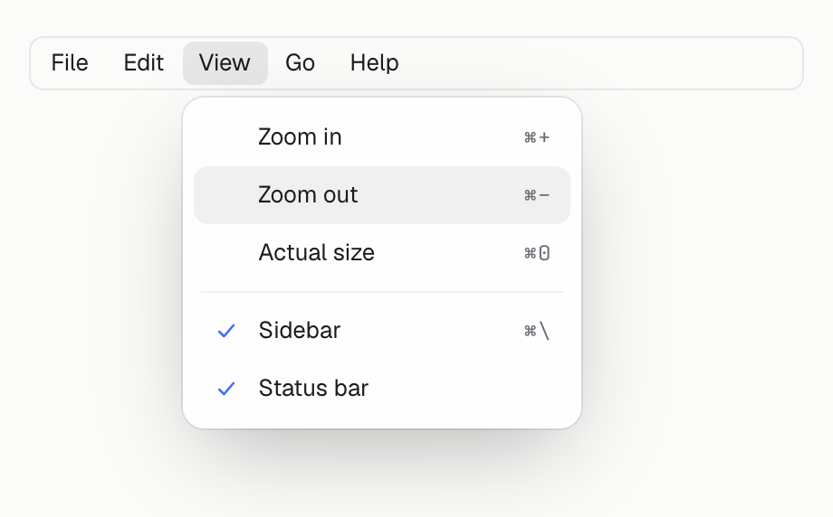
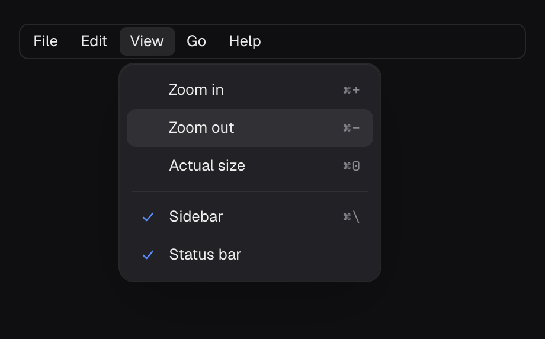
<figcaption>条带，<code>open = "view"</code> 且 <code>active = "zoom-out"</code>。</figcaption>
</figure>

<figure class="tn-figure">
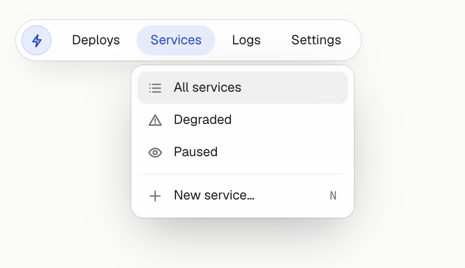
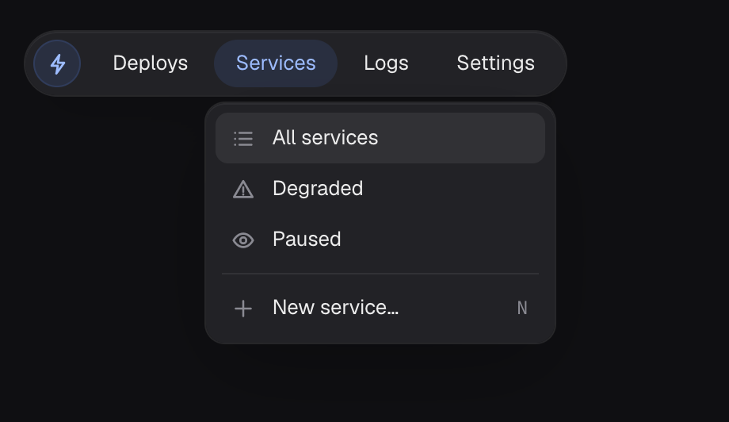
<figcaption><code>variant = "pill"</code> 搭配 <code>icon = "bolt"</code> 和 <code>open = "services"</code>。</figcaption>
</figure>

<figure class="tn-figure">
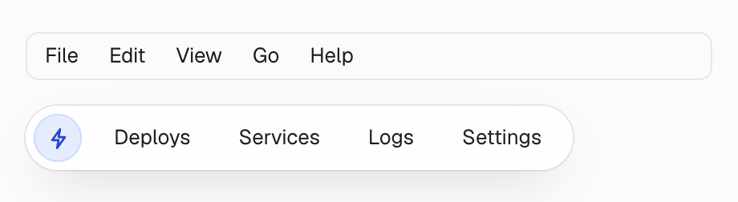
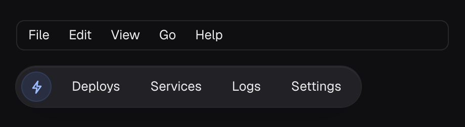
<figcaption>两种外观的关闭状态。</figcaption>
</figure>

<figure class="tn-figure">
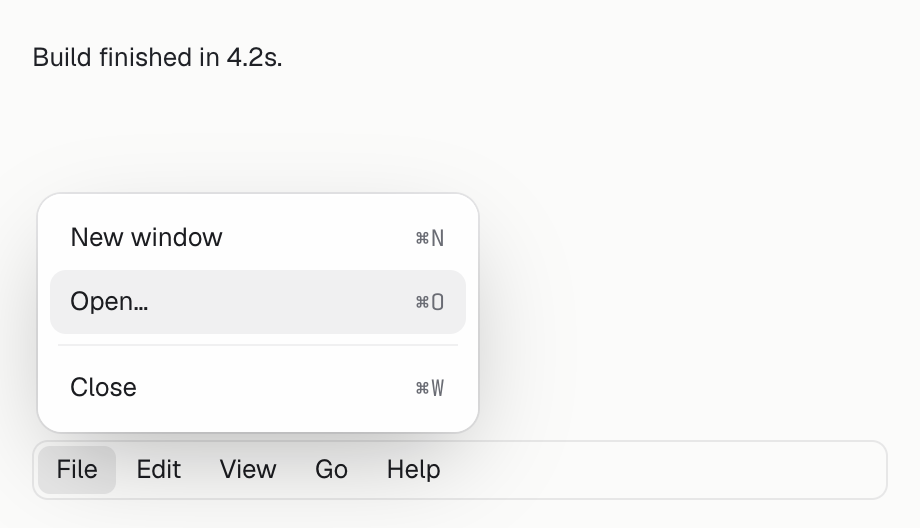
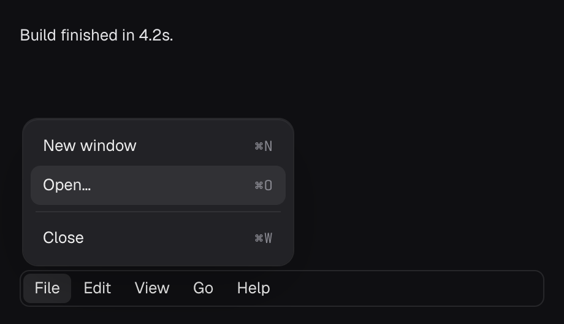
<figcaption>在 dock 中菜单向上打开。</figcaption>
</figure>

| 属性 | 类型 | 默认值 | 含义 |
| --- | --- | --- | --- |
| `menus` | `{ {id: string, label?: string, items: { item }} }` | `{}` | 菜单，按顺序。`id` 在事件和 `open` 中指名菜单；没有 `id` 的条目被跳过。`label` 是其标题（默认：`id`）。`items` 是 [`menu`](#menu) 条目：项对象、`"-"` 表示分隔线、`{header}` 表示分区标题 |
| `variant` | `"strip"` \| `"pill"` | `"strip"` | 外观（`data-variant`）；其他值按 `"strip"` 处理 |
| `icon` | `string` | 无 | 绘制在标题之前作为应用标记的图标名（`.sf-mb-mark`，装饰性）。`pill` 下为强调色，位于强调色着色的 30px 圆盘上；`strip` 下为 `--t2` 的裸图标。未知名称不绘制任何内容 |
| `open` | `string` | 无 | 显示为打开的菜单的 `id`。其变化优先于指针操作的结果；只要它保持不变，指针的打开与关闭就有效。没有菜单使用的 `id`（或 `""`）不打开任何菜单 |
| `active` | `string` | 无 | 打开菜单中高亮行的 `id`（你的键盘光标）；沿途持有它的子菜单会相应保持打开 |

**子节点：** 无（被忽略）。

| 变体 | 外观 | 位置 |
| --- | --- | --- |
| `strip` | 30px 细线条带，全宽，24px 标题；打开的标题落在 `--l2` 胶囊上 | 应用的头行、dock（该处菜单向上打开） |
| `pill` | 40px 磨砂胶囊，宽度随标题，30px 胶囊标题，一个强调色标记；打开的标题以强调色着色 | 悬浮于应用之上，居中放在 `justify = "center"` 的 `row` 中 |

**事件：**

| 事件 | 负载 | 时机 |
| --- | --- | --- |
| `toggle` | `{ev = "toggle", id, item = <menu id>, open = true}` | 单击已关闭的标题打开其菜单，或菜单打开时指针停留在另一个标题上（只发一个事件：打开一个菜单会关闭另一个） |
| `toggle` | `{ev = "toggle", id, item = <menu id>, open = false}` | 单击已打开菜单的标题、在打开菜单之外按下，或选中一行，都会将其关闭 |
| `action` | `{ev = "action", id, act = <row id>, item = <menu id>, checked?}` | 单击已启用的行；对勾选行（翻转）或单选行（`true`；该组其他项关闭），`checked` 是该行的新状态。随后是菜单的 `toggle`，`open = false` |

禁用行、标题和分隔线不发送任何事件；带子菜单的行会打开它。在已关闭或用 `listen = false` 打开的 surface 上，菜单栏会绘制（包括 `open` 指名的菜单），但指针不会打开、关闭或选中任何内容，也不会发送任何事件。

**键盘：** 该栏从不获取焦点。典型模型：某个按键（F10，或像 macOS 那样的
⌃F2）把 `open` 设为第一个菜单；←/→ 沿菜单移动 `open`；↑/↓ 在打开菜单的各行间移动 `active`；Enter 运行 `active`
（自己发送该命令并清空 `open`）；Escape 清空 `open`。把
`toggle` 映射回 `open`，指针与按键就能保持一致。

**样式：**

```html
<div class="sf sf-menubar open" data-id="main.bar" data-variant="strip" role="menubar">
	<span class="sf-mb-mark" aria-hidden="true"><svg class="ico">…</svg></span>
	<span class="sf-mb-menu sf-menu-anchor" data-menu="file">
		<span class="sf-mb-title" role="menuitem" aria-haspopup="menu" aria-expanded="false">File</span>
		<div class="sf-menu-pop" role="menu" data-variant="default" data-align="start">…</div>
	</span>
	<span class="sf-mb-menu sf-menu-anchor open" data-menu="view">
		<span class="sf-mb-title" role="menuitem" aria-haspopup="menu" aria-expanded="true">View</span>
		<div class="sf-menu-pop" role="menu" data-variant="default" data-align="start">…</div>
	</span>
</div>
```

| 目标 | 选择器 |
| --- | --- |
| 节点 | `.sf-menubar`、`.sf-menubar[data-variant='pill']` |
| 有菜单打开 | `.sf-menubar.open` |
| 应用标记 | `.sf-mb-mark` |
| 一个标题及其菜单 | `.sf-mb-menu`、`.sf-mb-menu[data-menu='view']` |
| 打开的那一个 | `.sf-mb-menu.open` |
| 一个标题 | `.sf-mb-title`、`.sf-mb-title[aria-expanded='true']` |
| 一个菜单 | `.sf-mb-menu > .sf-menu-pop`（其行：参见 [`menu`](#menu)） |

标题为 `400 13px` 无衬线（等宽区域内亦然），颜色 `--t1`；悬停加上
`--l1`，按下为 `--l2`。条带的标题高 24px、圆角 6px，位于高 30px、圆角 8px 并带 `--l2` 细线描边的条带内；打开的标题落在 `--l2` 上。胶囊是 `--pop-bg` 磨砂玻璃，带 `--l2` 描边和柔和阴影，其 30px 标题为胶囊形；打开的标题为强调色 12% 底色上的
`--accent-ink`。每个菜单都会绘制，但只有打开的显示（否则为 `display: none`），位于条带下方 7px（胶囊下方 10px），并带 popover 的出现动画。在减弱动效、`.sf-still` 和 `.sf-paused` 下，过渡与出现动效关闭。

## `tabs` 标签栏 {#tabs}

细线之上的一排标签；激活的标签以下划线强调色标出。
该条带不滚动：超出宽度的标签被裁掉。激活标签由你决定：单击发送 `select`，只有当你回传新的 `active` 时条带才变化。

带下划线的条带是页面的导航：在半区多于两个的应用中，头行与统计信息下方放一条条带，每个视图一个标签（其名称，必要时带暗色计数），其下只渲染激活的视图，占满宽度。在 `select` 时以及从你的 key 处理器处理 Tab/⇧Tab（或 `[`/`]`）时切换视图，并在按键说明中写明（参见
[设计视图](../guides/design.md#page-structure)）。

`variant = "segmented"` 时，条带改为分段控件：一个小凹槽，把各标签作为分段，激活的分段凸起在卡片表面上。它按标签自适应宽度，而不是拉伸。它筛选或切换单个视图显示的内容，位置在该视图的工具栏行（左侧一句暗色说明，右侧为控件）或卡片头部（其
[`end`](layout.md#card)）；绝不作第二条导航条（参见
[设计视图](../guides/design.md#a-view-table-and-detail)）。

**构建：** `tern.ui.node("tabs", { items = { … }, active = "…" })`。没有专用构建器。

| 属性 | 类型 | 默认值 | 含义 |
| --- | --- | --- | --- |
| `items` | `{ {id: string, label: Spans} }` | `{}` | 标签，按顺序。没有 `id` 的条目被跳过 |
| `active` | `string` | 无 | 激活标签的 `id`（`.on`、`aria-selected="true"`） |
| `variant` | `"underline"` \| `"segmented"` | `"underline"` | 外观。`"segmented"` 会加上类 `seg`；其他值按 `"underline"` 处理 |

**子节点：** 无（被忽略）。

**事件：** 单击标签发送 `{ev = "select", id = <tabs node id>,
item = <tab id>}`。`item` 是 `items` 中该标签的 `id`，不是节点 id。

<!-- 上游原文把该行内代码跨行折开，此处原样保留以便 docs:check 逐字比对：
`{ev = "select", id = <tabs node id>,
item = <tab id>}`. `item` is the tab's `id` from `items`, not a node id.
-->

**样式：**

```html
<div class="sf sf-tabs" data-id="main.tabs" role="tablist">
	<div class="sf-tab on" role="tab" aria-selected="true" data-tab="files">Files</div>
	<div class="sf-tab" role="tab" aria-selected="false" data-tab="commits">Commits</div>
</div>
```

| 目标 | 选择器 |
| --- | --- |
| 节点 | `.sf-tabs` |
| 一个标签 | `.sf-tab`、`.sf-tab[data-tab='files']` |
| 激活标签 | `.sf-tab.on`、`.sf-tab[aria-selected='true']` |
| 分段条带 | `.sf-tabs.seg` |

条带使用 `--sans` 12px；非激活标签为 `--t3`，悬停加上 `--l1`，激活下划线为 `--accent`，细线为 `--l2`。减弱动效下过渡关闭。

分段条带高 28px，内边距 2px，圆角 9px，底色 `--l1`，带 `--l1` 细线描边。每个标签高 24px，`padding: 0 10px`，圆角 7px，`500 12.5px` 无衬线字体，颜色 `--t3`；激活的为 `--card` 上的 `--t1`（深色下为 `--raise`），带柔和阴影和 `--l1` 描边。每个标签都显示手形指针。

```lua
local ui = tern.ui

ui.node("tabs", {
	key = "tabs",
	active = state.tab,
	items = {
		{ id = "files", label = "Files" },
		{ id = "commits", label = { ui.span("Commits "), ui.span("12", "muted") } },
		{ id = "checks", label = "Checks" },
	},
})

-- event(state, ev, cx): render only the active view
-- if ev.ev == "select" and ev.id == "main.tabs" then state.tab = ev.item end
```

<figure class="tn-figure">
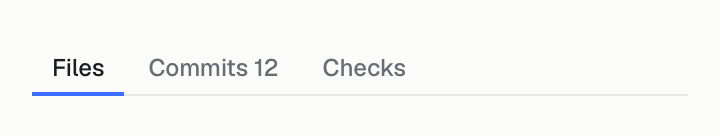
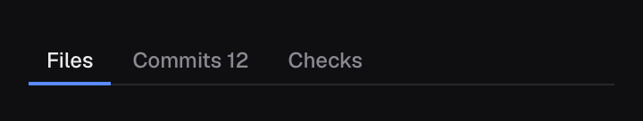
<figcaption>条带，<code>active = "files"</code>。</figcaption>
</figure>

视图工具栏行中的分段筛选器，位于其筛选的表格之上：

```lua
ui.node("col", { key = "jobs" }, {
	ui.node("row", { key = "bar", justify = "between", align = "center" }, {
		ui.text({ ui.span(#shown(state) .. " of " .. #state.jobs .. " jobs", "muted") }),
		ui.node("tabs", {
			key = "filter",
			variant = "segmented",
			active = state.filter,
			items = {
				{ id = "all", label = "All" },
				{ id = "failed", label = "Failed" },
				{ id = "running", label = "Running" },
			},
		}),
	}),
	jobs_table(state),
})
```

<figure class="tn-figure">
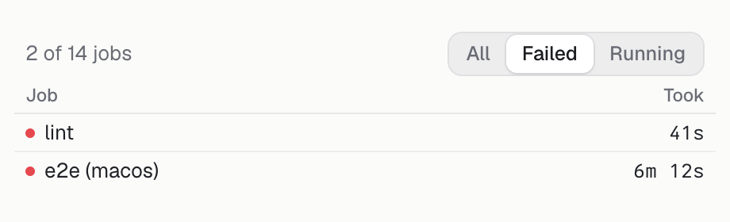
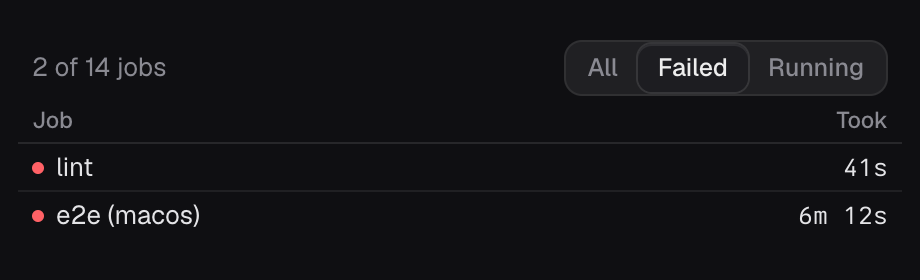
<figcaption><code>variant = "segmented"</code> 搭配 <code>active = "failed"</code>，位于其筛选的表格上方的工具栏行中。</figcaption>
</figure>

## `nav` 导航 {#nav}

一个导航栏：应用的各个分区，激活的分区被标出，持子页面的项会打开一个由它们组成的菜单。当一个分区是一组内容（Deploys → Production、Previews、History）而不是单个视图时就用它；一排扁平的视图则是 [`tabs`](#tabs)。

两种外观：

- `variant = "pills"`（默认）：各项位于一个小凹槽中，激活的一项凸起在卡片表面上，像分段标签那样。带子项的项显示一个插入符，并在其下方打开一个紧凑菜单（
  [`menu`](#menu) 类型的行：图标、标签、右侧暗等宽详情）。它按项自适应宽度；把它放在工具栏行或页面头部。
- `variant = "links"`：细线之上的文字链接，激活链接下方有强调色下划线，并滑动到下一条激活链接。带子项的项会打开一个两栏的富条目面板：图标色块、标题和一行说明。它占满容器宽度；用作头行下方的页面导航。

激活项由你决定：单击没有子项的项或某个子项，会立即标记它并发送 `select`；你在
`active` 中回传。单击带子项的项会在本地打开其菜单（或再次关闭），不发送任何事件。当 `active` 是某个子项的 id 时，其父项显示为激活，该子项在打开的菜单中被标出。

当程序把 `active` 或 `open` 改为与上次发送不同的值时，该值优先于用户本地的选择或打开/关闭；再次发送相同的值则保留用户的选择。在用 `listen = false` 打开（或已关闭）的 surface 上，导航会绘制，但点击既不翻转也不发送。

**构建：** `tern.ui.node("nav", { items = { … }, active = "…" })`。没有专用构建器。

```lua
local ui = tern.ui

ui.node("nav", {
	key = "nav",
	variant = "links",
	active = state.page,
	open = state.menu, -- the item whose panel shows, driven by your keys
	items = {
		{ id = "overview", label = "Overview" },
		{ id = "deploys", label = "Deploys", items = {
			{ id = "production", label = "Production", detail = "Live releases, by region", icon = "rocket" },
			{ id = "history", label = "History", detail = "Every release, rollbacks", icon = "history" },
			{ id = "previews", label = "Previews", detail = "One per open pull request", icon = "eye" },
			{ id = "hooks", label = "Hooks", detail = "Run checks before a promote", icon = "bolt" },
		} },
		{ id = "usage", label = "Usage" },
		{ id = "issues", label = "Issues", count = 3 },
	},
})

-- event(state, ev, cx)
-- if ev.ev == "select" and ev.id == "main.nav" then state.page = ev.item end
```

<figure class="tn-figure">
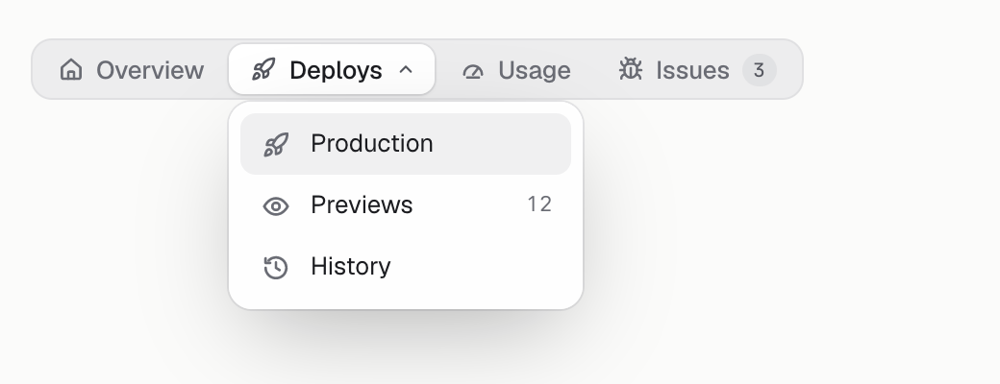
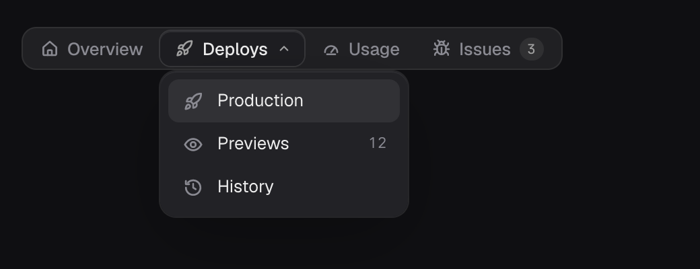
<figcaption>默认的 <code>pills</code>，<code>open</code> 在 Deploys 上，激活子项已标出。</figcaption>
</figure>

<figure class="tn-figure">
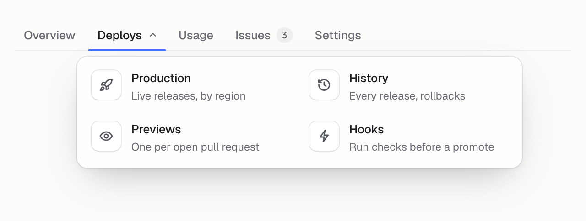
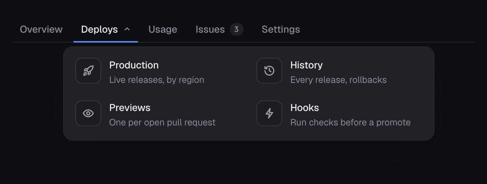
<figcaption><code>variant = "links"</code>，其富条目面板处于打开状态。</figcaption>
</figure>

<figure class="tn-figure">
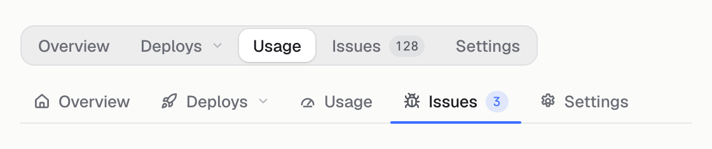
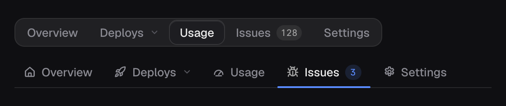
<figcaption>两种外观的关闭状态，带图标和计数。</figcaption>
</figure>

| 属性 | 类型 | 默认值 | 含义 |
| --- | --- | --- | --- |
| `items` | `{ {id: string, label?: string, icon?: string, count?: string \| number, items?: { {id: string, label?: string, detail?: string \| number, icon?: string} }} }` | `{}` | 各项，按顺序。没有 `id` 的条目被跳过；`label` 默认为 `id`。`icon` 是 Tern 图标名（与 [`icon`](data.md#icon) 类型相同）。`count` 在标签之后显示为小等宽胶囊（激活项上以强调色着色）。`items` 非空的项带子项：它显示插入符并打开菜单，而不会被选中。子项的 `detail` 在 `pills` 菜单中是右对齐的暗色注记，在 `links` 面板中则是说明行；其 `icon` 领起菜单行，或填充面板条目的色块 |
| `active` | `string` | 无 | 激活项或子项的 `id`。子项的 id 也会把其父项标记为激活 |
| `open` | `string` | 无 | 显示其菜单或面板的项（带子项）的 `id`。其他值不显示任何内容 |
| `variant` | `"pills"` \| `"links"` | `"pills"` | 外观；其他值按 `"pills"` 处理 |

**子节点：** 无（被忽略）。

| 变体 | 外观 | 子项打开方式 |
| --- | --- | --- |
| `pills` | 凹槽中的胶囊，激活的一项凸起 | 该项下方的紧凑菜单（`menu` 类型的行） |
| `links` | 细线之上的文字链接，激活链接下方有滑动的强调色下划线 | 两栏条目面板：图标色块、标题、说明 |

**事件：**

| 事件 | 负载 | 时机 |
| --- | --- | --- |
| `select` | `{ev = "select", id = <nav node id>, item = <item or sub-item id>}` | 单击没有子项的项或某个子项时。surface 不监听时不发送 |

打开或关闭菜单不发送任何事件；若你驱动 `open`，请保存自己的状态并回传它。

**键盘：** 节点从不获取焦点。从你的 key 处理器驱动导航：用 ←/→（或 Tab/⇧Tab）移动 `active`，用 ↓ 或
Enter 发送 `open = <item id>` 打开激活项的菜单，用
↑/↓ 在其子项间移动 `active`，用 Escape 发送 `open = nil` 关闭。在你的按键说明中写明。

**样式：**

```html
<div class="sf sf-nav" data-id="main.nav" data-variant="links">
	<div class="sf-nav-bar inked" role="menubar">
		<div class="sf-nav-item" role="menuitem" data-item="overview"><span class="sf-nav-label">Overview</span></div>
		<div class="sf-nav-item on open" role="menuitem" data-item="deploys" aria-current="page" aria-haspopup="menu" aria-expanded="true">
			<span class="sf-nav-label">Deploys</span><span class="sf-nav-chev">…</span>
		</div>
		<div class="sf-nav-item" role="menuitem" data-item="issues">
			<span class="sf-nav-label">Issues</span><span class="sf-nav-count">3</span>
		</div>
		<span class="sf-nav-ink" aria-hidden="true"></span>
	</div>
	<div class="sf-nav-pop" role="menu" aria-label="Deploys" data-for="deploys">
		<div class="sf-nav-entry" role="menuitem" data-sub="production">
			<span class="sf-nav-tile">…</span>
			<span class="sf-nav-text"><span class="sf-nav-title">Production</span><span class="sf-nav-detail">Live releases, by region</span></span>
		</div>
	</div>
</div>
```

| 目标 | 选择器 |
| --- | --- |
| 节点 | `.sf-nav`、`.sf-nav[data-variant='pills' \| 'links']` |
| 导航栏 | `.sf-nav-bar`（`role=menubar`） |
| 一个项 | `.sf-nav-item`、`.sf-nav-item[data-item='deploys']` |
| 激活项 | `.sf-nav-item.on`、`.sf-nav-item[aria-current='page']` |
| 菜单已打开的项 | `.sf-nav-item.open`、`[aria-expanded='true']` |
| 项的部分 | `.sf-nav-ico`、`.sf-nav-label`、`.sf-nav-count`、`.sf-nav-chev` |
| 下划线（`links`） | `.sf-nav-ink`（由导航栏上的 `--ink-x` / `--ink-w` 定位） |
| 胶囊菜单 | `.sf-nav-item .sf-menu-pop`（[`menu`](#menu) 类型的类） |
| 链接面板 | `.sf-nav-pop`，其条目 `.sf-nav-entry[data-sub]`、`.sf-nav-entry.on`、`.sf-nav-tile`、`.sf-nav-title`、`.sf-nav-detail` |
| 任何菜单打开 | `.sf-nav.has-pop` |

项使用 `--sans`，字号 `500 13px`，未激活为 `--t3`，悬停与激活为
`--t1`。胶囊：高 26px，位于 `--l1` 上内边距 3px、圆角 11px 的凹槽中；激活胶囊为 `--card`（深色下 `--raise`）上加柔和阴影。链接：
高 36px，位于 `--l2` 细线之上；2px 的 `--accent` 下划线以
0.28s 滑入。计数是 `--chip-bg` 上的等宽 10.5px 胶囊，激活时以强调色着色。面板是 `--pop-bg` 玻璃卡片，圆角 `--r-card`，条目宽
236px、分两栏，32px 图标色块在悬停时转为强调色。在 `.sf-still`、`.sf-paused`
和减弱动效下，过渡与打开动画关闭。

## `breadcrumb` 面包屑 {#breadcrumb}

从根到用户当前位置的路径：一个组织、一个项目、一个环境；一条文件夹路径。除最后一段外，每一段都能把用户带回那一步。当视图位于层级深处时，在页面头行中用它；在兄弟视图之间切换则用 [`tabs`](#tabs) 或
[`nav`](#nav)。

两种外观：

- `variant = "chevron"`（默认）：无衬线字体的各段，可带前置图标，段与段之间是插入符。悬停的段落在柔和胶囊上；最后一段即当前位置，为完整的墨色。
- `variant = "path"`：等宽路径，风格接近 Tern 的面板标题，暗色父级之间用 `/` 分隔，叶子为强调字重。不绘制图标。当各步是文件路径、键路径或 URL 时用它。

设置 `max` 时，长于 `max` 段的路径保留第一段和最后 `max - 1` 段（`max` 为 `1` 时只保留最后一段），中间折叠成一个
"…" 小片。单击该小片会打开折叠段的菜单（
[`menu`](#menu) 类型的 popover：它们的图标和标签；在
`path` 外观下为紧凑行）；选中一项会为它发送 `select`，效果与单击已显示的段落相同，并关闭菜单。

最后一段是当前位置：它带 `aria-current="page"`，单击它不发送任何事件。单击其他任何一段会带着其
`id` 发送 `select`；由你导航并回传新的路径。带 `href` 的段在 ⌘ 单击时打开该链接，与通用的 [`href`](index.md#props-every-node-takes)
一样（普通单击仍然选中）。标签对所在段而言太长时（各段上限 220px，行变窄时收缩，当前段最后收缩），会失去中间部分，如 `observabi…ay-ingest`，保留两端；完整标签是其工具提示。

菜单在本地打开和关闭：单击 "…"、在其外部按下，或选中一项。当程序把 `open` 改为与上次发送不同的值时，该值优先于用户的；再次发送相同的值则保留用户的选择。在用 `listen = false` 打开（或已关闭）的 surface 上，面包屑会绘制，但小片不会打开其菜单，也不发送任何事件。

**构建：** `tern.ui.node("breadcrumb", { items = { … } })`。没有专用构建器。

```lua
local ui = tern.ui

ui.node("breadcrumb", {
	key = "where",
	max = 4,
	items = {
		{ id = "acme", label = "acme", icon = "folder" },
		{ id = "infra", label = "infra", icon = "folder" },
		{ id = "k8s", label = "k8s", icon = "folder" },
		{ id = "clusters", label = "clusters" },
		{ id = "prod-eu", label = "prod-eu", href = "https://console.acme.dev/clusters/prod-eu" },
	},
})

-- event(state, ev, cx)
-- if ev.ev == "select" and ev.id == "main.where" then go_to(state, ev.item) end
```

<figure class="tn-figure">
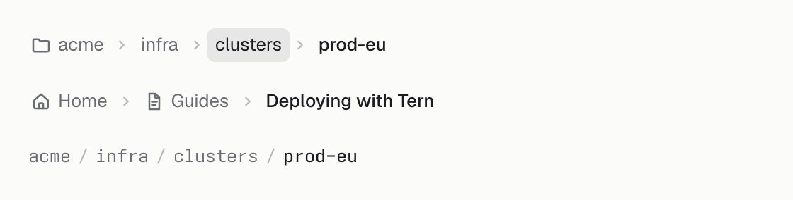
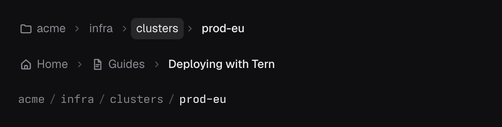
<figcaption>默认的 <code>chevron</code> 外观（<code>active</code> 在 clusters 上会绘制其胶囊），以及 <code>variant = "path"</code>。</figcaption>
</figure>

<figure class="tn-figure">
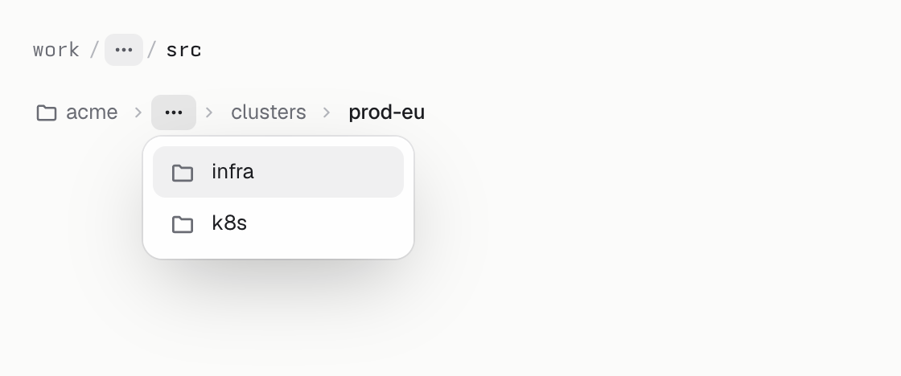
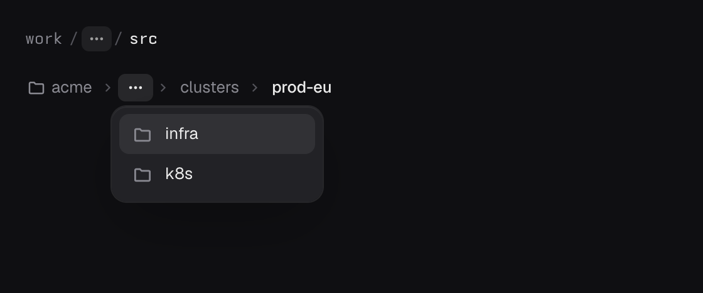
<figcaption>由 <code>max = 2</code> 折叠的 <code>path</code>，以及 <code>max = 3</code> 且折叠菜单处于 <code>open</code> 状态。</figcaption>
</figure>

<figure class="tn-figure">
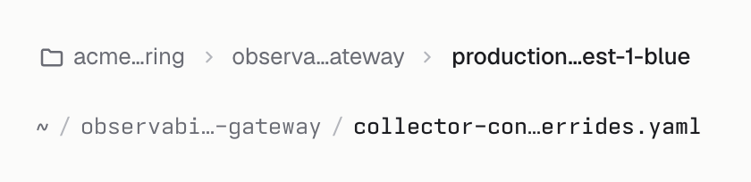
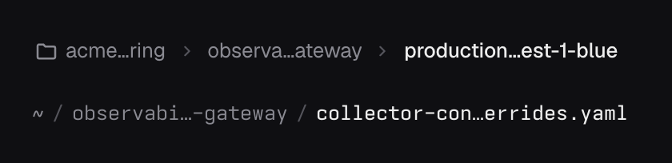
<figcaption>长标签失去中间部分；完整标签是该段的工具提示。</figcaption>
</figure>

| 属性 | 类型 | 默认值 | 含义 |
| --- | --- | --- | --- |
| `items` | `{ {id: string \| number, label?: string, icon?: string, href?: string} }` | `{}` | 路径，根在最前；最后一条是当前位置。没有 `id` 的条目被跳过；`label` 默认为 `id`。`icon` 是 Tern 图标名（与 [`icon`](data.md#icon) 类型相同），在 `chevron` 外观中及折叠菜单里绘制在标签之前。`href` 是 ⌘ 单击该段时打开的 URL 或路径 |
| `variant` | `"chevron"` \| `"path"` | `"chevron"` | 外观；其他值按 `"chevron"` 处理 |
| `max` | `number` | 无 | 最多显示的段数。更长的路径保留第一段和最后 `max - 1` 段（为 `1` 时只保留最后一段），其余折叠进一个 "…" 菜单。未设置、`0` 或非数字：从不折叠 |
| `open` | `boolean` | `false` | 折叠菜单是否显示（仅在存在折叠段时）。其变化时优先于用户的打开或关闭 |
| `active` | `string` | 无 | 处于你键盘光标下的段的 `id`：已显示的段绘制其悬停胶囊，折叠的段则成为菜单中的高亮行。从不是最后一段 |

**子节点：** 无（被忽略）。

| 变体 | 外观 |
| --- | --- |
| `chevron` | 无衬线 13px 的段，高 24px，可选 14px 图标，`›` 插入符；悬停时柔和胶囊；当前段为完整墨色、字重 500 |
| `path` | 等宽 12.5px，`--t3` 的父级之间用 `/` 分隔，叶子为 `--t1`、字重 550；无图标；更淡的悬停胶囊 |

**事件：**

| 事件 | 负载 | 时机 |
| --- | --- | --- |
| `select` | `{ev = "select", id = <breadcrumb node id>, item = <crumb id>}` | 单击最后一段以外的段，或单击菜单中已折叠的段时。⌘ 单击带 `href` 的段（那会打开链接）时不发送，surface 不监听时也不发送 |

打开或关闭菜单不发送任何事件；若你驱动 `open`，请保留自己的状态。

**键盘：** 节点从不获取焦点。从你的 key 处理器驱动面包屑：用 ←/→ 沿各段移动 `active`（一旦你发送 `open = true`，它会在菜单内高亮折叠的段），并在 Enter 时按 `select` 的方式导航到
`active`；用 Escape 发送
`open = false` 关闭菜单。在你的按键说明中写明。

**样式：**

```html
<div class="sf sf-breadcrumb" data-id="main.where" data-variant="chevron" role="navigation" aria-label="Breadcrumb">
	<ol class="bc-list">
		<li class="bc-it">
			<button class="bc-crumb" data-item="acme"><span class="bc-ic" aria-hidden="true">…</span><span class="bc-lbl">acme</span></button>
		</li>
		<li class="bc-it bc-fold open sf-menu-anchor">
			<span class="bc-sep" aria-hidden="true">…</span>
			<button class="bc-more" aria-haspopup="menu" aria-expanded="true" aria-label="2 more crumbs">…</button>
			<div class="sf-menu-pop" role="menu" data-variant="default">…</div>
		</li>
		<li class="bc-it">
			<span class="bc-sep" aria-hidden="true">…</span>
			<button class="bc-crumb cur" data-item="prod-eu" aria-current="page"><span class="bc-lbl">prod-eu</span></button>
		</li>
	</ol>
</div>
```

| 目标 | 选择器 |
| --- | --- |
| 节点 | `.sf-breadcrumb`、`.sf-breadcrumb[data-variant='chevron' \| 'path']` |
| 列表 | `.bc-list`，其各步 `.bc-it` |
| 一个段 | `.bc-crumb`、`.bc-crumb[data-item='infra']`，带链接的：`.bc-crumb[data-href]` |
| 当前段 | `.bc-crumb.cur`、`[aria-current='page']` |
| 键盘光标 | `.bc-crumb.active` |
| 段的部分 | `.bc-ic`、`.bc-lbl` |
| 分隔符 | `.bc-sep` |
| 折叠 | `.bc-fold`（其菜单显示时为 `.open`），其小片 `.bc-more`（`[aria-expanded='true']`） |
| 折叠的菜单 | `.bc-fold .sf-menu-pop`（[`menu`](#menu) 类型的类） |

各段为 `--t3`，当前段为 `--t1`；分隔符为 `--t4`。悬停胶囊与光标为 `--l2`（`path` 中为 `--l1`），圆角 `--r-chip`，按下时缩放 0.97。"…" 小片为 28×22，底色 `--l1`，悬停或打开时为 `--l2`。
标签上限 220px。在 `.sf-still`、`.sf-paused`
和减弱动效下，过渡与按下缩放关闭。

## `pager` 分页器 {#pager}

分页表格或列表下方的控件。你发送页码与各项计数；Tern 绘制三种外观之一，并在用户翻页时告知你。每当视图只显示更大内容的一小段时就用它：`range`（默认）是紧凑的表格页脚，`pages` 让人直接跳到某一页，`more` 用于收尾一个随用户请求而增长的列表（日志、信息流、提交）。

- **`range`**："12–24 of 312" 用等宽字体，计数为强调字重、单词为暗色，然后是合在一个 28px 胶囊里的 ‹ ›。按满宽布局时（`col` 或该区域的 `main`），箭头位于右边缘；放在 `row` 中时宽度随内容。每个箭头在其边界处禁用。
- **`pages`**：‹ 1 2 3 4 5 … 26 ›，当前页为强调色着色的胶囊。超过七页时，条带始终有七个槽位：首页与末页、当前页及其相邻页，以及每段被省略的页码各一个 "…"（`1 2 3 4 5 … 26`、`1 … 12 13 14 … 26`、`1 … 22 23 24 25 26`），且每个槽位的宽度等于最宽的页码，因此翻页时箭头从不移动。页数达数千时条带会很宽（四位数时约 440px）；这种情况下优先用 `range`。
- **`more`**：细线下一条安静的居中行（如同表格行），一个强调色的 "Show 50 more" 胶囊和暗色的 "· 262 left"。把它紧放在它所收尾的列表或表格之后。这里 `page` 计的是已加载的页数：`size = 50`、`total = 312` 时第 1 页意味着已显示 50 条、剩余 262 条。在最后一页它只提供剩余部分（"Show 12 more"）；什么都不剩时该行显示 "All 312 shown" 且不发送任何事件。

**计数。** 页数取 `pages`，否则用 `total` 除以 `size`（向上取整）。`range` 需要 `total` 和 `size` 才能显示条目范围；只有 `pages` 时显示 "Page 3 of 26"。没有任何计数时，`range` 和
`pages` 只有一页、两个箭头都关闭；`more` 会一直提供更多（"Show 100 more"，没有 `size` 时为 "Show more"），直到你移除它。
数字按千位分组（`1,048,576`）。

**钳制。** `page` 从 1 开始，并被钳制进页数范围：`0` 读作 1，超出末页的页码读作最后一页。Tern 发送的 `change` 事件始终在范围内。

**翻页先在本地生效。** 单击箭头或页码胶囊会立即显示该页，并发送带页码 `value` 的 `change`；你的程序加载该页并用 `page` 回应。在你的 `page` 变化之前，用户的页码保持绘制（其他属性变化，例如 `loading`，不会影响它）；当你的 `page` 变化时，以你的为准。more 行本身不移动任何东西：它发送 `act = "more"` 的 `action`，你的程序加载下一页并发送 `page + 1`。

**加载。** `loading = true` 显示一个旋转圆环：在范围之后、替代当前页的页码（其胶囊保持宽度），或替代 more 行的插入符——此时其文字读作 "Loading…"，且在 `loading` 消失前不发送任何事件。加载期间箭头和胶囊仍可交互。

在已关闭或用 `listen = false` 打开的 surface 上，分页器会绘制但不翻页，也不发送任何事件。

**构建：** `tern.ui.node("pager", { page = …, total = …, size = … })`。没有专用构建器。

```lua
local ui = tern.ui
local SIZE = 25

-- view
return {
	main = ui.col({
		deploys_table(state.rows),
		ui.node("pager", {
			key = "pager",
			page = state.page,
			total = state.total,
			size = SIZE,
			label = "deployments",
			loading = state.loading,
		}),
	}),
}

-- event(state, ev, cx)
-- if ev.ev == "change" and ev.id == "main.pager" then
--   state.page = ev.value; state.loading = true; fetch(state.page, SIZE)
-- end
```

一个不断增长的信息流，由 more 行收尾：

```lua
ui.node("col", { key = "log" }, {
	commit_list(state.commits),
	ui.node("pager", {
		key = "more",
		variant = "more",
		page = state.loaded,
		total = state.total,
		size = 50,
		label = "commits",
		loading = state.loading,
	}),
})

-- if ev.ev == "action" and ev.act == "more" then
--   state.loading = true; fetch_page(state.loaded + 1)
-- end
```

<figure class="tn-figure">
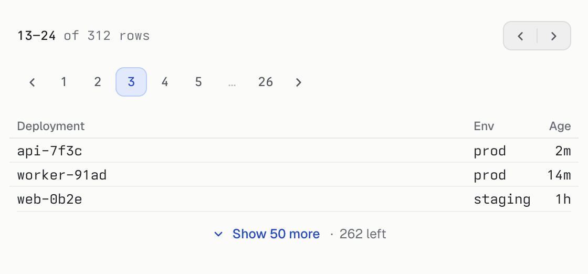
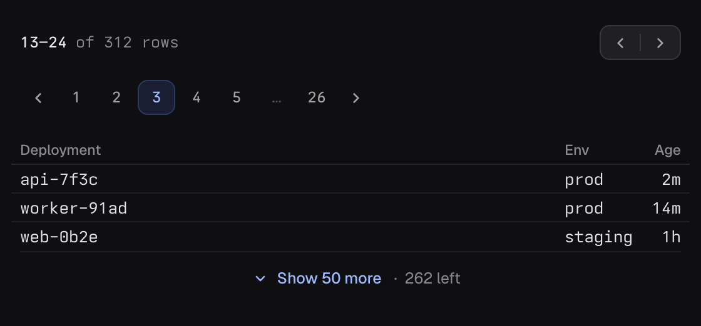
<figcaption>三种外观：<code>range</code>（默认）、<code>pages</code>，以及收尾表格的 <code>more</code>。</figcaption>
</figure>

<figure class="tn-figure">
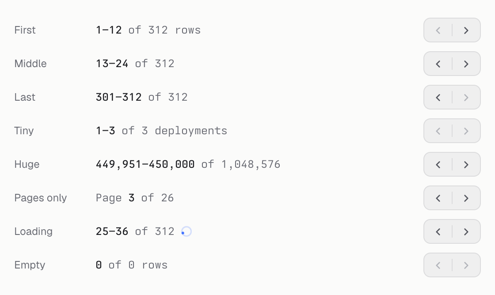
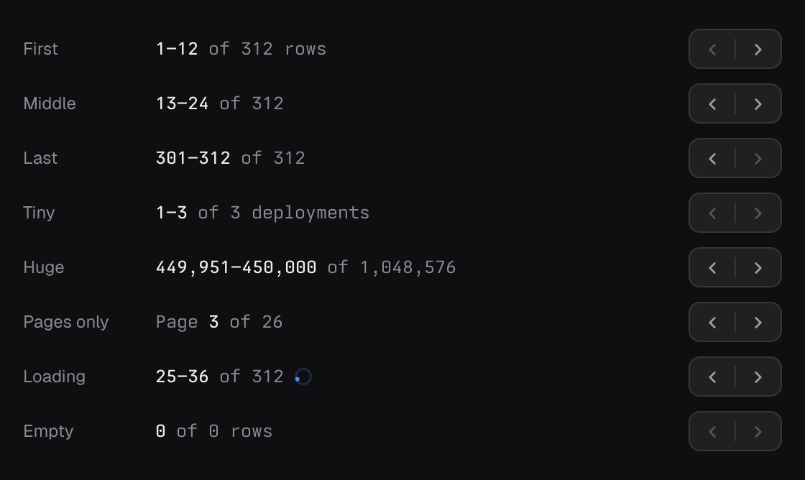
<figcaption><code>range</code> 在边界处，总数极小与极大，仅有页数，<code>loading</code>，以及无内容可显示。</figcaption>
</figure>

<figure class="tn-figure">
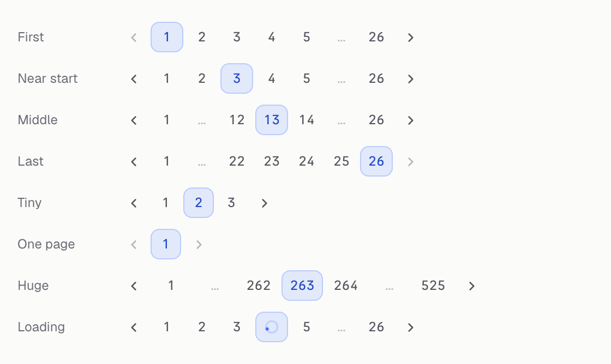
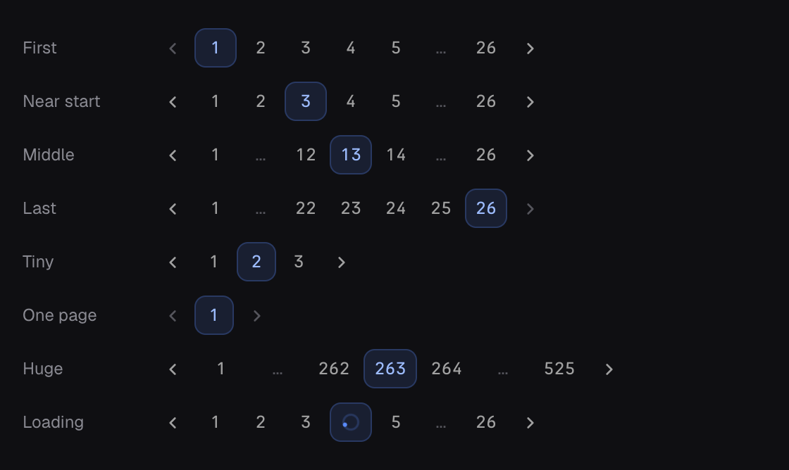
<figcaption><code>pages</code>：首页、近端页、中间页和末页处的七槽窗口，页数少与页数多，以及 <code>loading</code>。</figcaption>
</figure>

<figure class="tn-figure">
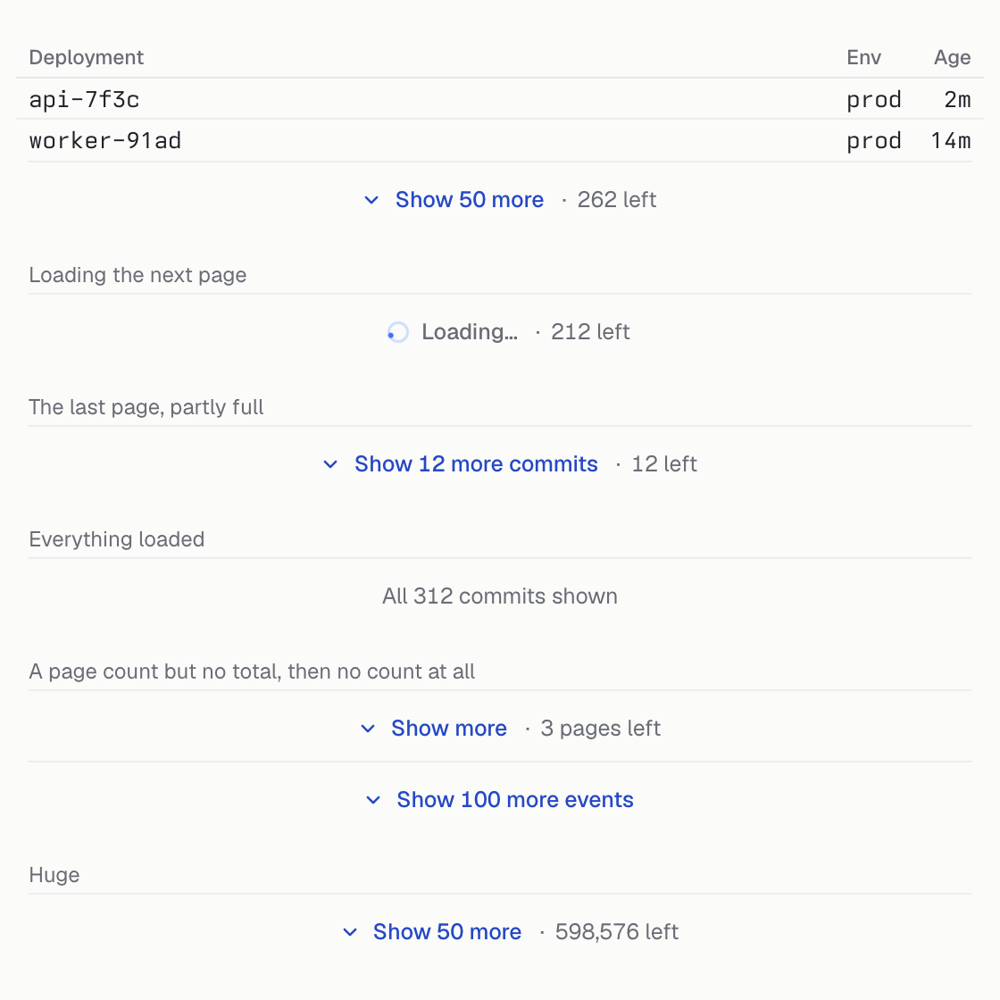
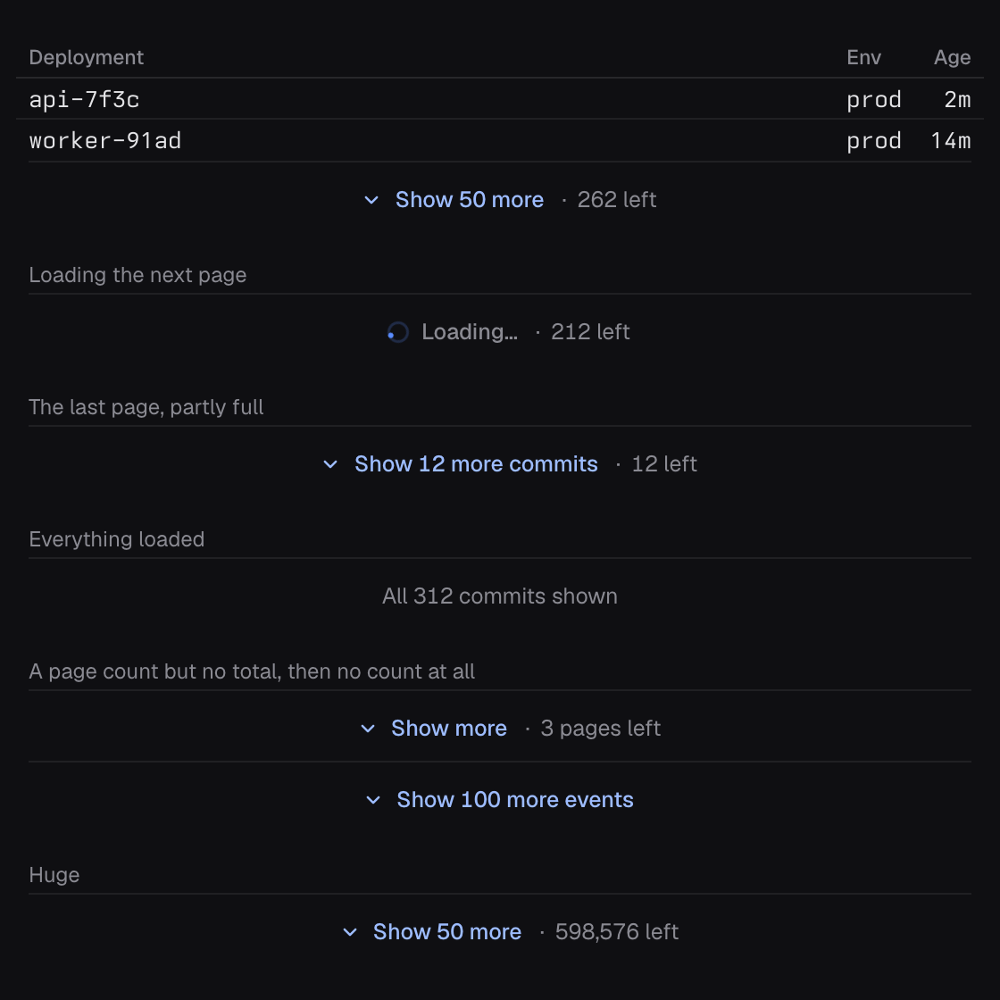
<figcaption><code>more</code> 收尾表格、加载中、在最后一页、已完成，以及计数不全或没有计数。</figcaption>
</figure>

| 属性 | 类型 | 默认值 | 含义 |
| --- | --- | --- | --- |
| `variant` | `"range"` \| `"pages"` \| `"more"` | `"range"` | 外观（见下文）。未知值按 `"range"` 处理 |
| `page` | `number` | `1` | 当前页，从 1 开始，被钳制进页数范围。对 `more` 而言是迄今已加载的页数。其变化优先于用户的本地页码 |
| `pages` | `number` | 由 `total` / `size` 得出 | 页数。对计数而言优先于 `total` / `size`；`0` 或缺失时回退到它们 |
| `total` | `number` | 无 | 条目总数：`range` 显示 "12–24 of 312"，`more` 据此计算剩余量 |
| `size` | `number` | 无 | 每页条数。没有它时，`range` 把 `total` 均摊到 `pages` 上 |
| `loading` | `boolean` | `false` | 一个旋转圆环（在范围之后、当前胶囊中、more 行中）以及 `aria-busy`；more 行不发送任何事件 |
| `label` | `string` | 无 | 计数之后说明条目是何种事物（复数）："of 312 rows"、"Show 50 more commits"、"All 312 commits shown" |

[通用属性](index.md#props-every-node-takes)适用（`key`、`aria`、`title`、`grow`、`min` 等）。没有 `aria` 时，`range` 或 `pages` 分页器是一个名为 "Pagination" 的
`navigation` 地标。

**子节点：** 无（被忽略）。

**变体：**

| `variant` | 外观 | 用途 |
| --- | --- | --- |
| `range` | "12–24 of 312"（等宽、等宽数字）与合于一体的 ‹ › 胶囊 | 表格或列表的页脚；默认 |
| `pages` | ‹ 1 2 [3] 4 5 … 26 ›，当前页为强调色着色的胶囊，稳定的七槽窗口 | 人们需要跳到某一页时（搜索结果、文档索引） |
| `more` | "Show 50 more · 262 left"，居中且安静；末尾为 "All 312 shown" | 按需增长的列表（日志、信息流、历史） |

**事件：**

| 事件 | 负载 | 时机 |
| --- | --- | --- |
| `change` | `{ev = "change", id, value = <page>}`：页码，从 1 开始，在范围内 | 单击箭头或页码胶囊时（`range`、`pages`）；该页立即绘制 |
| `action` | `{ev = "action", id, act = "more"}` | 未处于 `loading` 且未完成时单击 more 行（`more`） |

**键盘：** 分页器从不获取焦点：按键仍归你的程序。从键盘翻页时自行改变 `page`（←/→ 或 PgUp/PgDn 为上一页和下一页，Home/End 为首页和末页），并在页面到达期间显示
`loading`。

**无障碍：** 箭头为 `role=button`，名称为 "Previous page" 和
"Next page"（在边界处为 `aria-disabled`）；页码胶囊名为 "Page N"，当前的一个带 `aria-current="page"`；空隙被隐藏。more 行是一个
`role=button`，其文本即其名称。

**样式：**

| 目标 | 选择器 |
| --- | --- |
| 任何分页器 | `.sf-pager`、`.sf-pager[data-variant=range\|pages\|more]` |
| 一个箭头，处于边界 | `.sf-pager-step.prev`、`.sf-pager-step.next`、`.sf-pager-step.off` |
| 范围文本 | `.sf-pager-range`（`.pre`、`.cur`、`.of`） |
| 合于一体的箭头 | `.sf-pager-steps`、`.sf-pager-sep` |
| 页码胶囊 | `.sf-pager-list`、`.sf-pager-pg`、`.sf-pager-pg.on`、`.sf-pager-pg.gap`、`.sf-pager-pg.busy` |
| more 行 | `.sf-pager-more`（`.busy`）、`.sf-pager-ic`、`.sf-pager-left`、`.sf-pager-done` |

单词为 `--sans`，数字为 `--mono` 并在任何区域都使用等宽数字。
箭头与胶囊为 28px，圆角 `--r-ctl`；悬停加上 `--l1`，按下立即缩小再回弹。当前胶囊为
`--accent-ink`，位于 13% 的 `--accent` 底色上并带 24% 描边；禁用的箭头为 `--t4`。more 胶囊为 `--accent-ink`，悬停时底色为 10% 的 `--accent`。在减弱动效和 `.sf-still` 下过渡停止。

## `picker` 选择面板 {#picker}

一个以数据为先的模态面板：你发送目录和要显示的内容，Tern 绘制一块玻璃面板，包含搜索头、可选的范围栏、标签行、事实列、虚拟化的行、预览区和操作栏。它为 omp 而建（编码 agent 的模型选择器、会话选择器和设置），并由 `omp-pickers.css` 定型；该样式表在每个 surface 上都会加载，因此在插件 block 中它看起来也一样。

**在插件中使用。** 它能在 block 中工作，直接放在 `layer` 区域：该节点*就是*面板，绝对定位于整个 block 之上
（`position: absolute; inset: 0`），其下是暗淡模糊的背景。放在 `main` 或 lens 中时，它改为覆盖其容器，通常不是你想要的。它不绘制真正的文本输入框：搜索行显示你的 `query` 和一个绘制的
光标，所以输入、方向键、Enter 和 Escape 都必须在你 block 的
`key` 处理器中处理，由它更新 `query`、`selected` 等。指针输入以事件形式到达（见下文）。它是重量级组件；若只想在自己的布局里做普通可选列表，请用 [`list`](#list)。

### 布局与行为 {#layout-and-behavior}

- **尺寸。** `size = "lg"`（默认）是顶部居中的面板，最大
  1120×760px，距顶 28px。`"md"` 是命令面板尺寸的面板，最大
  680px 宽、540px 高，距顶 72px，高度只按行数需要（`query` 缩小行集时它保持高度）。`"screen"` 填满
  surface，无背景、圆角或阴影。
- **窄面板。** 宽度低于 760px 时，范围栏折进头部按钮
  （`.narrow`），其菜单发送同样的 `scope` 动作，副标题隐藏。侧边预览在 980px 以下移到列表下方
  （`.pv-below-auto`）；640px 以下预览隐藏，计数也隐藏
  （`.pv-hide`）。`md` 面板只在没有 `query` 时显示其副标题：
  此时头部是标题，副标题在下一行。
- **行**按各布局的固定高度虚拟化：`rows` 36px、
  `cards` 54px、`timeline` 26px（`node = "user"` 时 34px）、`tree` 24px；分组
  标题 32px。一条选中条（`.pk-selbar`）在各行之间滑动。第一个可见行所属的分组吸附在顶部（`.pk-sticky`）。匹配的
  `hits` 在标签中以粗体绘制，不带 `list` 所用的底色。
- **让选中项保持可见。** 列表在打开时、布局变化时、`selected` 变化时，以及选中项可见期间行发生变化时，会滚动到选中项。读者已滚离的列表在更新时保持原位。
- **事实列**按 `priority` 从低到高隐藏，直到标签保有自己的 260px。
  `text` 列会在标签让出的空间中增长以容纳最宽的值（最多 320px），并在任何列隐藏之前先缩回默认宽度；仍被截断的值会以完整形式作为该事实的工具提示显示。
- **头部的 `esc`。** 只有当没有任何动作在其 `keys` 中含 `"esc"` 或 `"escape"` 时，头部的 `esc` 键帽才显示；此时由该动作在操作栏中的按钮代替它。
- **操作栏折叠。** 当操作栏按钮溢出时，绑定到 Escape 的动作（除非它是 `primary`）移入头部的 `esc` 按钮
  （`.fold-esc`），随后根节点也会加上 `.fold-keys`；宽度恢复时展开。
- **按钮只显示标签。** 操作栏按钮只说明它做什么；它的快捷键在工具提示中（`Select  ⏎`），不绘制在按钮上。确认条上的按钮响应 ⏎ 和 esc 而不绘制它们。Omp 的 Console 聊天风格会把快捷键再作为 TUI 的按键说明绘制出来。
- **动效。** 面板入场有动画，变化的行错开入场（最多 8 行，
  间隔 24ms），操作栏事实在首次显示时从零增长。在 `.sf-still` 或
  `prefers-reduced-motion` 下这些都关闭。

**构建：** `tern.ui.node("picker", props, preview_children)`。没有专用构建器。

### 面板属性 {#sheet-props}

| 属性 | 类型 | 默认值 | 含义 |
| --- | --- | --- | --- |
| `size` | `"md"` \| `"lg"` \| `"screen"` | `"lg"` | 面板尺寸（见上）。其他值回退为 `"lg"` |
| `layout` | `"rows"` \| `"cards"` \| `"timeline"` \| `"tree"` | `"rows"` | 行模板。`cards` 把 `detail` 放在单独一行；`timeline` 为每行绘制一个节点；`tree` 绘制层级引导线和展开插入符 |
| `preview` | `"side"` \| `"below"` \| `"none"` | `"side"`，`md` 时为 `"none"` | 预览区的位置 |
| `title` | Spans | 无 | 标题（不是通用工具提示）。没有它时头部只有图标和搜索（`.no-title`）；此时面板的无障碍名称为 `placeholder`，否则为 `noun` |
| `subtitle` | Spans | 无 | 标题的第二部分 |
| `icon` | `string` | 一个列表图标 | 头部图标名 |
| `query` | `string` | 无 | 搜索文本。未设置则隐藏搜索（`.no-query`）；`""` 显示占位符 |
| `cursor` | `number` | `query` 末尾 | `query` 中的光标位置，以 UTF-16 单位计 |
| `placeholder` | `string` | `"Search <noun>…"` | 搜索占位符 |
| `noun` | `string` | `"items"` | 行所代表的事物，用于占位符和空状态文本 |
| `focus` | `"list"` \| `"scopes"` \| `"tabs"` \| `"strip"` \| `"preview"` | `"list"` | 你的按键驱动哪个部分；在 `.pk-sheet` 上设置 `.f-<focus>`。光标只在 `list` 时显示；其他值分别给激活范围、激活标签、`selected` 条带小片或预览区加环 |
| `state` | `"ready"` \| `"loading"` \| `"error"` | `"ready"` | `loading` 显示 8 行骨架屏，计数显示 `…`；`error` 在提示卡片中显示 `message`。设置 `.st-loading` / `.st-error` |
| `message` | Spans | 无 | `state = "error"` 时的错误卡片文本 |
| `empty` | Spans | `"No <noun> yet"` | 没有行且 `query` 为空时的文本 |
| `total` | `number` | 无 | 目录总量；与之不同时计数读作 `"<shown> of <total>"` |

### 行：`items`、`order`、选中 {#rows-items-order-selection}

| 属性 | 类型 | 默认值 | 含义 |
| --- | --- | --- | --- |
| `items` | `{ PickerItem }` | `{}` | 目录，以 `id` 为键。替换它会重建各行 |
| `itemsAdd` | `{ PickerItem }` | 无 | 按 `id` 加入（或替换）目录的项 |
| `itemsDel` | `{ string }` | 无 | 从目录中移除的项 id |
| `order` | `{ string \| {group, label, count?} }` | `items` 的顺序 | 要显示的内容及顺序：项 id（未知 id 被跳过）与分组标题。带 `group` 字段的表即标题；它显示 `label` 和可选的 `count`（千位分隔） |
| `selected` | `string` | 无 | 选中项 id：选中条、`aria-activedescendant` |
| `current` | `{ string }` | `{}` | 以勾选标记标为当前的项 id（`.cur`）；只要有任一当前项，每行都保留勾选槽位（`.has-cur`） |
| `hits` | `{ [id]: { {from, to} } }` | 无 | 按项 id 给出的匹配范围：位置式 `{from, to}` 对（JSON `[[0, 2]]`），即标签纯文本中的 UTF-16 `[from, to)` 偏移；覆盖项自身的 `hits` |
| `columns` | `{ Column }` | `{}` | 事实列，最多 8 个 |
| `confirm` | `{text, act?, label?}` | 无 | 覆盖在选中行上的确认条：垃圾桶图标、`text`、发送 `act`（默认 `"confirm"`）的危险按钮 `label`（默认 `"Delete"`），以及发送 `cancel` 的 `Keep` |

`PickerItem`：

| 字段 | 类型 | 含义 |
| --- | --- | --- |
| `id` | `string` | 必填；没有它的项被丢弃 |
| `label` | Spans | 行文本。配合 `mono = true` 且纯文本标签含 `/` 时，它拆成优先截断的暗色 `dir` 和 `name` |
| `detail` | Spans | 标签之后的行内内容（在 `cards` 中单独一行） |
| `icon` | `string` | 前置图标名 |
| `role` | `string` | `icon` 未设置时，按角色名选择前置图标 |
| `mark` | `{text, seed?, icon?}` | 头像：Tern 有对应图标时用 `icon`（`provider:<id>` 表示模型提供商的标志，参见 [图标名称](data.md#icon-names)），否则用首字母（`text` 前两个非空格字符）配由 `seed`（默认 `text`）生成的渐变；优先于 `icon` |
| `dot` | tone name | 没有 mark 或图标时作为前置的状态圆点，否则为角落圆点（`tree` 中不用）。`timeline` 中不绘制。在 `tree` 中，`"accent"` 点亮层级引导线 |
| `mono` | `boolean` | 等宽标签 |
| `facts` | `{ [column id]: number \| Spans }` | 列值。数字显示为紧凑形式（`272k`、`1.6M`）；在 `bar` 列中 0–1 的数字是量表；在 `elapsed` 列中数字是迄今的毫秒数，计时器由终端从该项出现时开始运行（`12.3s`、`2m12s`、`1h5m`、`3d2h`） |
| `badges` | `{ {text, tone?, title?} }` | 标签之后最多 3 个徽标，然后是 `+N` 徽标，其工具提示列出其余项 |
| `chips` | `{ {text, on?, auto?, dot?} }` | 徽标之后的角色小片；`dot` 是命名圆点颜色的 span 记号 |
| `tone` | tone name | 该行的 `data-tone` |
| `disabled` | `true` \| `string` | 置灰该行（`.off`）；字符串是其工具提示中的原因。禁用行仍可选中，但从不激活 |
| `hits` | `{ {from, to} }` | 标签中的匹配范围：位置式对（JSON `[[0, 2]]`），UTF-16 `[from, to)` 偏移，以 `mark.sf-mark` 标记 |
| `node` | `string` | `timeline`：节点样式 `n-<node>`（`user`、带图标的 `tool`，默认 `assistant`）；同时也设置 `data-node` |
| `depth` | `number` | `tree`：缩进引导线 |
| `open` | `boolean` | `tree`：插入符，为 `true` 时旋转；未设置为叶子 |
| `title` | `string` | 行的工具提示（`bar` 事实也同样有） |

`Column`：

| 字段 | 类型 | 默认值 | 含义 |
| --- | --- | --- | --- |
| `id` | `string` | 必填 | `facts` 的键 |
| `head` | `string` | `""` | 表头标签。有任何表头时，表头骑在第一个分组标题和吸顶标题上；列表不以分组开头时，则独占一行 `.pk-colhead` |
| `format` | `"text"` \| `"num"` \| `"price"` \| `"bar"` \| `"time"` \| `"elapsed"` \| `"dim"` | `"text"` | 类 `f-<format>` 和默认宽度：text 96（有空间时增长以容纳其值）、num 52、price 76、bar 44、time 44、elapsed 52、dim 64 px。它只给列定型，不格式化值：除 `bar` 和 `elapsed` 外，数字显示为紧凑形式（`3`，而不是 `$3`），因此价格和 `time` 值请以文本发送 |
| `priority` | `number` | `100` | 值越低，列表变窄时越先隐藏 |
| `min` | `number` | 无 | 以字符计的最小宽度 |

### 范围、标签、条带、动作 {#scopes-tabs-strip-actions}

| 属性 | 类型 | 含义 |
| --- | --- | --- |
| `scopes` | `{ {id, label, group?, mark?, icon?, dot?, count?, disabled?} }` | 左侧的垂直范围栏；`mark` 与项的 `mark` 相同，优先于 `icon`。`group` 相同的连续范围共享一个标题；变成无分组时绘制分隔线。`disabled`（true 或一个原因）会添加锁和工具提示，但仍发送动作 |
| `scope` | `string` | 激活范围的 id |
| `tabs` | `{ {id, label, count?} }` | 列表上方的标签行：最多 4 个标签时为分段控件，更多则为小片 |
| `tab` | `string` | 激活标签的 id |
| `strip` | `{label?, items = { {id, label, on?, dot?} }, selected?}` | 操作栏上方的一行开关小片；`on` 勾选某小片，`selected` 给某小片描边 |
| `actions` | `{ {id, label?, keys?, primary?, end?, danger?, on?, disabled?} }` | 操作栏；`label` 默认为 `id`。次要动作在左侧，`end` 的在右侧，`primary` 的最后一个落在角落。`keys` 在按钮的工具提示中指明其快捷键（`Label  keys`）；`keys` 中含 `"escape"`/`"esc"` 的动作即背景和头部 `esc` 所发送的动作。`on` 使其成为按下态的开关。`disabled`（true 或一个原因）置灰它（`.off`，原因为工具提示），其点击不发送任何内容 |

在没有 query 的空状态下，`keys` 含
`"tab"` 的第一个动作会作为按钮提供；在错误状态下，则是 `id = "retry"` 的动作。

**子节点：** 预览。子节点绘制在 `.pk-pv-slot` 中；没有子节点时，该区显示 "Nothing to preview"。`preview = "none"` 隐藏该区。

### 事件 {#events}

`id` 是 picker 节点的 id。

| 手势 | 事件 |
| --- | --- |
| 单击一行 | `{ev = "select", id, item}` |
| 单击选中行、单击上一次单击的行，或双击一行 | `{ev = "activate", id, item}`（每次双击一次；禁用的行从不发送） |
| 单击一个范围，或在窄范围菜单中选中一个 | `{ev = "action", id, act = "scope", value = <scope id>}` |
| 单击一个标签 | `{ev = "action", id, act = "tab", value = <tab id>}` |
| 单击一个条带小片 | `{ev = "action", id, act = "strip", value = <chip id>}` |
| 单击操作栏按钮 | `{ev = "action", id, act = <action id>}` |
| 单击背景或头部 `esc` | `{ev = "action", id, act = <escape action id or "close">}` |
| 确认条按钮 | `act = <confirm.act or "confirm">`，或 `act = "cancel"` |
| 空状态的 `Clear search` | `{ev = "action", id, act = "clear"}` |
| 空状态或错误状态按钮 | `{ev = "action", id, act = <that action's id>}` |

分组标题不发送任何事件。按键归你：在 `key` 中处理它们。

### 样式 {#styling}

```html
<div class="sf sf-picker sz-lg lay-rows pv-side has-cur" data-id="layer.models">
	<div class="pk-dim" aria-hidden="true"></div>
	<div class="pk-sheet f-list" role="dialog" aria-modal="true">
		<div class="pk-head">
			<span class="pk-ic"></span>
			<div class="pk-title"><span class="t">Models</span><span class="sub">…</span></div>
			<button class="pk-scopebtn" data-pk="menu"></button>
			<div class="pk-search"><span class="q">son</span><span class="caret"></span></div>
			<span class="pk-count">12 of 140</span>
			<button class="pk-esc" data-pk="act" data-v="close"><span class="kbd">esc</span></button>
		</div>
		<div class="pk-body">
			<div class="pk-scopes" role="tablist">
				<div class="pk-sgh">Providers</div>
				<div class="pk-scope nav-row on" data-pk="scope" data-v="all">…</div>
			</div>
			<div class="pk-center">
				<div class="pk-main">
					<div class="pk-tabs seg"><div class="pk-tabs-in"><button class="pk-tab on" data-pk="tab" data-v="…"></button></div></div>
					<div class="pk-colhead"></div>
					<div class="pk-list">
						<div class="pk-sticky pk-row grp"></div>
						<div class="pk-scroll">
							<div class="pk-rows" role="listbox">
								<div class="pk-selbar"></div>
								<div class="pk-confirm" role="alertdialog"></div>
								<div class="pk-row sel cur" role="option" data-pk="row" data-v="sonnet" id="pk-sonnet">
									<span class="pk-lead"></span>
									<div class="pk-txt"><div class="pk-l1">
										<span class="pk-label">…</span><span class="pk-tags">…</span>
										<span class="pk-detail"><span class="t">…</span></span>
									</div></div>
									<div class="pk-facts"><span class="pk-fact c0 f-price">$3</span></div>
									<span class="pk-cur"></span>
								</div>
							</div>
						</div>
					</div>
					<div class="pk-state"></div>
				</div>
				<div class="pk-pv"><span class="pk-pv-empty">Nothing to preview</span><div class="pk-pv-slot">…</div></div>
			</div>
		</div>
		<div class="pk-strip" role="toolbar"></div>
		<div class="pk-bar" role="toolbar"><button class="pk-btn" data-pk="act" data-v="…"></button><span class="pk-bar-fill"></span><button class="pk-btn primary">…</button></div>
	</div>
</div>
```

| 目标 | 选择器 |
| --- | --- |
| 节点 | `.sf-picker`、`.sf-picker[data-id=…]`、`[data-role=…]` |
| 尺寸、布局、预览 | `.sz-md` `.sz-lg` `.sz-screen`、`.lay-rows` `.lay-cards` `.lay-timeline` `.lay-tree`、`.pv-side` `.pv-below` `.pv-none` |
| 宽度状态 | `.narrow`、`.pv-below-auto`、`.pv-hide`、`.fold-esc`、`.fold-keys`、`.h0`–`.h7`（列已隐藏） |
| 内容状态 | `.no-title`、`.no-query`、`.has-cur`、`.st-loading`、`.st-error` |
| 背景、面板 | `.pk-dim`、`.pk-sheet`、`.pk-sheet.f-<focus>`（内部，可能变化） |
| 头部 | `.pk-head`、`.pk-ic`、`.pk-title .t`、`.pk-title .sub`、`.pk-search .q/.ph/.caret`、`.pk-count`、`.pk-esc`、`.pk-scopebtn`（内部，可能变化） |
| 范围 | `.pk-scopes`、`.pk-scope`、`.pk-scope.on`、`.pk-scope.dis`、`.pk-sgh`、`.pk-ssep`、`.pk-lock`（内部，可能变化） |
| 标签 | `.pk-tabs.seg` / `.pk-tabs.chips`、`.pk-tab`、`.pk-tab.on`、`.pk-tab .n`（内部，可能变化） |
| 行 | `.pk-row`、`.pk-row.sel`、`.pk-row.cur`、`.pk-row.off`、`.pk-row.grp`、`.pk-row[data-v=…]`、`.pk-row[data-tone=…]`、`.pk-row[data-node=…]`、`.pk-row.arr-a/.arr-b`（入场中）（内部，可能变化） |
| 行的部分 | `.pk-lead`、`.pk-mark`、`.pk-mark.logo`（图标 mark）、`.pk-dot`、`.pk-dot.corner`、`.pk-node.n-<node>`、`.pk-guides .pk-g`、`.pk-chev`、`.pk-label`、`.pk-label.mono.path .dir/.name`、`.pk-tags`、`.pk-badge`、`.pk-chip`、`.pk-detail`、`.pk-facts`、`.pk-fact.c<i>.f-<format>`、`.pk-meter`、`.pk-cur`、`.pk-gl`、`.pk-gc`（内部，可能变化） |
| 选中、吸顶、确认 | `.pk-selbar`、`.pk-sticky`、`.pk-rows.confirming`、`.pk-confirm`、`.pk-ct`（内部，可能变化） |
| 状态 | `.pk-state.loading .pk-sk`、`.pk-state.error .pk-err`、`.pk-state.empty .pk-empty`（内部，可能变化） |
| 预览 | `.pk-pv`、`.pk-pv-empty`、`.pk-pv-slot`（内部，可能变化） |
| 条带、操作栏 | `.pk-strip`、`.pk-strip-l`、`.pk-schip`、`.pk-bar`、`.pk-btn`、`.pk-btn.primary/.danger/.on/.off/.esc`（内部，可能变化） |
| 筛选命中 | `.sf-picker mark.sf-mark` |

每个 `pk-*` 类都是 Tern 为 omp 面板提供的内部结构；只有根节点上的 `.sf-picker`
及其状态类值得依赖。面板使用主题的
`--pop-bg`、`--glass-hi`、`--dim`、`--l1`–`--l3`、`--t1`–`--t4`、
`--accent` 和 `--grad`（参见 [变量](../styles/variables.md)）。

```lua
local ui = tern.ui

-- in a block view; state.query ("cl") and state.sel ("sonnet") are driven
-- by your key handler, state.current ("opus") is the model in use
local items, order = {}, {}
for _, g in state.groups do -- the models matching state.query, by provider
	table.insert(order, { group = g.id, label = g.name, count = #g.models })
	for _, m in g.models do
		table.insert(items, {
			id = m.id,
			label = m.path, -- "anthropic/claude-opus": dim dir, bold hits
			mono = true,
			icon = "model",
			hits = { { m.hit, m.hit + #state.query } }, -- UTF-16 offsets
			facts = { ctx = m.context, price = m.price }, -- 200000, "$15"
			disabled = m.offline and (m.runtime .. " is not running") or nil,
		})
		table.insert(order, m.id)
	end
end
return {
	main = ui.col({ ui.text("Choose the model for this session.") }),
	layer = ui.col({
		ui.node("picker", {
			key = "models",
			size = "md",
			title = "Model",
			noun = "models",
			query = state.query,
			items = items,
			order = order,
			selected = state.sel,
			current = { state.current },
			columns = {
				{ id = "ctx", head = "Context", format = "num" },
				{ id = "price", head = "$/M", format = "price", priority = 50 },
			},
			actions = {
				{ id = "close", label = "Cancel", keys = { "esc" } },
				{ id = "use", label = "Use", keys = { "enter" }, primary = true },
			},
		}),
	}),
}

-- event(state, ev, cx)
-- ev.ev == "select"   -> state.sel = ev.item
-- ev.ev == "activate" -> use ev.item
-- ev.ev == "action" and ev.act == "close" -> hide the picker
```

<figure class="tn-figure">
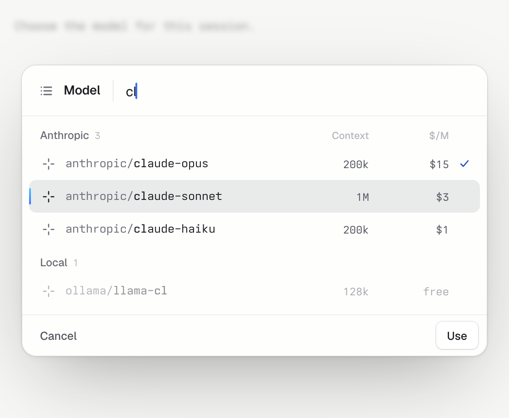
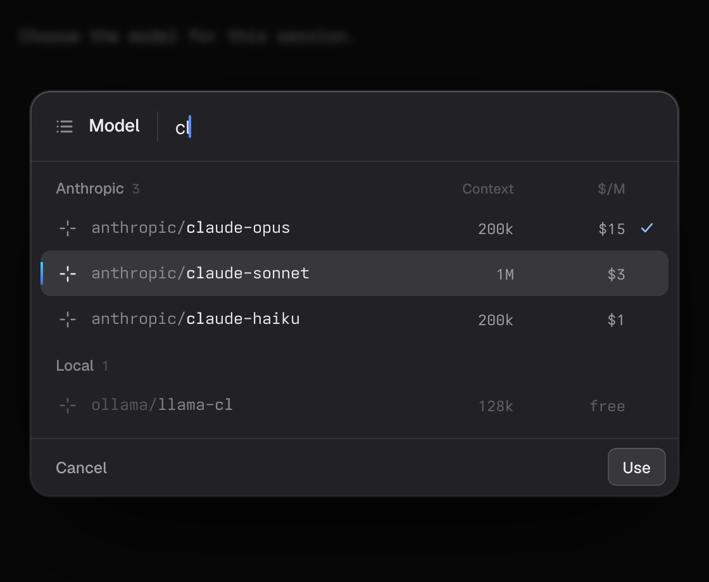
<figcaption><code>layer</code> 区域中的一个 <code>md</code> 面板。在此宽度下（低于 640px）计数被隐藏。</figcaption>
</figure>

## 相关页面 {#related-pages}

- [构建视图](../guides/views.md)：动作与事件。
- [Block](../guides/blocks.md)：节点 id、按键、`key` 处理器。
- [视图样式](../styles/index.md)、[变量](../styles/variables.md)。
