# 进度与动效 {#progress-and-motion}

这些类型用来表示正在进行的工作与各种数量。所有动画都由 Tern 自己运行，因此插件从不发送帧：
它只在构建时发送一次 `spinner`、`shimmer` 或 `elapsed`，Tern 便让它持续运动，直到节点改变或
消失。表示“忙碌”时用 `spinner` 或 `shimmer`，数据尚未到达时的视图形状用 `skeleton`，
运行中的计时器用 `elapsed`，吞吐量数值用 `rate`，已知（或未知）的完成比例用 `progress`，
用量或整体拆分这样的量级用 `meter`，序列或拆分用 `chart`，omp 的思考强度字形用 `effort`。

| 类型 | 构建器 | 绘制内容 |
| --- | --- | --- |
| [`spinner`](#spinner) | `tern.ui.node("spinner", …)` | 带可选标签的活动指示器 |
| [`shimmer`](#shimmer) | `tern.ui.node("shimmer", …)` | 有一道光带扫过的文字 |
| [`skeleton`](#skeleton) | `tern.ui.node("skeleton", …)` | 内容仍在加载处的占位形状（若干行、一个头像、几行行条、瓦片或一个 block） |
| [`elapsed`](#elapsed) | `tern.ui.node("elapsed", …)` | 实时计时器或倒计时（`12.3s`、`4:05`） |
| [`rate`](#rate) | `tern.ui.node("rate", …)` | 缓动到每个新值的数字（`42.3 tok/s`） |
| [`progress`](#progress) | `tern.ui.progress(value, label)` | 进度条，确定或不确定 |
| [`meter`](#meter) | `tern.ui.meter(value, label)` | 以一个条形、圆环或方块网格表示的值或堆叠的各部分 |
| [`chart`](#chart) | `tern.ui.bars(…)`, `tern.ui.spark(…)` | 热力图、若干条形、迷你折线、随时间的折线或面积（一个或多个系列），或占比圆环 |
| [`effort`](#effort) | `tern.ui.node("effort", …)` | 按思考强度等级填充的圆环 |

这些类型都没有子节点：传入的子节点会被 Tern 忽略。它们都接受 [元素](index.md) 中介绍的通用属性
（`id`、`role`、`tone`、`title`、`aria`、`actions`、…）。

## Tern 如何为动效计时 {#how-tern-clocks-motion}

时钟有两种。

- **CSS 关键帧。** spinner、shimmer、skeleton、不确定进度条、effort 的火焰、图表的入场以及 meter
  的填充，都是运行在文档时钟上的 CSS 动画与过渡。每种类型的关键帧名称列在各自的 **样式** 小节中。
  可以重设它们的样式，也可以用自己的 `@keyframes` 替换（参见[支持的 CSS](../styles/css.md)）。
- **视图的 tick。** `elapsed` 与 `rate` 改变的是*文本*，因此视图为它们各自维护一个时钟。计时器只在
  其文本变化时重绘：`short` 格式下不足一分钟时每 100 ms 一次，其余情况每秒一次。速率在缓动期间
  大约每 16 ms 重绘一次。已停止的计时器、已结束的倒计时或已稳定的速率完全不需要帧。

时间以 **age** 的形式传递，从不使用墙上时钟时间戳。`elapsed.age` 是构建节点时已经过去的毫秒数。
Tern 把起点设为“age 到达的时刻 − age”，因此重绘、延迟挂载或重新附着后的重放仍会显示正确的时间。

### 隐藏、被覆盖与减弱动效 {#hidden-covered-and-reduced-motion}

Tern 会在每个区域上放置状态类（`.sf-main`、`.sf-dock`、`.sf-layer`）：

| 类 | 何时出现 | 对动效类型的影响 |
| --- | --- | --- |
| `.sf-paused` | surface 不可见时 | spinner、shimmer 与 effort 的关键帧停在原处；skeleton 显示其素色块；Spindle 标记停在静止帧 |
| `.sf-still` | Tern 的减弱动效设置打开时（默认跟随系统设置；也可以强制打开或关闭） | 与 `.sf-paused` 相同，且不止于此：见下表 |
| `@media (prefers-reduced-motion: reduce)` | 系统设置打开时 | 与 `.sf-still` 相同（Tern 的基础样式表还会把所有动画与过渡的时长归零） |

有些东西不是 CSS，因此 Tern 在渲染时也会读取减弱动效设置。此时 `meter` 或 `effort` 会直接绘制
其值，没有首次显示时的扫入。

各类型在减弱动效下的表现：

| 类型 | 减弱动效 |
| --- | --- |
| `spinner` | 指示器停在第一帧；标签保留 |
| `shimmer` | 以自身颜色显示纯文本，没有扫光 |
| `skeleton` | `shimmer` 与 `pulse` 显示素色柔和块，没有光带也不呼吸；`wire` 本来就不动 |
| `elapsed` | 继续走时（它是文本，不是动效） |
| `rate` | 继续更新，并且仍然缓动：缓动跑在视图的 tick 上，而不在 CSS 中 |
| `progress` | 确定：在系统设置下填充立即到位（该设置会把过渡时长归零）；仅在 `.sf-still` 下仍在 0.3 s 内缓动。不确定：一条 35% 不透明度的满宽填充 |
| `meter` | 没有首次显示的增长；之后的条形与圆环数值直接跳变而不缓动（`transition: none`）。方块单元格仍会在 0.3 s 内淡入，除非系统设置打开 |
| `chart` | 热力图列、条形、折线、面积、圆点、图例与圆环段立即出现（没有 `omp-cell`/`omp-bar`/`sf-chart-*` 入场）；悬停圆点与线条直接显示，不缓动 |
| `effort` | 没有扫入或交叉淡化；在 `max` 时火焰会显示，但不闪动 |

在 sheet（例如模态 picker）之下，Tern 会添加 `.sf-covered`。其下的每个动画都会保持当前帧，直到
该 sheet 消失。

## `spinner` 活动指示器 {#spinner}

一个内联的活动指示器，后面可选地跟一个标签。它按内容定尺寸，且从不收缩（`flex: none`）。
指示器的颜色由 `tone` 决定，没有 `tone` 时为强调色。标签使用文本颜色。

没有标签的 spinner 在指示器之后没有间隙，因为它的标签元素在有 span 之前一直隐藏
（`.sf-hidden`）。如果未设置 `aria`，spinner 会得到 `role="img"`，其 `aria-label` 设为标签的
纯文本；没有标签时为 `"Working"`。

**构建方式：** `tern.ui.node("spinner", { style = "dots", label = "Fetching" })`。没有专用的构建器。

| 属性 | 类型 | 默认值 | 含义 |
| --- | --- | --- | --- |
| `style` | `"braille"` \| `"dots"` \| `"starburst"` \| `"orbit"` | `"braille"` | 指示器。未知值绘制 `braille` |
| `label` | Spans（字符串或 span 列表） | 无 | 指示器之后的文本。span 令牌与 `fx` 的用法与 [`text`](text.md) 相同 |
| `tone` | Tone | accent | 指示器的颜色（`[data-tone]`） |
| `aria` | string | 标签文本或 `"Working"` | 无障碍名称。设置它同时会去掉自动的 `role="img"` |

各 `style` 的外观：

| `style` | 绘制内容 | 循环 |
| --- | --- | --- |
| `braille` | `⠋⠙⠹⠸⠼⠴⠦⠧⠇⠏`，在一个单行窗口中一次显示一个字形 | `sf-strip`，1 s，10 步 |
| `starburst` | `·✢✳✶✻✽✻✶✳✢`，omp 的思考字形 | `sf-strip`，1.2 s，10 步 |
| `dots` | 三个圆点依次脉冲 | `sf-dot`，1.25 s，延迟 0 / 0.15 / 0.3 s |
| `orbit` | 一个圆点绕着一圈淡色圆环旋转 | `sf-turn`，0.9 s，18 步 |

父节点带 `role = "omp.working"`（omp 的 working 行）的 `starburst` spinner 改为绘制 Stencil
Spindle 标记（`span.sf-spindle`）。这个标记由 Tern 原生绘制，而不是用 CSS 关键帧。它是为 omp
准备的。插件可以在父节点上使用该 role 来达到同样效果，但应当使用文档中列出的 style。

**子节点：** 无（会被忽略）。

**事件：** 自身不产生事件；`actions` 的用法与任何节点相同。

**样式：**

```html
<span class="sf sf-spinner" data-id="…" data-tone="info" role="img" aria-label="Fetching">
	<!-- braille / starburst -->
	<span class="sf-spin braille" aria-hidden="true">
		<span class="strip"><span>⠋</span><span>⠙</span>…</span>
	</span>
	<!-- dots:     <span class="sf-dots" aria-hidden="true"><i></i><i></i><i></i></span> -->
	<!-- orbit:    <span class="sf-orbit" aria-hidden="true"><i></i></span> -->
	<!-- Spindle:  <span class="sf-spindle" aria-hidden="true"></span> -->
	<span class="lbl">Fetching</span>
</span>
```

| 目标 | 选择器 |
| --- | --- |
| 节点本身 | `.sf-spinner` |
| 按色调 | `.sf-spinner[data-tone='success']` |
| 帧窗口（braille、starburst） | `.sf-spin`、`.sf-spin.braille`、`.sf-spin.starburst`（内部，可能变化） |
| 帧条带，即动画元素 | `.sf-spin .strip`（内部，可能变化） |
| 圆点 | `.sf-dots > i`（内部，可能变化） |
| 圆环及其圆点 | `.sf-orbit`、`.sf-orbit > i`（内部，可能变化） |
| Spindle 标记 | `.sf-spindle`（内部，可能变化） |
| 标签 | `.sf-spinner .lbl`（内部，可能变化） |

关键帧有 `sf-strip`（把条带上移 100%）、`sf-dot` 与 `sf-turn`。指示器读取 `--tc`（色调颜色）或
`--accent`。标签读取 `--tv-fg`，以 `--t1` 作为回退。帧窗口宽 `1.2em`，高 `--sf-lh`。Spindle
标记以 `currentColor` 绘制，`--sf-spindle: still` 会让它停在静止帧。

```lua
local ui = tern.ui

return ui.col({
	ui.node("row", { gap = "lg" }, {
		ui.node("spinner", { label = "braille" }),
		ui.node("spinner", { style = "starburst", label = "starburst" }),
		ui.node("spinner", { style = "dots", label = "dots" }),
		ui.node("spinner", { style = "orbit", label = "orbit" }),
	}),
	ui.node("spinner", { style = "dots", tone = "info", label = { ui.span("Syncing ", ""), ui.span("3 repos", "muted") } }),
})
```

<figure class="tn-figure">
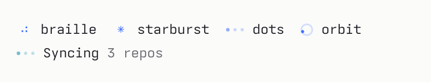
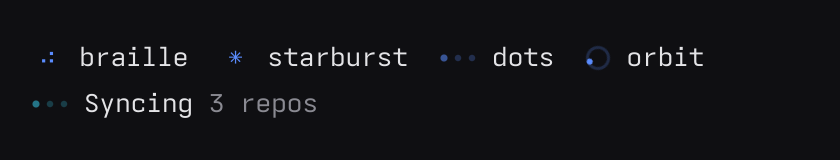
<figcaption>每种样式在其循环中某一瞬间的样貌，以及一个带色调与样式化标签的 spinner。</figcaption>
</figure>

## `shimmer` 扫光文字 {#shimmer}

一段带有一道光带从左到右扫过的文字。用于“正在工作”的消息。无论多长，光带都在 2 s 内扫过
整段文字，然后重新开始。文本保留其空白（`white-space: pre`）。节点的 `aria-label` 是纯文本。

任何 span 都可以通过 `fx = "shimmer"` 获得同样的效果（参见 [文本](text.md)）。

**构建方式：** `tern.ui.node("shimmer", { text = "Thinking…" })`。

| 属性 | 类型 | 默认值 | 含义 |
| --- | --- | --- | --- |
| `spans` | span 列表 | 无 | 带样式的文本。为数组时优先于 `text` |
| `text` | string | 无 | 纯文本，在 `spans` 不是数组时使用 |
| `mode` | `"classic"` \| `"kitt"` | `"classic"` | `classic` 从左到右扫过并重新开始。`kitt` 来回往返（`animation-direction: alternate`，类 `.kitt`） |
| `palette` | `{ low?, mid?, high? }`，值为 span 令牌 | 主题文本色 | 三种扫光颜色。每个值的第一个 span 令牌把 `--sh-lo` / `--sh-mid` / `--sh-hi` 设为 `var(--sf-c-<token>)`。请使用颜色令牌（`muted`、`dim`、`accent`、`info`、`success`、…）；omp 主题令牌会映射到对应的令牌（`toolDiffAdded` → `ins`）。缺少的键、未知令牌，或指定不到颜色的令牌（`strong`）都会回退到默认值 |

每个 span 的样式令牌会成为包住该 span 文本的包装元素的 `sf-t-<token>` 类。扫光会覆盖文本的
颜色，因此 span 上的颜色令牌在扫光运行时不会显示（在减弱动效下会显示）。其他令牌（例如
`strong`）仍然生效。

**子节点：** 无（会被忽略）。

**事件：** 自身不产生事件；`actions` 的用法与任何节点相同。

**样式：**

```html
<span class="sf sf-shimmer kitt" data-id="…" aria-label="Thinking…">
	<span class="sf-fx-shimmer">
		<span class="sf-t-strong">Thinking…</span>
	</span>
</span>
```

| 目标 | 选择器 |
| --- | --- |
| 节点本身 | `.sf-shimmer` |
| 往返模式 | `.sf-shimmer.kitt` |
| 扫光 | `.sf-shimmer .sf-fx-shimmer`（内部，可能变化） |

扫光是一个 `background-clip: text` 渐变，由关键帧 `sf-sh` 移动（2 s、线性、无限循环），与
OpenAI Codex 的扫光相同：光带约十个字符宽（`--sh-band`，默认 `5em`），其颜色沿余弦曲线从
两端的 `--sh-lo` 经 `--sh-mid` 升到中间的 `--sh-hi`，从文本之前一个光带宽度处开始，到文本之后
同样远处结束。颜色默认为 `--t3`、`--t2` 与 `--t1`（参见[变量](../styles/variables.md)）。也可以
在自己的样式表中设置 `--sh-lo`、`--sh-mid`、`--sh-hi` 与 `--sh-band`，而不使用 `palette`：

```css
[data-role='plugin.deploy.status'] .sf-shimmer {
	--sh-hi: var(--accent);
}
```

```lua
local ui = tern.ui

return ui.node("shimmer", {
	text = "Deploying to staging…",
	mode = "kitt",
	palette = { low = "muted", mid = "info", high = "accent" },
})
```

<figure class="tn-figure">
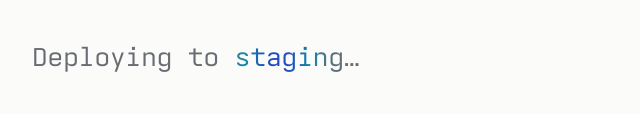
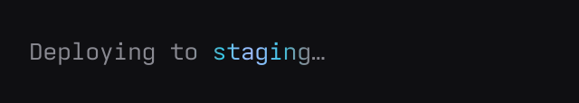
<figcaption>扫光的某一瞬间：高亮之前与之后的字符都处于低色。</figcaption>
</figure>

## `skeleton` 骨架屏 {#skeleton}

内容尚未到达时的形状：在文字、头像、表格行或统计瓦片将要出现的位置放置柔和的占位块。用它代替
数据正在路上的视图，并让它与视图尺寸相同，这样数据落地时不会发生跳动：给它视图的 `key`，并在
同一位置把该节点换成真实节点。对于有名称的工作（“Fetching services…”），[`shimmer`](#shimmer)
或 [`spinner`](#spinner) 表达得更多；对于 `picker` 中的列表，请使用它的
[`state = "loading"`](lists.md#picker)。

`shape` 决定它代表什么：

- `text`（默认）：`lines` 条参差的文本行，每行有一个文本行高，最后一行较短。
- `avatar`：一个 32px 的圆盘，旁边是一条名称行，其下方是一条更短的行。
- `rows`：`rows` 条类似表格的行：一个圆点、一条条状块，以及右边缘的一个短值，行之间为细线。
- `card`：`tiles` 个并排的统计瓦片（标签、数值、副行），与 [`stats`](data.md#stats) 绘制的一样；
  它们会换行，而不是被压窄。
- `block`：一个填满节点的圆角矩形（一张图片、一个图表、一个编辑器）：默认 72px 高，除非由通用的
  `min` / `max` 指定尺寸（`min = { h = "8lines" }`）。

每个宽度都依据节点的 id 生成，因此同一个节点在每一帧、每次重绘与重新挂载后都保持相同的参差边缘。

`variant` 决定三种外观：

| 变体 | 外观 | 适用于 |
| --- | --- | --- |
| `shimmer`（默认） | 柔和块，一道光带按 [`shimmer`](#shimmer) 标签的时钟（2 s，从左到右）与颜色扫过整个骨架。每个形状显示同一光带的对应切片 | 任何内容加载时 |
| `pulse` | 同样的块缓慢呼吸（2 s） | 更平静的加载状态，同时出现很多骨架时 |
| `wire` | 无填充、无动效的虚线细描边：即将到来的布局的线框图 | 等待用户而非网络（尚未选择任何东西）的视图、类似印刷草图的场景 |

在减弱动效下（Tern 的设置或系统设置）、在隐藏副本中以及暂停时，`shimmer` 与 `pulse` 都会静止为
素色柔和块。

`tone` 会给形状着色（例如为选中项的卡片使用 `accent` 骨架）。程序样式表如果设置了 shimmer 的
`--sh-lo` / `--sh-mid` / `--sh-hi`，骨架也会使用这些颜色。

**构建方式：** `tern.ui.node("skeleton", { shape = "rows", rows = 6 })`。

| 属性 | 类型 | 默认值 | 含义 |
| --- | --- | --- | --- |
| `variant` | `"shimmer"` \| `"pulse"` \| `"wire"` | `"shimmer"` | 外观（见上）。其他任何值都按 `shimmer` 处理 |
| `shape` | `"text"` \| `"avatar"` \| `"rows"` \| `"card"` \| `"block"` | `"text"` | 它代表什么。其他任何值都按 `text` 处理 |
| `lines` | integer，1–24 | `3` | 仅 `text`：行数。会被限制在范围内；0 绘制一行 |
| `rows` | integer，1–50 | `4` | 仅 `rows`：行数。会被限制在范围内 |
| `tiles` | integer，1–8 | `3` | 仅 `card`：统计瓦片数量。会被限制在范围内 |
| `tone` | Tone | 无 | 用该色调给形状（以及 `wire` 描边）着色 |
| `aria` | string | `"Loading"` | 无障碍名称 |

通用的 `min` 与 `max` 可以给 `block` 指定尺寸；`max.w` 让任何形状都不宽于所在列。

```lua
local ui = tern.ui

return ui.node("col", { gap = "lg" }, {
	ui.node("skeleton", { shape = "avatar" }),
	ui.node("skeleton", { lines = 3 }),
	ui.node("skeleton", { shape = "card", tiles = 3 }),
})
```

TSX 中的写法相同：

```tsx
<skeleton key="services" shape="rows" rows={6} variant="pulse" />
```

<figure class="tn-figure">


<figcaption>默认的 <code>shimmer</code>：<code>shape: "avatar"</code>、<code>"text"</code> 与 <code>"card"</code>，一道光带扫过它们全部。</figcaption>
</figure>

<figure class="tn-figure">


<figcaption><code>variant: "pulse"</code>：方块缓慢地淡入淡出。</figcaption>
</figure>

<figure class="tn-figure">
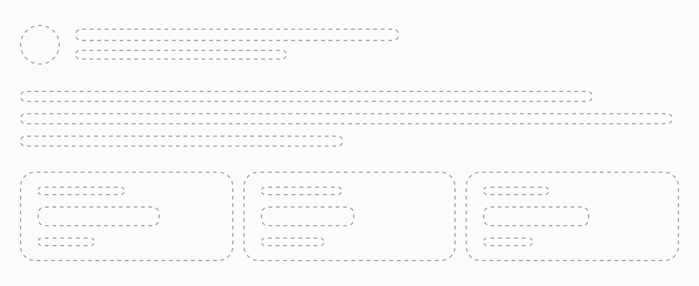
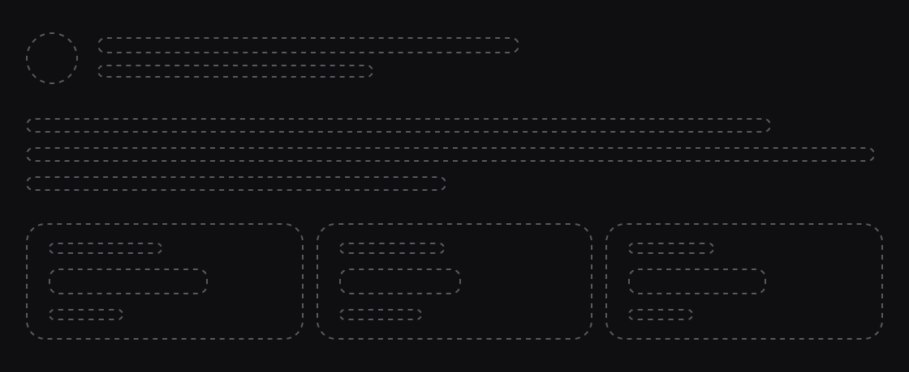
<figcaption><code>variant: "wire"</code>：即将到来的布局的静止线框图。</figcaption>
</figure>

<figure class="tn-figure">
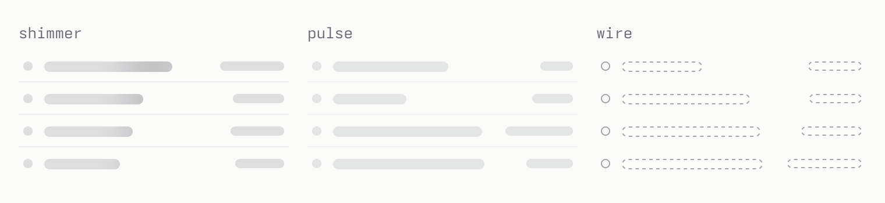
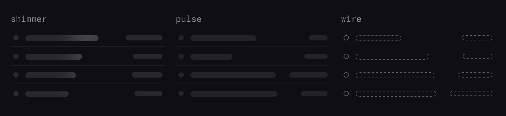
<figcaption>各变体中的 <code>shape: "rows"</code>。</figcaption>
</figure>

<figure class="tn-figure">
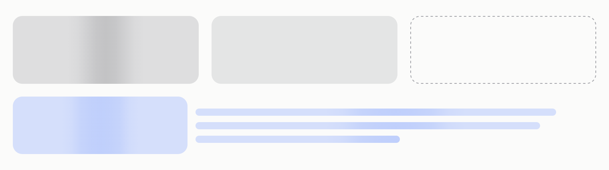
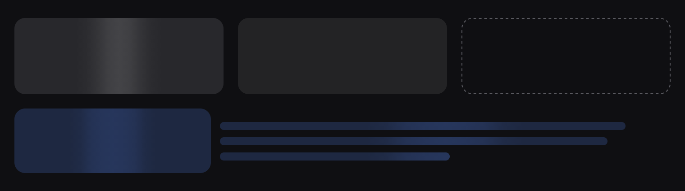
<figcaption>各变体中用 <code>min: { h: "5lines" }</code> 定尺寸的 <code>shape: "block"</code>；下方是带 <code>max: { w: 0.3 }</code> 的 <code>tone: "accent"</code>。</figcaption>
</figure>

<figure class="tn-figure">


<figcaption>减弱动效下，<code>shimmer</code> 静止为素色块。</figcaption>
</figure>

**子节点：** 无（会被忽略）。

**事件：** 自身不产生事件；`actions` 的用法与任何节点相同。

**键盘：** 节点永不获得焦点，也没有可驱动的对象；数据到达时由程序把它替换为真实视图。

**无障碍：** 节点为 `role="status"`，带 `aria-busy="true"` 与名称 `Loading`（或它的 `aria`）；
各形状对辅助技术隐藏。

**样式：**

```html
<div class="sf sf-skeleton" data-id="…" data-variant="shimmer" data-shape="avatar" role="status" aria-busy="true" aria-label="Loading">
	<div class="sk-in" aria-hidden="true" style="--sk-run: …; --sk-band: …">
		<i class="sk-b sk-av" style="--sk-x: …"></i>
		<div class="sk-col">
			<div class="sk-line"><i class="sk-b sk-name"></i></div>
			<div class="sk-line"><i class="sk-b sk-meta"></i></div>
		</div>
	</div>
</div>
<!-- text: <div class="sk-line"><i class="sk-b sk-t"></i></div>…
     rows: <div class="sk-row"><i class="sk-b sk-dot"></i><i class="sk-b sk-bar"></i><i class="sk-b sk-end"></i></div>…
     card: <div class="sk-tile"><i class="sk-b sk-lbl"></i><i class="sk-b sk-val"></i><i class="sk-b sk-sub"></i></div>…
     block: <i class="sk-b sk-blk"></i> -->
```

| 目标 | 选择器 |
| --- | --- |
| 节点本身 | `.sf-skeleton` |
| 变体 / 形状 / 色调 | `.sf-skeleton[data-variant='wire']`、`[data-shape='rows']`、`[data-tone]` |
| 形状容器 | `.sf-skeleton .sk-in`（内部，可能变化） |
| 任何形状 | `.sf-skeleton .sk-b`（内部，可能变化） |
| 文本行 | `.sk-line`、`.sk-t`（内部，可能变化） |
| 头像圆盘及其行 | `.sk-av`、`.sk-col`、`.sk-name`、`.sk-meta`（内部，可能变化） |
| 行及其各部分 | `.sk-row`、`.sk-dot`、`.sk-bar`、`.sk-end`（内部，可能变化） |
| 瓦片及其各部分 | `.sk-tile`、`.sk-lbl`、`.sk-val`、`.sk-sub`（内部，可能变化） |
| 块 | `.sk-blk`（内部，可能变化） |

变量：`--sk-fill`（各块）、`--sk-mid` / `--sk-hi`（光带）与 `--sk-wire`（描边），全部由
`--sh-lo` / `--sh-mid` / `--sh-hi` 派生；`.sk-in` 上的 `--sk-run` 与 `--sk-band`（扫光的运行长度
与光带宽度）以及 `--sk-x`（形状在其中的偏移），由 Tern 在布局后设置。关键帧：`sk-sweep` 让光带
扫过每个形状（2 s、线性、无限循环），`sk-pulse` 让 `pulse` 变体呼吸（2 s、ease-in-out、无限循环）。

## `elapsed` 计时器 {#elapsed}

一个从某个 age 向上计时、或向下计到零的实时计时器。文本使用等宽数字，不换行，以 `--t3` 绘制。
它具有 `role="timer"`。

**构建方式：** `tern.ui.node("elapsed", { age = ms })`。

| 属性 | 类型 | 默认值 | 含义 |
| --- | --- | --- | --- |
| `age` | number (ms) | `0` | 构建节点时已经过去的毫秒数。负的 age 是倒计时，在它到达后经过这么多毫秒结束 |
| `stopped` | number (ms) | 无 | 把显示冻结在这个毫秒数。计时器不再走时 |
| `format` | `"short"` \| `"clock"` | `"short"` | 时间的读法。未知值按 `short` 处理 |

格式（负值显示为零）：

| 显示时间 | `short` | `clock` |
| --- | --- | --- |
| 不足 1 分钟 | `12.3s`（十分之一秒，向下取整，因此绝不会跑快） | `0:12` |
| 不足 1 小时 | `4m 05s` | `4:05` |
| 1 小时或更多 | `1h 02m` | `1:02:03` |

age 的工作方式：

- 正的 `age` 显示 `age` 加上该 `age` 值到达以来经过的时间。每次 `age` 到达（在新节点中，或在包含
  它的 `set` 中）都会重新锚定计数，即使数值没有变化。只更新其他属性的 `set` 不会打断计数。
  因此每次发送时都应从自己的起始时间计算 `age`（`(os.clock() - started) * 1000`，或插件时间源中的
  等价写法）。
- 负的 `age` 从 `-age` 毫秒开始倒计时，并在 `0:00` / `0.0s` 停住。它的锚定方式相同：在该 `age`
  值到达后 `-age` 毫秒结束，只更新其他属性的 `set` 不会打断它，而新的 `age`（即使数值相同）
  会重新开始。到达零后便停在那里。
- `stopped` 显示一个固定时长，例如已完成任务的最终耗时。

**子节点：** 无（会被忽略）。

**事件：** 自身不产生事件；`actions` 的用法与任何节点相同。

**样式：**

```html
<span class="sf sf-elapsed" data-id="…" role="timer">4m 05s</span>
```

| 目标 | 选择器 |
| --- | --- |
| 节点本身 | `.sf-elapsed` |

它没有关键帧。减弱动效不会让它停止。

```lua
local ui = tern.ui

-- a running job, a finished one and a countdown
return ui.col({
	ui.row({ ui.text("build"), ui.node("elapsed", { age = 12345 }) }),
	ui.row({ ui.text("tests"), ui.node("elapsed", { stopped = 18400 }) }),
	ui.row({ ui.text("retry in"), ui.node("elapsed", { age = -30000, format = "clock" }) }),
})
```

<figure class="tn-figure">
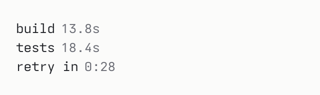
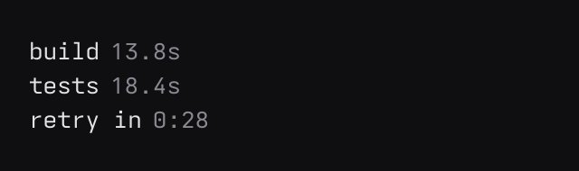
<figcaption>在帧到达约 1.5 s 后绘制：运行中的计时器与倒计时已从各自的 age 前进；已停止的那个没有。</figcaption>
</figure>

## `rate` 速率 {#rate}

一个缓动到每个新值、而不是直接跳变的数字。用于吞吐量，例如每秒 token 数。发送新的 `value` 时，
显示会在 420 ms 内从当前显示的值缓动到新值（ease-out cubic）。第一个值立即显示。文本在 100 以下
保留一位小数，100 及以上不保留小数；设置了 `unit` 时，后面跟一个空格与 `unit`（`42.3 tok/s`、
`1234`）。

**构建方式：** `tern.ui.node("rate", { value = 42.26, unit = "tok/s" })`。

| 属性 | 类型 | 默认值 | 含义 |
| --- | --- | --- | --- |
| `value` | number | `0` | 目标值 |
| `unit` | string | 无 | 在一个空格之后追加 |

**子节点：** 无（会被忽略）。

**事件：** 自身不产生事件；`actions` 的用法与任何节点相同。

**样式：**

```html
<span class="sf sf-rate" data-id="…">42.3 tok/s</span>
```

| 目标 | 选择器 |
| --- | --- |
| 节点本身 | `.sf-rate` |

它使用等宽数字，不换行，以 `--t2` 绘制。节点需要稳定的 `id` 才能缓动：换了新 id 的节点会以该值为起点
重新开始。

```lua
local ui = tern.ui

return ui.row({ ui.text("download"), ui.node("rate", { id = "dl-rate", value = state.mbps, unit = "MB/s" }) })
```

## `progress` 进度条 {#progress}

一条水平进度条，后面可选地带一个标签。有 `value` 时，填充显示该比例，并在 0.3 s 内移动到新值。
没有 `value`（`nil`/`null`）时，进度条是**不确定**的：一条 30% 宽的填充在轨道上滑动。节点具有
`role="progressbar"`，`aria-valuemin` 为 0，`aria-valuemax` 为 100。`aria-valuenow` 是四舍五入后
的百分比，不确定时不存在。轨道会伸展填满整行（最小 40 px）。标签为空时隐藏。

**构建方式：** `tern.ui.progress(value, label)`（参见 [UI 构建器](../reference/ui.md#progress)），或
`tern.ui.node("progress", { value = 0.4, label = "40%" })`。

| 属性 | 类型 | 默认值 | 含义 |
| --- | --- | --- | --- |
| `value` | number 0–1，或 `nil` | `nil`（不确定） | 已完成的比例。限制在 0–1，并四舍五入到整数百分比 |
| `label` | Spans | 无 | 进度条之后的文本，使用等宽数字 |
| `tone` | Tone | accent | 填充颜色。`neutral` 也使用强调色 |

**子节点：** 无（会被忽略）。

**事件：** 自身不产生事件；`actions` 的用法与任何节点相同。

**样式：**

```html
<div class="sf sf-progress indeterminate" data-id="…" role="progressbar" aria-valuemin="0" aria-valuemax="100">
	<div class="track"><div class="fill"></div></div>
	<span class="lbl">Uploading…</span>
</div>
```

| 目标 | 选择器 |
| --- | --- |
| 节点本身 | `.sf-progress` |
| 不确定 | `.sf-progress.indeterminate` |
| 轨道 | `.sf-progress .track`（内部，可能变化） |
| 填充 | `.sf-progress .fill`（内部，可能变化） |
| 标签 | `.sf-progress .lbl`（内部，可能变化） |

关键帧为 `sf-indet`（1.3 s，`translateX(-100%)` → `translateX(340%)`）。轨道高 4 px，位于 `--l2`
上。填充使用 `--tc`，没有色调时为 `--accent`。减弱动效下，不确定进度条会变成一条 35% 不透明度的
满宽填充。

```lua
local ui = tern.ui

return ui.col({
	ui.progress(0.4, "40%"),
	ui.node("progress", { value = 0.85, tone = "success", label = "85%" }),
	ui.progress(nil, "Preparing…"), -- indeterminate
})
```

<figure class="tn-figure">
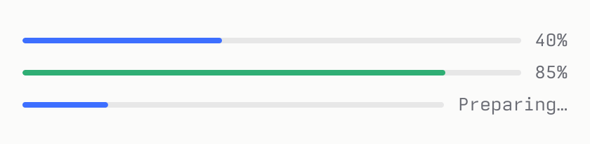
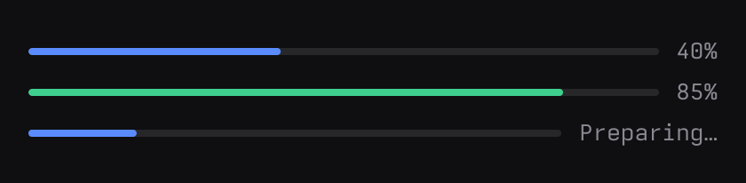
<figcaption>确定、带色调与不确定三种形态。每条轨道占据标签留下的宽度。</figcaption>
</figure>

## `meter` 量条 {#meter}

一个以**条形**（默认）、**圆环**或**方块网格**绘制的量级。它显示一个 `value`，或堆叠的 `parts`
来拆分一个整体（例如已用 / 缓存 / 空闲）。阈值可以把它着色为 `warn` 或 `bad`。刻度（`marks`）
可以在轨道上标出某个上限。

形状由 `style` 决定。Tern 从不根据数值选择形状：

| `style` | 形状 | `size` `sm` / `md` / `lg` |
| --- | --- | --- |
| `bar`（默认，任何未知值亦然） | 一条沿所在行增长的圆角轨道（`flex: 1 1 60px`；在列中横向拉伸） | 高 4 / 6 / 10 px |
| `ring` | 一个以 16 单位 SVG 绘制的圆环，从 12 点位置顺时针填充 | 12 / 16 / 24 px |
| `blocks` | 8 px 方块的网格，10 列。使用 `steps` 时，改为一行为该数量的细条 | 2 / 5 / 10 行（20 / 50 / 100 个单元格） |

首次显示时，条形或圆环的填充在 0.6 s 内从零增长（`meter-fill`，一个 Web Animation，不是 CSS
关键帧）。之后的数值在 0.4 s 内缓动（对 `width`/`left` 使用 CSS 过渡，圆环则用
`stroke-dasharray`）。方块单元格不增长；它们在 0.3 s 内改变颜色。减弱动效下会直接绘制该值。

**构建方式：** `tern.ui.meter(value, label)`（参见 [UI 构建器](../reference/ui.md#meter)），或对
下列属性使用 `tern.ui.node("meter", { … })`。`tern.ui.test_summary(…)` 会构建一行，其中含一个
堆叠量条（参见 [UI 构建器](../reference/ui.md#test_summary)）。表格单元格也可以放量条
（`tern.ui.meter_cell`、`meter_parts_cell`，参见 [Data](data.md)）。

| 属性 | 类型 | 默认值 | 含义 |
| --- | --- | --- | --- |
| `value` | number 0–1 | 无 | 量级。限制在 0–1。给定 `parts` 时不参与绘制，但仍用于 `thresholds` |
| `parts` | `{ { value, token?, label?, hatch? } }` | 无 | 堆叠的各部分，从左到右（圆环上为顺时针）。见下文 |
| `thresholds` | `{ warn?: number, bad?: number }` | 无 | `value ≥ bad` 时设 `data-level="bad"`，否则 `value ≥ warn` 时设 `data-level="warn"`。需要 `value` |
| `style` | `"bar"` \| `"ring"` \| `"blocks"` | `"bar"` | 形状 |
| `size` | `"sm"` \| `"md"` \| `"lg"` | `"sm"` | 见形状表。其他任何值都按 `sm` 处理 |
| `steps` | integer 1–20 | 无 | 仅 `blocks`：一行为恰好这么多单元格（`data-steps`）。超出范围的值被忽略 |
| `marks` | `{ { at, tone?, title?, icon? } }` | 无 | 位于 `at` 处的刻度（0–1，必填）。见下文 |
| `label` | Spans | 无 | 形状之后的文本，通常是数值（`72%`） |
| `total` | Spans | 无 | 标签之后的文本，通常是整体（`200K`），颜色更弱 |
| `tone` | Tone | accent | 填充颜色。优先于阈值等级（`neutral` 不优先） |
| `title` | string | 各部分的摘要 | 工具提示。没有它时，parts 带标签的量条会得到 `used 42% · cache 8%` |

`parts` 的条目：

| 字段 | 类型 | 含义 |
| --- | --- | --- |
| `value` | number | 该部分在整体中的份额。各部分按顺序截断，因此总和绝不超过 1：会溢出的部分被削减，其后的部分得到 0 |
| `token` | string | 颜色：一个 span 令牌（`success`、`error`、`muted`、…），或一个 omp 主题令牌（`toolDiffAdded`、…），后者映射到其语义令牌。填充取该令牌用于绘制文本的颜色。`"track"` 是空隙：该部分保留其位置，但绘制为空轨道 |
| `label` | string | 该部分的工具提示，也用于量条的默认 `title` |
| `hatch` | boolean | 在填充上叠加斜线阴影，用于预留或估算的部分 |

`marks` 的条目：

| 字段 | 类型 | 含义 |
| --- | --- | --- |
| `at` | number 0–1 | 在轨道上的位置，限制在 0–1。没有 `at` 的 mark 会被丢弃 |
| `tone` | Tone | 刻度颜色（刻度上的 `data-tone`） |
| `title` | string | 工具提示（仅条形刻度） |
| `icon` | icon 名称 | 仅条形。在轨道上绘制该图标，并在其周围断开轨道与填充，宽度为 `--sf-mt-gap`（默认 14 px）。图标名见 [Data 中的 `icon`](data.md) |

在圆环上，mark 是短的径向刻度。方块网格会忽略 mark。在方块网格中，各部分按顺序填充单元格。
每个部分得到其四舍五入后的份额，总数与四舍五入后的总和一致。

节点具有 `role="meter"`，`aria-valuemin` 为 0，`aria-valuemax` 为 100。`aria-valuenow` 是
`value`（或各部分之和）四舍五入后的百分比。它还会在节点上把 `--sf-meter` 设为该值（0–1），
以便样式表绘制自己的量条。没有 `value` 也没有 `parts` 时，节点会得到 `unknown` 类与虚线轨道。

**子节点：** 无（会被忽略）。

**事件：** 自身不产生事件；`actions` 的用法与任何节点相同。

**样式：**

```html
<div class="sf sf-meter" data-id="…" data-style="bar" data-size="sm" data-level="warn"
     role="meter" aria-valuenow="78" style="--sf-meter: 0.78">
	<div class="sf-mt-track gapped">
		<div class="sf-mt-rail"></div>                <!-- only with icon marks -->
		<div class="sf-mt-fill"></div>                <!-- one value -->
		<!-- or per part: <div class="sf-mt-part first hatch" title="cache"></div> … <div class="sf-mt-part last gap"></div> -->
		<div class="sf-mt-mark icon" data-tone="warning" title="compacts here"><svg>…</svg></div>
	</div>
	<!-- ring:   <svg class="sf-mt-ring" viewBox="0 0 16 16"><circle class="track"/><circle class="arc"/>…<line class="mark"/></svg> -->
	<!-- blocks: <div class="sf-mt-blocks"><i class="on"></i><i class="on hatch"></i><i></i>…</div> -->
	<span class="sf-mt-lbl">78%</span>
	<span class="sf-mt-total">200K</span>
</div>
```

| 目标 | 选择器 |
| --- | --- |
| 节点本身 | `.sf-meter` |
| 形状 / 尺寸 / 分步 | `.sf-meter[data-style='ring']`、`[data-size='lg']`、`[data-steps]` |
| 等级 | `.sf-meter[data-level='warn']`、`[data-level='bad']` |
| 无值 | `.sf-meter.unknown` |
| 条形轨道、导轨 | `.sf-mt-track`、`.sf-mt-track.gapped`、`.sf-mt-rail`（内部，可能变化） |
| 单一填充、各部分 | `.sf-mt-fill`；`.sf-mt-part`，带 `.first`、`.last`、`.hatch`、`.gap`（内部，可能变化） |
| 条形刻度 | `.sf-mt-mark`、`.sf-mt-mark.icon`、`.sf-mt-mark[data-tone]`（内部，可能变化） |
| 圆环 | `.sf-mt-ring`、`.sf-mt-ring .track`、`.sf-mt-ring .arc`（为空时带 `.gap`、`.sf-hidden`）、`.sf-mt-ring .mark`（内部，可能变化） |
| 方块网格、单元格 | `.sf-mt-blocks`、`.sf-mt-blocks i`、`i.on`、`i.hatch`（内部，可能变化） |
| 标签、总计 | `.sf-mt-lbl`、`.sf-mt-total`（内部，可能变化） |

变量：`--mt` 是填充颜色。默认是 `--accent`，按等级为 `--warn` 或 `--bad`，节点带非中性色调时
为 `--tc`。覆盖 `--mt` 可以一次性重设所有形状的颜色。轨道使用 `--l2`（圆环与分步单元格用
`--l3`）。标签是 `--t3`，总计是 `--t4`。`--sf-mt-gap` 设置图标刻度断开处的宽度。`--sf-meter`
是数值，由 Tern 设置。量条的规则位于 `omp-composer.css` 样式表中，但它们并不限定于 omp，
对每个 surface 都生效。

```lua
local ui = tern.ui

return ui.col({
	ui.node("meter", {
		value = 0.84,
		thresholds = { warn = 0.8, bad = 0.95 },
		label = "84%",
		total = "512G",
		marks = { { at = 0.9, tone = "warning", title = "quota" } },
	}),
	ui.node("row", { gap = "lg" }, {
		ui.node("meter", {
			style = "ring",
			size = "md",
			parts = {
				{ value = 0.42, token = "info", label = "used" },
				{ value = 0.08, token = "muted", label = "cache", hatch = true },
			},
			label = "50%",
		}),
		ui.node("meter", { style = "blocks", value = 0.6, label = "60%" }),
		ui.node("meter", { style = "blocks", steps = 5, value = 0.6 }),
	}),
})
```

<figure class="tn-figure">
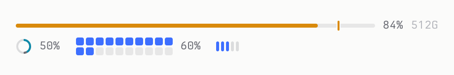
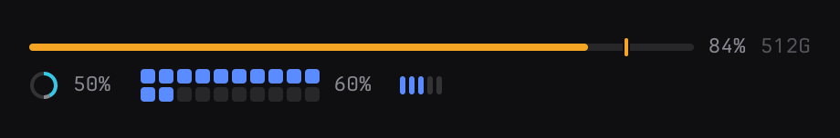
<figcaption>一条越过 <code>warn</code> 阈值并带刻度的条形、一个由两部分组成的圆环、一个 <code>sm</code> 方块网格（20 格）以及 <code>steps = 5</code>。</figcaption>
</figure>

## `chart` 图表 {#chart}

由 Tern 绘制的序列数据：**热力图**（日历样式的单元格网格）、**条形**图、由细条组成的**迷你折线**、
随时间的**折线**或**面积**（一个或多个系列），或表示占比的**圆环**。节点具有 `role="figure"`。
带 `summary` 时，其纯文本会成为 `aria-label`，并在图表下方出现一行摘要。

| `kind` | 绘制内容 | 适用场景 |
| --- | --- | --- |
| `heatmap`（默认） | 四种 `--chart-c` 色阶的日历样式单元格网格 | 数周或一年内的活动（运行、部署） |
| `bars` | 每个条目一根条形，共享所在行的宽度 | 并排展示少量数值（每天的运行次数） |
| `spark` | 一行由细条组成的迷你条带 | 行或表格单元格中、紧挨数字的趋势 |
| `line`（一个系列） | 一条 1.75 px 的折线，其下是同色的柔和面积并渐隐至基线，配淡色网格线，下方为 x 标签；最后一点处有圆点，绘图区旁显示最后一个值 | 随时间变化的单个值：本周延迟、覆盖率趋势、部署以来的 req/s |
| `line`（多个） | 每个系列一条折线，共用一个值域，上方为图例 chip，每条线末端有圆点；没有面积，也没有最后一个值 | 同一时间上的多个系列（p50/p95/p99） |
| `area` | 与 `line` 相同，但每个系列下方有更饱满的填充 | 当数量本身重要（磁盘已用、消耗的 token）而不只是形状时，随时间变化的值 |
| `donut` | 一条由带小间隙的段组成的圆环，位于淡色轨道之上，中间是总计，其下是 `caption`，旁边是图例列表（圆点、标签、值） | 整体的少数几部分（4–6 个）：按服务划分的请求、按类型划分的磁盘 |

任何属性变化时，Tern 都会重建热力图，因此热力图要保持小规模（一年是 371 个单元格）。其他类型
就地更新，因此每秒喂入一次的图表不会重放入场动画：条形保留其元素（只有上次绘制以来新增的条形会
入场，其余缓动到新高度），折线、面积与圆环保留已绘制的部分，在形状不变的前提下移动其点。它们的
入场动画在图表首次出现或形状改变（换 `kind`、系列或段的数量不同）时播放：折线从左侧开始绘出
（0.9 s，每个系列比前一个晚 90 ms），面积在其下方淡入，终点圆点与最后一个值随着折线到达而弹出；
圆环一边旋转到位，一边让各段淡入。

指针停在折线或面积上时，绘图区会显示一条向下的细线，并在每个系列的该点处显示圆点；停留其上会
显示该点的工具提示：它的 x 标签与每个系列的值（带 `unit`）（`Tue · p50 12 ms · p95 45 ms`），
或该点自己的 `title`。圆环的段与其图例行共享一个工具提示：标签、值与占比（`api · 552 · 46%`）。

**构建方式：** `tern.ui.bars(series)` 与 `tern.ui.spark(series)`（参见
[UI 构建器](../reference/ui.md#bars-spark)）。热力图、折线、面积或圆环，或 `summary`、`size` 与
`token`，请使用 `tern.ui.node("chart", { … })`。

| 属性 | 类型 | 默认值 | 含义 |
| --- | --- | --- | --- |
| `kind` | `"heatmap"` \| `"bars"` \| `"spark"` \| `"line"` \| `"area"` \| `"donut"` | `"heatmap"` | 哪种图表。其他任何值都绘制热力图 |
| `size` | `"sm"` \| `"md"` \| `"lg"` | `"md"` | 热力图单元格 8 / 11 / 13 px。条形高 2 / 4 / 8 行。spark 始终只有一行高。`line`/`area`：绘图区高 60 / 112 / 176 px（13 px 字体下；宽度填满）。`donut`：圆环直径 76 / 112 / 152 px。其他任何值都按 `md` 绘制 |
| `token` | span 令牌 | `accent` | 填充颜色，设为 `--chart-c`：条形、单元格、折线或面积的第一个系列、圆环的第一段。后续没有 `token` 的系列与段依次取 `--chart-2` … `--chart-10`（紫色、琥珀色、绿色、青色、红色，然后是四个由主题颜色旋转得到的色相），之后从头开始 |
| `summary` | Spans | 无 | 图表下方的一行文字，以及它的无障碍名称 |
| `series`（`bars`、`spark`） | `{ { value, label?, title?, tone? } }` | 无 | 每个条目一根条形，按顺序。高度相对于值域（`min`..`max`）；为零、负数或缺失的值绘制 1 px 的残条。条形最宽 24 px（spark 为 4 px），并共享所在行的宽度。工具提示为 `title`，否则为 `label`。`tone` 会用该色调填充这根条形，而非 `token` |
| `series`（`line`、`area`，一个系列） | `{ number \| { value?, label?, title? } }` | 无 | 每个条目一个点，在绘图区上均匀分布。没有数字的条目（`null`，或没有 `value` 的表）是空隙：折线在那里断开。没有 `labels` 时，`label` 是该点的 x 标签；`title` 替换其工具提示 |
| `series`（`line`、`area`，多个） | `{ { label?, token?, values } }`，每个 `values` 为 `{ number \| { value, title? } }` | 无 | 一旦某个条目带有 `values` 数组就按此处理；没有的条目被跳过。每个条目一条折线；各点按索引共享 x 位置（最长的系列决定数量）。`label` 命名其图例 chip 及其在工具提示中的部分；`token` 决定其颜色 |
| `series`（`donut`） | `{ number \| { value, label?, token?, title? } }` | 无 | 每个条目一段，从顶部开始顺时针，按其在总数中的份额确定大小。为零、负数或缺失的 `value` 不绘制段，但保留其图例行。`title` 替换该段的工具提示 |
| `labels` | `{ string }` | 各条目的 `label`（单系列） | `line`/`area`：按点索引给出的 x 标签。`""` 表示该点不带标签。超过 8 个标签会均匀抽稀。第一个标签对齐绘图区左边缘，最后一个对齐右边缘 |
| `unit` | string | 无 | `line`/`area`/`donut`：写在 Tern 打印的每个值之后（工具提示、最后一个值、圆环总计与图例）。货币符号（`$`、`€`、`£`、`¥`）置于数字之前（`$51.4`）；`%`、`×` 与 `°` 紧贴数字（`64%`）；其他单位前加一个空格（`182 ms`） |
| `last` | `boolean` \| Spans | `true` | `line`/`area` 单系列：最后一个点旁的标签。`true` 打印其值并带 `unit`；文本或 span 替换它；`false` 隐藏它。多系列从不显示它 |
| `min`, `max` | number | `0`，以及系列或 mark 的最大值 | `bars`/`spark`：固定的值域。数值会被限制在其中。退化的值域（`max ≤ min`，或非有限）会让每根条形都绘制为空。`line`/`area`：见下文。在 `chart` 节点上，它们是数字，而不是通用的 `{ w, h }` 尺寸范围 |
| `marks` | `{ { value, tone?, title? } }` | 无 | `bars`/`spark`/`line`/`area`：以值单位在 `value` 处横穿图表绘制水平虚线参考线（目标、上限）。`tone` 给该线着色（默认为弱化的前景色）；`title` 是悬停时的工具提示。超出值域的 mark 会被限制到边缘 |
| `total` | Spans | 各值之和，带 `unit` | `donut`：圆环中间显示的内容 |
| `caption` | Spans | 无 | `donut`：圆环下方一行低调的文字（`requests`），按圆环宽度左右换行 |
| `cells` | `{ { number? } }`（若干行、每行若干列） | 无 | `heatmap`：由 0–1 的强度值组成的行。最宽的行决定列数 |
| `tips` | `{ { string? } }` | 无 | `heatmap`：每个单元格一个工具提示，索引方式与 `cells` 相同 |
| `rows` | `{ string }` | 无 | `heatmap`：每行一个标签（`"Mon"`、`""`、`"Wed"`、…） |
| `cols` | `{ { at, label } }` | 无 | `heatmap`：列标签（月份），放在列 `at` 之上（从 0 开始的整数）。缺少任一字段的条目被跳过 |

热力图单元格的值映射到一个等级（`data-l`）：`≤ 0` → `0`（空色块），`≤ 0.25` → `1`，`≤ 0.5` →
`2`，`≤ 0.75` → `3`，在此之上 → `4`。非数字或缺失的单元格为 `n`，绘制为透明。四个等级分别以
20%、40%、65% 与 100% 的 `--chart-c` 填充。

在 `line` 或 `area` 上，`min` 与 `max` 固定值域，超出范围的值会被限制到边缘。没有它们时，值域从
0（有负值时从最小值之下）到略高于最大值或 mark，取整为 1、1.2、1.5、2、2.5、3、4、5、6 或 8
乘以 10 的幂（182 → 200）。退化的值域（全为零、`max ≤ min`）会把每个点都放在基线上。

Tern 打印的值都很短：最多三位有效数字，千写作 `k`，百万写作 `M`，十亿写作 `B`
（`1200` → `1.2k`，`12.34` → `12.3`，`3.14159` → `3.14`），并使用真正的减号。要按自己的方式打印
数值，请发送 `last`、`total` 或某个点的 `title`。

当每一段都足够长、能在两端保留间隙时，圆环的各段会使用圆头；其中一段细条就会让所有段变成方头，
因此小的份额绝不会显得比实际更大。只有一段时就是一个完整的圆环。

注意，构建器发送的 `series` 条目是 `{ value, label }` 形式的对象。传给 `tern.ui.node` 的 Luau 表
也必须使用这些字段名：位置式的 `{ label, value }` 对只有通过 `tern.ui.bars`/`spark` 才有效。

`min`、`max`、`marks` 与系列的 `tone` 是较新的属性：较旧的 Tern 会忽略它们（没有 mark，值域自动
计算）。

```lua
local ui = tern.ui

local latency = { 2, 4, 3, 6, 5, 8, 7, 9, 6, 4, 7, 10, 8, 6, 9 }
local series = {}
for i, v in latency do
	series[i] = { value = v }
end

return ui.col({
	ui.node("chart", {
		kind = "bars",
		size = "sm",
		series = {
			{ value = 3, label = "Mon" }, { value = 7, label = "Tue" }, { value = 5, label = "Wed" },
			{ value = 9, label = "Thu" }, { value = 4, label = "Fri" }, { value = 1, label = "Sat" },
			{ value = 2, label = "Sun" },
		},
	}),
	ui.node("chart", { kind = "spark", token = "success", series = series, summary = "p95 latency, last 15 min" }),
})
```

<figure class="tn-figure">
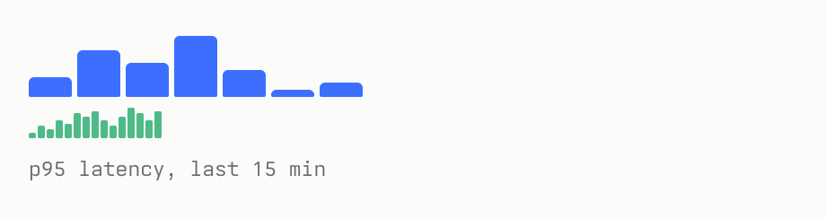
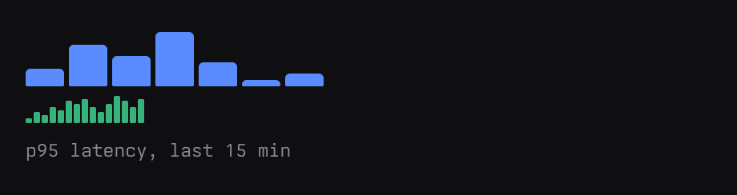
<figcaption>一个 <code>sm</code> 条形图，以及一条带 <code>token</code> 与 <code>summary</code> 的 spark。</figcaption>
</figure>

折线、面积与圆环：

```lua
local ui = tern.ui

return ui.col({
	-- One series: points are numbers or { value, label?, title? }; a point without a value is a gap.
	ui.node("chart", {
		kind = "line",
		unit = "ms",
		labels = { "Mon", "", "", "", "Wed", "", "", "", "", "Fri", "", "", "", "Sun" },
		series = state.latency, -- 14 numbers
		summary = "p95 latency, last 7 days",
	}),
	-- Several series share the labels and the domain.
	ui.node("chart", {
		kind = "line",
		unit = "ms",
		labels = state.days,
		series = {
			{ label = "p50", values = state.p50 },
			{ label = "p95", token = "pending", values = state.p95 },
			{ label = "p99", token = "warning", values = state.p99 },
		},
	}),
	ui.node("chart", {
		kind = "donut",
		caption = "requests",
		series = {
			{ label = "api", value = 552 },
			{ label = "web", value = 288 },
			{ label = "worker", value = 216 },
			{ label = "cron", value = 144 },
		},
	}),
})
```

TSX 中的写法相同：

```tsx
<col>
   <chart kind="line" unit="ms" labels={days} series={latency} summary="p95 latency, last 7 days" />
   <chart
      kind="line"
      unit="ms"
      labels={days}
      series={[
         { label: 'p50', values: p50 },
         { label: 'p95', token: 'pending', values: p95 },
         { label: 'p99', token: 'warning', values: p99 },
      ]}
   />
   <chart kind="donut" caption="requests" series={byService} />
</col>
```

<figure class="tn-figure">
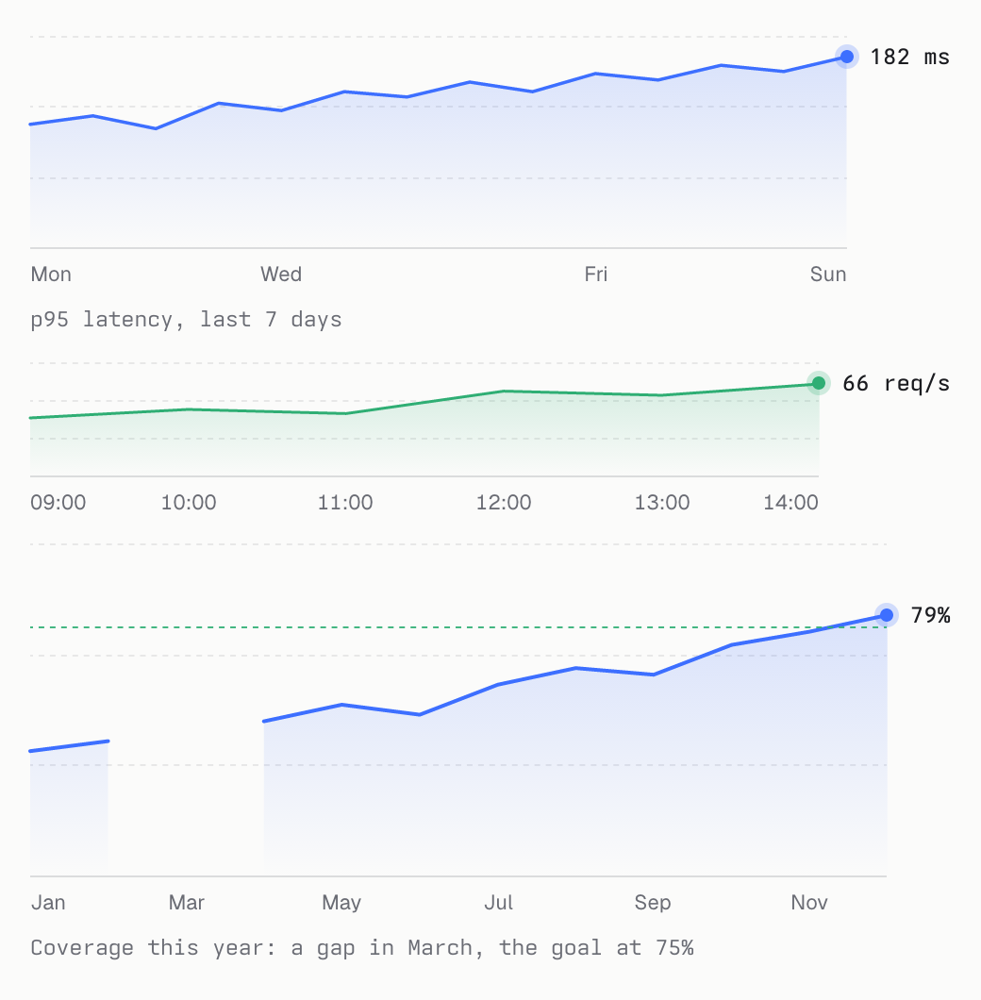
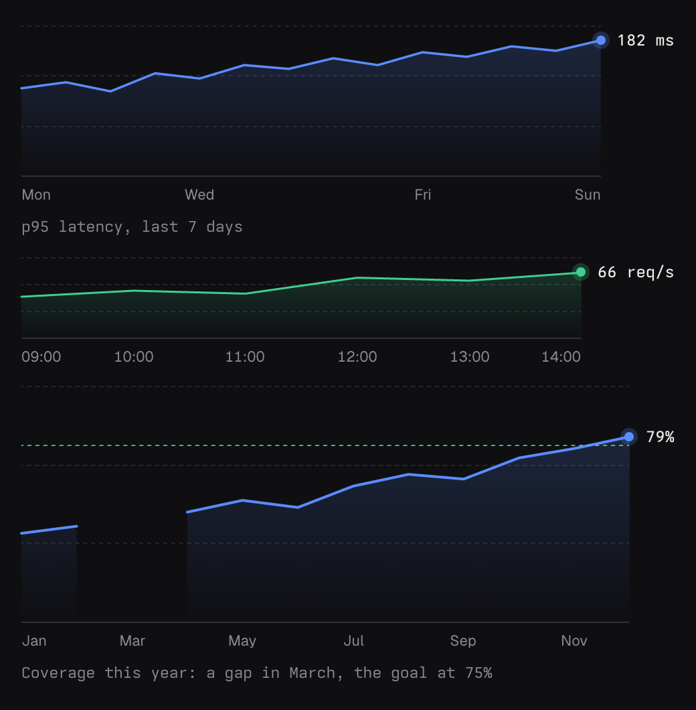
<figcaption>一条 <code>md</code> 大小、带 <code>unit</code> 的 <code>line</code>；一条 <code>sm</code> 大小、带 <code>token</code> 的折线；以及一条 <code>lg</code> 大小、带空隙（<code>null</code>）、固定 <code>max</code> 与一个 mark 的折线。</figcaption>
</figure>

<figure class="tn-figure">
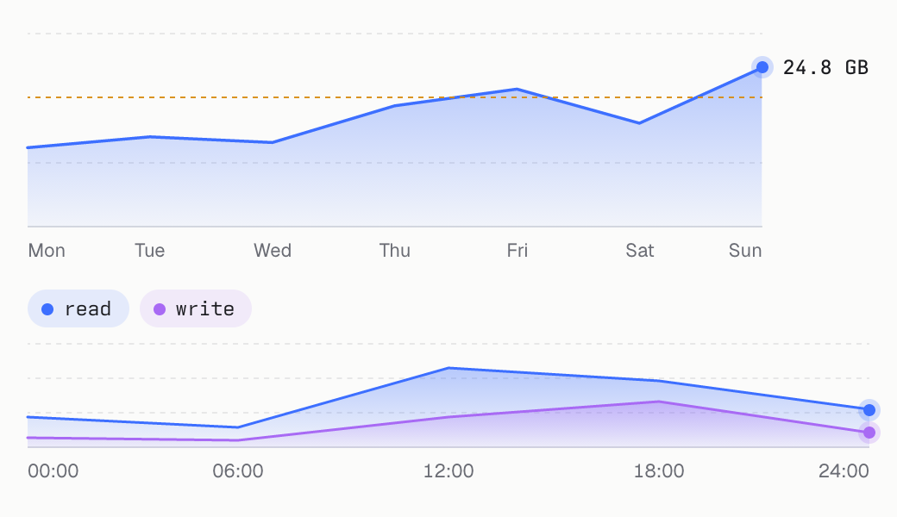
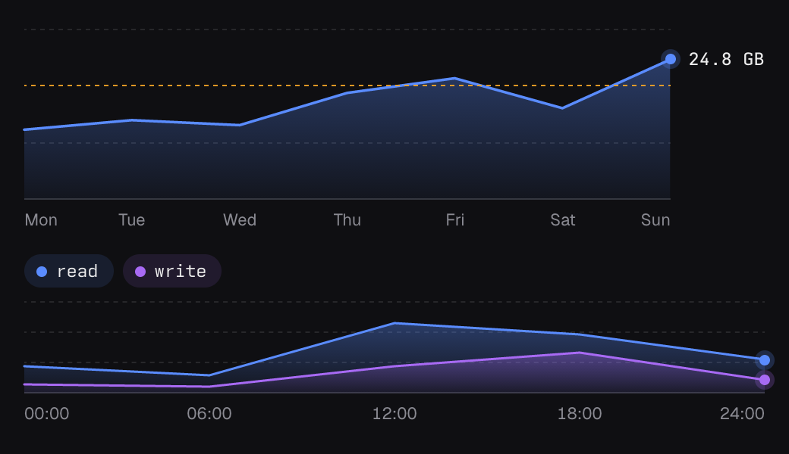
<figcaption>一个带警告 mark 的 <code>area</code>，以及一个包含两个系列的 <code>sm</code> 面积图。</figcaption>
</figure>

<figure class="tn-figure">
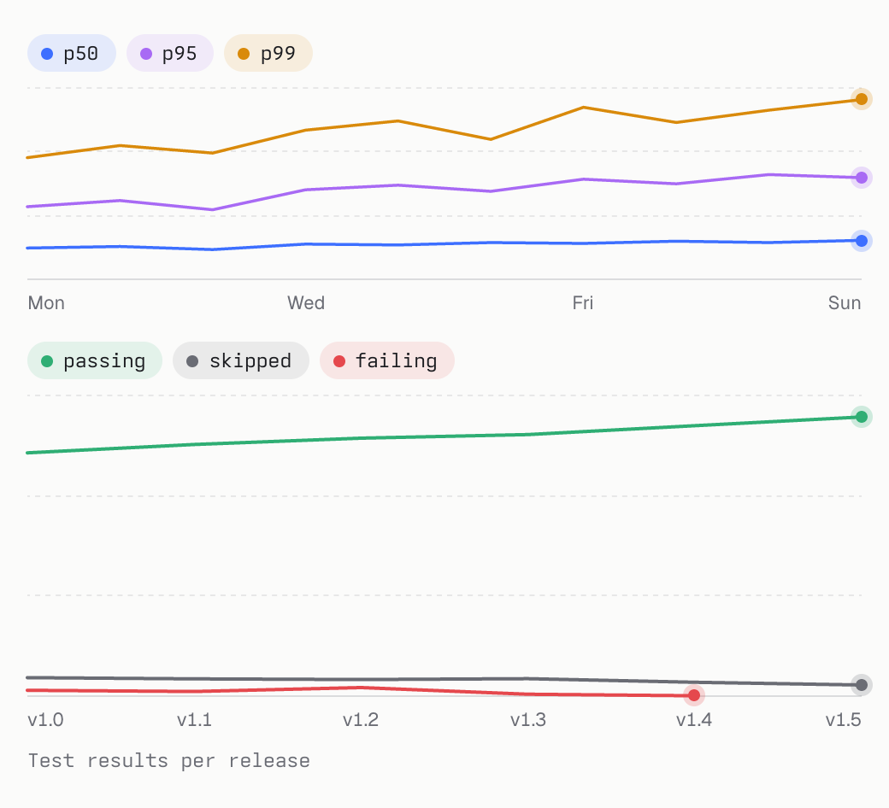
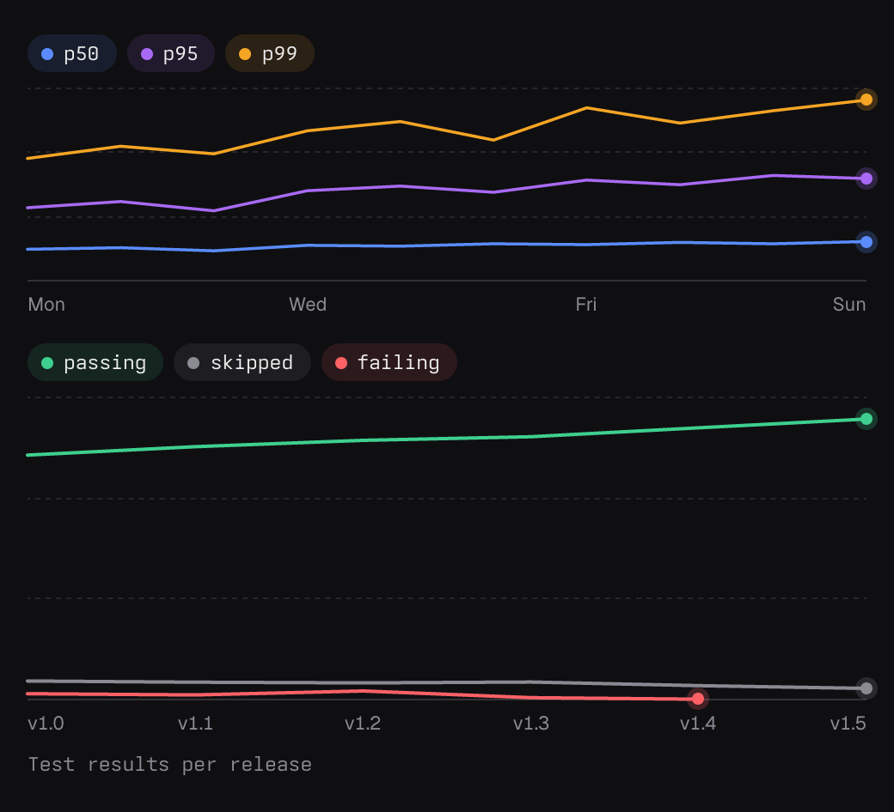
<figcaption>多个系列：图例 chip 位于顶部，共用一个值域，每条线末端有圆点。在 <code>lg</code> 下，最后一个值为 <code>null</code> 的系列会提前结束。</figcaption>
</figure>

<figure class="tn-figure">
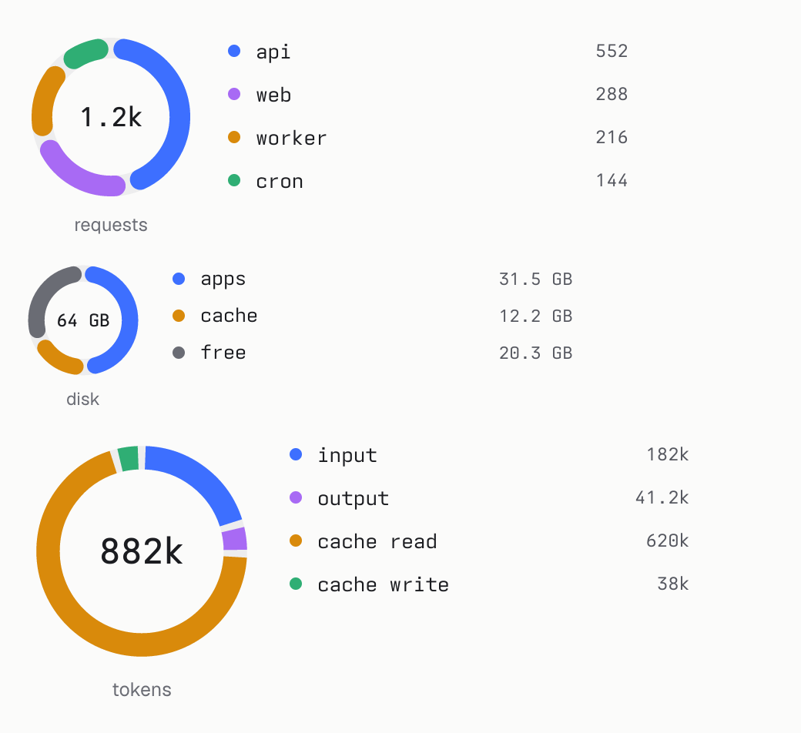
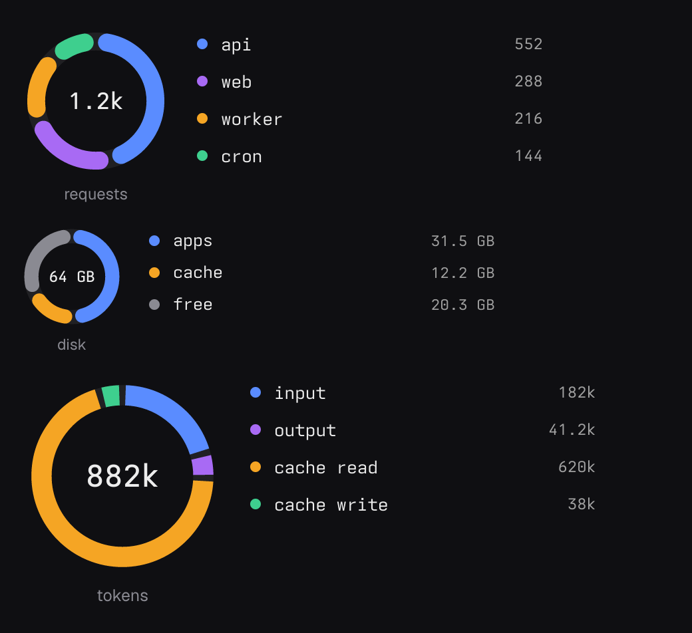
<figcaption>一个 <code>md</code> 大小、带 <code>caption</code> 的 <code>donut</code>，一个 <code>sm</code> 大小、带自身 <code>total</code> 与 token 的圆环，以及一个 <code>lg</code> 大小的圆环。</figcaption>
</figure>

**子节点：** 无（会被忽略）。

**事件：** 自身不产生事件；`actions` 的用法与任何节点相同。指针停在图表上只会显示工具提示。

**键盘：** 图表永不接管按键。数据由程序掌握：发送新的 `series`（与 `labels`）来移动图表；形状不变时
保留已绘制的部分并就地更新。

**样式：**

```html
<div class="sf sf-chart" data-id="…" data-kind="heatmap" data-size="md" role="figure" style="--chart-c: …">
	<div class="hm">
		<div class="mls"><span class="ml" style="--at: 4">Feb</span>…</div>
		<div class="grid">
			<div class="rls"><span class="rl">Mon</span>…</div>
			<div class="wk" style="--x: 0"><span class="c" data-l="3" title="Jan 3: 12 runs"></span>…</div>
			…
		</div>
	</div>
	<!-- bars / spark: <div class="bars"><span class="b" style="--v: 0.5; --x: 0" title="Mon"></span>…<span class="mk" style="--v: 0.8" title="Target"></span>…</div> -->
	<div class="sum">412 runs this year</div>
</div>
<div class="sf sf-chart" data-id="…" data-kind="line" data-size="md" role="figure" aria-label="…" style="--chart-c: …">
	<div class="lg"><span class="lgi" style="--sc: …"><i class="dot"></i><span class="t">p50</span></span>…</div>
	<div class="ln">
		<div class="pc">
			<div class="plot">
				<div class="gl" aria-hidden="true"><i class="g" style="--g: 0"></i>…</div>
				<svg class="sv" aria-hidden="true" viewBox="0 0 W H" preserveAspectRatio="none">
					<defs class="df"><linearGradient class="ag" id="ga0"><stop class="s0"/><stop class="s1"/></linearGradient></defs>
					<g class="se" style="--sc: …; --i: 0"><path class="fa"/><path class="st"/></g>
				</svg>
				<span class="end" style="--sc: …; --x: 1; --v: 0.91"></span>
				<div class="ov">
					<span class="col" title="Mon · 50 ms" style="--x0: 0; --x1: 0.04; --px: 0"><i class="vl"></i><i class="pd" style="--sc: …; --v: 0.25"></i></span>…
					<span class="mk" style="--v: …"></span>…
				</div>
			</div>
			<div class="xl" aria-hidden="true"><span class="x s" style="--x: 0">Mon</span>…</div>
		</div>
		<div class="sd"><span class="lv" style="--v: 0.91">182 ms</span></div>
	</div>
	<div class="sum">…</div>
</div>
<div class="sf sf-chart" data-kind="donut" …>
	<div class="dn">
		<div class="fig">
			<div class="ring">
				<svg class="dv rd" viewBox="0 0 100 100"><circle class="tr"/><circle class="sg" title="api · 552 · 46%" style="--sc: …"/>…</svg>
				<div class="ctr"><span class="tot">1.2k</span></div>
			</div>
			<span class="cap">requests</span>
		</div>
		<div class="leg"><div class="lr" title="…" style="--sc: …"><i class="dot"></i><span class="t">api</span><span class="v">552</span></div>…</div>
	</div>
</div>
```

| 目标 | 选择器 |
| --- | --- |
| 节点本身 | `.sf-chart` |
| 类型 / 尺寸 | `.sf-chart[data-kind='spark']`、`.sf-chart[data-size='sm']` |
| 热力图容器、月份标签 | `.sf-chart .hm`、`.mls`、`.ml`（内部，可能变化） |
| 网格、行标签、列 | `.sf-chart .grid`、`.rls`、`.rl`、`.wk`（内部，可能变化） |
| 按等级选择的单元格 | `.sf-chart .c[data-l='0'…'4']`、`.c[data-l='n']`（内部，可能变化） |
| 条形容器、条形 | `.sf-chart .bars`、`.sf-chart .b`（内部，可能变化） |
| 参考线（mark） | `.sf-chart .mk`（内部，可能变化） |
| 图例 chip（多系列） | `.sf-chart .lg`、`.lgi`、`.lgi .dot`、`.lgi .t`（内部，可能变化） |
| 绘图区容器、网格线 | `.sf-chart .plot`、`.gl`、`.g`（内部，可能变化） |
| 系列的折线、面积 | `.sf-chart .se .st`、`.se .fa`；其渐变端点 `.ag .s0`、`.s1`（内部，可能变化） |
| 终点圆点、最后一个值 | `.sf-chart .end`、`.sf-chart .lv`（内部，可能变化） |
| 悬停带、其细线与圆点 | `.sf-chart .col`、`.col .vl`、`.col .pd`（内部，可能变化） |
| x 标签 | `.sf-chart .xl .x`（首个为 `.x.s`，末尾为 `.x.e`）（内部，可能变化） |
| 圆环、轨道、段 | `.sf-chart .dv`、`.dv .tr`、`.dv .sg`（`.dv.rd`：圆头）（内部，可能变化） |
| 圆环总计、caption | `.sf-chart .tot`、`.sf-chart .cap`（内部，可能变化） |
| 圆环图例行、标签、值 | `.sf-chart .lr`、`.lr .t`、`.lr .v`（内部，可能变化） |
| 摘要 | `.sf-chart .sum`（内部，可能变化） |

变量：`--chart-c`（填充，第一个系列的颜色）、`--chart-2` … `--chart-10`（后续系列与段使用的调色板）、
`--sc`（某个系列或段的颜色，设在其各部分上）、`--cell` 与 `--gap`（热力图单元格的尺寸与间距）、
`--p`（按等级决定的单元格填充百分比）、`--at`（月份标签所在的列）、`--x`（列或条形的索引，用于
错峰入场；在折线上为 0–1 的横向位置）、`--v`（条形的高度或点在绘图区上的位置，以比例表示）、
`--i`（系列或段的索引，用于错峰入场）、`--ph`（绘图区高度）与 `--ring`（圆环直径），两者都设在
`.sf-chart` 上。在 role 样式表中设置 `--ph` 或 `--ring`，可以在三档尺寸之间为图表指定大小。

关键帧：`omp-cell` 让每个热力图列淡入，每列错开 8 ms。`omp-bar` 让每根条形在首次绘制时用 0.6 s
从底部增长，每根错开 20 ms（上限 24）。之后新增的条形立即入场，保留的条形缓动到新高度
（`transition: height 0.3s`）。`sf-chart-draw` 绘出每条折线（0.9 s，每个系列 90 ms）；
`sf-chart-fade` 让面积、图例 chip、最后一个值淡入，让圆环各段（相隔 60 ms）与其图例行（相隔 50 ms）
淡入；`sf-chart-pop` 在 0.6 s 后让每个终点圆点弹出；`sf-chart-spin` 让圆环旋转到位（0.7 s）。由于
Tern 在每次变化时都会重建热力图，它的入场动画会在属性变化时重放；其他类型每种形状只播放一次。
图表的规则位于 `omp-panels.css` 中，对每个 surface 都生效。

```lua
local ui = tern.ui

return ui.node("chart", {
	kind = "heatmap",
	token = "success",
	rows = { "Mon", "", "Wed", "", "Fri", "", "" },
	cols = {
		{ at = 0, label = "Sep" }, { at = 4, label = "Oct" }, { at = 9, label = "Nov" },
		{ at = 13, label = "Dec" }, { at = 17, label = "Jan" },
	},
	cells = state.cells, -- 7 rows × N weeks of 0–1
	tips = state.tips,
	summary = string.format("%d deploys", state.count),
})
```

<figure class="tn-figure">
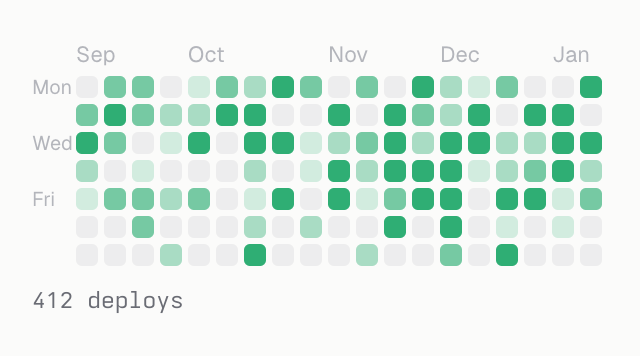
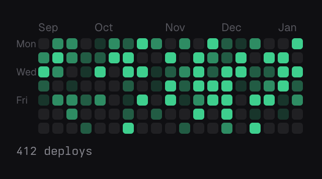
<figcaption>默认 <code>md</code> 尺寸下的二十周。一个 <code>null</code> 单元格（<code>data-l="n"</code>）不绘制任何内容，如最后一列所示。</figcaption>
</figure>

## `effort` 思考强度 {#effort}

omp 输入区 chip 的思考强度字形。它是为 omp 构建的，但任何插件都可以显示它。它绘制一个 14 px 的
圆环，每个等级顺时针填充六分之一，使用该等级的颜色。在 `max` 时圆环闭合并“燃起火焰”：一圈火焰
从环上升起，内部有一块余烬，两者都在闪动。其他任何等级（例如尚未解析的 `auto`）会绘制一个虚线
空环，并设置 `unknown` 类。

等级变化时，圆弧扫到新的填充位置，火焰交叉淡化（CSS 过渡）。首次显示时，圆弧在 0.6 s 内从空
扫入。在减弱动效、`.sf-still` 或 `.sf-paused` 下，火焰静止不动。减弱动效下也没有扫入。

**构建方式：** `tern.ui.node("effort", { level = "high" })`。

| 属性 | 类型 | 默认值 | 含义 |
| --- | --- | --- | --- |
| `level` | `"off"` \| `"minimal"` \| `"low"` \| `"medium"` \| `"high"` \| `"xhigh"` \| `"max"` | 无 | 档位：0/6 到 6/6。其他任何值均为未解析 |
| `aria` | string | `"Thinking effort"` | 无障碍名称 |

| 等级 | 填充 | 圆弧颜色 |
| --- | --- | --- |
| `off` | 空 | （无圆弧） |
| `minimal` | 1/6 | `muted` |
| `low` | 2/6 | `info` |
| `medium` | 3/6 | `accent` |
| `high` | 4/6 | `warning` |
| `xhigh` | 5/6 | `error` |
| `max` | 满，燃着火 | `error`（混入火焰） |

颜色即 span 令牌颜色（`--sf-c-<token>`）。在 `max` 时轨道与圆弧淡出，取而代之的是一个以火焰渐变
描边的圆环。节点具有 `role="meter"`，`aria-valuemin` 为 0，`aria-valuemax` 为 6，`aria-valuenow`
为档位（未解析时为 0），`aria-valuetext` 为等级。

**子节点：** 无（会被忽略）。

**事件：** 自身不产生事件；`actions` 的用法与任何节点相同。

**样式：**

```html
<span class="sf sf-effort" data-id="…" data-level="max" role="meter" aria-valuenow="6" aria-valuetext="max">
	<svg class="sf-eff" viewBox="0 0 16 16" aria-hidden="true">
		<defs><linearGradient id="fire"><stop class="lo"/><stop class="hi"/></linearGradient></defs>
		<path class="crown"/>
		<circle class="track"/>
		<circle class="arc"/>
		<circle class="blaze"/>
		<path class="ember"/>
	</svg>
</span>
```

| 目标 | 选择器 |
| --- | --- |
| 节点本身 | `.sf-effort` |
| 按等级 | `.sf-effort[data-level='high']` |
| 未解析 | `.sf-effort.unknown` |
| 字形 | `.sf-eff`（内部，可能变化） |
| 圆环轨道、等级圆弧 | `.sf-eff .track`、`.sf-eff .arc`（内部，可能变化） |
| 火焰：燃烧圆环、火焰、余烬 | `.sf-eff .blaze`、`.sf-eff .crown`、`.sf-eff .ember`（内部，可能变化） |
| 火焰渐变端点 | `.sf-eff .lo`、`.sf-eff .hi`（内部，可能变化） |

变量：`--fire`（渐变低端色标，由 `--bad` 混合而成）与 `--fire-hi`（高端色标，`#ffc24a`）。轨道为
`--l3`。关键帧：`sf-flame`（火焰冠，1.4 s）与 `sf-ember`（0.9 s、alternate），两者都在等级达到
`max` 后 0.5 s 开始。

```lua
local ui = tern.ui

local levels = { "off", "minimal", "low", "medium", "high", "xhigh", "max", "auto" }
local cells = {}
for i, level in levels do
	cells[i] = ui.node("col", { gap = "xs", align = "center" }, {
		ui.node("effort", { level = level }),
		ui.text({ ui.span(level, "dim") }),
	})
end
return ui.node("row", { gap = "lg" }, cells)
```

<figure class="tn-figure">
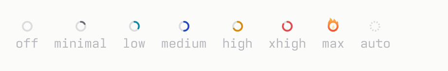
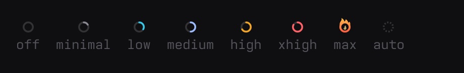
<figcaption>每个档位，以及作为未解析等级的 <code>auto</code>。</figcaption>
</figure>

## 相关页面 {#related-pages}

- [元素](index.md)：通用属性与完整的类型索引。
- [文本](text.md)：span 令牌与 `fx = "shimmer"` span 效果。
- [为视图设置样式](../styles/index.md)：样式表、钩子，以及 `.sf-still` 等状态类。
- [变量](../styles/variables.md)：`--accent`、`--t1`…`--t4`、`--l1`…`--l3`、色调颜色。
- [支持的 CSS](../styles/css.md)：`@keyframes`、动画与过渡支持。
