# 文本与代码 {#text-and-code}

这些类型把文字呈现在屏幕上：带样式的 span、Markdown、带高亮的代码、diff、原始的终端输出以及公式。标签以及需要逐个 span 设置样式的短行用 `text`，由人写成 Markdown 的内容用 `md`，文件或片段用 `code`，一处改动用 `diff`，程序的输出按终端显示的样子用 `ansi`，单个 TeX 公式用 `math`。

| 类型 | 构建方式 | 绘制内容 |
| --- | --- | --- |
| [`text`](#text) | `tern.ui.text(spans)` | 会换行、钳制或截断的带样式 span |
| [`md`](#md) | `tern.ui.md(text)` | omp 方言的 Markdown：提示块、表格、任务、数学、mermaid |
| [`code`](#code) | `tern.ui.code(text, lang?, start?)` | 带高亮的代码块，可选行号与标记 |
| [`diff`](#diff) | `tern.ui.diff(text, path?)` | 统一或并排的 diff，带词级强调 |
| [`ansi`](#ansi) | `tern.ui.ansi(text)` | 迷你终端中的程序输出（SGR 颜色、OSC 8 链接） |
| [`rows`](#rows) | `tern.ui.node("rows", …)` | 以固定宽度预先渲染的终端行（迁移回退方案） |
| [`math`](#math) | `tern.ui.node("math", …)` | 一个排版好的 TeX 公式，行内或独立显示 |

这些类型都不绘制子节点：传入的子节点会被忽略。每个节点元素都是
`<div class="sf sf-<kind>" data-id="…">`，[公共属性](index.md)（`key`、`tone`、`role`、`title`、
`min`/`max`、`actions` 等）对每个类型都有效。这些类型中的文本使用终端的等宽字体，按
`--sf-fs`/`--sf-lh` 排版，并且可以选中。

样式表可依赖的稳定钩子：`.sf-<kind>`、`[data-id]`、`[data-role]`、`[data-tone]`、`[data-mark]`、
`[data-href]`、span 的 `.sf-t-<token>` 类、`.sf-link`、`.sf-fx-*`、`.tk-*`，以及所在区域的
`[data-surface]`。下文列出的其他每个类都属于 Tern 的内部结构：列出它们是为了让你能为其设置样式，
但它们属于内部实现，版本之间可能变化。作用域与层叠参见[视图样式](../styles/index.md)，
`--sf-c-*`、`--t1`…`--t4`、`--code-bg` 等参见 [CSS 变量](../styles/variables.md)，
样式表可用的内容参见[受支持的 CSS](../styles/css.md)。

## 文本类型与文本操作 {#text-kinds-and-text-ops}

`text`、`md`、`code`、`ansi` 与 `math` 属于*文本类型*：它们的主文本是 `text` 属性，协议的
`text` 与 `splice` 操作作用于它（`editor`、`input`、`shimmer` 与 `el` 也是如此；参见
[输入](input.md)、[动效](motion.md)与 [`el`](el.md)）。`diff` 与 `rows` 不是文本类型。

| 操作 | 效果 |
| --- | --- |
| `text append <s>` | 把 `s` 追加到 `text` 字符串末尾（当 `text` 缺失或不是字符串时将其设为 `s`） |
| `text replace <s>` | 把 `text` 设为 `s` |
| `splice <at> <del> <s>` | 把 `text` 中偏移 `at` 处的 `del` 个 UTF-16 单元替换为 `s`；范围超出文本或拆开代理对会报错 |

插件从不发送操作。插件返回整个视图；当某个文本类型的 `text` 属性相对上一次视图只在末尾增长了内容时，
Tern 把它作为追加操作发给渲染器（参见 [UI 构建器](../reference/ui.md#text-and-code)）。
各渲染器让追加变得廉价：`md` 只从最后一个变化的顶层 block 起重新解析，`code` 保留未变化行的高亮，
`ansi` 只把新增的尾部喂给它的终端。向 `text` 流式写入只对 `text` 属性有效：带 `spans` 的
`text` 节点绘制其 span，并忽略 `text`。

## `text` 文本 {#text}

绘制一串带样式的 span。文本默认按词换行；也可以在任何位置换行、保持单行、钳制到若干行，或在末尾、开头、
中间截断。换行由 CSS 负责。钳制与截断由 Tern 在布局之后根据元素宽度计算：截断处以 `…` 结尾，
被截断的节点会把完整文本作为提示（`title`），除非自行设置了 `title`。宽度变化时，Tern 重新显示完整的
span、重新测量并重新截断。span 可以标注其来源（[引用](#citations)）。

**构建方式：** `tern.ui.text(spans)`（参见 [UI 构建器](../reference/ui.md#nodes-and-spans)），
它生成 `{k = "text", p = {spans = …}}`。span 用 `tern.ui.span`、`tern.ui.link` 与 `tern.ui.path`
构建。也可用 `tern.ui.node("text", { text = "One style", wrap = "none" })`。

| 属性 | 类型 | 默认值 | 含义 |
| --- | --- | --- | --- |
| `spans` | `Spans`（span 表与字符串的列表） | 无 | 带样式的各段。`spans` 为列表时优先于 `text` |
| `text` | string | `""` | 纯文本，一个无样式 span。仅在 `spans` 不是列表时使用 |
| `wrap` | `"word"` \| `"char"` \| `"none"` | `"word"` | `word` 在词之间断行（比整行更长的词按字符断开）；`char` 在任意处断开；`none` 让每个以 `\n` 分隔的行保持一行。未知值按 `word` 处理 |
| `truncate` | `"end"` \| `"start"` \| `"middle"` | `"end"` | 溢出文本的截断位置：`end` 保留开头（`abcd…`），`start` 保留结尾（`…wxyz`），`middle` 两端都保留（`ab…yz`）。未知值按 `end` 处理。没有 `wrap` 或 `lines` 的 `truncate` 会让文本保持单行 |
| `lines` | integer | 无 | 钳制到这么多视觉行，最后一行以 `…` 结尾。`0` 表示不钳制。`1` 保持一行 |
| `measure` | `"prose"` | 无 | `prose` 把行长限制在 80 个单元格，以获得易读的段落；否则文本填满其宽度 |
| `cite` | `"chip"` \| `"pill"` \| `"note"` | `"chip"` | 被引用 span 的外观（参见[引用](#citations)）。未知值按 `chip` 处理 |
| `sources` | boolean | `note` 为 `true`，否则 `false` | 在文本下方绘制带编号的来源列表。文本被适配时（`truncate`、`lines`、`wrap = "none"`）不绘制 |

适配运行时的行为：

- 单行（`wrap = "none"`、`lines = 1` 或只给 `truncate`）：只有当文本真的溢出时 Tern 才截断，
  并按 `truncate` 截断。
- 带换行的 `lines = N`：Tern 按 `wrap` 的断行方式逐行计算单元格数（字体是等宽的），保留能放进 N 行的
  内容，去掉末尾的空白并以 `…` 结尾（放在最后一行之内：最后一行若已排满，则让出最后一个字符给它）。
  `truncate` 在这里不适用：钳制总是从末尾截断。
- `truncate = "middle"` 且其中某个 span 带 `path` 样式时，先整段丢掉该 span 开头的目录
  （`Edited …/src/routes/users.ts`），若还不够再截整个文本的中间。
- 落在某个 span 内部的截断会保留该 span 的样式，省略号同样保留。

```lua
local s = "Indexing the workspace for symbols and references"
ui.node("text", { truncate = "end", spans = { ui.span("end    ", "dim"), s } })
ui.node("text", { truncate = "start", spans = { ui.span("start  ", "dim"), s } })
ui.node("text", { truncate = "middle", spans = { ui.span("middle ", "dim"), s } })
ui.node("text", { truncate = "middle", spans = {
	ui.span("path   ", "dim"), ui.span("Edited ", "muted"),
	ui.span("app/server/src/routes/users.ts", "path"), ui.span(" +12", "ins num"),
} })
ui.node("text", { lines = 2, spans = { ui.span("lines=2 ", "dim"),
	s .. ", then warming the type cache for every open file." } })
```

<figure class="tn-figure">
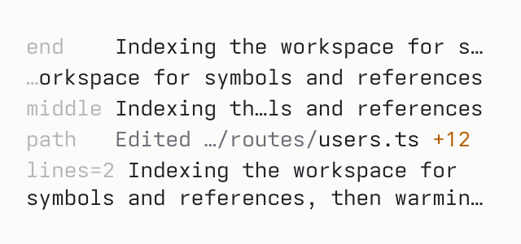
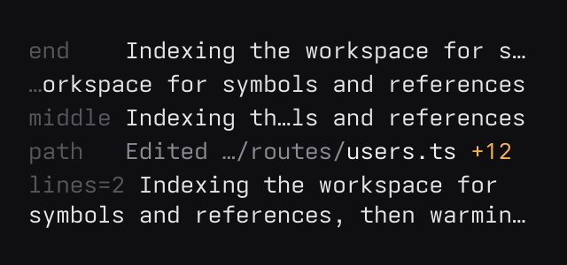
<figcaption>288px 下的这五个节点：<code>start</code> 连标签也会被截断，因为整个文本都被截断；路径行最先丢弃目录。</figcaption>
</figure>

### span {#spans}

span 是一个表；span 列表中的普通字符串就是无样式 span。

| 字段 | 类型 | 含义 |
| --- | --- | --- |
| `t` | string | 文本。`t` 为空时不绘制任何内容 |
| `s` | string | 以空格分隔的样式 token（见下文）。缺省或 `""` 为普通样式。未知 token 不绘制任何类（但参见程序 token） |
| `href` | string | 让该 span 成为链接（见下文） |
| `fx` | `"shimmer"` \| `"pulse"` \| `"none"` | 一种效果。`shimmer` 让一段高光扫过字符；`pulse` 让 span 淡入淡出。其他任何值都表示无效果 |
| `cite` | 来源表，或它们的列表 | 该段文字引用的来源（参见[引用](#citations)）；标记跟在文字之后。`t` 为空的被引用 span 只绘制标记 |

`tern.ui.span(t, s)` 与 `tern.ui.link(t, href, s)` 用来构建 `t`、`s` 与 `href`；`fx` 需自行设置在
返回的表上。`text` 以及所有接受 span 属性的类型（`card` 与 `section` 的头部、`kv`、`table` 的单元格、
`badge` 等）都使用 span，因此这里的全部内容同样适用于它们。

### span 样式 token {#span-style-tokens}

每个语义 token 在 span 上绘制为类 `.sf-t-<token>`：

| Token | 绘制内容 |
| --- | --- |
| `muted` | 安静的文字：`--sf-c-muted` |
| `dim` | 更安静的文字：`--sf-c-dim` |
| `strong` | 字重 600，使用主文本色（`--t1`） |
| `em` | 斜体 |
| `accent` | `--sf-c-accent` |
| `success` | `--sf-c-success` |
| `warning` | `--sf-c-warning` |
| `error` | `--sf-c-error` |
| `info` | `--sf-c-info` |
| `pending` | `pending` 色调的颜色（`--live`），用于等待他人处理的词，与等待中的圆点或徽标并列 |
| `title` | 页头行中页面的标题：`550 15px/1.3` 的 sans（Geist），以 `-0.014em` 收紧字距，使用 `--t1` |
| `code` | 行内代码芯片：`--chip-bg` 上的 `--sf-c-code`，一圈细边框，圆角 |
| `mono` | 等宽数字（`font-variant-numeric: tabular-nums`）；在 sans 区域中还会使用等宽字体 |
| `path` | 文件路径：`--sf-c-path`。含 `/` 的 span 会拆成 `span.dir`（到最后一个 `/` 为止的目录，使用 `--sf-c-muted`）与文件名。`truncate = "middle"` 会按目录缩短它 |
| `key` | 键帽：带内边距，位于 `--l1` 上，使用 `--sf-c-key`。不含空格且以 `+` 连接的键 id（`ctrl+r`、`shift+enter`、`f5`）绘制为对应平台的键帽（`⌃R`），id 作为提示 |
| `link` | 链接颜色（`--sf-c-link`），但不使其成为链接；真正的链接请用 `href` |
| `num` | 代码中的数字：`--sf-c-num` 的等宽数字。`kv` 值与文本中的数字请用 `mono` |
| `ins` | 插入的文本：`--sf-c-ins` |
| `del` | 删除的文本：`--sf-c-del`，带删除线 |
| `mark` | 高亮（搜索命中、选中的行）：着色的背景，设置了 `--sf-mark-bg` 时使用它 |
| `typo` | 拼错的词：`--spelling-error-color` 的点线下划线，与 Tern 的文本字段标记方式一致 |
| `icon` | 按图标度量绘制的 Nerd Font 字形（宽 1.2em，Nerd 补丁的等宽字体，`aria-hidden`）。当下一个非空 span 不以空白开头时，它还会得到 `.gap`（一点右外边距） |
| `hide` | 不绘制（`display: none`），但仍留在文本中 |

在以 [`font: "sans"`](../protocol/surfaces.md#open-and-close) 打开的 Surface 区域中，`mono`、`code`、
`num`、`path` 与 `key` span（以及 Markdown 行内代码）以 12.5px 的终端等宽字体绘制：这是在 sans 文本中
把 id、版本号、大小、时间与路径保持为等宽字体写法的方式。无论所在区域如何，`title` span 都以 sans
字体绘制。

token 可以组合：`"strong error"`、`"muted path"`。即使两个 token 映射到同一个 token，它也只会出现一次。
文本含空格、或不是以 `+` 连接的 id 的 `key` span（`Esc to cancel`）按原样绘制其文本。

<figure class="tn-figure">
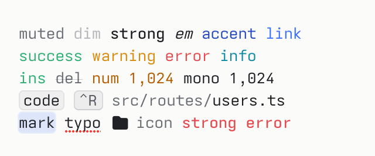
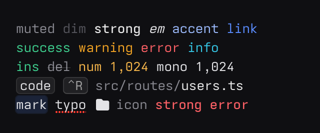
<figcaption>每个词都是一个 span，按它所命名的 token 设置样式：<code>{t = "ctrl+r", s = "key"}</code>、<code>{t = "src/routes/users.ts", s = "path"}</code>，以及一个带 <code>s = "icon"</code> 的文件夹字形。</figcaption>
</figure>

**任意文本中的图标。** 未标 `icon` 的 span 中的私用区码位（U+E000–U+F8FF，以及第 15、16 平面：
Nerd Font 图标）会被拆成独立的 span，带上原 span 的样式外加 `icon`。`md` 正文与编辑器中同样如此，
因此 Nerd 字形永远不会与它后面的文字重叠。

### 程序（主题）token {#program-theme-tokens}

omp 主题的 token 名也可以作为 span token 使用。每个都优先用主题中为它定义的颜色绘制
（`--omp-<token>`，参见[主题 token 颜色](../styles/variables.md#theme-token-colors)），否则使用它所
映射的语义 token 的颜色。omp 的 `accent`、`dim`、`muted`、`error`、`success` 与 `warning` 本身就是
语义 token。

| Token | 映射到 |
| --- | --- |
| `text`、`customMessageText`、`syntaxVariable`、`toolOutput`、`userMessageText` | 普通（无类） |
| `borderAccent`、`customMessageLabel`、`mdListBullet`、`statusLineModel`、`syntaxFunction`、`thinkingMedium` | `accent` |
| `borderMuted`、`statusLineSep`、`thinkingOff` | `dim` |
| `border`、`mdCodeBlockBorder`、`mdHr`、`mdLinkUrl`、`mdQuote`、`mdQuoteBorder`、`statusLineOutput`、`statusLineSpend`、`statusLineUntracked`、`syntaxComment`、`syntaxOperator`、`syntaxPunctuation`、`thinkingText`、`thinkingMinimal`、`toolDiffContext` | `muted` |
| `thinkingXhigh`、`thinkingMax`、`toolDiffRemoved` | `error` |
| `statusLineCost`、`statusLineGitClean`、`statusLineStaged`、`syntaxString` | `success` |
| `bashMode`、`statusLineDirty`、`statusLineGitDirty`、`thinkingHigh` | `warning` |
| `pythonMode`、`statusLineContext`、`statusLineSubagents`、`syntaxKeyword`、`syntaxType`、`thinkingLow` | `info` |
| `mdCode` | `code` |
| `mdCodeBlock` | `mono` |
| `mdHeading`、`toolTitle` | `strong` |
| `mdLink` | `link` |
| `statusLinePath` | `path` |
| `syntaxNumber` | `num` |
| `toolDiffAdded` | `ins` |
| `customMessageBg`、`selectedBg`、`statusLineBg`、`toolErrorBg`、`toolPendingBg`、`toolSuccessBg`、`userMessageBg` | 无：填充色从不作用于文字 |

Tern 不认识的 token（`s = "myTone"`）既不会得到类，也不会有颜色。span 中没有原始颜色。

### 链接 {#links}

带 `href` 的 span 绘制为 `span.sf-link[data-href]`（链接颜色、指针光标、悬停时下划线），提示为
`<href>  ⌘-click to open`。⌘ 点击会打开它。当 Tern 的“打开链接方式”设置为普通点击时，普通点击也会
打开它，除非按住 ⇧ 或该次点击结束了文本选择。

| `href` | 打开方式 |
| --- | --- |
| 带 scheme 的 URL（`https://…`、`mailto:…`） | 通过窗口的链接处理，先经过 `tern.route.link`（参见[路由](../guides/routing.md)） |
| `file://…` | 该文件，在文件 block 中打开，走 Tern 的系统集成 |
| 无 scheme：路径（`./README.md`、`docs/a.md:12`、`../b.md#L3`、`src/a.rs:10-20`、`src/a.rs#L10-L20`、`~/x`、`C:\x`） | 先做 `%XX` 解码；相对路径在面板所在 host 上按面板的工作目录解析；像 `file://` 链接一样在文件 block 中打开，并定位到该行（范围定位到首行）。本机上不存在的路径会弹出一条 toast，写明解析后的路径 |

`tern.ui.path(p, cwd)` 构建一个链接到绝对 `file://` URL 的 `path` span。

### 引用 {#citations}

span 可以标注其文字来自何处。给它一个 `cite`（单个来源或其列表），Tern 就会在这段文字之后绘制标记：
默认是带编号的小芯片，也可以是装着来源域名的胶囊，或点线下划线配上标数字，并在文本下方列出带编号的
来源列表。当 agent 的回答或摘要依赖网页、issue 或文档，而读者应当不必离开面板就能核对这些来源时，
就该用它。

| 来源字段 | 类型 | 默认值 | 含义 |
| --- | --- | --- | --- |
| `href` | string | 必填 | 来源所在的位置；点击时打开。没有它的来源会被忽略 |
| `title` | string | `""` | 来源的标题（悬停卡片、来源列表、无障碍名称） |
| `n` | 整数 ≥ 1 | 按出现顺序 | 显示的编号。没有指定编号的来源按首次出现顺序取得下一个空闲编号 |
| `site` | string | `href` 的主机名，去掉 `www.` | 胶囊中显示的名称 |
| `snippet` | string | 无 | 悬停卡片中显示的引文（最多两行） |

来源在每个 `text` 节点内按其 `href` 首次出现的顺序编号（同一个 `href` 保持其编号）；来源自带的 `n`
优先。节点的 `cite` 属性决定外观：

| `cite` | 外观 | 悬停卡片作用于 |
| --- | --- | --- |
| `chip`（默认） | 这段文字之后带编号的小强调色芯片，每个来源一个 | 每个芯片（及其来源） |
| `pill` | 第一个来源的域名装在一个带彩点的胶囊中，更多时显示 `+N` | 该胶囊（所有来源） |
| `note` | 这段文字带点线下划线，后面是上标数字；来源列表在下方 | 被引用的文字（所有来源） |

普通点击标记、被引用的文字（`note`）或某条来源，都会通过与[链接](#links)相同的处理打开 `href`，
不会向程序发送事件（⇧ 点击以及结束文本选择的点击不会打开任何东西）。指针停在悬停卡片的宿主上会显示
一张卡片，含来源的标题、URL 与引文。复制文本时（`copy` 操作或选中复制），每个被引用的文字之后会保留
`[1]` 形式的标记。没有 `cite` 的 span 不受影响。

引用只支持指针操作：节点不接受焦点。需要键盘访问的程序应自行列出这些来源（或打开 `sources`），
并通过自己的按键打开它们。

```lua
tern.ui.node("text", {
	cite = "chip",
	spans = {
		{
			t = "The lockfile drifted from package.json",
			cite = {
				title = "pnpm install — frozen lockfile",
				href = "https://pnpm.io/cli/install",
				snippet = "CI fails when the lockfile needs an update.",
			},
		},
		" after the bump, and ",
		{ t = "CI refuses frozen installs", cite = {
			{ title = "Frozen lockfile errors", href = "https://github.com/pnpm/pnpm/issues/7019" },
			{ title = "pnpm install", href = "https://pnpm.io/cli/install" },
		} },
		".",
	},
})
```

同样的内容用 TSX 写，作为脚注并带来源列表：

```tsx
<text
   cite="note"
   spans={[
      { t: 'The lockfile drifted', cite: { title: 'pnpm install', href: 'https://pnpm.io/cli/install' } },
      ' after the bump.',
   ]}
/>
```

<figure class="tn-figure">
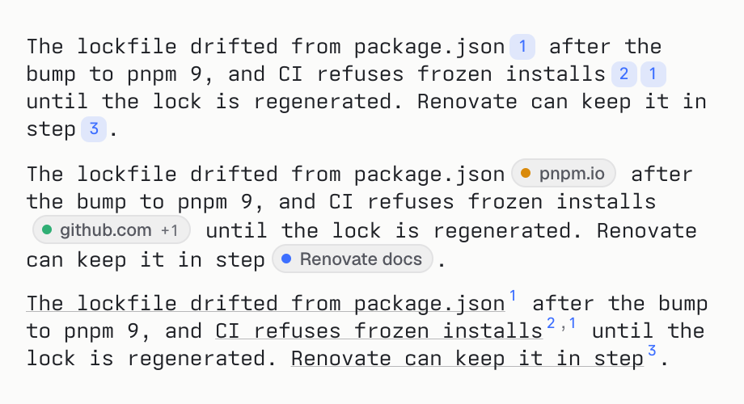
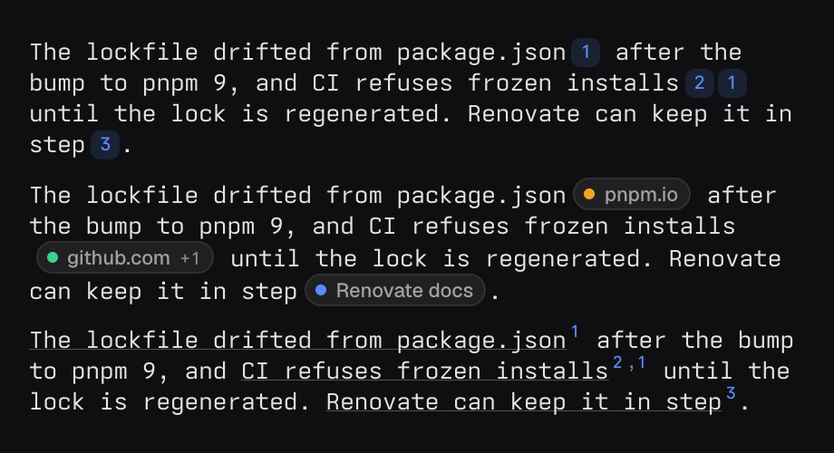
<figcaption>三种外观：<code>chip</code>、<code>pill</code> 与 <code>note</code>（此处不带其列表）。</figcaption>
</figure>

<figure class="tn-figure">
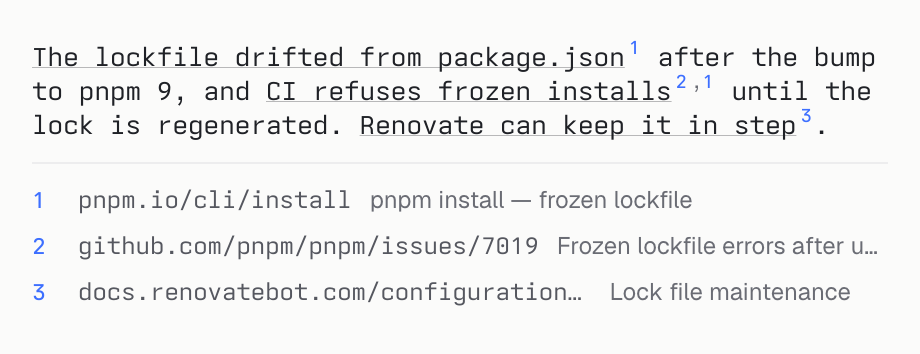
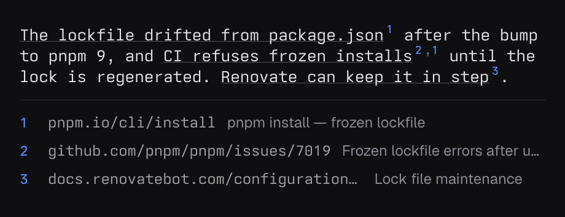
<figcaption><code>cite = "note"</code> 在文本下方绘制带编号的来源。</figcaption>
</figure>

### 效果 {#effects}

`fx = "shimmer"` 让一道光带扫过该 span，与 [`shimmer`](motion.md#shimmer) 类型相同（`--sh-lo`、
`--sh-hi`、`--sh-mid` 设置三种颜色，默认分别为 `--t3`、`--t1`、`--t2`）。`fx = "pulse"` 会加上
`.sf-fx-pulse`（不透明度在 1.6s 内从 1 → 0.45 → 1）。两者都带 `.sf-fx-<fx>`，并在重绘时保持文档时钟的
相位。在减少动效下（`.sf-still`）以及面板隐藏时（`.sf-paused`）它们会停止；停住的 shimmer 用自身
颜色显示其文本。

**子节点：** 无（会被忽略）。

**事件：** 自身不产生事件；`actions` 的用法与任何节点相同。链接与引用的点击由 Tern 处理，
不会到达你的 `event`。

**样式：**

```html
<div class="sf sf-text nowrap" data-id="…" title="full text when cut">
	plain text
	<span class="sf-t-muted">Edited </span>
	<span class="sf-t-path sf-link" data-href="file:///…" title="file:///…  ⌘-click to open">
		<span class="dir">app/src/routes/</span>users.ts
	</span>
	<span class="sf-t-icon gap" aria-hidden="true"></span>
	<span class="sf-t-key" title="ctrl+r">⌃R</span>
	<span class="sf-fx-shimmer">Working…</span>
</div>
<div class="sf sf-text cite-chip" data-id="…">
	<span class="sf-cite" data-href="https://pnpm.io/cli/install">
		<span class="run">The lockfile drifted</span>
		<span class="mk">
			<span class="cp">[1]</span>
			<span class="n" role="link" data-href="https://pnpm.io/cli/install" aria-label="Source 1: pnpm install">1</span>
			<span class="pill" role="link" data-href="…" aria-label="Source: pnpm.io"><span class="dot" data-c="…"></span><span class="site">pnpm.io</span></span>
		</span>
	</span>
	after the bump.
	<div class="sf-cite-list" role="list"><div class="src" data-href="…"><span class="n">1</span><span class="url">…</span><span class="ttl">…</span></div>…</div>
</div>
```

既无 `href` 也无效果的无样式 span 是一个裸文本节点，而不是 `span`。

| 目标 | 选择器 |
| --- | --- |
| 节点本身 | `.sf-text` |
| 单行（`wrap = "none"` 或 `lines = 1`） | `.sf-text.nowrap` |
| 按字符换行 | `.sf-text.char` |
| prose 行宽 | `.sf-text.prose` |
| 带样式的 span | `.sf-t-<token>` |
| 链接 span | `.sf-link`、`[data-href]`、`[data-href^="http"]` |
| 路径的目录、其位置（`:12`、`#L3`） | `.sf-t-path .dir`、`.sf-t-path .ln`（内部，可能变化） |
| 后面跟着文字的图标 | `.sf-t-icon.gap` |
| 效果 | `.sf-fx-shimmer`、`.sf-fx-pulse` |
| 引用外观 | `.sf-text.cite-chip`、`.cite-pill`、`.cite-note` |
| 被引用的 span：其文字、其标记 | `.sf-cite[data-href]`、`.sf-cite .run`、`.sf-cite .mk`（内部，可能变化） |
| 仅供复制的 `[1]` 文本（不可见） | `.sf-cite .cp`（内部，可能变化） |
| 带编号的芯片或上标 | `.sf-cite .n[data-href]`（内部，可能变化） |
| 域名胶囊 | `.sf-cite .pill`、`.pill .dot[data-c]`、`.pill .site`、`.pill .more`（内部，可能变化） |
| 引用悬停卡片 | `.sf-hovercard.sf-cite-card`、`.src`、`.head`、`.dot`、`.ttl`、`.url`、`.snip`（内部，可能变化） |
| 来源列表 | `.sf-cite-list`、`.src[data-href]`、`.n`、`.url`、`.ttl`（内部，可能变化） |

变量：每个带颜色的 token 对应 `--sf-c-<token>`（`muted`、`dim`、`accent`、`success`、`warning`、
`error`、`info`、`code`、`path`、`key`、`link`、`num`、`ins`、`del`），以及 `--sf-mark-bg`、
`--spelling-error-color`、`--sh-lo`/`--sh-mid`/`--sh-hi`。参见 [CSS 变量](../styles/variables.md)。

```lua
local ui = tern.ui

local function header(run)
	local file = ui.path(run.file, run.cwd)
	local line = ui.text({
		ui.span("Edited ", "muted"),
		file,
		ui.span(" +" .. run.added, "ins num"),
		ui.span(" −" .. run.removed, "del num"),
	})
	local p = line.p or {}
	p.truncate = "middle" -- one line; drops directories of the path first
	line.p = p
	return line
end

local busy = ui.span("Indexing…", "muted")
busy.fx = "shimmer"
return ui.col({ header(state.run), ui.text({ busy }) })
```

## `md` Markdown {#md}

通过 kit 的 Markdown 视图绘制 omp 方言的 Markdown，使用终端的等宽字体。源文本被拆成顶层 block，
每个绘制为自己的 `div.md`；更新时只重新解析源文本发生变化的 block（当链接引用定义变化时则是全部）。
长文档依然廉价：远离视口的 block 不做布局，并保持上次的高度（从未显示过时是一个估算值），长代码围栏的
行组以及长列表的项（在停止流式之后）也是如此。查找与复制仍能看到完整的源文本。

**图片。** `` 图片由 Tern 解析，而不是由程序解析：面板旁的文件（或绝对路径、`file://`、
`~/`）、`data:` URI 或 `http(s)` 地址会在 UI 线程之外读取并解码，就地按原始尺寸显示，且不会宽于列
（其他 host 上的文件通过那个 host 读取）。Tern 无法读取的来源会保留芯片——一个图片图标加上替代文本，
并以来源作为提示。

**构建方式：** `tern.ui.md(text)`（参见 [UI 构建器](../reference/ui.md#text-and-code)），或
`tern.ui.node("md", { text = src, stream = true })`。

| 属性 | 类型 | 默认值 | 含义 |
| --- | --- | --- | --- |
| `text` | string | `""` | Markdown 源文本 |
| `stream` | bool | `false` | 源文本仍在到达：最后一个 block 是临时的（`.streaming`），它可能是一个未闭合的围栏或列表。其最后一个元素以 86% 不透明度绘制，末尾的段落、标题或列表项以脉动的强调色插入符结尾。未闭合的 mermaid 围栏在闭合或 `stream` 关闭之前显示为代码，因此写了一半的图永远不会被布局 |
| `marks` | `Spans` | 无 | 在正文中任何出现处替换其字面文本绘制的 span。每个位置上最早出现者胜出，并列时取最长者。omp 用它处理已发送提示中的芯片、skill 与提及 |

### 方言 {#dialect}

| 特性 | 语法 | 绘制内容 |
| --- | --- | --- |
| CommonMark | 标题、段落、强调、链接、图片、列表、引用、分隔线、代码 | 常见的那些元素。原始 HTML 仍作为字面文本（block 时为 `div.md-html`） |
| 5 级与 6 级标题 | `#####`、`######` | `h4.h5`、`h4.h6`（没有 `h5`/`h6`） |
| 换行 | 段落内的每个行尾，因为 omp 就是这样在终端中绘制 Markdown 的（CommonMark 会把这些行连接起来）；行尾的两个空格或 `\` 同样 | `span.br` |
| GFM 表格 | 竖线、`:---:` 对齐 | `div.tbl > table > thead + tbody`；对齐以内联 `text-align` 表示 |
| 严重度胶囊 | 内容恰为 `high`、`medium` 或 `low` 的表格单元格（不区分大小写） | `span.sev.<level> > i + text` |
| 任务列表 | `- [ ]`、`- [x]` | `ul.tasks > li.task`（勾选时带 `.done`，其文本加删除线），只读复选框 `span.cb[role=checkbox]`（勾选时带 `.on`） |
| 删除线、自动链接 | `~~x~~`、裸 URL（`http://`、`https://`、`file://`、`www.`）与邮箱 | `del`、链接 |
| 提示块 | 第一行为 `[!NOTE]`、`[!TIP]`、`[!IMPORTANT]`、`[!WARNING]` 或 `[!CAUTION]` 的引用块（不区分大小写） | `div.callout.<kind> > .co-ic + div.co-body`；warning 与 caution 用 `--warn` 着色并配警告图标，其余用 `--accent` 着色并配信息图标 |
| 数学 | 行内 `$…$`、`\(…\)`；块级 `$$…$$`、`\[…\]`、`\begin{env}…\end{env}` | 围绕 `currentColor` 中已排版的 `svg` 的 `span.math`（`.display`）或 `div.math-display`；排版失败的公式显示为 `code.math-err`，并以错误信息为提示。包装元素把 TeX 保存在 `data-tex` 中，文本选择会把它复制为 `$tex$` / `$$tex$$` |
| 代码围栏 | ```` ```lang ```` | `--code-bg` 上的 `div.code > div.code-head (language + Copy) + pre > code`，每行一个 span，以 `.tk-*` 类高亮（参见 [`code`](#code)）。头部只在悬停或聚焦时显示，位于 block 的右上角。标签是小写的围栏语言，没有语言时为 `text` |
| Mermaid | ```` ```mermaid ```` | `figure.mfig[data-m] > div.mfig-head (icon, "mermaid · <kind>", Source, Copy, Open) + div.mfig-body`，图按原始尺寸显示；过宽的图可横向滚动 |
| 色块 | 代码 span 中的十六进制颜色 | 它之前的一个 `span.chip` 颜色芯片 |
| 文件路径 | 正文中的路径，或整体为路径的代码 span，可带位置：`` `crates/x/y.rs:10-20` ``、`src/a.ts#L4`、`./b.md:3:7` | 一个带链接的 `path` span，`span.sf-t-path.sf-link[data-href]`（目录 `.dir` 与位置 `.ln` 弱化，文件名加粗），像路径 `href` 一样定位到该行打开文件。只有读起来像文件的内容才加链接：有分隔符或位置，且有扩展名（`src/a.rs`、`keys.rs:12`；而 `ui.now`、`and/or`、`styles/*.css` 不会）。Markdown 链接内的文本仍遵循该链接 |
| Nerd 图标 | 私用区码位 | `icon` span（参见 [span 样式 token](#span-style-tokens)） |

正文（段落、标题、列表项与单元格内部的文本）通过与 `text` 相同的 span 路径绘制。

**用户设置。**“Markdown 标题”（默认 Annotated）属于 Tern 的设置，不是属性。Annotated：每个标题都是
正文字号、字重 600、使用 `mdHeading` 颜色，前面有一个弱化的 `#`…`######` 标记（`::before`，`--t4`）。
Annotated 会给区域加上 `.sf-h-annotated`。Sized：`h1`–`h3` 为 20/17/15px 的 sans 标题。
“打开链接方式”决定普通点击是否打开链接，与 span 相同。

**复制。** 代码块的 Copy 按钮（`.code-copy`，位于悬停或聚焦时显示的头部中）把代码放入剪贴板。
mermaid 图的 Open 按钮（`.mfig-open`）或点击其绘图会把图放大显示；点击一个完整 SVG 图的绘图也会按
绘制原样放大显示。对围栏已完整的 SVG、3D 与 mermaid 图，Source（`.mfig-source`）会用围栏的代码
（`pre.mfig-src`）代替绘图，直到再次按下它，而 Copy（`.mfig-copy`）把该代码放入剪贴板。文本选择以
Markdown 为底层的文本复制，数学部分为其 TeX。

**运行。** 在 `main` 中，当 Tern 能够运行程序的命令时（本机上的程序，而非通过 `ssh` 连接的机器上的
程序，且仅限 macOS 与 Linux），`sh`、`shell`、`bash` 或 `zsh` 围栏在 Copy 之前有一个 Run 按钮
（`.code-run`）。Run 用该 shell 在面板的目录中启动代码（`sh -c …`），其输入为空，输出经过管道
（不使用分页器，也没有终端提示），输出在代码下方流式显示：一个迷你终端，显示最后 16 行（其上方以
“N earlier lines” 显示其余部分），下面是一条带状态与时间的脚注行。运行期间按钮变为 Stop，它会中断
命令（`SIGINT`，若两秒内未结束则再 kill）。结束后脚注行说明结果（Done、`exit N`、Stopped）及其耗时，
并带一个 Clear 按钮；Run 会就地重新运行，替换旧输出。仍在到达的围栏（流式的尾部）尚不提供 Run。
输出只属于 Tern：程序看不到它，block 离开记录时它也随之消失（正在运行的命令届时也会结束）。

**子节点：** 无（会被忽略）。

**事件：** 自身不产生事件；`actions` 的用法与任何节点相同。Copy、Open、Run 与链接点击由 Tern 处理。

**样式：**

```html
<div class="sf sf-md" data-id="…">
	<div class="md">
		<h2 id="h-…">Setup</h2>
		<p>Run <code>make</code> first.</p>
	</div>
	<div class="md streaming">
		<div class="callout warning"><svg class="co-ic">…</svg><div class="co-body"><p>…</p></div></div>
		<div class="code">
			<div class="code-head"><span>rust</span><button class="btn sm quiet code-copy">Copy</button></div>
			<pre><code><span><span class="tk-keyword">fn</span> main() {}</span></code></pre>
		</div>
	</div>
</div>
```

| 目标 | 选择器 |
| --- | --- |
| 节点本身 | `.sf-md` |
| 一个顶层 block（块） | `.sf-md .md`（内部，可能变化） |
| 临时的流式尾部 | `.sf-md .md.streaming` |
| 标题 | `.sf-md .md :is(h1, h2, h3, h4)`、`h4.h5`、`h4.h6` |
| 带注释的标题 | `.sf-h-annotated .sf-md .md h2` |
| 列表、任务 | `ul`、`ol`、`li > .li-t`、`ul.tasks`、`li.task`、`li.task.done`、`.cb`、`.cb.on` |
| 表格 | `.tbl`、`table`、`th`、`td`、`.sev.high`/`.medium`/`.low` |
| 提示块 | `.callout`、`.callout.note`/`.tip`/`.important`/`.warning`/`.caution`、`.co-ic`、`.co-body` |
| 代码围栏 | `.code`、`.code-head`、`.code-copy`、`pre code`、`.tk-*` |
| 围栏的运行 | `.code.runnable`、`.code.ran`、`.code.running`、`.code.failed`、`.code-run`、`.code-out`、`.code-out-foot`、`.code-out-state[data-tone]`、`.code-out-time`、`.code-out-clear` |
| Mermaid | `.mfig`、`.mfig-head`、`.mfig-open`、`.mfig-body` |
| 数学 | `.math`、`.math.display`、`.math-display`、`code.math-err` |
| 图片 | `.md-img`、`.md-img.framed`、`.md-img-frame`、`.md-img-alt` |
| 行内代码、色块 | `code`、`.chip`、`.swatch` |

所有内部选择器都是 kit 的 Markdown DOM（内部，可能变化）。各 block 之间相距 `0.5 × --sf-lh`
（`.sf-md` 上的 `gap`）。变量：`--code-bg`、`--chip-bg`、`--t1`…`--t4`、`--accent`、`--warn`，
以及 `--tk-*` 的各颜色。

````lua
local ui = tern.ui

local doc = ui.node("md", {
	text = [[
## Release

> [!WARNING]
> Tag only from `main`.

- [x] changelog, see [notes](https://example.com)
- [ ] tag `v1.4.0`

| Check | Risk |
| --- | :---: |
| Migrations | high |
| Docs | low |

Energy: $E = mc^2$, accent `#7c5cff`.

```rust
fn main() { println!("ship"); }
```
]],
	stream = state.generating,
})
return { main = ui.col({ doc }) }
````

<figure class="tn-figure">
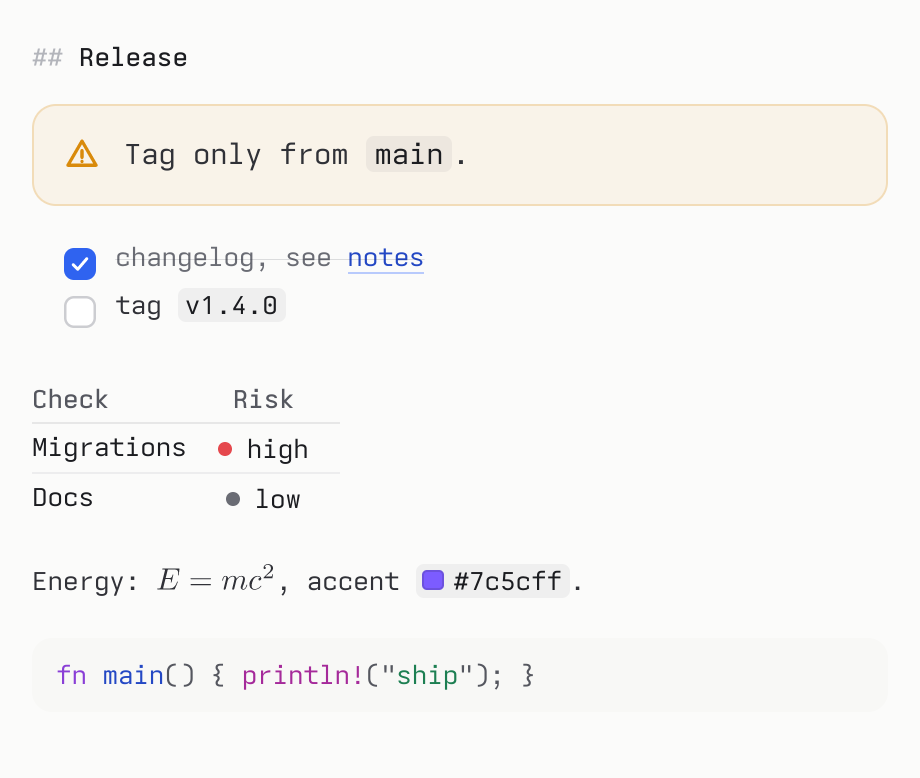
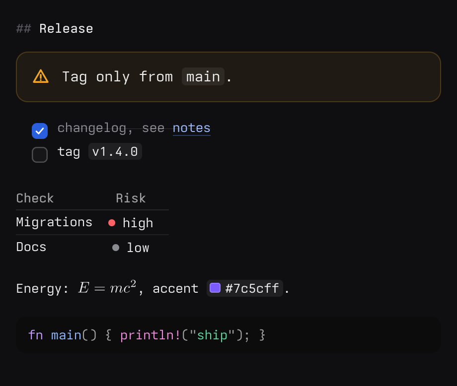
<figcaption>在 <code>stream</code> 关闭时。围栏的语言标签与 Copy 按钮在悬停时出现。</figcaption>
</figure>

## `code` 代码 {#code}

用 Tern 的高亮器绘制代码块，可选行号与带标记的行。高亮在后台对整段文本运行，因此跨行字符串与注释也能正确
着色；在各行的颜色算出来之前，它们以普通样式显示。不换行的行在 block 内部横向滚动。代码块始终具有完整的
源文本高度，但只有视口附近的行会被挂载。没有 `wrap` 时每行只有一行高；有 `wrap` 时各行保持其换行后的
高度。超过 4,096 字节的行只绘制前 4,096 字节（在字符边界处切断），随后是一个弱化的
“… N more characters”（`span.sf-elided`）；只有已绘制的部分会被高亮与标记。

**预览。** `preview = { lines = N }` 把高度超过 N 个绘制行的 block（换行的行按其行数计）钳制为前 N 行，
底部带渐隐（类 `clamped`），并在主体之后放一个 `button.sf-code-more`，文字为 “K more lines”
（“1 more line”）。只有钳制范围内的行会被挂载（连同通常的超前渲染）；其余行在钳制解除后挂载，
不换行的行仍然横向滚动。该按钮就地展开 block（“Show less” 会再次折叠它）；新的 `preview` 值会重置
这种展开。在可折叠的 card、section 或 tool 内部，预览只在该折叠区处于折叠状态时生效：展开时 block
完整显示、按钮隐藏；折叠时按钮会打开该折叠区（`toggle` 事件，与点击头部相同），而不是只展开 block。

**刷色。** 标记的 `wash`（一个数字列表）按与 `heat` 相同的十级琥珀到红色渐变给该行刷色，每个值都是
钳制在 0–1 的分数（不是数字的值按 0 处理）。一个值会把整行刷成同一色；多个值则在行内从左到右形成
渐变，每个值一个均匀分布的色标，因此一行可以并排显示两个打分者的结果。它取代 `heat` 的平涂以及该行上
的色调着色；`heat` 仍然决定概览带中该行的竖条与折叠迷你折线。空列表不绘制任何内容，全为 0 的分数即使
有 `heat` 也让该行保持素色。有 `wash` 而无 `tone` 的标记不绘制色调竖条。

**折叠。** `folds` 的每一项（`from`/`to`，即行号栏编号中的首行与末行）把它覆盖的各行绘制为一行
（`.sf-fold`）：代码字体中的 `label`（默认 `… [lines {from}-{to}]`，单行时为 `… [line {from}]`）、
被折叠行的标记 `heat` 迷你折线，然后是 `note`（字符串或 span）。点击折叠行会就地展开该折叠，各行连同
其标记（仅在展开后生效）绘制在一个头部行之下（`.sf-fold.open`，先写行号，若给了 `label` 再写
`label`），点击该头部行会再次折叠它们（聚焦的折叠行上按 Enter 或 Space 也可切换）；展开的折叠所绘制的
行带 `.folded`（已折叠的折叠不会绘制其行）。位于已折叠折叠区内的查找命中会打开它。每个折叠的展开状态
属于 Tern，按它的首行在 `text` 或 `folds` 的更新之间保持；`open = true` 只会打开此前未绘制过的折叠
（其前没有折叠从该行开始）。与更早的折叠重叠、或落在文本之外的折叠会被丢弃。`tone = "error"` 给该行
着色；任何色调都会给 note 上色。`hovercard` 是一个节点树，当指针停在该折叠行上时以卡片显示，
与公共的 [`hovercard`](index.md) 属性相同。

**概览。** `overview = true` 在各行上方绘制一条概览带（`.sf-code-map`）：每行一个竖条，其高度取该行
标记的 `heat`，其颜色取标记的色调；其下方是一条覆盖折叠之外各行的带；还有一个覆盖当前可见各行的
括号，随滚动移动。点击或拖动概览带会把 block 滚动到对应行。

**摘录。** `nums` 为每行单独指定行号（`text` 每行一个整数，严格递增），取代从 `start` 开始计数，
适用于从更长文件中挑出的行，例如带上下文的搜索命中。若某行的编号不接在前一行之后，它的上方会出现一个
`…` 行（`.sf-gap`），位于行号栏中并与编号对齐，因此摘录仍是作为一个整体横向滚动的单个 block。
标记与折叠按这些编号指定行。长度与 `text` 的行数不同的 `nums`，或不递增的 `nums`，会被忽略，
各行改从 `start` 计数。

**构建方式：** `tern.ui.code(text, lang, start)`（参见 [UI 构建器](../reference/ui.md#text-and-code)）；
给了 `start` 时它还会设置 `numbers = true`。也可用
`tern.ui.node("code", { text = src, path = "src/main.rs", wrap = true })`。

| 属性 | 类型 | 默认值 | 含义 |
| --- | --- | --- | --- |
| `text` | string | `""` | 代码 |
| `lang` | string | 无 | 按语言名或扩展名指定文法（`"rust"`、`"lua"`、`"ts"`）。优先于 `path`。既没有 `lang` 也没有 `path` 时，代码按纯文本绘制 |
| `path` | string | 无 | 文件路径：`lang` 缺省时按文件名选择文法，并显示带文件图标、弱化的目录与文件名的头部（提示为路径）。没有 `path` 就没有头部 |
| `numbers` | bool | `false` | 显示行号栏 |
| `start` | integer | `1` | 首行的编号 |
| `nums` | 整数列表 | 无 | 每行的编号，严格递增，取代 `start`；编号跳跃处有 `…` 行（参见摘录） |
| `marks` | `{line, tone?, heat?, wash?, ranges?}` 的列表 | 无 | 带标记的行。`line` 按行号栏的编号计（从 `start` 或 `nums` 起）；`start` 之前的行以及 `nums` 中缺失的行会被忽略。`tone` 是[色调](index.md)之一（默认 `accent`；未知色调按 `accent` 处理）；该行会得到一条色调竖条，其编号也用该色调，且除 `accent` 之外的任何色调还会给该行着色。`accent` 标记（搜索命中）无论主题的强调色如何都保持弱化，因此一串这样的标记永远不会被读成 diff，而 block 中未标记的行则变为一半不透明度。`heat` 是 0 到 1 的分数（会被钳制），按从未着色到强烈的琥珀到红色、共十级的渐变给该行刷色，取代色调的着色（`wash` 见刷色一节，会取而代之）；有 `heat` 或 `wash` 而无 `tone` 的标记不绘制竖条；在有 `accent` 标记的 block 中只有其文本变淡，刷色不受影响。`ranges` 是 `{{start, end}, …}`，即该行中的字节范围（结束端不含），以更强的着色绘制，例如搜索命中 |
| `wrap` | bool | `false` | 对长行软换行，而不是横向滚动 |
| `preview` | `{lines = N}` | 无 | 钳制为前 N 个绘制行并带渐隐，附一个 “K more lines” 按钮（参见预览）。小数的 `lines` 会被截断；小于 1 或其他形状的值表示不预览 |
| `folds` | `{from, to, label?, note?, tone?, open?, hovercard?}` 的列表 | 无 | 在被展开之前绘制为一行的连续行段（参见折叠）。会排序且不重叠 |
| `overview` | bool | `false` | 在各行上方显示概览带（参见概览） |

高亮 token 类，来自 kit 的高亮器：

| 类 | 颜色变量 | 典型 token |
| --- | --- | --- |
| `.tk-comment` | `--tk-comment` | 注释 |
| `.tk-doc` | `--tk-doc` | 文档注释（`///`、`/** */`、docstring） |
| `.tk-keyword` | `--tk-keyword` | 关键字 |
| `.tk-function` | `--tk-function` | 函数名 |
| `.tk-macro` | `--tk-macro` | 宏、属性、装饰器（`println!`、`#[derive]`、`@sealed`） |
| `.tk-variable` | `--tk-variable` | 变量 |
| `.tk-property` | `--tk-property` | 字段、属性、对象与配置的键、标记语言的属性名 |
| `.tk-string` | `--tk-string` | 字符串、行内代码 |
| `.tk-escape` | `--tk-escape` | 字符串中的转义与格式占位符、标记语言实体 |
| `.tk-number` | `--tk-number` | 数字 |
| `.tk-constant` | `--tk-constant` | `true`、`None`、`nil`、具名常量、枚举成员 |
| `.tk-type` | `--tk-type` | 类型 |
| `.tk-tag` | `--tk-tag` | 标记语言的标签名（HTML、JSX、XML） |
| `.tk-heading` | `--tk-heading` | 标记语言的标题 |
| `.tk-link` | `--tk-link` | 标记语言的链接文字与目标 |
| `.tk-operator` | `--tk-operator` | 运算符 |
| `.tk-punct` | `--tk-punct` | 标点 |
| `.tk-inserted` | `--tk-inserted` | 插入的行（diff 文法） |
| `.tk-deleted` | `--tk-deleted` | 删除的行（diff 文法） |

同一批类也用于 `md` 围栏、`diff` 与 `editor` 的代码。覆盖 `--tk-*` 变量即可一次改动全部配色。

**子节点：** 无（会被忽略）。

**事件：** 自身不产生事件；`actions` 的用法与任何节点相同。预览的展开是 Tern 的本地状态。

**样式：**

```html
<div class="sf sf-code numbers wrap clamped" data-id="…" style="--sf-gw:…">
	<div class="sf-code-head"><svg class="ico">…</svg><span class="sf-code-path" title="src/main.rs"><span class="dir">src/</span><span class="name">main.rs</span></span></div>
	<div class="sf-code-body">
		<div class="sf-code-lines">                   <!-- the mounted lines only -->
			<div class="sf-ln mk" data-tone="warning">
				<span class="sf-gut" aria-hidden="true">12</span>
				<span class="sf-lt"><span class="tk-keyword">let</span> x = <span class="sf-em">42</span>;</span>
			</div>
		</div>
	</div>
	<button class="sf-code-more" title="Show all lines" aria-expanded="false">14 more lines<svg class="ico chev">…</svg></button>
</div>
```

| 目标 | 选择器 |
| --- | --- |
| 节点本身 | `.sf-code` |
| 带行号、换行 | `.sf-code.numbers`、`.sf-code.wrap` |
| 带 `accent` 标记（其未标记行变淡） | `.sf-code.matches` |
| 头部（没有 `path` 时隐藏） | `.sf-code-head`、`.sf-code-head.sf-hidden`（内部，可能变化） |
| 头部中的路径 | `.sf-code-path`、`.sf-code-path .dir`、`.sf-code-path .name`（内部） |
| 滚动主体、各行 | `.sf-code-body`、`.sf-code-lines`（内部） |
| 预览钳制 | `.sf-code.clamped > .sf-code-body`（`max-height: var(--sf-clamp)`，content-box，底部渐隐） |
| 更多/更少按钮 | `.sf-code-more`、`.sf-code-more.open`（已展开）、`.sf-code-more.sf-hidden`（内部） |
| 一行 | `.sf-ln`（内部） |
| 带标记的行 | `.sf-ln.mk`、`.sf-ln[data-tone="error"]` |
| 一行的 heat 级（`0`–`10`；可能没有 `.mk`） | `.sf-ln[data-heat="7"]` |
| 被刷色的行（因 `wash`，或高于 0 的 `heat`；其背景为 `--wash`） | `.sf-ln.wash` |
| `nums` 跳跃处的 `…` 行 | `.sf-ln.sf-gap`（内部） |
| 行号栏、行文本 | `.sf-gut`、`.sf-lt`（内部） |
| 被截断行的说明 | `.sf-elided`（内部） |
| 标记的范围 | `.sf-ln.mk .sf-em` |
| 折叠行、展开（其头部） | `.sf-fold`、`.sf-fold.open`、`.sf-fold[data-tone="error"]`（内部） |
| 展开的折叠中的一行 | `.sf-ln.folded`（内部） |
| 概览带 | `.sf-code-map`（内部） |
| Token | `.tk-*` |

变量：`--sf-gw`（行号栏宽度，按位数内联设置）、`--sf-clamp`（被钳制各行的高度，内联设置在
`.sf-code-body` 上）、`--tc`（色调颜色，来自 `data-tone`）、`--code-bg`（block 背景）、
`--l1`（描边与头部横线）、`--t3`/`--t4`、`--sf-lh`、`--sf-tab`（每个制表位的列数）、`--tk-*`。

```lua
local ui = tern.ui

local block = ui.code(state.source, nil, 40) -- numbers from 40
block.p.path = "src/server.lua"
block.p.marks = {
	{ line = 42, tone = "error", ranges = { { 16, 21 } } }, -- `sockt`
	{ line = 45, tone = "warning" },
}
return { main = ui.col({ block }) }
```

<figure class="tn-figure">
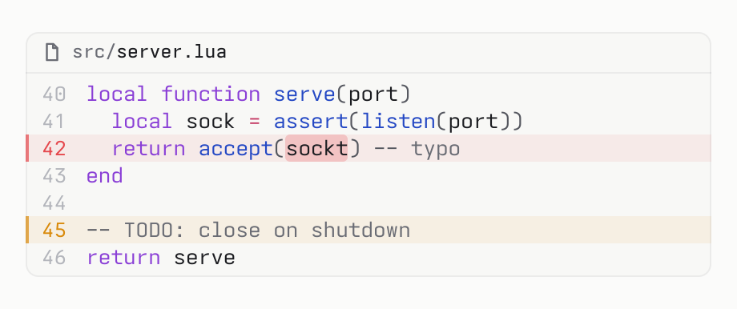
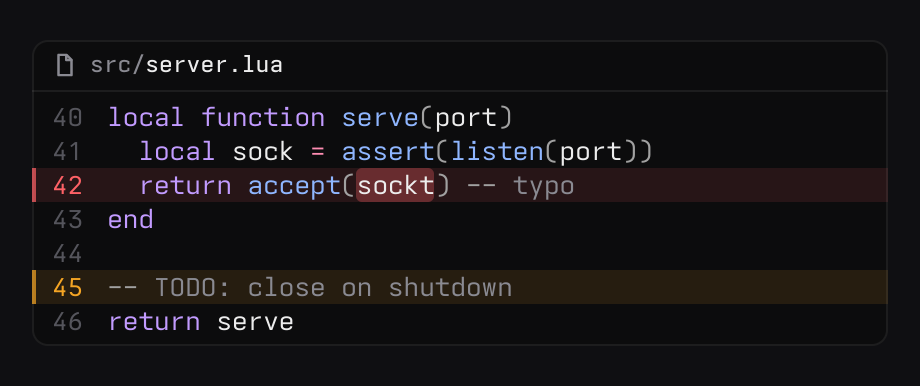
<figcaption>该示例中 <code>state.source</code> 为七行。语法来自 <code>path</code>，因为 <code>lang</code> 为 nil。</figcaption>
</figure>

带分数、折叠、刷色与概览带的各行：

```lua
local ui = tern.ui

local block = ui.code(state.output, nil, 1)
block.p.overview = true
block.p.marks = {
	{ line = 1, tone = "accent", heat = 0.9, wash = { 0.9, 0.3 } },
	{ line = 2, heat = 0.2, wash = { 0.2, 0.6 } },
	{ line = 7, heat = 0.7 }, -- folded below, still hot
}
block.p.folds = {
	{
		from = 3, to = 9, label = "… [lines 3-9]", note = "7 lines below the cutoff", tone = "error",
		hovercard = ui.text("Line 7 scored 0.9, under the cutoff of 1"),
	},
}
return { main = ui.col({ block }) }
```

## `diff` 差异 {#diff}

绘制带词级强调与两侧语法高亮的 diff。它不绘制自己的头部：请把它放进一个头部写明文件的 `card` 中。
放在 `card` 内部时它紧贴边缘（自身没有描边或背景）。没有任何改动的 diff 显示 “No changes”。

**构建方式：** `tern.ui.diff(text, path)`（参见 [UI 构建器](../reference/ui.md#text-and-code)），或
`tern.ui.node("diff", { hunks = …, path = …, mode = "split" })`。

| 属性 | 类型 | 默认值 | 含义 |
| --- | --- | --- | --- |
| `text` | string | 无 | 一个统一 diff：`@@ -a,b +c,d @@` 形式的各个 hunk。`diff --git`、`---`/`+++` 与 `index` 头部可以接受，并用它们确定文件名。完全没有 hunk 头部的文本会被当作一个由 `+`/`-`/` ` 行组成的 hunk |
| `hunks` | `{oldStart?, newStart?, lines}` 的列表 | 无 | 直接给出的 hunk；为列表时优先于 `text`。`oldStart`/`newStart` 默认为 `1`；`lines` 是以 `+`、`-` 或空格开头的字符串（其他任何行以及空行都整行按上下文处理）。以 `\` 开头的行（`\ No newline at end of file`）会被跳过 |
| `path` | string | 头部指定的文件 | `lang` 缺省时用它选择文法。不绘制 |
| `lang` | string | 无 | 按语言名指定文法；优先于 `path` |
| `mode` | `"unified"` \| `"split"` \| `"auto"` | `"auto"` | `unified`：单列，每行只标一个编号（删除的行用其旧编号，其余行用其新编号）。`split`：旧 \| 新并排，未配对的行缺的一侧留空。缺省、`auto` 或任何其他值：按用户的设置。两种方式下长行都在其行（或其半列）内折到其文本下方；diff 从不横向滚动 |

**Edits 设置。** 对于 `unified` 与 `split` 之外的任何 `mode`，由 Tern 的“Edits”设置决定：Inline
（默认）绘制统一视图；Split 在 block 宽于 112 个单元格时并排绘制，否则绘制统一视图，并随宽度变化重新
决定。显式给出的 `mode` 优先于该设置。

超过 4,096 字节的行像 [`code`](#code) 中那样截断，其说明也同样处理。

配对的行（同一处改动中的第 i 个 `-` 与第 i 个 `+`）会在发生变化的词上带词级强调（`.sf-em`），
除非任一行超过 1000 字节、或两侧大部分被重写。hunk 之间会有一个折叠行，写着
`⋯ N unchanged lines`（间隔未知时只写 `⋯`），以及来自下一个 hunk 的 `@@` 头部的所属函数；
第一个 hunk 的头部文本不绘制。在缩进 2 个或更多单元格的新增行与删除行上，淡淡的引导线穿过前导空白标出
每个缩进单位（有制表符时为一个制表位，4 个空格的倍数时为 4 个单元格，否则为 2 个）。超过 64 行的 diff
（按当前布局）会把这些行放进每 64 行一个的 `div.sf-dgrp` 分组，只在视口附近布局（在此之前每个分组按其
各行的估算高度占位）。

**制表符宽度设置。** 这里的制表符、[`code`](#code) 中以及 Markdown 代码中的制表符每 N 列一停，
N 为 Tern 的“Tab width”设置（Settings › Appearance › Programs，默认 3；区域上的 `--sf-tab`）。

**子节点：** 无（会被忽略）。

**事件：** 自身不产生事件；`actions` 的用法与任何节点相同。

**样式：**

```html
<div class="sf sf-diff split" data-id="…" style="--sf-gw:…">
	<div class="sf-diff-body">
		<div class="sf-dsep">⋯ 12 unchanged lines<span class="fn">fn main()</span></div>
		<!-- unified -->
		<div class="sf-dl del"><span class="sf-dg">4</span><span class="sf-dm">-</span><span class="sf-dt">let x = <span class="sf-em">1</span>;</span></div>
		<!-- split -->
		<div class="sf-dr">
			<div class="sf-dl half del">…</div>
			<div class="sf-dl half add">…</div>
		</div>
		<!-- over 64 rows: the rows in groups of 64 -->
		<div class="sf-dgrp" style="content-visibility:auto;contain-intrinsic-height:auto …px">…</div>
	</div>
</div>
```

| 目标 | 选择器 |
| --- | --- |
| 节点本身 | `.sf-diff`、`.sf-diff.split` |
| 主体 | `.sf-diff-body`（内部，可能变化） |
| 空状态 | `.sf-diff-empty`（内部） |
| 长 diff 的行分组 | `.sf-dgrp`（内部，只在视口附近布局） |
| hunk 之间的折叠行 | `.sf-dsep`、`.sf-dsep .fn`（内部） |
| 一行 | `.sf-dl.ctx`、`.sf-dl.add`、`.sf-dl.del`（内部） |
| 并排行及其半列 | `.sf-dr`、`.sf-dl.half`、空白侧的 `.nil`（内部） |
| 编号、标记、文本 | `.sf-dg`、`.sf-dm`、`.sf-dt`（内部） |
| 变化的词 | `.sf-dl.add .sf-em`、`.sf-dl.del .sf-em` |
| 缩进引导线 | `.sf-dt.ind`（内部） |
| Token | `.tk-*` |

变量：`--sf-gw`、`--ok`（新增）、`--bad`（删除）、`--code-bg`、`--l1`、`--l2`（缩进引导线）、
`--t4`、`--sf-cw`、`--sf-tab`、`--sf-shade`（空白的一侧）、`--ind`/`--ind-unit`（内联设置在
`.sf-dt.ind` 上）、`--tk-*`。

```lua
local ui = tern.ui

local change = ui.diff(state.patch, "src/app.lua")
return ui.card({ ui.path("src/app.lua", state.cwd) }, { change })
```

同一个 patch 在 card 之外用两种方式绘制：

```lua
local patch = [[
@@ -3,4 +3,4 @@ function start(cfg)
 local port = cfg.port
local host = cfg.host
 log("on " .. port)
return serve(host, tls)
@@ -20,2 +20,3 @@ return {
 start = start,
stop = stop,
 }]]
return ui.col({
	ui.node("diff", { text = patch, path = "src/app.lua", mode = "unified" }),
	ui.node("diff", { text = patch, path = "src/app.lua", mode = "split" }),
})
```

<figure class="tn-figure">
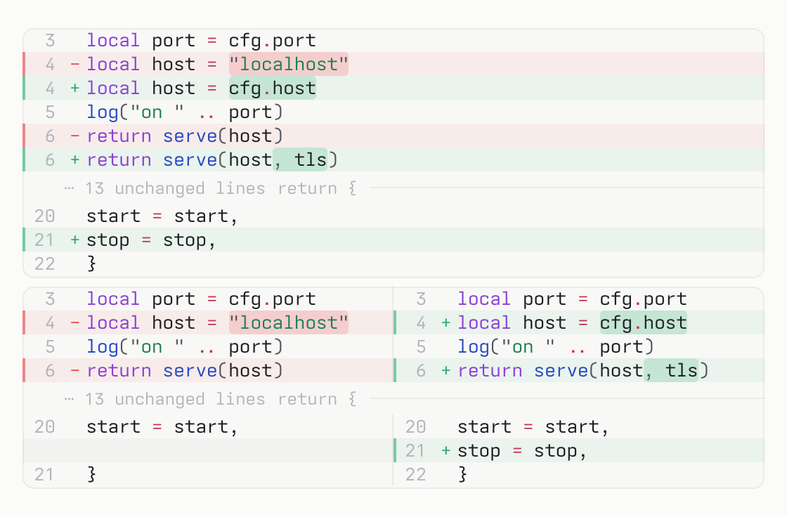
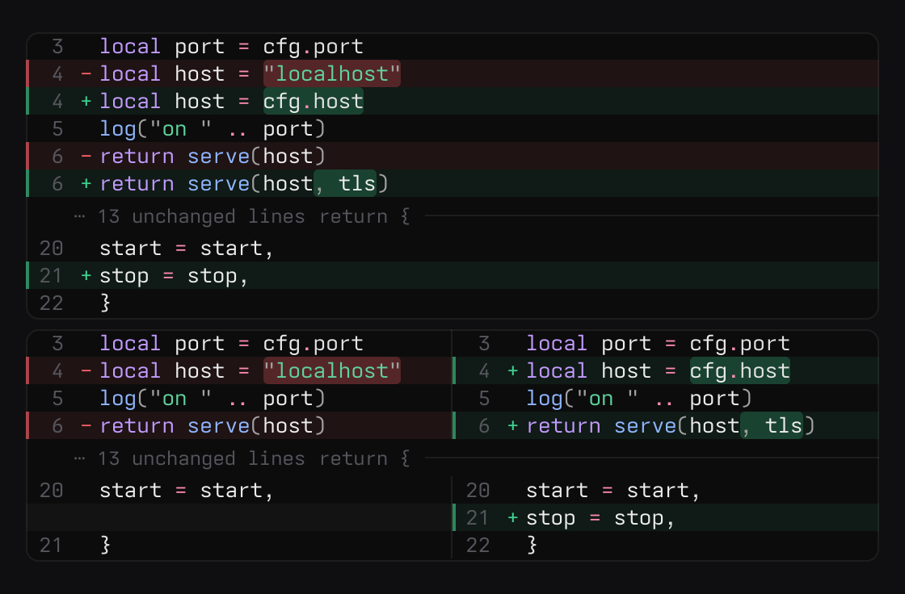
<figcaption><code>mode = "unified"</code>（上）与 <code>mode = "split"</code>（下）。配对的行只给发生变化的词着色。</figcaption>
</figure>

## `ansi` 终端输出 {#ansi}

绘制迷你终端中的原始程序输出：SGR 颜色与样式、OSC 8 超链接、`\r` 与 `\b`。输出按 block 的宽度换行，
宽度变化时重排；单独的 `\n` 会移到下一行的行首，与 pty 的行为一致。block 的高度与它的输出相同，
但只有视野中的行（以及两侧各 24 行）会被绘制。ANSI 颜色来自终端主题（`--ansiN`）；背景是透明的。

只会增长的文字（一次 `text append`，或某个视图的 `text` 增加了后缀）只把新增的尾部喂给终端；
其他任何变化都会让终端重新开始。

**构建方式：** `tern.ui.ansi(text)`（参见 [UI 构建器](../reference/ui.md#text-and-code)），或
`tern.ui.node("ansi", { text = out, follow = true, preview = { lines = 8 } })`。

| 属性 | 类型 | 默认值 | 含义 |
| --- | --- | --- | --- |
| `text` | string | `""` | 输出，含转义序列 |
| `cols` | integer | 无 | 最大列数：block 更宽时按这个宽度换行 |
| `preview` | `{lines = N}` | 无 | 钳制为 N 行并带渐隐，附一个就地展开它的按钮（“Show less” 会再次折叠）。可以是前 N 行，其下为 “K more lines”；或在 `follow` 时取最后 N 行，其上为 “K earlier lines”（“1 earlier line”）。新的 `preview` 值会重置展开状态。在可折叠的 card、section 或 tool 内部，它只在该折叠区折叠时生效，此时按钮会改为打开该折叠区（见下文） |
| `follow` | bool | `false` | 保持尾部在视野内。与 `preview` 一起使用时，钳制显示尾部。有 `max.h` 界限时，block 会一直保持在底部，直到用户从底部滚开；用户滚回底部后继续跟随 |
| `max` | `{h = …}` | 无 | 公共的尺寸界限。对 `ansi`，`max.h`（`"10lines"`）让 block 纵向滚动（`.scroll`），而不是裁切 |

⌘ 点击 OSC 8 链接会打开它（在“打开链接方式”的普通点击设置下，普通点击也会打开，除非按住 ⇧
或该次点击结束了选择）。

鼠标像在终端中一样选择输出：拖动从按下处开始逐行选中单元格；双击选中一个词，三击选中一行，
⇧ 点击扩展选择。Tern 的复制（Copy 快捷键、上下文菜单中的 Copy、选中即复制）会取选中的文本，
每个输出行末尾的换行、以及行文本之后的空白单元格则被略去。在其他任何位置按下都会结束选择。

**子节点：** 无（会被忽略）。

在可折叠的 card、section 或 tool 内部（树上最近的那一个），当该折叠区展开时预览让位：block 完整显示、
按钮隐藏。折叠时，按钮会打开它（`toggle` 事件，与点击头部相同），而不是只展开 block。

**事件：** 自身不产生事件；`actions` 的用法与任何节点相同。more 按钮是 Tern 的本地状态。

**样式：**

```html
<div class="sf sf-ansi scroll" data-id="…">
	<div class="sf-term-clip clamped fade-bottom" style="--sf-clip:…">
		<div class="tv-mini">…</div>
	</div>
	<button class="sf-ansi-more" title="Show all output" aria-expanded="false">12 more lines<svg class="ico chev">…</svg></button>
</div>
<!-- a tail preview (`follow`): the button, with .tail, comes before the clip -->
<div class="sf sf-ansi" data-id="…">
	<button class="sf-ansi-more tail" title="Show all output" aria-expanded="false">12 earlier lines<svg class="ico chev">…</svg></button>
	<div class="sf-term-clip clamped fade-top" style="--sf-clip:…">…</div>
</div>
```

| 目标 | 选择器 |
| --- | --- |
| 节点本身 | `.sf-ansi` |
| 滚动（`max.h`） | `.sf-ansi.scroll` |
| 裁切区 | `.sf-term-clip`、`.sf-term-clip.clamped`、`.fade-top`（跟随尾部时）、`.fade-bottom`（内部，可能变化） |
| 终端 | `.tv-mini`（内部） |
| 更多/更少按钮 | `.sf-ansi-more`、`.sf-ansi-more.open`（已展开）、`.sf-ansi-more.tail`（尾部预览的，位于裁切区之前）、`.sf-ansi-more.sf-hidden`（内部） |

变量：`--sf-clip`（被钳制的高度）、`--sf-lh`，以及来自终端主题的 `--ansi0`…`--ansi15`。

```lua
local ui = tern.ui

local log = ui.ansi(state.output)
log.p.follow = true
log.p.max = { h = "12lines" }
return { main = ui.col({ ui.text("Build output"), log }) }
```

一次失败构建的预览：八行 SGR 着色的输出，一个 OSC 8 链接，钳制为七行。

```lua
local E = "\27"
local out = table.concat({
	E .. "[1;32m   Compiling" .. E .. "[0m tern-core v0.9.2",
	E .. "[1;32m   Compiling" .. E .. "[0m tern-ui v0.9.2",
	E .. "[1;33mwarning" .. E .. "[0m" .. E .. "[1m: unused variable: `port`" .. E .. "[0m",
	"  " .. E .. "[34m-->" .. E .. "[0m src/server.rs:42:9",
	E .. "[1;31merror[E0308]" .. E .. "[0m" .. E .. "[1m: mismatched types" .. E .. "[0m",
	"  " .. E .. "[34m-->" .. E .. "[0m src/app.rs:17:5",
	E .. "[2mFor more information, see" .. E .. "[0m "
		.. E .. "]8;;https://doc.rust-lang.org/error_codes/E0308.html" .. E .. "\\E0308" .. E .. "]8;;" .. E .. "\\",
	E .. "[1;31merror" .. E .. "[0m: could not compile `tern-ui`",
}, "\n")
return ui.node("ansi", { text = out, preview = { lines = 7 } })
```

<figure class="tn-figure">
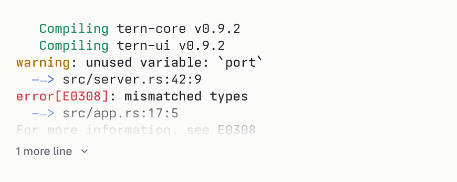
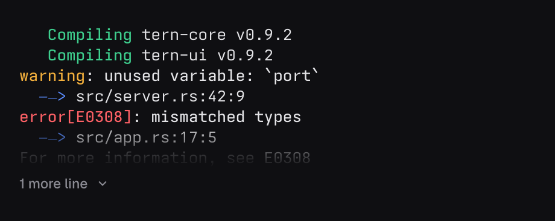
<figcaption>颜色来自终端主题。没有 <code>follow</code> 时，预览保留最前面的几行，并在底部渐隐。</figcaption>
</figure>

## `rows` 行 {#rows}

迁移回退方案：程序已经为终端渲染好的行，按恰好 `cols` 列显示，不重排，所有行都显示，并在角落有一个
弱化的 `fallback` 标记用于调试。它面向正在迁移到协议的程序；插件应优先使用会重排的 `ansi`。

**构建方式：** `tern.ui.node("rows", { lines = { … }, cols = 80 })`。

| 属性 | 类型 | 默认值 | 含义 |
| --- | --- | --- | --- |
| `lines` | 字符串列表 | `{}` | 各行，含转义序列；非字符串会被跳过 |
| `cols` | integer | `80` | 精确的列宽 |

**子节点：** 无（会被忽略）。

**事件：** 自身不产生事件；`actions` 的用法与任何节点相同。

**样式：**

```html
<div class="sf sf-rows" data-id="…">
	<span class="sf-rows-mark" title="Fallback rows (3)" aria-label="Fallback rows (3)">fallback</span>
	<div class="sf-term-clip"><div class="tv-mini">…</div></div>
</div>
```

| 目标 | 选择器 |
| --- | --- |
| 节点本身 | `.sf-rows` |
| 标记 | `.sf-rows-mark`（内部，可能变化） |
| 裁切区、终端 | `.sf-term-clip`、`.tv-mini`（内部） |

```lua
return tern.ui.node("rows", { lines = { "\27[1mname\27[0m  size", "a.txt     12" }, cols = 40 })
```

## `math` 数学 {#math}

用与 `md` 数学相同的引擎排版一个 TeX 公式：默认行内，或作为独立的显示块。

**构建方式：** `tern.ui.node("math", { text = "e^{i\\pi} + 1 = 0", display = true })`。

| 属性 | 类型 | 默认值 | 含义 |
| --- | --- | --- | --- |
| `text` | string | `""` | TeX，不带定界符 |
| `display` | bool | `false` | 显示样式，作为在节点宽度内居中的块。显示数学会丢弃空行（空行会结束该块）；行内数学是一行（换行按空格处理），位于节点的起始处 |

排版失败的公式会把其源文本显示为 `code.math-err`，并以错误信息作为提示。

**子节点：** 无（会被忽略）。

**事件：** 自身不产生事件；`actions` 的用法与任何节点相同。

**样式：**

```html
<div class="sf sf-math display" data-id="…">
	<div class="md">
		<div class="math-display" data-tex="…"><svg>…</svg></div>
	</div>
</div>
<!-- inline: <div class="md"><p><span class="math" data-tex="…"><svg>…</svg></span></p></div> -->
```

| 目标 | 选择器 |
| --- | --- |
| 节点本身 | `.sf-math`、`.sf-math.display` |
| 公式 | `.sf-math .math`、`.sf-math .math-display`（内部，可能变化） |
| 排版失败的公式 | `.sf-math code.math-err`（内部） |

svg 以 `currentColor` 绘制，内部元素将其设为 `--t1`（`.md`，以及显示数学的 `.math-display`），
因此直接设在 `.sf-math` 上的 `color` 无法作用于它。用
`.sf-math :is(.math, .math-display) { color: … }` 重新给公式上色。

```lua
local ui = tern.ui

return ui.col({
	ui.text("The identity:"),
	ui.node("math", { text = "e^{i\\pi} + 1 = 0", display = true }),
	ui.node("math", { text = "\\sum_{k=1}^{n} k = \\frac{n(n+1)}{2}" }),
})
```

<figure class="tn-figure">
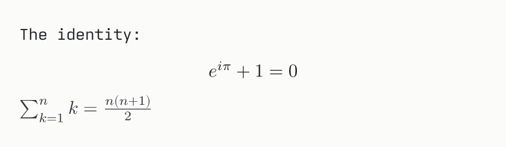
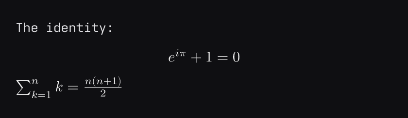
<figcaption>一个显示公式（居中）与一个行内公式（文本样式：上下限在求和号旁，分式较小）。</figcaption>
</figure>
