# Agent、Chat 与 Task 类型 {#agent-chat-and-task-kinds}

这些类型把 agent 的工作、对话与设置绘制成实时数据。它们为两个程序而设计：omp（编码 agent）用 `tool`、`agent`、`checklist` 和 `prefs` 绘制它的工具调用、子 agent、待办列表和 `/settings` 页面，Tern 自身则用 `block` 绘制 shell 命令的 lens 输出。chat 相关的类型则绘制围绕这些工作的对话：消息（`message`）、答案背后的步骤与推理（`trace`）、带堆栈的错误（`stacktrace`）、接下来可以问什么（`suggestions`），以及 agent 反过来问的问题（`questions`）。每种类型也能在插件视图中渲染，本页说明其中哪些在那里可用。当你的插件呈现相同的形状时就可以选用它们：带状态与输出主体的运行步骤（`tool`）、带实时统计的 worker（`agent`）、分阶段的待办列表（`checklist`）、聊天，或设置页面（`prefs`）。`block` 不用自己构建：Tern 会把你的 lens 视图包进一个 `block`。

| 类型 | 构建器 | 绘制内容 |
| --- | --- | --- |
| [`tool`](#tool) | `tern.ui.node("tool", …)` | 一个步骤：数据头（图标、动词、目标、meta、状态、计时器）位于带边框、可折叠的主体之上；或一个等待批准 |
| [`agent`](#agent) | `tern.ui.node("agent", …)` | 一行 worker，带实时状态与统计，以及可展开的内容 |
| [`trace`](#trace) | `tern.ui.node("trace", …)` | 一个 agent 的步骤、思维链、带来源的推理块 |
| [`stacktrace`](#stacktrace) | `tern.ui.node("stacktrace", …)` | 一个错误及其堆栈帧：高亮显示的应用帧、折叠的库帧、某一帧处的代码 |
| [`checklist`](#checklist) | `tern.ui.node("checklist", …)` | 分阶段的待办列表、带弹出层的 dock 胶囊，或一条“仍有未完成”提醒 |
| [`message`](#message) | `tern.ui.node("message", …)` | 一条聊天消息：作者、时间、头像、正文、回应、悬停操作与状态行 |
| [`suggestions`](#suggestions) | `tern.ui.node("suggestions", …)` | 接下来可提出的提示，以 chip、编号行或小卡片呈现 |
| [`questions`](#questions) | `tern.ui.node("questions", …)` | 一份问卷：步骤、内联 chip 或折叠列表 |
| [`block`](#block) | 由 Tern 围绕 lens 视图生成 | 一条命令的输出：lens 视图或原始输出、Native/Raw 切换、复制 |
| [`prefs`](#prefs) | `tern.ui.node("prefs", …)` | 完整的设置页面或设置抽屉，由你的数据与按键驱动 |

这些类型都没有 `tern.ui` 构建器；请使用 `tern.ui.node(kind, props,
children)`（参见 [UI 构建器](../reference/ui.md)）。每个节点是一个
`<div class="sf sf-<kind>" data-id="<id>">`，并接受 [元素](index.md) 中介绍的通用属性（`role`、
`tone`、`hidden`、`actions`、…），但有两个例外：`tool` 与 `trace` 把 `title` 用作头部文本，
而不是工具提示；`message` 把 `actions` 用作自己的按钮列表。

它们的样式表已内置，并在每个 surface 上加载：`omp-tools.css`（`tool`、
`agent`、`checklist`）、`surface-trace.css`、`surface-stacktrace.css`、
`surface-message.css`、`surface-suggestions.css` 与 `surface-questions.css`（每类一个）、
`surface-lens.css`（`block`）、kit 的 `prefs.css` 加上 `omp-prefs.css`
（`prefs`）。稳定的钩子是 `.sf-<kind>`、`[data-id]`、`[data-role]`、`[data-tone]`、
`[data-state]`、`[data-variant]` 以及区域 `[data-surface]`。下文列出的其他类是
Tern 的内部结构：记录它们是为了让你能作为选中目标，但它们是**内部结构，可能随版本变化**。

## `tool` 步骤 {#tool}

一步工作：一个由 Tern 从数据绘制的头部，以及一个由你的子节点构成的主体。omp 每次工具调用发送一个（`bash`、`read`、`edit`、…）；在插件里，它适用于一个部署步骤、一次查询、一个构建阶段——任何带动词、目标、状态与输出的操作。

头部从左到右依次为：左边缘的状态条、一个图标、`title` 动词、`target`、`meta` 事实、徽标、可伸缩的间隙、`note`、一个 `exit N` chip、一个计时器、一个状态字形、一个折叠箭头与悬停操作按钮。主体按顺序容纳子节点。只要某个可见子节点的类型与其前一个可见子节点不同（先是代码，然后是输出，再是表格），该子节点就获得 `.sf-tool-hr`，样式表会在它上方画一条细线。两个 `code` 子节点之间的 `text` 是同一文件两段代码之间的间隙（omp 在行号跳跃处显示 `…`）：它获得 `.sf-tool-gap`，其上方的代码段获得 `.sf-tool-cont`，且不画细线，这样样式表就能把各段代码及其间隙绘制成一个整体。主体中任何东西都不再画第二层边框：嵌套的 `card` 与 `tool` 子节点会去掉描边与着色，绘制为无边框区块（嵌套 card 还会隐藏其头部 chip），`code` 与 `diff` 子节点会去掉背景与边框（代码块还会隐藏其头部），因此一个步骤绝不会出现框中框。

**边框。** `frame: "card"`（默认）画一圈描边，在 `running`/`pending` 时带淡色着色，`error` 时带红色着色。`frame: "inline"` 去掉描边、着色与状态条：一行头部加上主体，缩进于一条细线之后。

**状态。** `status` 取 `pending`、`running`、`done`、`error`、`cancelled`、`ask` 之一；其他值按 `pending` 处理。`running` 以旋转圆环作为字形，并显示一条常亮的左侧条；`error` 显示 x 圆圈和红条；`cancelled` 显示带斜线的圆；`done` 与 `pending` 不显示字形。`ask` 等待人的批准（见下文“批准”）：不显示字形，图标使用警告色。

**计时器。** 在 `running` 或 `pending` 期间，`age`（发送时已流逝的毫秒数）会启动一个实时计时器：它从 `age` 加上 `age` 上次到达以来经过的时间开始累加，因此不改动 `age` 的 patch 不会重置它。其他情况下计时器显示 `took`，否则显示冻结的 `age`。冻结时间不足一秒会获得 `.fast`（悬停头部前隐藏）。没有 `age`/`took` 就没有计时器。

```lua
local ui = tern.ui

ui.node("col", { gap = "sm" }, {
	ui.node("tool", { name = "bash", title = "Deploy", status = "pending",
		target = "kubectl apply -f k8s/web.yaml", targetKind = "command",
		badges = { { text = "prod", tone = "info" } } }),
	ui.node("tool", { name = "bash", title = "Build", status = "running", age = 4200,
		target = "cargo build --release 2>&1 | tee build.log", targetKind = "command" }, {
		ui.node("ansi", { text = "Compiling stencil-css v0.1.0\n…" }),
	}),
	ui.node("tool", { name = "edit", title = "Edit", status = "done", took = 640,
		target = "src/deploy/plan.rs:13-36", targetKind = "path", meta = { "+8 −1" } }),
	ui.node("tool", { name = "bash", title = "Test", status = "error", took = 3100,
		exit = 101, note = "2 failed",
		target = "cargo test -p deploy", targetKind = "command" }, {
		ui.node("ansi", { text = "test plan::rollback ... \27[31mFAILED\27[0m\n…" }),
	}),
})
```

<figure class="tn-figure">
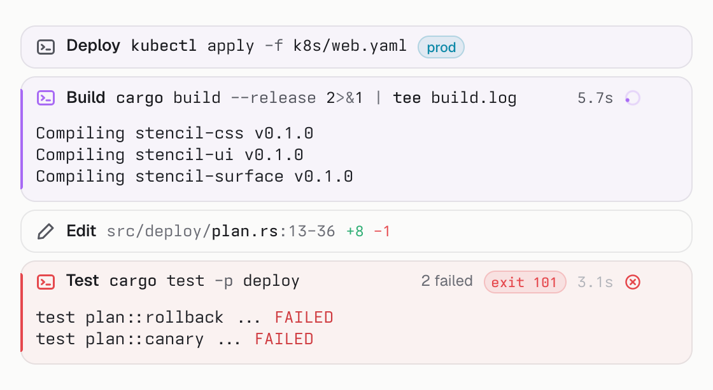
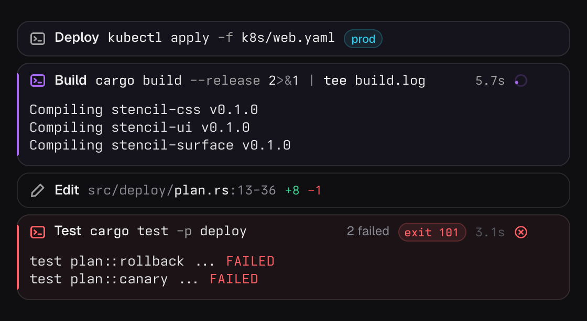
<figcaption>待执行、运行中、已完成与错误。Edit 的 640 ms 不足一秒，因此其计时器要等到悬停才显示。</figcaption>
</figure>

**目标。** `targetKind` 决定字符串 `target` 的绘制方式：

| `targetKind` | 绘制为 |
| --- | --- |
| `command` | 一行 shell 拆成若干片段：`.cmd`（程序词）、`.flag`（`-x`）、`.str`（带引号的字符串）、`.var`（`$X`）、`.op`（`|`、`&&`、`;`、`>`、…），其余为纯文本。折叠时显示省略号，展开时换行。 |
| `path` | `.dir`（目录，弱化）、`.name`（文件，加强）、`.ln`（`:12` / `:13-36` 后缀，轻柔） |
| `pattern`、`query` | 两个 `.q` 弯引号之间的文本 |
| `text`（默认） | 按给定内容绘制的文本或 span |

Span（一个表格，而非字符串）始终按 span 绘制。节点上带 `href` 时，目标的工具提示会给出该链接，在 tool 上任意位置 ⌘-点击即可打开。

**Meta。** 每个 `meta` 条目是一个 `.sf-tool-meta` span。在纯字符串中，`+N` 形式的词会被包进 `.add`（新增色），`-N` / `−N` 包进 `.del`（删除色），因此 `"+8 −1"` 读起来就像 diff 统计。

**折叠。** `collapsible: true` 会把头部变成按钮（Enter 或 Space 翻转；普通点击翻转，⌘-点击不翻转）。该状态是局部的，按 `key` 在该节点的兄弟节点之间记忆（没有则按 id），与 card 类似，而不是 surface 级。在同父节点下删除并以新 id、相同 key 添加一个节点会保留折叠状态；相同 key 在另一个父节点下拥有独立状态。`collapsed` 设置初始状态；之后更改该属性会把记忆的状态重置为它。折叠时：

- 使用 `preview: { lines = N }` 时，主体被裁剪为前 N 行，底部带渐隐，下方有一个“`K more lines · Show all ⌃O`”按钮；
- 使用 `preview: { tail = N }` 时，主体被裁剪为最后 N 行，顶部带渐隐，并显示“`K earlier lines · Show all ⌃O`”（两者都给出时以 tail 为准）；
- 使用 `preview = "children"` 时，主体保持完整：不裁剪，也没有 Show all 按钮（类 `clamp-children`）。子节点自己的 preview（`ansi`、`code`）会改为自行裁剪，因此主体的每一节只显示自己的几行；
- 没有 preview 时，主体隐藏。

行数按绘制后的行计算（换行的一行计为多行），从主体的高度测量。仅当主体高于 preview 时才应用裁剪。Show all 按钮对 `lines` 位于被裁剪的主体下方，对 `tail` 位于头部与主体之间；它会把 tool 展开。`⌃O` 键帽只是标签：按键会到达你的 block 的 `key` 处理器，而不是 tool。

可折叠的 tool 是其中 preview 的展开控件，和 card 一样：它打开时，主体中 `ansi` 或 `code` 的 `preview` 会让位，完整显示；折叠后（通过头部、程序的 `collapsed` 或 Show all 按钮），它们又会裁剪。折叠期间，它们的“N more lines” / “N earlier lines”按钮会打开整个 tool（发送 `toggle` 事件，如同点击头部），而不是只展开自己那块。

**复制命令。** 带 `command` 属性，或在 `command` 缺省时 `target` 是 `targetKind = "command"` 形式的字符串，头部就会提供一个 Copy command 按钮（悬停时显示，与操作按钮一样），无论头部怎样显示，它都整行复制那条原始命令。`command` 让 tool 在 `target` 显示别的内容（意图）时仍能复制自己的命令。

<!-- 原文此行内代码跨行断开，按原文保留两个片段：`targetKind =`、` when ` -->

```lua
ui.node("tool", {
	name = "bash", title = "Deploy", status = "done", took = 12400,
	target = "kubectl rollout status deploy/web", targetKind = "command",
	collapsible = true, collapsed = true, preview = { tail = 3 },
	tools = { { id = "copy", label = "Copy" }, { id = "rerun", label = "Rerun" } },
}, {
	ui.node("ansi", { text = rollout_log }), -- six lines
})
```

<figure class="tn-figure">
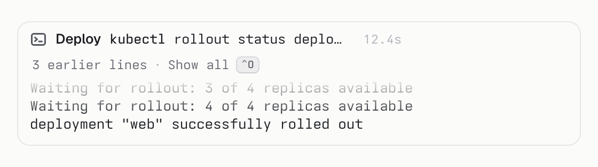
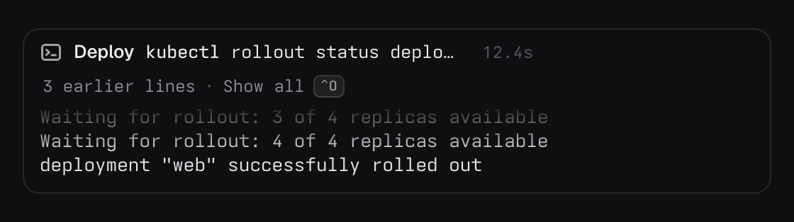
<figcaption>以 <code>preview = { tail = 3 }</code> 折叠。折叠箭头与 Copy、Rerun 按钮在悬停时显示。</figcaption>
</figure>

**折叠分组。** 开启 Tern 的 *Fold tool calls* 设置（默认关闭）后，`main` 的子节点中两个或更多连续的工作 block（`tool` 节点，以及 omp 的工具卡片与仅含思考的消息）会归入一个 `div.sf-work-head` 展开控件，显示“Worked for 12.3s · Deploy ×2 · Test”：先是合计的 `took`，然后每个 `title`（没有则 `name`）及其次数。后面还跟着其他 block 的一段以折叠状态开始；到 `main` 末尾仍在增长的一段以展开状态开始。一段中的 block 获得 `.sf-work`，折叠的获得 `.sf-folded`。嵌套的 tool 永不折叠。

**操作。** `tools` 列出悬停或键盘聚焦时显示在头部的按钮：`{ id, label, keys? }`，其中 `keys` 是按键名称列表，会作为键帽绘制在按钮内。点击会把 `id` 作为操作在 tool 节点上运行：内置操作（`toggle`、`copy`、`open`、`select`、`activate`、`zoom`）在任何节点上都执行同样的行为（参见 [元素](index.md)）；其他任何 id 会发送 `action`。

**批准。** tool 可以在运行前等待人确认。设置 `status = "ask"`，Tern 就会在头部与主体之间绘制一个批准面板；用 `ask` 描述它。只要某个步骤风险足够高、应当先由人点头，就可以用它：删除文件、force push、部署，以及任何花钱的操作。程序拿到答案后，设置它运行时的状态（`running`、`done`、`cancelled`、…）与 `approved`：面板消失，头部中的一个 chip 记录该决定（*Allowed once*、*Allowed this session*、绿色的 *Always allowed*、红色的 *Denied*；它在任何状态下都显示）。

`confirm` 决定外观：

| `confirm` | 外观 | 按钮 |
| --- | --- | --- |
| `card`（默认） | 边框变为警告色调（描边与着色），头部显示一个脉动的 *Needs your approval* chip，细线下方的一栏放置按钮。适合人应当先完整看到再确认的调用。 | 左侧 Deny；右侧 Always 与 Allow ⏎ |
| `strip` | 头部下方一条紧凑的警告条，显示 `ask.text`（*Allow this command?*）；边框保持朴素。适合一连串调用，为每个调用显示一张卡片会过于喧闹。 | Deny · Allow |
| `scopes` | 问题（*Allow this?*）、scope 单选列表（“是”的有效期），然后是按钮；边框保持朴素。没有 `ask.scopes` 时，列表是 *Only this time*、*For this session*、*Always*（`once`、`session`、`always`）。 | Deny · Allow ⏎ |

点击按钮会发送 `action { id, act, value? }`，其中 `act` 为 `allow`、`deny` 或 `always`，`value` 是选中的 scope（`ask.scope`，或人选的单选；没有时缺省）。选择 scope 单选不会发送任何内容：它立即显示为选中，并随下一次按钮的 `value` 一起带上。来自程序的 `ask.scope` 变更优先于人的选择。面板从不获取焦点：Allow 上的 ⏎ 键帽只是标签，因此要在你的 block 的 `key` 处理器中绑定 Enter（以及 Escape 表示拒绝，如果你需要），并像点击一样作答；要从键盘移动 scope，请设置 `ask.scope`。以 `listen: false` 关闭或打开的 surface 会绘制面板，但不发送任何内容，也不移动单选。

```lua
local ui = tern.ui

ui.node("tool", {
	name = "bash", title = "Run", target = "rm -rf dist build", targetKind = "command",
	status = "ask", confirm = "scopes",
	ask = {
		text = "Let bash run rm -rf?",
		scopes = {
			{ id = "once", label = "Only this time" },
			{ id = "session", label = "For this session" },
			{ id = "repo", label = "Always, in this repo" },
		},
	},
})

-- after action { act = "allow", value = "once" }, the same tool once it ran:
ui.node("tool", {
	name = "bash", title = "Run", target = "rm -rf dist build", targetKind = "command",
	status = "done", approved = "once", took = 840,
})
```

<figure class="tn-figure">
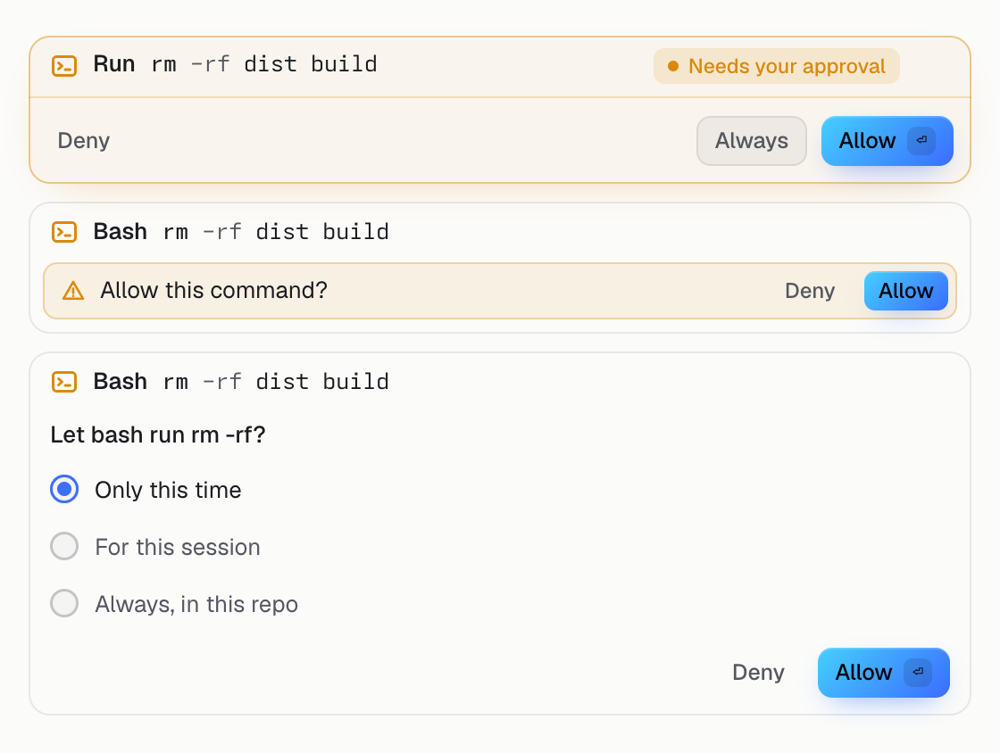
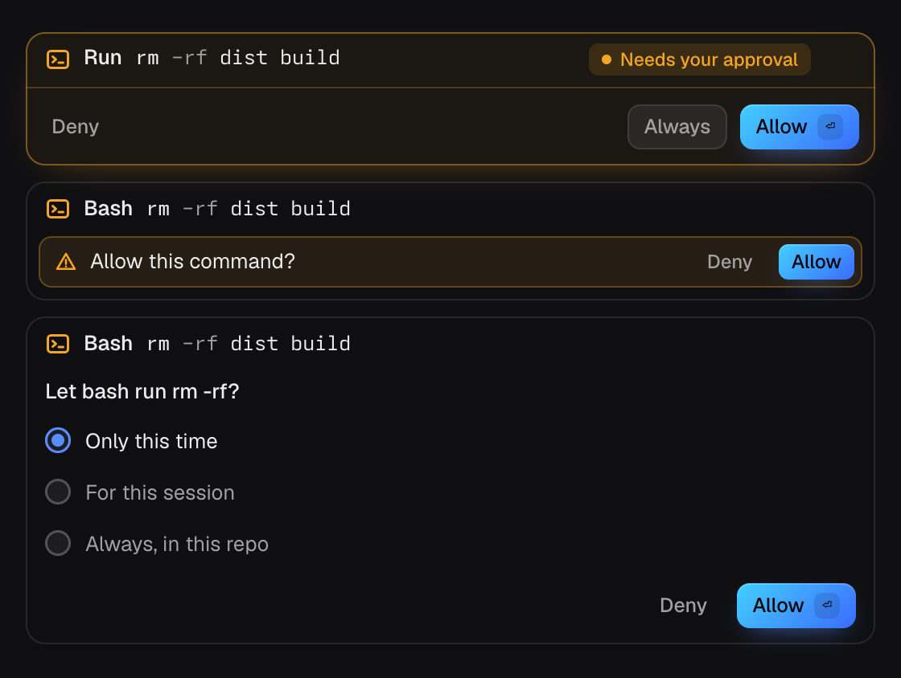
<figcaption>三种批准外观：<code>confirm = "card"</code>、<code>"strip"</code> 与 <code>"scopes"</code>。</figcaption>
</figure>

<figure class="tn-figure">
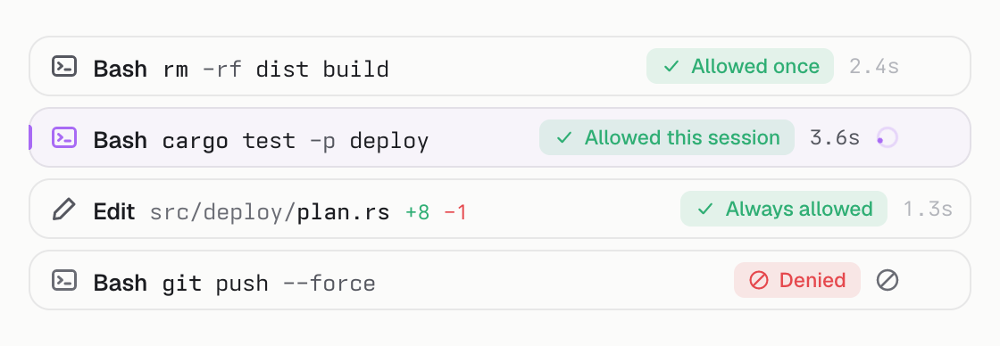
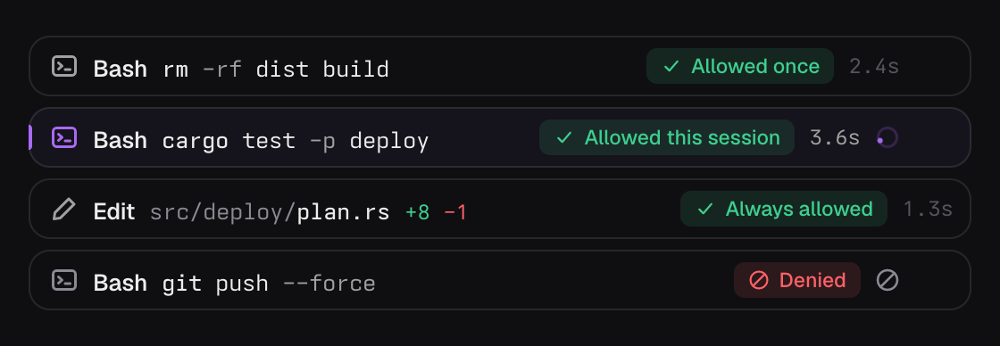
<figcaption>得到答案之后：<code>approved</code> 会在头部留下一个 chip。</figcaption>
</figure>

**构建方式：** `tern.ui.node("tool", { … }, { …body })`。

| 属性 | 类型 | 默认值 | 含义 |
| --- | --- | --- | --- |
| `name` | string | `""` | 工具名称；按 `omp.tool.<name>` 角色表选取图标（`bash`/`shell` 终端、`read` 文档、`edit` 笔、`write` 文件加号、`grep`/`glob`/`search` 搜索、`find` 闪光、`ls` 文件夹、`web`/`fetch`/`browser` 地球、`todo` 清单勾选、`task` 用户、`eval` 代码、`python`、`lsp` 花括号、`proc` 活动、…）。其他任何名称使用插头图标。 |
| `title` | text | `""` | 动词（“Deploy”、“Query”）。同时是头部的无障碍名称，连同目标与状态。在这里不是工具提示。 |
| `target` | text | none | 主要参数，等宽显示。 |
| `targetKind` | `"command"` \| `"path"` \| `"pattern"` \| `"query"` \| `"text"` | `"text"` | 字符串 `target` 的绘制方式（见上表）。同时作为 `data-tk` 设置在节点上，并作为 `.sf-tool-target` 上的类。 |
| `href` | string | none | tool 的链接：⌘-点击打开；显示在目标的工具提示中。 |
| `meta` | array of text | `[]` | 目标之后的简短事实。 |
| `badges` | array of `{ text, tone?, title? }` | `[]` | 头部的 `.sf-badge` chip；`tone` 设置 `data-tone`，`title` 设置工具提示。 |
| `note` | text | none | 计时器之前的简短状态说明（“timed out”、“partial”）。 |
| `exit` | number | none | 非零代码会显示一个 `exit N` chip（`.sf-chip.st-error.sf-tool-exit`）。 |
| `status` | `"pending"` \| `"running"` \| `"done"` \| `"error"` \| `"cancelled"` \| `"ask"` | `"pending"` | 状态：类 `st-<status>`、字形、着色、计时器模式；`"ask"` 等待批准并绘制面板。 |
| `age` | number (ms) | none | 发送时已流逝的时间；运行/待执行期间为实时计时器，之后回退为冻结值。 |
| `took` | number (ms) | none | 结束后的最终耗时。 |
| `intent` | string | none | 头部的工具提示。 |
| `frame` | `"card"` \| `"inline"` | `"card"` | 有无描边。 |
| `collapsible` | boolean | `false` | 头部切换主体。 |
| `collapsed` | boolean | none | 初始折叠状态（仅与 `collapsible` 一起使用）。 |
| `preview` | `{ lines = N }` \| `{ tail = N }` \| `"children"` | none | 折叠主体的裁剪方式；`"children"` 保持主体完整，把裁剪交给子节点自己的 preview。 |
| `command` | string | none | 头部 Copy command 按钮复制的原始命令行（否则取 `command` 目标的）。 |
| `tools` | array of `{ id, label?, keys? }` | `[]` | 悬停操作按钮。 |
| `confirm` | `"card"` \| `"strip"` \| `"scopes"` | `"card"` | `status` 为 `"ask"` 时的批准外观（见上表）。 |
| `ask.text` | string | `"Allow this command?"`（strip）、`"Allow this?"`（scopes）、none（card） | 问题。 |
| `ask.allow` | string | `"Allow"` | Allow 按钮的标签。 |
| `ask.deny` | string | `"Deny"` | Deny 按钮的标签。 |
| `ask.always` | string \| `false` | `"Always"` | Always 按钮的标签（仅 `card`）；`false` 会隐藏它。 |
| `ask.scopes` | array of `{ id, label? }` | once / session / always | `confirm = "scopes"` 的单选项；`label` 默认取 `id`。 |
| `ask.scope` | string | the first scope (scopes look), none otherwise | 选中的 scope，作为按钮的 `value` 发送。来自程序的变更优先于人的选择。 |
| `approved` | `"once"` \| `"session"` \| `"always"` \| `"denied"` | none | 答案，在任何状态下都作为头部 chip 显示。 |
| `key` | string | node id | 在兄弟节点之间的标识；折叠状态按此 key 在同一父节点下记忆。 |

**子节点：** 按顺序绘制在 `.sf-tool-body` 中（任意类型）。嵌套的 `card` 与 `tool` 子节点绘制为无边框。

**事件：** 用户翻转可折叠 tool 时发送 `toggle { id, collapsed, key? }`；id 不是内置操作的按钮发送 `action { id, act, mods? }`；批准按钮发送 `action { id, act, value? }`，`act` 为 `allow`、`deny` 或 `always`，`value` 为选中的 scope。外加节点上的通用 `actions`。

**样式：**

```html
<div class="sf sf-tool card st-running collapsible [collapsed] [nopreview] [clamped] [tail] [clamp-children] [inline] [ask-card|ask-strip|ask-scopes]"
	data-id="…" data-tk="command">
	<i class="sf-tool-bar"></i>
	<div class="sf-tool-head" role="button" tabindex="0" aria-expanded="true">
		<span class="sf-tool-ic"><!-- icon --></span>
		<span class="sf-tool-line">
			<span class="sf-tool-title">Deploy</span>
			<span class="sf-tool-target command"><span class="cmd">kubectl</span> apply <span class="flag">-f</span> …</span>
			<span class="sf-tool-meta"><span class="add">+8</span> <span class="del">−1</span></span>
			<span class="sf-badge" data-tone="info">prod</span>
			<span class="sf-tool-sp"></span>
			<span class="sf-tool-note">partial</span>
			<span class="sf-chip st-error sf-tool-exit">exit 1</span>
			<span class="sf-tool-askchip"><i class="dot"></i>Needs your approval</span>
			<span class="sf-tool-approved" data-tone="ok"><svg class="ico">…</svg>Allowed once</span>
		</span>
		<span class="sf-tool-time [fast]" role="timer">1.2s</span>
		<span class="sf-tool-st"><i class="sf-tool-spin"></i></span>
		<span class="sf-chev"><!-- chevron --></span>
		<button class="sf-tool-copy [sf-hidden]" title="Copy command"><svg class="ico">…</svg></button>
		<span class="sf-tool-acts"><button class="sf-tool-act">Copy<span class="kbd">⌘C</span></button></span>
	</div>
	<div class="sf-tool-ask scopes [sf-hidden]"><!-- card: text and foot; strip: .sf-tool-ask-ic, text, .sf-tool-sp and the buttons in one row -->
		<div class="sf-tool-ask-text">Let bash run rm -rf?</div>
		<div class="sf-tool-scopes" role="radiogroup">
			<button class="sf-tool-scope on" role="radio" aria-checked="true"><i class="radio"></i><span class="label">Only this time</span></button>
		</div>
		<div class="sf-tool-ask-foot">
			<span class="sf-tool-sp"></span>
			<button class="sf-button sf-tool-ask-btn" data-variant="quiet"><span class="sf-btn-label">Deny</span></button>
			<button class="sf-button sf-tool-ask-btn" data-variant="primary"><span class="sf-btn-label">Allow</span><span class="sf-kbd"><span class="kbd">⏎</span></span></button>
		</div>
	</div>
	<div class="sf-tool-body"><!-- children; a child whose kind changes gets .sf-tool-hr, a text between two code runs .sf-tool-gap (the run above it .sf-tool-cont) --></div>
	<button class="sf-tool-more"><span class="n">12 more lines</span><span class="dot">·</span>Show all<span class="kbd">⌃O</span></button>
</div>
```

| 目标 | 选择器 |
| --- | --- |
| 节点 | `.sf-tool` |
| 有边框 / 无边框 | `.sf-tool.card` / `.sf-tool.inline` |
| 某个状态 | `.sf-tool.st-pending`、`.st-running`、`.st-done`、`.st-error`、`.st-cancelled` |
| 目标类型 | `.sf-tool[data-tk='path']` |
| 折叠状态 | `.sf-tool.collapsible`、`.collapsed`、`.nopreview`（折叠且无 preview）、`.clamped`（preview 裁剪生效）、`.tail`（tail preview）、`.clamp-children`（`preview = "children"`） |
| 左侧状态条 | `.sf-tool-bar`（内部，可能变化） |
| 头部、图标、行 | `.sf-tool-head`、`.sf-tool-ic`、`.sf-tool-line`（内部，可能变化） |
| 动词、目标、meta | `.sf-tool-title`、`.sf-tool-target.<kind>`，带 `.cmd .flag .str .var .op` / `.dir .name .ln` / `.q`，`.sf-tool-meta .add` / `.del`（内部，可能变化） |
| 说明、退出、计时器、字形 | `.sf-tool-note`、`.sf-tool-exit`、`.sf-tool-time`（`.fast`）、`.sf-tool-st`、`.sf-tool-spin`（内部，可能变化） |
| 折叠箭头 | `.sf-tool-head > .sf-chev`（内部，可能变化） |
| 操作按钮 | `.sf-tool-acts`、`.sf-tool-act`、`.sf-tool-act .kbd`（内部，可能变化） |
| 复制命令 | `.sf-tool-copy`、`.sf-tool-copy.sf-hidden`（没有可复制内容）（内部，可能变化） |
| 主体、分隔线 | `.sf-tool-body`、`.sf-tool-body > .sf-tool-hr`（内部，可能变化） |
| 代码段之间的间隙、其上方的代码段 | `.sf-tool-body > .sf-tool-gap`、`.sf-tool-body > .sf-code.sf-tool-cont`（内部，可能变化） |
| Show all 按钮 | `.sf-tool-more`，带 `.n`、`.dot`、`.kbd`（内部，可能变化） |
| 等待批准，按外观 | `.sf-tool.st-ask`，带 `.ask-card`、`.ask-strip`、`.ask-scopes` |
| 批准面板 | `.sf-tool-ask.card` / `.strip` / `.scopes`、`.sf-tool-ask-ic`、`.sf-tool-ask-text`、`.sf-tool-ask-foot`、`.sf-tool-ask-btn[data-variant]`（同时也是 `.sf-button`）（内部，可能变化） |
| Scope 单选 | `.sf-tool-scopes` > `.sf-tool-scope`（`.on`、`aria-checked`），带 `.radio`、`.label`（内部，可能变化） |
| 批准 chip | `.sf-tool-askchip`（`.dot`）、`.sf-tool-approved[data-tone='ok' \| 'bad']`（内部，可能变化） |

变量：裁剪高度在 `.clamped` 期间以内联方式作为 `--sf-clamp` 设置在节点上。着色在已定义时读取 `--sf-tint-pending` 与 `--sf-tint-error`，否则读取 `--live` / `--sf-bad`；`--sf-run-a` 是运行着色的 alpha（深色 0.04，浅色 0.05）。批准卡片的描边与着色、警告条以及 chip 的圆点读取 `--warn`。颜色是 Tern 的语义 token 颜色（参见 [CSS 变量](../styles/variables.md)）。旋转指示器、状态条与头部动效、批准面板的入场以及 chip 的脉动会在减少动效模式与静态视图（`.sf-still`）中停止。

```lua
local ui = tern.ui

local function step(s)
	return ui.node("tool", {
		key = "deploy." .. s.env,
		name = "bash",
		title = "Deploy",
		target = "kubectl apply -f " .. s.file,
		targetKind = "command",
		badges = { { text = s.env, tone = "info" } },
		status = s.status, -- "running", "done", "error"
		age = s.status == "running" and s.elapsed or nil,
		took = s.took,
		exit = s.exit,
		collapsible = true,
		collapsed = s.status == "done",
		preview = { tail = 6 },
		tools = { { id = "copy", label = "Copy" }, { id = "rerun", label = "Rerun" } },
	}, {
		ui.node("ansi", { text = s.output }),
	})
end
```

点击 Rerun 会向你的 block 的 `event` 发送 `action { id = <tool id>, act = "rerun" }`。

## `agent` 工作行 {#agent}

一个 worker 占一行：状态字形、名称、徽标、一行任务，以及右对齐的统计（模型、工具调用数、请求数、进度、上下文仪表或 token 数、费用、计时器）。第二行显示它当前运行什么（工具图标、工具名、闪烁的意图与工具自己的计时器），或一个重试倒计时。子节点是它展开后的内容。omp 每个子 agent 发送一个；在插件里，它适用于任何作业或 worker 池：CI runner、爬虫、同步 worker。

**状态。** `status` 取 `pending`、`running`、`done`、`failed`、`aborted`、`idle`、`parked` 之一（其他值按 `pending` 处理）。字形是实时脉冲（`running`）、对勾（`done`）、x（`failed`）、斜线（`aborted`），或空心圆环（其余）。

**统计。** 从 `stats` 读取；每部分仅在设置时显示：

| 字段 | 绘制为 |
| --- | --- |
| `model`（节点属性） | `.model` chip，显示名称最后一个 `/` 之后的部分；完整名称作为工具提示。带 `thinking`（如 `thinkingLow` 这样的 token）时，显示该 token 语义色的圆点。 |
| `stats.tools` | `.tools`：扳手图标与计数（大于 0 时） |
| `stats.requests` | `.req`：`N req`（大于 0 时） |
| `stats.done` | `.done`：小圆环与 `N%`（0–1，取整），仅在 `running` 时 |
| `stats.context` | `.sf-agent-meter`：按比例（0–1，大于 1 时按百分比）填充的条，75% 时 `.warn`，90% 时 `.bad`；工具提示与标签为 `contextLabel` 或 `N% context` |
| `stats.tokens` | `.tok`：紧凑计数（`12K`、`1.2M`），仅在缺少 `context` 时 |
| `stats.cost` | `.cost`：`$0.42`，或 `<$0.01`（大于 0 时） |
| `stats.age` / `stats.took` | `.time`：`running`/`pending` 期间为基于 `age` 的实时计时器；否则为冻结的 `took`（没有则 `age`） |

与 `tool` 的 `age` 一样，`stats.age`、`tool.age` 与 `retry.age` 从到达时刻起继续累加，因此其他属性的 patch 不会打断它们。由于它们位于一个对象内，`stats`（或 `tool`、`retry`）以相同 `age` 再次到达（例如为了更新 `tools`）同样会让计数继续；不同的 `age` 会从该值重新开始。

**第二行。** 设置 `retry` 时显示 `↻ retry A/M in <countdown>`（倒计时 `delay - age` 毫秒），`error` 作为工具提示。否则，在 `running` 且设置了 `tool` 时，显示工具的图标（与 [`tool`](#tool) 同一张表）、名称、意图（span 会得到 `shimmer` 效果，除非它们自行设置）以及基于 `tool.age` 的实时计时器。该行为空时隐藏。

**折叠。** 与 `tool` 相同：`collapsible` 把该行变成按钮（点击、Enter、Space；⌘-点击不翻转），状态是局部的，按 `key` 在兄弟节点之间记忆（否则按 id），`collapsed` 设置它，`.collapsed` 隐藏子节点。

**深度。** `depth`（0–6）在节点上设置 `--sf-depth`；样式表把该行缩进 `depth × 22px`，用于以兄弟节点绘制的工作进程树。

```lua
ui.node("col", { gap = "xs" }, {
	ui.node("agent", { name = "runner-3", agent = "linux", task = "Build and test main",
		status = "running", model = "anthropic/opus", thinking = "thinkingHigh",
		stats = { tools = 14, done = 0.4, context = 0.78, cost = 0.42, age = 72000 },
		tool = { name = "bash", intent = "Running the test suite", age = 8000 } }),
	ui.node("agent", { name = "runner-4", agent = "linux", task = "Lint the workspace",
		status = "done", stats = { tools = 6, tokens = 19400, cost = 0.08, took = 41000 } }),
	ui.node("agent", { name = "runner-5", agent = "macos", task = "Sign the app bundle",
		status = "failed", badges = { { text = "flaky", tone = "warning" } },
		stats = { tools = 3, took = 12000 } }),
	ui.node("agent", { name = "crawler-1", task = "Fetch the changelog", status = "running",
		depth = 1, stats = { requests = 2, age = 5000 },
		retry = { attempt = 2, max = 5, delay = 30000, age = 12000, error = "429 Too Many Requests" } }),
	ui.node("agent", { name = "runner-6", task = "Waiting for a slot", status = "idle" }),
})
```

<figure class="tn-figure">
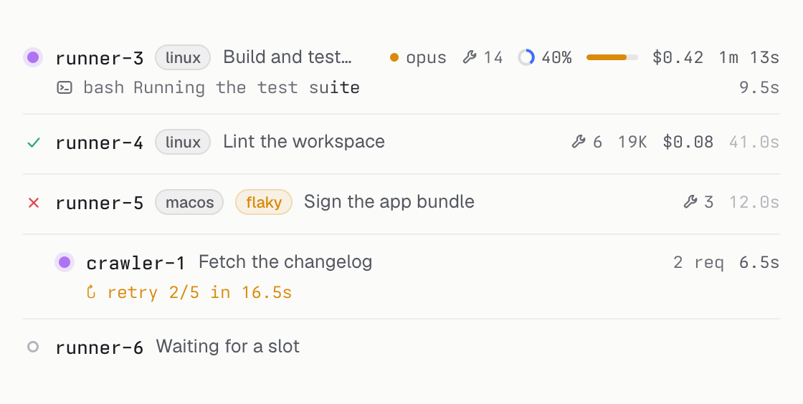
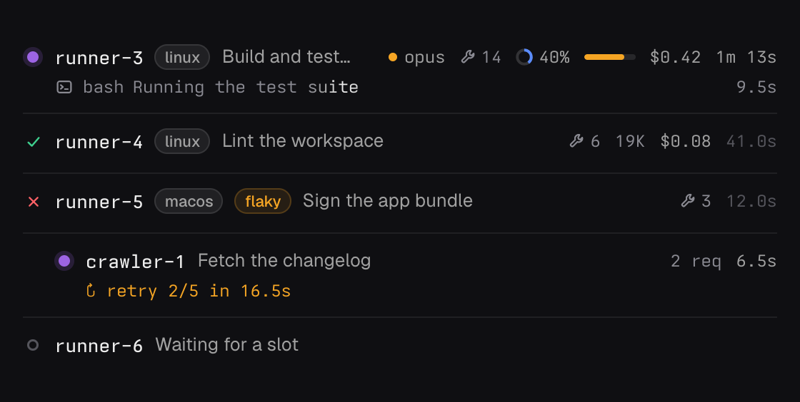
<figcaption>上下文仪表在 75% 时变为琥珀色。</figcaption>
</figure>

**构建方式：** `tern.ui.node("agent", { … }, { …content })`。

| 属性 | 类型 | 默认值 | 含义 |
| --- | --- | --- | --- |
| `name` | string | `""` | 显示名称；连同状态构成该行的无障碍名称。 |
| `agent` | string | none | 作为第一个 `.sf-badge` 显示的类型（无色调）。 |
| `badges` | array of `{ text, tone? }` | `[]` | 更多 `.sf-badge` chip。 |
| `task` | text | none | 一行任务；超出时省略，除非该 agent 有 `hovercard`，否则完整文本作为工具提示。 |
| `status` | 见上文 | `"pending"` | 类 `st-<status>`、字形、计时器模式。 |
| `model` | string | none | 模型 chip。 |
| `thinking` | string | none | 模型 chip 圆点所用的 span token。 |
| `stats` | `{ tools?, requests?, done?, context?, contextLabel?, tokens?, cost?, age?, took? }` | none | 上文的统计。没有 `stats` 就没有计时器。 |
| `tool` | `{ name, intent?, age? }` | none | 当前运行的工具（第二行，仅 `running`）。 |
| `retry` | `{ attempt?, max?, delay?, age?, error? }` | none | 第二行的重试倒计时（优先于 `tool`）；`attempt`/`max` 默认为 1。 |
| `depth` | integer | `0` | 嵌套深度，上限为 6。 |
| `collapsible` | boolean | `false` | 该行切换子节点。 |
| `collapsed` | boolean | none | 初始折叠状态。 |
| `key` | string | node id | 在兄弟节点之间的标识；折叠状态按此 key 在同一父节点下记忆。 |

**子节点：** 按顺序绘制在 `.sf-agent-kids` 中（没有子节点或折叠时隐藏）。

**悬停卡片：** 通用 `hovercard` 只在该行之上打开，不会覆盖子节点。omp 把子 agent 的完整任务说明作为一个 `md` 卡片发送，该行的 `task` 是它的一行摘要。

**事件：** 用户翻转可折叠行时发送 `toggle { id, collapsed, key? }`。外加通用 `actions`。

**样式：**

```html
<div class="sf sf-agent st-running collapsible [collapsed]" data-id="…" style="--sf-depth: 1">
	<div class="sf-agent-row" role="button" tabindex="0" aria-expanded="true">
		<span class="sf-agent-g"><i class="live"></i></span>
		<span class="sf-agent-name">runner-3</span>
		<span class="sf-badge">linux</span>
		<span class="sf-agent-task">Build and test main</span>
		<span class="sf-sp"></span>
		<span class="sf-agent-stats">
			<span class="model"><i class="dot"></i>opus</span>
			<span class="tools"><!-- wrench -->14</span>
			<span class="req">9 req</span>
			<span class="done"><!-- ring -->40%</span>
			<span class="sf-agent-meter warn"><i class="fill"></i></span>
			<span class="cost">$0.42</span>
			<span class="time" role="timer">1m 12s</span>
		</span>
	</div>
	<div class="sf-agent-now">
		<span class="ic"><!-- icon --></span><span class="tn">bash</span>
		<span class="intent">Running tests</span><span class="time">8s</span>
	</div>
	<div class="sf-agent-kids"><!-- children --></div>
</div>
```

| 目标 | 选择器 |
| --- | --- |
| 节点 | `.sf-agent` |
| 某个状态 | `.sf-agent.st-running`、`.st-done`、`.st-failed`、`.st-aborted`、`.st-idle`、`.st-parked`、`.st-pending` |
| 折叠 | `.sf-agent.collapsible`、`.sf-agent.collapsed` |
| 行、字形 | `.sf-agent-row`、`.sf-agent-g`（`.live`、`.hollow`、图标）（内部，可能变化） |
| 名称、任务 | `.sf-agent-name`、`.sf-agent-task`（内部，可能变化） |
| 统计 | `.sf-agent-stats`，带 `.model`、`.model .dot`、`.tools`、`.req`、`.done`、`.tok`、`.cost`、`.time`（内部，可能变化） |
| 上下文仪表 | `.sf-agent-meter`（`.warn`、`.bad`）、`.sf-agent-meter .fill`（内部，可能变化） |
| 第二行 | `.sf-agent-now`，带 `.ic`、`.tn`、`.intent`、`.time`、`.retry`（内部，可能变化） |
| 内容 | `.sf-agent-kids`（内部，可能变化） |

变量：`--sf-depth`（按节点设置）。脉冲与仪表填充有动画，并在减少动效模式与静态视图中停止。

```lua
local ui = tern.ui

local function worker(w)
	return ui.node("agent", {
		key = "w." .. w.id,
		name = w.id,
		agent = w.pool,
		task = w.job,
		status = w.state, -- "running", "idle", "done", "failed"
		stats = { tools = w.steps, cost = w.cost, age = w.elapsed, took = w.took },
		tool = w.state == "running" and { name = "bash", intent = w.step, age = w.step_age } or nil,
		collapsible = true,
		collapsed = true,
	}, {
		ui.node("md", { text = w.log_summary }),
	})
end
```

## `trace` 轨迹 {#trace}

一个 agent 的步骤作为数据呈现：每一行是一个步骤（状态着色的图标、标题、等宽的目标如命令或路径、可选的说明行、时间以及它读取的来源），任何一行都可以原地展开，显示它产出了什么。它适用于 agent 的执行轨迹或思维链、带来源的推理块、作业队列；单个带自身主体的工具调用请用 [`tool`](#tool)，worker 行用 [`agent`](#agent)，计划用 [`checklist`](#checklist)。

**变体。** `variant` 决定外观：

| 变体 | 外观 | 头部 | 默认展开 |
| --- | --- | --- | --- |
| `rail`（默认） | 各行位于一条垂直细线轨上，每步一个字形；运行中的行闪烁并带实时计时器；有内容的行在其行下方原地展开。 | 仅在带 `title` 时，作为说明文字（不折叠） | 始终展开 |
| `summary` | 一行，`Worked for 12s · 5 steps ⌄`（除非设置 `summary`，否则由 `status` 与 `took`/`age` 推导），展开为一个不带轨道的紧凑列表。 | 摘要行；点击折叠 | 折叠 |
| `card` | 一张裸卡片：头部（`title`，否则运行中为 `Reasoning`、结束后为 `Thought for 4s`），运行时带已流逝时钟（`0:04`）闪烁，细线上方是散文主体（子节点），以及一行来源 chip。 | 头部；点击折叠 | 展开 |

**状态。** 每一行以及整个 trace 的 `status` 取 `pending`、`running`、`done`、`error` 之一（其他值按 `pending` 处理）。字形是该行的 `icon` 按状态着色（`pending` 弱化、`running` 用实时色、`done` 次级色、`error` 红色）；没有 icon 时，运行中显示旋转圆环、已完成显示绿色对勾、待执行显示空心圆点。`error` 行显示圆圈中的 ✕，标题为红色。与 [`tool`](#tool) 和 [`agent`](#agent) 相同的圆环、对勾与闪烁。

**时间。** `running` 行显示从 `age` 起计时的实时计时器（发送时已流逝的毫秒数；再次发送相同的 `age` 会继续累加）。已结束的行以弱化样式显示 `took`（没有则 `age`）；`pending` 行不显示。trace 自身的 `age`/`took` 驱动头部：`running`/`pending` 期间为实时计时器，否则显示冻结时间（`rail` 头部始终显示；`summary` 与 `card` 头部仅在运行中显示，已结束的用文字表述）。

**内容。** `key`（没有则 id）等于某行 `id` 的子节点就是该行的展开内容：该行获得一个折叠箭头，其行成为按钮，行打开时内容显示在其下方。其他所有子节点都是主体：`card` 的散文，在 `rail` 与 `summary` 中位于各行下方。

**来源。** 行上的 `sources` 在其下方绘制 chip；trace 上的 `sources` 在底部绘制一行 `Sources`（`card` 外观）。chip 在一个圆点之后显示 `site`（没有则取 `href` 的主机名，去掉 `www.`），圆点颜色由站点选取，`title` 与 `href` 作为工具提示；点击会像任何 surface 链接一样打开 `href`。

**展开状态。** 仅限指针操作，局部且立即生效，如同 card 的折叠：点击有内容的行（或 `summary`/`card` 头部）会立即翻转，选择按行 id 记忆（头部没有 id），随后发送 `toggle` 事件。程序设置的 `open` 若与上次绘制不同，会再次生效（行的 `open`，头部则用 trace 的 `open`）。⌘-点击不翻转。surface 关闭或以 `listen: false` 打开时无效：它会绘制，但从不翻转，也不发送任何内容（来源 chip 仍会打开其链接）。

**键盘。** 节点从不获取焦点；程序通过 `open`（在 trace 与每一行上）驱动展开状态，并重新发送 trace。

```lua
local ui = tern.ui

ui.node("trace", {
	lines = {
		{ id = "think", icon = "clock", title = "Thought for 5s", status = "done", took = 5000 },
		{ id = "v", icon = "terminal", title = "Ran", target = "pnpm --version", status = "done", took = 420 },
		{ id = "diff", icon = "terminal", title = "Ran", target = "git diff --stat HEAD~1",
			status = "done", took = 180, open = true },
		{ id = "inst", icon = "terminal", title = "Failed", target = "pnpm install --frozen-lockfile",
			status = "error", took = 3100, detail = "ERR_PNPM_OUTDATED_LOCKFILE" },
		{ id = "src", icon = "globe", title = "Used 2 sources", status = "done", sources = {
			{ title = "pnpm install", href = "https://pnpm.io/cli/install", site = "pnpm.io" },
			{ title = "Frozen lockfile in CI", href = "https://github.com/pnpm/pnpm/issues/1890", site = "github.com" },
		} },
	},
}, {
	ui.node("code", { key = "diff", lang = "text",
		text = "package.json | 2 +-\n1 file changed, 1 insertion(+), 1 deletion(-)" }),
})
```

<figure class="tn-figure">
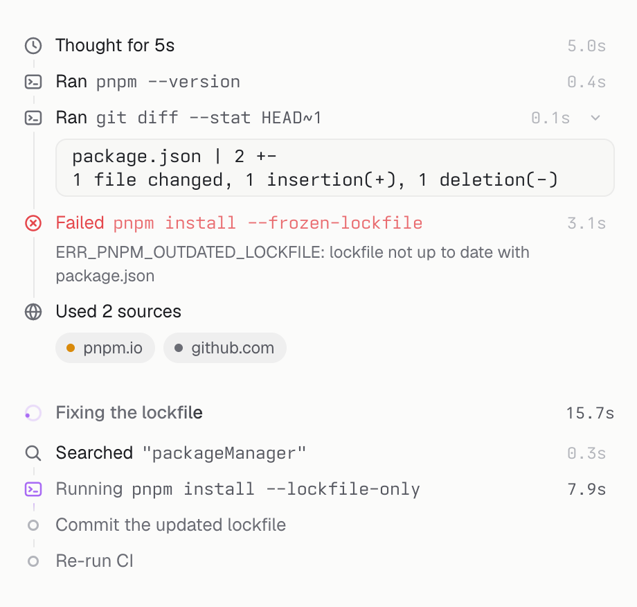
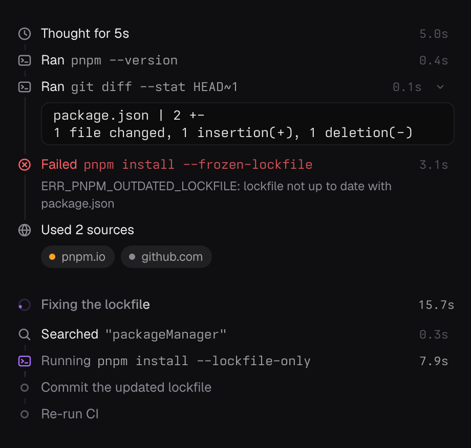
<figcaption>默认的 rail：有内容的行在原地展开；运行中的行闪烁并计时。</figcaption>
</figure>

推理块就是同一个节点配 `variant = "card"`：它的子节点是散文，`sources` 是底部的 chip。

```lua
ui.node("trace", {
	variant = "card",
	status = thinking and "running" or "done",
	age = thinking and elapsed or nil,
	took = not thinking and took or nil,
	sources = { { title = "pnpm install", href = "https://pnpm.io/cli/install", site = "pnpm.io" } },
}, {
	ui.node("text", { text = "The frozen install fails because the lockfile was not updated after the version bump." }),
})
```

<figure class="tn-figure">
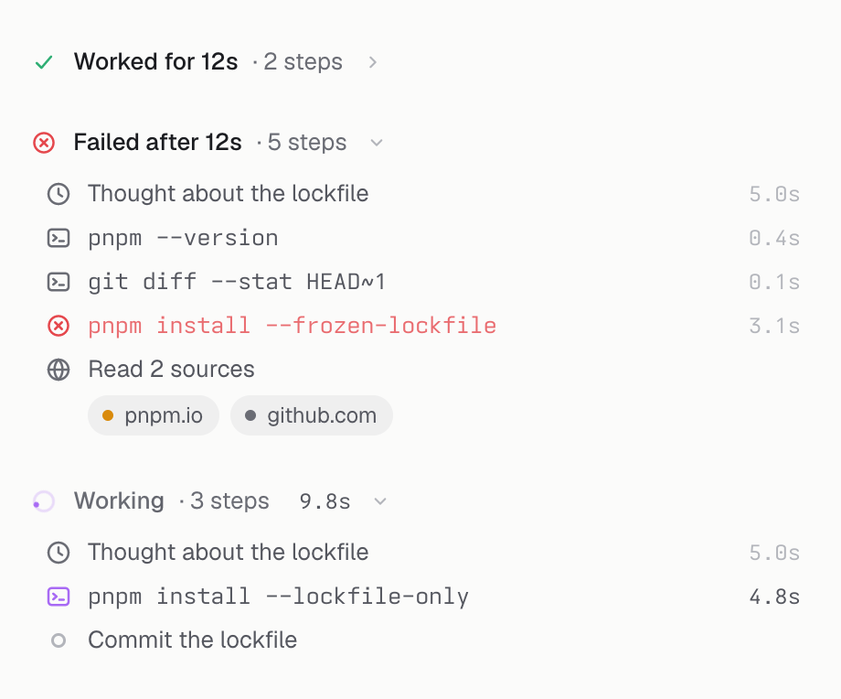
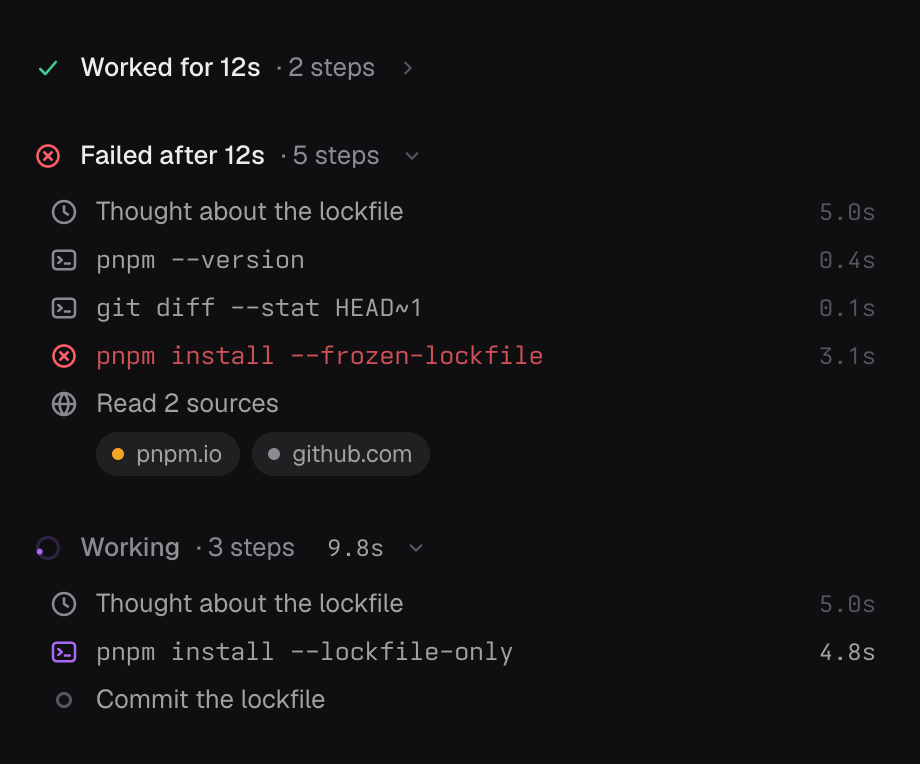
<figcaption><code>variant = "summary"</code> 从状态与时间推导其行文本。</figcaption>
</figure>

<figure class="tn-figure">
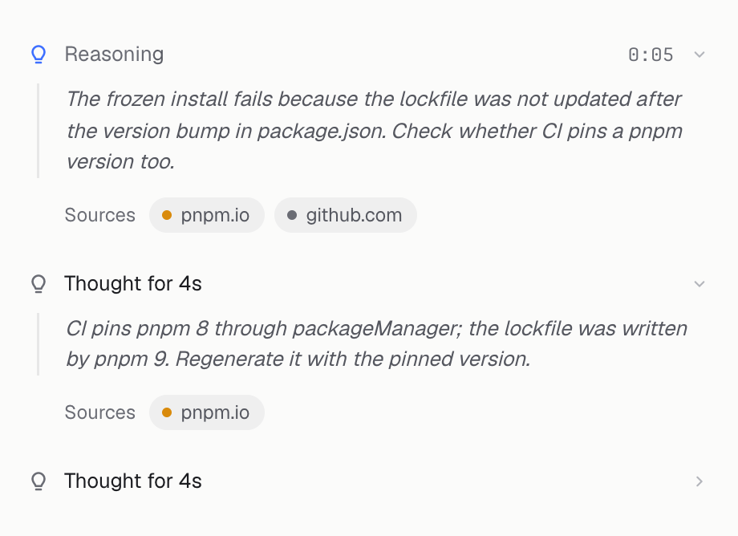
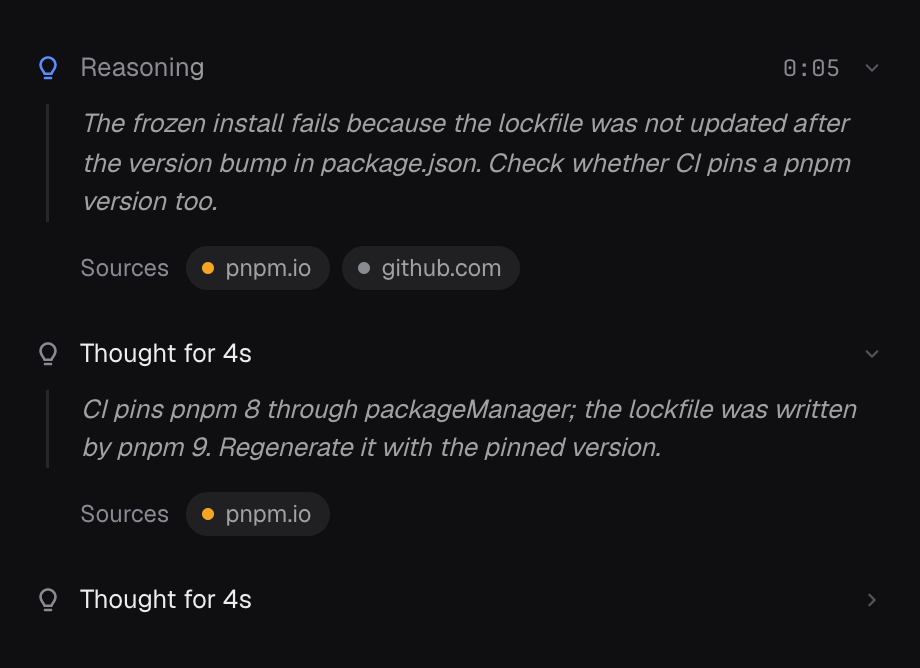
<figcaption><code>variant = "card"</code>：带来源的推理。</figcaption>
</figure>

**构建方式：** `tern.ui.node("trace", { … }, { …content })`。

| 属性 | 类型 | 默认值 | 含义 |
| --- | --- | --- | --- |
| `variant` | `"rail"` \| `"summary"` \| `"card"` | `"rail"` | 外观（见上表）。 |
| `lines` | array of line（见下文） | `[]` | 步骤，按顺序。 |
| `status` | `"pending"` \| `"running"` \| `"done"` \| `"error"` | `"pending"` | 整个 trace 的状态：头部字形、闪烁、计时器模式、推导的摘要。 |
| `title` | text | none | 头部文本（`card`：默认 `Reasoning` / `Thought for <took>`；`rail`：说明文字，没有它就没有头部）。在这里不是工具提示。 |
| `summary` | text | derived | `summary` 头部的文本；推导值：`Working`（运行中）、`Queued`（待执行）、`Worked for 12s`（完成）、`Failed after 12s`（错误）。 |
| `icon` | string（图标名） | `lightbulb` 于 `card`，其余 none | 非运行且非失败时的头部字形。 |
| `age` | number (ms) | none | 发送时已流逝的时间；运行或待执行期间作为头部的实时计时器。 |
| `took` | number (ms) | none | 结束后的总耗时（没有则 `age`）。 |
| `open` | boolean | `false` 于 `summary`，其余 `true` | 头部的折叠是否打开（`summary`、`card`）；变更优先于用户的选择。 |
| `sources` | array of source（见下文） | `[]` | 底部的 trace `Sources` 行。 |
| `key` | string | node id | 在兄弟节点之间的标识。 |

一行：

| 字段 | 类型 | 默认值 | 含义 |
| --- | --- | --- | --- |
| `id` | string | 其索引 | 标识：决定其内容子节点的 key、展开状态以及 `toggle` 事件的 `item`。 |
| `icon` | string（图标名） | none | 它的字形（`clock`、`terminal`、`globe`、`search`、…），按状态着色。 |
| `title` | text（span） | none | 用文字表示的步骤；`running` 时闪烁。 |
| `target` | text | none | 它作用于什么，等宽显示（命令、路径、查询）；超出省略，完整文本作为工具提示。 |
| `detail` | text | none | 行下方一条弱化文本。 |
| `status` | `"pending"` \| `"running"` \| `"done"` \| `"error"` | `"pending"` | 类 `st-<status>`、字形、计时器。 |
| `age` | number (ms) | none | 发送时已流逝的时间；`running` 时为实时计时器。 |
| `took` | number (ms) | none | 结束后的耗时（没有则 `age`）。 |
| `open` | boolean | `false` | 其内容是否显示；变更优先于用户的选择。没有内容时忽略。 |
| `sources` | array of source | `[]` | 行下方的 chip。 |

来源：`{ title?, href?, site? }`（`site` 默认取 `href` 的主机名，去掉 `www.`）。

**子节点：** `key`（没有则 id）是某行 `id` 的子节点被放在该行之下；其余按顺序构成主体（`.sf-trace-prose`，为空时隐藏）。

**事件：** 用户翻转某行（`item` 为其 id）或头部（没有 `item`）时发送 `toggle { id, item?, open }`。来源 chip 请求 host 打开其 `href`（不发送事件）。外加节点上的通用 `actions`。

**样式：**

```html
<div class="sf sf-trace rail st-running open" role="group" data-id="…">
	<div class="sf-trace-head" role="button" aria-expanded="true"><!-- summary, card, titled rail -->
		<span class="sf-trace-g"><!-- glyph --></span>
		<span class="sf-trace-title">Worked for 12s</span>
		<span class="sf-trace-n">· 5 steps</span>
		<span class="sf-trace-sp"></span>
		<span class="sf-trace-time" role="timer">0:04</span>
		<span class="sf-chev"></span>
	</div>
	<div class="sf-trace-fold"><div class="sf-trace-in">
		<div class="sf-trace-lines" role="list">
			<div class="sf-trace-line st-done has-body open [last]" role="listitem">
				<div class="sf-trace-row" role="button" aria-expanded="true">
					<span class="sf-trace-g"><!-- icon, i.sf-trace-spin, i.hollow; .tick --></span>
					<span class="sf-trace-t">
						<span class="sf-trace-title">Ran</span>
						<span class="sf-trace-target">git diff --stat HEAD~1</span>
					</span>
					<span class="sf-trace-time" role="timer">0.1s</span>
					<span class="sf-chev"></span>
				</div>
				<div class="sf-trace-detail">…</div>
				<div class="sf-trace-srcs">
					<button class="sf-trace-src" data-hue="2"><i class="dot"></i>pnpm.io</button>
				</div>
				<div class="sf-trace-body"><div class="sf-trace-in"><!-- the line's children --></div></div>
			</div>
		</div>
		<div class="sf-trace-prose"><!-- the body --></div>
		<div class="sf-trace-srcs"><span class="sf-trace-srcs-l">Sources</span><!-- chips --></div>
	</div></div>
</div>
```

| 目标 | 选择器 |
| --- | --- |
| 节点 | `.sf-trace` |
| 某个变体 | `.sf-trace.rail`、`.summary`、`.card` |
| 某个状态 | `.sf-trace.st-running`、`.st-done`、`.st-error`、`.st-pending`（以及 `.sf-trace-line` 上） |
| 展开 | `.sf-trace.open`、`.sf-trace-line.open`、`.sf-trace-line.has-body` |
| 头部 | `.sf-trace-head`，带 `.sf-trace-g`、`.sf-trace-title`、`.sf-trace-n`、`.sf-trace-time`、`.sf-chev`（内部，可能变化） |
| 某一行 | `.sf-trace-line`（`.last`）、`.sf-trace-row`、`.sf-trace-g`（`.tick`、`.sf-trace-spin`、`.hollow`）、`.sf-trace-title`、`.sf-trace-target`、`.sf-trace-time`、`.sf-trace-detail`（内部，可能变化） |
| 轨道 | `.sf-trace-line::before`（内部，可能变化） |
| 内容、主体 | `.sf-trace-body`、`.sf-trace-prose`（内部，可能变化） |
| 来源 | `.sf-trace-srcs`、`.sf-trace-srcs-l`、`.sf-trace-src[data-hue]`（0–5）、`.sf-trace-src .dot`（内部，可能变化） |

圆环、闪烁与折叠有动画，在减少动效模式与静态视图（`.sf-still`）中停止；计时器仍会走动。

## `stacktrace` 堆栈 {#stacktrace}

一个错误以及抛出它的堆栈，由数据绘制。发送错误的类型与消息，以及最内层在前的帧；Tern 会点亮你代码中的帧，折叠它们之间的库帧，并在双击时打开某帧的文件、定位到其行。任何运行、测试或 agent 工具调用以异常失败时都可以用它：测试运行器的失败、崩溃报告、服务器日志条目。纯文本日志请用 `ansi` 或 `code`。

**变体。** `variant` 决定外观：

- **`frames`**（默认）：一张错误卡片。头部显示错误图标、错误色的类型以及其下的消息，完整换行。每个应用帧占两行：先是等宽的函数，然后是弱化的目录与加强的 `file:line`。每一段库帧（`app = false`）折叠为一行低调的“▸ N library frames”；点击可原地展开（本地视图状态，从不发送）。选中某个库帧会打开它所在的那段。
- **`split`**：错误显示为一行，位于帧列表之上（函数在左，`file:line` 在右），旁边是所选帧的代码摘录，用 Tern 的高亮器高亮，与 `code` 一样，错误行按错误色着色并带色条。窄宽度时，代码移到列表下方。没有 `code` 的帧显示“No source for this frame”。
- **`mono`**：一个紧凑的等宽区域，`Type: message` 行以错误色显示，其下是 `at fn (file:line:col)` 行，所选帧点亮并带错误色条，库帧弱化，底部有一个 Copy 按钮。

| 变体 | 外观 | 适用场景 |
| --- | --- | --- |
| `frames` | 一张错误卡片：图标、类型、消息；应用帧为函数名位于 `dir/file:line` 之上；库帧段折叠 | 转录或结果视图中的一次失败 |
| `split` | 错误行位于帧列表之上，旁边是所选帧的高亮代码，错误行已标记 | 手上有源码时的调试器式视图 |
| `mono` | 等宽区域中的 `at fn (file:line:col)` 行，所选帧点亮，底部 Copy | 用户要粘贴到别处的紧凑日志条目 |

**选择。** 点击帧会立即选中它（在 `split` 中还会显示其代码）并发送 `select`；双击会发送 `activate`，并像链接的 `path` span 那样打开该帧所在文件的行与列（`src/a.ts#L42C13`；host 以面板所在目录解析相对路径）。在你设置 `selected` 之前，第一个应用帧处于选中状态。`selected` 变更时优先于本地选择。

**复制。** Copy 按钮，或节点上的 `copy` 操作，会把整个 trace 作为文本放入剪贴板：

```text
TypeError: Cannot read properties of undefined (reading 'id')
    at resolveUser (src/auth/session.ts:42:13)
    at Layer.handle (node_modules/express/lib/router/layer.js:95:5)
```

```lua
tern.ui.node("stacktrace", {
	key = "crash",
	variant = "split",
	lang = "typescript",
	error = { type = "TypeError", message = "Cannot read properties of undefined (reading 'id')" },
	frames = {
		{ fn = "resolveUser", file = "src/auth/session.ts", line = 42, col = 13,
			code = { start = 40, lines = {
				"  const s = await load(token);",
				"  if (!s) return null;",
				"  return users.get(s.user.id);",
				"}",
			} } },
		{ fn = "Layer.handle", file = "node_modules/express/lib/router/layer.js", line = 95, col = 5, app = false },
		{ fn = "main", file = "src/index.ts", line = 8, col = 3 },
	},
	selected = state.frame,
})
```

<figure class="tn-figure">
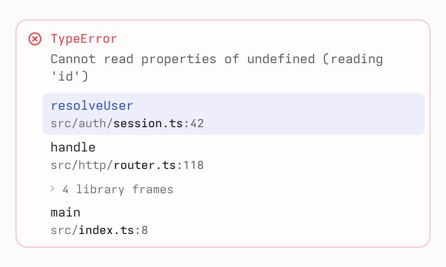
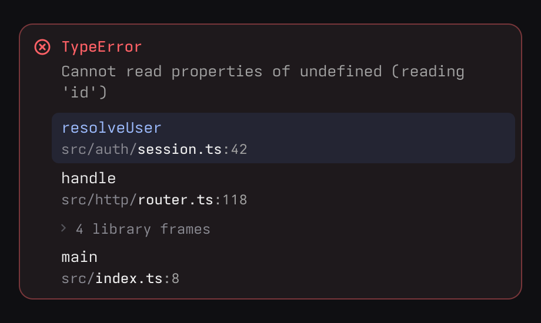
<figcaption><code>frames</code>：应用帧点亮，库帧折叠。</figcaption>
</figure>

<figure class="tn-figure">
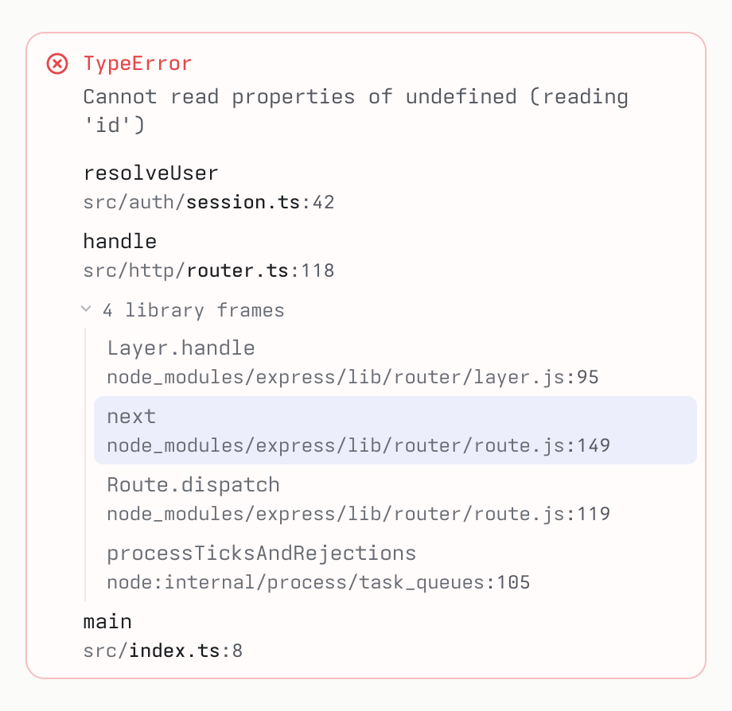
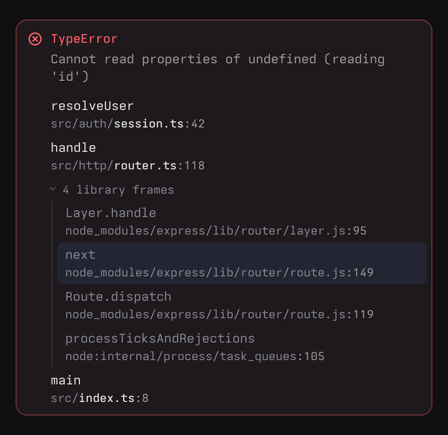
<figcaption>选中的库帧会打开它所在的那段。</figcaption>
</figure>

<figure class="tn-figure">
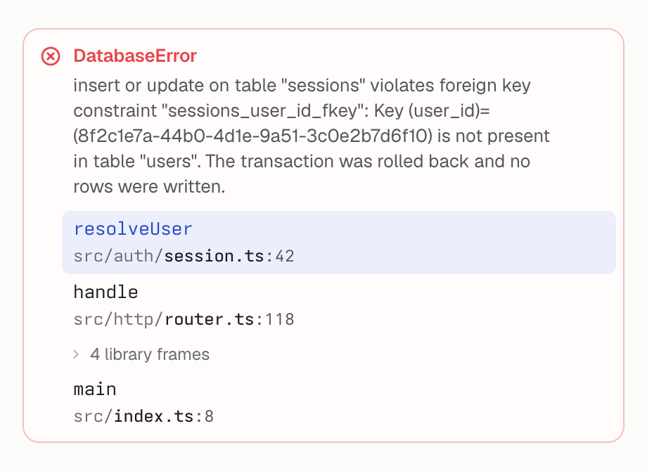
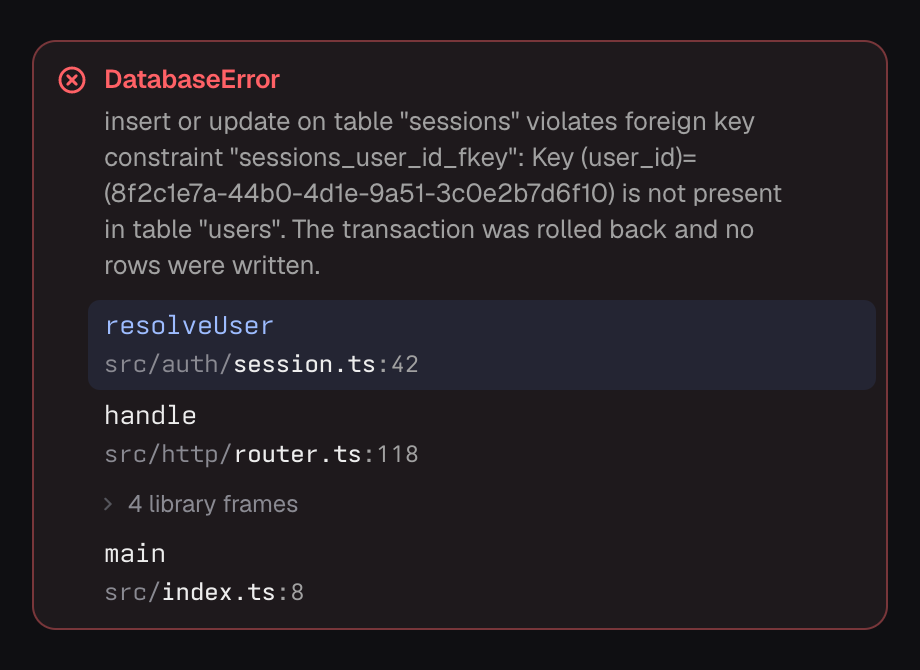
<figcaption>长消息会完整换行。</figcaption>
</figure>

<figure class="tn-figure">
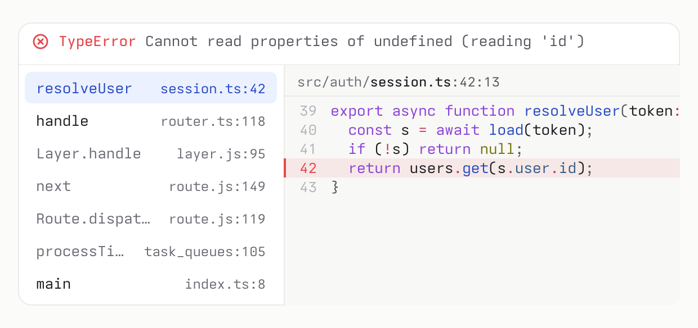
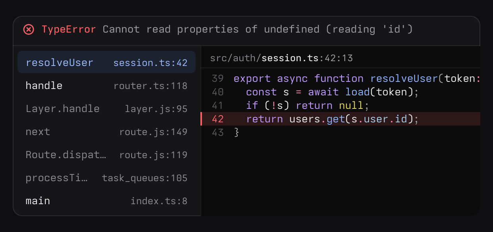
<figcaption><code>split</code>：帧列表旁边是所选帧处的代码。</figcaption>
</figure>

<figure class="tn-figure">
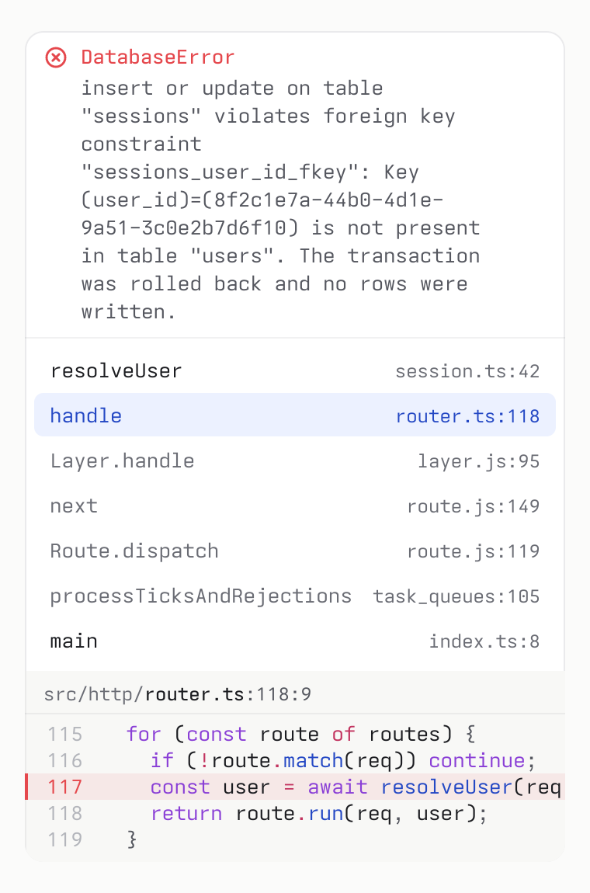
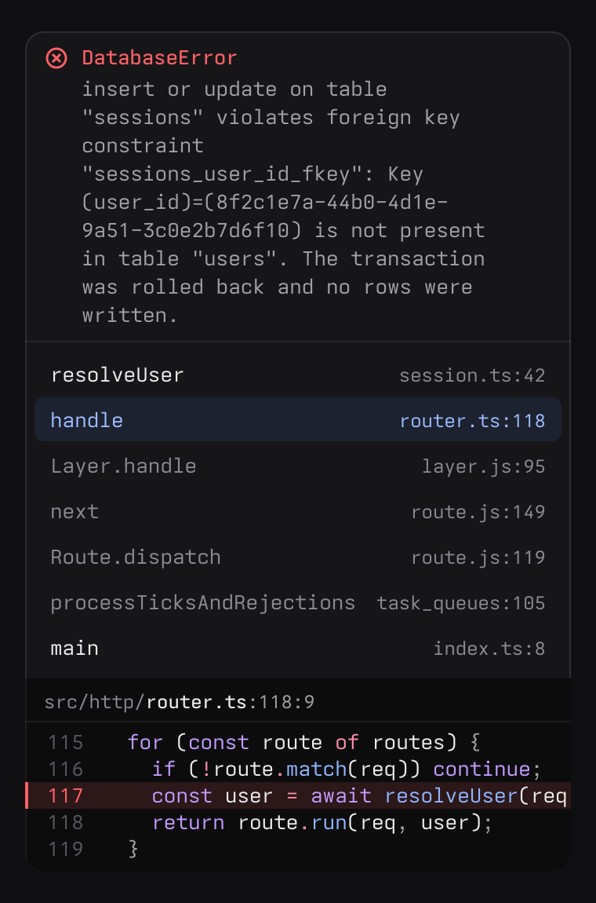
<figcaption>窄宽度时，代码移到列表下方。</figcaption>
</figure>

<figure class="tn-figure">
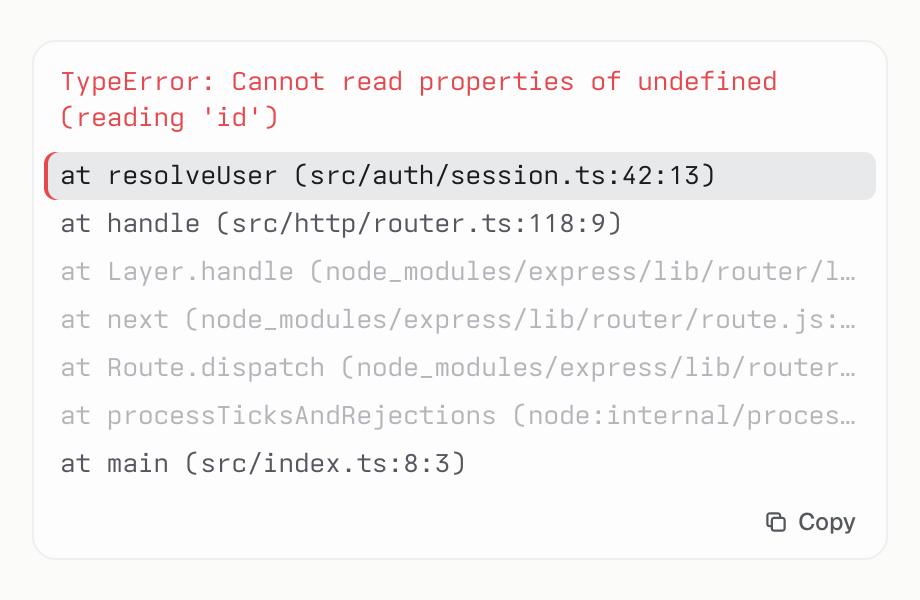
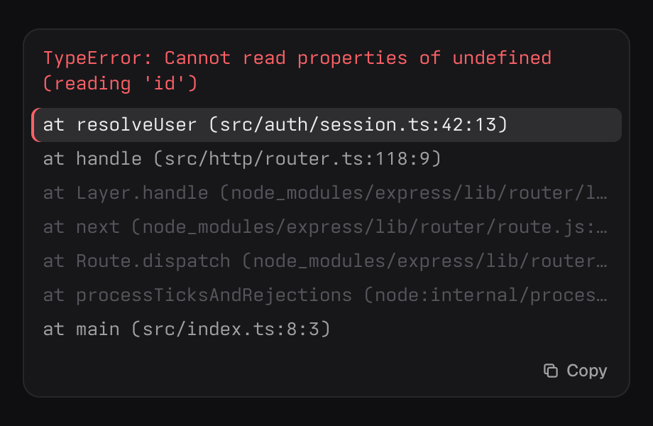
<figcaption><code>mono</code>：紧凑行与 Copy。</figcaption>
</figure>

<figure class="tn-figure">
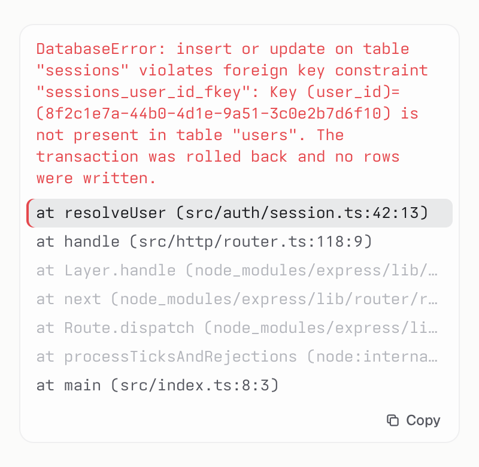
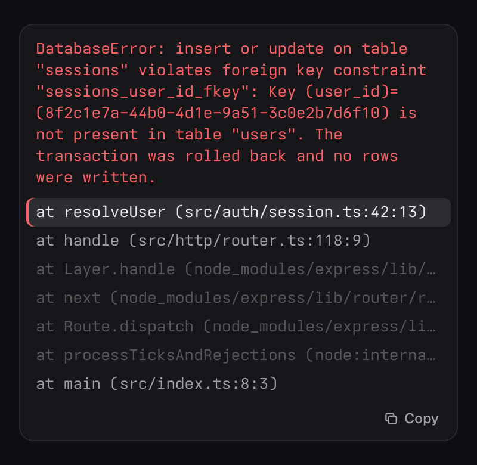
<figcaption><code>mono</code> 中的长消息。</figcaption>
</figure>

**构建方式：** `tern.ui.node("stacktrace", { error = …, frames = … })`。

| 属性 | 类型 | 默认值 | 含义 |
| --- | --- | --- | --- |
| `error` | `{ type?, message? }` | none | 错误。头部显示类型与消息（`mono`：`Type: message`）。 |
| `frames` | array of frames | `[]` | 堆栈，最内层在前。 |
| `frames[].fn` | string | `""` | 函数（为空时为 `<anonymous>`）。 |
| `frames[].file` | string | `""` | 文件路径，按程序所知的写法；相对路径以面板所在目录为基准打开。 |
| `frames[].line` | integer | none | 行号，从 1 开始。 |
| `frames[].col` | integer | none | 列号，从 1 开始（`mono`、`split` 的代码头部与打开链接会显示）。 |
| `frames[].app` | boolean | `true` | 你的代码（`true`）还是库的代码（`false`：在 `frames` 中折叠，其他变体弱化）。 |
| `frames[].code` | `{ start?, lines, line? }` | none | `split` 的源码摘录：首个行号（默认 1）、各行，以及要标记的行（默认为该帧的 `line`）。 |
| `selected` | integer | 第一个应用帧 | 所选帧的索引。变更优先于用户的上次选择。 |
| `lang` | string | 按第一个摘录的文件名 | 摘录高亮所用的语言（`typescript`、`rust`、…）。 |
| `variant` | `"frames"` \| `"split"` \| `"mono"` | `"frames"` | 外观。 |

**子节点：** 无（忽略）。

**事件：** 点击帧 `item` 时发送 `select { id, item }`（`item` 为其索引；它会立即显示为选中）；双击时发送 `activate { id, item }`，Tern 会像打开自己的文件一样打开其文件并定位到该行。库帧折叠与 Copy 是局部的，不发送任何内容。在以 `listen: false` 打开（或已关闭）的 surface 上，点击不会选中任何内容，也不发送任何内容；折叠、Copy 与打开文件仍然可用。外加节点上的通用 `actions`。

**键盘：** trace 从不获取焦点。通过设置 `selected`（用 ↑↓ 遍历帧）从你的按键驱动选择，并在 Enter 时自行打开帧（发送 host 的打开操作，或复用你为 `activate` 所做的工作）。

**样式：**

```html
<div class="sf sf-stacktrace" data-id="…" data-variant="frames">
	<div class="sf-st-head" data-variant="frames">
		<span class="sf-st-ic" aria-hidden="true"><svg class="ico">…</svg></span>
		<div class="sf-st-title">
			<span class="sf-st-type">TypeError</span>
			<span class="sf-st-msg">Cannot read properties of undefined</span>
		</div>
		<button class="sf-st-copy sf-button" data-variant="quiet" data-size="sm" data-act="copy" aria-label="Copy trace"></button>
	</div>
	<div class="sf-st-body">
		<!-- frames -->
		<div class="sf-st-frames" role="listbox">
			<div class="sf-st-frame [sel]" data-frame="0" role="option" aria-selected="true">
				<span class="sf-st-fn">resolveUser</span>
				<span class="sf-st-loc"><span class="dir">src/auth/</span><span class="name">session.ts</span><span class="pos">:42</span></span>
			</div>
			<div class="sf-st-fold [open]">
				<div class="sf-st-fold-head" role="button" data-fold="1" aria-expanded="false">
					<span class="sf-chev"></span><span class="sf-st-fold-label">2 library frames</span>
				</div>
				<div class="sf-st-fold-body"><div class="sf-st-frame lib" data-frame="1">…</div></div>
			</div>
		</div>
		<!-- split -->
		<div class="sf-st-split">
			<div class="sf-st-list" role="listbox">
				<div class="sf-st-frame [lib] [sel]" data-frame="0"><span class="sf-st-fn"></span><span class="sf-st-at">session.ts:42</span></div>
			</div>
			<div class="sf-st-code">
				<div class="sf-st-nocode [sf-hidden]">No source for this frame</div>
				<div class="sf-st-pane [sf-hidden]" data-pane="0">
					<div class="sf-st-path"><span class="sf-st-loc">…</span></div>
					<div class="sf-st-lines">
						<div class="sf-st-ln [err]"><span class="sf-st-gut">42</span><span class="sf-st-lt"><span class="tk-keyword">return</span> …</span></div>
					</div>
				</div>
			</div>
		</div>
		<!-- mono -->
		<div class="sf-st-frame mono [lib] [sel]" data-frame="0">at resolveUser (src/auth/session.ts:42:13)</div>
	</div>
	<div class="sf-st-foot"><!-- mono: the Copy button --></div>
</div>
```

| 目标 | 选择器 |
| --- | --- |
| 节点 | `.sf-stacktrace`、`[data-variant='frames' \| 'split' \| 'mono']` |
| 头部 | `.sf-st-head`、`.sf-st-ic`、`.sf-st-title`、`.sf-st-type`、`.sf-st-msg`、`.sf-st-copy`（内部，可能变化） |
| 一个帧 | `.sf-st-frame[data-frame='<index>']`，带 `.sel`、`.lib`、`.mono`；`.sf-st-fn`、`.sf-st-loc`（`.dir`、`.name`、`.pos`）、`.sf-st-at`（内部，可能变化） |
| 库帧折叠 | `.sf-st-frames`、`.sf-st-fold`（`.open`）、`.sf-st-fold-head`、`.sf-st-fold-label`、`.sf-st-fold-body`（内部，可能变化） |
| Split | `.sf-st-split`、`.sf-st-list`、`.sf-st-code`、`.sf-st-nocode`、`.sf-st-pane`、`.sf-st-path`、`.sf-st-lines`、`.sf-st-ln`（`.err`）、`.sf-st-gut`、`.sf-st-lt`，带高亮器的 `.tk-*`（内部，可能变化） |
| 底部 | `.sf-st-foot`（内部，可能变化） |

变量：节点上的 `--st-row` 是 `mono` 行与库帧折叠行的高度（24px）。折叠与 `split` 代码面板有入场动画；动画在减少动效模式与静态视图（`.sf-still`）中停止。

## `checklist` 清单 {#checklist}

按阶段划分的待办列表，以三种呈现形式之一从数据绘制。omp 把它用于 todo 工具（`full`）、输入框上方的胶囊（`hud`）以及回合结束提示（`reminder`）。在插件里，它适用于发布清单、迁移计划、任何分阶段的进度。

**条目。** 每个条目有一个 `status`：`pending`（空心圆环）、`active`（圆环中的脉动圆点，文本强调）、`done`（对勾，文本加删除线）、`dropped`（短横线，加删除线，弱化）或 `blocked`（警告三角；其说明为警告色）。未知状态按 `pending` 绘制。一个阶段的进度统计 `done` 与 `dropped` 条目。

**`full`**（默认）。每个阶段占一行，带进度圆环、标题与 `done/total`，然后是其条目。没有标题的单个阶段会省略它那一行。已完成的阶段折叠为它那一行；阶段上的 `collapsed` 会覆盖这一点。点击（或 Enter/Space）阶段行会在本地折叠或展开它，按阶段 id 记忆，直到节点消失。没有 `id` 的阶段共享同一个折叠状态。

**`hud`。** 右边缘的一个胶囊按钮：整体圆环、第一个 `active` 条目的文本（没有则第一个 `pending`；再没有则“All done”或“Todos”）以及 `done/total`。点击会在胶囊上方打开或关闭一个弹出层（`.sf-ck-pop`），其中包含 `full` 列表，并发送 `activate { id, item = "hud" }`。

**`reminder`。** 一个头部按钮：警告图标、“`N todos still open`”（未完成指 `pending`、`active` 或 `blocked`）、`note` 与一个折叠箭头。点击只展开未完成的条目。

自上次绘制以来变为 `done` 的条目会一次性获得 `.fresh`：对勾缩放进入，删除线绘制出来，之后的重新绘制中不再重复。把更新作为同一节点上的新 `phases` 发送即可保持这一点。

**构建方式：** `tern.ui.node("checklist", { mode = …, phases = { … } })`。

| 属性 | 类型 | 默认值 | 含义 |
| --- | --- | --- | --- |
| `phases` | array of phases | `[]` | 列表。 |
| `phases[].id` | string | `""` | 阶段 id；作为本地折叠状态的 key。 |
| `phases[].title` | text | none | 阶段标题。 |
| `phases[].items` | array of items | `[]` | 条目（没有 `id` 的条目会被跳过）。 |
| `phases[].collapsed` | boolean | 完成时折叠 | 初始折叠状态。 |
| `items[].id` | string | required | 条目 id；作为 `.fresh` 动画的 key。 |
| `items[].text` | text | `""` | 条目文本。 |
| `items[].status` | `"pending"` \| `"active"` \| `"done"` \| `"dropped"` \| `"blocked"` | `"pending"` | 条目状态。 |
| `items[].note` | text | none | 条目下方的一行。 |
| `mode` | `"full"` \| `"hud"` \| `"reminder"` | `"full"` | 呈现形式；同时是节点上的一个类。 |
| `note` | text | none | 仅 `reminder`：计数之后的文本（“reminder 1/3”）。 |

**子节点：** 无（忽略）。

**事件：** 点击 `hud` 胶囊时发送 `activate { id, item = "hud" }`。阶段折叠与提醒展开是局部的，不发送任何内容。

**样式：**

```html
<!-- full -->
<div class="sf sf-checklist full" data-id="…" role="group" aria-label="Todos, 3 of 7 done">
	<div class="sf-ck-phase [done] [folded]">
		<div class="sf-ck-ph" role="button" tabindex="0" aria-expanded="true">
			<svg class="sf-ring [full]"><circle class="tr"/><circle class="fl"/></svg>
			<span class="t">Ship</span><span class="n">2/3</span>
		</div>
		<div class="sf-ck-items">
			<div class="sf-ck-item st-done [fresh]">
				<span class="sf-ck-g"><!-- check / dash / warn / <i class="dot"> --></span>
				<span class="sf-ck-t">Tag the release</span>
				<div class="sf-ck-note">waiting on CI</div>
			</div>
		</div>
	</div>
</div>
<!-- hud -->
<div class="sf sf-checklist hud [open]">
	<button class="sf-ck-pill" aria-expanded="false"><svg class="sf-ring">…</svg><span class="t">Tag the release</span><span class="n">3/7</span></button>
	<div class="sf-ck-pop [sf-hidden]"><!-- the full list --></div>
</div>
<!-- reminder -->
<div class="sf sf-checklist reminder [open]">
	<div class="sf-ck-rh" role="button" tabindex="0"><span class="ic"><!-- warn --></span><span class="t">4 todos still open</span><span class="n">reminder 1/3</span><span class="sf-chev"></span></div>
	<div class="sf-ck-items"><!-- open items --></div>
</div>
```

| 目标 | 选择器 |
| --- | --- |
| 节点 | `.sf-checklist` |
| 呈现形式 | `.sf-checklist.full`、`.hud`、`.reminder`；`.open`（弹出层或提醒已展开） |
| 阶段 | `.sf-ck-phase`（`.done`、`.folded`）、`.sf-ck-ph`，带 `.t`、`.n`（内部，可能变化） |
| 进度圆环 | `.sf-ring`（完成时 `.full`）、`.sf-ring .tr`、`.sf-ring .fl`（内部，可能变化） |
| 条目 | `.sf-ck-items`、`.sf-ck-item.st-<status>`、`.sf-ck-item.fresh`（内部，可能变化） |
| 条目部件 | `.sf-ck-g`（`active` 时 `.dot`）、`.sf-ck-t`、`.sf-ck-note`（内部，可能变化） |
| HUD | `.sf-ck-pill`，带 `.t`、`.n`；`.sf-ck-pop`（内部，可能变化） |
| 提醒 | `.sf-ck-rh`，带 `.ic`、`.t`、`.n`、`.sf-chev`（内部，可能变化） |

圆环的填充是内联设置的 `stroke-dasharray`。弹出、删除线、弹出层与活跃圆点的动效在减少动效模式与静态视图中停止。

```lua
local ui = tern.ui

local phases = {
	{ id = "build", title = "Build", items = {
		{ id = "b1", text = "Compile", status = "done" },
		{ id = "b2", text = "Test", status = "done" },
	} },
	{ id = "ship", title = "Ship", items = {
		{ id = "s1", text = "Write the changelog", status = "done" },
		{ id = "s2", text = "Tag the release", status = "active" },
		{ id = "s3", text = "Publish", status = "blocked", note = "waiting on approval" },
		{ id = "s4", text = "Announce", status = "pending" },
		{ id = "s5", text = "Update the old docs", status = "dropped" },
	} },
}

ui.node("col", { gap = "md" }, {
	ui.node("checklist", { mode = "full", phases = phases }),
	ui.node("checklist", { mode = "hud", phases = phases }),
	ui.node("checklist", { mode = "reminder", note = "reminder 1/3", phases = phases }),
})
```

<figure class="tn-figure">
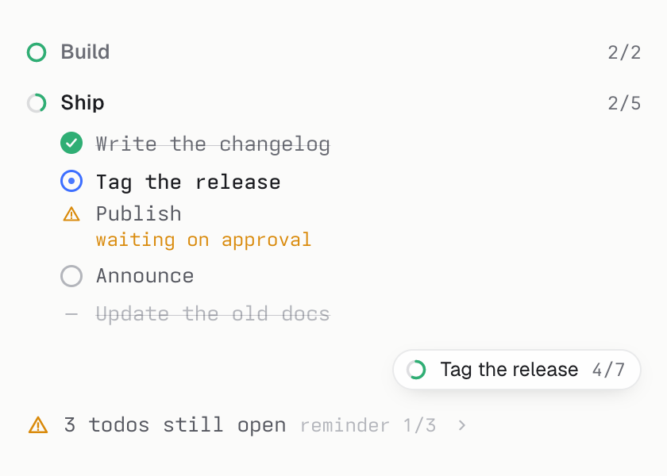
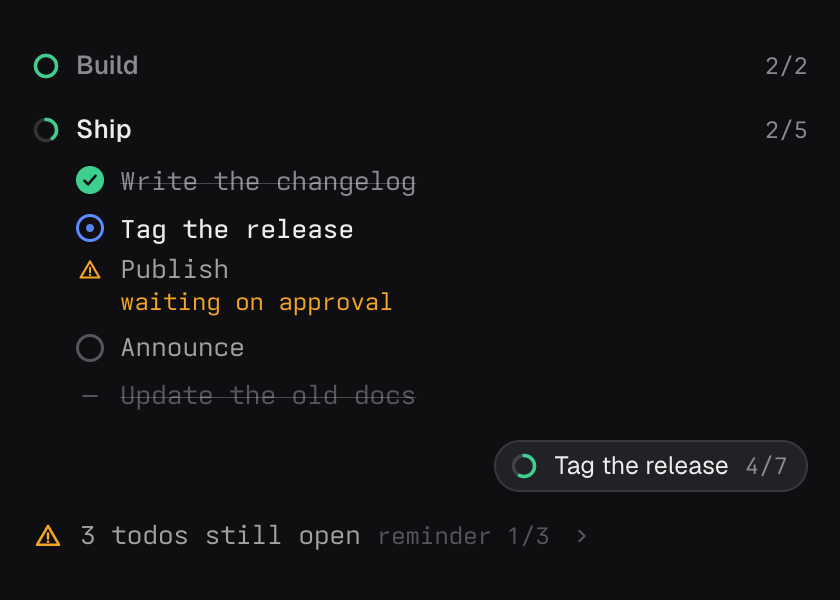
<figcaption><code>full</code>、<code>hud</code> 与 <code>reminder</code> 呈现同样的阶段。Build 已完成，因此折叠为它那一行。</figcaption>
</figure>

## `message` 消息 {#message}

对话中的一条消息。节点绘制聊天消息的外框（谁写的、何时写的、其头像、人们留下的回应、一行悬停操作以及一行状态），子节点是主体：散文用 `md`，代码块、图片、`tool` 卡片，任何内容。一个类型覆盖聊天的三种外观，由 `variant` 选择：

- **`auto`**（默认）是 agent 聊天，如 omp 的 Reader 所绘：本地用户的消息（`side = "end"`）位于右侧的强调色气泡中；其他人的消息按普通散文横跨阅读宽度排布，位于小头像、名称与时间之下。
- **`bubble`** 是即时通讯：两侧都有气泡，起始侧气泡旁有头像，气泡下方是回应 chip，本地用户的气泡下方是状态。
- **`flat`** 是团队讨论串（Slack、Linear 评论）：每一行都从左侧开始，带 32px 头像、名称与时间，文本在其下；指针经过时该行着色，其操作浮动在该行右上角。

当一方是 agent 时用 `auto`，人们互相交谈时用 `flat`，类手机的即时通讯用 `bubble`。把消息放进一个没有间隙的 `col`：每条消息与上一条保持自己的间距（12px，`continued` 时为 2px）。

| 变体 | 外观 | 适用场景 |
| --- | --- | --- |
| `auto` | 结束侧：右侧的强调色气泡（浅色 13%，深色 24%），宽度最多为 78% 或 560px，圆角 18，尾角 6px。起始侧：普通正文横跨宽度，位于 20px 头像、名称（字重 550）与等宽 `--t3` 的时间之下 | agent 聊天：用户提问，agent 用散文、代码与工具卡片作答 |
| `bubble` | 两侧都有气泡：结束侧为右侧的强调色，起始侧为柔和灰色（`--t1` 的 6.5%/8.5%），旁边是 28px 头像，名称在上方；回应在气泡下方；连续气泡收紧其所在侧的圆角 | 即时通讯、客服聊天、任何类手机场景 |
| `flat` | 行从左侧开始：32px 头像、名称与时间，正文在其下；指针经过时该行着色（`--sf-shade`）；连续的行在悬停时于左侧槽中显示时间；操作浮动在该行右上角一个小 `--pop-bg` 工具条中 | 团队讨论串、评论、评审讨论 |

**侧。** `side = "end"` 标记本地用户的消息。在 `auto` 与 `bubble` 中，它们位于右侧并使用强调色气泡，不显示头部（用户知道是谁发的），并把 `time` 放在页脚，除非 `status` 占据了该位置。在 `flat` 中侧不起作用：每一行都从左读取。

**连续段。** `continued = true` 表示该消息与上一条作者相同：它去掉头部与头像（列仍保留，因此连续段保持对齐），与上一条相距 2px，并在 `bubble` 中收紧其所在侧的气泡圆角。在 `flat` 中，连续的行在悬停时于头像槽中显示其 `time`。

**头像。** `avatar` 指定该节点某个子节点的名称（一个 [`avatar`](data.md#avatar) 节点，或 `icon`、`image`）；它被绘制在头像槽中，尺寸由变体决定（`auto` 中 20px、`bubble` 中 28px、`flat` 中 32px），且不属于主体。在 `auto` 中，该槽位于名称旁；在 `bubble` 与 `flat` 中，它位于左列顶部。`auto` 与 `bubble` 中结束侧的消息会隐藏它。

**回应。** `reactions` 列出主体下方的 chip：`text`（一个 emoji 或字形，也是该回应的标识）、`count`（有多少人回应，包括本地用户）以及 `on`（本地用户是其中之一）。点击会立即翻转 chip，把用户计入或排除，并发送 `change { value = text, on }`；翻转按节点的 `key` 与此 chip 的 text 记忆，因此在新 id 下重建后仍然保留，直到你的下一帧改变该回应的 `on`，那时它再次生效。把事件映射回 `on` 与 `count`。

**操作。** `actions` 是这一类型自有的图标按钮列表，位于页脚（在 `flat` 中是一个浮动在该行右上角的小工具条），而不是通用的 `{ click, menu }` 对象。指针位于消息上时显示，或用 `reveal = "always"` 始终显示（agent 聊天中的最新回答）。点击会像点击操作那样运行该 act（参见 [元素](index.md)）：`copy` 复制消息文本（其子节点的文本：`md` 为 Markdown 源码）并显示 Copied，内置 act（`open`、`toggle`、`zoom`、`select`、`activate`）的行为与各处相同，其他任何 act 会发送 `action { act }`。没有 `icon` 时，act 绘制其惯用图标（`copy`、`retry`/`regenerate`/`refresh` ↻、`edit`、`share`、`rewind`，其他任何为 `more` ⋯）；没有 `title` 时，工具提示为首字母大写的 act。

**状态。** `status` 是消息下方一行低调的等宽文本（“Read 14:03”、“Delivered”、“Edited”）。`pending = true` 会让它闪烁，并在结束侧使气泡变暗：消息仍在发送途中。

```lua
local ui = tern.ui

local function message(m, prev)
	local same = prev and prev.author == m.author
	local kids = {}
	if not same and m.author ~= me then
		kids[#kids + 1] = ui.node("avatar", { id = m.id .. ".av", text = m.author, size = "sm" })
	end
	kids[#kids + 1] = ui.node("md", { text = m.text })
	return ui.node("message", {
		key = m.id,
		side = m.author == me and "end" or "start",
		author = m.author,
		time = m.time,
		continued = same,
		avatar = (not same and m.author ~= me) and (m.id .. ".av") or nil,
		reactions = m.reactions, -- { { text = "♥", count = 2, on = true } }
		actions = m.author == "omp" and {
			{ act = "copy" },
			{ act = "retry", title = "Regenerate" },
		} or nil,
		reveal = m.last and "always" or nil,
		status = m.author == me and m.read and ("Read " .. m.read) or nil,
		pending = m.sending,
	}, kids)
end

-- in the block's event handler
if ev.ev == "change" and ev.id:match("^msg") then
	toggle_reaction(ev.id, ev.value, ev.on)
elseif ev.ev == "action" and ev.act == "retry" then
	regenerate(ev.id)
end
```

<figure class="tn-figure">
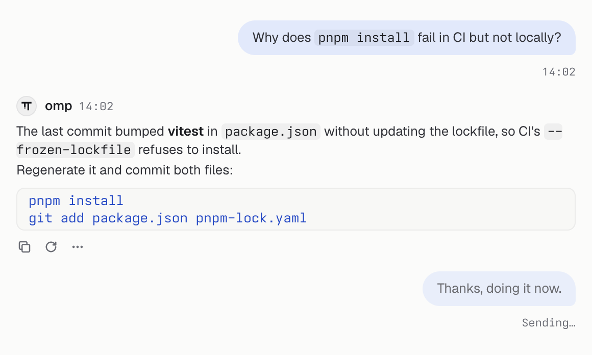
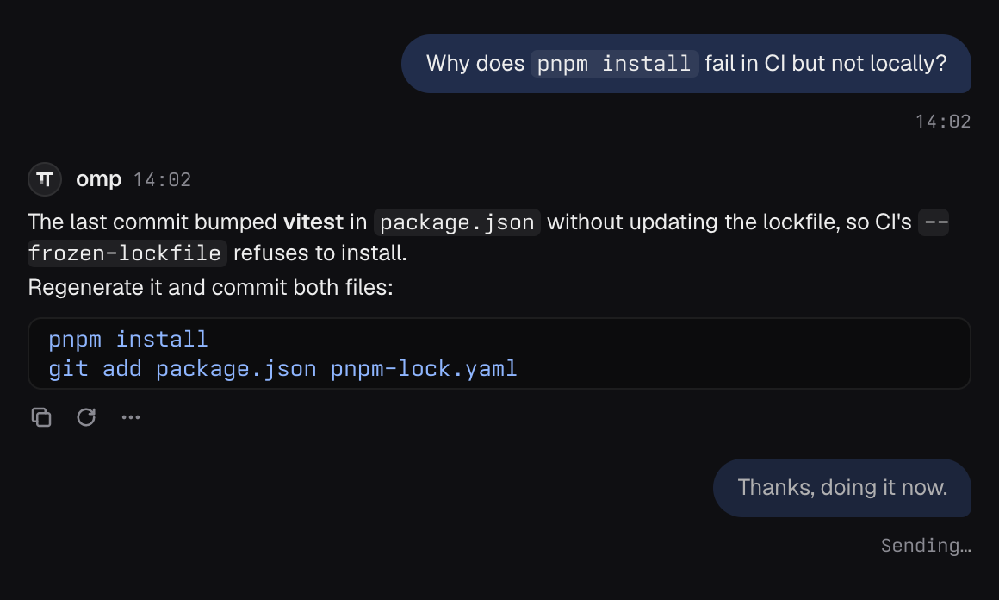
<figcaption><code>auto</code>：用户在右侧气泡中，agent 为普通散文并带其操作。</figcaption>
</figure>

<figure class="tn-figure">
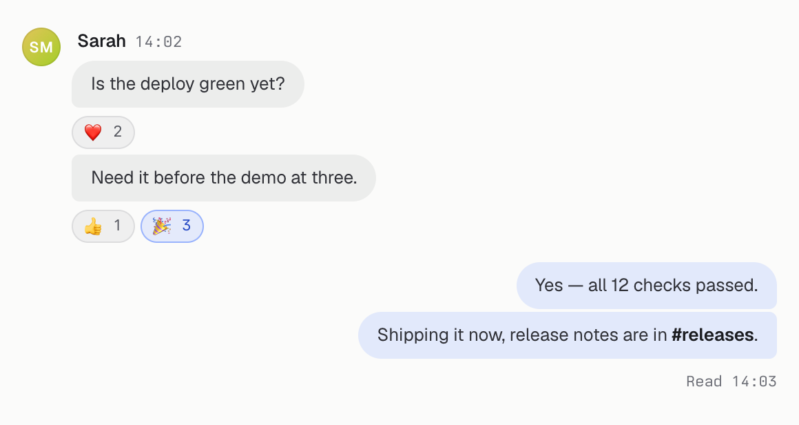
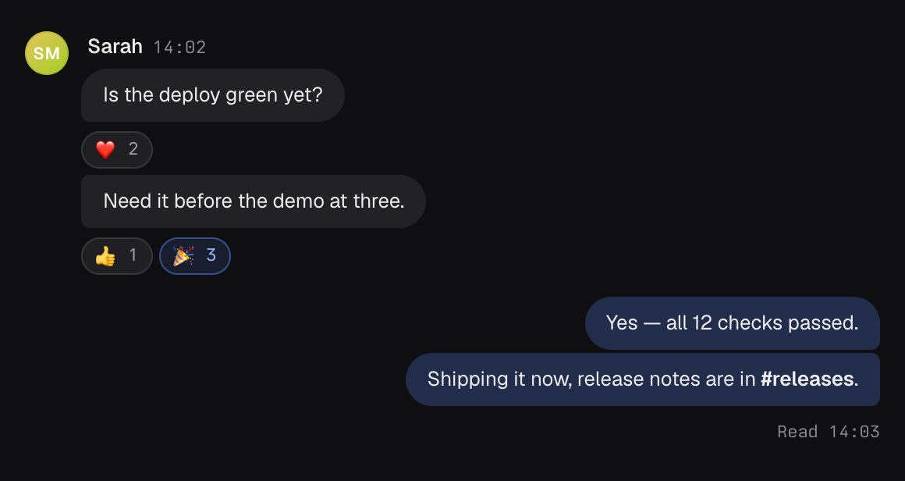
<figcaption><code>bubble</code>：两侧都有气泡，回应与已读状态。</figcaption>
</figure>

<figure class="tn-figure">
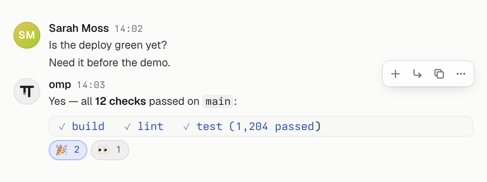
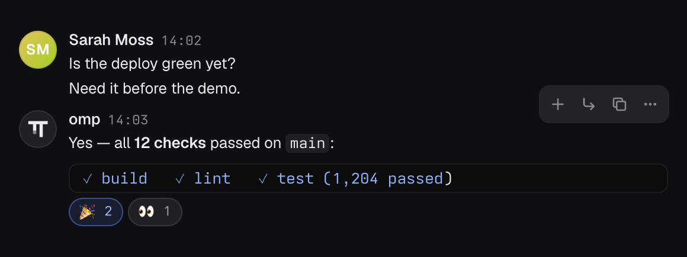
<figcaption><code>flat</code>：按作者分组的行，操作浮动在该行之上。</figcaption>
</figure>

<figure class="tn-figure">
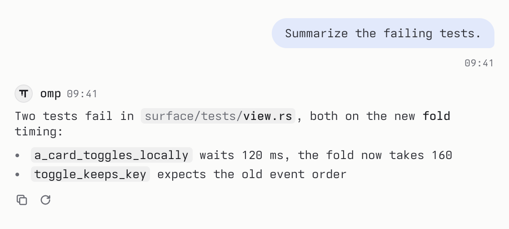
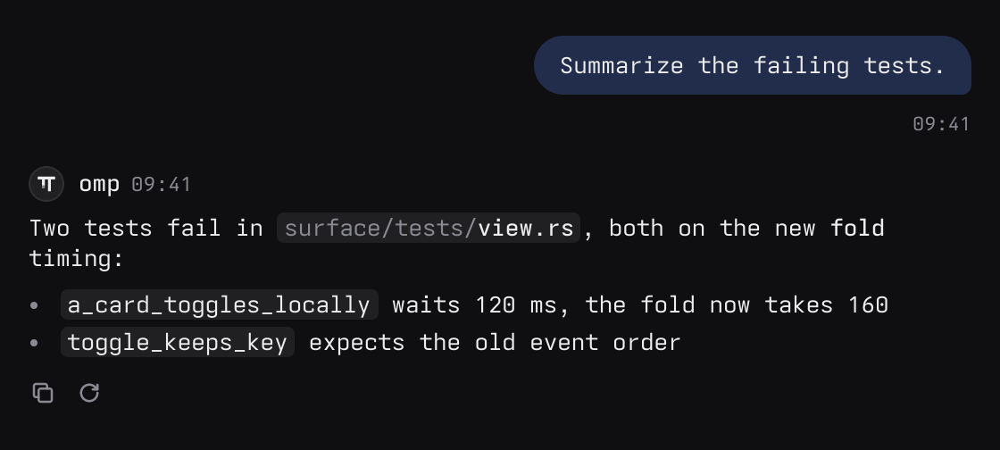
<figcaption>在等宽区域中，消息保持其形状，使用终端的字体。</figcaption>
</figure>

**构建方式：** `tern.ui.node("message", { … }, { avatar, …body })`。

| 属性 | 类型 | 默认值 | 含义 |
| --- | --- | --- | --- |
| `variant` | `"auto"` \| `"bubble"` \| `"flat"` | `"auto"` | 外观（见上表）。未知值按 `auto` 处理。 |
| `side` | `"start"` \| `"end"` | `"start"` | `end` 是本地用户：在 `auto` 与 `bubble` 中位于右侧并使用强调色气泡。 |
| `author` | string | none | 头部中的名称。 |
| `time` | string | none | 头部中的时间，等宽（`"14:02"`、`"Yesterday"`）；在结束侧的 `auto`/`bubble` 消息中，没有 `status` 时显示在页脚；在 `flat` 的连续行中，悬停时显示在左侧槽中。 |
| `avatar` | string | none | 绘制在头像槽中的子节点 id（一个 `avatar` 节点，或 `icon`、`image`）。id 不存在时不绘制头像，该子节点留在主体中。 |
| `continued` | boolean | `false` | 与上一条消息作者相同：无头部、无头像，相距 2px。 |
| `reactions` | array of `{ text, count?, on? }` | `[]` | 回应 chip：`text` 为 emoji 或字形（其标识；没有 text 的条目会被跳过），`count`（≥ 0 的整数，默认 0；为 0 时隐藏）为包含本地用户在内的回应人数，`on`（布尔，默认 `false`）表示本地用户已回应。 |
| `actions` | array of `{ act, icon?, title? }` | `[]` | 悬停时显示的图标按钮：`act` 为点击运行的操作（没有 act 的条目会被跳过），`icon` 为任意 Tern 图标名（否则用 act 自带的，见“操作”），`title` 为工具提示与无障碍名称（否则为首字母大写的 act）。 |
| `reveal` | `"hover"` \| `"always"` | `"hover"` | 操作何时显示；`always` 让它们保持显示（最新回答）。 |
| `status` | string | none | 消息下方一行低调的等宽文本（“Read 14:03”、“Delivered”）。 |
| `pending` | boolean | `false` | 仍在发送途中：状态闪烁，结束侧气泡变暗。 |
| `key` | string | node id | 在兄弟节点之间的标识；回应翻转按此 key 在同一父节点下记忆。 |

**子节点：** `avatar` 子节点进入头像槽；其他每个子节点都是主体，按顺序绘制，彼此相距 8px（任意类型：`md`、`code`、`image`、`tool`、由 `attachment` 组成的 `row`）。没有主体子节点的消息只绘制头部与 chip。

**事件：** 用户翻转回应 chip 时发送 `change { id, value, on }`（`value` 是该 chip 的 text）；用户点击 act 不是内置操作的按钮时发送 `action { id, act, value?, mods? }`（与各处一样，`name=value` 形式的 act 会单独发送 `value`）。`copy` 不发送任何内容：Tern 复制消息文本。以 `listen: false` 关闭或打开的 surface 会绘制 chip 与按钮，但既不翻转也不发送任何内容。

**键盘：** 无；消息从不获取焦点，其按钮的按键由程序处理。通过属性驱动键盘行为：把你想用按键切换的回应放进 `reactions`（`on`、`count`），用 `reveal = "always"` 显示光标所在消息的操作。

**样式：**

```html
<div class="sf sf-message [continued] [has-av] [reveal] [pending]" data-id="…"
	data-variant="auto" data-side="start" role="article">
	<div class="sf-msg-av">
		<div class="sf-msg-pic"><!-- the avatar child --></div>
		<span class="sf-msg-stamp" aria-hidden="true">14:02</span>
	</div>
	<div class="sf-msg-head">
		<span class="sf-msg-author">omp</span>
		<span class="sf-msg-time">14:02</span>
	</div>
	<div class="sf-msg-body"><!-- the other children --></div>
	<div class="sf-msg-reacts" role="group" aria-label="Reactions">
		<button class="sf-msg-react on" aria-pressed="true" aria-label="🎉 3" data-i="0">
			<span class="sf-msg-emoji">🎉</span><span class="sf-msg-count">3</span>
		</button>
	</div>
	<div class="sf-msg-foot">
		<div class="sf-msg-acts" role="toolbar" aria-label="Message actions">
			<button class="sf-msg-act" data-act="copy" title="Copy" aria-label="Copy"><svg class="ico">…</svg></button>
		</div>
		<span class="sf-msg-status [sf-fx-shimmer]">Read 14:03</span>
	</div>
</div>
```

没有可显示内容的部分带有 `.sf-hidden`。

| 目标 | 选择器 |
| --- | --- |
| 节点 | `.sf-message`、`[data-variant='auto' \| 'bubble' \| 'flat']`、`[data-side='start' \| 'end']` |
| 状态 | `.sf-message.continued`、`.has-av`（绘制了头像子节点）、`.reveal`（操作始终显示）、`.pending` |
| 头像列、槽、槽内时间 | `.sf-msg-av`、`.sf-msg-pic`、`.sf-msg-stamp`（内部，可能变化） |
| 头部、名称、时间 | `.sf-msg-head`、`.sf-msg-author`、`.sf-msg-time`（内部，可能变化） |
| 主体（`auto`/`bubble` 中的气泡） | `.sf-msg-body`（内部，可能变化） |
| 回应 chip | `.sf-msg-reacts`、`.sf-msg-react`（`.on`）、`.sf-msg-emoji`、`.sf-msg-count`（内部，可能变化） |
| 页脚、操作、状态 | `.sf-msg-foot`、`.sf-msg-acts`、`.sf-msg-act[data-act]`、`.sf-msg-status`（内部，可能变化） |

节点上的变量：`--msg-bubble`（结束侧气泡填充）、`--msg-other`（`bubble` 中起始侧气泡填充）、`--msg-av`（头像列的宽度与头像的尺寸）。消息以短暂的上升与淡入出现；该动画、悬停淡入以及 pending 闪烁在减少动效模式与静态视图（`.sf-still`）中停止。

## `suggestions` 建议 {#suggestions}

用户可以接下来提出的内容，每次点击发送一条：在 agent 的回答下方、在空聊天中、在错误之后。节点绘制这些条目，并说明哪一个被点击；程序把文本放进输入框，或直接发送。

**变体。** `variant` 决定外观：

- `chips`（默认）：可换行的胶囊，每个以一个闪光（或条目的 `icon`）开头。适用于少量短提示。条目的 `detail` 是其工具提示。
- `rows`：整行宽的行，以一个 `›`（或条目的 `icon`）开头，文本之后是弱化的 `detail`，右侧是 1–9 的数字键帽（或条目自己的 `keys`）。适用于程序也绑定到按键的提示。
- `cards`：两列的小卡片网格，文本位于弱化的 `detail` 之上（选择它的理由）。条目的 `icon` 显示在其左上角。

条目错峰进入，并在指针经过时略微上浮（减少动效模式下两者都没有）。长文本以省略号结尾：chips 与 rows 中为一行，cards 中为两行之后。

```lua
local ui = tern.ui

ui.node("suggestions", {
	id = "next",
	variant = "rows",
	items = {
		{ id = "explain", text = "Explain this error" },
		{ id = "test", text = "Write a test for resolveUser" },
		{ id = "lint", text = "Fix the 3 lint warnings", detail = "src/user.ts" },
	},
})

-- in the block's event handler
if ev.ev == "activate" and ev.id == "next" then
	send(prompts[ev.item])
end
```

<figure class="tn-figure">
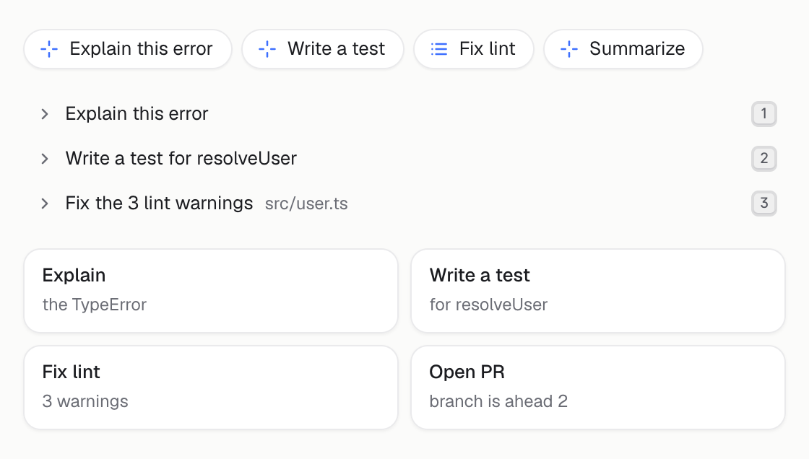
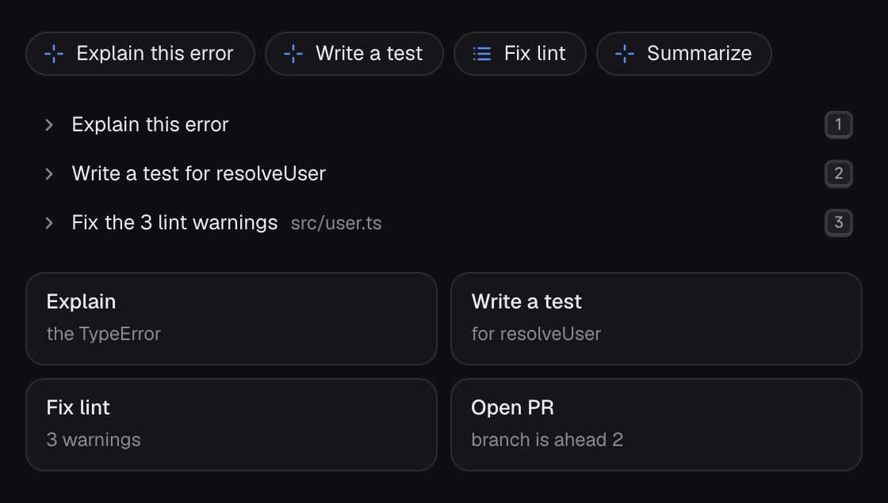
<figcaption><code>chips</code>、<code>rows</code> 与 <code>cards</code>。</figcaption>
</figure>

<figure class="tn-figure">
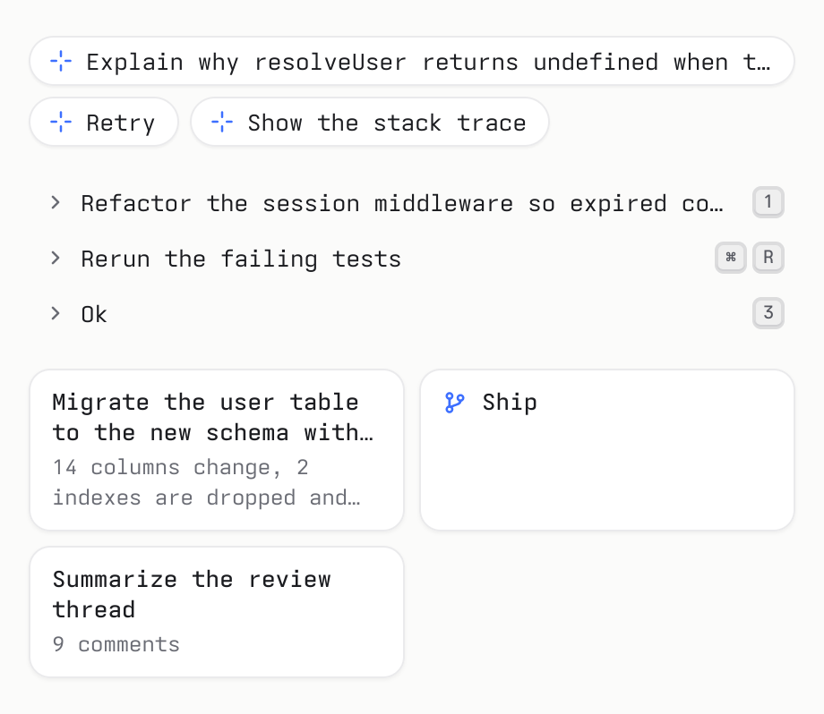
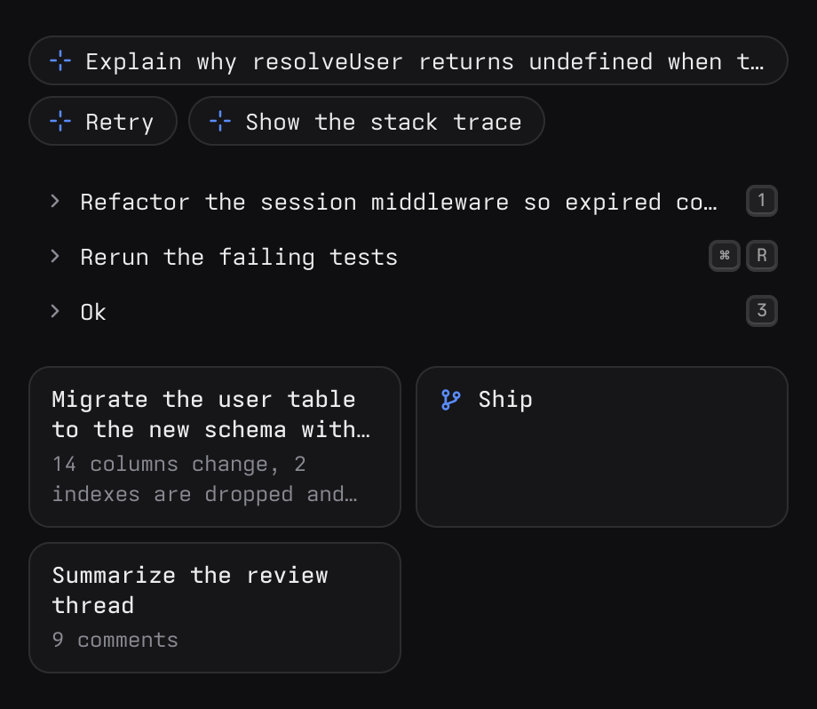
<figcaption>等宽区域中的长短文本，带条目自己的 <code>keys</code> 与 <code>icon</code>。</figcaption>
</figure>

**构建方式：** `tern.ui.node("suggestions", { variant = …, items = { … } })`。

| 属性 | 类型 | 默认值 | 含义 |
| --- | --- | --- | --- |
| `variant` | `"chips"` \| `"rows"` \| `"cards"` | `"chips"` | 外观（见上面的列表）。 |
| `items` | array of `{ id?, text, detail?, icon?, keys? }` | `[]` | 建议，按顺序。没有 `text` 的条目会被跳过。 |
| `items[].id` | string | 条目的 `text` | `activate` 中用作名称的值。 |
| `items[].text` | string | required | 显示出来的提示。 |
| `items[].detail` | string | none | `rows`：位于文本之后的弱化文本；`cards`：其下方的弱化行；`chips`：工具提示。 |
| `items[].icon` | string（图标名） | `sparkles`（chips）、`›`（rows）、none（cards） | 开头的图标。 |
| `items[].keys` | array of key names | `rows`：条目的序号 1–9 | 仅 `rows`：右侧的键帽，按 `kbd` 的绘制方式；`[]` 表示没有。 |

**子节点：** 无（忽略）。

**事件：** 点击条目时发送 `activate { id, item }`（`item` 为其 `id`，没有则为其 `text`）。surface 关闭或以 `listen: false` 打开时不发送。外加节点上的通用 `actions`。

**键盘：** 节点从不获取焦点。提供按键的程序（`rows` 的数字）自行绑定它们，并按 `activate` 的方式行事；键帽只是显示它们。

**样式：**

```html
<div class="sf sf-suggestions" data-id="…" data-variant="rows" role="list">
	<div class="sf-sug" role="listitem" data-item="lint" style="--i: 2">
		<span class="sf-sug-ic"><svg class="ico">…</svg></span>
		<span class="sf-sug-body">
			<span class="sf-sug-text">Fix the 3 lint warnings</span>
			<span class="sf-sug-detail">src/user.ts</span>
		</span>
		<span class="sf-sug-keys kbds"><span class="kbd">3</span></span>
	</div>
</div>
```

| 目标 | 选择器 |
| --- | --- |
| 节点 | `.sf-suggestions`、`[data-variant='chips' \| 'rows' \| 'cards']` |
| 一个条目 | `.sf-sug[data-item='<id>']` |
| 图标、文本、详情 | `.sf-sug-ic`、`.sf-sug-body`、`.sf-sug-text`、`.sf-sug-detail`（内部，可能变化） |
| 键帽（`rows`） | `.sf-sug-keys.kbds > .kbd`（内部，可能变化） |

变量：条目上的 `--i` 是其索引（最多 12），用于错峰入场。入场与上浮在减少动效模式与静态视图（`.sf-still`）中停止。

## `questions` 提问 {#questions}

一份问卷：带选项的问题，一次一步地作答。当程序或 agent 在继续之前需要做决定时用它：接下来构建什么、包含哪些部分、一个截止日期。转录中一个带少量选项的问题是 `variant = "inline"`；简短调查是 `steps`（默认）或 `list`。自由表单请用 `el` 控件；单个是/否，用两个按钮。

**条目。** 每个问题有一个 `id`、一个 `prompt`、可选的 `description`、`choices`（`{ value, label, detail? }`，或直接用字符串作为 value 与 label），以及三个标志：`multi`（可多选：用复选框而非单选）、`required`（没有 Skip；Next 与 Submit 等待回答）和 `other`（`{ placeholder }`：自由文本回答）。前九个选项把序号显示为键帽，因此程序可以从键盘接收 `1`–`9`。

**其他。** 自由文本回答是该节点的一个 `input` 子节点，`key =
"<question id>.other"`，在问题显示选项时绘制在其选项下方（否则不绘制）。程序像对待任何 `input` 一样拥有它的文本，并把它映射进 `answers`（不匹配任何选项 value 的文本回答，在摘要中按该文本绘制）。

**变体。** `variant` 决定外观：

| 变体 | 外观 | 适用场景 |
| --- | --- | --- |
| `steps` | 每个问题一张卡片，进度、选项卡片、Back / Skip / Next | 能获得用户注意力的简短调查 |
| `inline` | 提示、带键帽的 chip、提示语，位于内容流中 | agent 在转录中间提出的一个快速问题 |
| `list` | 所有问题；已回答的折叠为“✓ prompt · answer” | 用户可按任意顺序回答的多个问题 |

- **`steps`**（默认）：每个问题一张卡片。分段进度与“2 of 4”、提示（必答时带红色 `*`）与描述、选项卡片（单选或复选、标签、详情、键帽）、Other 字段，然后是 Back、Skip（仅在非必答时）与 Next，最后一步时 Next 变为 Submit（或 `submit` 标签）。
- **`inline`**：紧凑，位于内容流中。一个闪光与提示（有更多问题时显示“2/3”）、带键帽的 chip（`multi` 时已选标签之后带对勾）、Other 字段与一行提示（`hint`，否则推导：“1–3 picks · or type an answer · skip to leave it”）。没有按钮：程序接收按键。
- **`list`**：按顺序显示每个问题。当前的一个（`step`）显示其 chip 与 Other 字段；已回答的折叠为一行：绿色对勾、提示与答案（“Delegation”，或标签以“,”连接）；未回答的显示其序号。点击折叠的问题可展开它。页脚在 Submit 旁统计“2 of 4 answered”。

**本地状态。** 与 `el` 控件一样，指针立即生效，程序随后收到通知：选择立即显示，Back / Next / Skip 移动步骤，列表行展开。节点在绘制期间记忆这些。程序把 `step` 或某个答案改成与上次发送不同的值时，优先于用户的选择。在已关闭的 surface 或以 `listen: false` 打开的 surface 上，不翻转也不发送任何内容。

```lua
local ui = tern.ui

ui.node("questions", {
	id = "plan",
	step = 1,
	answers = { dir = "deleg" },
	items = {
		{ id = "dir", prompt = "Direction", required = true,
			choices = { { value = "deleg", label = "Delegation" }, { value = "ask", label = "Question prompts" } } },
		{ id = "detail", prompt = "What should we prototype next?", description = "Pick one, or write your own.",
			other = { placeholder = "Another answer…" },
			choices = {
				{ value = "deleg", label = "Delegation", detail = "Work moving to a specialist" },
				{ value = "ask", label = "Question prompts", detail = "Choices while the UI waits" },
			} },
	},
}, {
	ui.node("input", { key = "detail.other", placeholder = "Another answer…" }),
})
```

<figure class="tn-figure">
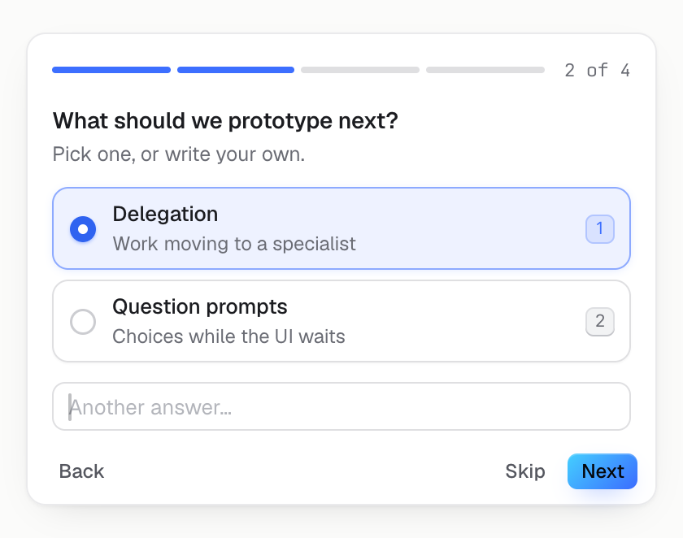
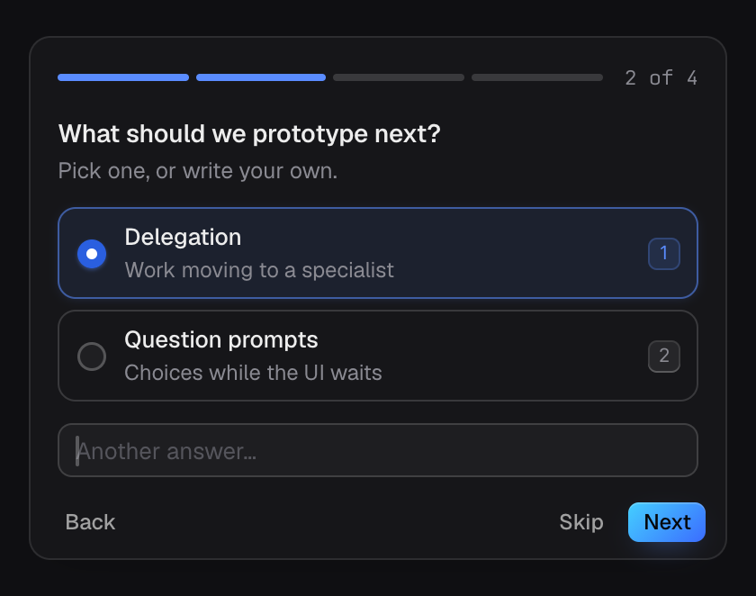
<figcaption><code>steps</code>：途中的一次单选。</figcaption>
</figure>

<figure class="tn-figure">
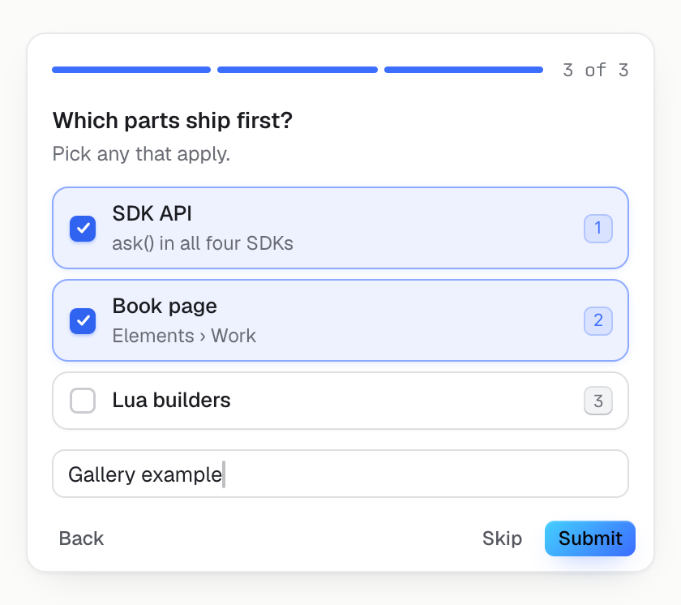
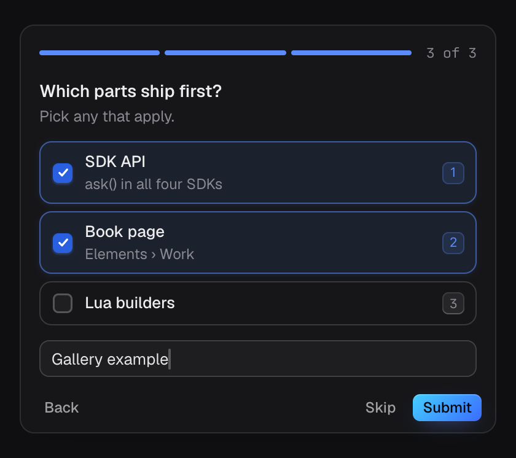
<figcaption><code>steps</code> 的最后一步：一个带 Other 回答的 <code>multi</code> 问题。</figcaption>
</figure>

<figure class="tn-figure">
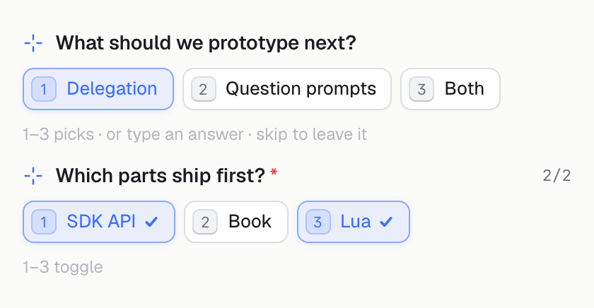
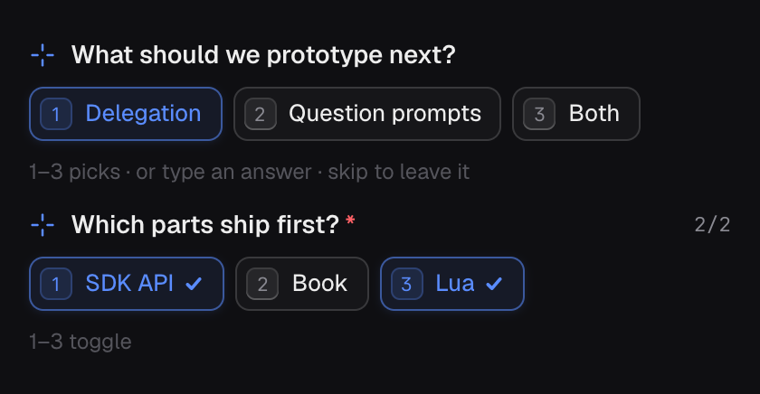
<figcaption><code>inline</code>：带 Other 的单选，以及一次必答的 <code>multi</code> 多选。</figcaption>
</figure>

<figure class="tn-figure">


<figcaption><code>list</code>：已回答的问题折叠为一行。</figcaption>
</figure>

**构建方式：** `tern.ui.node("questions", { items = { … }, step = …, answers = { … } }, { …other inputs })`。

| 属性 | 类型 | 默认值 | 含义 |
| --- | --- | --- | --- |
| `items` | array of questions | `[]` | 问题（没有 `id` 的会被跳过）。 |
| `items[].id` | string | required | 问题 id：其事件中的 `item`，以及在 `answers` 中的 key。 |
| `items[].prompt` | string | `""` | 问题本身。 |
| `items[].description` | string | none | 提示下方的一行。 |
| `items[].choices` | array of `{ value, label?, detail? }` 或字符串 | `[]` | 选项；`label` 默认取 `value`。 |
| `items[].choices[].detail` | string | none | 选项卡片上的第二行（仅 `steps`）。 |
| `items[].multi` | boolean | `false` | 多选：答案为 value 数组。 |
| `items[].other` | `{ placeholder? }` \| boolean | none | 从以 `<id>.other` 为 key 的 `input` 子节点接收自由文本回答。 |
| `items[].required` | boolean | `false` | 没有 Skip；Next 等待该问题的回答，Submit 等待每个必答问题。 |
| `step` | number | `0` | 当前问题的索引，从 0 开始（会被限制在条目范围内）。 |
| `answers` | object of id → string \| array of strings | `{}` | 答案：一个选项 value、一个 value 数组（`multi`），或文本（Other）。 |
| `variant` | `"steps"` \| `"inline"` \| `"list"` | `"steps"` | 外观。 |
| `hint` | string | derived | `inline` 的提示行（`""` 会隐藏它）。 |
| `submit` | string | `"Submit"` | 最后一步（以及 `list`）的提交标签。 |

**子节点：** 只有那些正在显示选项的问题的 `<question id>.other` 子节点 `input`，各自放入其问题的 Other 槽；其他子节点不绘制。

**事件：**

| 事件 | 载荷 | 时机 |
| --- | --- | --- |
| `change` | `{ id, item, value }`：`item` 为问题 id，`value` 为新答案（一个选项 value，或 `multi` 的数组） | 点击选项即选中（或翻转）该选项。 |
| `action` | `{ id, act, item }`：`act` = `next`、`back` 或 `skip`，`item` 为离开的问题 | 点击 Next、Back 或 Skip。 |
| `action` | `{ id, act = "submit", value }`：`value` 为每个答案，用户的选择覆盖 `answers` | 在所有必答问题已回答时点击 Submit。 |
| `select` | `{ id, item }`：`item` 为问题 id | 点击 `list` 中的另一个问题。 |

**键盘：** 节点从不获取焦点。程序通过属性驱动它：`1`–`9` 选择当前问题的选项（设置 `answers`），Enter / Tab 移动 `step`，输入进入 Other `input`（`autofocus`、`cursor`）。把 `change` 映射进 `answers`、把 `action` 映射进 `step`，以保持程序为所有者。

**无障碍。** 节点是 `form`；选项是带 `aria-checked` 的 `radio` 组成的 `radiogroup`（或 `checkbox` 组成的 `group`）；`steps` 的进度是带 `aria-valuenow` 的 `progressbar`；列表问题是按其 prompt 命名的 `group`。

**样式：**

```html
<div class="sf sf-questions" data-id="…" data-variant="steps" role="form">
	<div class="q-body">
		<div class="q-top">
			<div class="q-progress" role="progressbar" aria-valuenow="2"><i class="q-seg on"></i><i class="q-seg on"></i><i class="q-seg"></i></div>
			<span class="q-count">2 of 3</span>
		</div>
		<div class="q-head">
			<span class="q-prompt">What should we prototype next?<span class="q-req">*</span></span>
			<span class="q-desc">Pick one, or write your own.</span>
		</div>
		<div class="q-choices" role="radiogroup">
			<div class="q-choice on" role="radio" aria-checked="true">
				<span class="q-mark q-dot"><i class="q-pip"></i></span>
				<span class="q-text"><span class="q-label">Delegation</span><span class="q-detail">Work moving to a specialist</span></span>
				<span class="q-key">1</span>
			</div>
		</div>
		<div class="q-other"><!-- the input keyed detail.other --></div>
		<div class="q-foot"><button class="sf-button">Back</button><span class="q-fill"></span><button class="sf-button">Skip</button><button class="sf-button">Next</button></div>
	</div>
</div>
```

| 目标 | 选择器 |
| --- | --- |
| 节点 | `.sf-questions`、`[data-variant='steps' \| 'inline' \| 'list']` |
| 主体、进度 | `.q-body`、`.q-top`、`.q-progress`、`.q-seg`（`.on`）、`.q-count`（内部，可能变化） |
| 问题 | `.q-head`、`.q-prompt`、`.q-req`、`.q-desc`、`.q-spark`（`inline`）（内部，可能变化） |
| 选项 | `.q-choices`、`.q-choice`（`.on`；`inline` 与 `list` 中为 `.q-chip`）、`.q-mark`（`.q-dot` 带 `.q-pip`、`.q-box`）、`.q-tick`、`.q-text`、`.q-label`、`.q-detail`、`.q-key`（内部，可能变化） |
| Other、提示 | `.q-other`、`.q-hint`（内部，可能变化） |
| `list` 中的问题 | `.q-q`（`.open`、`.done`）、`.q-num`、`.q-ok`、`.q-sum`（内部，可能变化） |
| 页脚 | `.q-foot`、`.q-fill`；按钮是 `.sf-button`（内部，可能变化） |

选项的过渡在减少动效模式与静态视图（`.sf-still`）中停止。

## `block` 输出块 {#block}

Tern 的命令 lens block：一条 shell 命令的输出，从终端网格中转入并由某个 lens 读取。它由 Tern 创建；它为终端而设计，不是为插件视图。你为 [lens](../reference/api-host.md) 写的内容是它内部的视图：Tern 把你的视图包进一个 id 为 `native` 的 `col`，并把它作为该 block 的第一个子节点插入，位于 `raw`（一个带捕获字节的 `ansi` 节点）之前。

存在 `native` 且“设置 › 终端 › **Native command output**”开启时，block 显示 `native`，否则显示 `raw`；关闭或开启该设置会切换已经显示出来的 block。用 Native/Raw 切换某个 block 会覆盖该 block 的设置：一个局部的、按 block 的选择，按 `key` 在节点的兄弟节点之间记忆（否则按 id），而不是 surface 级。在同父节点下删除并以新 id、相同 key 添加一个 block 会保留该选择；相同 key 在另一个父节点下拥有独立状态。只有显示出来的子节点会被挂载，因此切换会重绘该 block。chrome 保持低调，让 block 读起来像命令输出：

- 一条微弱的 2px 左边缘：悬停时更亮，运行时着 `--live` 色，退出失败后着 `--sf-bad` 色；
- 右上角的一个工具条（相对当前可见的内容；block 高于面板时亦然），悬停或键盘聚焦时出现：lens 标签（图标加上程序，对于 `git`、`cargo`、`docker`、`npm`、`kubectl`、… 还加上其子命令，跳过 `NAME=value` 赋值以及 `sudo`、`env`、`time`、`npx`、`uvx` 这类包装器），以输入的 `cmd` 作为工具提示；Native/Raw 分段控件（没有原生视图时隐藏）；一个 Copy 按钮；
- 一行弱化的页脚，带 `exit N` 徽标（非零退出，结束后）与耗时（`took`，结束后，超过一秒）。两者都不存在时页脚隐藏。

Copy 会运行 `copy` 操作：把原始输出作为纯文本复制，按捕获宽度的终端所显示的样子。

**构建方式：** 由 Tern 构建。其属性如下，供参考：

| 属性 | 类型 | 默认值 | 含义 |
| --- | --- | --- | --- |
| `cmd` | string | `""` | 输入的那一行；lens 标签的工具提示。 |
| `line` | string | `cmd` | 识别出的行；标签由它推导。 |
| `cwd` | string | none | 工作目录（Tern 在恢复时使用；不绘制）。 |
| `lens` | string | `""` | lens id（`git.log`、`plugin.k8s.get`）；`data-role` 变为 `lens.<lens>` 并选取图标。插件 lens（`lens.plugin.…`）使用终端图标。 |
| `role` | string | `lens.<lens>` | 覆盖 `data-role`。 |
| `state` | `"running"` \| `"done"` | `"done"` | 设置 `data-state`；除 `"running"` 之外都视为 `done`。 |
| `exit` | integer | none | 退出状态；非零（结束后）会添加 `.failed` 与退出徽标。 |
| `took` | number (ms) | none | 页脚中的耗时（结束后，超过 1000 ms）。 |
| `age` | number (ms) | none | 由 Tern 携带，但 block 不绘制。 |
| `key` | string | node id | 在兄弟节点之间的标识；Native/Raw 选择按此 key 在同一父节点下记忆。 |

**子节点：** `native`（你的 lens 视图，位于一个 `col` 中，在 lens 拥有视图之前不存在）与 `raw`（`ansi`）。raw 子节点是 id 为 `raw` 的那个，否则是最后一个 `ansi` 子节点；native 子节点是第一个其他子节点。只显示其中一个。

**事件：** 无。没有谁监听已完成的命令，因此 Native/Raw 与 Copy 都是局部的。

**样式：** 这里是 lens 作者限定其 CSS 作用域的地方。

```html
<div class="sf sf-block [failed]" data-id="b" data-role="lens.plugin.k8s.get" data-state="done" data-view="native">
	<div class="sf-block-bar">
		<span class="sf-block-lens" title="kubectl get pods -A">
			<span class="sf-block-ic"><!-- icon --></span><span class="lbl">kubectl get</span>
		</span>
		<div class="sf-block-seg" role="group" aria-label="Output">
			<button class="sf-block-opt on" aria-pressed="true">Native</button>
			<button class="sf-block-opt" aria-pressed="false">Raw</button>
		</div>
		<button class="sf-block-copy" aria-label="Copy output"><!-- icon --></button>
	</div>
	<div class="sf-block-body">
		<div class="sf sf-col" data-id="native"><!-- your lens view --></div>
	</div>
	<div class="sf-block-foot">
		<span class="sf-badge" data-tone="error">exit 1</span><span class="sf-block-took">2.4s</span>
	</div>
</div>
```

| 目标 | 选择器 |
| --- | --- |
| 你的 lens 的 block | `.sf-block[data-role='lens.plugin.<plugin>.<lens>']` |
| 运行中 / 已结束 | `.sf-block[data-state='running']` / `[data-state='done']` |
| 退出失败 | `.sf-block.failed` |
| 显示原生或原始输出 | `.sf-block[data-view='native']` / `[data-view='raw']` |
| 你的视图 | `.sf-block-body > [data-id='native'] > …`，或在你自己的节点上使用自己的 `role` |
| 工具条 | `.sf-block-bar`、`.sf-block-lens`、`.sf-block-ic`、`.sf-block-lens .lbl`（内部，可能变化） |
| Native/Raw | `.sf-block-seg`、`.sf-block-opt`、`.sf-block-opt.on`（内部，可能变化） |
| Copy | `.sf-block-copy`（内部，可能变化） |
| 主体 | `.sf-block-body`（内部，可能变化） |
| 页脚 | `.sf-block-foot`、`.sf-block-foot > .sf-badge`、`.sf-block-took`（内部，可能变化） |

`surface-lens.css` 中有两条规则会影响 lens 视图：在 block 内，card 的主体缩进 12px（`.sf-block-body .sf-card-body`）；带 `role = "output"` 的列表读作输出行（可选择文本、无悬停、除非虚拟化否则换行）。主体的间隙是 `--sf-inner-gap`。

```css
/* A plugin sheet: highlight a failing kubectl lens, and dim it while it runs. */
.sf-block[data-role='lens.plugin.k8s.get'].failed .sf-table {
	box-shadow: inset 2px 0 0 var(--sf-bad);
}
.sf-block[data-role='lens.plugin.k8s.get'][data-state='running'] .sf-table {
	opacity: 0.7;
}
```

你可以在自己的 block 视图中放一个 `block` 节点，但在那里它没有用处：它会绘制，但在终端的命令 block 之外，Copy 复制的是空字符串，因为原始文本来自 block surface。

## `prefs` 设置 {#prefs}

一个按 kit 的 Preferences 页面外观绘制、由你的数据驱动的设置页面。omp 为 `/settings` 发送它。它是这里最丰富的类型：程序拥有每个设置与每个按键，页面把每种指针操作作为事件发回；你以新属性作答。

**绘制位置。** 在 `main` 中，它作为整页填满该区域的 host：一个导航列（品牌、搜索、页面分组）、滚动的文档，以及右上角的 Close 按钮。宽度低于 760px 时导航折叠为图标栏（`.pf.rail`）。在 `layer` 中它是 kit 的抽屉（`.pf.sheet`）：停靠在右边缘，宽度为 `--tv-aside`（host 没有预留时为 440px），关闭按钮位于品牌行，各页面为一个图标条。在终端的 inline surface 中，host 会把抽屉旁的转录收窄（“aside”）；插件 block 是屏幕 surface，因此它旁边不会有东西收窄：抽屉覆盖在 block 的内容之上。

**数据模型。** 页面由 `pages`（导航）、当前的 `page` 以及由行组成的 `sections` 构成。每一行有一个 `control`，其 `k` 为七种之一。

| 属性 | 类型 | 默认值 | 含义 |
| --- | --- | --- | --- |
| `title` | string | `"Settings"` | 品牌标题与该页面的无障碍名称。 |
| `pages` | array of `{ id, label?, group?, icon?, disabled?, changed? }` | `[]` | 导航行。`group` 相同的连续页面共享以该 group 为标题的分组。`icon` 是一个[图标名](data.md#icon)（默认 `sliders`）。`disabled`（一个原因字符串）会使该行变暗并成为其工具提示；它无法被打开，无论从其导航行还是从其搜索结果标题（标记为 `.off`，工具提示相同）。`changed`（大于 0 的计数）显示一项“N changed from default”计数。 |
| `page` | string | `""` | 当前页面 id：在导航中高亮；头部显示 `NN · Label` 与该标签。 |
| `lead` | string | none | 页面标题下方的一段。 |
| `sections` | array of sections | `[]` | 文档的各节（见下）。 |
| `query` | string | `""` | 搜索文本。非空（去除空白）时，文档显示结果，按各节的 `page` 在页面标题下分组，标签与提示中的匹配词放在 `<mark>` 中。Tern 不做过滤：你只发送匹配的各节，每节带其 `page`。 |
| `cursor` | integer | none | 搜索字段中的 UTF-16 光标位置；在你的搜索字段拥有按键时设置。没有它时，字段显示去除空白的 query，或“Search settings”。 |
| `focus` | string | none | 带焦点环（`.focus`）的行 id 或节 id；页面会把它滚动到可见位置（节滚到顶部，行滚到最近的边缘）。 |
| `editing` | `{ row, option?, draft?, cursor? }` | none | 你正在用键盘编辑的行（见“编辑”）。 |

一节是 `{ id?, title?, page?, rows }`。没有行的节会被跳过（`status-line` 这个 id 除外，见“子节点”）。完全没有行的页面显示“Nothing to set here”；没有命中的搜索显示“No settings match …”。

一行：

| 字段 | 类型 | 含义 |
| --- | --- | --- |
| `id` | string | 必填；该行的 `data-row` 及其事件的 `item`。 |
| `label` | string | 标签（默认取 id）。 |
| `hint` | string | 标签下方一行。 |
| `warning` | string | 标签前的警告图标，以及其下的文本（`.warn`）。 |
| `disabled` | string | 一个原因：显示在标签下方并作为工具提示；该行变暗（`.off`），其控件不起作用。 |
| `changed` | boolean | 标签左侧的强调色圆点（工具提示“Changed from default: `defaultLabel`”，或仅“Changed from default”）以及控件前的 Reset 按钮（`action` 与 `keys` 行以及禁用的行没有）。 |
| `defaultLabel` | string | 默认值，在圆点的工具提示中给出名称。 |
| `control` | object | 控件，按 `k`（见下表）。 |

七种控件：

| `k` | 字段 | 绘制 | 点击时 |
| --- | --- | --- | --- |
| `switch` | `on` | `.pf-sw` 开关 | 立即翻转，发送 `change { value = bool }` |
| `choice` | `value`、`options`（`{ value, label?, detail? }`）、`style`（`"auto"` \| `"segmented"` \| `"menu"`）、`mono` | `segmented` 时为 `.pf-seg` 分段；`auto` 时若为 2–4 个选项且标签合计 28 个字符或更少，也用分段；否则为一个显示当前标签的 `.pf-pick` 弹出按钮。`detail` 是分段的工具提示，或菜单选项的第二行。 | 分段：立即选中，发送 `change { value = string }`。弹出：发送 `activate`；当你在该行设置 `editing` 时显示菜单；选择选项会发送 `change { value }`。 |
| `number` | `value`、`min`、`max`、`step`（默认 1）、`unit`、`labels`（`{ ["<n>"] = label }`） | `.pf-step`：− 值 + | 以新值发送 `change { value = number }`：给出 `labels` 时为其下一个键，否则为 `value ± step`，并限制在 `min`/`max` 内。无路可走的按钮会被禁用。值显示其 `labels` 条目，否则显示数字与 `unit`。 |
| `text` | `value`、`placeholder`（默认“Not set”）、`secret`、`mono` | `.pf-in`：字段外观，而非输入框 | 发送 `activate`；编辑时显示 `editing.draft`，光标位于 `editing.cursor`。`secret` 显示圆点。 |
| `keys` | `keys`（组合键数组，每个为按键名数组） | 键帽组（`.pf-chord > .kbd`）；该行获得 `.pf-key` | 无（没有控件操作） |
| `multi` | `values`、`options`、`ordered` | 开关 chip（`.pf-chips > .pf-chip`），或带 `ordered` 时可重排列表（`.pf-order > .pf-oi`：抓手、位置、标签、开关），启用的在前，按 `values` 顺序 | 发送 `change { value = { …enabled values in order } }`。在有序列表中，把抓手拖到另一项上会把它移到该项之前（拖到其下半部分时移到其后），并启用该项、发送新顺序。 |
| `action` | `act`（默认 `"edit"`）、`label`（默认“Edit…”） | 一个小按钮 | 发送 `action { act, value = row }` |

**编辑。** 按键从不到达页面；它们到达你的 block 的 `key` 处理器。你通过属性驱动键盘操作：`focus` 移动焦点环；`editing = { row }` 打开某个选择行的菜单（`option` 高亮，默认为当前值）、把某个多选行的高亮放在 `option` 上，或显示某个文本行的 `draft` 并把光标放在 `cursor`。清除 `editing` 即可关闭。

**更新。** 文档仅在其结构变化时重建（page、query、sections、行 id、控件类型与选项；页面或 query 变化还会滚动到顶部并重放入场动效）。否则各行就地打补丁，因此开关是滑动而不是重绘。

**子节点：** 按 `role` 放置。role 为 `omp.prefs.preview.status` 的子节点放在 `status-line` 节之后（该节不显示时不绘制）。role 为 `omp.prefs.editor` 的子节点，或任何 `picker`，进入 `.pf-editor`，即页面上的一张玻璃卡片（用于没有原生控件的编辑器，或大型选择的子菜单）。其他任何子节点放在各节之后，进入 `.pf-extra`。

**事件：** 全部携带 `id` = prefs 节点的 id。

| 用户操作 | 事件 |
| --- | --- |
| 点击导航行或某个搜索结果的页面标题 | `action { act = "page", value = <page id> }`（禁用的页面无论从哪一处都不发送） |
| 点击 Close（或抽屉的 x） | `action { act = "close" }` |
| 翻转开关、分段、菜单选项、步进器、chip，重排，或按下 Reset | `change { item = <row>, value }`：开关为 `bool`，choice 为 `string`，number 为 `number`，multi 为按顺序的 `string[]`，Reset 为 `null` |
| 点击弹出按钮或文本字段 | `activate { item = <row> }` |
| 再次点击已打开弹出层的按钮，或点击已打开菜单之外的任何位置 | `action { act = "close", value = <row> }` |
| 指向某个菜单选项 | `select { item = "<row>=<value>" }`，每个选项一次（用于实时预览） |
| 点击 `action` 按钮 | `action { act = <control.act>, value = <row> }` |
| 点击行内控件之外的区域 | `select { item = <row> }` |
| 焦点位于页面外字段时点击页面 | 先发送 `focus`，然后是上面的那个事件 |

页面自身不处理 Escape：Escape 会到达你的 `key` 处理器，在那里你关闭页面（或已打开的编辑器）。所有这些事件都会到达插件 block 的 `event`。

**样式：**

```html
<div class="sf sf-prefs" data-id="…">
	<div class="pf on [rail] [sheet]" aria-label="Settings">
		<nav class="pf-nav">
			<div class="pf-brand"><span class="pf-mark"></span><span class="pf-brand-t">Settings</span><button class="icon-btn pf-close"></button></div>
			<div class="pf-search"><!-- icon --><span class="q [ph]"><span class="pre"></span><span class="pf-caret"></span><span class="post"></span></span></div>
			<div class="pf-groups">
				<div class="nav-group pf-group"><div class="nav-head">General</div>
					<div class="pf-items"><button class="nav-row [on] [off]" data-v="look"><!-- icon --><span class="lbl">Look</span><span class="meta pf-changed">2</span></button></div>
				</div>
			</div>
		</nav>
		<div class="pf-scroll"><div class="pf-doc [arrive]">
			<header class="pf-head [pf-found]"><div class="pf-eyebrow mono">01 · Look</div><h1 class="pf-title">Look</h1><p class="pf-lead">…</p></header>
			<section class="pf-sec" data-sec="theme"><h2 class="pf-sec-t">Theme</h2>
				<div class="pf-rows">
					<div class="pf-row [changed] [warn] [off] [editing] [stack] [focus]" data-row="dark">
						<span class="pf-dot"></span>
						<div class="pf-lbl"><div class="t">Dark mode</div><div class="h">…</div></div>
						<div class="pf-ctl"><button class="pf-reset">Reset</button><button class="pf-sw on" role="switch"><i class="knob"></i></button></div>
					</div>
				</div>
				<div class="pf-preview"></div>
			</section>
			<div class="pf-extra"></div>
		</div></div>
		<div class="pf-top"><button class="btn sm quiet"><span class="kbd">esc</span>Close</button></div>
		<div class="pf-editor [on]"></div>
	</div>
</div>
```

| 目标 | 选择器 |
| --- | --- |
| 节点 | `.sf-prefs`；在 layer 中为 `.sf-layer .sf-prefs` |
| 页面、图标栏、抽屉 | `.pf`、`.pf.rail`、`.pf.sheet`（kit 的类，内部，可能变化） |
| 导航 | `.pf-nav`、`.pf-brand`、`.pf-close`、`.pf-search .q`（`.ph`、`.pf-caret`）、`.pf-groups`、`.nav-group`、`.nav-head`、`.nav-row`（`.on`、`.off`）、`.pf-changed`（内部，可能变化） |
| 文档 | `.pf-scroll`、`.pf-doc`（`.arrive`）、`.pf-head`（搜索时为 `.pf-found`）、`.pf-eyebrow`、`.pf-title`、`.pf-lead`、`.pf-part`、`.pf-part-h`（`.off`）、`.pf-part-b`、`.pf-none`（内部，可能变化） |
| 各节 | `.pf-sec[data-sec='<id>']`（`.focus`）、`.pf-sec-t`、`.pf-rows`、`.pf-preview`、`.pf-extra`、`.pf-editor.on`（内部，可能变化） |
| 行 | `.pf-row[data-row='<id>']`，带 `.changed`、`.warn`、`.off`、`.editing`、`.stack`（multi）、`.focus`、`.pf-key`（keys）；`.pf-dot`、`.pf-lbl .t`、`.pf-lbl .h`、`.pf-warn`、`.pf-why`、`.pf-ctl`、`.pf-reset`、`mark`（内部，可能变化） |
| 控件 | `.pf-sw`（`.on`、`.sm`、`.knob`）；`.pf-seg > button.on`；`.pf-pop`、`.pf-pick`、`.pf-menu`（`.still`）、`.mi`（`.cur`、`.sel`、`.two`）、`.pf-check`、`.pf-ml .t`、`.pf-ml .d`；`.pf-step`、`.pf-step .v`；`.pf-in`（`.mono`、`.editing`、`.v`、`.ph`、`.secret`）；`.pf-chord .kbd`；`.pf-chips`、`.pf-chip`（`.on`、`.sel`）；`.pf-order`、`.pf-oi`（`.on`、`.sel`、`.drag`）、`.pf-grip`、`.pf-oi .n`（内部，可能变化） |

变量：`--tv-aside`（抽屉宽度）、`--sf-zoom`、`--pf-room`（在打开的菜单上内联设置：其宽度预算，使长选项在行内换行），以及 kit 的 `--accent`、`--accent-ink`、`--accent-fill`。页面把自身高度设为其 host 的高度。

```lua
local ui = tern.ui

local function settings(state)
	return ui.node("prefs", {
		title = "Deploy settings",
		lead = "How and where your pushes deploy.",
		pages = {
			{ id = "general", label = "General", icon = "sliders" },
			{ id = "targets", label = "Targets", icon = "server", changed = state.changed },
			{ id = "keys", label = "Shortcuts", icon = "keyboard" },
		},
		page = state.page,
		focus = state.focus,
		editing = state.editing,
		sections = {
			{ id = "run", title = "Runs", rows = {
				{ id = "auto", label = "Deploy on push", hint = "Every push to main starts a deploy.",
					control = { k = "switch", on = state.auto } },
				{ id = "env", label = "Environment", changed = state.env ~= "dev", defaultLabel = "Dev",
					control = { k = "choice", value = state.env, options = {
						{ value = "dev", label = "Dev" },
						{ value = "staging", label = "Staging" },
						{ value = "prod", label = "Prod" },
					} } },
				{ id = "jobs", label = "Parallel jobs", control = { k = "number", value = state.jobs, min = 1, max = 8 } },
				{ id = "token", label = "API token", control = { k = "text", value = state.token, secret = true } },
				{ id = "notify", label = "Notify", control = { k = "multi", values = state.notify, options = {
					{ value = "slack", label = "Slack" },
					{ value = "email", label = "Email" },
					{ value = "pager", label = "Pager" },
				} } },
				{ id = "logs", label = "Clear logs", hint = "Deletes the logs of finished runs.",
					control = { k = "action", act = "clear-logs", label = "Clear" } },
			} },
		},
	})
end

-- In the block's event(state, ev, cx):
-- ev.ev == "change" and ev.item == "auto" -> state.auto = ev.value
-- ev.ev == "action" and ev.act == "page"  -> state.page = ev.value
-- ev.ev == "activate" and ev.item == "token" -> state.editing = { row = "token", draft = state.token, cursor = #state.token }
```

<figure class="tn-figure">


<figcaption>以 <code>page = "general"</code>、<code>focus = "env"</code>、<code>env = "prod"</code>、<code>changed = 2</code> 呈现。560px 时导航为图标栏；图示限定了页面的高度，实际中页面会填满其 host。</figcaption>
</figure>

随后文本编辑发生在你的 `key` 处理器中：按每个按键更新 `editing.draft` 与 `editing.cursor`，按 Enter 提交，按 Escape 清除 `editing`。

