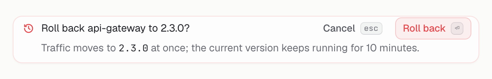
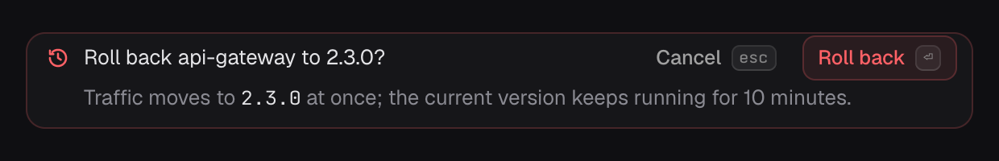
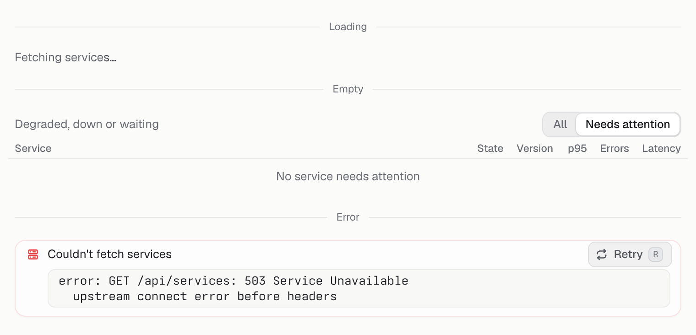
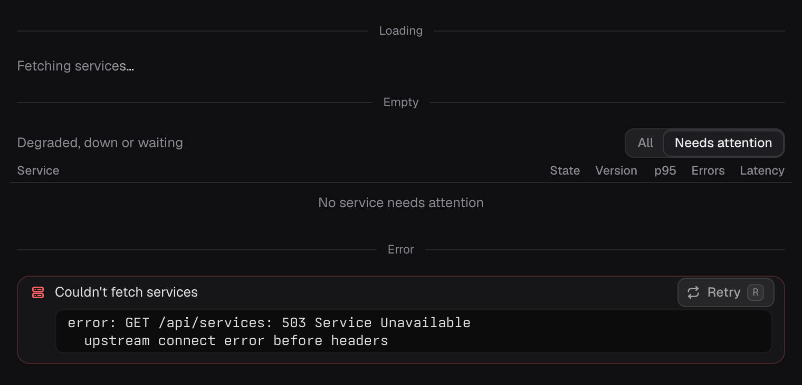
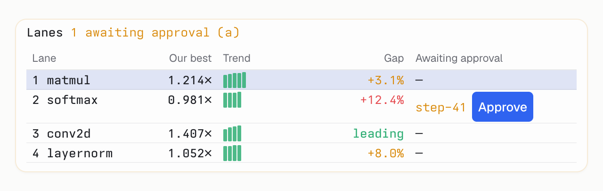
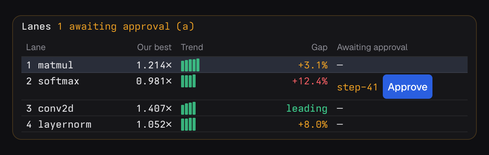
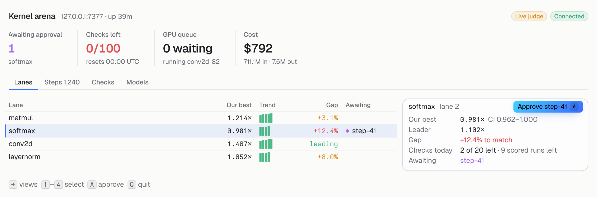
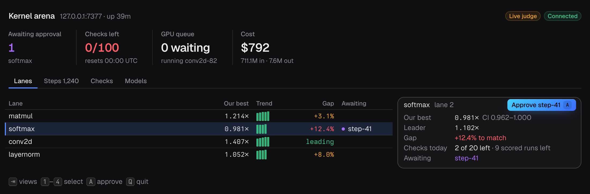

# 设计视图 {#designing-views}

Tern 自身的视图（omp 的会话、git block、设置、选择器）共用同一种外观：一个沉静的桌面应用，以 Geist 的精度绘制。面向人的文字用无衬线字体，面向机器的字符串用等宽字体；灰色克制，用细线代替边框，只在有意义的地方使用颜色；屏幕上只有一个主操作，并且每一种状态都经过设计。[元素](../elements/index.md) 中的各种 kind 会替你绘制这种外观。用它们搭建、并遵循本页规则的视图，无需写一行自己的 CSS，看上去就像 Tern 的一部分。

本页面向所有构建视图的人：用 Luau 编写的插件 block，或通过 [Surface 协议](../protocol/index.md) 与 Tern 对话、借助 [SDK](../protocol/sdks.md) 的程序。配方以 TSX（TypeScript SDK）给出，并附 Luau 等价写法；Rust、Python 和 Go SDK 使用同名的 prop，每个 SDK 都附带一个 `dashboard` 示例，把下面的每一份配方组合在一起。

<figure class="tn-figure">


<figcaption>这是一个页面，不是一堆卡片的堆叠：head 行、统计条、标签页，以及选中服务卡片旁的表格。没有样式表。</figcaption>
</figure>

## 规则 {#the-rules}

1. **以无衬线字体打开应用。** 在 surface（或 block）上设置 `font: "sans"`，文字就会以界面字体绘制；机器字符串通过 span token 与列标志保持等宽。（[排版](#typography)）
2. **搭建页面，而不是堆叠卡片。** 一个 head 行、一条统计条、视图之间的标签页，以及每个视图中占满整宽的表格和选中项的卡片。每张卡片只承载一个对象；绝不要承载表格、`stats` 条或另一张卡片。（[页面结构](#page-structure)）
3. **先考虑 kind，再考虑 `el`。** `button`、`table`、`stats` 条、`tabs` 条、`card`：每一种都由 Tern 绘制、设定尺寸、复制、朗读并套用主题。（[该用什么](#what-to-reach-for)）
4. **颜色只承载含义。** 用色调与 span token，绝不用十六进制色值，绝不写自己的颜色类。（[颜色](#color-only-for-meaning)）
5. **屏幕上只有一个主操作。** 它作用于当前选中项：位于选中项的卡片中，或是没有卡片时位于选中的行上。其余一切都用默认按钮或 `quiet` 按钮。（[按钮](#buttons)）
6. **两种密度。** head 行、栏和表单使用 `md` 控件；行、表格和详情卡片使用 `sm`。（[密度](#density)）
7. **每个视图都有四种状态：** 加载、空、错误和成功。（[四种状态](#the-four-states)）
8. **按键由你掌控，并且可见。** 你的程序处理每个按键；用 `keys` 和按键图例把它们展示出来。（[键盘](#keyboard)）
9. **指针样式由 Tern 管理。** 任何可点击元素本身就会显示手形光标；绝不要设置 `cursor`。（[光标](#cursor)）
10. **CSS 放在最后。** 很少使用，限定在你的 surface 内，用 token 着色。（[何时写 CSS](#when-to-write-css)）

## 页面结构 {#page-structure}

屏幕型应用（仪表盘、工具自己的窗口、一个会话）是一个自上而下阅读的页面：它是什么、运行得如何、你能去哪里，然后是你正在看的那一件事。

```text
head row     Deploys  prod · eu-west-1 · updated 2 min ago     [Canary running] [Connected] [Refresh R]
stats strip  Services 6 │ Error rate 0.42% │ p95 latency 182 ms │ Awaiting promotion 2
tabs         Services 6   Deploys 41   Alerts 2   Config
view         description ··········· [All | Needs attention]   ┌ search 3.2.0-rc.1  [Promote P] ┐
             table, full width, one grow column              │ facts and actions               │
dock         key legend (and a confirm strip while one is open)
```

1. **head 行**，而不是一张卡片：一个 `row`，设置 `justify: "between"` 与 `align: "center"`，直接放在 `main` 中。左侧是一个 `text`，应用名用 `title` token，其后跟弱化的元信息（它监视的地址、运行时长、上次更新的时间）；右侧是状态徽标和页面的全局控件（Refresh）。不需要图标。
2. **统计条**：页面所关注的少数几个数字，最多四块，紧贴 head 行下方，直接放在 `main` 中。`stats` 节点本身没有外框；绝不要把它放进卡片。没有可汇总内容的页面可以跳过它。
3. **标签页**用于超过两个面板的情况：在 head 行和统计条下方放置一条 [`tabs`](../elements/lists.md#tabs) 条（默认的下划线变体），每个视图一个标签，标签使用视图名，并在有帮助时附上弱化计数（`Steps 1,240`、`Alerts 2`）。同一时刻只显示一个视图，占满整宽，你的程序只渲染当前活动的那个。Tab 与 ⇧Tab（或 `[` 和 `]`）用于切换视图；按键图例要说明这一点。两个面板可以直接上下堆叠。
4. **视图**就是它的数据，直接放在页面上：一个占满整宽、外面没有卡片的 `table`，其上方可选地放一个工具栏 `row`（左侧是弱化说明，右侧是分段 `tabs` 或按钮），旁边是选中项的卡片。主从两栏放在一个 `row` 中，设置 `align: "stretch"` 与 `gap: "lg"`：表格放在 `grow: 1` 且 `basis: 0` 的 `col` 中，卡片设置 `min: { w: '44ch' }` 与 `max: { w: '56ch' }`。并排布局只用于主从关系，绝不用于两个互不相关的面板。
5. **卡片即对象**：选中项的详情、确认条、一个错误、同级中的一个实体（用量页面上的某个 provider）。绝不要用卡片把表格、`stats` 条或另一张卡片框起来。
6. **dock** 承载固定在底部的内容：打开确认条时显示该确认条，以及一条按键图例（带 `key` span 的弱化 `text`）或一条 [`status`](../elements/chrome.md#status) 栏。

## 该用什么 {#what-to-reach-for}

| 你想要 | 使用 | 不要用 |
| --- | --- | --- |
| 页面的名称与状态 | 一个 head `row`：包含 `title` token 的 `text` 加弱化元信息；右侧是徽标与全局按钮 | 一张容纳所有内容的 head 卡片 |
| 几个标题性数字 | 紧贴 head 行下方的 [`stats`](../elements/data.md#stats) | 卡片里的统计；一行 `text` 与徽标 |
| 多个面板 | head 下方的 [`tabs`](../elements/lists.md#tabs)，一次显示一个视图 | 一次显示所有面板；卡片网格 |
| 应用的顶层分区，其中一些包含若干子页面 | [`nav`](../elements/lists.md#nav)（工具栏中的 pill，页面 head 下方的链接）；每个分区都是单一扁平视图时用 `tabs` | 一排用于切换视图的 `button` |
| 按 Mac 应用菜单栏的方式（File、Edit、View）分组的应用命令 | [`menubar`](../elements/lists.md#menubar)：head 行或 dock 中的 `strip`，带自身标识悬浮在应用之上的 `pill` | 每个分组一个 `menu` 按钮排成一行；超过五六个按钮的 `button` 工具栏 |
| 共享列的行，并从中选一个 | 带 `selectable`、`selected` 的 [`table`](../elements/data.md#table)，在页面上占满整宽 | 卡片里的表格；配样式表的 `html.table` |
| 同时对多行执行操作（重启、删除、导出） | 带 `multi: true` 与 `bar` 操作的 `table`；复选框会让密集的键盘驱动表格显得拥挤时用 `variant: "bar"` | 每行一个 `el` 复选框；每行一个按钮 |
| 很长的表格或列表，一次一页 | 在其下方放 [`pager`](../elements/lists.md#pager)：表格页脚中的 `range`，人们来回跳转时用 `pages`，不断增长的 feed 用 `more` | 上一页/下一页 `button` 加一个“Page 3” `text` |
| 选中行的事实信息与操作 | 表格旁的详情 [`card`](../elements/layout.md#card)：一个 `kv`，主操作放在其 head 的 `end` 中 | 每行一个按钮 |
| 用户可调整大小的两三个视图（一个列表及其详情、一个查询及其结果） | [`split`](../elements/layout.md#split)：同一个带框盒子里的 `hairline`，独立卡片用 `tiles` | 固定 `basis` 的 `card` 组成的 `row`；一次一个视图就够时用 `tabs` |
| 同级中的一个对象、一个确认、一个错误 | 带 `icon`、`head`、`meta`、`end` 的 [`card`](../elements/layout.md#card) | 把表格、统计或卡片包起来的卡片 |
| 少量带标签的事实信息 | [`kv`](../elements/data.md#kv) | `el` 的 `dl` 网格 |
| 一列可供挑选的项目（标签、详情、值） | 由 `item` 组成的 [`list`](../elements/lists.md#list) | 只有一列的表格 |
| 固定高度中的长列表、日志或聊天 | 带 `max.h` 的 [`scroll`](../elements/layout.md#scroll)；不断增长的输出用 `stick: "end"` | 在 `col` 上设 `max.h`，它会把超出的内容裁掉 |
| 一个操作 | [`button`](../elements/input.md#button) | 配样式表的 `html.button` |
| 两到五个相关的操作或开关（撤销/重做、视图切换、一个操作及其菜单、面板的工具条） | 包住 `button` 节点的 [`buttons`](../elements/input.md#buttons) | 散落在 `row` 里的 `button` |
| 超出工具栏容量的命令；排序或视图菜单 | [`menu`](../elements/lists.md#menu)：操作用 `default`，排序/筛选组用 `dense`，少数重量级选项用 `detail` 行；右键菜单用 `actions.menu` | 一排 `button`；一个 `picker`（它用于查找，不用于命令） |
| 栏中的开关切换 | 带 `on` 的 `button` | 表单之外的复选框 |
| 一个开或关的设置项 | [`switch`](../elements/input.md#switch)：设置中用带 `label` 与 `hint` 的 `default`，密集列表中用 `compact` | `el` 复选框；栏外带 `on` 的 `button` |
| 一个筛选器或视图的模式 | 视图工具栏 `row` 中带 `variant: "segmented"` 的 `tabs` | 画成分段样式的单选按钮；第二条下划线式标签条 |
| 从一组值中选一个（模型、区域、分支） | [`select`](../elements/input.md#select)：表单中用 `field`，head 与栏中用 `quiet`，选项超过十来个时用 `search` | 由按钮弹出的 `list`；一排按钮；超过三个选项时用 `el` 单选按钮 |
| 一个状态词 | 带 `tone` 的 [`badge`](../elements/data.md#badge)、表格文本单元格的 `dot`，或用该 tone 的 span token 写出的这个词 | 自己定义的色彩类 |
| 谁做的、谁在参与、哪个模型或仓库 | 名字旁的 [`avatar`](../elements/data.md#avatar)；多人（评审者、关注者）用 [`avatars`](../elements/data.md#avatars)，`max` 取 3–5 | `badge` 里的首字母；一排 `image` |
| 按键提示 | `button` 上的 `keys`；页面其余按键放在 `dock` 的按键图例中 | 以文本形式写 `[r] refresh` |
| 一个趋势 | 表格的 [spark 单元格](../elements/data.md#table)，或 [`chart`](../elements/motion.md#chart) 的 `kind: "spark"` | `▁▂▃▅` 字形 |
| 某个值随时间的变化及其最新读数，或同一时间上的多条序列（p50/p95/p99） | `chart` 的 `kind: "line"`；多条序列时用 `values` 序列与 `labels` | 数字 `table`；拉高的 `spark`；每条序列一张图表上下堆叠 |
| 某个事物的占比 | [`meter`](../elements/motion.md#meter)、表格的 meter 单元格、[`progress`](../elements/motion.md#progress) | 只有一个文本百分比 |
| 整体如何分成若干部分 | 带 `caption` 的 `chart` `kind: "donut"` | 由许多部分组成的 `meter` 加手工图例 |
| 进行中的工作 | 说明正在做什么的 [`spinner`](../elements/motion.md#spinner) 或 [`shimmer`](../elements/motion.md#shimmer)，[`elapsed`](../elements/motion.md#elapsed)（表格之外） | “Loading…” |
| 数据还在途中的视图 | 在视图位置放 [`skeleton`](../elements/motion.md#skeleton)，呈即将到达内容的形状（表格用 `rows`，统计方块用 `card`），并带上视图的 `key` | 空面板里孤零零一个 spinner，“Loading…” |
| 尚无任何内容的视图、列表或区域 | 在视图位置放 [`empty`](../elements/layout.md#empty)：缺什么、为什么，以及解决它的那一个 `button` | 空外框，孤零零一句 “No data” `text` |
| 一个对话框或 sheet | 用 `foot` 承载其按钮的 [`overlay`](../elements/chrome.md#overlay) | `main` 里的卡片 |
| 视图旁针对选中项的详情或设置 | 带 `side: "right"` 的 [`overlay`](../elements/chrome.md#sheets-and-drawers)（检查器 sheet），`foot` 放 Apply | 盖在它所描述内容之上的居中对话框 |
| 从底部升起的日志、终端或预览 | 带 `side: "bottom"` 的 `overlay`（抽屉） | 取代页面的第二个视图 |
| 一闪而过的确认提示 | [`toast`](../elements/chrome.md#toast)（block 中的 `cx:toast`） | 一直停留的一行文字 |
| 沿底部排列的事实信息 | `dock` 中带 `seg` 的 [`status`](../elements/chrome.md#status) | 一个 `text` 页脚 |
| 正文、日志、代码 | [`md`](../elements/text.md#md)、[`ansi`](../elements/text.md#ansi)、[`code`](../elements/text.md#code) | 手工换行的 `text` |
| 标注来源的回答 | 带 `cite` 的 [`text`](../elements/text.md#text) span；长文阅读用 `cite: "note"` 并附来源列表 | 裸露的 URL；在文本里手打 `[1]` |
| 一段对话（agent 聊天、团队讨论串、对某次变更的评论） | `col` 中的 [`message`](../elements/work.md#message) 节点，agent 聊天用 `variant: "auto"`，人与人之间用 `"flat"`；正文用 `md` 与 `code` 子节点 | 每条消息一张 `card`；用自己的 `el` 拼出气泡 |
| 消息携带的文件，或输入框将要发送的文件 | [`attachment`](../elements/data.md#attachment)：消息中用 `chip`，图片用 `tile`，输入框托盘用 `pill` | 每个文件一张 `card` 或一个 `badge`；用 `image` 显示非图片文件 |
| 用户可翻看的少量图片或面板（截图、渲染图、备选方案） | 由 `image`（或任意元素）幻灯片组成的 [`carousel`](../elements/data.md#carousel) | 放满尺寸图片的 `col`；用 `tabs` 展示图片 |
| 提供接下来可以向 agent 提的问题 | 最后一条回答下方的 [`suggestions`](../elements/work.md#suggestions)：几个简短提示用 chip，程序绑定 1–9 时用带数字键的 `rows`，每条都需要理由时用 `cards` | 一排 `button`；用 `md` 项目符号列表列提示 |
| 向用户提出一个或多个选择题并等待回答 | [`questions`](../elements/work.md#questions)（流程中单个快速问题用 `inline`） | 在 `md` 中写编号选项，再让用户输入答案 |
| agent 逐步做了什么，或其带来源的推理过程 | [`trace`](../elements/work.md#trace)：实时日志用 `rail`，结束后用 `summary`，推理过程用 `card` | 一个 `checklist`（那是计划，不是日志）；一列带 emoji 的 `text` 行 |
| 在危险步骤执行前征求确认（删除、推送、消费） | 带 `status: "ask"` 与 `confirm` 的 [`tool`](../elements/work.md#tool) | 一张装 Allow 与 Deny `button` 的 `card` |
| 带调用栈的异常或崩溃 | [`stacktrace`](../elements/work.md#stacktrace)：转录中用 `frames`，有源码时用 `split`，紧凑可复制的日志用 `mono` | 原始堆栈的 `code` 块；带彩色行的 `ansi` |
| 在转录或日志中标记一个时刻（可恢复的检查点、有人加入、上下文被压缩） | 带 `variant: "note"` 或 `"pin"` 的 [`rule`](../elements/layout.md#rule)，以 Restore 按钮作为其 `end` 子节点 | 每个事件一张 `card`；一行加粗的 `text` |
| 一个文本输入框 | [`input`](../elements/input.md#input)、[`editor`](../elements/input.md#editor) | — |
| 带快捷键的搜索或筛选框 | 带 `icon: "search"`、`keys`、`clear` 的 [`input`](../elements/input.md#addons) | 由一个图标、一个 `input` 和一个 `button` 组成的 `row` |
| 一个 URL、一个大小、一个带单位的数量 | 带 `prefix`/`suffix` 或 `stepper` + `unit` 的 `input` | 输入框旁的文本；其旁的 `+`/`-` 按钮 |
| 带 Send 按钮的消息框 | 带 `buttons` 的 `input`（或 `editor`），其中一个是 `primary` | 一个输入框加单独一行按钮 |
| 一个 token 或密码 | 带 `secret`（以及 `copy` 按钮）的 `input` | 自己画 `•` |
| 验证码或一次性代码 | [`otp`](../elements/input.md#otp)：由你的程序接收按键并设置 `text` | 占位符形如 `______` 的 `input`；六个 `input` |
| 用户凭感觉设定的数值（不透明度、大小、温度、时间窗口） | [`slider`](../elements/input.md#slider)，区间用 `[lo, hi]` 形式的 `value` | 让用户输入数字的 `input`；`+`/`−` 按钮 |
| 用户选择的某一天或日期区间 | 表单中的 [`date`](../elements/input.md#date)；月份本身就是视图时用 [`calendar`](../elements/input.md#calendar) | 解析 `2026-10-30` 的 `input`；由日期组成的 `table` |
| 表单或设置：带标签、帮助与错误的控件 | 每个控件外包 [`field`](../elements/input.md#field)（表单中用 `stacked`，设置中用 `row`，对话框中用 `grid`） | 自己在控件上方写标签 `text`、下方写红色 `text` |
| 由选项组成的表单 | 由带标签的单选按钮与复选框构成的 `el` `form`（[HTML 元素](../elements/el.md#controls)），通过 `button` 提交 | — |

## 排版 {#typography}

**面向人的文字用无衬线字体，面向机器的字符串用等宽字体。** 程序的 surface 默认以终端的等宽字体绘制，这适合与 shell 输出共处的输出。应用型界面（`screen` surface、会话、仪表盘、表单）则改用界面字体打开：

```tsx
const surface = session.open({ mode: 'screen', title: 'Deploys', font: 'sans' });
```

```lua
tern.block.define("deploys", {
	font = "sans",
	init = function(cx, args, saved) … end,
	view = function(state, cx) … end,
})
```

在无衬线 surface 中（[`font`](../protocol/surfaces.md#open-and-close)），文字是 13px 的 Geist，而人会复制的内容保持等宽：

- span token `mono`、`num`、`path`、`code` 与 `key` 以 12.5px 等宽字体绘制：id、哈希、版本、大小、时间、`+12 −3`；
- 设置 `mono: true` 的表格列以等宽字体绘制其单元格；
- `code`、`diff`、`ansi`、`json`、`kbd`、`editor` 与 `input` 保持等宽。

**页面的名称**使用 `title` token：Geist 15px，字重升一级，仅用于 head 行。页面内部的标题是卡片的 `head` 或标签页的标签，而不是再加一级标题。

**数字要对齐。** `align: "end"` 的表格列以及 `num` 与 `mono` token 使用等宽数字。一列中的每个数字都右对齐。在 `kv` 的值或连续行文中，数字用 `mono` 而不是 `num`：`num` 会给它涂上代码数字颜色，读起来像语法高亮。

**强调靠字重升一级**，而不是靠颜色：`strong` 用于那个最要紧的词，`muted` 用于元信息（计数、单位、“updated 2 min ago”），`dim` 用于几乎不重要的内容。一律使用句首大写（“Error rate”，而不是 “ERROR RATE”）；列头不加冒号；需要更多输入的控件以“…”结尾。

**在区分度最低的地方截断长字符串。** 路径、分支与 ref 从中间截断（列上的 `truncate: "middle"`、`path` token），正文从句尾截断；完整值放进 `title`。

## 颜色只用于表达含义 {#color-only-for-meaning}

视图的大部分是中性的。颜色每次使用只表达一件事：

| 色调 | 含义 |
| --- | --- |
| `accent` | 选中、主操作、焦点、链接；进行中的工作（运行中、思考中） |
| `info` | 与第一个进行中状态并行运行的第二种进行中状态（他人在思考时进行求值）；中性消息 |
| `pending` | 等待他人：已排队、等待批准、尚未开始 |
| `success` | 健康、通过、完成、已添加 |
| `warning` | 降级、缓慢、很快需要关注、冲突 |
| `error` | 失败、宕机、已删除、破坏性 |
| `muted` | 空闲、过期、关闭、已跳过、已取消 |
| `user` | 用户自己的内容 |

- **节点**用 `tone`（badge、卡片、文本单元格的 `dot`、meter）；**词**用 span token（`{ t: '3 failed', s: 'error' }`）。span token 有 `accent`、`info`、`pending`、`success`、`warning`、`error`、`muted` 与 `dim`：等待步骤的名称与其 `pending` 圆点并排时，名称也可以是 `pending`。
- 给词或圆点着色，不要给整行着色。整行按状态染色的表格读起来像噪声；名字前一个 6px 圆点一眼就能读到。
- 只有整个面板都表达某种含义时卡片才使用 tone：一次失败的运行、一条确认条。只有一个坏数字的面板保留中性外环，只给那个数字着色。
- 绝不使用十六进制色值，也绝不使用自己定义的类，例如 `.ok { color: … }`：色调与 token 会跟随浅色、深色与用户主题，屏幕阅读器和复制操作拿到的是不带你样式的文本。

## 密度 {#density}

两个层级，与 macOS 一致：

| 层级 | 位置 | 控件 | 文字 |
| --- | --- | --- | --- |
| Chrome | head 行、工具栏、dock、表单、对话框、确认条 | `md` 按钮（28px）、分段标签页（28px） | 13px |
| 内容 | 表格、列表、树、行、详情卡片 | `sm` 按钮（22px）、徽标（18px）、圆点、迷你走势图 | 12.5–13px，等宽字体 12.5px |

- 用 `gap` 控制间距（`xs` 2px、`sm` 6px、`md` 10px、`lg` 16px），绝不用外边距。`main` 已经让其顶层节点之间相隔 16px：head 行、统计、标签页和视图不再需要额外处理。
- 阅读性文案每行最多约 66 个字符：在其 `md` 上设 `max: { w: '66ch' }`。
- 更少、更大的元素。一个视图是一张表格加选中项的卡片，而不是六张各三行的卡片；更多面板就改用[标签页](#page-structure)。

## 按钮 {#buttons}

[`button`](../elements/input.md#button) 这一 kind 绘制 Tern 的按钮：

| `variant` | 用于 | 屏幕上 |
| --- | --- | --- |
| `default` | 大多数操作：Refresh、Open、Retry | 任意 |
| `primary` | 屏幕存在的那个唯一操作，作用于选中项：Promote、Approve、Commit；重大确认条的确认按钮 | 一个 |
| `quiet` | 栏或 head 中的次要操作、Cancel、嵌在文本里的开关 | 任意 |
| `danger` | 破坏性操作：其确认条或对话框的确认按钮，或打开该确认条的触发器（绝不直接执行） | 一个，在上下文中 |

- 行、表格与详情卡片（包括其 head）内使用 `size: "sm"`；head 行、栏、表单与确认条中用 `md`（默认值）。
- `keys` 显示你的程序处理的快捷键（`keys: ['cmd', 'enter']`）；工具提示会重复显示它。
- 操作执行期间用 `busy`：按钮保持宽度、显示 spinner，并不再接受任何操作。`disabled` 配合原因字符串说明为什么不可用。
- `on` 使其成为开关（`Follow`、`Wrap`）。
- 标签用句首大写的动词（“Roll back”、“Open logs”），不要用 “OK”。
- 绝不要给 `html.button` 写样式：`button` 这一 kind 已自带外观、按下效果、键帽与各种状态。`el` 的 `button` 是为表单而存在的，在表单里它会获得同样的默认外观（[HTML 元素](../elements/el.md#default-look)）。

```tsx
<row gap="sm">
   <button icon="repeat" keys={['r']} onClick={refresh}>Refresh</button>
   <button variant="quiet" on={state.follow} onClick={toggleFollow}>Follow</button>
   <button variant="primary" keys={['cmd', 'enter']} busy={state.deploying} onClick={deploy}>
      Deploy
   </button>
</row>
```

```lua
ui.row({
	ui.button("Refresh", { key = "refresh", icon = "repeat", keys = { "r" }, actions = { click = "refresh" } }),
	ui.button("Follow", { key = "follow", variant = "quiet", on = state.follow, actions = { click = "follow" } }),
	ui.button("Deploy", { key = "deploy", variant = "primary", keys = { "cmd", "enter" }, busy = state.deploying,
		actions = { click = "deploy" } }),
})
```

## 表格 {#tables}

[`table`](../elements/data.md#table) 会设定各列宽度，在窄时隐藏最不重要的列，只挂载屏幕上的行，以文本形式复制，并在辅助技术中朗读为表格。设置 `selectable` 后，它的行就成了原生应用中可选取的行：

- `selectable` 让行可点击：单击会发送 `select`，以该行的 id 作为 `item`，双击发送 `activate`。选中状态由你维护：把它作为 `selected` 传回，即可绘出 accent 色调与行首竖条。在按键处理函数中（↑/↓、j/k）也以同样方式移动选中。
- `selected` 变化时，只要表格在屏幕上，就会把对应行滚动到可视区域。已滚出视野的表格不做处理，因此从别处设置的选中项不会把页面拉回去。
- **只有一个 `grow` 列**：主文本列（名称、步骤 id、描述），它占用多余宽度。绝不要在数字、迷你走势图、徽标或按钮上设 `grow`：多余宽度会落在名称与其数值之间，留下空隙。网格是例外：行 × 同类的列（lane × 模型）给每个值列 `grow: 1`，均分宽度，行标签列不设。
- **数字**用 `align: "end"` 与 `mono: true`，并带上单位（`182 ms`）；次要数值用 `muted`。id、版本、大小与时间也用 `mono: true`；路径用 `truncate: "middle"`。
- **`priority`** 决定表格变窄时先隐藏什么：缺省值为 `0`，最先消失。给 `grow` 列最高的值，使它永不隐藏；其次是数字；迷你走势图、meter 与次要列取最低。
- 单元格要表明自己承载什么：带状态 `dot` 或 `icon` 的文本、`badge`、`button`（`sm`，其点击发送 `action`，以该行作为 `item`，且不触发选中）、`spark`、`meter`。
- 行：右键操作用 `menu`，工具提示用 `title`，不可选取的行用 `disabled`（并附原因）。
- `empty` 是没有行时显示的那一行文字。
- **操作。** 表格旁有详情卡片时，选中项的操作是卡片 head 中带快捷键的 `primary` 按钮，行上不带按钮：等待该操作的行在文本单元格中以 `pending` 圆点表明这一点。没有详情卡片时，行操作用 `sm` 按钮单元格，且只有**选中行**的按钮是 `primary` 并带快捷键（`keys: ['a']`）；其余每行都是 `default`。无论哪种方式，屏幕上只有一个主操作，并且随选中项变化。
- **长度。** 在屏幕型应用中，表格不需要 `max.h`：页面本身会滚动。详情卡片内的列表只显示少量行（最近十步）：截取数据，而不是限定高度。`max.h` 是按高度裁剪，而不是按行或段落裁剪，被裁掉的内容会渐隐；它留给那些会说明其余内容在哪里的预览（按 Enter 打开全部）。
- 没有 elapsed 单元格。把时长写成文本（`4m 12s`），随其增长重新渲染：视图 diff 只修补发生变化的单元格。[`elapsed`](../elements/motion.md#elapsed) 这一 kind 用于表格之外。

数据绝不要用 `html.table`：它没有上述任何能力，而且它的行要看起来像 Tern，就得写一份与每个主题相抗的样式表。

## 卡片 {#cards}

[`card`](../elements/layout.md#card) 是一个对象：选中项的详情、一条确认条、一个错误、同级中的一个实体（用量页面上的某个 provider）。它的 head 就是该对象的标题栏：

- `icon`：它是什么（`server`、`branch`、`activity`），在有用处出现。
- `head`：它的名称（`search`、`step-41`、“Couldn't fetch services”）。
- `meta`：关于它的弱化事实信息（`3.2.0-rc.1`、“updated 2 min ago”）。
- `end`：右侧的控件：该项的主操作（`sm`，带快捷键）、状态 `badge`。点击那里永远不会折叠卡片。
- `status` 用于运行/完成/失败的 chip，`selected` 用于持有按键的卡片，`collapsible` 用于用户可折叠的卡片。

正文占用其余空间。没有图标时，正文与 head 文字对齐。

卡片绝不把表格、`stats` 条或另一张卡片框起来。页面本身已经是框架：给表格包一张卡片会损失宽度，还平白多出一圈外环；卡片套卡片读起来则是杂乱。

## 配方 {#recipes}

### 应用外壳 {#an-app-shell}

一个使用无衬线字体的 `screen` surface。`main` 承载页面：head 行、统计条、标签页与当前活动视图，彼此相隔 16px；`dock` 承载打开时的确认条与按键图例。每个处理函数都修改状态并调用 `render`；按键通过循环进入。只渲染当前活动的视图：标签页的 `select` 与 Tab/⇧Tab 修改 `view`，下一次渲染就完成切换。

在 Tern 之外，`plain()` 会把同一个视图以文本形式打印出来。

```tsx
import { connect, plain, span, type Key } from '@stencil-hq/tern';

type View = 'services' | 'deploys' | 'alerts' | 'config';
const VIEWS: View[] = ['services', 'deploys', 'alerts', 'config'];

const session = await connect({ app: 'deploys' });
if (!session) {
   console.log(plain(page(state).main));
   process.exit(0);
}
const surface = session.open({ mode: 'screen', title: 'Deploys', font: 'sans', closable: true });
const render = (): void => surface.render(page(state));

function page(s: State) {
   return {
      main: (
         <col gap="lg">
            <Head s={s} />
            <Overview s={s} />
            <tabs
               key="nav"
               active={s.view}
               items={[
                  { id: 'services', label: ['Services ', span(String(s.services.length), 'muted')] },
                  { id: 'deploys', label: ['Deploys ', span(String(s.deploys.length), 'muted')] },
                  { id: 'alerts', label: ['Alerts ', span(String(s.alerts.length), 'muted')] },
                  { id: 'config', label: 'Config' },
               ]}
               onSelect={ev => { s.view = ev.item as View; render(); }}
            />
            {s.view === 'services' && <Services s={s} />}
            {s.view === 'deploys' && <Deploys s={s} />}
            {s.view === 'alerts' && <Alerts s={s} />}
            {s.view === 'config' && <Config s={s} />}
         </col>
      ),
      dock: (
         <col>
            {s.confirm && <Confirm s={s} />}
            <Legend />
         </col>
      ),
   };
}

/** Applies one key; false quits. */
function onKey(k: Key): boolean {
   const s = state;
   if (k.name === 'tab' || k.name === '[' || k.name === ']') {
      const step = k.shift || k.name === '[' ? -1 : 1;
      s.view = VIEWS[(VIEWS.indexOf(s.view) + step + VIEWS.length) % VIEWS.length];
   } else if (k.name === 'escape' && s.confirm) s.confirm = null;
   else if (k.name === 'escape' || k.name === 'q') return false;
   else if (k.name === 'up' || k.name === 'k') move(s, -1);
   else if (k.name === 'down' || k.name === 'j') move(s, 1);
   else if (k.name === 'r') refresh();
   else viewKey(s, k); // p, l, ⇧R, b: the selected service's actions
   return true;
}

render();
for await (const input of session) {
   if (input.type === 'key' && !onKey(input.key)) break;
   render();
}
await session.close();
```

```lua
local ui = tern.ui
local VIEWS = { "services", "deploys", "alerts", "config" }
local VIEW = { services = services, deploys = deploys, alerts = alerts, config = config }

local function nav(state)
	return ui.node("tabs", { key = "nav", active = state.view, items = {
		{ id = "services", label = { ui.span("Services "), ui.span(tostring(#state.services), "muted") } },
		{ id = "deploys", label = { ui.span("Deploys "), ui.span(tostring(#state.deploys), "muted") } },
		{ id = "alerts", label = { ui.span("Alerts "), ui.span(tostring(#state.alerts), "muted") } },
		{ id = "config", label = "Config" },
	} })
end

tern.block.define("deploys", {
	font = "sans",
	init = function(cx, args, saved)
		return { view = "services", services = {}, deploys = {}, alerts = {}, selected = nil, filter = "all", loading = true }
	end,
	view = function(state, cx)
		local dock = { legend() }
		if state.confirm then
			table.insert(dock, 1, confirm_strip(state))
		end
		return {
			main = ui.node("col", { gap = "lg" }, { head(state), overview(state), nav(state), VIEW[state.view](state) }),
			dock = ui.col(dock),
		}
	end,
	key = function(state, key, cx)
		if key.name == "tab" or key.name == "[" or key.name == "]" then
			local step = (key.shift or key.name == "[") and -1 or 1
			local at = table.find(VIEWS, state.view) or 1
			state.view = VIEWS[(at - 1 + step) % #VIEWS + 1]
			return true
		end
		return on_key(state, key, cx)
	end,
	event = function(state, ev, cx)
		if ev.ev == "select" and ev.id == "main.nav" then
			state.view = ev.item
		else
			on_event(state, ev, cx)
		end
	end,
})
```

给每个视图的根节点各自的 `key`（`services`、`deploys`），这样切换时会替换视图，而不是把一个视图修补进另一个。

### head 行 {#the-head-row}

应用名用 `title` token，其后跟弱化的身份信息；右侧是状态徽标与页面的全局控件，用 `md`。

```tsx
function Head({ s }: { s: State }) {
   return (
      <row key="head" justify="between" align="center">
         <text key="title">
            <span s="title">Deploys</span>
            <span s="muted">{`   ${s.env} · ${s.region} · updated ${ago(s.updated)}`}</span>
         </text>
         <row key="end" gap="sm" align="center">
            {s.canary && <badge key="canary" tone="pending">Canary running</badge>}
            <badge key="link" tone={s.connected ? 'success' : 'error'}>{s.connected ? 'Connected' : 'Offline'}</badge>
            <button key="refresh" icon="repeat" keys={['r']} busy={s.refreshing} onClick={refresh}>Refresh</button>
         </row>
      </row>
   );
}
```

```lua
local function head(state)
	local status = {}
	if state.canary then
		status[#status + 1] = ui.badge("Canary running", "pending")
	end
	status[#status + 1] = state.connected and ui.badge("Connected", "success") or ui.badge("Offline", "error")
	status[#status + 1] = ui.button("Refresh", { key = "refresh", icon = "repeat", keys = { "r" }, busy = state.refreshing,
		actions = { click = "refresh" } })
	return ui.node("row", { key = "head", justify = "between", align = "center" }, {
		ui.text({ ui.span("Deploys", "title"),
			ui.span("   " .. state.env .. " · " .. state.region .. " · updated " .. ago(state.updated), "muted") }),
		ui.node("row", { key = "end", gap = "sm", align = "center" }, status),
	})
end
```

### 统计条 {#a-stats-strip}

页面所关注的那几个数字，平平地放在 head 行下方的页面上：没有卡片，没有外框；各个方块取自身宽度，彼此之间用细线分隔，变窄时换行。最多四块：更多的数字放进某个方块的 `sub` 或视图里。`tone` 给需要注意的数值着色；`sub` 说明与什么相比。

```tsx
function Overview({ s }: { s: State }) {
   const canaries = s.services.filter(svc => svc.state === 'canary').map(svc => svc.name);
   return (
      <stats
         key="stats"
         items={[
            { label: 'Services', value: String(s.services.length), sub: `${count(s, 'degraded')} degraded · ${count(s, 'down')} down` },
            { label: 'Error rate', value: '0.42%', tone: 'warning', sub: 'last 15 min' },
            { label: 'p95 latency', value: '182 ms', sub: 'target 250 ms' },
            { label: 'Awaiting promotion', value: String(canaries.length), tone: 'pending', sub: canaries.join(', ') },
         ]}
      />
   );
}
```

```lua
local function overview(state)
	local canaries = names(state, "canary")
	return ui.node("stats", { key = "stats", items = {
		{ label = "Services", value = tostring(#state.services),
			sub = count(state, "degraded") .. " degraded · " .. count(state, "down") .. " down" },
		{ label = "Error rate", value = "0.42%", tone = "warning", sub = "last 15 min" },
		{ label = "p95 latency", value = "182 ms", sub = "target 250 ms" },
		{ label = "Awaiting promotion", value = tostring(#canaries), tone = "pending", sub = table.concat(canaries, ", ") },
	} })
end
```

### 一个视图：表格与详情 {#a-view-table-and-detail}

Services 视图：一个工具栏行（弱化说明、分段筛选器），一张占满整宽、只有一个 `grow` 列的可选表格，旁边是选中服务的卡片。表格的 `select` 设置选中项，`activate` 将其打开，行菜单发送 `action`，以该行作为 `item`。卡片在其 head 中承载屏幕唯一的主操作 Promote，并带它的 `p` 键；其他操作放在其事实信息下方，用 `sm`。行上不带按钮：canary 的 `pending` 圆点与状态词已表明它在等待。

```tsx
const TONE = { live: 'success', degraded: 'warning', down: 'error', canary: 'pending' } as const;
const WORD = { live: 'muted', degraded: 'warning', down: 'error', canary: 'pending' } as const;

function ServicesView({ s }: { s: State }) {
   return (
      <row key="services" gap="lg" align="stretch">
         <col key="list" grow={1} basis={0}>
            <row key="bar" justify="between" align="center">
               <text key="about"><span s="muted">Canaries first, then by health</span></text>
               <tabs
                  key="filter"
                  variant="segmented"
                  active={s.filter}
                  items={[{ id: 'all', label: 'All' }, { id: 'attention', label: 'Needs attention' }]}
                  onSelect={ev => { s.filter = ev.item; render(); }}
               />
            </row>
            <table
               key="table"
               selectable
               selected={s.selected}
               empty="No service needs attention"
               cols={[
                  { id: 'name', head: 'Service', grow: 1, truncate: 'middle', priority: 9 },
                  { id: 'state', head: 'State', priority: 6 },
                  { id: 'version', head: 'Version', mono: true, priority: 2 },
                  { id: 'p95', head: 'p95', align: 'end', mono: true, priority: 8 },
                  { id: 'errors', head: 'Errors', align: 'end', mono: true, priority: 7 },
                  { id: 'trend', head: 'Latency', priority: 3 },
                  { id: 'deployed', head: 'Deployed', align: 'end', priority: 1 },
               ]}
               rows={shown(s).map(svc => ({
                  id: svc.name,
                  menu: ['logs', 'restart'],
                  cells: {
                     name: { text: svc.name, dot: TONE[svc.state] },
                     state: [{ t: svc.state, s: WORD[svc.state] }],
                     version: svc.version,
                     p95: `${svc.p95} ms`,
                     errors: svc.errors < 0.01 ? pct(svc.errors) : [{ t: pct(svc.errors), s: svc.state === 'down' ? 'error' : 'warning' }],
                     trend: { spark: { values: svc.latency } },
                     deployed: [{ t: ago(svc.deployedAt), s: 'muted' }],
                  },
               }))}
               onSelect={ev => { s.selected = ev.item; render(); }}
               onActivate={ev => openLogs(ev.item)}
               onAction={{ logs: ev => openLogs(ev.item), restart: ev => askRestart(ev.item) }}
            />
         </col>
         <Detail svc={s.services.find(svc => svc.name === s.selected)} />
      </row>
   );
}

function Detail({ svc }: { svc?: Service }) {
   if (!svc)
      return (
         <card key="detail" head="No service selected" min={{ w: '44ch' }} max={{ w: '56ch' }}>
            <text key="hint"><span s="muted">Select a service</span></text>
         </card>
      );
   return (
      <card
         key="detail"
         head={svc.name}
         meta={svc.version}
         min={{ w: '44ch' }}
         max={{ w: '56ch' }}
         end={
            svc.state === 'canary' && (
               <button variant="primary" size="sm" keys={['p']} onClick={() => promote(svc.name)}>Promote</button>
            )
         }
      >
         <kv
            key="facts"
            items={[
               { k: 'State', v: [{ t: svc.state, s: WORD[svc.state] }, { t: ` · ${svc.note}`, s: 'muted' }] },
               { k: 'Instances', v: [{ t: `${svc.ready}/${svc.instances}`, s: 'mono' }] },
               { k: 'p95', v: [{ t: `${svc.p95} ms`, s: 'mono' }, { t: `  ${svc.was.p95} ms on ${svc.was.version}`, s: 'muted' }] },
               { k: 'Errors', v: [{ t: pct(svc.errors), s: 'mono' }, { t: `  ${pct(svc.was.errors)} on ${svc.was.version}`, s: 'muted' }] },
               { k: 'Image', v: [{ t: svc.image, s: 'mono' }] },
               { k: 'Deployed by', v: [{ t: svc.deployedBy }, { t: ` · ${ago(svc.deployedAt)}`, s: 'muted' }] },
            ]}
         />
         <row key="actions" gap="sm">
            <button size="sm" keys={['l']} onClick={() => openLogs(svc.name)}>Logs</button>
            <button size="sm" keys={['shift', 'r']} onClick={() => askRestart(svc.name)}>Restart</button>
            <button variant="danger" size="sm" icon="history" keys={['b']} onClick={() => askRollback(svc.name)}>
               Roll back
            </button>
         </row>
      </card>
   );
}
```

```lua
local TONE = { live = "success", degraded = "warning", down = "error", canary = "pending" }
local WORD = { live = "muted", degraded = "warning", down = "error", canary = "pending" }

local function detail(state)
	local svc = find(state, state.selected)
	if not svc then
		return ui.card("No service selected", { ui.text({ ui.span("Select a service", "muted") }) },
			{ key = "detail", min = { w = "44ch" }, max = { w = "56ch" } })
	end
	local children, props = {}, { key = "detail", meta = svc.version, min = { w = "44ch" }, max = { w = "56ch" } }
	if svc.state == "canary" then
		children[#children + 1] = ui.button("Promote", { key = "end", variant = "primary", size = "sm", keys = { "p" },
			actions = { click = "promote" } })
		props["end"] = "main.services.detail.end"
	end
	children[#children + 1] = ui.kv({
		{ "State", { ui.span(svc.state, WORD[svc.state]), ui.span(" · " .. svc.note, "muted") } },
		{ "Instances", { ui.span(svc.ready .. "/" .. svc.instances, "mono") } },
		{ "p95", { ui.span(svc.p95 .. " ms", "mono"), ui.span("  " .. svc.was.p95 .. " ms on " .. svc.was.version, "muted") } },
		{ "Errors", { ui.span(pct(svc.errors), "mono"), ui.span("  " .. pct(svc.was.errors) .. " on " .. svc.was.version, "muted") } },
		{ "Image", { ui.span(svc.image, "mono") } },
		{ "Deployed by", { ui.span(svc.deployed_by), ui.span(" · " .. ago(svc.deployed_at), "muted") } },
	})
	children[#children + 1] = ui.node("row", { key = "actions", gap = "sm" }, {
		ui.button("Logs", { key = "logs", size = "sm", keys = { "l" }, actions = { click = "logs" } }),
		ui.button("Restart", { key = "restart", size = "sm", keys = { "shift", "r" }, actions = { click = "restart" } }),
		ui.button("Roll back", { key = "rollback", variant = "danger", size = "sm", icon = "history", keys = { "b" },
			actions = { click = "rollback" } }),
	})
	return ui.card(svc.name, children, props)
end

local function services(state)
	local rows = {}
	for i, svc in shown(state) do
		local errors = pct(svc.errors)
		if svc.errors >= 0.01 then
			errors = { ui.span(errors, svc.state == "down" and "error" or "warning") }
		end
		rows[i] = {
			id = svc.name,
			menu = { "logs", "restart" },
			cells = {
				name = { text = svc.name, dot = TONE[svc.state] },
				state = { ui.span(svc.state, WORD[svc.state]) },
				version = svc.version,
				p95 = svc.p95 .. " ms",
				errors = errors,
				trend = { spark = { values = svc.latency } },
				deployed = { ui.span(ago(svc.deployed_at), "muted") },
			},
		}
	end
	return ui.node("row", { key = "services", gap = "lg", align = "stretch" }, {
		ui.node("col", { key = "list", grow = 1, basis = 0 }, {
			ui.node("row", { key = "bar", justify = "between", align = "center" }, {
				ui.text({ ui.span("Canaries first, then by health", "muted") }),
				ui.node("tabs", { key = "filter", variant = "segmented", active = state.filter, items = {
					{ id = "all", label = "All" },
					{ id = "attention", label = "Needs attention" },
				} }),
			}),
			ui.node("table", {
				key = "table",
				selectable = true,
				selected = state.selected,
				empty = "No service needs attention",
				cols = {
					{ id = "name", head = "Service", grow = 1, truncate = "middle", priority = 9 },
					{ id = "state", head = "State", priority = 6 },
					{ id = "version", head = "Version", mono = true, priority = 2 },
					{ id = "p95", head = "p95", align = "end", mono = true, priority = 8 },
					{ id = "errors", head = "Errors", align = "end", mono = true, priority = 7 },
					{ id = "trend", head = "Latency", priority = 3 },
					{ id = "deployed", head = "Deployed", align = "end", priority = 1 },
				},
				rows = rows,
			}),
		}),
		detail(state),
	})
end

-- event(state, ev, cx): the table is main.services.list.table, the filter main.services.list.bar.filter
if ev.ev == "select" and ev.id == "main.services.list.table" then
	state.selected = ev.item
elseif ev.ev == "select" and ev.id == "main.services.list.bar.filter" then
	state.filter = ev.item
elseif ev.ev == "activate" or (ev.ev == "action" and ev.act == "logs") then
	open_logs(cx, ev.item or state.selected)
elseif ev.ev == "action" and ev.act == "promote" then
	promote_service(state, state.selected)
elseif ev.ev == "action" and ev.act == "restart" then
	ask_restart(state, ev.item or state.selected)
elseif ev.ev == "action" and ev.act == "rollback" then
	ask_rollback(state, state.selected)
end
```

`p`、`l`、⇧R 与 `b` 键作用于选中的服务，正如其卡片所示。没有任何选中项时保留卡片，只放一行弱化文字（“Select a service”），这样布局不会跳动。自带列表的卡片（该服务最近的部署）只显示最近几行，从数据中截取；而长文本（一份报告、一份日志）完整显示：卡片随之增长，页面滚动。

### 没有详情卡片时 {#without-a-detail-card}

如果短列表的每一行各有一个操作，可以跳过卡片：操作就是一个 `sm` 按钮单元格。只有选中行的按钮是 `primary` 并带快捷键；其他可以执行该操作的行得到 `default` 按钮，这样屏幕仍只有一个主操作，并随选中项变化。

```tsx
act:
   svc.state !== 'canary'
      ? ''
      : svc.name === s.selected
        ? { button: { text: 'Promote', act: 'promote', variant: 'primary', keys: ['p'] } }
        : { button: { text: 'Promote', act: 'promote' } },
```

```lua
local promote = nil
if svc.state == "canary" then
	promote = { text = "Promote", act = "promote" }
	if svc.name == state.selected then
		promote.variant, promote.keys = "primary", { "p" }
	end
end
-- in the row's cells
act = promote and { button = promote } or "",
```

`act` 列使用 `align: "end"`，且不设 `grow`。

### 按键图例 {#a-key-legend}

页面按键放在 `dock` 中：一段带 `key` span 的弱化 `text`，按人会依次去按的顺序排列。落在按钮上的按键也在这里显示。

```tsx
const LEGEND: [string[], string][] = [
   [['tab'], 'views'], [['up', 'down'], 'select'], [['p'], 'promote'], [['l'], 'logs'],
   [['shift+r'], 'restart'], [['b'], 'roll back'], [['r'], 'refresh'], [['q'], 'quit'],
];

function Legend() {
   return (
      <text key="keys">
         {LEGEND.flatMap(([keys, what]) => [...keys.map(k => span(k, 'key')), span(` ${what}  `, 'muted')])}
      </text>
   );
}
```

```lua
local LEGEND = {
	{ { "tab" }, "views" }, { { "up", "down" }, "select" }, { { "p" }, "promote" }, { { "l" }, "logs" },
	{ { "shift+r" }, "restart" }, { { "b" }, "roll back" }, { { "r" }, "refresh" }, { { "q" }, "quit" },
}

local function legend()
	local spans = {}
	for _, entry in LEGEND do
		for _, k in entry[1] do
			spans[#spans + 1] = ui.span(k, "key")
		end
		spans[#spans + 1] = ui.span(" " .. entry[2] .. "  ", "muted")
	end
	return ui.node("text", { key = "keys", spans = spans })
end
```

若程序需要沿底部展示事实信息（一个分支、一个时钟），则改用 [`status`](../elements/chrome.md#status) 栏，把按键提示放在其中一个 segment 里。

### 确认条 {#a-confirm-strip}

破坏性操作就地询问：一张 error 色调的卡片，用一句话说明后果，其 head 的 `end` 中是 Cancel 与该操作本身。Cancel 用 `quiet` 并带 `keys: ['esc']`，该操作用 `danger` 并带 `keys: ['enter']`：Escape 取消，Enter 确认。凡是可撤销的都直接撤销，而不是请求确认。

后果重大但不具破坏性的操作（会消耗配额，或无法收回，例如为一次计分运行 Approve）以同样的方式询问，但使用 `tone="accent"` 与 `primary` 确认按钮。该确认条打开期间，它的按钮就是屏幕唯一的主操作：在确认条关闭前，把详情卡片（或行上）的按钮画成 `default`。

```tsx
<card
   key="confirm"
   tone="error"
   icon="history"
   head={`Roll back ${s.confirm.service} to ${s.confirm.to}?`}
   end={
      <row gap="sm">
         <button variant="quiet" keys={['esc']} onClick={cancel}>Cancel</button>
         <button variant="danger" keys={['enter']} busy={s.rollingBack} onClick={rollBack}>Roll back</button>
      </row>
   }
>
   <text>
      <span s="muted">Traffic moves to </span>
      <span s="mono">{s.confirm.to}</span>
      <span s="muted"> at once; the current version keeps running for 10 minutes.</span>
   </text>
</card>
```

```lua
ui.card("Roll back " .. c.service .. " to " .. c.to .. "?", {
	ui.node("row", { key = "end", gap = "sm" }, {
		ui.button("Cancel", { key = "cancel", variant = "quiet", keys = { "esc" }, actions = { click = "cancel" } }),
		ui.button("Roll back", { key = "go", variant = "danger", keys = { "enter" }, busy = state.rolling_back,
			actions = { click = "rollback-confirm" } }),
	}),
	ui.text({ ui.span("Traffic moves to ", "muted"), ui.span(c.to, "mono"),
		ui.span(" at once; the current version keeps running for 10 minutes.", "muted") }),
}, { key = "confirm", tone = "error", icon = "history", ["end"] = "main.confirm.end" })
```

后果重大那一类，TSX 写法：

```tsx
<card
   key="confirm"
   tone="accent"
   icon="check"
   head={`Approve ${s.ask.step} as a scored run?`}
   end={
      <row gap="sm">
         <button variant="quiet" keys={['esc']} onClick={cancel}>Cancel</button>
         <button variant="primary" keys={['enter']} onClick={approve}>Approve</button>
      </row>
   }
>
   <text><span s="muted">It uses 1 of today's 3 scored runs.</span></text>
</card>
```

把确认条放在 `dock` 中、按键图例之上，这样页面滚动时它仍在视野内。需要多于一句话才能说清的决定，则用模态 [`overlay`](../elements/chrome.md#overlay)，把按钮放在其 `foot` 中。

<figure class="tn-figure">


<figcaption>一条确认条：用一句话说明后果，危险按钮用色调而不是填充。</figcaption>
</figure>

## 四种状态 {#the-four-states}

每一种都要设计；没有一种是事后补的。

| 状态 | 展示 | 不要 |
| --- | --- | --- |
| 加载 | 页面按它将来的样子呈现：在数据位置放一个与视图形状对应的 [`skeleton`](../elements/motion.md#skeleton)，或用 `shimmer`、`spinner` 说明正在做什么（“Fetching services…”） | 空面板里孤零零一个 spinner，“Loading…” |
| 空 | 表格的 `empty` 行，或在视图位置放 [`empty`](../elements/layout.md#empty)：缺什么、为什么，以及解决它的那一个 `button` | 空外框，视图缺失 |
| 错误 | 在原视图位置放一张 `tone: "error"` 的 `card`：head 中说明什么失败了，`code` 中放工具自身的消息，再加一个 Retry `button` | 一条会滚走的红线；持久失败只弹一个 toast |
| 成功 | 变更本身：行的状态翻转，计数跳动。只有效果在视野之外时才用 `toast` | 一个对话框；一条一直停留的横幅 |

```tsx
function Services({ s }: { s: State }) {
   if (s.loading && s.services.length === 0) return <shimmer key="services">Fetching services…</shimmer>;
   if (s.error)
      return (
         <card key="services" icon="server" head="Couldn't fetch services" tone="error"
            end={<button icon="repeat" keys={['r']} onClick={refresh}>Retry</button>}>
            <code>{s.error}</code>
         </card>
      );
   return <ServicesView s={s} />;
}
```

```lua
local function services_state(state)
	if state.loading and #state.services == 0 then
		return ui.node("shimmer", { key = "services", text = "Fetching services…" })
	end
	if state.error then
		return ui.card("Couldn't fetch services", {
			ui.button("Retry", { key = "end", icon = "repeat", keys = { "r" }, actions = { click = "refresh" } }),
			ui.code(state.error),
		}, { key = "services", icon = "server", tone = "error", ["end"] = "main.services.end" })
	end
	return services(state)
end
```

各状态期间保持视图的 key 不变，这样内容变化时视图位置不动。head 行、统计与标签页自始至终保持绘制。

<figure class="tn-figure">


<figcaption>在 Services 视图的位置展示加载、空与错误状态。</figcaption>
</figure>

## 键盘 {#keyboard}

凡是用指针可达的操作，都可用按键可达，并且按键要显示出来。

- 按键归你的程序所有：它们进入 block 的 `key` 处理函数或 TSP 程序的输入，而绝不进入某个节点。`button` 从不获取焦点，因此点击按钮后按键仍留在你手中。
- 在每个操作所在的位置展示其按键：按钮上的 `keys`，以及 `dock` 中按键图例里的页面按键（一段带 `key` span 的弱化 `text`，或一个 `status` segment）。
- 使用常见的按键：Tab 与 ⇧Tab（或 `[` 和 `]`）切换视图，↑/↓ 与 j/k 移动选中，Enter 打开选中项，`r` 刷新，`/` 筛选，⌘Enter 提交。
- Escape 一次退出一层：先确认条，再筛选或搜索，再打开的详情。选中项不算一层，因此 Escape 不会清除它。当已无可退出之处时，Escape 与 `q` 退出全屏应用。
- 用按键移动选中会改变 `selected`；表格会把它滚动到可视区域。不要为一天要发生上百次的动效做动画。

## 光标 {#cursor}

Tern 在视图中所有可点击的元素上显示手形光标：按钮、可选取的行、标签页、列表项、可折叠的 head、链接、带 `click` 操作的节点，以及 `el` 的标签、复选框和单选按钮。禁用与忙碌状态的控件显示箭头（[`.sf-act`](../styles/index.md#on-node-elements)）。绝不要自己设置 `cursor`：一行设了 `cursor: pointer` 而旁边按钮没设，正是各种 kind 要避免的不一致。

## 何时写 CSS {#when-to-write-css}

很少。先找现成的 prop：`tone`、span token、`gap`、`grow`、`min`/`max`、`variant`、`size`、`mono`、`align`。当某件事确实没有对应 prop 时：

- 把每条规则限定在你的 surface（`[data-surface='plugin.<plugin>.<block>']`）或你自己的 `role` 内；
- 用 token 着色（`--t1`…`--t4`、`--l1`…`--l4`、`--accent`、`--ok`、`--warn`、`--bad`、`--tc`），浅色调用 `rgb(from var(--accent) r g b / 10%)`，绝不用十六进制色值或 `#fff`；
- 细线用 `box-shadow: inset 0 0 0 1px var(--l2)`，而不是边框；
- 不要重设 Tern 各种 kind 的样式，不要设置 `cursor`，也不要从零给 `button` 和 `table` 元素写样式：它们的默认样式已经匹配。

限定范围与钩子参见[视图样式](../styles/index.md)。

## 反模式 {#anti-patterns}

这些都来自依据这几份文档早期版本搭出的真实仪表盘。每一处都靠结构与 prop 解决，而不是靠更多 CSS。

**卡片套卡片。** 一张 head 卡片里嵌一个 `stats` 区域，或一张面板卡片里装着它自己的卡片：外环套外环，而且每一层内边距都在吃掉宽度。

```tsx
<card key="head" head="Arena">
   <stats key="stats" items={tiles} />
   <card key="lanes" head="Lanes"><table key="t" … /></card>
</card>
```

改后：head 行与统计条直接放在 `main` 中，表格直接放在其视图中；卡片只承载一个对象，不承载任何卡片式的东西。

**把仪表盘做成卡片网格。** 一个带 `wrap` 的 `row` 里放六张卡片，每张都设 `grow` 和 `min.w`，高度各不相同：它们的边缘永远对不齐，视线来回跳动。改后：一条 `tabs` 条，每个标签一个占满整宽的视图，只有主从配对并排。

**在迷你走势图或数字列上设 `grow`。** `{ id: 'trend', grow: 1 }` 会把表格撑开：多余宽度落在名称与数字之间，走势图留下空隙。改后：只在名称列设 `grow: 1`；数字用 `align: "end"` 与 `mono`。

**把页面 head 做成一张装下所有内容的卡片。** 第一张卡片承载名称、一行事实、徽标、一个 `stats` 区域和一个 Refresh 按钮，页面顶部看上去既沉重又空了一半。改后：head 行（`title` token、弱化元信息、右侧的徽标与 Refresh）以及其下方的统计条，都在页面上。

**一次显示所有面板。** lane、worker、step、check 和模型上下堆叠或并排挤压，每个只剩几行。改后：带计数的标签页（`Steps 1,240`），只显示活动视图，用 Tab/⇧Tab 切换，并有按键图例加以说明。

**一份手工表格、按钮与颜色的样式表。** 七十行 CSS 用来重建各种 kind 已经画好的东西，其中字面量 `#fff` 会在主题下失效，而且只有行上有指针光标：

```css
.g { width: 100%; border-collapse: collapse; font-variant-numeric: tabular-nums; }
.g th { text-align: left; font-weight: 400; color: var(--sf-c-muted); padding: 1px 6px; … }
.g tr.pick { cursor: pointer; }
.g tr.pick:hover td { background: var(--l1); }
.g tr.sel td { background: rgb(from var(--sf-c-accent) r g b / 14%); }
.ok { color: var(--sf-c-success); }
.warn { color: var(--sf-c-warning); }
.bad { color: var(--sf-c-error); }
button.btn { padding: 0 9px; margin-left: 6px; border-radius: 5px; background: var(--l1); … }
.g td button.btn { padding: 0 6px; line-height: 1.2; }
button.btn.go { background: var(--accent-fill); color: #fff; box-shadow: none; }
```

改后：没有样式表。`selectable` 与 `selected` 给出悬停、手形光标与选中；色调与 span token 给出颜色；`button` 这一 kind 与按钮单元格给出按钮。

**一个 `html.table` 仪表盘，单元格里放一块 accent 色块。** 行是带 `onClick` 的 `html.tr`，迷你走势图嵌在 `td` 中，颜色靠类，一个填充 accent 色的 `html.button` 被塞进行里：

```tsx
<card key="lanes" head={[{ t: 'Lanes', s: 'strong' }, { t: '  1-5 select', s: 'dim' }]}>
   <html.table key="t" class="g">
      <html.tr key="h">
         <html.th key="a">Lane</html.th>
         <html.th key="b" class="n">Our best</html.th>
         <html.th key="c">Trend</html.th>
         <html.th key="f" class="n">Gap</html.th>
         <html.th key="i">Awaiting approval</html.th>
      </html.tr>
      {lanes.map(lane => (
         <html.tr key={lane.id} class={lane.id === m.lane ? 'pick sel' : 'pick'} onClick={() => selectLane(lane.id)}>
            <html.td key="lane" class="lane">{lane.name}</html.td>
            <html.td key="best" class="n"><html.span key="x" class="b">{x3(lane.best)}</html.span></html.td>
            <html.td key="trend" class="trend"><chart key="c" kind="spark" token="success" series={lane.series} /></html.td>
            <html.td key="gap" class={`n ${lane.gap < 0.1 ? 'warn' : 'bad'}`}>{pct(lane.gap)}</html.td>
            <html.td key="aw">
               {lane.awaiting ? <html.button key="b" class="btn go" onClick={() => askApprove(lane.id)}>Approve</html.button> : null}
            </html.td>
         </html.tr>
      ))}
   </html.table>
</card>
```

改后：采用页面结构。一个 head 行和一条统计条；Lanes、Steps 等用标签页；在 Lanes 视图中，一张自行设定列宽、选中、复制并隐藏列的占满整宽表格，只在 lane 名称上设 `grow`，旁边是选中 lane 的卡片。卡片在其 head 中承载屏幕唯一的主操作 Approve，并带它的 `a` 键；行上不带按钮，等待中的步骤在文本单元格中显示在一个 `pending` 圆点之后。

```tsx
<row key="lanes" gap="lg" align="stretch">
   <col key="list" grow={1} basis={0}>
      <table
         key="table"
         selectable
         selected={m.lane}
         cols={[
            { id: 'lane', head: 'Lane', grow: 1, priority: 9 },
            { id: 'best', head: 'Our best', align: 'end', mono: true, priority: 8 },
            { id: 'trend', head: 'Trend', priority: 2 },
            { id: 'gap', head: 'Gap', align: 'end', mono: true, priority: 7 },
            { id: 'awaiting', head: 'Awaiting', priority: 6 },
         ]}
         rows={lanes.map(lane => ({
            id: lane.id,
            cells: {
               lane: lane.name,
               best: x3(lane.best),
               trend: { spark: { values: lane.series, tone: 'success' } },
               gap: [{ t: pct(lane.gap), s: lane.gap < 0.1 ? 'warning' : 'error' }],
               awaiting: lane.awaiting ? { text: lane.awaiting, dot: 'pending' } : '',
            },
         }))}
         onSelect={ev => selectLane(ev.item)}
      />
   </col>
   <card
      key="detail"
      head={sel.name}
      meta={`lane ${sel.n}`}
      min={{ w: '44ch' }}
      max={{ w: '56ch' }}
      end={
         sel.awaiting && (
            <button variant="primary" size="sm" keys={['a']} onClick={() => askApprove(sel.awaiting)}>
               {`Approve ${sel.awaiting}`}
            </button>
         )
      }
   >
      <kv
         key="facts"
         items={[
            { k: 'Our best', v: [{ t: x3(sel.best), s: 'mono' }, { t: `  CI ${ci(sel)}`, s: 'muted' }] },
            { k: 'Leader', v: [{ t: x3(sel.leader), s: 'mono' }] },
            { k: 'Gap', v: [{ t: `${pct(sel.gap)} to match`, s: 'error' }] },
            { k: 'Awaiting', v: sel.awaiting ? [{ t: sel.awaiting, s: 'pending' }] : [{ t: 'nothing', s: 'muted' }] },
         ]}
      />
   </card>
</row>
```

<figure class="tn-figure">


<figcaption>改前：<code>html.table</code>、一份样式表，以及到处都是等宽字体。</figcaption>
</figure>

<figure class="tn-figure">


<figcaption>改后：同样的数据成为一个页面：head 行、统计条、标签页，以及选中 lane 卡片旁的表格。</figcaption>
</figure>

**把事实信息写成一行文字。** 一行 `muted` 的标签和值构成表头（`tokens 1.2M in / 340k out · cost ≈ $4.10`），把数字挤在眼睛找不到的地方。改后：head 行在标题后放弱化的身份信息（arena URL、运行时长），右侧用徽标承载状态信息（judge 是 live 还是 dry、连接状态），其下是至多四块的 `stats` 条，单位和其他内容放在 `sub` 中。

**到处都用等宽字体。** surface 打开时没有设 `font`，于是标签、head 和正文读起来像终端输出。改后：`font: "sans"`，只在真正是机器字符串的内容上用 `mono: true` 或 `mono` token。

**手工定义的颜色。** `.ok`、`.warn`、`.bad` 与 `.acc` 类叠加在 `--sf-c-*` 变量上。改后：使用 `success`、`warning`、`error` 与 `accent` span token，或在节点上设 `tone`。

**行上有指针，按钮上是箭头。** 只在 `tr.pick` 上设 `cursor: pointer`。改后：什么都不做；Tern 在所有可点击的元素上显示手形光标。

## 审查清单 {#review-checklist}

发布视图之前，逐项检查：

- [ ] 应用以 `font: "sans"` 打开；id、版本、路径、大小与时间是等宽字体（`mono` 列、`mono`/`path` token）；`kv` 与文本中的数字用 `mono` 而不是 `num`。
- [ ] 页面自上而下可读：head 行（`title` token 中的名称、弱化元信息、右侧的徽标与全局控件），然后是至多四块 `stats`，面板超过两个时再加标签页。
- [ ] 没有卡片承载表格、`stats` 条或另一张卡片；卡片就是对象（选中项、确认条、错误）。
- [ ] 同一时刻只显示一个视图，占满整宽；只有主从关系并排，卡片宽 44–56ch。
- [ ] 没有 `html.table` 承载数据；表单之外没有 `html.button`；没有样式表重建某个 kind。
- [ ] 没有十六进制颜色值，没有自己定义的颜色类，没有 `cursor`。
- [ ] 屏幕上至多一个 `primary` 按钮：在详情卡片的 head 中，或没有卡片时在选中行上（带其快捷键），其余各行的按钮为 `default`。
- [ ] 每张表恰有一个 `grow` 列，即其主文本列（网格例外：每个值列 `grow: 1`，行标签列不设）；数字用 `align: "end"` 与 `mono` 并带单位；`grow` 列拥有最高的 `priority`，迷你走势图与次要列最低。
- [ ] 破坏性操作在 error 色调的确认条中询问，按钮用 `danger`；后果重大的操作在 accent 色调的确认条中询问，按钮用 `primary`；Cancel 用 `quiet` 并带 `esc`，确认按钮带 `enter`，两者都在确认条的 `end` 中。
- [ ] 行、表格与详情卡片中的按钮用 `sm`；head 行、栏与确认条中的按钮用 `md`。
- [ ] 每张卡片都有 `head`，在有用处有 `icon`，事实信息放在 `meta`，操作与状态徽标放在 `end`。
- [ ] 各状态使用各自的色调：等待 `pending`，进行 `accent`（第二种进行状态用 `info`），健康 `success`，降级 `warning`，失败 `error`，空闲 `muted`。
- [ ] 表格中的时长是文本，随其变化重新渲染。
- [ ] 长路径从中间截断，完整值放在 `title`。
- [ ] 颜色只出现在表达状态的地方：圆点、徽标、词。
- [ ] 加载、空、错误与成功四种状态都看得出经过设计。
- [ ] 每个操作都有按键，按键可用，并且 `keys` 或按键图例显示它；Tab 与 ⇧Tab 切换视图。
- [ ] Escape 一次退出一层（确认条、筛选、打开的详情；不含选中项），无层可退时用 `q` 退出。
- [ ] 浅色与深色主题下都读得清楚；80 列时没有任何内容被裁切。
- [ ] 在 Tern 之外，程序打印出可读的纯文本回退（或传入你自己的 `fallback`）。

## 相关页面 {#related-pages}

- [元素](../elements/index.md)：每一种 kind、prop 与事件。
- [构建视图](views.md) 与 [Blocks](blocks.md)：插件中的视图。
- [Surface 协议](../protocol/index.md) 与 [SDK](../protocol/sdks.md)：程序提供的视图。
- [视图样式](../styles/index.md)：当 prop 不够用时。
