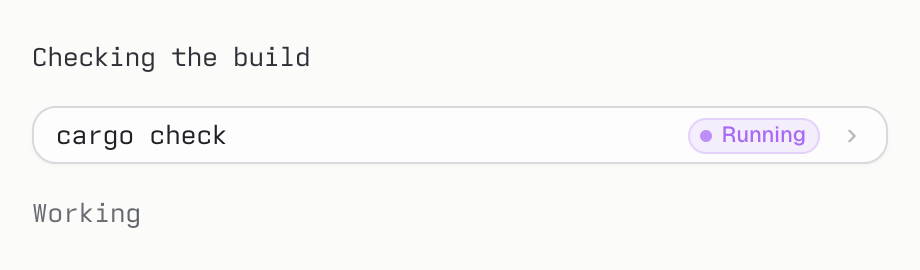
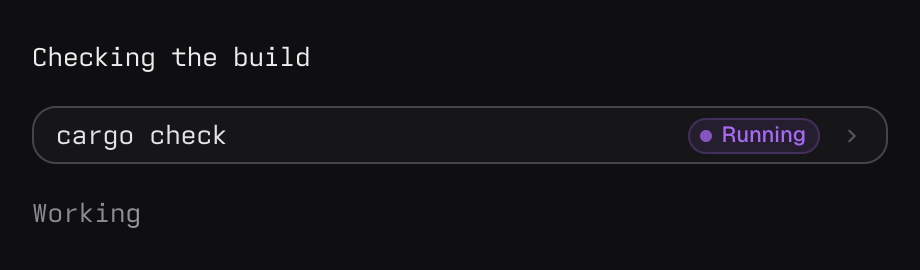
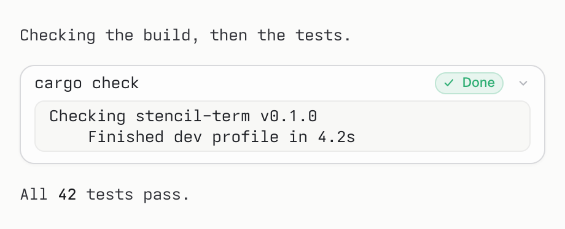
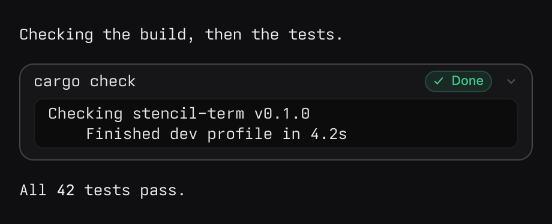

# 文档与帧 {#documents-and-frames}

Surface 的内容是一份文档：一棵由程序构建、并通过一帧帧操作来改变的节点树。

## 文档 {#the-document}

节点形如 `{"id": string, "k": kind, "p": props, "c": [children]}`。`p` 与 `c`
都是可选的。

- id 由你决定：非空字符串，在 Surface 内唯一，并且简短（omp 使用 36 进制
  计数器）。组件的 id 在其整个生命周期内保持稳定，这样 Tern 才能在多次更新之间
  保留它的元素、高亮与折叠状态。
- `k` 必须是 `hello` 回复所列词汇表中的一种类型。
- 属性既包括该类型自身的属性，也包括每个节点都接受的属性。各种类型及其属性见
  [元素](../elements/index.md)。值为 `null` 的属性会被丢弃，如同它不存在。
- 文本存放在属性中（`text`、`spans`）。文本类型（`text`、`md`、`code`、
  `ansi`、`math`、`editor`、`input`、`shimmer`、`el`）把主文本保存在 `text`
  中，`text` 与 `splice` 操作针对的就是它。程序不会向这些节点继承任何字体度量。

根节点就是 Surface 本身：一个 `col`，其 id 为 Surface 的 `id`，无法移动或删除。
它的子节点是[区域](surfaces.md#regions)：在根节点下以 `main`、`dock` 与 `layer`
为 id 添加的节点（通常是 `col`）。Surface 初始只有根节点，因此它的第一帧会添加
它所用的区域。

## 帧 {#frames}

帧形如 `{"sf": surface, "s": seq, "ops": [op…]}`，以原子方式应用：Tern 只在帧与帧
之间绘制文档，因此一帧会整体替换 Surface 的同步输出。`s` 随 Surface 的每一帧递增，
Tern 用 `ack` 事件确认它绘制了什么（[流量控制](operations.md#flow-control)）。
Tern 不检查 `s` 的顺序，只在 `ack` 与 `error` 中原样回显。

## 帧操作 {#frame-ops}

| 操作 | 结构 | 效果 |
| --- | --- | --- |
| `add` | `["add", id, parent, before\|null, node]` | 在 `parent` 下插入 `node`（整棵子树），位置在兄弟节点 `before` 之前，`before` 为 `null` 时放在最后。`id` 必须等于 `node.id`，且 `before` 为必需项。如果子树中任一节点失败（未知类型、重复 id、超出限制），整棵子树都不会被添加。 |
| `set` | `["set", id, props]` | 浅合并属性：每个键整体替换该属性。值为 `null` 会删除该属性。 |
| `text` | `["text", id, "append"\|"replace", string]` | 更新文本类型（`text`、`md`、`code`、`ansi`、`math`、`editor`、`input`、`shimmer`、`el`）的主文本。对没有文本的节点执行 `append` 会设置其文本。`append` 是流式路径：`md` 节点从最后一个未闭合的 block 起重新渲染。 |
| `splice` | `["splice", id, at, del, string]` | 在主文本的 `at` 处替换 `del` 个 UTF-16 码元（编辑器编辑、大段粘贴）。`at` 与 `del` 是整数，`at + del` 须落在文本范围内，且两端都不得切开代理对。 |
| `move` | `["move", id, parent, before\|null]` | 重新挂载或重排一棵子树。`before` 必须是 `parent` 的子节点（或为 `null` 表示最后），且不能是该节点自身。节点不能移入自己的子树。 |
| `del` | `["del", id]` | 移除一棵子树。其中的焦点也随之消失。 |
| `settle` | `["settle", id]` | 提示该子树短期内不太可能变化。Tern 可以将其扁平化并释放其视图状态。之后对它（任意深度）的任何操作都会让它恢复。`settle` 不限制任何操作，但在其[保留预算](operations.md#retention)下，Tern 会优先丢弃 `main` 中最旧的已 settle 的 `main` 子节点，并发出 `gone` 事件。 |
| `focus` | `["focus", id\|null]` | 拥有光标与 IME 的 `editor` 或 `input`，或没有（[输入与事件](input.md#keys)）。 |
| `reveal` | `["reveal", id, "start"\|"end"\|"nearest"]` | 将节点滚动到可见区域（选中的列表项、搜索命中）。节点所在的 `list` 会滚动到它。位于 `main` 中的节点滚动面板（screen Surface 自己的 `main`）；位于 `dock` 或 `layer` 中的节点只滚动它所在的容器。`start` 遵循滚动容器的 `scroll-padding`；其他位置一律按 `nearest` 处理。只有最近一次的 `reveal` 生效。 |
| `scroll` | `["scroll", id, "line-up"\|"line-down"\|"page-up"\|"page-down"\|"start"\|"end"]` | 由你转发的键盘滚动（PgUp、PgDn 与 End 会到达程序）：将节点处或其上方最近的滚动容器（带 `max.h` 的 `ansi` block、`list`、选择器面板、screen Surface 的 `main`）移动一行、一个视口减一行，或移到某一端。把跟随中的 `ansi` 滚离其尾部会停止跟随；`end` 会恢复跟随。内联 Surface 的 `main` 随面板滚动，会忽略此操作。特性 `scroll`。 |
| `suspend`、`resume` | `["suspend"]`、`["resume"]` | 将面板交还给网格，然后再取回（[Surface](surfaces.md#open-and-close)）。 |

操作仅以 id 定位节点，因此在回滚缓冲区深处修改一个节点与修改屏幕上的节点代价相同：
`["set","t9",{"collapsed":false}]` 会在任何位置展开一张卡片。

Tern 逐条应用帧中的操作。命名了未知 id、添加了词汇表之外的类型、突破限制或参数
格式错误的操作会被单独拒绝，并给出指明其从 0 开始索引的事件；帧的其余部分照常应用，
因此后续操作看到的是不含该操作的文档：

```text
← ESC _ tsp;e;{"ev":"error","sf":"s1","s":2,"op":1,"msg":"unknown id t7"} ESC \
```

完全无法接收的帧（缺少 `sf`、Surface 未知或已关闭、`ops` 不是数组、主体不是 JSON）
会整体丢弃，并给出不带 `op` 的 `error`。

### 示例 {#example}

向一个 flow Surface 发送两帧。第一帧添加 `main`，其中包含一行 Markdown、一张折叠的
卡片和一个 shimmer：

```text
→ ESC _ tsp;f;{"sf":"s1","s":1,"ops":[["add","main","s1",null,{"id":"main","k":"col","c":[
    {"id":"m1","k":"md","p":{"text":"Checking the build"}},
    {"id":"t9","k":"card","p":{"head":"cargo check","status":"running","collapsible":true,"collapsed":true},"c":[
      {"id":"o9","k":"code","p":{"lang":"text","text":"Checking stencil-term v0.1.0\n    Finished dev profile in 4.2s"}}]},
    {"id":"w1","k":"shimmer","p":{"text":"Working"}}]}]]} ESC \
```

<figure class="tn-figure">


<figcaption>第 1 帧之后。</figcaption>
</figure>

第二帧向 Markdown 追加文本、把卡片标记为完成并展开、移除 shimmer，并添加一行
结尾文字：

```text
→ ESC _ tsp;f;{"sf":"s1","s":2,"ops":[
    ["text","m1","append",", then the tests."],
    ["set","t9",{"status":"done","collapsed":false}],
    ["del","w1"],
    ["add","m2","main",null,{"id":"m2","k":"md","p":{"text":"All **42** tests pass."}}]]} ESC \
```

<figure class="tn-figure">


<figcaption>第 2 帧之后：一次绘制，没有中间状态。</figcaption>
</figure>

## Tern 决定的事项 {#what-tern-decides}

- **间距。** `main` 中各 block 之间的间隙，以及同一个 block 内各部件之间的间隙，
  都是 Tern 的节奏。不要为此发送空白的 `text` 或 `spacer` 节点。
- **用户设置。** 有些外观属于用户而非属性：Markdown 标题的样式（正文大小加标注，
  或按级别设定字号）、`mode` 缺失或为 `auto` 的 diff 如何排布（内联或分栏）、
  连续的工具调用是否折叠在一个标题之下，以及对话记录的聊天样式（Reader、
  Spine 或 Console）。它们都会实时切换。
- **回退。** 终端未在其 `hello` 回复中列出的类型可以按 `rows` 发送：在所通告的
  `cols` 下预渲染的 ANSI 行（[文本与代码](../elements/text.md#rows)）。它用于
  逐个组件地迁移渲染器。

## 时间与动画 {#time-and-animation}

- 你从不发送逐帧更新。运动类型（`spinner`、`shimmer`、`elapsed`、`rate`）与
  span 效果（`fx`）由 Tern 按显示器的刷新率计时，并在面板隐藏时暂停。
- **时长，而非时刻。** 时长以 age 的形式传递：`elapsed.age`（以及 `tool` 的
  `age`、`agent` 的 `stats.age`、`tool.age` 与 `retry.age`）是你写帧时已经过去的
  毫秒数，倒计时为负值，Tern 会存储 `start = receive time − age`。没有需要同步的时钟，
  修改其他属性的 patch 会让计数继续运行，重放快照也仍然正确，因为 Tern 在拍摄
  快照时会重写 age。
- **减弱动态效果**（系统的设置或 Tern 的设置）会把运动换成静止的等价物：静止的
  spinner 带其标签、没有 shimmer、计时器仍然走动。`hello` 回复的 `reduceMotion` 与
  `motion` 事件会告知你，因此可以丢弃纯运动节点。各类型的细节见
  [进度与运动](../elements/motion.md)。
