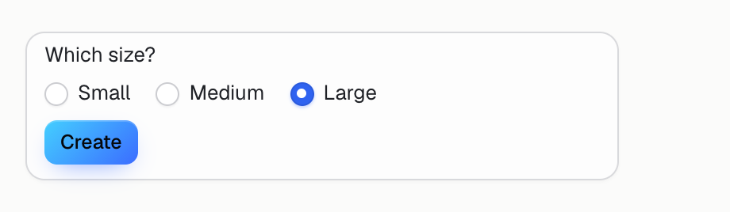
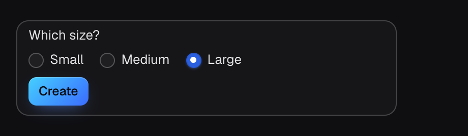

# Surface 协议 {#surface-protocol}

Tern Surface 协议（TSP）让终端面板中的程序以语义组件的树来描述其 UI。Tern 负责排布
这棵树、绘制它并以原生方式为其添加动画。讲 TSP 的程序不再绘制单元格：不需要制表符
号、不需要用背景色填充留白、不需要换行与截断的计算、不需要 spinner 定时器，也不需要在
尺寸变化时重绘。它发送屏幕上*有什么*，例如「一张待处理的卡片，主体是这些 ANSI 字节，
折叠到 10 行」，而由 Tern 决定它*看起来怎样*。

**在构建 UI 之前，请先读[设计视图](../guides/design.md)。** 它把一个应用组织为一个
页面（一行头部、一条 `stats` 条、视图之间的 `tabs`、选中项 `card` 旁一张全宽的
`selectable` `table`），把每一项职责映射到承担它的类型，以 sans 字体打开应用，
并列出会让视图看起来像网页的那些错误。遵循它的视图无需样式表就像 Tern 自己的界面。

插件不需要本书的这一部分：Tern 为插件的 block 与 lens 讲 TSP，而插件只需返回
[视图](../guides/views.md)。这些页面面向在面板中运行并向其 pty 写入的程序：打印表格
或提出问题的 CLI、全屏 TUI、诸如 omp 的编码 agent。TSP 在 ssh 上以及通过 Tern 的
会话守护进程都能工作，因为它与程序的其他输出一起带内传输。

## 各项由谁负责 {#who-owns-what}

| | 所有者 | 方式 |
| --- | --- | --- |
| 显示的内容 | 程序 | 一份由[元素词汇表](../elements/index.md)中的节点构成的文档，通过帧操作改变。 |
| 布局 | Tern | 程序从不测量文本。它只需以单元格计的宽度（hello 应答与 `resize` 事件中的 `cols`），且仅用于 `rows` 回退与 ANSI 输出宽度。 |
| 动画 | Tern | 动效类型（`spinner`、`shimmer`、`elapsed` 等）由 Tern 计时，Tern 遵循「减弱动态效果」设置。程序不发送逐帧更新。 |
| 状态与输入 | 程序 | 按键以 pty 输入的形式到达程序。它的编辑器、选择列表与模式仍是它自己的状态机，由它发送的状态绘制。指针操作以事件形式返回。 |
| 仅视图状态 | Tern | 悬停与滚动位置只属于 Tern，从不报告。折叠以及点击 `el` 复选框或单选框会在窗口中立即改变并被报告（`toggle`、`change`），因此程序可以镜像它们。 |
| 主题 | Tern | Tern 的主题为 Surface 着色；程序可以添加自己的样式表。 |
| 历史 | 程序 | 在其 Surface 打开期间，每个节点始终可按 id 寻址，无论在视口中还是在回滚缓冲深处，除非 Tern 在保留预算下丢弃它（`gone` 事件）。不存在「最终」行：一张已滚走的卡片仍然可以改变。关闭的 Surface 用 `keep` 留在屏幕上，但不再接受帧。 |

不讲 TSP 的终端永远不会应答[握手](handshake.md)，程序则保留自己的 ANSI 渲染器。

## 一次完整会话 {#a-whole-session}

一个 CLI 在自身输出下方提出一个问题，从提交它的那次点击中读取答案，然后退出，把表单
留在回滚缓冲中（`→` 表示程序到终端，经 pty 的输出；`←` 表示终端到程序，经其输入）：

```text
→ ESC _ tsp;q;{"q":"hello","v":[1],"app":"create-app"} ESC \  ESC [ c
← ESC _ tsp;r;{"r":"hello","v":1,…,"features":[…,"flow","font"],…} ESC \
← ESC [ ?62;52;c
→ ESC _ tsp;o;{"id":"pick","mode":"flow","font":"sans"} ESC \
→ ESC _ tsp;f;{"sf":"pick","s":1,"ops":[["add","main","pick",null,{"id":"main","k":"col","c":[…form…]}]]} ESC \
← ESC _ tsp;e;{"ev":"ack","sf":"pick","s":1} ESC \
← ESC _ tsp;e;{"ev":"change","sf":"pick","id":"l.r","value":"l","checked":true,"name":"size","values":{"size":"l"}} ESC \
← ESC _ tsp;e;{"ev":"action","sf":"pick","id":"go","act":"submit","values":{"size":"l"}} ESC \
→ ESC _ tsp;x;{"id":"pick","keep":true} ESC \
```

hello 应答先于 DA1 应答到达，因此该 CLI 知道可以讲 TSP。它打开一个
[`flow` surface](surfaces.md)，该 Surface 位于其输出之中、光标所在的行上，使用 UI
字体（`font`），然后添加 `main` 区域的根节点，其父节点即 Surface 的 id。问题是
`el` `form` 中的一张 `card`：`row` 中带标签的单选框，以及一个主
[`button`](../elements/input.md#button)。无需样式表：各类型自会绘制出 Tern 的外观
（该节点在传输中只占一行）：

```json
{"id":"main","k":"col","c":[
 {"id":"ask","k":"el","p":{"tag":"form"},"c":[
  {"id":"q","k":"card","p":{"head":"Which size?","max":{"w":"48ch"}},"c":[
   {"id":"sizes","k":"row","p":{"gap":"lg"},"c":[
    {"id":"s","k":"el","p":{"tag":"label"},"c":[
     {"id":"s.r","k":"el","p":{"tag":"input","type":"radio","name":"size","value":"s"}},
     {"id":"s.t","k":"el","p":{"tag":"span","text":"Small"}}]},
    {"id":"m","k":"el","p":{"tag":"label"},"c":[
     {"id":"m.r","k":"el","p":{"tag":"input","type":"radio","name":"size","value":"m"}},
     {"id":"m.t","k":"el","p":{"tag":"span","text":"Medium"}}]},
    {"id":"l","k":"el","p":{"tag":"label"},"c":[
     {"id":"l.r","k":"el","p":{"tag":"input","type":"radio","name":"size","value":"l"}},
     {"id":"l.t","k":"el","p":{"tag":"span","text":"Large"}}]}]},
   {"id":"go","k":"button","p":{"text":"Create","variant":"primary","actions":{"click":"submit"}}}]}]}]}
```

帧 1 一经绘制，Tern 就会确认它。点击 Large 会立即选中其单选框，并从单选框节点
`l.r` 报告 `change`，同时带上 `values`，即表单中具名控件。点击 Create 会发送
`action`，以按钮的 `click` 名称作为 `act`，并带上同样的 `values`。该 CLI 用
`keep` 关闭，这会把表单按最后一次绘制的样子留在回滚缓冲中：

<figure class="tn-figure">


<figcaption>这次会话留下的表单，Large 因点击而选中。</figcaption>
</figure>

更完整的表单见 [HTML 元素](../elements/el.md#recipe-a-styled-form)。

## 页面 {#pages}

| 页面 | 内容 |
| --- | --- |
| [传输](transport.md) | 分帧、各动词、分块、Windows |
| [握手](handshake.md) | 检测 Tern、`hello` 查询与应答、特性 |
| [Surface](surfaces.md) | 打开与关闭 Surface、inline、screen 与 flow 模式、锚定、区域 |
| [文档与帧](documents.md) | 文档模型、帧操作、时间 |
| [输入与事件](input.md) | 按键、原生编辑、指针操作、Tern 发送的每一种事件 |
| [样式表与图标](theme.md) | 程序样式表、图标字形 |
| [流控、持久化与安全](operations.md) | credits、保留、快照、调试、限制 |
| [SDK](sdks.md) | 讲上述全部内容的 Rust、Python、Go 与 TypeScript 库 |

节点词汇表，即每一种类型及其 props，见[元素](../elements/index.md)，
样式见[视图样式](../styles/index.md)。
