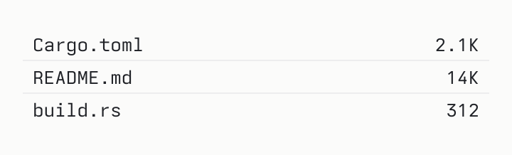
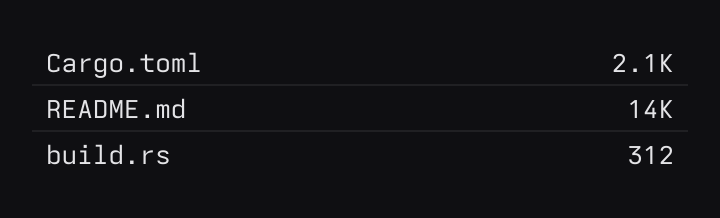
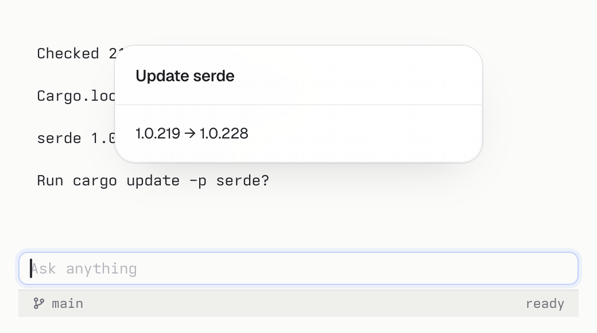
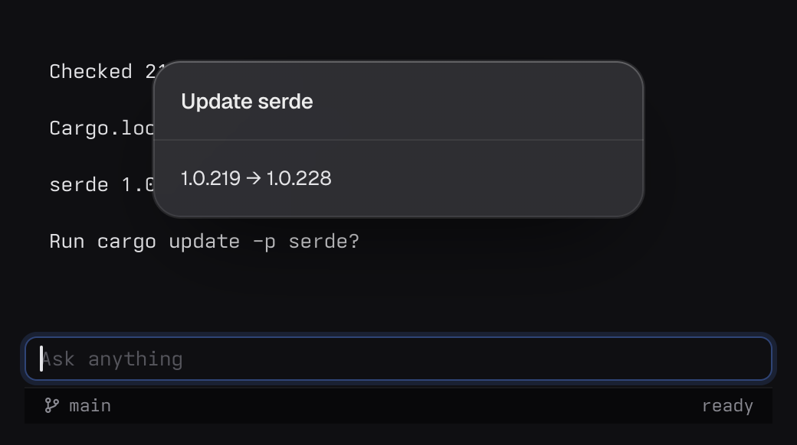

# Surface {#surfaces}

**Surface** 是程序在其面板中显示的文档。活动 Surface 中的一切随时都可编辑，包括已经向上滚进历史的部分：回滚缓冲区是文档的一部分，而不是对过去各行的封存记录。一个面板的回滚缓冲区中可以容纳任意多个已关闭的 Surface，但在每个屏幕缓冲区中，每种模式最多只有一个活动 Surface。

## 模式 {#modes}

| 模式 | 用于 | 位置 | 程序结束之后 |
| --- | --- | --- | --- |
| `inline`（默认） | 在面板中运行某个会话的程序（omp） | 主屏幕的光标所在行，活动期间独占该面板 | 在下一个 shell 提示符处丢弃 |
| `screen` | 全屏视图（一个应用、一个全屏浮层） | 覆盖整个面板，与备用屏幕相同 | 关闭时丢弃 |
| `flow` | 不是全屏的程序：先打印表格、提出问题或显示进度，然后退出的 CLI（特性 `flow`） | 主屏幕的光标所在行，处在周围的输出之中 | 像输出那样保留在回滚缓冲区中 |

## 打开与关闭 {#open-and-close}

```json
// tsp;o
{"id":"s1","mode":"inline","title":"omp","role":"omp.session"}
```

| 字段 | 含义 |
| --- | --- |
| `id` | 你为 Surface 取的名字：帧与事件以 `sf` 携带它。必需；不含它的 `o` 是错误。每个打开的 Surface 都应使用自己的 id：`f` 与 `x` 会作用于第一个使用该 id 的已打开 Surface，即活动屏幕缓冲区中的第一个。 |
| `mode` | `inline`、`screen` 或 `flow`。未知模式是错误。 |
| `title` | 在程序设置自己的标题（OSC 0/2）之前，用它命名面板。 |
| `role` | 为样式表命名该 Surface：它是该 Surface 三个区域元素上的 `data-surface`（`omp.session`、`omp.rewind`）。不是 `data-role`，后者属于区域节点。 |
| `adopt` | `true` 会重新打开一个已关闭的内联 Surface（见下）。 |
| `listen` | `false` 表示程序从不读取其输入（见下）。默认 `true`。 |
| `closable` | `true` 表示关闭面板不会丢失任何内容，因此 Tern 不经询问就关闭它（见下）。默认 `false`。 |
| `font` | `"sans"` 以 UI 字体绘制 Surface，`"mono"` 以终端字体绘制（见下）。默认 `"mono"`；其他任何值都按 `"mono"` 处理。 |

- **内联。** 锚定在主屏幕的光标所在行；随回滚缓冲区一起流动。活动期间它像备用屏幕那样独占面板（**干净面板**）：shell 的行、启动该程序的命令、回滚缓冲区以及更早的已关闭 Surface 都不绘制，Surface 首行之上不会有任何滚动。Surface 关闭或挂起时，它们会回来。在备用屏幕上打开内联 Surface 是错误。
- **屏幕。** 像备用屏幕那样填满面板，包括浮层。无论 `keep` 如何设置，关闭时都会被丢弃。
- **Flow。** 与 `inline` 一样锚定在主屏幕的光标所在行（在备用屏幕上为错误），但它从不独占面板：其上方 shell 的行与下方的输出都保留，它像这些行一样横跨面板，不带对话记录的聊天样式。它是命令输出：关闭它（带 `keep:true` 的 `x`，或程序退出）会把它留在原处，下一个 shell 提示符也是如此，若程序任其打开，该提示符会先将其关闭。它一直保留到其锚定行离开回滚缓冲区。打开期间它是与内联 Surface 一样的活动 Surface，拥有帧、事件、`dock` 与 `layer`。
- **可安全关闭。** 开启 **Running programs** 中的 **Confirm before closing**（`confirm_close`，默认开启）时，Tern 在关闭程序仍在运行的面板之前会先询问。不保留任何会因关闭而丢失的内容的程序（查看器、仪表板）以 `closable:true` 打开其 Surface：该 Surface 打开期间，关闭面板不会弹出提示。它只作用于那一个 Surface；一旦它关闭，或 `adopt` 未重复这一设置，程序就又会被守卫关停。有时存在未保存工作的程序则改用 Program Status 序列 `ESC ] 7501 ; state=idle ESC \`（或用 `BEL` 代替 `ESC \`）报告其状态：程序开始报告后，Tern 只在上一次报告为 `state=working` 或 `state=blocked` 时才询问，因此在有未保存内容时写 `state=working`，重新安全后写 `state=idle`。
- **不监听。** `listen:false`（任何模式）表示程序从不读取其输入。此时 Tern 不发送任何与该 Surface 相关的内容：没有 ack（发送帧时不必等待 credits），没有事件，没有错误，直到你下一个 `q` 或监听的 `o` 之前也完全没有回答。其控件不会翻转。以这种方式打印静态视图的程序不需要原始模式，也不会在输入队列中为 shell 留下任何内容：

  ```text
  ESC _ tsp;o;{"id":"ls","mode":"flow","listen":false} ESC \
  ESC _ tsp;s;{"sf":"ls","name":"main","css":".size{text-align:right}"} ESC \
  ESC _ tsp;f;{"sf":"ls","s":1,"ops":[["add","main","ls",null,{"id":"main","k":"col","c":[
    {"id":"t","k":"el","p":{"tag":"table"},"c":[
      {"id":"a","k":"el","p":{"tag":"tr"},"c":[
        {"id":"a.n","k":"el","p":{"tag":"td","text":"Cargo.toml"}},
        {"id":"a.s","k":"el","p":{"tag":"td","class":"size","text":"2.1K"}}]},
      {"id":"b","k":"el","p":{"tag":"tr"},"c":[
        {"id":"b.n","k":"el","p":{"tag":"td","text":"README.md"}},
        {"id":"b.s","k":"el","p":{"tag":"td","class":"size","text":"14K"}}]},
      {"id":"c","k":"el","p":{"tag":"tr"},"c":[
        {"id":"c.n","k":"el","p":{"tag":"td","text":"build.rs"}},
        {"id":"c.s","k":"el","p":{"tag":"td","class":"size","text":"312"}}]}]}]}]]} ESC \
  ESC _ tsp;x;{"id":"ls","keep":true} ESC \
  ```

  <figure class="tn-figure">
  
  
  <figcaption>已关闭的 flow Surface：表格像其周围的行那样横跨面板。</figcaption>
  </figure>

- **字体。** Surface 默认以终端的等宽字体绘制，适合与 shell 输出混排的输出。`font:"sans"`（特性 `font`）改为以 UI 字体绘制，与 Tern 自身的应用一致，也是应用（仪表板、表单、会话）应当采用的打开方式（[设计视图](../guides/design.md#typography)）。它的三个区域元素获得 `sf-sans` 类：文本为 `13px/18px` 的 Geist（`--sans`），随界面缩放，区域的行高（`--sf-lh`、`"lines"` 范围、列表行、表格行）为 18px，而不是终端的行高。机器字符串仍为等宽字体：span 标记 `mono`、`code`、`num`、`path` 与 `key` 以 12.5px 用终端字体绘制，带 `mono` 的表格列也是如此，而显示机器文本的各类节点（`code`、`diff`、`ansi`、`rows`、`editor`、`input`、`json`、`kbd`、`math`，以及 `md` 中的围栏代码）保持终端字体、字号与行高。其他一切（`text`、`md` 正文、卡片与分节标题、`kv`、列表、标签页、徽标、表格、树）都跟随该区域。带 `adopt` 的 `o` 采用它所携带的 `font`。

  ```text
  ESC _ tsp;o;{"id":"app","mode":"screen","title":"Deploys","font":"sans"} ESC \
  ```

- **屏幕覆盖内联。** 不使用备用屏幕的程序，可以在其内联 Surface 活动期间打开一个屏幕 Surface 来显示全屏视图。屏幕 Surface 覆盖面板：网格行与内联 Surface 的 `main`、`dock` 及浮层都被隐藏，指针输入、光标以及视图事件（`resize`、`visible`）都发送给屏幕 Surface。它从不关闭或改变内联 Surface：其文档、`dock`、`layer`、焦点与帧序列保持原样，发往它的帧仍然生效。屏幕 Surface 关闭时，内联 Surface 完全恢复原样显示。无需重发任何内容。
- **替换。** 新的 `o` 会替换该缓冲区中同模式的活动 Surface：内联或 flow 的按 `keep:true` 关闭，屏幕的则被丢弃。新的内联 `o`（程序开始其会话）还会丢弃仍在覆盖该缓冲区的任何屏幕 Surface。屏幕 `o` 从不触碰内联 Surface，两者也都不触碰 flow Surface。
- **关闭。** 带 `{"id":"s1","keep":true}` 的 `x` 关闭该 Surface：其仅在活动期间存在的区域（`dock`、浮层、焦点）消失，其 `main` 留在回滚缓冲区中，对内联 Surface 保留到 shell 的下一个提示符，对 flow Surface 则永久保留。`keep:false` 将其移除。`keep` 默认为 `true`。
- **接管。** 带 `{"id":"s1","adopt":true}` 的 `o` 会重新打开该 id 仍在此面板回滚缓冲区中的最新一个已关闭内联 Surface：同一份文档，再次完全可编辑，但没有 `dock` 或 `layer`（关闭时已丢弃；需重新添加）。`mode` 被忽略；`title` 与 `role` 在给出时替换原来的值，`listen` 与任何 `o` 一样生效。与新的内联 `o` 一样，它会关闭该缓冲区的活动内联 Surface（按 `keep:true`）并丢弃屏幕 Surface；接管已经活动的 id 则什么也不做。程序在停止/启动循环之后（例如外部编辑器）执行接管，使其对话记录在原处继续，而不是再打印一份。若该 id 不在面板中，Tern 会回答 `{"ev":"gone","ids":["s1"]}`（除非该 `o` 声明了 `listen:false`），随后你打开一个新 Surface。
- **挂起。** `["suspend"]` 与 `["resume"]` 帧操作会把面板暂时交还给网格（一条交互式 shell 命令、一个外部 `$EDITOR`）。挂起的 Surface 保持其位置，也不接受指针焦点；网格输出出现在它下方。
- **崩溃安全。** 面板的进程退出时，每个活动 Surface 都会关闭：内联与 flow 的按 `keep:true` 关闭（已结束的面板会留下以供阅读），屏幕的则被丢弃。RIS（`ESC c`）清屏，其 Surface 一并清除。此后程序被认定为已消失，Tern 不再发送任何内容，直到有东西询问（`q`）或打开 Surface（`o`）。
- **回到提示符。** shell 提示符（OSC 133;A）意味着程序已消失。Tern 丢弃该面板的每个内联与屏幕 Surface，包括以 `keep:true` 关闭的那些，因此退出会话程序会把其对话记录从面板上移除，shell 的行恢复原样显示。如果程序没有向其内联 Surface 锚定行下方的网格写入任何内容，锚定行会被撤销，shell 的光标回到程序发现它的位置。flow Surface 与 Tern 自身的命令 lens block 保留：它们是命令输出。
  因此，内联 Surface 上的 `keep:true` 只在程序独占面板、其间没有提示符时有效。在作业控制挂起（`^Z`、`fg`）之后，`adopt` 会收到 `gone`。
- **离开。** 在停止读取输入*之前*先关闭你的 Surface（`x`），然后短暂排空输入，使在途的答复与事件永远不会到达 pty 的下一个读取者。那个读取者通常是 shell，它会把这些当作已输入的文本：zsh 会把 `ESC _` 读作插入上一个词。绝不打印或回显 TSP 输入。不读取输入的程序则应改用 `listen:false` 打开。
- **标题。** 当命令打开其第一个监听中的 Surface（非 `listen:false`）时，Tern 丢弃 shell 给该面板的标题（zsh 的 preexec 标题是命令行），因此 `o` 的 `title` 会命名该面板，直到程序设置自己的标题；请在 `o` 之后设置你的标题。同一命令之后的 Surface 不再改动程序的标题。
- **杂散输出。** Surface 活动期间不属于 TSP 的字节（某个库的日志、stderr）照常进入网格。内联 Surface 独占面板期间，它们与网格的其余部分一同隐藏，直到它关闭或挂起。
- **备用屏幕。** 切换到备用屏幕的程序（你的程序启动的 `vim`）照常覆盖面板。内联与 flow Surface 属于主屏幕，备用屏幕结束时它们会回来。屏幕 Surface 属于打开时处于活动的那个缓冲区：在备用屏幕上打开的那个，会在程序离开（或清空）备用屏幕时消失，监听中的程序会收到 `{"ev":"gone","sf":"s1","ids":["s1"]}`。

## 在网格中锚定 {#anchoring-in-the-grid}

内联或 flow Surface 恰好占据网格的一行，即其**锚定行**。执行 `o` 时，如果光标所在行有任何内容（光标不在第 0 列、有文本、有另一个锚定），Tern 先结束该行，把光标所在行变成锚定行，并把光标移到下一行的开头。锚定行是该 Surface 在网格计算中占用的唯一一行，因此回滚缓冲区深处的节点可以增长、缩小、出现或消失，而不会移动、插入或重排任何一行网格。调整大小时，锚定行从不加入被换行的行，也不会被当作空白裁剪，并且像任何行一样滚入历史。快照会连同其文档一起携带它。

Surface 的存续时间恰与其锚定行一致。当该行从回滚缓冲区末端滚出、被擦除（`ESC [2J`、`clear`）或在滚动区域内被滚走，或回滚缓冲区被清空时，Surface 随之消失，而监听中的已打开 Surface 会收到 `{"ev":"gone","sf":"s1","ids":["s1"]}`。

Tern 把面板绘制为若干段固定高度的网格行，段与段之间隔着处于自然高度的 Surface。选择、鼠标上报、链接、查找与光标都经过这一布局。

**滚动锚定。** 当用户正在查看的内容上方发生高度变化时（回滚缓冲区中的折叠卡片展开、过去的某个条目被替换），视图停留在视口下方的内容上；不会有任何跳动。Surface 内部，滚动位置记录为 `main` 中的某个子项以及在该子项中的深入程度，因此它上方的子项改变高度时会带着它一起移动。视图跟随活动末端时，则保持尾部固定。对视图之外节点的操作会立即作用于文档；其布局等到它们进入视图时才进行，其间使用估算值。

## 区域 {#regions}

Surface 的根节点（其 id 即 Surface 的 `id`）最多有三个 id 固定的子节点：

| Id | 容纳 |
| --- | --- |
| `main` | 流动的文档（对话记录）。随面板滚动。 |
| `dock` | Surface 活动期间固定在面板底部：编辑器、状态行、工作指示器。关闭时移除。面板把 `main` 布局在其上方，并在用户向上滚动之前保持尾部可见。 |
| `layer` | 浮在一切之上的浮层（[浮层](../elements/chrome.md#overlay)）。关闭时移除。 |

```text
ESC _ tsp;f;{"sf":"s1","s":1,"ops":[
  ["add","main","s1",null,{"id":"main","k":"col","c":[
    {"id":"m1","k":"text","p":{"text":"Checked 214 crates."}},
    {"id":"m2","k":"text","p":{"text":"Cargo.lock pins serde 1.0.219."}},
    {"id":"m3","k":"text","p":{"text":"serde 1.0.228 is out."}},
    {"id":"m4","k":"text","p":{"text":"Run cargo update -p serde?"}}]}],
  ["add","dock","s1",null,{"id":"dock","k":"col","c":[
    {"id":"ed","k":"editor","p":{"placeholder":"Ask anything"}},
    {"id":"bar","k":"status","c":[
      {"id":"br","k":"seg","p":{"icon":"branch","text":"main"}},
      {"id":"st","k":"seg","p":{"side":"right","text":"ready"}}]}]}],
  ["add","layer","s1",null,{"id":"layer","k":"col","c":[
    {"id":"ask","k":"overlay","p":{"anchor":"top","size":"sm","head":[{"t":"Update serde"}]},"c":[
      {"id":"ask.t","k":"text","p":{"text":"1.0.219 → 1.0.228"}}]}]}],
  ["focus","ed"]]} ESC \
```

<figure class="tn-figure">


<figcaption>一个内联 Surface：上方为 <code>main</code>，底部为 <code>dock</code>，<code>layer</code> 的浮层覆盖在两者之上。</figcaption>
</figure>

每个区域绘制到自己的元素中，而不是其类型的节点：区域节点的类型及其除 `role` 之外的属性都被忽略（`col` 不绘制 `.sf-col`，其 `gap` 或 `class` 不起作用），其子节点直接进入区域元素。用以下选择器为区域设置样式：

```html
<div class="sf-region sf-main" data-scope="sf1" data-surface="omp.session" data-role="…">…</div>
<div class="sf-region sf-dock" data-scope="sf1" data-surface="omp.session">…</div>
<div class="sf-region sf-layer" data-scope="sf1" data-surface="omp.session">…</div>
```

| 目标 | 选择器 |
| --- | --- |
| 任一区域 | `.sf-region` |
| 单个区域 | `.sf-main`、`.sf-dock`、`.sf-layer` |
| 按 `o` 的 `role` | `[data-surface='omp.session']`（全部三个区域） |
| 按程序 `hello` 中的 `app` | `[data-app='hermes']`（全部三个区域） |
| 按区域节点的 `role` 属性 | `.sf-main[data-role='…']` |
| 在模态浮层或全屏浮层、或 `picker` 之下 | `.sf-main.sf-covered`、`.sf-dock.sf-covered` |

屏幕 Surface 的各区域共用其覆盖层：`main` 占据整个高度并自行滚动（`reveal` 滚动的是它，而不是面板），`dock` 位于 `main` 之下。

**Aside**（特性 `aside`）。内联 Surface 的 `layer` 中的 `prefs` 节点是停靠在面板右边缘的表单，而不是浮层：面板为其预留 Tern 自身设置表单的宽度（最多占面板的 60%），网格行、`main` 与 `dock` 在其旁边结束，你在 `resize` 中会得到更窄的 `cols`。Surface 的其余部分在表单旁保持活动；按键去往你的 `focus` 所指的位置，点击会以 `focus` 事件移动它们。关闭该节点或 Surface 会归还宽度。
