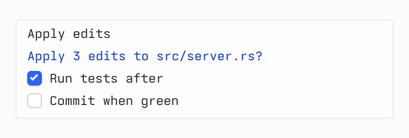
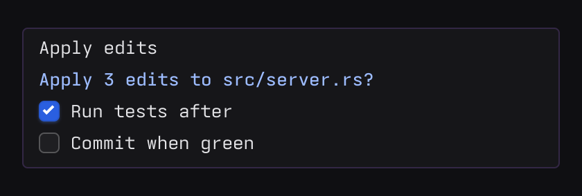

# 样式表与图标 {#stylesheets-and-icons}

程序可以自带 CSS（`s`）与图标字形。两者都是可选的：不提供时，Tern 会以自己的主题
绘制 surface。

Tern 在 `hello` 回复中以 `dark` 报告其外观，并在外观变化时发送
`{"ev":"theme","dark":bool}`。`t` 动词（早先的 program palette）会被接受并忽略。

## 样式表 {#stylesheets}

```text
ESC _ tsp;s;{"sf":"s1","name":"main","css":".ask label{display:flex;gap:8px}"} ESC \
```

`s`（特性 `styles`）安装或替换 surface `sf` 的样式表 `name`（由 1–64 个
`A–Z a–z 0–9 _ -` 字符组成）；省略 `sf` 时指实时 surface。`css` 为 null、缺失或
为空时移除该样式表。

- surface 的样式表按首次发送的顺序级联在 Tern 自身样式之后；被替换的样式表保持
  其位置。
- 关闭后它们仍随 surface 保留，因此其回滚缓冲区保持原有外观，快照也会回放它们。
- 一个 surface 最多容纳 256 KiB 的 CSS，统计范围为其所有样式表，并用新文本替换
  被替换的那一份。超过该上限、名称不合法、`css` 不是字符串，或指向未知 surface
  的 `s`，都会被拒绝并产生 `error` 事件，不做任何更改。
- **限定在 surface 内。**每个选择器都相对于该 surface：`.ask label` 只在其
  `main`、`dock` 与 `layer` 区域内部匹配，其他位置都不匹配。区域元素本身在作用域
  之外，因此命名 `.sf-main` 的选择器匹配不到任何内容。Tern 的 chrome、其他面板与
  其他 surface 都无法触及。该作用域不增加特异性，因此你的规则能胜过特异性相同的
  Tern 规则。
- **无法触及。**带 `url()` 与 `position: fixed` 的声明会被丢弃并报告；
  `@font-face` 会被忽略，`@import` 会被报告为不受支持。样式表的 `@keyframes`
  属于它自己；若动画引用了该样式表未定义的 keyframes，则使用 Tern 的。
- **错误。**窗口会跳过无法解析的内容，或丢弃它们，并在每次样式表 CSS 变化时报告
  一遍该样式表的问题，全部放在一个事件中：
  `{"ev":"error","sf","sheet":name,"msg":"<line>:<col>: …; <line>:<col>: …"}`。

下面这张样式表为一个由 `el` 节点组成的表单排版，并把 Tern 的卡片改成直角；它之所以
能作用于卡片，是因为卡片位于该 surface 之内：

```css
.ask { display: flex; flex-direction: column; gap: 6px }
.ask label { display: flex; gap: 8px; align-items: center }
.ask .q { font-weight: 600; color: var(--sf-c-accent) }
.sf-card { border-radius: 4px }
```

```json
{"id":"n1","k":"card","p":{"tone":"pending","head":"Apply edits"},"c":[
 {"id":"n2","k":"el","p":{"tag":"form","class":"ask"},"c":[
  {"id":"n3","k":"el","p":{"tag":"div","class":"q","text":"Apply 3 edits to src/server.rs?"}},
  {"id":"n4","k":"el","p":{"tag":"label"},"c":[
   {"id":"n5","k":"el","p":{"tag":"input","type":"checkbox","checked":true}},
   {"id":"n6","k":"el","p":{"tag":"span","text":"Run tests after"}}]},
  {"id":"n7","k":"el","p":{"tag":"label"},"c":[
   {"id":"n8","k":"el","p":{"tag":"input","type":"checkbox"}},
   {"id":"n9","k":"el","p":{"tag":"span","text":"Commit when green"}}]}]}]}
```

<figure class="tn-figure">


</figure>

可用的样式钩子、级联与配方见[视图样式](../styles/index.md)；CSS 引擎支持的范围见
[支持的 CSS](../styles/css.md)。插件不发送 `s`：它们的样式表来自清单与
`tern.css`。

## 图标与字形 {#icons-and-glyphs}

- **具名图标。**固定的图标槽位（`icon` 节点、`item` 或 `seg` 的 `icon`、`role`
  为卡片选定的图标）从 Tern 的图标集中取名。名称列在
  [数据](../elements/data.md#icon-names)中。
- **文本中的字形。**行内文本里的图标是 Nerd Font 码位（私有使用区），放在带
  `icon` 标记的 span 中，可保留任意颜色标记（`"statusLineModel icon"`）。Tern
  以其等宽 Nerd Font 字体按图标度量绘制 `icon` span，其后跟随文本时会自动留出
  间距，因此不必再加终端里惯用的字形后补空格。对于其他任何连续的私有使用区码位，
  Tern 会自行移入一个 icon span，并保留其所在 span 的样式：包括不带 `icon` 标记
  的 span，以及不是 span 的文本（编辑器缓冲区、`md` 正文）。不要用 emoji 或
  Unicode 替代字符充当图标。
