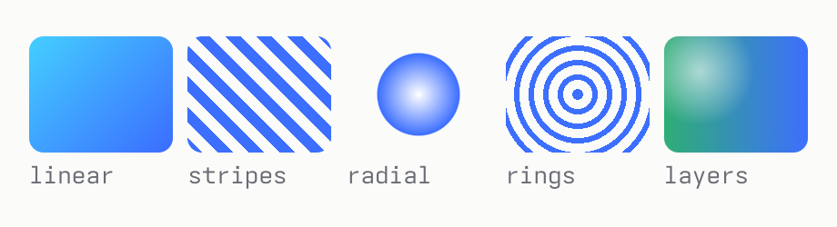
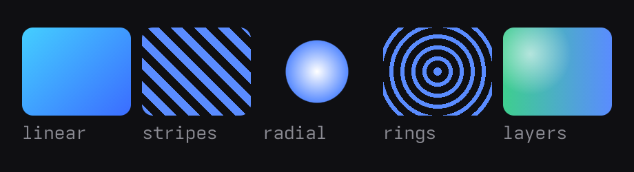
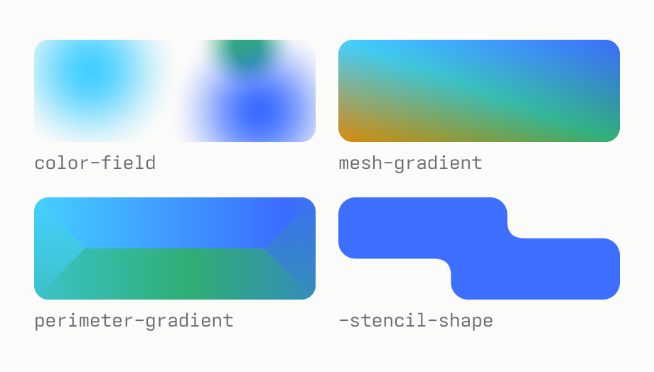
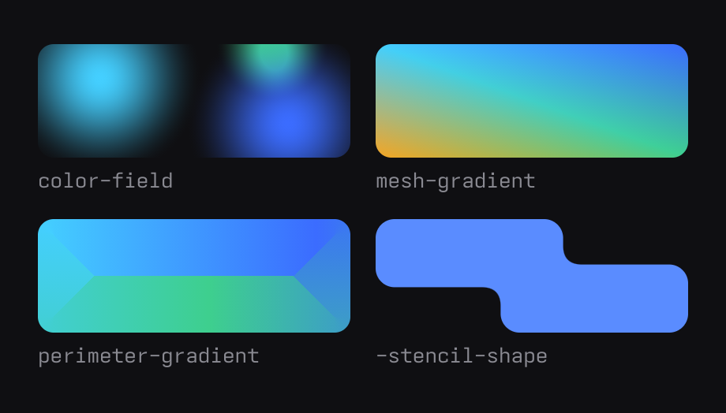
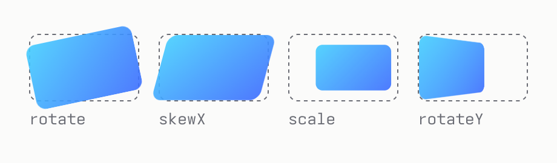
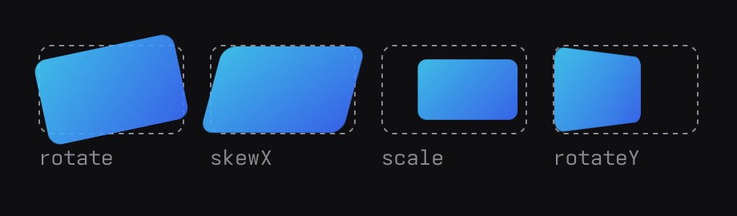
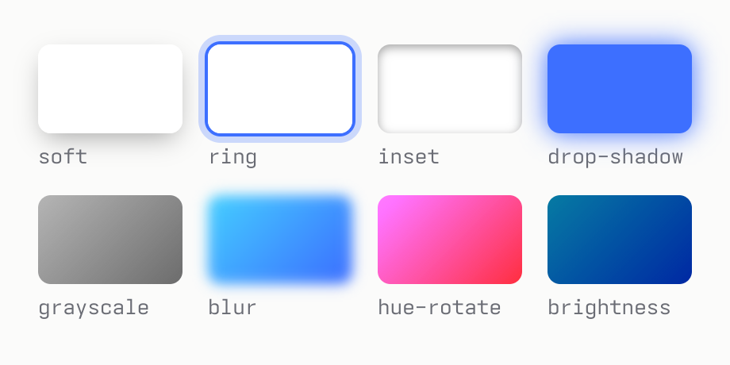
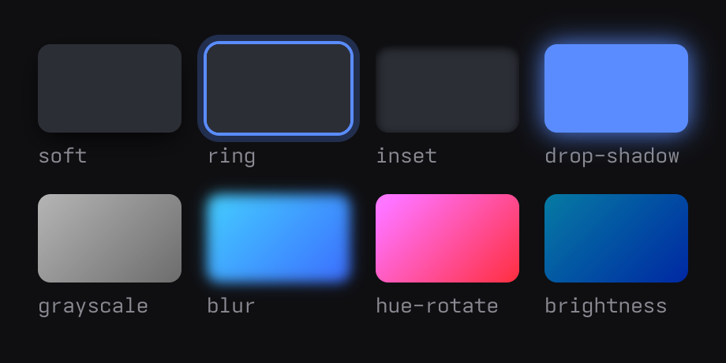
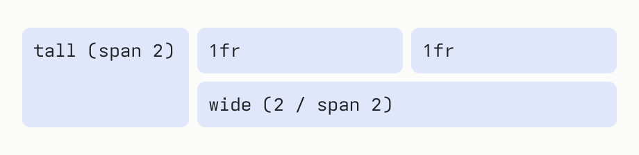
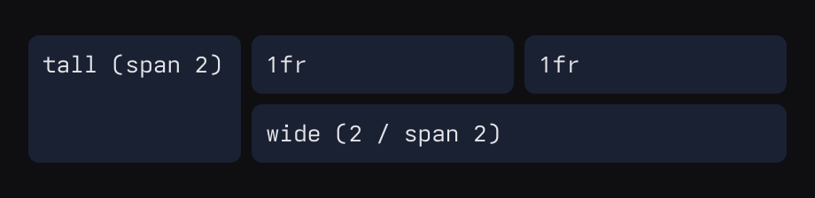

# 支持的 CSS {#supported-css}

Tern 用自己的引擎绘制插件视图，而不是浏览器。它接受一个已定义的 CSS 子集，外加若干
Stencil 扩展。本页列出该引擎确切接受什么、忽略什么、拒绝什么。关于样式表的来源以及
该针对哪些类，参见[视图样式](index.md)。关于主题变量，参见 [CSS 变量](variables.md)。

## CSS 的放置位置 {#where-your-css-goes}

| 来源 | 样式表名称 | 作用范围 |
| --- | --- | --- |
| 清单 `styles` | `plugin:<host>:<id>:styles`（本机上为 `plugin:local:<id>:styles`） | 全局作者样式表 |
| `tern.css(name, source)` | `plugin:local:<id>:<name>` | 全局作者样式表 |
| TSP 程序的 surface 样式表 | `tsp:<scope>:<name>` | 限定在其 surface 内（参见[限定作用域的样式表](#scoped-sheets)） |

插件样式表是普通的作者样式表。它的规则可以匹配窗口中的任何内容，因此请用 block 的区域
（`[data-surface="plugin.<plugin>.<block>"]`）或自己的类为选择器加前缀。新样式表排在层叠的
最后；替换样式表（重新加载，或用相同名称再调用一次 `tern.css`）会保留其原有位置。

### 错误 {#errors}

解析器绝不会因错误而丢弃整个样式表。它丢弃无法使用的部分，保留其余内容：

| 情况 | 结果 |
| --- | --- |
| 未知属性 | 丢弃声明，报错 `unknown property` |
| 已知属性、值无效 | 丢弃声明，报错 |
| 被忽略的属性（见下文） | 静默丢弃声明 |
| 不支持的选择器、伪类或伪元素 | 丢弃整条规则（其全部选择器），报错 |
| 不支持的 at 规则（`@import`、`@supports`、`@container` 等） | 丢弃 at 规则，报错 `unsupported at-rule` |
| 不支持的媒体特性或值 | 丢弃该 `@media` 块，报错 |
| `var()` 无法解析出任何值，且没有回退值 | 该元素上的该属性按 `unset` 处理（不报错） |
| `var()` 解析为无效值 | 该元素上的该属性按 `unset` 处理（不报错） |

对插件样式表，Tern 会以警告 `plugin style sheet has errors` 记录这些错误，附带样式表名称，
并以 `file:line:column: message` 的形式记录每一条错误。可在 Tern 的日志中查找。对 TSP
surface 样式表，错误会以每个样式表一个 `error` 事件的形式返回给程序：`sheet` 保存样式表名称，
`msg` 保存全部错误，每条写作 ``line:column: message in `snippet` ``，并以 `; ` 连接：

```text
{"ev":"error","sheet":"main","msg":"2:6: unsupported length unit `rem` in `width: 2rem;`; 3:1: unsupported pseudo-class `:enabled` in `.t:enabled {`","sf":"s1"}
```

为兼容 Web 样式表，以下属性会被接受并静默丢弃：
`-moz-osx-font-smoothing`、`text-rendering`、`-webkit-tap-highlight-color`、`-webkit-box-orient`。

## 语法 {#syntax}

### 规则与嵌套 {#rules-and-nesting}

样式规则、`@media`、`@layer`、`@keyframes`（以及 `@-webkit-keyframes`）和 `@font-face`
是仅有的规则类型。CSS 嵌套可用，并在解析时展平为普通规则：

```css
.my-panel {
	padding: 8px;

	& .title { font-weight: 600; }   /* .my-panel .title */
	> .row { display: flex; }        /* .my-panel > .row */
	.note { opacity: .7; }           /* .my-panel .note (no & means descendant) */
	&.busy { cursor: progress; }     /* .my-panel.busy */
	.dark & { color: white; }        /* .dark .my-panel */

	@media (max-width: 600px) { padding: 4px; }

	color: gray;  /* after nested rules: a later rule of its own, so it wins ties */
}
```

- `&` 代表父选择器列表。在特异性计算中，每个 `&` 都按特异性最高的父选择器计。
- 不含 `&` 的嵌套选择器是相对的：开头的 `>` 或 `+` 使用该组合符，否则为后代选择器。
- 嵌套选择器不能既以组合符开头又包含 `&`。
- 选择器以伪元素结尾的规则内部不能嵌套任何内容。
- 样式规则内只能嵌套 `@media`。嵌套 `@keyframes` 属于错误。

### `!important` 声明 {#important}

`!important` 可用于任何声明，包括自定义属性。层叠先应用所有普通声明，再应用所有
`!important` 声明，因此重要声明胜过任何普通声明。

### 层叠顺序 {#cascade-order}

对单个元素，声明按以下顺序胜出（越后越优先）：

1. Tern 的 user-agent 样式表。
2. 作者规则（先 Tern 内置样式表，再插件样式表），依次按层叠层（参见 [`@layer`](#layer)）、
   特异性、样式表顺序、样式表内位置排序。由于插件样式表在 Tern 的样式表之后注册，在层与
   特异性相同时，你的规则胜过 Tern 的规则。
3. 元素的行内样式。
4. 然后是 `!important` 声明：作者规则按层的逆序（无层最低，第一层最高），再是 CSS 主题，
   最后是行内 `!important`。

CSS 主题（[主题](../guides/themes.md)）把每条声明都视为 `!important`：它胜过任何作者规则与
行内样式，只有行内 `!important` 才能胜过它。

运行中的过渡，然后 CSS 动画，然后脚本动画，都会覆盖层叠后的值进行绘制。关于这与 Tern
自身类的交互，参见[视图样式](index.md)。

### CSS 全局关键字 {#css-wide-keywords}

每个属性都接受 `inherit`、`initial` 和 `unset`。不支持 `revert` 与 `revert-layer`。
`all` 属性只接受这三个关键字。

### 继承 {#inheritance}

下文各表中标记为“是否继承：是”的属性默认继承；其余属性重置为初始值。自定义属性始终继承。

## 取值 {#values}

### 长度与百分比 {#lengths-and-percentages}

| 单位 | 含义 |
| --- | --- |
| `px` | CSS 像素 |
| `em` | 元素的字号（对 `font-size` 则是父元素的字号） |
| `ch` | 元素字号的一半（对 `font-size` 则是父元素字号的一半）。这是 CSS 对 `0` 宽度的回退值；Tern 不测量字形，因此在大多数字体中实际的 `0` 略宽一些（约 0.6em） |
| `vw`、`vh` | 窗口宽度或高度的 1% |
| `%` | 该属性参照对象（包含块等）的百分比 |
| `0` | 单独的零即为长度 |

其他长度单位都无法解析：`rem`、`ex`、`lh`、`vmin`、`vmax`、`dvh`、`cm`、`pt`
以及其余单位都会以 `unsupported length unit` 被拒绝。请使用 `em` 或 `px`，或来自
[CSS 变量](variables.md)的 `var()`。

裸数字只在 SVG 属性（`stroke-width`、`stroke-dashoffset`、`stroke-dasharray`）中按 px 计。

`em`、`ch`、`vw` 与 `vh` 会计算为 px，因此继承的长度（`letter-spacing` 等）继承的是绝对值。

### 数学函数 {#math-functions}

`calc()`、`min()`、`max()` 与 `clamp()` 在所有接受长度或百分比的位置都可用，并且可以嵌套。
它们接受 `+`、`-`、`*`、`/`、括号以及上述长度单位：

```css
.side { width: clamp(160px, 30%, 320px); }
.gap  { margin-top: calc(1em + 2px); }
```

时间也接受数学运算（`calc(2 * 30ms)`），并在解析时折叠。其他数学函数（`round()`、`abs()`、
`sin()` 等）会被拒绝。

### 其他单位 {#other-units}

| 类型 | 单位 |
| --- | --- |
| `<time>` | `s`、`ms` |
| `<angle>` | `deg`、`rad`、`grad`、`turn`（允许单独的 `0`） |
| 网格轨道 | `fr` |

### 颜色 {#colors}

| 语法 | 说明 |
| --- | --- |
| `#rgb` `#rgba` `#rrggbb` `#rrggbbaa` | 十六进制 |
| 命名颜色（`red`、`rebeccapurple` 等） | 全部 CSS 命名颜色 |
| `transparent`、`currentColor` | `currentColor` 保持动态，跟随元素的 `color` |
| `rgb()` / `rgba()` | 旧式逗号语法，以及带 `/ alpha` 的现代空格语法 |
| `hsl()` / `hsla()` | 色相为数字或 `deg`；饱和度与亮度为百分比。逗号或空格语法均可。 |
| `oklab()`、`oklch()` | 现代语法，允许 `none` 分量（`rgb()` 与 `hsl()` 不接受 `none`） |
| 相对颜色：`rgb(from <color> r g b / a)` | 另有 `hsl(from …)`（`h s l`）、`oklab(from …)`（`l a b`）、`oklch(from …)`（`l c h`），支持 `alpha` 与对通道做数学运算。原点不能是 `currentColor`。 |
| `color-mix(in <space> [<hue-method> hue], <color> [<p>%], <color> [<p>%])` | 色彩空间：`srgb` `srgb-linear` `hsl` `hwb` `lab` `lch` `oklab` `oklch` `xyz` `xyz-d50` `xyz-d65`。色相方法：`shorter` `longer` `increasing` `decreasing`。百分比为 0–100%，不能同时为零。操作数不能是 `currentColor`。 |
| `light-dark(<light>, <dark>)` | 按元素各自计算出的 `color-scheme` 选择分支：当其列出 `dark` 且未列出 `light` 时取 `dark`，否则取 light。可用于任何值以及自定义属性内部。 |

`hwb()`、`lab()`、`lch()` 与 `color()` 在这里不是颜色函数（它们只用于命名 `color-mix()`
的色彩空间）；它们会以 `unsupported color function` 被拒绝。系统颜色（`Canvas`、
`ButtonText` 等）会被拒绝。

### 自定义属性与 `var()` {#custom-properties-and-var}

`--name: <anything>` 声明一个自定义属性；该属性会继承。`var(--name)` 与
`var(--name, fallback)` 可用于任何值，可在回退值中嵌套，并可引用其他自定义属性。引用环，
或深度超过 32 层的引用链，会像缺失变量那样失败。带 `var()` 或 `light-dark()` 的值在替换后
按元素检查，因此含 `var()` 的简写属性要到那时才展开。不支持 `@property`：自定义属性是无类型的，
不会参与动画。

### 位置 {#positions}

一个 `<position>`（`background-position`、`mask-position`、`transform-origin`、径向渐变的
`at`）接受一个、两个或四个分量：`center`、`left 20%`、`30% 8px`、`right 8px bottom 4px`。
关键字为 `left`、`right`、`top`、`bottom` 与 `center`。三值位置（`left 10px top`）会被拒绝。

### 图像 {#images}

`background-image`、`mask-image` 与 `list-style-image` 接受 `none`、`url()`、
`linear-gradient()`、`repeating-linear-gradient()`、`radial-gradient()` 与
`repeating-radial-gradient()`：

- 线性方向：`<angle>` 或 `to <side or corner>`（默认：to bottom）。
- 径向：`circle` / `ellipse`、`closest-side` / `closest-corner` / `farthest-side` /
  `farthest-corner` 或显式尺寸、`at <position>`（默认：ellipse、farthest-corner、at center）。
- 色标接受一个或两个位置；渐变至少需要两个色标。色标颜色不能是 `currentColor`。
- `repeating-` 形式会重复其色标区间：沿渐变线形成条纹，从中心向外形成同心环。
- `url()` 只在 `background-image` 中绘制：可以是 `data:` 图像，或在插件的全局样式表中使用
  插件的某个文件（[Chrome 与样式](../guides/chrome.md#images-url)）。视图自身的样式表会丢弃
  `url()`，而 `mask-image` 接受渐变。

```css
.linear  { background: linear-gradient(135deg, var(--a1), var(--a2)); }
.stripes { background: repeating-linear-gradient(45deg, var(--accent) 0 6px, transparent 6px 12px); }
.radial  { background: radial-gradient(circle closest-side, #fff, var(--accent) 70%, transparent 72%); }
.rings   { background: repeating-radial-gradient(circle, var(--accent) 0 3px, transparent 3px 8px); }
.layers  {
	background:
		radial-gradient(circle at 25% 30%, rgb(255 255 255 / 60%), transparent 40%),
		linear-gradient(to right, var(--ok), var(--accent));
}
```

<figure class="tn-figure">


<figcaption>上述五条规则，各占一个图块。</figcaption>
</figure>

`conic-gradient()`、`image-set()` 与 `cross-fade()` 会以 `unsupported image function` 被拒绝。
Stencil 增加了三个原生图像函数。坐标相对于盒子的左上角；百分比按其宽度或高度计，半径百分比
按较短边计：

| 函数 | 绘制内容 |
| --- | --- |
| `color-field(anchor(<color>, <x> <y>, <radius> [, <ax> <ay>, <fx> <fy>, <px> <py>])#)` | 柔和的色块，各自在半径处淡出。可选的三元组使锚点漂移：每轴上的振幅（长度）、频率（弧度每秒）与相位，按 `-stencil-time` 采样。 |
| `mesh-gradient(vertices(vertex(<color>, <x> <y>)#), triangles(triangle(<i> <j> <k>)#))` | 三角形，颜色在顶点之间插值。至少需要三个顶点；索引从 0 开始且互不相同。 |
| `perimeter-gradient(<radius>, <phase>, <color-stops>)` | 色标沿圆角半径为 `<radius>` 的圆角矩形顺时针排布；`<phase>`（圈数）旋转起点。 |

```css
.field {
	border-radius: 10px;
	background: color-field(
		anchor(var(--a1), 20% 30%, 90%),
		anchor(var(--a2), 80% 70%, 90%),
		anchor(var(--ok), 75% 0, 50%));
}
.mesh {
	border-radius: 10px;
	background: mesh-gradient(
		vertices(vertex(var(--a1), 0 0), vertex(var(--a2), 100% 0),
			vertex(var(--ok), 100% 100%), vertex(var(--warn), 0 100%)),
		triangles(triangle(0 1 2), triangle(0 2 3)));
}
.edge {
	border-radius: 10px;
	background: perimeter-gradient(10px, 0, var(--a1), var(--a2), var(--ok), var(--a1));
}
.blob {
	background: var(--accent);
	-stencil-shape: shape-union(12px,
		round-rect(0 0 60% 60% / 12px),
		round-rect(40% 40% 60% 60% / 12px));
}
```

<figure class="tn-figure">


<figcaption>原生图像函数，以及 <code>-stencil-shape</code>（参见 <a href="#stencil-extensions">Stencil 扩展</a>）。</figcaption>
</figure>

### 变换 {#transforms}

`transform` 接受 `translate()`、`translateX()`、`translateY()`、`translateZ()`、`translate3d()`、
`scale()`、`scaleX()`、`scaleY()`、`scaleZ()`、`scale3d()`、`rotate()`、`rotateX()`、`rotateY()`、
`rotateZ()`、`rotate3d()`、`skew()`、`skewX()`、`skewY()`、`matrix()`、`matrix3d()` 与
`perspective()`（长度或 `none`）。单独的 `translate`、`rotate` 与 `scale` 属性同样可用。
当某祖先设置了 `perspective` 时，3D 旋转会呈现景深：

```css
.slot   { perspective: 200px; }
.rotate { transform: rotate(-12deg); }
.skew   { transform: skewX(-15deg); }
.scale  { transform: scale(.7) translateX(12px); }
.flip   { transform: rotateY(50deg); transform-origin: left center; }
```

<figure class="tn-figure">


<figcaption>每个盒子与其未变换的槽位（虚线）对照。</figcaption>
</figure>

### 滤镜 {#filters}

`filter` 与 `backdrop-filter` 接受 `blur()`、`brightness()`、`contrast()`、`grayscale()`、
`invert()`、`opacity()`、`saturate()`、`sepia()`、`hue-rotate()`、`drop-shadow()` 与 `url()`。
量为数字或百分比（不可为负）；空函数取默认值（量类为 `1`，`blur()` 与 `hue-rotate()` 为 `0`）。
`drop-shadow()` 接受 `x y [blur]` 与一个颜色，不支持 `inset` 或扩散。

被滤镜处理过的背景会替换元素边框盒（按其 `border-radius` 取圆角）下方的内容，元素的透明度与
遮罩会作用于它。当被滤镜处理的背景是半透明的，例如位于可透视的窗口之上时，透出的是那份透明度，
而不是未经滤镜处理的内容。Filter Effects 2 草案则是把被滤镜处理的背景合成到原内容之上
（其 §2.1 第 7 步），从而让清晰的内容透过模糊的半透明背景显示出来。

```css
.box  {
	height: 56px;
	border-radius: 8px;
	background: light-dark(#fff, #2c2e36);
	--shade: light-dark(rgb(0 0 0 / 35%), rgb(0 0 0 / 90%));
}
.gray, .blur, .hue, .dim { background: linear-gradient(135deg, var(--a1), var(--a2)); }
.glow { background: var(--accent); }
.soft { box-shadow: 0 6px 16px -4px var(--shade); }
.ring { box-shadow: 0 0 0 2px var(--accent), 0 0 0 6px rgb(from var(--accent) r g b / 25%); }
.inset { box-shadow: inset 0 2px 6px var(--shade); }
.glow { filter: drop-shadow(0 0 8px var(--accent)); }
.gray { filter: grayscale(1); }
.blur { filter: blur(4px); }
.hue  { filter: hue-rotate(120deg) saturate(1.5); }
.dim  { filter: brightness(.6) contrast(1.4); }
```

<figure class="tn-figure">


<figcaption>上：<code>box-shadow</code> 与 <code>drop-shadow()</code>。下：同一渐变经过四种滤镜。</figcaption>
</figure>

Stencil 增加了原生滤镜函数：

| 函数 | 效果 |
| --- | --- |
| `analytic-lens(<band>, <r> <g> <b> [, <pre-blur>])` | 沿元素形状（设置了 `-stencil-shape` 时按该形状）在宽度为 `<band>` 的边缘带内折射；`<r> <g> <b>` 是带符号的每通道位移长度，`<pre-blur>` 是先施加的模糊。 |
| `ripple(<x> <y>, <amplitude>, <frequency>, <decay>, <speed>)` | 由 `<x> <y>` 发出的波纹，由 `-stencil-time` 驱动（0 时无效果）：位移长度、角频率、指数衰减、波前速度（px/s）。在减少动态效果模式下关闭。 |
| `color-matrix(<20 numbers>)` | 四行五列：一个仿射 RGBA 颜色矩阵。 |
| `variable-blur(<sigma>, <image>)` | 模糊至多 `<sigma>`，按盒子上渐变（或 `url()`）遮罩的 alpha 缩放。 |
| `snapshot-warp(<progress>, <x> <y> <w> <h> [, <curvature>])` | 随 `<progress>` 由 0→1 把元素扭曲向目标矩形（曲率默认 0.35）。 |
| `dissolve(<progress> [, <seed>])` | 随 `<progress>` 从 0（完好）上升，对元素的覆盖区域做带种子的溶解。 |

### 缓动函数 {#easing-functions}

`linear`、`ease`、`ease-in`、`ease-out`、`ease-in-out`、`step-start`、`step-end`、
`cubic-bezier(x1, y1, x2, y2)`（x 在 0–1 之间）、`steps(n [, jump-start | jump-end | jump-none | jump-both | start | end])`
（n ≥ 1，使用 `jump-none` 时 ≥ 2），以及 Stencil 扩展 `spring(<duration>, <bounce>)`
（duration > 0，bounce 在 −1…1 之间，不含端点）。不支持带停靠点的 `linear(…)` 函数。

## 属性 {#properties}

厂商别名映射到标准属性：`-webkit-backdrop-filter`、`-webkit-mask` 以及每一个 `-webkit-mask-*`
长写属性（旧式的 `-webkit-mask-composite` 运算符 `xor`、`source-over`、`source-in`、`source-out`
会被转换）、`-webkit-background-clip`、`-webkit-user-select`、`-webkit-transform`、
`-webkit-filter`、`-webkit-app-region`、`-webkit-line-clamp`、`word-wrap`（→ `overflow-wrap`）、
`grid-gap`、`grid-row-gap`、`grid-column-gap`。

“可动画”指过渡与动画会插值该属性；其余属性按离散方式切换。`#` 表示逗号分隔的列表。

¹ 对齐关键字：`normal` `auto` `stretch` `center` `start` `end` `flex-start` `flex-end`
`self-start` `self-end` `baseline` `space-between` `space-around` `space-evenly` `left` `right` `legacy`。<br>
² 轨道列表：`<length-percentage>`、`<n>fr`、`auto`、`min-content`、`max-content`、`minmax(a, b)`
与 `repeat(<integer>, tracks…)`。不支持 `repeat(auto-fill, …)`，不支持命名线，不支持
`grid-template-areas`。<br>
³ 参见[图像](#images)。<br>
⁴ 参见[变换](#transforms)。⁵ 参见[滤镜](#filters)。⁶ 参见[缓动函数](#easing-functions)。

### 盒模型与定位 {#box-and-position}

| 属性 | 取值 | 初始值 | 是否继承 | 是否可动画 |
| --- | --- | --- | --- | --- |
| `display` | `none` `block` `inline` `inline-block` `flex` `inline-flex` `grid` `inline-grid` `contents` `list-item` `flow-root` `table` `table-row` `table-cell` `table-row-group` `table-header-group` `-webkit-box` `-webkit-inline-box` | `inline` | 否 | 否 |
| `position` | `static` `relative` `absolute` `fixed` `sticky` | `static` | 否 | 否 |
| `top` | `auto` \| `<length-percentage>` | `auto` | 否 | 是 |
| `right` | 同 `top` | `auto` | 否 | 是 |
| `bottom` | 同 `top` | `auto` | 否 | 是 |
| `left` | 同 `top` | `auto` | 否 | 是 |
| `z-index` | `auto` \| `<integer>` | `auto` | 否 | 是 |
| `box-sizing` | `content-box` `border-box` | `content-box` | 否 | 否 |
| `width` | `auto` `min-content` `max-content` `content` \| `<length-percentage>` | `auto` | 否 | 是 |
| `height` | 同 `width` | `auto` | 否 | 是 |
| `min-width` | 同 `width` | `auto` | 否 | 是 |
| `min-height` | 同 `width` | `auto` | 否 | 是 |
| `max-width` | `none` `min-content` `max-content` \| `<length-percentage>` | `none` | 否 | 是 |
| `max-height` | 同 `max-width` | `none` | 否 | 是 |
| `margin-top` | `auto` \| `<length-percentage>`（允许负值） | `0` | 否 | 是 |
| `margin-right` | 同 `margin-top` | `0` | 否 | 是 |
| `margin-bottom` | 同 `margin-top` | `0` | 否 | 是 |
| `margin-left` | 同 `margin-top` | `0` | 否 | 是 |
| `padding-top` | `<length-percentage>` | `0` | 否 | 是 |
| `padding-right` | `<length-percentage>` | `0` | 否 | 是 |
| `padding-bottom` | `<length-percentage>` | `0` | 否 | 是 |
| `padding-left` | `<length-percentage>` | `0` | 否 | 是 |
| `overflow-x` | `visible` `hidden` `clip` `scroll` `auto` | `visible` | 否 | 否 |
| `overflow-y` | 同 `overflow-x` | `visible` | 否 | 否 |
| `visibility` | `visible` `hidden` `collapse` | `visible` | 是 | 否 |
| `zoom` | `normal` \| `<number>` \| `<percentage>`（≥ 0；`0` 等于 `normal`） | `1` | 是 | 否 |
| `content-visibility` | `visible` `auto` `hidden` | `visible` | 否 | 否 |
| `contain-intrinsic-width` | `none` \| `<length>` \| `auto <length>` \| `auto none` | `none` | 否 | 否 |
| `contain-intrinsic-height` | 同 `contain-intrinsic-width` | `none` | 否 | 否 |

### Flex 与网格 {#flex-and-grid}

| 属性 | 取值 | 初始值 | 是否继承 | 是否可动画 |
| --- | --- | --- | --- | --- |
| `flex-direction` | `row` `row-reverse` `column` `column-reverse` | `row` | 否 | 否 |
| `flex-wrap` | `nowrap` `wrap` `wrap-reverse` | `nowrap` | 否 | 否 |
| `flex-grow` | `<number>` ≥ 0 | `0` | 否 | 是 |
| `flex-shrink` | `<number>` ≥ 0 | `1` | 否 | 是 |
| `flex-basis` | 同 `width` | `auto` | 否 | 是 |
| `order` | `<integer>` | `0` | 否 | 是 |
| `align-items` | 对齐关键字¹ | `normal` | 否 | 否 |
| `align-self` | 对齐关键字¹ | `auto` | 否 | 否 |
| `align-content` | 对齐关键字¹ | `normal` | 否 | 否 |
| `justify-content` | 对齐关键字¹ | `normal` | 否 | 否 |
| `justify-items` | 对齐关键字¹ | `legacy` | 否 | 否 |
| `justify-self` | 对齐关键字¹ | `auto` | 否 | 否 |
| `row-gap` | `normal` \| `<length-percentage>` | `normal` | 否 | 是 |
| `column-gap` | `normal` \| `<length-percentage>` | `normal` | 否 | 是 |
| `grid-template-columns` | `none` \| 轨道列表² | `none` | 否 | 是 |
| `grid-template-rows` | `none` \| 轨道列表² | `none` | 否 | 是 |
| `grid-column` | `<line> [/ <line>]`，line 为 `auto` \| `span <integer>` \| `<integer>` | `auto` | 否 | 否 |
| `grid-row` | 同 `grid-column` | `auto` | 否 | 否 |

### 颜色与背景 {#color-and-background}

| 属性 | 取值 | 初始值 | 是否继承 | 是否可动画 |
| --- | --- | --- | --- | --- |
| `color` | `<color>` | `black` | 是 | 是 |
| `color-scheme` | `normal` \| `light` 和/或 `dark` | `normal` | 是 | 否 |
| `opacity` | `<number>` 或 `<percentage>`，钳制在 0–1 | `1` | 否 | 是 |
| `background-color` | `<color>` | `transparent` | 否 | 是 |
| `background-image` | `<image>#`³ | `none` | 否 | 是 |
| `background-position` | `<position>#` | `0% 0%` | 否 | 是 |
| `background-size` | (`cover` \| `contain` \| `auto`/`<length-percentage>` {1,2})# | `auto` | 否 | 是 |
| `background-repeat` | (`repeat-x` \| `repeat-y` \| [`repeat` `no-repeat` `space` `round`]{1,2})# | `repeat` | 否 | 否 |
| `background-origin` | (`border-box` `padding-box` `content-box`)# | `padding-box` | 否 | 否 |
| `background-clip` | (`border-box` `padding-box` `content-box` `text`)# | `border-box` | 否 | 否 |
| `object-fit` | `fill` `contain` `cover` `none` `scale-down` | `fill` | 否 | 否 |
| `image-rendering` | `auto` `smooth` `high-quality` `pixelated` `crisp-edges` | `auto` | 是 | 否 |

`object-fit` 把 [`image` 节点](../elements/data.md#image)的像素放置在其盒子中，始终居中
（不支持 `object-position`）；节点的框继承该属性，Tern 的样式表把 `contain` 设为图像的默认值。
`image-rendering: pixelated` 与 `crisp-edges` 用最近像素缩放图像（包括 `url()` 背景），
得到硬边的像素画效果；其余取值平滑缩放。

### 边框与轮廓 {#borders-and-outline}

| 属性 | 取值 | 初始值 | 是否继承 | 是否可动画 |
| --- | --- | --- | --- | --- |
| `border-top-width` | `thin`（1px）`medium`（3px）`thick`（5px）\| `<length>`（无 %） | `medium` | 否 | 是 |
| `border-right-width` | 同 `border-top-width` | `medium` | 否 | 是 |
| `border-bottom-width` | 同 `border-top-width` | `medium` | 否 | 是 |
| `border-left-width` | 同 `border-top-width` | `medium` | 否 | 是 |
| `border-top-style` | `none` `hidden` `solid` `dashed` `dotted` `double` `groove` `ridge` `inset` `outset` `auto` | `none` | 否 | 否 |
| `border-right-style` | 同 `border-top-style` | `none` | 否 | 否 |
| `border-bottom-style` | 同 `border-top-style` | `none` | 否 | 否 |
| `border-left-style` | 同 `border-top-style` | `none` | 否 | 否 |
| `border-top-color` | `<color>` | `currentcolor` | 否 | 是 |
| `border-right-color` | `<color>` | `currentcolor` | 否 | 是 |
| `border-bottom-color` | `<color>` | `currentcolor` | 否 | 是 |
| `border-left-color` | `<color>` | `currentcolor` | 否 | 是 |
| `border-top-left-radius` | `<length-percentage>` [`<length-percentage>`]（水平、垂直） | `0` | 否 | 是 |
| `border-top-right-radius` | 同上 | `0` | 否 | 是 |
| `border-bottom-right-radius` | 同上 | `0` | 否 | 是 |
| `border-bottom-left-radius` | 同上 | `0` | 否 | 是 |
| `border-collapse` | `collapse` `separate` | `separate` | 是 | 否 |
| `outline-width` | 同 `border-top-width` | `medium` | 否 | 是 |
| `outline-style` | 同 `border-top-style` | `none` | 否 | 否 |
| `outline-color` | `<color>` | `currentcolor` | 否 | 是 |
| `outline-offset` | `<length-percentage>` | `0` | 否 | 是 |

### 效果、变换与遮罩 {#effects-transforms-and-masks}

| 属性 | 取值 | 初始值 | 是否继承 | 是否可动画 |
| --- | --- | --- | --- | --- |
| `box-shadow` | `none` \| (`inset`? x y [blur [spread]] `<color>`?)# | `none` | 否 | 是 |
| `transform` | `none` \| 变换函数⁴ | `none` | 否 | 是 |
| `transform-origin` | `<position>` [z 长度，忽略] | `50% 50%` | 否 | 是 |
| `translate` | `none` \| `<length-percentage>` [`<length-percentage>` [`<length>`]] | `none` | 否 | 是 |
| `rotate` | `none` \| `<angle>` \| `x`/`y`/`z`/`<number>{3}` `<angle>` | `none` | 否 | 是 |
| `scale` | `none` \| `<number>`/`<percentage>` {1,3} | `none` | 否 | 是 |
| `perspective` | `none` \| `<length>` | `none` | 否 | 是 |
| `perspective-origin` | `<position>` | `50% 50%` | 否 | 是 |
| `filter` | `none` \| 滤镜函数⁵ | `none` | 否 | 是 |
| `backdrop-filter` | 同 `filter` | `none` | 否 | 是 |
| `mix-blend-mode` | `normal` `multiply` `screen` `overlay` `darken` `lighten` `color-dodge` `color-burn` `hard-light` `soft-light` `difference` `exclusion` `hue` `saturation` `color` `luminosity` `plus-lighter` | `normal` | 否 | 否 |
| `isolation` | `auto` `isolate` | `auto` | 否 | 否 |
| `clip-path` | `none` \| `inset(<length-percentage>{1,4} [round <radius>])` | `none` | 否 | 是 |
| `mask-image` | `<image>#`³ | `none` | 否 | 否 |
| `mask-position` | `<position>#` | `0% 0%` | 否 | 是 |
| `mask-size` | 同 `background-size` | `auto` | 否 | 是 |
| `mask-repeat` | 同 `background-repeat` | `repeat` | 否 | 否 |
| `mask-origin` | (`border-box` `padding-box` `content-box`)# | `border-box` | 否 | 否 |
| `mask-clip` | (`border-box` `padding-box` `content-box` `no-clip`)# | `border-box` | 否 | 否 |
| `mask-composite` | (`add` `subtract` `intersect` `exclude`)# | `add` | 否 | 否 |
| `mask-mode` | (`alpha` `luminance` `match-source`)# | `match-source` | 否 | 否 |
| `will-change` | `auto` \| 标识符# | `auto` | 否 | 否 |

### 文本与字体 {#text-and-fonts}

| 属性 | 取值 | 初始值 | 是否继承 | 是否可动画 |
| --- | --- | --- | --- | --- |
| `font-family` | 家族名（带引号或不带引号）与通用族：`serif` `sans-serif` `monospace` `cursive` `fantasy` `system-ui`（`-apple-system`、`BlinkMacSystemFont`）`ui-monospace` `ui-sans-serif` `ui-serif` `ui-rounded` | `sans-serif` | 是 | 否 |
| `font-size` | `<length-percentage>` | `16px` | 是 | 是 |
| `font-weight` | `normal` `bold` `bolder` `lighter` \| `<number>` 1–1000 | `normal` | 是 | 是 |
| `font-style` | `normal` `italic` `oblique` | `normal` | 是 | 否 |
| `line-height` | `normal` \| `<number>` \| `<length-percentage>` | `normal` | 是 | 是 |
| `letter-spacing` | `normal` \| `<length-percentage>` | `normal` | 是 | 是 |
| `text-align` | `left` `right` `center` `justify` `start` `end` `match-parent` | `start` | 是 | 否 |
| `text-decoration-line` | `none` \| `underline` `overline` `line-through` 中的任意组合 | `none` | 否 | 否 |
| `text-decoration-style` | `solid` `double` `dotted` `dashed` `wavy` | `solid` | 否 | 否 |
| `text-decoration-color` | `<color>` | `currentcolor` | 否 | 是 |
| `text-overflow` | `clip` `ellipsis` | `clip` | 否 | 否 |
| `line-clamp` | `none` \| `<integer>` ≥ 1 | `none` | 否 | 否 |
| `white-space` | `normal` `nowrap` `pre` `pre-wrap` `pre-line` `break-spaces` | `normal` | 是 | 否 |
| `word-break` | `normal` `break-all` `keep-all` `break-word` | `normal` | 是 | 否 |
| `overflow-wrap` | `normal` `break-word` `anywhere` | `normal` | 是 | 否 |
| `text-wrap` | `wrap` `nowrap` `balance` `pretty` `stable` | `wrap` | 是 | 否 |
| `text-fit` | (`none` `grow` `shrink`) [`consistent` \| `per-line` \| `per-line-all`]? `<percentage>`?（CSS Text 5：换行后，每行的文本缩放以填满行盒；百分比限制放大或为缩小设下限） | `none` | 是 | 否 |
| `text-transform` | `none` `uppercase` `lowercase` `capitalize` | `none` | 是 | 否 |
| `font-variant-numeric` | `normal` \| `tabular-nums` `proportional-nums` `lining-nums` `oldstyle-nums` `diagonal-fractions` `stacked-fractions` `ordinal` `slashed-zero` 中的任意组合 | `normal` | 是 | 否 |
| `-webkit-font-smoothing` | `auto` `none` `antialiased` `subpixel-antialiased` | `auto` | 是 | 否 |
| `-stencil-text-snap` | `none` `pixel` | `none` | 是 | 否 |
| `-stencil-font-thicken` | `none` \| `<integer>` 0–255（macOS：CoreGraphics 的字体平滑按该强度加粗笔画，0 最细，与 Ghostty 的 `font-thicken-strength` 相同；优先于 `-webkit-font-smoothing`） | `none` | 是 | 否 |
| `tab-size` | `<number>` \| `<length>` | `8` | 是 | 是 |
| `vertical-align` | `baseline` `sub` `super` `text-top` `text-bottom` `middle` `top` `bottom` \| `<length-percentage>` | `baseline` | 否 | 是 |
| `list-style-type` | `none` `disc` `circle` `square` `decimal` \| `<string>` | `disc` | 是 | 否 |
| `list-style-position` | `inside` `outside` | `outside` | 是 | 否 |
| `list-style-image` | `<image>` | `none` | 是 | 否 |
| `content` | `normal` `none` \| `<string>` 与 `attr(<name>)` 组成的序列 | `normal` | 否 | 否 |
| `caret-color` | `auto` \| `<color>` | `auto` | 是 | 是 |
| `accent-color` | `auto` \| `<color>` | `auto` | 是 | 是 |

### 交互与滚动 {#interaction-and-scrolling}

| 属性 | 取值 | 初始值 | 是否继承 | 是否可动画 |
| --- | --- | --- | --- | --- |
| `cursor` | CSS UI 关键字：`auto` `default` `none` `pointer` `text` `grab` `grabbing` `zoom-in` `zoom-out` `crosshair` `move` `not-allowed` `wait` `progress` `help` `context-menu` `cell` `vertical-text` `alias` `copy` `no-drop` `all-scroll` `col-resize` `row-resize` `n-resize` `e-resize` `s-resize` `w-resize` `ne-resize` `nw-resize` `se-resize` `sw-resize` `ew-resize` `ns-resize` `nesw-resize` `nwse-resize`（不支持 `url()`） | `auto` | 是 | 否 |
| `pointer-events` | `auto` `none` `all` `visible` `-stencil-wheel`（只有滚轮停在元素上：它执行滚动，而按压、移动与悬停像 `none` 那样穿透；其内部声明 `none` 的元素也放行滚轮） | `auto` | 是 | 否 |
| `user-select` | `auto` `none` `text` `all` `contain` | `auto` | 否 | 否 |
| `touch-action` | `auto` `none` `manipulation` \| `pan-x` `pan-y` `pinch-zoom` 中的任意组合 | `auto` | 否 | 否 |
| `scrollbar-width` | `auto` `thin` `none` | `auto` | 否 | 否 |
| `scrollbar-color` | `auto` \| `<color> <color>`（滑块、轨道） | `auto` | 是 | 否 |
| `overscroll-behavior` | `auto` `contain` `none` {1,2}（x、y） | `auto` | 否 | 否 |
| `scroll-behavior` | `auto` `smooth` | `auto` | 否 | 否 |
| `overflow-anchor` | `auto` `none` | `auto` | 否 | 否 |
| `scroll-padding-top` | `auto` \| `<length-percentage>` | `auto` | 否 | 否 |
| `scroll-padding-right` | 同上 | `auto` | 否 | 否 |
| `scroll-padding-bottom` | 同上 | `auto` | 否 | 否 |
| `scroll-padding-left` | 同上 | `auto` | 否 | 否 |
| `scroll-snap-type` | `none` \| (`x` `y` `block` `inline` `both`) [`mandatory` \| `proximity`] | `none` | 否 | 否 |
| `scroll-snap-align` | (`none` `start` `end` `center`){1,2} | `none` | 否 | 否 |
| `scroll-snap-stop` | `normal` `always` | `normal` | 否 | 否 |
| `app-region` | `none` `drag` `no-drag` | `none` | 否 | 否 |

### 过渡与动画 {#transitions-and-animations}

| 属性 | 取值 | 初始值 | 是否继承 | 是否可动画 |
| --- | --- | --- | --- | --- |
| `transition-property` | `all` \| `none` \| 属性名#（未知名称会被接受并忽略） | `all` | 否 | 否 |
| `transition-duration` | `<time>#` | `0s` | 否 | 否 |
| `transition-timing-function` | `<easing>#`⁶ | `ease` | 否 | 否 |
| `transition-delay` | `<time>#` | `0s` | 否 | 否 |
| `animation-name` | `none` \| 名称（标识符或字符串）# | `none` | 否 | 否 |
| `animation-duration` | `<time>#` | `0s` | 否 | 否 |
| `animation-timing-function` | `<easing>#`⁶ | `ease` | 否 | 否 |
| `animation-delay` | `<time>#` | `0s` | 否 | 否 |
| `animation-iteration-count` | `infinite` \| `<number>` ≥ 0，# | `1` | 否 | 否 |
| `animation-direction` | (`normal` `reverse` `alternate` `alternate-reverse`)# | `normal` | 否 | 否 |
| `animation-fill-mode` | (`none` `forwards` `backwards` `both`)# | `none` | 否 | 否 |
| `animation-play-state` | (`running` `paused`)# | `running` | 否 | 否 |

### SVG 绘制 {#svg-painting}

| 属性 | 取值 | 初始值 | 是否继承 | 是否可动画 |
| --- | --- | --- | --- | --- |
| `fill` | 同 `stroke` | `black` | 是 | 是 |
| `fill-opacity` | alpha 0–1 | `1` | 是 | 是 |
| `stroke` | `none` \| `url()` \| `<color>` | `none` | 是 | 是 |
| `stroke-width` | `<length-percentage>` 或裸数字 | `1` | 是 | 是 |
| `stroke-linecap` | `butt` `round` `square` | `butt` | 是 | 否 |
| `stroke-linejoin` | `miter` `round` `bevel` | `miter` | 是 | 否 |
| `stroke-miterlimit` | `<number>` ≥ 0 | `4` | 是 | 是 |
| `stroke-dasharray` | `none` \| 长度/数字（空格或逗号分隔） | `none` | 是 | 是 |
| `stroke-dashoffset` | `<length-percentage>` 或裸数字 | `0` | 是 | 是 |
| `stroke-opacity` | alpha 0–1 | `1` | 是 | 是 |
| `stop-color` | `<color>` | `black` | 否 | 是 |
| `stop-opacity` | alpha 0–1 | `1` | 否 | 是 |
| `rx` | `auto` \| `<length-percentage>` | `auto` | 否 | 是 |
| `ry` | `auto` \| `<length-percentage>` | `auto` | 否 | 是 |

### 重置 {#reset}

| 属性 | 取值 | 初始值 | 是否继承 | 是否可动画 |
| --- | --- | --- | --- | --- |
| `all` | 仅 CSS 全局关键字 | `unset` | 否 | 否 |

### 简写属性 {#shorthands}

简写属性在样式表解析时展开为其长写属性（若其中含 `var()`/`light-dark()`，则按元素展开）。
未写出的长写属性重置为初始值。

| 简写 | 设置的属性 | 语法 |
| --- | --- | --- |
| `margin`、`padding`、`inset`、`scroll-padding` | 四边 | 1–4 个值（上 右 下 左） |
| `border-width`、`border-style`、`border-color` | 四边 | 1–4 个值 |
| `border-top`、`-right`、`-bottom`、`-left` | 某一侧的宽度、样式、颜色 | `width ‖ style ‖ color` |
| `border` | 全部十二个单边长写属性 | `width ‖ style ‖ color` |
| `border-radius` | 四个角 | `h{1,4} [/ v{1,4}]` |
| `outline` | `outline-width`、`-style`、`-color` | `width ‖ style ‖ color` |
| `background` | 颜色、图像、位置、尺寸、重复、起点、裁剪 | 层#、`position [/ size]`；只有最后一层可以带颜色；`background-attachment` 关键字会被接受并丢弃 |
| `mask` | 图像、位置、尺寸、重复、起点、裁剪、合成、模式 | 层# |
| `font` | 样式、粗细、字号、行高、家族 | `[style ‖ weight] size[/line-height] family`（不含 `font-variant`，不含系统字体） |
| `flex` | grow、shrink、basis | `none`（0 0 auto）、`auto`（1 1 auto）、`<grow> [<shrink>] ‖ <basis>`（省略的 grow/shrink 为 1，basis 为 0%） |
| `flex-flow` | 方向、换行 | `direction ‖ wrap` |
| `gap` | `row-gap`、`column-gap` | `row [column]` |
| `place-items` | `align-items`、`justify-items` | `align [justify]` |
| `place-content` | `align-content`、`justify-content` | `align [justify]` |
| `overflow` | `overflow-x`、`overflow-y` | `x [y]` |
| `contain-intrinsic-size` | `contain-intrinsic-width`、`-height` | `both` \| `width height` |
| `contain-intrinsic-inline-size`、`-block-size` | `contain-intrinsic-width` / `-height` | 一个值 |
| `grid-template` | 行、列 | `none` \| `rows / columns` |
| `text-decoration` | 线、样式、颜色 | `line ‖ style ‖ color` |
| `list-style` | 类型、位置、图像 | `type ‖ position ‖ image`（单独的 `none` 同时设置类型与图像） |
| `transition` | 属性、时长、缓动函数、延迟 | 项#：`property ‖ duration ‖ easing ‖ delay`（第一个时间为时长） |
| `animation` | 名称、时长、缓动函数、延迟、迭代次数、方向、填充模式、播放状态 | 项# |

### Stencil 扩展 {#stencil-extensions}

前缀为 `-stencil-` 的属性驱动 CSS 没有对应词汇的原生效果。它们是 Tern 引擎的特性，而非
Web 标准；Tern 自身的样式表目前只用到 `-stencil-time` 与 `-stencil-particles`。除
`-stencil-caret-animation` 之外，其余全部来自 `stencil-effects` crate：应用在启动时、首个样式表
解析之前调用 `stencil_effects::install()`，缺少这一步时样式表会把这些属性当作未知属性丢弃。

| 属性 | 取值 | 初始值 | 是否继承 | 是否可动画 | 效果 |
| --- | --- | --- | --- | --- | --- |
| `-stencil-caret-animation` | `auto` `blink` `breathe` `steady` \| `caret(<on>, <off>, <fade>)`（时间） | `auto` | 是 | 是 | 可编辑字段中文本光标的闪烁。减少动态效果模式下强制为 `steady`。 |
| `-stencil-shape` | `none` \| `shape-union(<smoothness>, round-rect(<x> <y> <w> <h> / <radius> [/ <exponent 2–8>])#)` | `none` | 否 | 是 | 把背景绘制为若干圆角矩形的平滑并集。 |
| `-stencil-progress` | `<number>` | `1` | 否 | 是 | 驱动 `reveal`（0 为隐藏，1 为显示）。用 `@keyframes` 对它做动画。 |
| `-stencil-time` | `<time>` | `0s` | 否 | 是 | 供粒子等原生效果使用的时钟；用 `@keyframes` 对它做动画。 |
| `-stencil-text-effect` | `none` `reveal` `morph` `numeric` | `none` | 否 | 否 | 逐字形的文本运动。`reveal` 随 `-stencil-progress` 由 0→1 使字形渐入；`morph` 为任何文本替换做动画；`numeric` 为变化的数字做动画。 |
| `-stencil-text-stagger` | `<number>` ≥ 0 | `0` | 否 | 是 | 每个字形比前一个晚多久开始（0：同时开始）。 |
| `-stencil-text-offset` | `<length> <length>` | `0 0` | 否 | 是 | 字形的起始位置（x y），相对于其应有位置。 |
| `-stencil-text-scale` | `<number> <number>` | `1 1` | 否 | 是 | 字形起始缩放（x y）。 |
| `-stencil-text-blur` | `<length>` ≥ 0 | `0` | 否 | 是 | 字形起始模糊半径。 |
| `-stencil-text-duration` | `<time>` ≥ 0 | `300ms` | 否 | 是 | `morph` 与 `numeric` 替换的时长。 |
| `-stencil-snapshot-transition` | `none` `fade` `blur` `wipe-left` `wipe-right` `wipe-up` `wipe-down` `genie` `poof` | `none` | 否 | 否 | host 捕获被移除元素时播放的退出效果。由 Tern 触发；插件无法触发。 |
| `-stencil-snapshot-duration` | `<time>` ≥ 0 | `300ms` | 否 | 是 | 该退出效果的时长。 |
| `-stencil-snapshot-target` | `<length>{4}`（x y w h） | `0 0 0 0` | 否 | 是 | `genie` 收缩到的目标。 |
| `-stencil-background-extension` | `none` `mirror` | `none` | 否 | 否 | 通过镜像延伸背景。 |
| `-stencil-particles` | `none` \| `particles(poof\|sparks\|confetti, <seed>, <count> [, <lifetime>] [, <gravity>])` | `none` | 否 | 是 | 在元素内绘制的带种子粒子爆发，按 `-stencil-time` 采样。默认值：生命周期 1s，重力 120。 |
| `-stencil-follow` | `none` \| `follow(<frequency> <damping> <response>)` | `none` | 否 | 是 | 以弹簧跟随 `-stencil-follow-target`，而不是直接跳到该处。 |
| `-stencil-follow-target` | `<length> <length>` | `0 0` | 否 | 是 | 跟随者移向的位移（x y）。 |
| `-stencil-squash` | `<number>` 0–0.15 | `0` | 否 | 是 | 由跟随者的加速度产生的挤压与拉伸。 |

```css
.my-answer {
	-stencil-text-effect: reveal;
	-stencil-text-offset: 0 8px;
	-stencil-text-blur: 4px;
	-stencil-text-stagger: .025;
	animation: my-resolve 500ms ease-out both;
}
@keyframes my-resolve { from { -stencil-progress: 0 } to { -stencil-progress: 1 } }
```

### 注册属性 {#registered-properties}

Rust 应用或效果 crate 可在启动时、任何样式表解析或文档创建之前，用
`stencil_css::register_property` 添加自己的有类型长写属性（更晚注册会 panic，名称被占用也会
panic）。每个属性得到一个名称、一个语法（`<number>`、`<length>`、`<length-percentage>`、
`<time>`、`<angle>`、`<color>`、列表中某个标识符、一对数字或长度、逗号分隔的时间或标识符列表，
或原生文法）、一个初始值，以及是否继承与是否可动画。之后样式表就像用内置属性那样使用它：
层叠、CSS 全局关键字、`var()`、过渡、`@keyframes` 与计算值都可用。

```rust
let level = stencil_css::register_property(stencil_css::PropertyDesc {
	name: "-myapp-level",
	syntax: stencil_css::Syntax::Number,
	initial: "0",
	inherited: false,
	animatable: true,
	invalidation: stencil_css::Invalidation::Paint,
});
```

### 注册函数 {#registered-functions}

应用以同样的方式在启动时、样式表使用它们之前添加 CSS 函数（更晚注册会 panic，名称被占用或与
内置名称冲突也会 panic）：用 `stencil_ui::register_filter_fn(FilterFnDesc { name, parse, to_gfx,
active, spatial, reach, escapes })` 添加滤镜函数，用 `stencil_ui::register_image_fn(name, parse, to_gfx)`
注册图像函数，用 `stencil_ui::register_paint_source(name, paint)`
添加绘制源。`parse` 把函数的实参
读入值（它们回显时以空格分隔，写作 `name(a b c)`；`css::Native` 值按其自身类型回显）。滤镜的
`to_gfx` 在给定 `FilterCx`（元素、其尺寸、层边界与缩放、层形状，以及为其跨多次绘制保留的纹理）
时，推入元素图层所应用的 `gfx::Filter`；`active` 表示它是否会改变任何东西（非激活的滤镜不占用
图层），`spatial` 表示它是否在边框盒空间内工作，`reach` 表示其输出使元素的墨迹向外扩展多远，
`escapes` 表示它是否能落到任意位置。图像函数的 `to_gfx` 给出每个背景图块填充所用的 `gfx::Paint`。
`stencil_ui::register_layer_shape` 添加元素内容与背景所裁剪到的解析形状（即 `stencil-effects` 中的
`-stencil-shape`）。绘制源自行绘制 `background-image: paint(name[, <arg>]*)`，其实参为数字、长度、
颜色、字符串或 URL：它只对使用了它的盒子运行，拿到 `PaintCx::content` 中该图像的图块，并裁剪到
图层的绘制区域。注册函数在两个端点都是同一函数且实参个数相同时逐实参插值，否则离散切换。

元素扩展（`stencil_ui::register_extension`，同样在启动时注册）是一个拥有已注册长写属性的原生特性
模块：当某元素的样式声明了其中某个属性时（或在其跟踪该元素期间），文档会在每一帧与每次 flush 时、
在 `seek_animations` 时，以及在被跟踪元素被移除时调用它；它为样式归其所有的元素绘制内容
（`ExtensionDesc::paints`），并可在作者指定的变换之前追加一个变换（`ExtensionDesc::transforms`）。
未声明其任何长写属性的元素，在每次重设样式时只花一次指针比较。`stencil-effects` 正是以这种方式
实现字形运动、粒子与跟随。

Tern 注册了 `monochrome([<color>] [<knockout>] [<stroke>])`：内容以单一墨色呈现（默认
`currentColor`），其浅色部分失去 `<knockout>`（0–1，默认 1）比例的墨色，其轮廓内侧宽度为 `<stroke>`
（默认 0）的边缘带保留完整墨色，因此彩色 emoji 看起来像线稿。

### 布局 {#layout}

布局支持块级（含外边距折叠）、行内格式化（文本、`inline`、`inline-block`）、flex、网格、表格、
列表项，以及绝对、固定与粘性定位。

| `display` | 布局为 |
| --- | --- |
| `block`、`list-item`、`table-cell`、`-webkit-box` | 块容器（`-webkit-box` 为其用于行数限制的垂直形式） |
| `flow-root` | 开启新格式化上下文的块容器 |
| `inline` | 最近块级元素的行内内容 |
| `inline-block`、`inline-flex`、`inline-grid`、`-webkit-inline-box` | 原子行内盒 |
| `flex`、`grid` | flex / 网格容器 |
| `table`、`table-row`、`table-row-group`、`table-header-group` | 表格（自动列布局） |
| `contents` | 无盒子；子元素取代其位置 |
| `none` | 不渲染 |

根元素、flex 与网格项、绝对或固定定位的盒子会被块化（`inline` → `block`、`inline-flex` → `flex` 等）。
`position: sticky` 在绘制时应用其定位偏移。

块级、flex、网格或表格盒子上的 `content-visibility: auto` 只在其内容接近滚动容器所展示的那部分
窗口时（两侧各在该范围之内）、持有焦点时，或持有由脚本滚入视口或聚焦的元素时，才对其内容做
布局、绘制与暴露。与此同时，盒子保持 `contain-intrinsic-width` / `-height` 给出的尺寸（`auto`
记住其上次布局时的尺寸），其内容保留最后一次的样式，Tab 也会跳过它们。`hidden` 始终跳过其内容。
给长的块列表加上 `content-visibility: auto; contain-intrinsic-height: auto 200px`，
就只会为实际显示的部分付出布局开销。

当上方内容改变尺寸时，滚动容器会让正在阅读的内容保持原位（滚动锚定）：一旦离开顶部，滚动端口顶部
的盒子会停在原处。`overflow-anchor: none` 为某个容器关闭该行为，或把某个盒子排除在锚点之外。

网格用 `grid-template-columns` / `-rows` 与 `grid-column` / `grid-row` 的线号与跨度来放置项目；
未放置的项目依次流入下一个空单元格，逐行推进：

```css
.board {
	display: grid;
	grid-template-columns: 120px repeat(2, minmax(0, 1fr));
	gap: 6px;
}
.board > div { padding: 8px; border-radius: 6px; background: rgb(from var(--accent) r g b / 14%); }
.board .tall { grid-row: span 2; }
.board .wide { grid-column: 2 / span 2; }
```

<figure class="tn-figure">


</figure>

## 选择器 {#selectors}

| 选择器 | 是否支持 |
| --- | --- |
| 类型 `div`、通用 `*`、类 `.a`、id `#a` | 支持。类型名不区分大小写，类名与 id 区分大小写。 |
| `[attr]` `[attr=v]` `[attr~=v]` `[attr\|=v]` `[attr^=v]` `[attr$=v]` `[attr*=v]` | 支持，可带 `i`（不区分大小写）或 `s` 标志 |
| 后代（空格）、子代 `>`、相邻兄弟 `+` | 支持 |
| 后续兄弟 `~`、列 `\|\|`、命名空间 `ns\|a` | 不支持 |
| 选择器列表 `a, b` | 支持。任一选择器无效即丢弃整条规则。 |
| `&` | 用于嵌套规则（见[规则与嵌套](#rules-and-nesting)） |

特异性遵循 Selectors 4。

### 伪类 {#pseudo-classes}

| 伪类 | 匹配 |
| --- | --- |
| `:hover`、`:active` | 指针之下 / 正被按下 |
| `:focus`、`:focus-visible`、`:focus-within` | 键盘焦点 |
| `:checked`、`:disabled` | 元素具有 `checked` / `disabled` 属性（属性测试，类似 `[checked]`） |
| `:first-child`、`:last-child`、`:only-child` | 在兄弟中的位置 |
| `:first-of-type`、`:last-of-type` | 在同标签兄弟中的位置 |
| `:nth-child(An+B [of S])`、`:nth-last-child(An+B [of S])` | 按计数位置；`of S` 过滤兄弟元素 |
| `:nth-of-type(An+B)`、`:nth-last-of-type(An+B)` | 在同标签兄弟中按计数位置 |
| `:root` | 文档根元素（在作用域样式表中永不匹配） |
| `:empty` | 没有子元素或文本 |
| `:not(S#)`、`:is(S#)`、`:where(S#)` | `:where` 不增加特异性 |

`:not()`、`:is()` 与 `:where()` 的参数是复杂选择器：`:where(table.grid th)`、
`:is(.a > .b, .c + .d)` 与 `:not(.off *)` 都可用，元素即为每个参数的主体。`of S` 只接受
复合选择器（`:nth-child(2n of .on)`）。其余（`:has()`、`:enabled`、`:link`、`:visited`、
`:target`、`:placeholder-shown`、`:read-only` 等）都是不支持的伪类。

### 伪元素 {#pseudo-elements}

| 伪元素 | 说明 |
| --- | --- |
| `::before`、`::after`（也可写作 `:before`、`:after`） | 设置 `content` 时生成的盒子；不适用于文本字段、`img` 或 `svg` |
| `::marker` | `display: list-item` 且 `list-style-type` 不为 `none` 时的列表标记 |
| `::placeholder` | 文本字段的占位文本 |
| `::selection` | 选中的文本；仅其颜色生效 |
| `::spelling-error` | 文本字段中拼错的词；仅 `text-decoration-color` 生效（点的颜色，默认红色） |
| `::highlight(name)` | 文本字段中自定义高亮 `name` 的原子（聊天附件标记）；`color` 与 `background-color` 生效 |
| `::-webkit-scrollbar` | 仅 `display: none`（隐藏滚动条） |

伪元素必须位于选择器末尾，且不能出现在 `:is()`/`:not()`/`:where()` 内。

## At 规则 {#at-rules}

### 媒体查询 `@media` {#media}

```css
@media (max-width: 720px) and (prefers-reduced-motion: reduce) { … }
```

| 特性 | 值 |
| --- | --- |
| `max-width`、`max-height` | 仅 `px`；与窗口尺寸比较（含等于） |
| `prefers-reduced-motion` | `reduce` |
| `prefers-reduced-transparency` | `reduce`、`no-preference` |
| `prefers-contrast` | `more`、`no-preference` |
| `prefers-color-scheme` | `light`、`dark`；窗口的外观（或应用自身的选择，`Doc::preferences`） |

特性之间用 `and` 连接；`screen`、`all` 与 `only` 三个词允许出现并被忽略。嵌套的 `@media`
块与其父块合并。其余情况一律报错并丢弃该块：`min-width`、`min-height`、范围语法
（`width < 600px`）、`prefers-color-scheme`、`orientation`、`hover`、`not`、`or`、逗号
列表，以及 `print` 等媒体类型。浅色与深色请使用 `light-dark()` 或主题变量
（[CSS 变量](variables.md)）。

### 层叠层 `@layer` {#layer}

```css
@layer base, theme;              /* declares the order */
@layer theme { .row { color: var(--t2); } }
@layer theme.dark { … }          /* a sublayer of theme */
@layer { … }                     /* an anonymous layer */
```

层按名称在所有样式表中首次出现的顺序排列（后出现的样式表中的 `@layer base` 加入同一
层）；某层的子层排在该层自身规则之前，而未分层的规则排在所有层之上，不论其特异性如何。
对 `!important` 声明，该顺序相反。`@layer` 可嵌套在 `@media` 中，`@media` 也可嵌套在
`@layer` 中；`@layer` 不能嵌套在样式规则内。不支持 `revert-layer`。

### 关键帧 `@keyframes` {#keyframes}

`@keyframes name { from {…} 50%, 70% {…} to {…} }`。偏移量为 `from`、`to` 以及 0–100% 的
百分比。关键帧可为其后一段设置 `animation-timing-function`。同名 `@keyframes` 以最后
一个为准。跨样式表时名称是全局的（作用域样式表除外），因此请给自己的名称加前缀。

### 字体加载 `@font-face` {#font-face}

会解析以检查错误，然后被忽略：插件无法加载字体。它需要 `font-family` 与 `src`；
`font-weight`、`font-display`、`font-style`、`font-stretch`、`unicode-range` 与
`font-feature-settings` 描述符会被接受。

### 其他 {#everything-else}

`@import`、`@supports`、`@container`、`@property`、`@namespace`、`@page`、`@scope`、
`@starting-style` 与 `@counter-style` 会以 `unsupported at-rule` 拒绝。

## 过渡与动画 {#transitions-and-animations-1}

过渡遵循 CSS Transitions（含 Chromium 的反向行为）；`@keyframes` 动画遵循 CSS
Animations。当 `transition-property` 中的属性因样式变化（视图切换的类、`:hover` 等）而
改变值时，过渡开始。`transition-property: all` 涵盖“是否可动画”一列为“是”的所有属性。
指定不可动画的属性不会有任何效果；指定未知属性会被接受并忽略。

动画对“是否可动画：是”的属性插值（长度、颜色、数字、阴影、变换、滤镜等）。关键字类
属性（`display`、`visibility`、`position` 等）与自定义属性按离散方式切换；无法插值的
一对值同样如此。

你的过渡与动画不会自行关闭。请用 `@media (prefers-reduced-motion: reduce) { … }` 尊重
用户的设置。文本光标已经这样做了。

## 作用域样式表 {#scoped-sheets}

TSP 程序随其 surface 提供的样式表被限制在该 surface 内。插件样式表不受作用域限制。
在作用域样式表中：

- 每个选择器都会获得一个前置的 `[data-scope="<scope>"]` 祖先（不增加特异性），因此规则
  只在 surface 内部匹配，`:root` 永不匹配。
- 其自身的 `@keyframes` 是私有的：样式表中的 `animation-name` 声明指向它自己的副本；
  其他名称仍为全局。
- 触及 surface 之外的声明会报错并丢弃：任何 `url()`（图像、遮罩、滤镜、SVG 绘制）以及
  `position: fixed`，`@keyframes` 内部同样如此。

## 从 web 迁移 {#coming-from-the-web}

- 没有 `rem`、`ex`、`lh`、`vmin`、`vmax`、动态视口单位或绝对单位：请用 `px`、`em`、`ch`、
  `%`、`vw`、`vh`。
- 没有 `~` 组合符，也没有 `:has()`。选择器参数只能是复合选择器。
- `:checked` 与 `:disabled` 测试属性；除这两个之外，没有 `:enabled`、`:link`、`:visited`、
  `:target` 或表单状态伪类。
- `@media` 只认识 `max-width`、`max-height`（px）以及四个偏好特性。没有 `min-width`。
  随配色方案切换颜色时，用 `light-dark()` 比用 `prefers-color-scheme` 块更易读。
- 没有 `@import`、`@layer`、`@supports`、`@container`、`@property`、`@scope` 或
  `@starting-style`。`@font-face` 会被忽略。
- 没有 `revert`/`revert-layer`；`all` 只接受 `inherit`、`initial`、`unset`。
- 缺失的属性包括 `text-shadow`、`text-indent`、`word-spacing`、`aspect-ratio`、
  `object-position`、`border-spacing`、`grid-template-areas`、`grid-auto-*`、`grid-area`、
  `grid-column-start` 及其他网格线长写属性、`place-self`、`float`、`clear`、
  `background-attachment`（`background` 简写会丢弃其关键字）、`font-variant`
  （`font-variant-numeric` 除外）、`font-feature-settings`、`text-underline-offset`、
  `resize`、`accent-color`、`appearance`、`counter-*`、`quotes`、`transition-behavior`、
  `animation-composition`，以及所有逻辑属性（`margin-inline`、`padding-block`、
  `inset-inline-start` 等）。使用它们会记录 `unknown property`。
- 没有 `fit-content` 尺寸关键字，没有 `repeat(auto-fill | auto-fit, …)`，没有命名网格线，
  没有三值位置，没有 `linear()` 缓动，也没有 `calc()`、`min()`、`max()` 与 `clamp()`
  之外的数学运算。
- 颜色：没有 `hwb()`、`lab()`、`lch()` 或 `color()` 函数，没有系统颜色。`color-mix()` 与
  相对颜色可用。
- 没有 `conic-gradient()`；`cursor` 不接受 `url()`；`clip-path` 只接受 `inset()`。
- `::-webkit-scrollbar` 只能隐藏滚动条；`::selection` 只接受颜色。
- 过渡与动画在减少动态效果模式下不会自动跳过；需自行添加媒体查询。

<!-- 英文原文在该处有两个未闭合的反引号（`, joined with ` 与 `, an image function with `），译文正文保持中文表述；此处保留原文片段，以便 scripts/check_parity.py 的行内代码比对与原文一致。 -->
