# 视图样式 {#styling-views}

Tern 把每个视图节点都绘制成由 CSS 样式表设置样式的普通元素。插件可以添加自己的
样式表，并重设它绘制的一切外观：block 的各个区域、一个 lens 视图、带 `role` 的
单个节点。本页介绍样式表从何而来、它们如何层叠、视图生成的 DOM、可以定位的每个类
与属性，以及常见重设外观的做法。

相关页面：

- [CSS 变量](variables.md)：用于着色的主题变量与 surface 变量，以及浅色与深色
  如何工作。
- [支持的 CSS](css.md)：Tern 能够理解的属性、值、选择器与 at-rule。
- 元素页面（`../elements/*.md`）：每种节点类型的确切 DOM，从
  [元素](../elements/index.md)开始。
- [Chrome 与样式](../guides/chrome.md#global-css)：从插件安装样式表，以及为状态段
  设置样式。

## 样式表的来源 {#where-sheets-come-from}

### 插件样式表 {#plugin-sheets}

插件的样式表是**全局的**：它们作用于整个窗口，而不只作用于插件自己的视图。Tern
按原样安装它们，不做任何作用域限定。因此写下的每个选择器都必须自行限定范围，
通常使用 block 的 `[data-surface]` 或节点的 `[data-role]`。

| 来源 | 样式表名称 | 作用范围 |
| --- | --- | --- |
| 清单 `styles` | `plugin:local:<id>:styles` | 本机上的每个窗口。在加载时安装，早于 window 入口运行，即使 window 入口失败也会保留。styles 为空时不安装样式表。 |
| 由 window 半区调用的 `tern.css(name, source)` | `plugin:local:<id>:<name>` | 本机上的每个窗口。`name` 由字母、数字、`_` 和 `-` 组成，且不能是 `styles`；其他名称会报错。用同一名称再次调用会就地替换该样式表；source 为空时留下一个空样式表。 |
| 已连接的远程 host 上处于 Ready 状态的插件，其清单 `styles` | `plugin:<slot>:<id>:styles` | 连接到该 host 的窗口。只有清单中的 styles 会传递过去；`tern.css` 在 window 半区中运行，而远程 host 不运行 window 半区。 |
| web 标签页 | `plugin:0:<id>:styles` | web 标签页不运行 Lua，因此它安装为其提供服务的守护进程中处于 Ready 状态插件的清单 `styles`。`tern.css` 样式表永远不会到达这里。 |

名称、限制与重新加载顺序见
[Chrome 与样式](../guides/chrome.md#global-css)。解析错误不会抛出：Tern 会记录
`plugin style sheet has errors` 并附上样式表名称，丢弃出错的规则与声明，然后应用
其余部分。

插件样式表中的 `@keyframes` 名称同样是全局的：某个样式表定义了已存在的名称，就会
为所有使用者替换那些关键帧。请给自己的名称加上插件 id 前缀（`todo-pulse`）。

### 程序样式表（TSP `s`） {#program-sheets-tsp-s}

不是插件的程序（omp，或在自身 pty 上使用 Tern Surface 协议的任意工具）通过 `s`
动词发送样式表（[样式表](../protocol/theme.md#stylesheets)）：

```text
ESC _ tsp;s;{"sf":"s1","name":"main","css":"…"} ESC \
```

这些样式表**被限制在 surface 之内**。每个视图都有一个作用域令牌 `sf<N>`，作为
`data-scope` 设置在其三个区域上。Tern 以 `tsp:<token>:<name>` 安装该样式表，并给
每个选择器加上前置的 `[data-scope="sf<N>"]` 祖先，这不会增加优先级。因此
`.ask label` 只匹配该 surface 的 `main`、`dock` 和 `layer` 内部。这些规则只匹配
区域的严格后代，从不匹配区域元素本身：程序样式表无法重设 `.sf-main` 的样式。

限定还会丢弃所有可能触及 surface 之外的声明：任何包含 `url()` 的值（背景、遮罩、
`filter: url(#…)`、自定义属性）、`position: fixed` 以及 `position: var(…)`。
样式表自身的 `@keyframes` 对它私有：它的 `animation-name` 能找到它们，其他
样式表找不到；而它未定义的名称会解析到全局。

解析错误与被丢弃的声明按样式表版本各回传给程序一次，并在同一个事件中以 `; ` 连接：

```text
{"ev":"error","sf":"s1","sheet":"main","msg":"3:1: position: fixed dropped: position outside the surface; 3:1: url() dropped: background-image outside the surface"}
```

| | 插件样式表 | 程序样式表（`s`） |
| --- | --- | --- |
| 作用域 | 整个窗口 | 某个 surface 的区域内 |
| 谁限定选择器 | 插件作者，使用 `[data-surface]` / `[data-role]` | Tern，使用 `[data-scope]` |
| `url()`、`position: fixed` | 允许 | 丢弃 |
| `@keyframes` | 全局 | 该样式表私有 |
| 错误 | 由 Tern 记录日志 | 以 `error` 事件发送给程序 |
| 生命周期 | 直到插件重新加载或被移除 | 与 surface 同在，会重放到回滚缓冲与快照中 |

插件从不发送 `s`：它的视图以 Tern 为其创建的 surface 形式到达窗口，其样式通过
清单 `styles` 与 `tern.css` 实现。

## 层叠 {#the-cascade}

Tern 按以下顺序排列作者规则：

1. `!important` 优先于普通声明。
2. 优先级（先 id，再类、属性与伪类，最后标签）。
3. 样式表顺序：优先级相同时，靠后的样式表胜过靠前的。
4. 在样式表中的位置：靠后的规则胜出。

元素的内联样式位于所有样式表的普通规则之后，只有样式表的 `!important` 声明能胜过
它。视图会为常见布局属性（`grow`、`shrink`、`basis`、`min`、`max`）以及区域的
zoom 与 grid 变量写入内联样式，因此要在样式表中重设这些，需要使用 `!important`。

Tern 窗口中的样式表顺序：

1. kit 的样式表（`theme.css`、`highlight.css`、`motion.css` 等），然后是终端视图的
   `termview.css`。
2. surface 样式表，顺序为：`surface.css`、`surface-content.css`、
   `surface-data.css`、`surface-list.css`、`surface-input.css`、
   `surface-lens.css`、`surface-el.css`，然后是 omp 的 `omp.css`、
   `omp-pickers.css`、`omp-prefs.css`、`omp-transcript.css`、`omp-tools.css`、
   `omp-composer.css`、`omp-panels.css`、`omp-apps.css`、`omp-chat-reader.css`、
   `omp-chat-spine.css`、`omp-chat-console.css`。
3. Tern 自身的窗口样式表（标签页、面板、设置），然后是文件编辑器的样式表。
4. 插件样式表与程序样式表，每个都在其名称首次安装时排在最后。

按名称替换样式表会保持它在层叠中的位置。插件重新加载会移除所有 `plugin:local:*`
样式表并重新安装（先清单 styles，再 `tern.css` 样式表），因此插件之间的顺序可能
变化。不要依赖这个顺序：改用优先级取胜。

由于插件的样式表位于 Tern 的样式表之后，同等优先级的规则会胜出。Tern 的大多数
规则是一到两个类（`.sf-badge`、`.sf-card.inset > .sf-card-body`），因此以 block
区域开头的选择器 `.sf-main[data-surface='plugin.<p>.<b>']` 就已经胜过它们。

## DOM 模型 {#the-dom-model}

视图由三层元素构成。

```html
<!-- a region: one per main, dock and layer -->
<div class="sf-region sf-main sf-chat-reader sf-h-annotated"
	data-scope="sf3" data-surface="plugin.todo.list" data-role="todo.main">
	<!-- a node element: one per node -->
	<div class="sf sf-card" data-id="n4" data-role="todo.group" data-tone="accent">
		<!-- inner parts: the kind's own structure -->
		<div class="sf-card-head">…</div>
		<div class="sf-card-body">
			<div class="sf sf-row" data-id="n5">…</div>
		</div>
	</div>
</div>
```

**区域。** 每个 surface 都有 `.sf-region.sf-main`、`.sf-region.sf-dock` 和
`.sf-region.sf-layer`。在插件 block 中，`main` 填满面板并自行滚动，`dock` 位于其
下方，`layer` 是用于浮层（`overlay`、`toast`、picker）的绝对定位、指针穿透图层。
区域的根节点作为其子元素绘制：它的 `role` 以 `data-role` 落在区域元素上，而它
自身的元素不会绘制。

**节点元素。** 每个节点都是 `<tag class="sf sf-<kind>" data-id="<id>">`，再加上
下面列出的通用属性。标签取决于类型（`div`、`span`、`button`，或 `el` 的 HTML
标签）。

**内部部件。** 每种类型在其元素内部构建自己的结构（`.sf-card-head`、
`.sf-tbl-c`、`.sf-ck-item`）。这些类列在每个元素页面上，属于 Tern 的实现：它们
可能随版本变化。

lens 视图是绘制在终端命令 block 内的单个节点，
`.sf-block[data-role='lens.plugin.<plugin>.<lens>']`。该 block 的 surface 是输出
而非屏幕，因此其区域不应用 Chat 皮肤。

## 稳定钩子 {#stable-hooks}

请定位这些钩子。它们属于协议的一部分
（[样式表](../protocol/theme.md#stylesheets)），在各版本之间保持不变。

| 钩子 | 所在位置 | 设置来源 |
| --- | --- | --- |
| `.sf-main`、`.sf-dock`、`.sf-layer`（与 `.sf-region` 一起） | 区域元素 | 始终存在 |
| `[data-surface='<role>']` | 区域元素 | surface 的 role：插件 block 为 `plugin.<plugin>.<block>` |
| `.sf-<kind>`（与 `.sf` 一起） | 每个节点元素 | 节点的类型：`.sf-card`、`.sf-table`、`.sf-badge` |
| `[data-id='<id>']` | 每个节点元素 | 节点的 id（未设置时自动生成） |
| `[data-role='<role>']` | 节点元素，或区域根节点对应的区域 | 节点的 `role` prop |
| `[data-tone='<tone>']` | 节点元素 | 节点的 `tone` prop |
| `[data-mark='<mark>']` | 节点元素 | 节点的 `mark` prop |
| `[data-href='<target>']` | 节点元素 | 节点的 `href` prop；`[data-href^='http']` 用于区分 URL 与路径 |
| `[title]` | 节点元素 | 节点的 `title` prop（同时也是工具提示）。少数类型改为把 `title` 作为内容读取（`tool` 的动词、`picker` 的标题）；参见各自的页面 |
| `[aria-label]` | 节点元素 | 节点的 `aria` prop |
| `el` 的标签与类 | `el` 节点 | `el` 节点的 `tag` 与 `class` prop（[el](../elements/el.md)） |
| `.sf-t-<token>` | span | span 的 `s` 令牌（[见下文](#span-token-classes)） |
| `.sf-block[data-role]`、`[data-state]`、`[data-view]`、`.failed` | lens block | lens id、命令的状态、当前显示的视图与退出码（[lens block](#lens-blocks)） |

`data-role` 与 `data-surface` 不同：block 的类型以 `data-surface` 落在区域上；
`data-role` 属于节点，承载节点的 `role` prop。

## 状态类与属性 {#state-classes-and-attributes}

视图会随状态变化切换这些内容。样式表可以读取它们，但不要自行设置。

### 区域上 {#on-regions}

| 类 | 含义 |
| --- | --- |
| `.sf-region` | 三个区域中的任意一个。设置终端字体、字号与行高，以及中性的 `--tc`。 |
| `.sf-sans` | surface 以 `font: "sans"` 打开：使用 UI 字体（`13px/18px` 的 Geist），机器字符串使用等宽字体（[Surface](../protocol/surfaces.md#open-and-close)）。 |
| `.sf-main` / `.sf-dock` / `.sf-layer` | 指明是哪一个区域。 |
| `.sf-chat-reader` / `.sf-chat-spine` / `.sf-chat-console` | Tern 的 Chat 样式设置。行内与屏幕类型的 surface（omp 会话、插件 block）会应用；流式输出与 lens block 不应用。参见 [Chat 皮肤](#chat-skins)。 |
| `.sf-still` | 开启了减少动态效果（Reduce Motion）：循环停止，微光效果变为普通样式，不确定进度条保持静止。 |
| `.sf-paused` | 面板被隐藏：循环暂停，恢复时从原处继续。 |
| `.sf-unfocused` | 该面板不是正在输入的面板：光标保持静止。 |
| `.sf-folded` | 该面板不是正在输入的面板，且 Tern 的保持 composer 打开设置（`settings.json` 中的 `keep_composer_open`）处于关闭状态（默认值）：omp 的 composer 折叠为一行。 |
| `.sf-h-annotated` | Markdown 标题保持正文字号，并带一个变暗的 `#` 标记（Tern 的 Markdown 标题设置关闭，为默认值）。 |
| `.sf-thoughts-open` | Tern 的展开思考内容设置开启：omp 的思考内容永不折叠；已结束的一条会去掉头部，与答案紧贴在一起。 |
| `.sf-covered` | 当 picker、模态框或全屏浮层位于 `layer` 中时，加在 `main` 与 `dock` 上：它们的动画在变暗的背景暂停。 |
| `data-scope="sf<N>"` | 视图用于程序样式表的作用域令牌。 |
| `data-surface` | surface 的 role。 |
| `data-role` | 区域根节点的 `role`。 |

视图还会在每个区域上设置内联变量：`--sf-fs`、`--sf-lh`、`--sf-cw`（终端字号、
行高与单元格宽度）、`--sf-tab`（每个制表位的列数）、`--sf-zoom`，以及把 13px
设计缩放到 UI 字号的 CSS `zoom`。参见 [CSS 变量](variables.md)。

### 节点元素上 {#on-node-elements}

| 类或属性 | 含义 |
| --- | --- |
| `.sf` | 每个节点元素。 |
| `.sf-hidden` | 节点的 `hidden` prop 为 true。等价于 `display: none !important`。 |
| `.sf-void` | 没有任何可见内容的 `col` 或 `row`（每个子元素都隐藏或为 void，且它不 grow）。不占空间，也不产生间距。 |
| `.sf-clip` | 节点设置了 `max.h` 上限：应用 `overflow: hidden`，超出部分被裁切。 |
| `.sf-act` | 节点带有 `click` 或 `dblclick` 动作：显示手形光标，即使位于文本之上也是如此。视图中其他一切可点击元素也会显示它（按钮、可选中表格行、标签页、列表项、可折叠的头部、链接、`el` 标签与控件）；禁用与忙碌状态的控件显示箭头。不要自行设置 `cursor`。 |
| `.sf-back` | 滚动回虚拟化 `main` 中的 block：其到达动画直接以完成状态开始。 |
| `.sf-hit` | 持有 Find 当前匹配项的节点，用于匹配项无法在文本中框出的情况。 |
| 类型状态类 | 因类型而异：`.collapsed`、`.collapsible`、`.on`、`.st-<status>`、`.fresh`、`.done` 等。列在每个元素页面上。 |

### 装饰元素 {#decorations}

Tern 会添加少量并非节点的元素。它们都带有 `.sf-deco`，因此 `:not(.sf-deco)`
可以跳过它们。

| 元素 | 内容 |
| --- | --- |
| `div.sf-deco.sf-find > div.sf-find-mark` | Find 在当前匹配项上方的强调框。 |
| `div.sf-deco.sf-work-head` | `main` 中一段被折叠的工作内容的头部（Tern 的折叠工作内容设置）。 |
| `span.sf-deco.sf-thought-sum` | omp 转录中一串思考内容首个头部的摘要。 |
| `.sf-deco.sf-caption`（`.sf-drafted`、`.sf-caption-name`、`.sf-caption-draft`） | 未聚焦的 omp 面板中折叠的 composer 的说明文字。 |
| `div.sf-deco.sf-brand` | omp 的应用标识。 |

## 色调 {#tones}

节点的 `tone` 设置 `data-tone`，并由此设置 `--tc`：每种类型的 chrome 都读取这个
色调颜色（`surface.css`）。用 `var(--tc)` 重设外观，规则就会跟随节点当前的任何
色调。

| 色调 | `--tc` |
| --- | --- |
| `neutral` | `var(--sf-neutral)` |
| `accent` | `var(--sf-accent, var(--accent))` |
| `info` | `var(--sf-info)` |
| `success` | `var(--sf-ok)`（Tern 的 `--ok`） |
| `warning` | `var(--sf-warn)`（Tern 的 `--warn`） |
| `error` | `var(--sf-bad)`（Tern 的 `--bad`） |
| `pending` | `var(--live)` |
| `muted` | `var(--sf-muted)` |
| `user` | `var(--sf-user)`（Tern 的 `--ink-pen`） |

其他任何 `tone` 值都会被丢弃（不设置 `data-tone`）。没有 tone 时，节点从父元素
继承 `--tc`，而区域把它设为 `--sf-neutral`；不带 tone 的 `card` 会把它重置为
`--sf-neutral`，而不是继承。各类型以 `rgb(from var(--tc) r g b/10%)` 为其着色；
`card` 在设置了 `--sf-tint-<tone>` 时还会使用该填充色。`--sf-ok`、`--sf-info`
等的值见 [CSS 变量](variables.md)。

## span 令牌类 {#span-token-classes}

span 的 `s` 是以空格分隔的令牌列表。每个已知的语义令牌都会变成 span 上的类
`.sf-t-<token>`。未知令牌会被丢弃。

| 令牌 | 类 | 效果 |
| --- | --- | --- |
| `muted` | `.sf-t-muted` | `color: var(--sf-c-muted)` |
| `dim` | `.sf-t-dim` | `color: var(--sf-c-dim)` |
| `strong` | `.sf-t-strong` | 粗体 |
| `em` | `.sf-t-em` | 斜体 |
| `accent` | `.sf-t-accent` | `color: var(--sf-c-accent)` |
| `success` | `.sf-t-success` | `color: var(--sf-c-success)` |
| `warning` | `.sf-t-warning` | `color: var(--sf-c-warning)` |
| `error` | `.sf-t-error` | `color: var(--sf-c-error)` |
| `info` | `.sf-t-info` | `color: var(--sf-c-info)` |
| `code` | `.sf-t-code` | `color: var(--sf-c-code)`（文本颜色），带细线描边的 chip 背景 |
| `mono` | `.sf-t-mono` | 等宽数字（视图本身已使用终端的等宽字体） |
| `path` | `.sf-t-path` | `color: var(--sf-c-path)`；内部的 `.dir` 部分为弱化色 |
| `key` | `.sf-t-key` | `color: var(--sf-c-key)`，键帽外观 |
| `link` | `.sf-t-link` | `color: var(--sf-c-link)` |
| `num` | `.sf-t-num` | `color: var(--sf-c-num)`，等宽数字 |
| `ins` | `.sf-t-ins` | `color: var(--sf-c-ins)` |
| `del` | `.sf-t-del` | `color: var(--sf-c-del)`，带删除线 |
| `mark` | `.sf-t-mark` | 高亮，如同搜索匹配项 |
| `typo` | `.sf-t-typo` | 标记为拼写错误 |
| `icon` | `.sf-t-icon` | 图标字形，带 `aria-hidden`。当后续文本不以空格开头时会添加 `.gap`，并在其后设置外边距 |
| `hide` | `.sf-t-hide` | 隐藏 |

omp 的主题令牌（`toolTitle`、`statusLineModel`、`syntaxString` 等）在 `s` 中同样
有效：每个都映射到最接近的语义令牌所对应的类。完整映射见
[文本](../elements/text.md)，该页也介绍了 span。

## Chat 皮肤 {#chat-skins}

Tern 的 Chat 样式设置（Reader 为默认值；Spine；Console）会把 `.sf-chat-reader`、
`.sf-chat-spine` 或 `.sf-chat-console` 加到面板中每个行内与屏幕 surface 的区域上，
插件 block 也包括在内。流式输出与 lens block 不应用。`omp-chat-*.css` 样式表绘制
每种皮肤。它们的大多数规则定位 omp 的 role（`[data-role^='omp.']`）；少数几条则
塑造 `main` 本身：

| 皮肤 | 对行内 surface 的 `main`（omp 的转录）所做处理 |
| --- | --- |
| Reader | 把 `main` 的子元素居中，行宽 720px，间距 20px，内边距为 `24px 16px 0`。 |
| Spine | 单列，最宽 920px，居中，并由 `main::before` 绘制一条竖线。 |
| Console | 单列，最宽 1040px，居中，左侧留 3 格空隙，子元素间距 0.75 行。 |

插件 block 是**屏幕**类型的 surface：它的区域挂载在面板的 cover（`.tv-cover`）中，
每种皮肤在那里都会关闭行宽限制，因此 `main` 从面板一侧延伸到另一侧，没有竖线或
空隙。仍然会作用到它的部分：

| 皮肤 | 作用到插件 block 的 `main` 上的部分 |
| --- | --- |
| Reader、Spine | `padding: 6px 0` 与 `gap: var(--sf-block-gap)`，与不使用皮肤时相同 |
| Console | `main` 子元素之间 0.75 行的 `gap`，等宽数字 |

那些 cover 规则有四层类与属性
（`.tv-cover .sf-chat-reader.sf-main:not([data-surface='omp.rewind'])`），因此在
`padding` 与 `gap` 上 `.sf-main[data-surface='…']` 会输给它们。请用 `!important`
设置自己 `main` 的间距：

```css
.sf-main[data-surface='plugin.todo.list'] {
	gap: 10px !important;
	padding: 8px 12px !important;
}
```

## 浅色与深色 {#light-and-dark}

Tern 会按当前显示的主题在文档根元素上设置 `data-theme='light'` 或
`data-theme='dark'`。有两种跟随方式：

- 在任何颜色值中使用 `light-dark(<light>, <dark>)`，Tern 自身的样式表就是这样
  （`--sf-info: light-dark(#0e89a8, #35c7e6)`）。
- 对不是颜色的内容使用 `[data-theme='dark'] <selector>`。

`@media (prefers-color-scheme: …)` 也会匹配当前显示的主题。更好的做法是用 Tern 的
变量着色（`--t1`…`--t4`、`--accent`、`--ok`、`--sf-c-*`、`--tc`），它们已经会自动
切换。参见 [CSS 变量](variables.md)。

## 减少动态效果与隐藏面板 {#reduced-motion-and-hidden-panes}

Tern 运行所有动态效果，并以两种方式遵循减少动态效果（Reduce Motion）设置：

- 设置开启时，区域上带有 `.sf-still`。在其作用下，Tern 的样式表会停止旋转指示器、
  微光、脉冲以及表示思考投入的弧线。
- `@media (prefers-reduced-motion: reduce)`，Tern 支持该查询。

`.sf-paused`（隐藏的面板）与 `.sf-covered`（覆盖面板的浮层）会暂停动画而不重置
它们。如果添加了自己的动画，请在 `.sf-still` 下停止它，在 `.sf-paused` 下暂停它。

用普通缓动编写无限动画；Tern 会为它们定速。涉及运动的部分（变换、位置、尺寸、
背景位置）按显示器刷新率运行。只就地重绘的无限动画（不透明度、颜色、阴影、滤镜）
在接入外部电源时也按刷新率运行；而当机器使用电池或处于低电量模式时，Tern 会以
50 ms 的节拍对它采样，与其自身的指示器一并处理，并在间隔中休眠。`steps()` 留给
本应跳变的效果，例如闪烁：

```css
.sf-main[data-surface='plugin.build.status'] [data-role='build.live'] {
	animation: build-pulse 1.2s ease-in-out infinite;
}
.sf-still [data-role='build.live'] {
	animation: none;
}
.sf-paused [data-role='build.live'] {
	animation-play-state: paused;
}
@keyframes build-pulse {
	from { opacity: 1; }
	50% { opacity: 0.5; }
	to { opacity: 1; }
}
```

## lens block {#lens-blocks}

lens 视图位于命令 block 中：

```html
<div class="sf sf-block failed" data-id="…"
	data-role="lens.plugin.disk.du" data-state="done" data-view="native">
	<div class="sf-block-bar">
		<span class="sf-block-lens"><span class="sf-block-ic"></span><span class="lbl">du</span></span>
		<div class="sf-block-seg"><button class="sf-block-opt on">Native</button><button class="sf-block-opt">Raw</button></div>
		<button class="sf-block-copy">Copy</button>
	</div>
	<div class="sf-block-body"><!-- your lens view's node --></div>
	<div class="sf-block-foot"><span class="sf-badge" data-tone="error">exit 1</span><span class="sf-block-took">2.3s</span></div>
</div>
```

工具栏在悬停或键盘聚焦时显示。底部仅在退出码非零或运行超过一秒时显示。

| 目标 | 选择器 |
| --- | --- |
| 你的 lens 对应的 block | `.sf-block[data-role='lens.plugin.<plugin>.<lens>']` |
| 命令运行期间 | `[data-state='running']` |
| 命令结束后 | `[data-state='done']` |
| 退出码非零后 | `.failed` |
| 显示你的视图或原始输出时 | `[data-view='native']`、`[data-view='raw']` |
| 左边缘 | `::before` |
| 工具栏、主体、底部 | `.sf-block-bar`、`.sf-block-body`、`.sf-block-foot`（内部结构，可能变化） |

## 最佳实践 {#best-practices}

- **先找 prop，再考虑样式表。** 按钮、可选中表格、面板头部、分段标签页、统计框与
  sans 字体都是已经具备 Tern 外观的类型与 prop；
  [设计视图](../guides/design.md) 为每种需求给出对应的一项。只对没有 prop 覆盖的
  部分编写 CSS，且绝不设置 `cursor`。
- **在插件 id 之下为节点命名 role**（`role = "todo.row"`），并通过 `[data-role]`
  设置样式。role 名称由你决定，不会与 Tern 或其他插件的名称冲突。
- **限定每条规则的范围。** 你的样式表是全局的。选择器请以
  `.sf-main[data-surface='plugin.<p>.<b>']`、lens block 的 `data-role` 或你定义的
  某个 role 开头。单独的 `.sf-card { … }` 会重设每个面板中每张卡片的外观，omp 的
  卡片也不例外。
- **用变量着色**：`--tc`、`--t1`…`--t4`、`--accent`、`--accent-fill`（用于
  accent 上的白色文字）、`--ok`、`--warn`、`--bad`、`--sf-c-<token>`。它们会跟随
  浅色、深色与用户主题。
- 当 `tone` 与 span 令牌能表达意图时，**优先使用它们而不是 CSS**。它们承载的语义
  可以被主题重新着色。
- **避免使用内部类。** `.sf-card-head`、`.sf-tbl-c`、`.sf-ck-item` 等属于 Tern
  的结构，可能变化。必须使用时，把它锚定到一个稳定钩子上，并预期需要重新检查。
- **不要与布局 prop 对抗。** `grow`、`basis`、`min` 与 `max` 属于内联样式。请把
  它们作为 prop 设置，而不是写在 CSS 中。
- **尺寸使用 px。** 视图会按 UI 字号 / 13 缩放每个区域，因此普通的 px 会跟随
  界面；`var(--sf-fs)` 则跟随终端字体。

## 示例做法 {#recipes}

### 重设某个 block 的卡片外观 {#restyle-one-block-s-cards}

```lua
local ui = tern.ui

local card = ui.node("card", { head = "Today", role = "todo.day" }, {
	ui.node("text", { spans = { "3 open" } }),
})
```

```css
.sf-main[data-surface='plugin.todo.list'] .sf-card[data-role='todo.day'] {
	border-radius: 10px;
	background: rgb(from var(--tc) r g b/6%);
	box-shadow: inset 0 0 0 1px var(--l2);
}
```

<figure class="tn-figure">
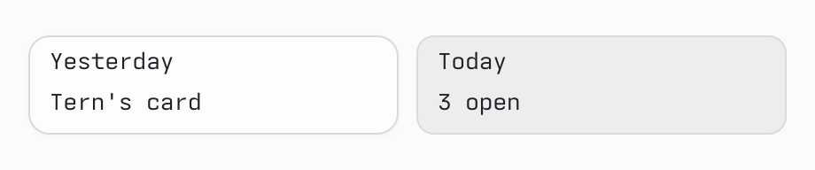
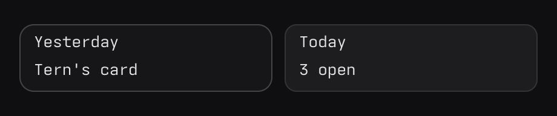
<figcaption>左侧是不带该 role 的卡片；右侧是 <code>todo.day</code> 卡片。</figcaption>
</figure>

### 紧凑表格 {#compact-tables}

```css
.sf-block[data-role='lens.plugin.disk.du'] .sf-table {
	font-variant-numeric: tabular-nums;
}
/* .sf-tbl-h and .sf-tbl-c are inner parts: anchored to the lens, may change */
.sf-block[data-role='lens.plugin.disk.du'] .sf-tbl-h {
	height: 20px;
	line-height: 20px;
}
.sf-block[data-role='lens.plugin.disk.du'] .sf-tbl-c {
	padding-top: 0;
	padding-bottom: 0;
}
```

<figure class="tn-figure">
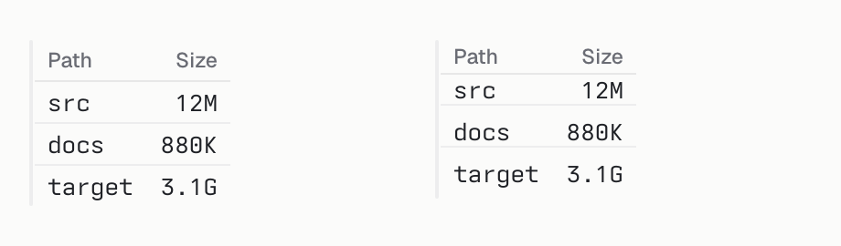
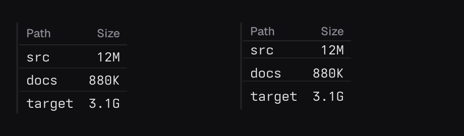
<figcaption>左侧是另一个 lens 的表格；右侧是 <code>disk.du</code> lens 的表格。</figcaption>
</figure>

### 在视图中修改某个色调的颜色 {#change-a-tone-s-color-in-your-views}

`--tc` 由同一元素上的 `[data-tone]` 设置，因此在自己的节点上就地覆盖它：

```css
.sf-main[data-surface='plugin.ci.runs'] [data-role^='ci.'][data-tone='pending'] {
	--tc: light-dark(#0f8a8a, #3fd0c9);
}
```

<figure class="tn-figure">
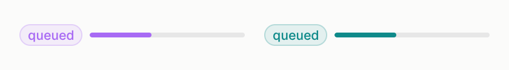
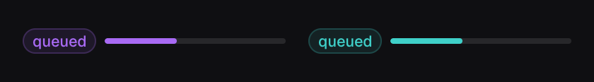
<figcaption>左侧是不带 <code>ci.</code> role 的 <code>pending</code> 节点；右侧是带该 role 的节点。</figcaption>
</figure>

### 自定义徽标外观 {#a-custom-badge-look}

```lua
local ui = tern.ui

local badge = ui.node("badge", { text = "beta", tone = "accent", role = "todo.flag" })
```

```css
.sf-badge[data-role='todo.flag'] {
	height: 16px;
	padding: 0 5px;
	border-radius: 4px;
	font-family: var(--mono);
	text-transform: uppercase;
	color: white;
	background: var(--accent-fill);
	box-shadow: none;
}
```

<figure class="tn-figure">
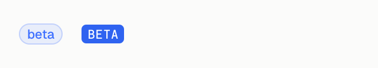
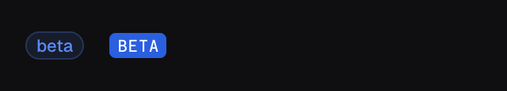
<figcaption>左侧是 <code>ui.badge("beta", "accent")</code>；右侧是 <code>todo.flag</code> 徽标。</figcaption>
</figure>

### 淡化已完成的 checklist 条目 {#dim-finished-checklist-items}

`checklist` 的条目行带有 `.st-<status>`（`pending`、`active`、`done`、`dropped`、
`blocked`）；参见 [Agent、Chat 与任务类型](../elements/work.md#checklist)。

```css
.sf-checklist[data-role='todo.steps'] .sf-ck-item.st-done {
	opacity: 0.5;
}
```

对于自己的行（`list`/`item`），请自行标记：设置 `mark = "done"` 并定位
`[data-mark='done']`，该钩子是稳定的。

```css
.sf-main[data-surface='plugin.todo.list'] .sf-item[data-mark='done'] .sf-t-del {
	opacity: 0.6;
}
```

<figure class="tn-figure">
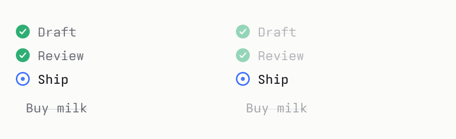
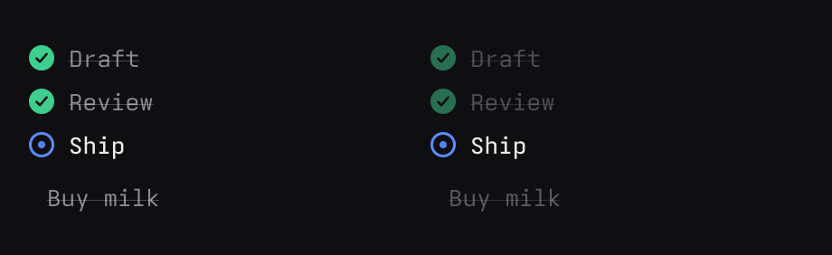
<figcaption>左侧是 Tern 的默认样式；右侧是 <code>todo.steps</code> checklist 以及一个 <code>mark = "done"</code> 的条目。</figcaption>
</figure>

### 按状态为 lens block 设置样式 {#style-a-lens-block-by-state}

```css
.sf-block[data-role='lens.plugin.build.make'][data-state='running']::before {
	background: var(--accent);
}
.sf-block[data-role='lens.plugin.build.make'].failed .sf-block-body {
	background: rgb(from var(--bad) r g b/6%);
	border-radius: 6px;
}
```

<figure class="tn-figure">
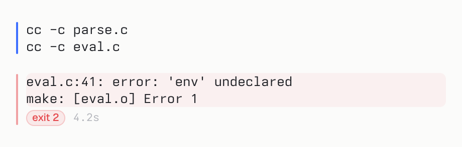
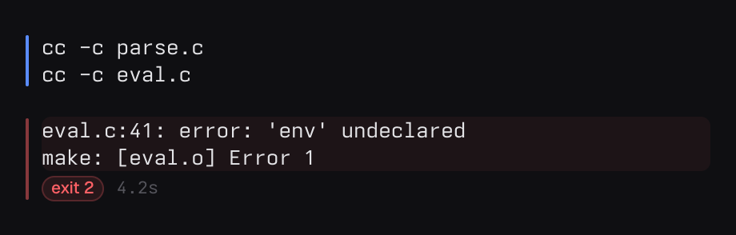
<figcaption>一个正在运行的 block，以及一个在 4.2 秒后以退出码 2 结束的 block。</figcaption>
</figure>

### 在运行时切换样式表 {#toggle-a-sheet-at-run-time}

`item` 行的高度至少为一行加 6px（`min-height`），且没有垂直内边距；紧凑样式表会
去掉这多出的 6px。

```lua
local compact = false

tern.command({
	id = "compact",
	title = "Toggle compact rows",
	run = function(_cx)
		compact = not compact
		tern.css("density", if compact
			then ".sf-main[data-surface='plugin.todo.list'] .sf-item { min-height: var(--sf-lh); }"
			else "")
	end,
})
```

## 调试样式 {#debugging-styles}

以控制端点运行一个窗口，并向它查询
（[调试](../guides/debugging.md#driving-a-window-from-a-script)）：

```sh
tern --control /tmp/tern-ctl.sock ~/src/my-plugin &
tern ctl --control /tmp/tern-ctl.sock css
tern ctl --control /tmp/tern-ctl.sock tree "[data-surface='plugin.todo.list'] [data-role='todo.day']"
```

- `css` 按层叠顺序列出已安装的样式表。查找 `plugin:local:<id>:styles` 与你的
  `tern.css` 名称，并确认你的样式表排在 surface 样式表之后。
- `tree SEL` 显示选择器匹配到的可见元素及其类与属性。没有匹配说明选择器有误
  （常见情况是本该用 `data-surface` 却写了 `data-role`）。
- 解析错误在日志中记录为 `plugin style sheet has errors`，并附样式表名称
  （[日志文件](../guides/debugging.md#log-files)）。

当规则匹配但落败时，把它与 Tern 针对同一元素的规则（元素页面中的选择器）比较
优先级，并给自己的选择器增加一个稳定钩子。
