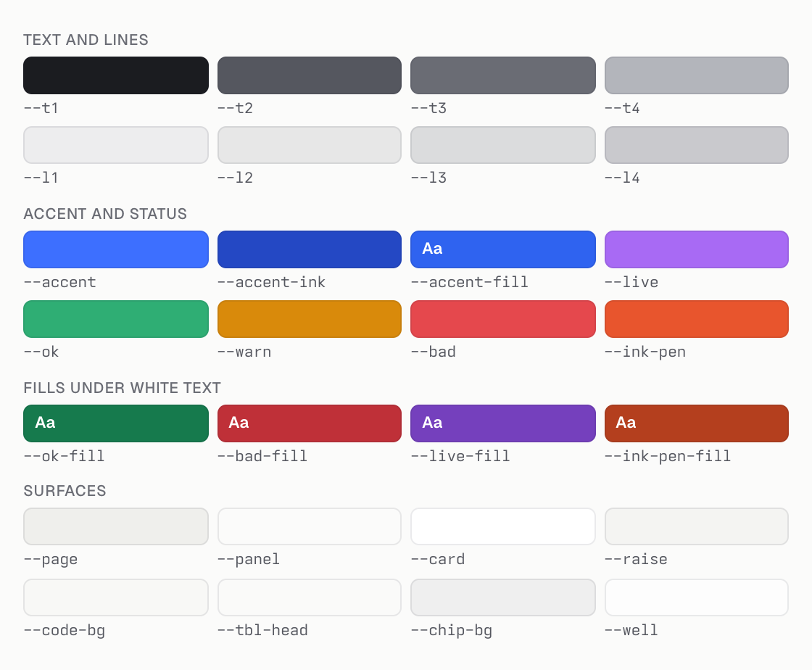
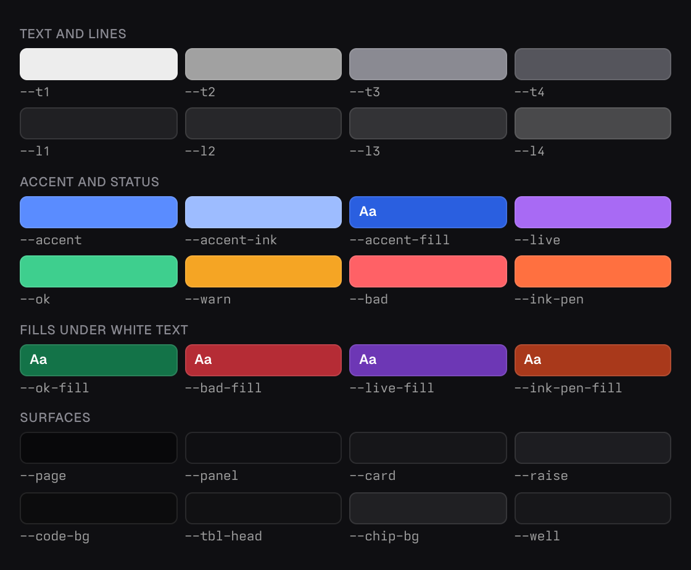
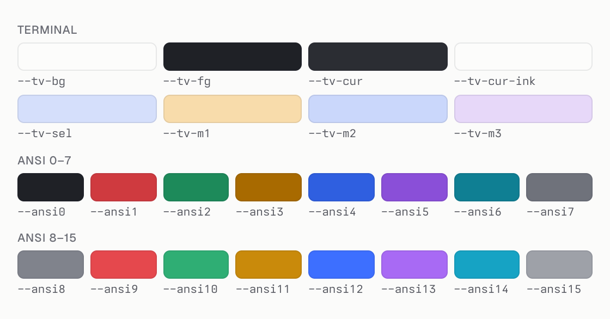
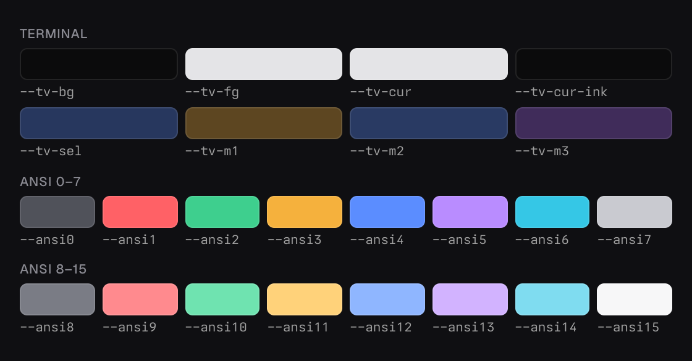
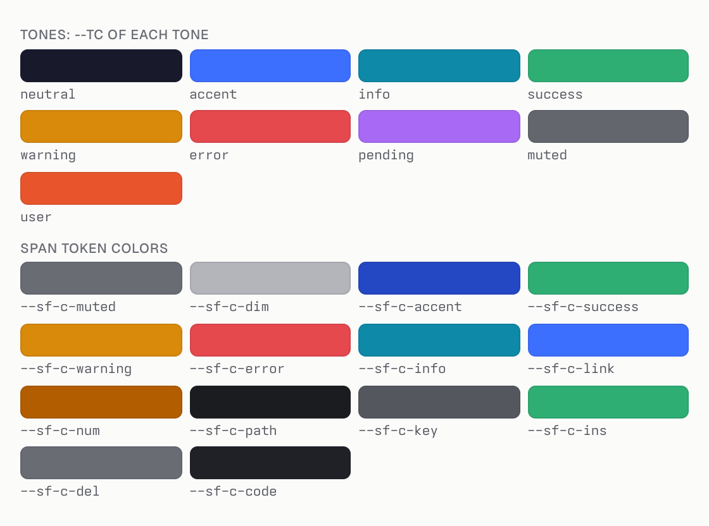
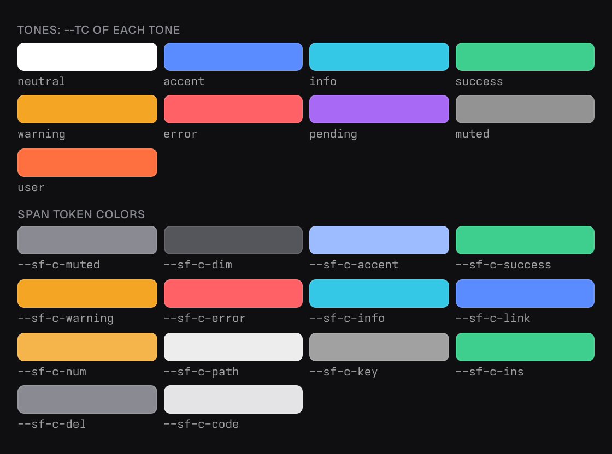
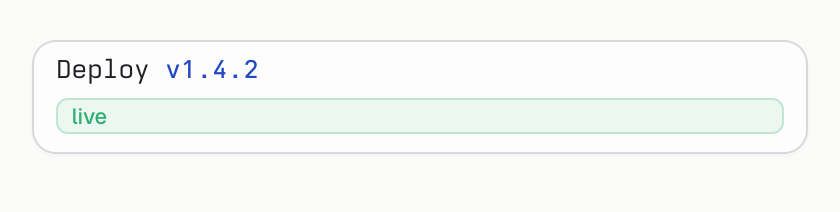
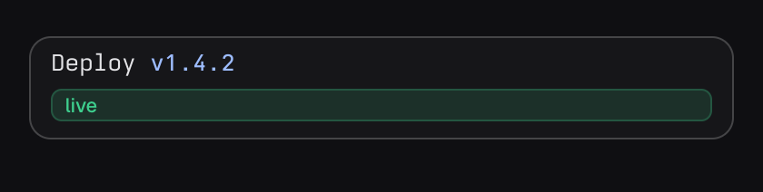

# CSS 变量 {#css-variables}

插件样式表与 Tern 绘制时使用同一套配色。颜色、线条、圆角、字体与网格长度一律通过 CSS 自定义属性引用，不要写死具体值。这样一来，视图就会自动跟随用户选择的主题、浅色与深色外观、对比度与透明度设置以及字号，无需额外处理。

本页按类别列出插件样式表可以读取的每一个自定义属性，并给出定义它的作用域，以及该属性是否可以依赖。样式表的加载与层叠方式参见[视图样式](index.md)。Tern 支持的 CSS 语法（`var()`、`light-dark()`、相对颜色、`color-mix()`）参见[支持的 CSS](css.md)。

## 取值的来源 {#where-the-values-come-from}

变量由三层设置，每一层都会覆盖前一层：

1. **套件默认值。** `theme.css` 在 `:root` 上定义设计 token。`highlight.css` 增加 `--tk-*` 语法配色。`termview.css` 增加终端的 `--tv-*` 与 `--ansi*` 配色。`surface.css` 增加 Surface 色调与 span 配色（`--sf-*`）。
2. **Tern 应用的主题。** 对于选定的主题变体，Tern 会把这些属性以内联方式写在根元素上：`--ink`、`--t1`…`--t4`、
   `--accent`、`--accent-ink`、`--accent-fill`、`--a1`、`--a2`、`--grad-ink`、`--ok`、`--ok-fill`、`--bad`、
   `--bad-fill`、`--warn`、`--live`、`--live-fill`、`--card`、`--raise`、`--code-bg`、`--tbl-head`、`--tv-bg`、
   `--tv-fg`、`--tv-cur`、`--tv-cur-ink`、`--tv-sel-a`、`--tv-sel-b`、`--ansi0`…`--ansi15`、主题的
   `--omp-<token>` 配色，以及内部的 `--tn-*` 通道。随后 `html.tn-themed`（`themes.css`）由这些值派生出
   `--page`、`--panel`、`--l1`…`--l4`、`--ink2`…`--ink4`、`--chip-bg`、`--well-line`、`--pop-bg`、
   `--topbar-bg`、`--sf-neutral` 与 `--tv-sel`。用户的
   [CSS 主题](../guides/themes.md#css-themes) 会把它的规则叠加在这一切之上，每条声明都带
   `!important`，并且排在插件添加的所有样式表之后。
3. **Surface 视图。** 在每个区域元素（`.sf-main`、`.sf-dock`、`.sf-layer`）上，视图会设置网格度量
   `--sf-zoom`、`--sf-fs`、`--sf-lh` 与 `--sf-cw`，以及标签宽度
   `--sf-tab`。

因此下文套件表格中的取值都是**默认值**。在 Tern 主题下，第 2 层的变量保存该主题的配色。变量名不会改变，因此只读变量名，绝不要复制十六进制色值。

## 浅色与深色 {#light-and-dark}

套件的 `:root` 设置 `color-scheme: light`，而 `[data-theme='dark']`（Tern 会把它设在根元素上）设置 `color-scheme: dark`。大多数颜色 token 写作
`light-dark(<light>, <dark>)`，因此每个 token 都会针对当前显示的外观求值。token 不需要额外的深色模式规则。当需要自己的双面配色时，用同样的方式书写：

```css
.sf-card[data-role='plugin.deploy.summary'] {
	background: light-dark(rgb(from var(--accent) r g b/6%), rgb(from var(--accent) r g b/12%));
}
```

如果想在选择器里直接指定深色外观，请使用 `[data-theme='dark'] .your-selector`。主题写入的配色已经针对当前显示的变体求值（每种外观一个值），因此第 2 层的变量是普通颜色，而不是 `light-dark()` 对。

套件中的深色模式是平铺的。`[data-theme='dark']` 会把 `--sheet-rim`、`--sheet-in` 与 `--sheet-drop` 替换为细线与阴影值，并设置 `--cv-glow: none`。

有两项系统设置会用 `!important` 覆盖 token（`motion.css`）：

- `prefers-contrast: more` 把 `--t1`…`--t4` 设为接近黑/白的层级，并加深 `--l1`…`--l3`。
- `prefers-reduced-transparency: reduce` 使 `--page`、`--panel`、`--pop-bg`、`--xp-bg`、`--topbar-bg`、
  `--tile-a`、`--tile-b`、`--sheet-a` 与 `--sheet-b` 变为不透明。

由于这些覆盖都通过变量实现，样式表读取 token 时就会跟随它们。

## 带后备值读取变量 {#reading-a-variable-with-a-fallback}

当某个元素上没有定义 `--name` 时，`var(--name, fallback)` 会使用后备值。凡是只在某些上下文中存在的变量，都应提供后备值：区域之外的网格度量、上下文填充色，以及本页标记为内部（internal）的任何变量。

```css
/* the terminal font size inside a surface region, 12px elsewhere */
.sf-text[data-role='plugin.logs.line'] {
	font-size: var(--sf-fs, 12px);
}

/* a card tint if one is set, else the card background */
.sf-card[data-role='plugin.ci.state'] {
	background: var(--sf-tint-success, var(--sf-card-bg));
}
```

后备值可以嵌套。Tern 自己的规则就是这么做的，例如区域的文字颜色是 `var(--tv-fg, var(--t1))`。

要获得某个 token 的半透明版本，请使用相对颜色，而不要另设一个变量：

```css
.sf-row[data-role='plugin.ci.failed'] {
	background: rgb(from var(--bad) r g b/10%);
	box-shadow: inset 2px 0 0 var(--bad);
}
```

## 稳定性 {#stability}

| 标记 | 含义 |
| --- | --- |
| **稳定** | 属于主题约定的一部分。每个主题都会设置或派生它。可以放心地在插件样式表中读取。 |
| **稳定（只读）** | 可以安全读取。Tern 会按区域或按元素写入它，因此自行设置的值会被覆盖或不起作用。 |
| **上下文** | 只在某些上下文中定义（特定元素，或自行设置的变量）。读取时始终要带后备值。 |
| **内部** | 供 Tern 自身的 chrome 或某一类 block 的渲染器使用的布局管线。记录于此是为了便于识别。它可能在不同版本之间改变或消失。 |

## 套件 token：文字与线条 {#kit-tokens-text-and-lines}

在 `theme.css` 中的 `:root` 上定义。这些是最常用的一批 token。

<figure class="tn-figure">


<figcaption>每个单元格都是在 Surface 中应用 <code>background: var(--name)</code> 的效果：套件默认值，浅色与深色。Tern 主题会替换第 2 层的取值。</figcaption>
</figure>

| 变量 | 含义 | 浅色 / 深色默认值 | 主题 | 稳定性 |
| --- | --- | --- | --- | --- |
| `--t1` | 主要文字。 | `#1b1c20` / `#ededed` | 设置（主题 ink） | 稳定 |
| `--t2` | 次要文字。 | `#55575f` / `#a1a1a1` | 设置 | 稳定 |
| `--t3` | 元信息文字：标签、提示。 | `#6a6c74` / `#8a8a92` | 设置 | 稳定 |
| `--t4` | 微弱文字：禁用态、占位符。 | `#b3b5bb` / `#55555c` | 设置 | 稳定 |
| `--ink` | 主题的 ink 颜色（默认与 `--t1` 相同）。 | `#1b1c20` / `#ededed` | 设置 | 稳定 |
| `--ink2` | 66% 的 ink（套件深色默认值为 70%）。 | 半透明 ink | 派生自 `--ink` | 稳定 |
| `--ink3` | 44% 的 ink（深色为 42%）。 | 半透明 ink | 派生 | 稳定 |
| `--ink4` | 14% 的 ink。 | 半透明 ink | 派生 | 稳定 |
| `--l1` | 细线、最淡的填充（悬停行、徽标）。 | ink 6% / 白色 7% | 派生（`--ink` 6%） | 稳定 |
| `--l2` | 细线、边框。 | 9% / 10% | 派生（9%） | 稳定 |
| `--l3` | 强边框。 | 14% / 15% | 派生（14%） | 稳定 |
| `--l4` | 最强的线条。 | 22% / 24% | 派生（22%） | 稳定 |

`prefers-contrast: more` 会覆盖 `--t1`…`--t4` 与 `--l1`…`--l3`。

## 套件 token：强调色与状态色 {#kit-tokens-accent-and-status}

| 变量 | 含义 | 浅色 / 深色默认值 | 主题 | 稳定性 |
| --- | --- | --- | --- | --- |
| `--accent` | 用于描边环、着色、链接与选中标记的强调色。 | `#3d6fff` / `#5a8cff` | 设置 | 稳定 |
| `--accent-ink` | 用作文字颜色的强调色（在 Surface 上可读）。 | `#2448c4` / `#9dbcff` | 设置 | 稳定 |
| `--accent-fill` | 涂在白色文字或图形下方的强调色（实心徽标、勾选标记）。在两种外观下与 `#fff` 的对比度至少为 4.5:1。 | `#2f63f0` / `#2a5fe0` | 设置 | 稳定 |
| `--a1`、`--a2` | 品牌渐变色的两个色标。 | `#44cfff`、`#3b6cff` | 设置 | 稳定 |
| `--grad` | `linear-gradient(135deg, var(--a1), var(--a2))`。 | — | 跟随 `--a1`/`--a2` | 稳定 |
| `--grad-ink` | 在 `--grad` 上可读的文字颜色。 | `#05070b` | 设置 | 稳定 |
| `--ok` | 成功。 | `#2fae74` / `#3ecf8e` | 设置 | 稳定 |
| `--warn` | 警告。 | `#d98a0b` / `#f5a524` | 设置 | 稳定 |
| `--bad` | 错误、破坏性操作。 | `#e5484d` / `#ff6166` | 设置 | 稳定 |
| `--live` | 运行中、等待中、进行中的活动（紫色）。 | `#a86af4` | 设置 | 稳定 |
| `--ok-fill` | 加深后用于承载白色文字的 `--ok`。 | `#167a4d` / `#137348` | 设置（已做对比度校正） | 稳定 |
| `--bad-fill` | 用于白色文字的 `--bad`。 | `#bf3038` / `#b52c35` | 设置 | 稳定 |
| `--live-fill` | 用于白色文字的 `--live`。 | `#7540bd` / `#6d37b5` | 设置 | 稳定 |
| `--ink-pen` | 橙色画笔颜色（Tern 用它表示用户自己发出的消息）。 | `#e8552d` / `#ff7040` | 主题不设置 | 稳定 |
| `--ink-pen-fill` | 用于白色文字的 `--ink-pen`。 | `#b43f1e` / `#a9391b` | 未设置 | 稳定 |

文字、图标、描边环与浅着色使用普通颜色（`rgb(from var(--ok) r g b/12%)`）。`*-fill` 颜色只用于承载白色文字的背景。

## 套件 token：Surface 与材质 {#kit-tokens-surfaces-and-materials}

| 变量 | 含义 | 浅色 / 深色默认值 | 主题 | 稳定性 |
| --- | --- | --- | --- | --- |
| `--page` | 面板之后的窗口背景。 | `#efefec` / `#08080a` | 派生自主题的页面颜色；在 glass 窗口中为半透明 | 稳定 |
| `--panel` | 面板背景。在主题下即终端背景。 | `#fbfbfa` / `#0f0f12` | `var(--tv-bg)`（在 glass 窗口中为半透明） | 稳定 |
| `--card` | 卡片背景。 | `#ffffff` / `#161619` | 设置 | 稳定 |
| `--raise` | 浮起控件的背景。 | `#f4f4f2` / `#1d1d21` | 设置 | 稳定 |
| `--code-bg` | 代码块背景。 | `#f8f8f6` / `#0c0c0d` | 设置 | 稳定 |
| `--tbl-head` | 表头背景。 | `#fafaf9` / `#111113` | 设置（与 `--code-bg` 相同） | 稳定 |
| `--chip-bg` | 徽标与行内代码的填充色。 | ink 5.5% / 白色 7% | 派生 | 稳定 |
| `--pop-bg` | 浮层与菜单的背景。 | `rgba(255,255,255,.82)` / `rgba(35,35,39,.98)` | 派生自主题的浮层颜色 | 稳定 |
| `--well` | 凹陷槽区的填充色。 | 白色 62% / 白色 3.5% | 未设置 | 稳定 |
| `--well-line` | 槽区的细线。 | ink 6.5% / 白色 7.5% | 派生 | 稳定 |
| `--glass-hi` | glass 顶部高光。 | `#fff` / 白色 5% | 未设置 | 稳定 |
| `--fog` | 不透明的柔和填充。 | `#f3f4f7` / `#0f0f12` | 未设置 | 稳定 |
| `--dim` | 模态样式表之后的遮罩。 | `rgba(244,244,241,.5)` / `rgba(0,0,0,.55)` | 未设置 | 稳定 |
| `--rail` | 导轨与引导线颜色。 | `rgb(96,120,178)` / `rgb(110,150,255)` | 未设置 | 稳定 |
| `--grid-dot` | 点阵网格颜色。 | ink 10% / 白色 6.5% | 未设置 | 稳定 |
| `--topbar-bg` | 应用顶栏材质。 | 半透明页面色 | 派生 | 内部 |
| `--sheet-a`、`--sheet-b` | 样式表背景的两个色标。 | 半透明白色 / `var(--card)` | 未设置 | 内部 |
| `--sheet-rim` | 样式表边框渐变。 | 白色渐变 / 9% 白色细线 | 深色覆盖 | 内部 |
| `--sheet-in` | 样式表内高光（box-shadow）。 | — | 深色覆盖 | 内部 |
| `--sheet-drop` | 样式表投影（box-shadow）。 | — | 深色覆盖 | 内部 |
| `--xp-bg` | 展开视图的背板。 | — | 未设置 | 内部 |
| `--tile-a`、`--tile-b` | 画廊磁贴背景色标。 | — | 未设置 | 内部 |
| `--cv-base`、`--cv-glow` | 画布基色及其环境光晕（深色下为 `none`）。 | — | 未设置 | 内部 |

## 套件 token：形状、字体、动效、布局 {#kit-tokens-shape-type-motion-layout}

| 变量 | 含义 | 取值 | 稳定性 |
| --- | --- | --- | --- |
| `--r-chip` | 徽标与标签的圆角。 | `6px` | 稳定 |
| `--r-ctl` | 控件（按钮、输入框）的圆角。 | `8px` | 稳定 |
| `--r-card` | 卡片的圆角。 | `12px` | 稳定 |
| `--r-panel` | 面板与样式表的圆角。 | `16px` | 稳定 |
| `--sans` | UI 字体栈。 | `'Geist', -apple-system, 'SF Pro Text', system-ui, sans-serif` | 稳定 |
| `--mono` | 等宽字体栈。 | `'Ioskeley Mono Term', ui-monospace, 'SF Mono', SFMono-Regular, Menlo, monospace` | 稳定 |
| `--hand` | 手写字体栈。 | `'Excalifont', 'Bradley Hand', 'Segoe Print', cursive` | 稳定 |
| `--ease` | 通用缓动。 | `cubic-bezier(0.2, 0.7, 0.2, 1)` | 稳定 |
| `--out` | 入场动画的缓出曲线。 | `cubic-bezier(0.16, 1, 0.3, 1)` | 稳定 |
| `--top`、`--side` | 套件应用外壳的顶栏高度与侧栏宽度（`56px`、`244px`；宽度低于 1360px 时为 `224px`，带 `html.side-collapsed` 时为 `0px`）。 | — | 内部 |
| `--W`、`--H`、`--tw`、`--th`、`--CW`、`--CH` | 套件画廊与画布的尺寸。 | — | 内部 |

Surface 区域会设置自己的字体。其 `font-family` 为 `var(--tv-font, var(--mono))`，字号为 `--sf-fs`，因此在等宽视图中，`--sans` 只用于那些刻意与终端字体区分开的文字。若 Surface 区域是以 `font: "sans"` 打开（类名 `sf-sans`，参见 [Surface](../protocol/surfaces.md#open-and-close)），则改用 `400 13px/18px var(--sans)`，机器字符串仍使用 `--mono`；此时只对刻意与 UI 字体区分开的内容设置字体。

在 `prefers-reduced-motion: reduce` 下，套件把所有动画与过渡的时长设为 `0s`。缓动变量保持原值。

## 语法高亮 token {#syntax-highlight-tokens}

在 `highlight.css` 中的 `:root` 上定义。高亮后的代码（`code`、`diff` 与 `md` 类型）用 `.tk-<name>` 类标记 token，每个类读取对应的变量。

| 变量 | 类 | 浅色 / 深色默认值 | 稳定性 |
| --- | --- | --- | --- |
| `--tk-comment` | `.tk-comment` | `var(--t3)` | 稳定 |
| `--tk-doc` | `.tk-doc` | `#35726b` / `#7bb9b0` | 稳定 |
| `--tk-keyword` | `.tk-keyword` | `#8a3fd6` / `#c29bff` | 稳定 |
| `--tk-function` | `.tk-function` | `#2448c4` / `#8fb6ff` | 稳定 |
| `--tk-macro` | `.tk-macro` | `#a52a9a` / `#f08ade` | 稳定 |
| `--tk-variable` | `.tk-variable` | `var(--t1)` | 稳定 |
| `--tk-property` | `.tk-property` | `#325a86` / `#a8d1ee` | 稳定 |
| `--tk-string` | `.tk-string` | `#1d7f52` / `#5fd39c` | 稳定 |
| `--tk-escape` | `.tk-escape` | `#055c3e` / `#a0f8c5` | 稳定 |
| `--tk-number` | `.tk-number` | `#b25e00` / `#f5b54a` | 稳定 |
| `--tk-constant` | `.tk-constant` | `#737007` / `#e0da69` | 稳定 |
| `--tk-type` | `.tk-type` | `#0b7894` / `#4fd2ee` | 稳定 |
| `--tk-tag` | `.tk-tag` | `#b63b32` / `#f8907f` | 稳定 |
| `--tk-heading` | `.tk-heading` | `#6744c5` / `#b6a5fd` | 稳定 |
| `--tk-link` | `.tk-link` | `#0070a6` / `#6fc1f6` | 稳定 |
| `--tk-operator` | `.tk-operator` | `#c2335f` / `#ff8db2` | 稳定 |
| `--tk-punct` | `.tk-punct` | `var(--t2)` | 稳定 |
| `--tk-inserted` | `.tk-inserted` | `var(--ok)` | 稳定 |
| `--tk-deleted` | `.tk-deleted` | `var(--bad)` | 稳定 |

若只想在自己的 block 中改变高亮配色，请把变量设在限定作用域的选择器上：

```css
[data-surface='plugin.notes.main'] {
	--tk-keyword: var(--accent-ink);
	--tk-string: var(--ok);
}
```

## 终端 token {#terminal-tokens}

在 `termview.css` 中的 `:root` 上定义。主题会在根元素上覆盖它们。Surface 区域会读取它们来确定文字颜色与字体。当视图的某部分需要看起来像终端网格时，请使用这些 token。

| 变量 | 含义 | 浅色 / 深色默认值 | 主题 | 稳定性 |
| --- | --- | --- | --- | --- |
| `--tv-font` | 终端字体族。 | `var(--mono)` | Tern 依据用户的字体设置，把它内联设置在 stage 与 peek 根元素上 | 稳定 |
| `--tv-bg` | 终端背景。 | `#fcfcfb` / `#0b0b0c` | 设置 | 稳定 |
| `--tv-fg` | 终端前景。 | `#1f2126` / `#e4e4e7` | 设置 | 稳定 |
| `--tv-cur` | 光标颜色。 | `#2b2d33` / `#e4e4e7` | 设置 | 稳定 |
| `--tv-cur-ink` | 光标下方的文字。 | `#fcfcfb` / `#0b0b0c` | 设置 | 稳定 |
| `--tv-sel` | 选中区域的填充色。 | 强调色 20% / 32% | 派生自主题的选中颜色（22% / 34%） | 稳定 |
| `--tv-sel-a`、`--tv-sel-b` | 选中渐变的上、下色标。设置后它们会取代平铺的 `--tv-sel`。 | 未定义 | 设置 | 上下文 |
| `--tv-m1` | 搜索命中高亮（标记组 1）。 | 琥珀色 42% / 34% | 未设置 | 稳定 |
| `--tv-m2` | 当前命中高亮（标记组 2）。 | 强调色 26% / 34% | 跟随主题的 `--accent` | 稳定 |
| `--tv-m3` | 标记组 3。 | `--live` 24% / 32% | 跟随主题的 `--live` | 稳定 |
| `--ansi0` … `--ansi15` | 16 个 ANSI 颜色：0–7 为普通色（黑、红、绿、黄、蓝、品红、青、白），8–15 为亮色。 | Tern 自带的调色板（`--ansi1` 为 `#cf3a3f` / `#ff6166`） | 由主题设置 | 稳定 |
| `--tv-contrast` | 自动文字对比度校正所用的最低 WCAG 比值。 | 未定义 | 由“minimum contrast”选项设置 | 内部 |

ANSI 颜色是主题的真实调色板。若要让插件中的某种颜色与 shell 程序打印“红色”时的颜色一致，请使用 `var(--ansi1)`。

<figure class="tn-figure">


<figcaption>来自 <code>termview.css</code> 的 <code>--tv-*</code> 与 <code>--ansi*</code> 默认值。在 Tern 主题下，它们保存该主题的配色。</figcaption>
</figure>

Tern 会在终端元素 `.tv` 上内联写入以下属性。它们只在终端面板内部定义，因此读取时需带后备值。

| 变量 | 含义 | 稳定性 |
| --- | --- | --- |
| `--tv-fs` | 终端字号，单位为 px。 | 内部 |
| `--tv-lh` | 终端行高，单位为 px。 | 内部 |
| `--tv-px`、`--tv-py` | 网格的水平与垂直内边距。 | 内部 |
| `--tv-aside` | 停靠在面板右边缘的样式表宽度（`prefs` 类型）。在区域内需除以 `--sf-zoom`。 | 内部 |
| `--tv-dock-h` | 停靠区的高度，设置在回滚胶囊上。 | 内部 |

在 Surface 内，请使用 `--sf-fs`、`--sf-lh` 与 `--sf-cw`，而不要用 `--tv-fs`/`--tv-lh`。它们以区域缩放后的 px 为单位，保持精确。

## Surface 网格度量 {#surface-grid-metrics}

视图会在终端字体、UI 字号、单元格尺寸或标签宽度发生变化时，把下列变量内联设置在每个区域元素（`.sf-main`、`.sf-dock`、`.sf-layer`）上。它们会被继承到每个节点。

| 变量 | 含义 | 稳定性 |
| --- | --- | --- |
| `--sf-fs` | 终端字号，单位为区域内的 px。即区域的 `font-size`（后备值 `12px`）。 | 稳定（只读） |
| `--sf-lh` | 区域的行距：终端行高（单元格高度），在无衬线区域（`.sf-sans`）中为 `18px`。即区域的 `line-height`（后备值 `17px`）。 | 稳定（只读） |
| `--sf-grid-lh` | 终端行高，在所有区域中都可用；等宽类型（`code`、`diff`、`ansi`、…）在无衬线区域中使用的就是它。 | 稳定（只读） |
| `--sf-cw` | 终端单元格宽度（网格字体的一个 `ch`）。 | 稳定（只读） |
| `--sf-zoom` | 区域的 CSS `zoom`（UI 字号 ÷ 13），为一个普通数值。把 host 侧的 px 长度除以它。 | 稳定（只读） |
| `--sf-tab` | `code`、`diff` 与 Markdown 代码中每个制表位的列数：Tern 的 Tab 宽度设置，用于 `tab-size` 的普通数值。 | 稳定（只读） |

Tern 的样式表是按 13px 字号绘制的，每个区域会按 UI 字号除以 13 进行缩放（Settings › Appearance；未单独设置时即终端字号）。因此样式表中的普通 px 会随视图周围的界面一同缩放。视图写入的终端度量已除以缩放系数，所以缩放之后在屏幕上仍然精确：两个字号一致时 `--sf-fs` 读作 `13px`，而 `--sf-lh` 与 `--sf-cw` 是以同一套设计单位表示的单元格高度与宽度。读取终端字号的文字请用 `--sf-fs`，长度必须精确落在网格上时用 `--sf-lh` 与 `--sf-cw`。prop 的范围会编译成这些值：`"40ch"` 变成 `calc(40 * var(--sf-cw))`，`"10lines"` 变成 `calc(10 * var(--sf-lh))`。

```css
/* a gutter exactly six cells wide, a list exactly eight lines tall */
.sf-row[data-role='plugin.blame.line'] > :first-child {
	width: calc(6 * var(--sf-cw));
}
.sf-list[data-role='plugin.blame.commits'] {
	max-height: calc(8 * var(--sf-lh));
}
```

## Surface 节奏与填充 {#surface-rhythm-and-fills}

在 `surface.css` 中的 `:root` 上定义。

| 变量 | 含义 | 浅色 / 深色默认值 | 稳定性 |
| --- | --- | --- | --- |
| `--sf-block-gap` | `main` 中 block 之间的间距（`.sf-main` 是使用该间距的 flex 列）。 | `16px` | 稳定 |
| `--sf-inner-gap` | 单个 block 内部各部分之间的间距（卡片的内容行）。 | `8px` | 稳定 |
| `--sf-card-bg` | 卡片背景（`.sf-card`）。 | 白色 55% / 白色 2.8% | 稳定 |
| `--sf-shade` | 淡淡的阴影填充（代码边槽、卡片头）。 | `--t1` 2.8% / 3% | 稳定 |

节点之间的间距由 Tern 控制，程序从不发送它。若要改变自己 block 中的节奏，请在所在区域上覆盖这些值：

```css
.sf-main[data-surface='plugin.todo.board'] {
	--sf-block-gap: 10px;
	--cn-gap: 10px; /* the Console chat style */
}
```

在 Console 对话样式下，`main` 用 `--cn-gap`（由 `.sf-chat-console` 设置在区域上）而不是 `--sf-block-gap` 来排布 block 间距，因此两个都要设置。

## 色调颜色 {#tone-colors}

在 `surface.css` 中的 `:root` 上定义。

| 变量 | 色调 | 默认值 | 稳定性 |
| --- | --- | --- | --- |
| `--sf-ok` | 成功 | `var(--ok)` | 稳定 |
| `--sf-warn` | 警告 | `var(--warn)` | 稳定 |
| `--sf-bad` | 错误 | `var(--bad)` | 稳定 |
| `--sf-info` | 信息 | `#0e89a8` / `#35c7e6` | 稳定 |
| `--sf-muted` | 弱化 | `#64666e` / `#939393` | 稳定 |
| `--sf-neutral` | 中性 | `#181a2c` / `#fff`；在 Tern 主题下为 `var(--ink)` | 稳定 |
| `--sf-user` | 用户 | `var(--ink-pen)` | 稳定 |
| `--sf-accent` | 强调 | 未定义（回退到 `--accent`） | 上下文 |

### 色调如何解析 {#how-tones-resolve}

每个带有 `tone` prop 的节点都会获得 `data-tone="<tone>"`。在 `surface.css` 中，每种色调都在该元素上设置一个变量 `--tc`：

| `[data-tone]` | `--tc` |
| --- | --- |
| `neutral` | `var(--sf-neutral)` |
| `accent` | `var(--sf-accent, var(--accent))` |
| `info` | `var(--sf-info)` |
| `success` | `var(--sf-ok)` |
| `warning` | `var(--sf-warn)` |
| `error` | `var(--sf-bad)` |
| `pending` | `var(--live)` |
| `muted` | `var(--sf-muted)` |
| `user` | `var(--sf-user)` |

每个区域初始都带有 `--tc: var(--sf-neutral)`。能感知色调的类型会用 `--tc` 以及由它生成的相对颜色来绘制。例如，徽标使用 `color: var(--tc)`、`background: rgb(from var(--tc) r g b/10%)` 与 `box-shadow: inset 0 0 0 1px rgb(from var(--tc) r g b/22%)`。样式表也可以这样做，于是规则会跟随节点所带的任意色调：

```css
.sf-card[data-role='plugin.ci.job'] {
	border-left: 3px solid var(--tc);
	background: rgb(from var(--tc) r g b/6%);
}
```

若要重设自己 block 中某一种色调的样式，请覆盖它的源变量，而不是 `--tc`：

```css
[data-surface='plugin.ci.main'] {
	--sf-warn: var(--ansi3);
}
```

`--tc` 可以稳定读取。只有在没有 `data-tone` 的元素上才自行设置它，否则色调规则会凭优先级胜出。

## Span token 颜色 {#span-token-colors}

在 `surface.css` 中的 `:root` 上定义。span 的样式 token 会变成 `.sf-t-<token>` 类。每个带颜色的 token 读取一个 `--sf-c-<token>` 变量，该变量优先取最近的 omp token 所对应的主题颜色（[主题 token 颜色](#theme-token-colors)），主题没有提供时取 Tern 自带的颜色：

| 变量 | 类 | 默认值 | 稳定性 |
| --- | --- | --- | --- |
| `--sf-c-muted` | `.sf-t-muted` | `--omp-muted`，否则 `var(--t3)` | 稳定 |
| `--sf-c-dim` | `.sf-t-dim` | `--omp-dim`，否则 `var(--t4)` | 稳定 |
| `--sf-c-accent` | `.sf-t-accent` | `--omp-accent`，否则 `var(--accent-ink)` | 稳定 |
| `--sf-c-success` | `.sf-t-success` | `--omp-success`，否则 `var(--ok)` | 稳定 |
| `--sf-c-warning` | `.sf-t-warning` | `--omp-warning`，否则 `var(--warn)` | 稳定 |
| `--sf-c-error` | `.sf-t-error` | `--omp-error`，否则 `var(--bad)` | 稳定 |
| `--sf-c-info` | `.sf-t-info` | `--omp-syntaxType`，否则 `var(--sf-info)` | 稳定 |
| `--sf-c-link` | `.sf-t-link`、`.sf-link` | `--omp-mdLink`、`--omp-accent`，否则 `var(--accent)` | 稳定 |
| `--sf-c-num` | `.sf-t-num` | `--omp-syntaxNumber`，否则 `#b25e00` / `#f5b54a` | 稳定 |
| `--sf-c-path` | `.sf-t-path`（其中的 `.dir` 部分使用 `--sf-c-muted`） | `--omp-statusLinePath`、`--omp-mdLinkUrl`，否则 `var(--t1)` | 稳定 |
| `--sf-c-key` | `.sf-t-key` | `var(--t2)` | 稳定 |
| `--sf-c-ins` | `.sf-t-ins` | `--omp-toolDiffAdded`、`--omp-success`，否则 `var(--ok)` | 稳定 |
| `--sf-c-del` | `.sf-t-del` | `--omp-toolDiffRemoved`、`--omp-error`，否则 `var(--t3)` | 稳定 |
| `--sf-c-code` | `.sf-t-code` | `--omp-mdCode`，否则 `currentColor` | 稳定 |

其余 span token 不使用颜色变量。`strong` 使用 `color: var(--t1)`，字重为 600。`em`、`mono`、`icon` 与 `hide` 只设置样式、等宽数字、字体或可见性。`mark` 使用 `--sf-mark-bg`，后备值为 `rgb(from var(--accent) r g b/16%)`。`typo` 用 `--spelling-error-color`（后备值 `#ff3b30`）绘制拼写错误点。`code` 与 `key` 会增加 `--chip-bg`/`--l1` 填充。

<figure class="tn-figure">


<figcaption>上：在带有各 <code>tone</code> 的 <code>el</code> 上应用 <code>var(--tc)</code>。下：<code>var(--sf-c-&lt;token&gt;)</code>；<code>--sf-c-code</code> 为 <code>currentColor</code>，即区域的文字颜色。</figcaption>
</figure>

接受颜色 `token` 的类型（chart 序列、meter 部件、effort）也以同样的方式解析它。语义 token 变成 `var(--sf-c-<token>)`；omp token 变成叠加在最近语义 token 之上的 `var(--omp-<token>, …)`。因此重设 `--sf-c-success` 也会重设 `token = "success"` 的 meter 部件。

```css
/* make "muted" spans quieter only in this block */
[data-surface='plugin.logs.main'] {
	--sf-c-muted: var(--t4);
}
```

span token 类的完整列表参见[视图样式](index.md)。

### 主题 token 颜色 {#theme-token-colors}

Tern 的主题就是 omp 主题（[自定义主题](../guides/themes.md)），Tern 会把 omp 每个文字 token 对应的主题自身颜色以 `--omp-<token>` 的形式设在根元素上：`--omp-mdHeading`、`--omp-syntaxKeyword`、`--omp-toolDiffAdded`，以及[文字与代码](../elements/text.md#program-theme-tokens)中其余的（`…Bg` 填充除外）。每一项都已重新调色，以便在终端背景、代码块与浮层上可读。主题没有提供的 token 不会被定义，因此读取时始终要带后备值。

它们着色的对象与 omp 配色一致：用 omp token（`toolTitle`、`statusLineModel`）设置样式的 span 会先读取自己的变量，再读取其语义类的变量；高亮代码先读取 `syntax*` 系列，再读取 `--tk-*` 颜色；Markdown 则读取 `mdHeading`、`mdLink`、`mdCode`、`mdQuote`、`mdQuoteBorder`、`mdListBullet`、`mdHr` 与 `mdCodeBlock`。

```css
/* a plugin's section titles in the theme's heading color */
[data-surface='plugin.ci.main'] .title {
	color: var(--omp-mdHeading, var(--t1));
}
```

## 上下文填充 {#context-fills}

这些变量默认不定义。Tern 关于卡片着色、选中、标记与状态栏的规则会带后备值读取它们，因此可以在自己的区域上自行定义。

| 变量 | 含义 | 稳定性 |
| --- | --- | --- |
| `--sf-tint-success` | `success` 的卡片填充，后备值 `--sf-card-bg`。 | 上下文 |
| `--sf-tint-error` | `error` 的卡片填充。 | 上下文 |
| `--sf-tint-pending` | `pending` 的卡片填充。 | 上下文 |
| `--sf-tint-user` | `user` 的卡片填充。 | 上下文 |
| `--sf-tint-custom` | 自定义消息卡片的卡片填充。 | 上下文 |
| `--sf-tint-neutral` | 其余卡片的填充。 | 上下文 |
| `--sf-tint-info` | `info` 的卡片填充。 | 上下文 |
| `--sf-sel` | 选中列表项的填充（后备值：强调色 10% / 16%）。 | 上下文 |
| `--sf-mark-bg` | `mark` span 的填充。 | 上下文 |
| `--sf-status-bg` | 状态栏背景（后备值 `var(--page)`）。 | 上下文 |

例如：

```css
/* give a plugin's selected list rows and highlights a green wash */
[data-surface='plugin.todo.main'] {
	--sf-sel: rgb(from var(--ok) r g b/14%);
	--sf-mark-bg: rgb(from var(--ok) r g b/20%);
}
```

## 按元素设置的变量 {#per-element-variables}

少数类型会在自己的元素上内联写入变量。这些取值由渲染器掌控。列出它们是为了让你能在针对该类型的规则中读取。全部为**内部**。

| 变量 | 设置位置 | 含义 |
| --- | --- | --- |
| `--tc` | 任何 `[data-tone]` 元素，所有区域 | 节点的色调颜色（参见[色调如何解析](#how-tones-resolve)）。可以稳定读取。 |
| `--sf-gw` | `code`、`diff` | 行号边槽的宽度。 |
| `--ind`、`--ind-unit` | `diff` 行 | 缩进宽度与缩进单位，单位为 `--sf-cw`。 |
| `--sf-clamp` | 带预览的折叠 `card`/`section`（`.clamped`）、`tool` 主体 | 折叠高度，单位为 px。 |
| `--sf-clip` | `term` | 内嵌终端的裁剪高度。 |
| `--sf-depth` | `agent` | 嵌套深度，0–6。 |
| `--sf-meter` | `meter` | 取值，0–1。仅在取值已知时写入（取值未知时添加 `.unknown`）。 |
| `--sf-mt-gap` | `meter`（读取） | 轨道上标记周围的间距（后备值 `14px`）。可以自行设置。 |
| `--d` | `tree` 行 | 行的深度（缩进为 `calc(var(--d) * 14px)`）。 |
| `--sh-lo`、`--sh-mid`、`--sh-hi` | 带 `palette` 的 `shimmer` | 低、中、高三种颜色，形式为 `var(--sf-c-<token>)`。后备值为 `--t3`、`--t2`、`--t1`。 |
| `--sh-band` | `shimmer`，`fx = "shimmer"`（读取） | 扫过光带的宽度（后备值 `5em`，约十个字符）。可以自行设置。 |
| `--chart-c` | `chart` | 由其 `token` 决定的序列颜色（默认 `var(--accent)`）。 |
| `--v`、`--x`、`--at` | `chart` 条形与热力图单元格 | 条形的高度（0–1）、条形或列的索引、月份标签所在的列。 |
| `--pf-room` | `prefs` 菜单 | 为展开的菜单预留的空间，单位为 px。 |
| `--sf-spindle` | spinner | `still` 固定 spinner 的静止帧。`.sf-still`、`.sf-paused`、`.sf-covered` 与减弱动效都会设置它。 |
| `--spelling-error-color` | `.sf-t-typo`（读取） | 拼写错误点的颜色（后备值 `#ff3b30`）。 |

## 示例 {#examples}

下面是一个状态徽标和卡片，它们会跟随主题、节点的色调以及终端网格：

```lua
local ui = tern.ui

local function view(state)
	return {
		main = ui.card({ "Deploy ", ui.span(state.version, "accent") }, {
			ui.badge(state.ok and "live" or "failed", state.ok and "success" or "error"),
		}),
	}
end
```

```css
[data-surface^='plugin.deploy.'] .sf-badge {
	border-radius: var(--r-chip);
	background: light-dark(rgb(from var(--tc) r g b/8%), rgb(from var(--tc) r g b/14%));
	box-shadow: inset 0 0 0 1px rgb(from var(--tc) r g b/24%);
	padding: 0 var(--sf-cw);
}
[data-surface^='plugin.deploy.'] .sf-card {
	border-radius: var(--r-card);
	margin-bottom: calc(var(--sf-lh) / 2);
}
[data-surface^='plugin.deploy.'] .sf-t-accent {
	color: var(--accent-ink);
	font-weight: 600;
}
```

<figure class="tn-figure">


<figcaption>该视图在 <code>state.version = "v1.4.2"</code> 且 <code>state.ok = true</code> 时的效果。</figcaption>
</figure>

下面是一个外观类似终端、使用主题自带 ANSI 颜色的面板：

```css
.sf-col[data-role='plugin.logs.console'] {
	background: var(--tv-bg);
	color: var(--tv-fg);
	font-family: var(--tv-font, var(--mono));
	border: 1px solid var(--l2);
	border-radius: var(--r-ctl);
}
.sf-col[data-role='plugin.logs.console'] .sf-t-error {
	color: var(--ansi1);
}
.sf-col[data-role='plugin.logs.console'] .sf-t-warning {
	color: var(--ansi3);
}
```
